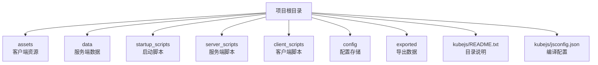
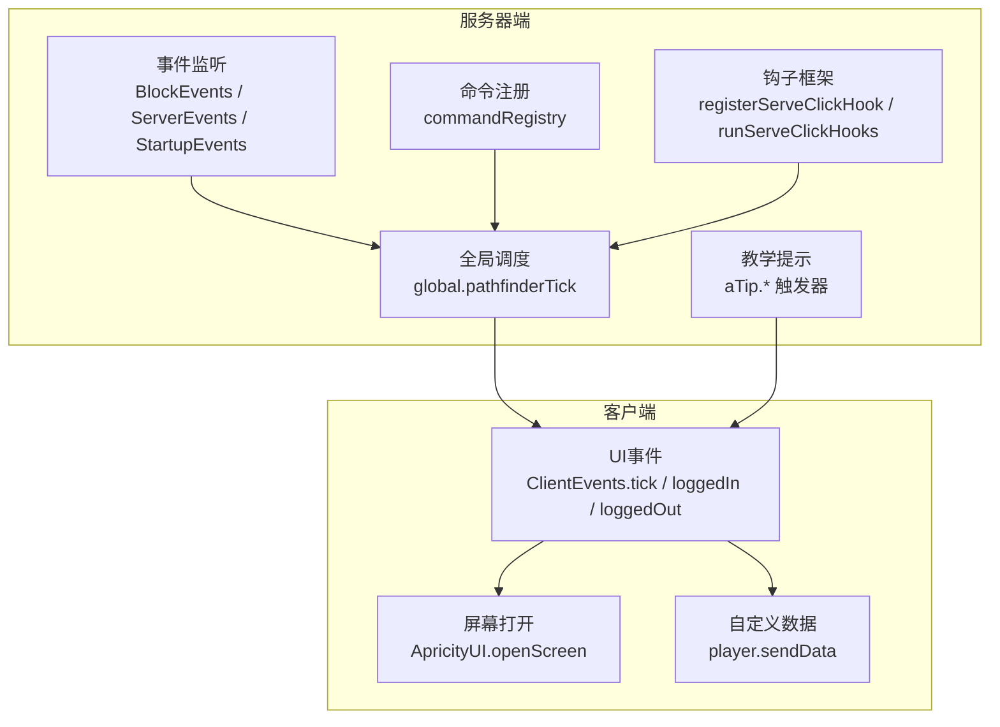
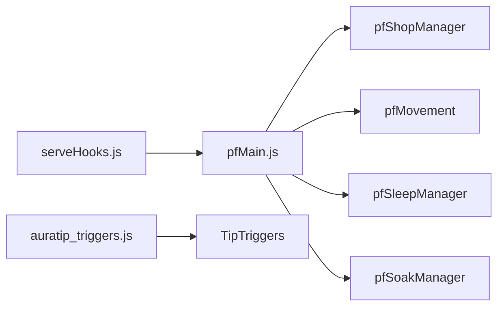

# API参考

<cite>
**本文引用的文件**
- [README.md](file://README.md)
- [kubejs/README.txt](file://kubejs/README.txt)
- [kubejs/jsconfig.json](file://kubejs/jsconfig.json)
- [kubejs/server_scripts/pathfinder/pfMain.js](file://kubejs/server_scripts/pathfinder/pfMain.js)
- [kubejs/server_scripts/pathfinder/pfConstants.js](file://kubejs/server_scripts/pathfinder/pfConstants.js)
- [kubejs/server_scripts/pathfinder/pfBlockHandler.js](file://kubejs/server_scripts/pathfinder/pfBlockHandler.js)
- [kubejs/server_scripts/auratip_triggers.js](file://kubejs/server_scripts/auratip_triggers.js)
- [kubejs/server_scripts/example.js](file://kubejs/server_scripts/example.js)
- [kubejs/startup_scripts/serveHooks.js](file://kubejs/startup_scripts/serveHooks.js)
- [kubejs/client_scripts/ui/foot_ui.js](file://kubejs/client_scripts/ui/foot_ui.js)
- [kubejs/client_scripts/ui/phone_ui.js](file://kubejs/client_scripts/ui/phone_ui.js)
- [kubejs/client_scripts/ui/stamina_hud.js](file://kubejs/client_scripts/ui/stamina_hud.js)
</cite>

## 目录
1. [简介](#简介)
2. [项目结构](#项目结构)
3. [核心组件](#核心组件)
4. [架构总览](#架构总览)
5. [详细组件分析](#详细组件分析)
6. [依赖分析](#依赖分析)
7. [性能考虑](#性能考虑)
8. [故障排查指南](#故障排查指南)
9. [结论](#结论)
10. [附录](#附录)

## 简介
本API参考面向KubeJS开发者，聚焦于本项目中公开可用的服务器端API、客户端API、事件API以及实用工具类的完整规范。内容覆盖：
- 服务器端API：事件监听、命令注册、全局状态管理、模块化调度框架
- 客户端API：UI事件、屏幕打开、渲染与状态更新
- 事件API：KubeJS事件总线的典型用法与最佳实践
- 实用工具类：全局钩子框架、常量与配置、教学提示系统

文档提供参数说明、返回值定义、使用示例与注意事项，并给出版本兼容性、废弃策略与迁移建议，帮助开发者快速定位并正确使用各API。

## 项目结构
本项目基于KubeJS标准目录组织，关键目录与用途如下：
- assets：资源包，放置纹理、模型、声音等客户端资源
- data：数据包，放置配方、战利品表、函数等服务端资源
- startup_scripts：启动阶段一次性加载脚本，适合注册物品、属性等
- server_scripts：服务端重载脚本，处理事件、命令、配方等
- client_scripts：客户端重载脚本，处理UI、提示、JEI事件等
- config：KubeJS配置存储（脚本可访问）
- exported：导出的数据转储（如图集）

图表来源
- [kubejs/README.txt:1-15](file://kubejs/README.txt#L1-L15)
- [kubejs/jsconfig.json:1-16](file://kubejs/jsconfig.json#L1-L16)

章节来源
- [kubejs/README.txt:1-15](file://kubejs/README.txt#L1-L15)
- [kubejs/jsconfig.json:1-16](file://kubejs/jsconfig.json#L1-L16)

## 核心组件
本节概述项目中的核心API与工具，便于快速检索与交叉引用。

- 服务器端API
  - 事件监听：BlockEvents、ServerEvents、StartupEvents、ItemEvents、ForgeModEvents
  - 命令注册：通过ServerEvents.commandRegistry注册自定义命令
  - 全局状态：global.pathfinderTick、global.aTip.*、global.serveClickHooks
  - 模块化调度：pfMain整合各子模块（商店、移动、睡眠、泡脚等）

- 客户端API
  - UI事件：ClientEvents.tick、ClientEvents.loggedIn、ClientEvents.loggedOut
  - 屏幕打开：ApricityUI.openScreen
  - 自定义数据：player.sendData(key, payload)

- 工具与框架
  - Serve钩子框架：registerServeClickHook、runServeClickHooks
  - 常量与配置：pfConstants导出寻路相关常量
  - 教学提示系统：AuraTip触发器与队列机制

章节来源
- [kubejs/server_scripts/pathfinder/pfMain.js:1-177](file://kubejs/server_scripts/pathfinder/pfMain.js#L1-L177)
- [kubejs/server_scripts/pathfinder/pfConstants.js:1-65](file://kubejs/server_scripts/pathfinder/pfConstants.js#L1-L65)
- [kubejs/server_scripts/auratip_triggers.js:1-212](file://kubejs/server_scripts/auratip_triggers.js#L1-L212)
- [kubejs/startup_scripts/serveHooks.js:1-31](file://kubejs/startup_scripts/serveHooks.js#L1-L31)
- [kubejs/client_scripts/ui/foot_ui.js:765-928](file://kubejs/client_scripts/ui/foot_ui.js#L765-L928)
- [kubejs/server_scripts/example.js:1-24](file://kubejs/server_scripts/example.js#L1-L24)

## 架构总览
整体架构围绕“事件驱动 + 模块化调度 + 客户端交互”的模式展开。服务器端通过事件监听与命令注册实现业务逻辑，客户端通过UI事件与屏幕打开实现交互体验。全局钩子框架将“额外功能”从主流程解耦，便于扩展与维护。

图表来源
- [kubejs/server_scripts/pathfinder/pfMain.js:1-177](file://kubejs/server_scripts/pathfinder/pfMain.js#L1-L177)
- [kubejs/server_scripts/auratip_triggers.js:1-212](file://kubejs/server_scripts/auratip_triggers.js#L1-L212)
- [kubejs/startup_scripts/serveHooks.js:1-31](file://kubejs/startup_scripts/serveHooks.js#L1-L31)
- [kubejs/client_scripts/ui/foot_ui.js:765-928](file://kubejs/client_scripts/ui/foot_ui.js#L765-L928)

## 详细组件分析

### 服务器端API

#### 事件监听与命令注册
- BlockEvents.rightClicked
  - 功能：监听方块右键事件，用于开店/关店、凭证与Boss触发判定
  - 参数：event.player、event.block、event.level、event.hand
  - 返回：无（void），内部根据条件执行逻辑
  - 注意事项：需判断主手物品与昼夜条件；状态持久化于BlockEntity NBT
  - 示例：参见[pfBlockHandler.js:8-33](file://kubejs/server_scripts/pathfinder/pfBlockHandler.js#L8-L33)

- ServerEvents.commandRegistry
  - 功能：注册自定义命令，支持多级子命令
  - 参数：event.commands（命令构建器）、context（命令上下文）
  - 返回：无（void）
  - 示例：参见[auratip_triggers.js:160-186](file://kubejs/server_scripts/auratip_triggers.js#L160-L186)

- ServerEvents.tick
  - 功能：服务器每tick执行，用于队列展示与状态推进
  - 参数：无
  - 返回：无（void）
  - 示例：参见[auratip_triggers.js:188-211](file://kubejs/server_scripts/auratip_triggers.js#L188-L211)

- ItemEvents.rightClicked
  - 功能：监听物品右键事件，结合目标实体进行UI打开与网络消息发送
  - 参数：event.target（目标实体）、event.player
  - 返回：无（void）
  - 示例：参见[example.js:1-24](file://kubejs/server_scripts/example.js#L1-L24)

- StartupEvents.registry
  - 功能：注册物品、方块、属性等资源
  - 参数：type（如'attribute'、'item'、'block'）、event（注册回调）
  - 返回：无（void）
  - 示例：参见[serveHooks.js:41](file://kubejs/startup_scripts/serveHooks.js#L41)（属性注册示例）与[serveHooks.js:26](file://kubejs/startup_scripts/serveHooks.js#L26)（属性修改事件）

- ForgeModEvents.onEvent
  - 功能：监听Forge Mod事件（如实体属性修改事件）
  - 参数：事件类型字符串、回调
  - 返回：无（void）
  - 示例：参见[serveHooks.js:41](file://kubejs/startup_scripts/serveHooks.js#L41)

章节来源
- [kubejs/server_scripts/pathfinder/pfBlockHandler.js:1-33](file://kubejs/server_scripts/pathfinder/pfBlockHandler.js#L1-L33)
- [kubejs/server_scripts/auratip_triggers.js:160-211](file://kubejs/server_scripts/auratip_triggers.js#L160-L211)
- [kubejs/server_scripts/example.js:1-24](file://kubejs/server_scripts/example.js#L1-L24)
- [kubejs/startup_scripts/serveHooks.js:1-31](file://kubejs/startup_scripts/serveHooks.js#L1-L31)

#### 全局调度与模块化
- global.pathfinderTick
  - 功能：寻路系统主循环入口，按tick驱动商店、实体收集、移动、睡眠、泡脚等逻辑
  - 参数：entity（触发方块的BlockEntity）
  - 返回：无（void）
  - 复杂度：随实体数量与模块数量线性增长
  - 注意事项：防止重复处理（基于lastTick与currTick），跨重启友好字段重置
  - 示例：参见[pfMain.js:11-177](file://kubejs/server_scripts/pathfinder/pfMain.js#L11-L177)

- global.serveClickHooks
  - 功能：点击结算钩子集合，按注册顺序执行，支持取消
  - 方法：registerServeClickHook(fn)、runServeClickHooks(ctx)
  - 返回：无（void）
  - 注意事项：异常捕获，ctx.cancel可中断后续钩子
  - 示例：参见[serveHooks.js:11-31](file://kubejs/startup_scripts/serveHooks.js#L11-L31)

- global.aTip.*
  - 功能：AuraTip教学提示系统，包含阶段管理、触发器、队列展示
  - 方法：getStage、setStage、clearStage、show、queueShow、closeThenShow、advance、resetCommand、debugShowCommand、findPlayerByUuid、findActionPlayer
  - 返回：布尔或数值
  - 注意事项：依赖外部TipTriggers；队列基于serverTick推进
  - 示例：参见[auratip_triggers.js:1-212](file://kubejs/server_scripts/auratip_triggers.js#L1-L212)

章节来源
- [kubejs/server_scripts/pathfinder/pfMain.js:1-177](file://kubejs/server_scripts/pathfinder/pfMain.js#L1-L177)
- [kubejs/startup_scripts/serveHooks.js:1-31](file://kubejs/startup_scripts/serveHooks.js#L1-L31)
- [kubejs/server_scripts/auratip_triggers.js:1-212](file://kubejs/server_scripts/auratip_triggers.js#L1-L212)

### 客户端API

#### UI事件与屏幕打开
- ClientEvents.tick
  - 功能：客户端每tick执行，用于UI状态更新与逻辑推进
  - 参数：event
  - 返回：无（void）
  - 示例：参见[foot_ui.js:765](file://kubejs/client_scripts/ui/foot_ui.js#L765)、[phone_ui.js:49](file://kubejs/client_scripts/ui/phone_ui.js#L49)、[stamina_hud.js:59](file://kubejs/client_scripts/ui/stamina_hud.js#L59)

- ClientEvents.loggedIn
  - 功能：玩家登录时初始化UI状态
  - 参数：event
  - 返回：无（void）
  - 示例：参见[foot_ui.js:913](file://kubejs/client_scripts/ui/foot_ui.js#L913)、[phone_ui.js:49](file://kubejs/client_scripts/ui/phone_ui.js#L49)、[stamina_hud.js:89](file://kubejs/client_scripts/ui/stamina_hud.js#L89)

- ClientEvents.loggedOut
  - 功能：玩家登出时清理UI状态
  - 参数：event
  - 返回：无（void）
  - 示例：参见[foot_ui.js:928](file://kubejs/client_scripts/ui/foot_ui.js#L928)、[phone_ui.js:49](file://kubejs/client_scripts/ui/phone_ui.js#L49)、[stamina_hud.js:89](file://kubejs/client_scripts/ui/stamina_hud.js#L89)

- ApricityUI.openScreen
  - 功能：打开指定HTML界面
  - 参数：player、screenPath、payload
  - 返回：无（void）
  - 示例：参见[example.js:12](file://kubejs/server_scripts/example.js#L12)

- player.sendData
  - 功能：向客户端发送自定义数据包
  - 参数：key（字符串）、payload（对象）
  - 返回：无（void）
  - 示例：参见[example.js:19](file://kubejs/server_scripts/example.js#L19)

章节来源
- [kubejs/client_scripts/ui/foot_ui.js:765-928](file://kubejs/client_scripts/ui/foot_ui.js#L765-L928)
- [kubejs/client_scripts/ui/phone_ui.js:49](file://kubejs/client_scripts/ui/phone_ui.js#L49)
- [kubejs/client_scripts/ui/stamina_hud.js:59-89](file://kubejs/client_scripts/ui/stamina_hud.js#L59-L89)
- [kubejs/server_scripts/example.js:1-24](file://kubejs/server_scripts/example.js#L1-L24)

### 事件API

#### 事件监听器与生命周期
- 事件命名空间
  - 服务器：ServerEvents.*、BlockEvents.*、ItemEvents.*、StartupEvents.*、ForgeModEvents.*
  - 客户端：ClientEvents.*

- 典型流程
  - 启动阶段：StartupEvents.registry注册资源
  - 运行阶段：ServerEvents.tick推进逻辑；BlockEvents.rightClicked响应交互
  - 客户端阶段：ClientEvents.tick更新UI；ClientEvents.loggedIn/ loggedOut初始化/清理

- 最佳实践
  - 使用优先级注释（如// priority: 10）控制事件执行顺序
  - 将复杂逻辑拆分为模块（如pfMain整合pfShopManager、pfMovement、pfSleepManager等）
  - 对外部依赖（如TipTriggers）进行存在性检查

章节来源
- [kubejs/server_scripts/pathfinder/pfMain.js:1-177](file://kubejs/server_scripts/pathfinder/pfMain.js#L1-L177)
- [kubejs/server_scripts/pathfinder/pfBlockHandler.js:1-33](file://kubejs/server_scripts/pathfinder/pfBlockHandler.js#L1-L33)
- [kubejs/server_scripts/auratip_triggers.js:1-212](file://kubejs/server_scripts/auratip_triggers.js#L1-L212)
- [kubejs/client_scripts/ui/foot_ui.js:765-928](file://kubejs/client_scripts/ui/foot_ui.js#L765-L928)

### 实用工具类

#### 常量与配置（pfConstants）
- 作用：集中定义寻路系统相关常量（网格、实体类型、方向、需求映射等）
- 导出：global.pfConstants
- 使用：在其他模块中读取常量，避免硬编码

章节来源
- [kubejs/server_scripts/pathfinder/pfConstants.js:1-65](file://kubejs/server_scripts/pathfinder/pfConstants.js#L1-L65)

#### 钩子框架（Serve）
- 作用：将“额外功能”从主流程解耦，按注册顺序执行，支持取消
- 接口：registerServeClickHook(fn)、runServeClickHooks(ctx)
- 注意：异常捕获，ctx.cancel可中断后续钩子

章节来源
- [kubejs/startup_scripts/serveHooks.js:1-31](file://kubejs/startup_scripts/serveHooks.js#L1-L31)

## 依赖分析
- 组件耦合
  - pfMain作为调度中心，依赖pfShopManager、pfMovement、pfSleepManager、pfSoakManager等模块
  - AuraTip依赖外部TipTriggers；若缺失则记录日志但不崩溃
  - Serve钩子框架通过数组聚合，避免直接耦合具体功能

- 外部依赖
  - TipTriggers：AuraTip触发器依赖
  - Forge事件：实体属性修改事件监听
  - KubeJS事件：ServerEvents、ClientEvents、BlockEvents、ItemEvents、StartupEvents

图表来源
- [kubejs/server_scripts/pathfinder/pfMain.js:1-177](file://kubejs/server_scripts/pathfinder/pfMain.js#L1-L177)
- [kubejs/server_scripts/auratip_triggers.js:1-212](file://kubejs/server_scripts/auratip_triggers.js#L1-L212)
- [kubejs/startup_scripts/serveHooks.js:1-31](file://kubejs/startup_scripts/serveHooks.js#L1-L31)

章节来源
- [kubejs/server_scripts/pathfinder/pfMain.js:1-177](file://kubejs/server_scripts/pathfinder/pfMain.js#L1-L177)
- [kubejs/server_scripts/auratip_triggers.js:1-212](file://kubejs/server_scripts/auratip_triggers.js#L1-L212)
- [kubejs/startup_scripts/serveHooks.js:1-31](file://kubejs/startup_scripts/serveHooks.js#L1-L31)

## 性能考虑
- 服务器端
  - global.pathfinderTick按tick遍历实体，注意实体数量增长带来的线性复杂度
  - 防重复处理：通过lastTick与currTick避免同tick重复计算
  - 跨重启友好：部分字段采用独立计数器，减少重启影响
- 客户端
  - ClientEvents.tick内避免重型计算，尽量委托到事件驱动的异步逻辑
- 通用
  - 使用优先级注释控制事件顺序，减少不必要的重复执行
  - 对外部依赖进行存在性检查，避免空引用导致的异常

[本节为通用指导，无需特定文件分析]

## 故障排查指南
- AuraTip触发失败
  - 现象：TipTriggers未定义或无法关闭
  - 排查：确认外部模组已加载；检查aTip.canClose与aTip.closePlayerTip
  - 参考：[auratip_triggers.js:31-39](file://kubejs/server_scripts/auratip_triggers.js#L31-L39)
- 命令不可用
  - 现象：/auratip_*命令无效
  - 排查：确认ServerEvents.commandRegistry已注册；检查命令语法
  - 参考：[auratip_triggers.js:160-186](file://kubejs/server_scripts/auratip_triggers.js#L160-L186)
- UI未响应
  - 现象：打开屏幕无效果或报错
  - 排查：确认ApricityUI.openScreen路径正确；检查ClientEvents.tick与loggedIn/ loggedOut逻辑
  - 参考：[foot_ui.js:765-928](file://kubejs/client_scripts/ui/foot_ui.js#L765-L928)
- 钩子异常中断
  - 现象：后续钩子未执行
  - 排查：检查ctx.cancel是否被设置；查看异常日志
  - 参考：[serveHooks.js:19-31](file://kubejs/startup_scripts/serveHooks.js#L19-L31)

章节来源
- [kubejs/server_scripts/auratip_triggers.js:1-212](file://kubejs/server_scripts/auratip_triggers.js#L1-L212)
- [kubejs/client_scripts/ui/foot_ui.js:765-928](file://kubejs/client_scripts/ui/foot_ui.js#L765-L928)
- [kubejs/startup_scripts/serveHooks.js:1-31](file://kubejs/startup_scripts/serveHooks.js#L1-L31)

## 结论
本API参考梳理了项目中的服务器端API、客户端API、事件API与实用工具类，提供了参数、返回值、使用示例与注意事项。通过模块化调度与钩子框架，系统实现了高内聚、低耦合的扩展能力。建议在开发中遵循事件优先级、防重复处理与外部依赖检查的最佳实践，确保稳定性与可维护性。

[本节为总结，无需特定文件分析]

## 附录

### 版本兼容性与废弃策略
- 版本要求
  - 项目基于KubeJS与Forge生态，版本信息请参考根目录说明与KubeJS官方文档
- 兼容性建议
  - 使用KubeJS事件命名空间与优先级注释，避免直接依赖内部实现细节
  - 对外部依赖（如TipTriggers）进行存在性检查
- 废弃策略
  - 新增功能优先通过钩子框架扩展，避免对主流程的破坏性变更
  - 对历史API提供迁移指引（例如从直接耦合迁移到钩子注册）

章节来源
- [README.md:1-6](file://README.md#L1-L6)
- [kubejs/README.txt:1-15](file://kubejs/README.txt#L1-L15)

### 迁移指南
- 从直接耦合迁移到钩子框架
  - 步骤：将原主流程中的额外逻辑抽取为独立函数，通过registerServeClickHook注册，运行时通过runServeClickHooks统一调度
  - 参考：[serveHooks.js:13-31](file://kubejs/startup_scripts/serveHooks.js#L13-L31)
- 从硬编码常量迁移到pfConstants
  - 步骤：将分散的常量集中到pfConstants，通过global.pfConstants读取
  - 参考：[pfConstants.js:52-65](file://kubejs/server_scripts/pathfinder/pfConstants.js#L52-L65)

章节来源
- [kubejs/startup_scripts/serveHooks.js:1-31](file://kubejs/startup_scripts/serveHooks.js#L1-L31)
- [kubejs/server_scripts/pathfinder/pfConstants.js:1-65](file://kubejs/server_scripts/pathfinder/pfConstants.js#L1-L65)