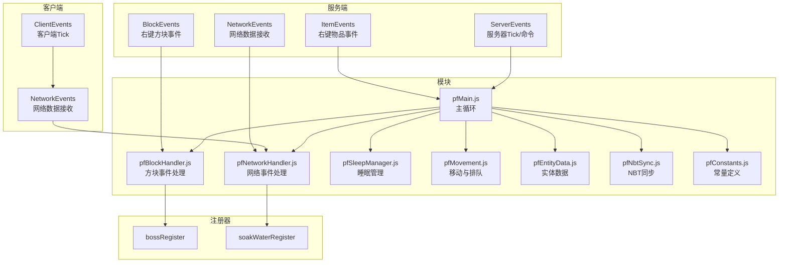
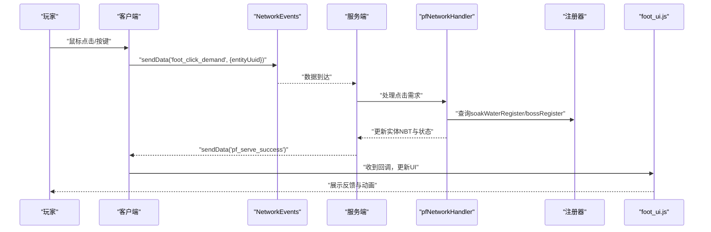
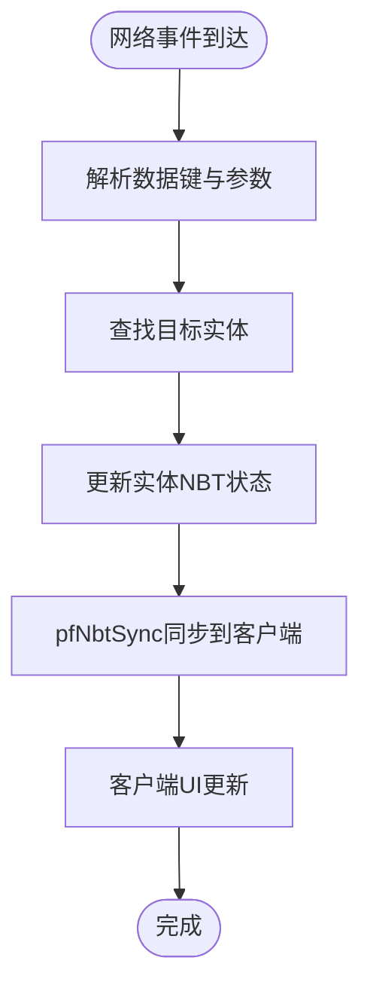
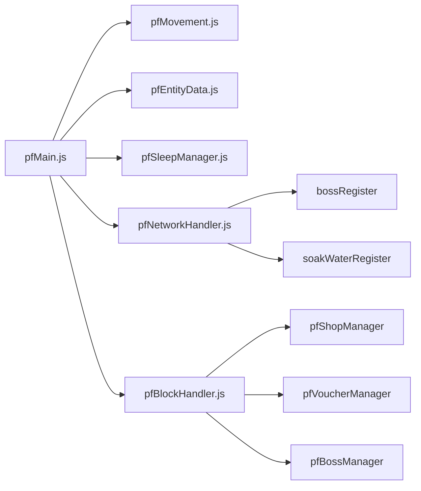

# 事件API

<cite>
**本文引用的文件**
- [serveHooks.js](file://kubejs/startup_scripts/serveHooks.js)
- [example.js](file://kubejs/server_scripts/example.js)
- [pathfinder.js](file://kubejs/server_scripts/pathfinder.js)
- [pfMain.js](file://kubejs/server_scripts/pathfinder/pfMain.js)
- [pfNetworkHandler.js](file://kubejs/server_scripts/pathfinder/pfNetworkHandler.js)
- [foot_ui.js](file://kubejs/client_scripts/ui/foot_ui.js)
- [auratip_triggers.js](file://kubejs/server_scripts/auratip_triggers.js)
- [pfBlockHandler.js](file://kubejs/server_scripts/pathfinder/pfBlockHandler.js)
- [pfConstants.js](file://kubejs/server_scripts/pathfinder/pfConstants.js)
- [pfNbtSync.js](file://kubejs/server_scripts/pathfinder/pfNbtSync.js)
- [pfEntityData.js](file://kubejs/server_scripts/pathfinder/pfEntityData.js)
- [pfMovement.js](file://kubejs/server_scripts/pathfinder/pfMovement.js)
- [pfSleepManager.js](file://kubejs/server_scripts/pathfinder/pfSleepManager.js)
</cite>

## 目录
1. [简介](#简介)
2. [项目结构](#项目结构)
3. [核心组件](#核心组件)
4. [架构总览](#架构总览)
5. [详细组件分析](#详细组件分析)
6. [依赖分析](#依赖分析)
7. [性能考虑](#性能考虑)
8. [故障排查指南](#故障排查指南)
9. [结论](#结论)
10. [附录](#附录)

## 简介
本文件系统性梳理该KubeJS项目中的事件体系，覆盖服务端事件API、客户端事件API、注册器事件API、钩子事件API等。重点说明事件触发条件、监听方式、数据传递与回调处理，解释事件生命周期、优先级设置与异步处理机制，并提供事件扩展点、自定义事件创建与事件链式处理的实现方法。同时给出事件调试、性能监控与错误处理的最佳实践，帮助开发者进行事件驱动开发。

## 项目结构
该项目采用模块化与事件驱动相结合的组织方式：
- 服务端事件：通过KubeJS事件API（如ItemEvents、BlockEvents、NetworkEvents、ServerEvents）注册监听器，处理游戏内的交互与状态变更。
- 客户端事件：通过ClientEvents与NetworkEvents在客户端侧响应用户输入与服务端广播。
- 注册器事件：通过全局注册表（如bossRegister、soakWaterRegister）集中管理可扩展的枚举与行为。
- 钩子事件：通过全局数组与函数维护钩子链，支持模块化扩展与链式执行。

**图表来源**
- [pfMain.js:11-177](file://kubejs/server_scripts/pathfinder/pfMain.js#L11-L177)
- [pfNetworkHandler.js:37-317](file://kubejs/server_scripts/pathfinder/pfNetworkHandler.js#L37-L317)
- [pfBlockHandler.js:8-148](file://kubejs/server_scripts/pathfinder/pfBlockHandler.js#L8-L148)
- [pfSleepManager.js:16-232](file://kubejs/server_scripts/pathfinder/pfSleepManager.js#L16-L232)
- [pfMovement.js:7-186](file://kubejs/server_scripts/pathfinder/pfMovement.js#L7-L186)
- [pfEntityData.js:7-218](file://kubejs/server_scripts/pathfinder/pfEntityData.js#L7-L218)
- [pfNbtSync.js:8-94](file://kubejs/server_scripts/pathfinder/pfNbtSync.js#L8-L94)
- [pfConstants.js:7-65](file://kubejs/server_scripts/pathfinder/pfConstants.js#L7-L65)

**章节来源**
- [pathfinder.js:1-30](file://kubejs/server_scripts/pathfinder.js#L1-L30)
- [pfMain.js:11-177](file://kubejs/server_scripts/pathfinder/pfMain.js#L11-L177)

## 核心组件
- 服务端事件API
  - ItemEvents：监听物品右键交互，如打开UI或触发业务逻辑。
  - BlockEvents：监听方块右键交互，如开店、Boss触发、凭证生成等。
  - NetworkEvents：监听客户端发送的网络数据，如点击需求、泡脚、送客等。
  - ServerEvents：监听服务器Tick与命令，如教学提示队列调度。
- 客户端事件API
  - ClientEvents：监听客户端Tick，负责UI窗口创建、更新与销毁。
  - NetworkEvents：监听服务端广播的事件，如搓脚成功反馈。
- 注册器事件API
  - bossRegister：Boss触发与倍率配置注册。
  - soakWaterRegister：泡脚水桶类型注册。
- 钩子事件API
  - serveClickHooks：服务端点击结算钩子链，支持模块化扩展与取消传播。

**章节来源**
- [example.js:1-24](file://kubejs/server_scripts/example.js#L1-L24)
- [pfBlockHandler.js:8-148](file://kubejs/server_scripts/pathfinder/pfBlockHandler.js#L8-L148)
- [pfNetworkHandler.js:37-317](file://kubejs/server_scripts/pathfinder/pfNetworkHandler.js#L37-L317)
- [auratip_triggers.js:17-212](file://kubejs/server_scripts/auratip_triggers.js#L17-L212)
- [foot_ui.js:782-925](file://kubejs/client_scripts/ui/foot_ui.js#L782-L925)
- [serveHooks.js:11-31](file://kubejs/startup_scripts/serveHooks.js#L11-L31)

## 架构总览
事件驱动架构分为三层：
- 事件源层：ItemEvents、BlockEvents、NetworkEvents、ClientEvents、ServerEvents。
- 事件处理层：模块化子系统（pfMain、pfNetworkHandler、pfBlockHandler、pfSleepManager、pfMovement、pfEntityData、pfNbtSync、pfConstants）。
- 数据同步层：NBT同步（pfNbtSync）与注册器（bossRegister、soakWaterRegister）。

**图表来源**
- [pfNetworkHandler.js:39-219](file://kubejs/server_scripts/pathfinder/pfNetworkHandler.js#L39-L219)
- [foot_ui.js:1017-1025](file://kubejs/client_scripts/ui/foot_ui.js#L1017-L1025)

## 详细组件分析

### 服务端事件API
- ItemEvents.rightClicked
  - 触发条件：玩家右键物品。
  - 监听方式：注册回调函数，获取事件上下文（如target实体、player）。
  - 数据传递：事件对象包含目标实体、玩家、物品等信息。
  - 回调处理：可在回调中打开UI、读取实体NBT、发送网络数据。
  - 示例参考：[ItemEvents右键监听:1-4](file://kubejs/server_scripts/example.js#L1-L4)

- BlockEvents.rightClicked（kubejs:pathfinder_block）
  - 触发条件：玩家右键特定方块。
  - 监听方式：注册回调函数，判断主手物品类型（凭证、Boss触发物、普通）。
  - 数据传递：事件对象包含玩家、方块位置、层级等。
  - 回调处理：扫描路径、校验环境、开店/关店/Boss生成/凭证生成。
  - 示例参考：[方块右键处理:8-148](file://kubejs/server_scripts/pathfinder/pfBlockHandler.js#L8-L148)

- NetworkEvents.dataReceived
  - 触发条件：客户端发送网络数据。
  - 监听方式：注册多个数据键的处理器（如foot_click_demand、foot_click_soak、foot_dismiss_customer）。
  - 数据传递：事件对象包含玩家、数据内容、实体UUID等。
  - 回调处理：解析需求键、查找实体、更新NBT、计算收益、掉落奖励、通知客户端。
  - 示例参考：[网络事件处理:39-311](file://kubejs/server_scripts/pathfinder/pfNetworkHandler.js#L39-L311)

- ServerEvents.tick/command
  - 触发条件：服务器Tick或执行命令。
  - 监听方式：注册tick回调与命令注册。
  - 数据传递：tick计数、命令上下文。
  - 回调处理：AuraTip教学流程调度、提示队列处理。
  - 示例参考：[AuraTip教学流程:188-212](file://kubejs/server_scripts/auratip_triggers.js#L188-L212)

**章节来源**
- [example.js:1-24](file://kubejs/server_scripts/example.js#L1-L24)
- [pfBlockHandler.js:8-148](file://kubejs/server_scripts/pathfinder/pfBlockHandler.js#L8-L148)
- [pfNetworkHandler.js:37-317](file://kubejs/server_scripts/pathfinder/pfNetworkHandler.js#L37-L317)
- [auratip_triggers.js:160-212](file://kubejs/server_scripts/auratip_triggers.js#L160-L212)

### 客户端事件API
- ClientEvents.tick
  - 触发条件：客户端每Tick。
  - 监听方式：注册tick回调，遍历附近实体，创建/更新/销毁UI窗口。
  - 数据传递：事件对象包含玩家、世界、Tick计数。
  - 回调处理：根据实体状态（睡眠、泡脚、等待）动态显示UI；更新倒计时、需求清单、满意度、步骤与抹油状态。
  - 示例参考：[客户端Tick与UI管理:782-925](file://kubejs/client_scripts/ui/foot_ui.js#L782-L925)

- NetworkEvents.dataReceived
  - 触发条件：服务端广播网络数据。
  - 监听方式：注册回调（如pf_serve_success）。
  - 数据传递：事件对象包含数据内容（如entityUuid、part）。
  - 回调处理：日志记录与反馈（动画已在客户端乐观触发）。
  - 示例参考：[服务端成功回调:1017-1025](file://kubejs/client_scripts/ui/foot_ui.js#L1017-L1025)

**章节来源**
- [foot_ui.js:782-925](file://kubejs/client_scripts/ui/foot_ui.js#L782-L925)
- [foot_ui.js:1017-1025](file://kubejs/client_scripts/ui/foot_ui.js#L1017-L1025)

### 注册器事件API
- bossRegister
  - 用途：Boss触发与倍率配置注册，影响满意度收益计算。
  - 使用场景：网络事件处理中按实体持久化数据查询并应用倍率。
  - 示例参考：[Boss倍率应用:20-34](file://kubejs/server_scripts/pathfinder/pfNetworkHandler.js#L20-L34)

- soakWaterRegister
  - 用途：泡脚水桶类型注册，识别手持水桶类型以决定泡脚效果。
  - 使用场景：泡脚点击事件处理中根据桶ID查询定义。
  - 示例参考：[泡脚桶识别:234-236](file://kubejs/server_scripts/pathfinder/pfNetworkHandler.js#L234-L236)

**章节来源**
- [pfNetworkHandler.js:20-34](file://kubejs/server_scripts/pathfinder/pfNetworkHandler.js#L20-L34)
- [pfNetworkHandler.js:234-236](file://kubejs/server_scripts/pathfinder/pfNetworkHandler.js#L234-L236)

### 钩子事件API
- serveClickHooks
  - 用途：服务端点击结算钩子框架，将“额外功能”从主流程拆分，模块化注册与链式执行。
  - 注册：通过global.registerServeClickHook注册钩子函数。
  - 执行：通过global.runServeClickHooks按顺序执行，支持ctx.cancel中断传播。
  - 错误处理：钩子内部异常被捕获并记录，不影响后续钩子执行。
  - 示例参考：[钩子注册与执行:11-31](file://kubejs/startup_scripts/serveHooks.js#L11-L31)

**章节来源**
- [serveHooks.js:11-31](file://kubejs/startup_scripts/serveHooks.js#L11-L31)

### 事件生命周期与优先级
- 优先级
  - 通过文件头部注释声明（如priority: 10、priority: 7、priority: -100），确保模块加载顺序与事件触发顺序可控。
  - 示例参考：[模块优先级声明:1-6](file://kubejs/server_scripts/pathfinder/pfMain.js#L1-L6)、[钩子优先级:1-2](file://kubejs/startup_scripts/serveHooks.js#L1-L2)、[AuraTip优先级:1-2](file://kubejs/server_scripts/auratip_triggers.js#L1-L2)

- 生命周期
  - 服务端：方块右键触发→路径扫描与校验→开店/关店/Boss生成/凭证生成→网络事件处理→实体状态更新→客户端UI同步。
  - 客户端：Tick检测→窗口创建/更新→鼠标交互→网络发送→服务端处理→回调更新UI。
  - 教学提示：命令触发→阶段校验→延迟队列→提示显示。

**章节来源**
- [pfBlockHandler.js:8-148](file://kubejs/server_scripts/pathfinder/pfBlockHandler.js#L8-L148)
- [pfNetworkHandler.js:37-317](file://kubejs/server_scripts/pathfinder/pfNetworkHandler.js#L37-L317)
- [foot_ui.js:782-925](file://kubejs/client_scripts/ui/foot_ui.js#L782-L925)
- [auratip_triggers.js:188-212](file://kubejs/server_scripts/auratip_triggers.js#L188-L212)

### 异步处理机制
- 服务器Tick驱动：ServerEvents.tick提供稳定的异步调度，适合非即时交互的逻辑（如AuraTip队列）。
- 客户端Tick驱动：ClientEvents.tick提供稳定的异步调度，适合UI与输入响应。
- 网络事件：NetworkEvents为异步消息通道，客户端与服务端通过sendData/dataReceived进行解耦通信。
- 钩子链：serveClickHooks按序执行，支持ctx.cancel短路，避免后续钩子执行。

**章节来源**
- [auratip_triggers.js:188-212](file://kubejs/server_scripts/auratip_triggers.js#L188-L212)
- [foot_ui.js:782-925](file://kubejs/client_scripts/ui/foot_ui.js#L782-L925)
- [serveHooks.js:19-30](file://kubejs/startup_scripts/serveHooks.js#L19-L30)

### 事件扩展点与链式处理
- 模块化扩展：pfMain作为整合入口，调用各子模块（pfShopManager、pfMovement、pfSleepManager、pfSoakManager等），便于新增功能模块。
- 钩子链扩展：通过registerServeClickHook注册钩子，runServeClickHooks顺序执行，支持ctx.cancel中断。
- 注册器扩展：bossRegister、soakWaterRegister集中管理配置，便于新增类型与行为。

**章节来源**
- [pfMain.js:11-177](file://kubejs/server_scripts/pathfinder/pfMain.js#L11-L177)
- [serveHooks.js:11-31](file://kubejs/startup_scripts/serveHooks.js#L11-L31)

### 数据流与状态同步
- NBT同步：pfNbtSync将关键状态（阶段、倒计时、需求清单、满意度、金钱、泡脚状态）写入手持物品NBT，自动同步至客户端。
- 实体数据：pfEntityData封装persistentData的读写，统一管理实体状态。
- 网络事件：pfNetworkHandler解析客户端请求，更新实体状态并通过pfNbtSync同步到客户端。

**图表来源**
- [pfNetworkHandler.js:39-219](file://kubejs/server_scripts/pathfinder/pfNetworkHandler.js#L39-L219)
- [pfNbtSync.js:8-94](file://kubejs/server_scripts/pathfinder/pfNbtSync.js#L8-L94)
- [foot_ui.js:817-890](file://kubejs/client_scripts/ui/foot_ui.js#L817-L890)

**章节来源**
- [pfNbtSync.js:8-94](file://kubejs/server_scripts/pathfinder/pfNbtSync.js#L8-L94)
- [pfEntityData.js:56-63](file://kubejs/server_scripts/pathfinder/pfEntityData.js#L56-L63)
- [pfNetworkHandler.js:39-219](file://kubejs/server_scripts/pathfinder/pfNetworkHandler.js#L39-L219)
- [foot_ui.js:817-890](file://kubejs/client_scripts/ui/foot_ui.js#L817-L890)

## 依赖分析
- 模块耦合
  - pfMain依赖pfMovement、pfEntityData、pfSleepManager、pfSoakManager、pfNetworkHandler、pfBlockHandler等子模块。
  - pfNetworkHandler依赖注册器（bossRegister、soakWaterRegister）与全局设置函数（如pfConsumeStamina）。
  - pfBlockHandler依赖pfPathfinding、pfShopManager、pfVoucherManager、pfBossManager等。
- 外部依赖
  - KubeJS事件API（ItemEvents、BlockEvents、NetworkEvents、ClientEvents、ServerEvents）。
  - Java类（如WorldWindow、ApricityUI、Minecraft）用于客户端UI与窗口管理。

**图表来源**
- [pfMain.js:11-177](file://kubejs/server_scripts/pathfinder/pfMain.js#L11-L177)
- [pfNetworkHandler.js:37-317](file://kubejs/server_scripts/pathfinder/pfNetworkHandler.js#L37-L317)
- [pfBlockHandler.js:8-148](file://kubejs/server_scripts/pathfinder/pfBlockHandler.js#L8-L148)

**章节来源**
- [pfMain.js:11-177](file://kubejs/server_scripts/pathfinder/pfMain.js#L11-L177)
- [pfNetworkHandler.js:37-317](file://kubejs/server_scripts/pathfinder/pfNetworkHandler.js#L37-L317)
- [pfBlockHandler.js:8-148](file://kubejs/server_scripts/pathfinder/pfBlockHandler.js#L8-L148)

## 性能考虑
- Tick频率控制
  - 服务端Tick与客户端Tick均应避免重型计算，将复杂逻辑拆分到子模块或延迟执行。
- 查询优化
  - 使用pfCollectEntities按阶段分类收集实体，减少重复遍历。
  - 使用Set与Map缓存（如trackedEntities、entityCountdowns）降低查找成本。
- 网络通信
  - 仅在网络必要时发送数据，合并更新（如一次性更新倒计时与满意度）。
- NBT访问
  - 避免频繁读写NBT，批量更新后一次性同步（pfNbtSync）。

[本节为通用建议，无需特定文件引用]

## 故障排查指南
- 事件未触发
  - 检查事件注册是否在正确优先级文件加载后执行。
  - 确认触发条件（如主手物品、昼夜、方块类型）满足。
- 网络事件异常
  - 查看服务端日志中“hook error”或“异常”记录，定位具体钩子或模块。
  - 核对客户端sendData与服务端NetworkEvents键一致。
- UI不同步
  - 确认实体NBT已通过pfNbtSync更新并同步到客户端。
  - 检查客户端Tick中实体存活状态与距离限制。
- 教学提示不显示
  - 检查AuraTip阶段与预期阶段一致，命令执行成功。
  - 确认TipTriggers可用且队列未被阻塞。

**章节来源**
- [serveHooks.js:23-29](file://kubejs/startup_scripts/serveHooks.js#L23-L29)
- [pfNetworkHandler.js:39-219](file://kubejs/server_scripts/pathfinder/pfNetworkHandler.js#L39-L219)
- [foot_ui.js:782-925](file://kubejs/client_scripts/ui/foot_ui.js#L782-L925)
- [auratip_triggers.js:188-212](file://kubejs/server_scripts/auratip_triggers.js#L188-L212)

## 结论
该事件系统通过KubeJS事件API与模块化设计实现了清晰的服务端/客户端交互、灵活的注册器扩展与可插拔的钩子链机制。结合NBT同步与Tick驱动，既保证了状态一致性，又提供了良好的性能与可维护性。开发者可通过注册器与钩子扩展新功能，通过事件链实现模块间解耦，借助调试与监控手段保障稳定性。

[本节为总结，无需特定文件引用]

## 附录
- 常用事件键
  - foot_click_demand：客户端点击需求部位。
  - foot_click_soak：客户端点击泡脚。
  - foot_dismiss_customer：客户端点击送客。
  - pf_serve_success：服务端通知搓脚成功。
- 常用NBT键
  - pfPhase、pfBedX/Y/Z/Yaw、pfCountdown、pfDemandJiaozhang/…、pfSatisfaction、pfMoney、pfIsSoaking、pfSoakDone、pfSoakTimeLeft、pfActionPlayerUuid等。
- 常用注册器
  - bossRegister：按ID映射Boss定义与倍率。
  - soakWaterRegister：按桶ID映射泡脚水定义。

**章节来源**
- [pfConstants.js:7-65](file://kubejs/server_scripts/pathfinder/pfConstants.js#L7-L65)
- [pfNbtSync.js:8-94](file://kubejs/server_scripts/pathfinder/pfNbtSync.js#L8-L94)
- [pfNetworkHandler.js:39-311](file://kubejs/server_scripts/pathfinder/pfNetworkHandler.js#L39-L311)
- [foot_ui.js:1017-1025](file://kubejs/client_scripts/ui/foot_ui.js#L1017-L1025)