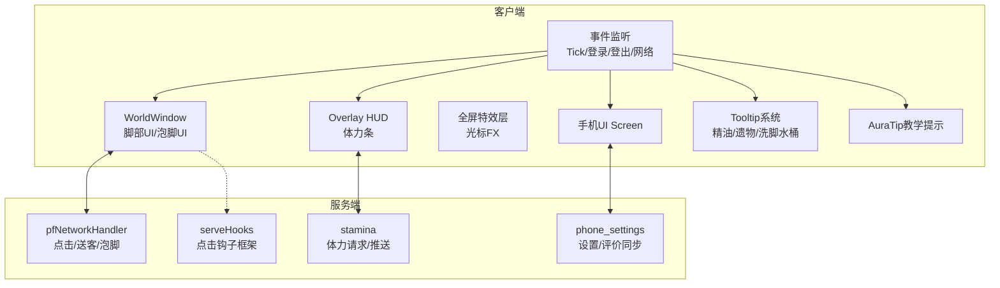
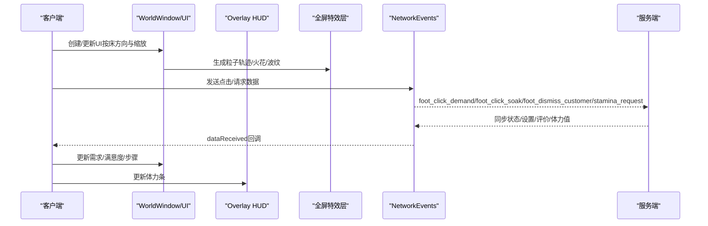
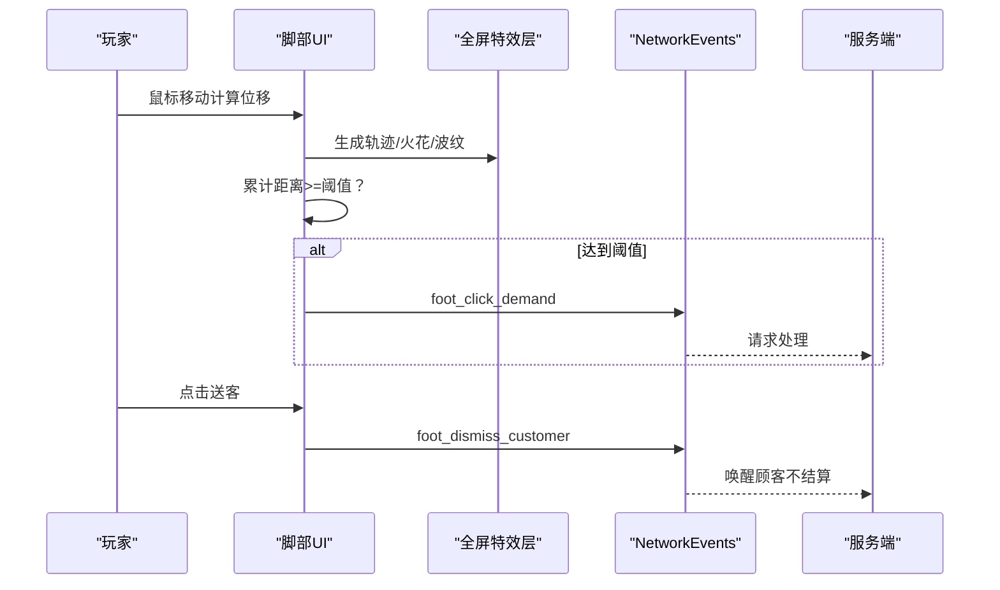
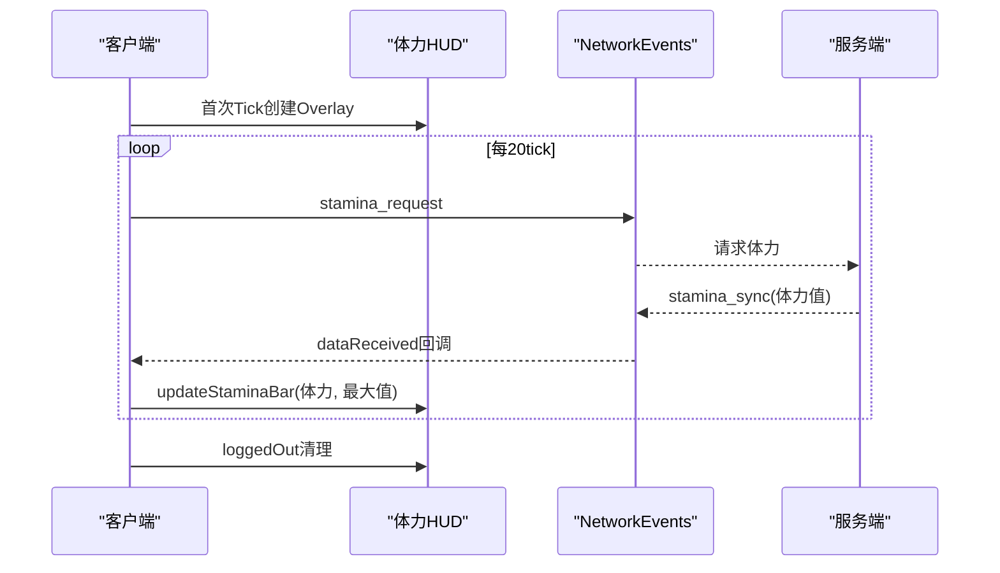
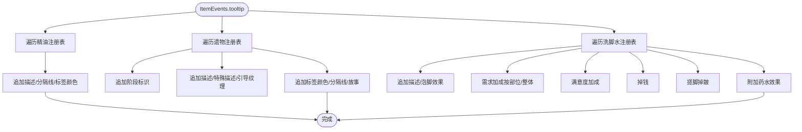
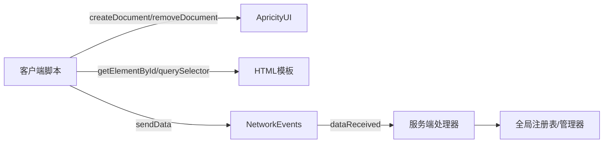

# 客户端API

<cite>
**本文引用的文件**
- [foot_ui.js](file://kubejs/client_scripts/ui/foot_ui.js)
- [stamina_hud.js](file://kubejs/client_scripts/ui/stamina_hud.js)
- [phone_ui.js](file://kubejs/client_scripts/ui/phone_ui.js)
- [auratip_tips.js](file://kubejs/client_scripts/auratip/auratip_tips.js)
- [oilTooltip.js](file://kubejs/client_scripts/tooltip/oilTooltip.js)
- [relicTooltip.js](file://kubejs/client_scripts/tooltip/relicTooltip.js)
- [soakWaterTooltip.js](file://kubejs/client_scripts/tooltip/soakWaterTooltip.js)
- [footui.html](file://apricity/kubejs/footui.html)
- [footsoak.html](file://apricity/kubejs/footsoak.html)
- [stamina_hud.html](file://apricity/kubejs/stamina_hud.html)
- [phone.html](file://apricity/kubejs/phone.html)
- [cursor_fx.html](file://apricity/kubejs/cursor_fx.html)
- [pfNetworkHandler.js](file://kubejs/server_scripts/pathfinder/pfNetworkHandler.js)
- [phone_settings.js](file://kubejs/server_scripts/phone_settings.js)
- [serveHooks.js](file://kubejs/startup_scripts/serveHooks.js)
</cite>

## 目录
1. [简介](#简介)
2. [项目结构](#项目结构)
3. [核心组件](#核心组件)
4. [架构总览](#架构总览)
5. [详细组件分析](#详细组件分析)
6. [依赖关系分析](#依赖关系分析)
7. [性能考虑](#性能考虑)
8. [故障排查指南](#故障排查指南)
9. [结论](#结论)
10. [附录](#附录)

## 简介
本文件面向前端与客户端开发者，系统性梳理该Minecraft KubeJS客户端API体系，覆盖UI界面API、HUD显示API、Tooltip系统API、事件监听API、网络通信与渲染机制、用户交互处理与视觉效果实现、自定义样式与响应式布局建议、性能优化与内存管理策略，以及调试方法。读者无需深入服务端即可理解并扩展客户端功能。

## 项目结构
客户端API主要由以下模块构成：
- UI界面模块：WorldWindow叠加UI（脚部服务UI、泡脚UI、手机UI）、Overlay HUD（体力条）、全屏粒子特效层
- Tooltip系统：物品描述增强（精油、遗物、洗脚水桶）
- 事件监听：客户端Tick、登录/登出、网络数据接收、AuraTip教学提示
- 服务端交互：通过NetworkEvents与服务端双向通信，驱动UI状态更新与交互行为

**图表来源**
- [foot_ui.js:12-36](file://kubejs/client_scripts/ui/foot_ui.js#L12-L36)
- [stamina_hud.js:6-16](file://kubejs/client_scripts/ui/stamina_hud.js#L6-L16)
- [phone_ui.js:6-23](file://kubejs/client_scripts/ui/phone_ui.js#L6-L23)
- [pfNetworkHandler.js:37-311](file://kubejs/server_scripts/pathfinder/pfNetworkHandler.js#L37-L311)
- [phone_settings.js:73-108](file://kubejs/server_scripts/phone_settings.js#L73-L108)
- [serveHooks.js:11-30](file://kubejs/startup_scripts/serveHooks.js#L11-L30)

**章节来源**
- [foot_ui.js:1-120](file://kubejs/client_scripts/ui/foot_ui.js#L1-L120)
- [stamina_hud.js:1-30](file://kubejs/client_scripts/ui/stamina_hud.js#L1-L30)
- [phone_ui.js:1-25](file://kubejs/client_scripts/ui/phone_ui.js#L1-L25)

## 核心组件
- WorldWindow叠加UI：在世界空间中按床方向与缩放显示UI，支持鼠标交互与粒子特效
- Overlay HUD：固定屏幕位置的HUD，如体力条，通过HTML模板与样式控制
- 全屏特效层：独立的Overlay文档承载光标跟随、轨迹、火花等粒子效果
- 手机UI Screen：服务端打开的Screen类型UI，客户端负责设置同步与登出清理
- Tooltip系统：为特定物品动态追加描述文本与标签颜色
- AuraTip教学提示：基于触发器的持久化提示系统
- 事件监听：ClientEvents.tick、ClientEvents.loggedIn/loggedOut、NetworkEvents.dataReceived

**章节来源**
- [foot_ui.js:12-36](file://kubejs/client_scripts/ui/foot_ui.js#L12-L36)
- [stamina_hud.js:6-16](file://kubejs/client_scripts/ui/stamina_hud.js#L6-L16)
- [phone_ui.js:6-23](file://kubejs/client_scripts/ui/phone_ui.js#L6-L23)
- [auratip_tips.js:1-20](file://kubejs/client_scripts/auratip/auratip_tips.js#L1-L20)
- [oilTooltip.js:1-15](file://kubejs/client_scripts/tooltip/oilTooltip.js#L1-L15)
- [relicTooltip.js:1-20](file://kubejs/client_scripts/tooltip/relicTooltip.js#L1-L20)
- [soakWaterTooltip.js:1-15](file://kubejs/client_scripts/tooltip/soakWaterTooltip.js#L1-L15)

## 架构总览
客户端通过ApricityUI提供的WorldWindow与Overlay能力，在世界空间与屏幕固定位置渲染UI；通过NetworkEvents与服务端进行数据交换，驱动UI状态更新与交互行为；通过事件监听在Tick周期内刷新显示、在登录/登出时清理资源。

**图表来源**
- [foot_ui.js:140-303](file://kubejs/client_scripts/ui/foot_ui.js#L140-L303)
- [stamina_hud.js:52-86](file://kubejs/client_scripts/ui/stamina_hud.js#L52-L86)
- [pfNetworkHandler.js:38-311](file://kubejs/server_scripts/pathfinder/pfNetworkHandler.js#L38-L311)

## 详细组件分析

### UI界面API（WorldWindow叠加UI）
- 功能概述
  - 在世界空间中按床朝向与缩放比例显示UI，支持鼠标悬停/拖动交互、粒子特效跟随、送客按钮、泡脚按钮与倒计时显示
  - 通过NBT读取实体状态（倒计时、需求清单、满意度、步骤、泡脚状态等），驱动UI更新
- 关键API与行为
  - 创建/移除窗口：创建WorldWindow并加入管理；移除时清理Map与跟踪实体
  - 交互事件：鼠标move生成粒子与累计拖动距离，达到阈值触发服务端事件；mouseleave重置状态
  - 送客按钮：发送网络事件，服务端直接唤醒顾客并结束流程
  - 泡脚UI：创建泡脚窗口，按钮点击发送开始泡脚请求；更新倒计时与进度条
  - 数据更新：按需读取NBT并更新需求清单、满意度、步骤、抹油状态
- 参数与回调
  - 位置与旋转：基于床坐标与yaw计算脚部位置并设置窗口旋转
  - 缩放与距离：窗口最大可见距离、缩放系数
  - 拖动阈值：累计像素距离阈值决定一次有效搓脚
  - 粒子生成：全屏特效层容器，按生命周期异步移除
- 使用场景
  - 搓脚阶段：根据手持物品部位与拖动距离判定服务端需求键
  - 泡脚阶段：在工作盆内放入洗脚水后开始倒计时
  - 结束阶段：送客按钮快速结束流程

**图表来源**
- [foot_ui.js:140-292](file://kubejs/client_scripts/ui/foot_ui.js#L140-L292)
- [pfNetworkHandler.js:277-311](file://kubejs/server_scripts/pathfinder/pfNetworkHandler.js#L277-L311)

**章节来源**
- [foot_ui.js:95-303](file://kubejs/client_scripts/ui/foot_ui.js#L95-L303)
- [foot_ui.js:335-390](file://kubejs/client_scripts/ui/foot_ui.js#L335-L390)
- [foot_ui.js:438-460](file://kubejs/client_scripts/ui/foot_ui.js#L438-L460)
- [foot_ui.js:636-744](file://kubejs/client_scripts/ui/foot_ui.js#L636-L744)
- [footui.html:1-63](file://apricity/kubejs/footui.html#L1-L63)
- [footsoak.html:1-21](file://apricity/kubejs/footsoak.html#L1-L21)

### HUD显示API（Overlay体力条）
- 功能概述
  - 固定屏幕位置显示体力条与数值，按百分比切换颜色阶段，周期性向服务端请求最新值
- 关键API与行为
  - 创建Overlay文档：首次Tick创建，失败日志输出
  - 更新显示：根据体力值与最大值计算百分比，设置高度与颜色类名
  - 请求同步：每20tick发送请求，服务端推送最新值
  - 登出清理：移除文档并重置状态
- 参数与回调
  - 最大值：默认10000
  - 颜色阶段：低/中/高三档渐变
  - 刷新频率：每20tick一次
- 使用场景
  - 行走/奔跑/跳跃/挖掘等消耗体力时，实时反馈体力状态

**图表来源**
- [stamina_hud.js:52-86](file://kubejs/client_scripts/ui/stamina_hud.js#L52-L86)
- [stamina_hud.js:89-101](file://kubejs/client_scripts/ui/stamina_hud.js#L89-L101)
- [stamina_hud.html:1-86](file://apricity/kubejs/stamina_hud.html#L1-L86)

**章节来源**
- [stamina_hud.js:1-101](file://kubejs/client_scripts/ui/stamina_hud.js#L1-L101)
- [stamina_hud.html:1-86](file://apricity/kubejs/stamina_hud.html#L1-L86)

### Tooltip系统API
- 精油Tooltip
  - 为精油物品追加描述与标签颜色，按标签颜色映射输出
- 遗物Tooltip
  - 为遗物物品追加阶段标识、描述、特殊描述、引导纹理、标签颜色与背景故事
- 洗脚水桶Tooltip
  - 为洗脚水桶追加描述与泡脚效果：需求加成（按部位/整体）、满意度加成、掉钱、搓脚掉皴、附加药水效果

**图表来源**
- [oilTooltip.js:1-46](file://kubejs/client_scripts/tooltip/oilTooltip.js#L1-L46)
- [relicTooltip.js:1-79](file://kubejs/client_scripts/tooltip/relicTooltip.js#L1-L79)
- [soakWaterTooltip.js:1-57](file://kubejs/client_scripts/tooltip/soakWaterTooltip.js#L1-L57)

**章节来源**
- [oilTooltip.js:1-46](file://kubejs/client_scripts/tooltip/oilTooltip.js#L1-L46)
- [relicTooltip.js:1-79](file://kubejs/client_scripts/tooltip/relicTooltip.js#L1-L79)
- [soakWaterTooltip.js:1-57](file://kubejs/client_scripts/tooltip/soakWaterTooltip.js#L1-L57)

### 事件监听API
- 客户端Tick
  - 每Tick扫描附近实体，创建/更新/移除UI窗口；按需更新显示
- 登录/登出
  - 登录：初始化UI状态
  - 登出：移除Overlay与Screen文档，清理全局状态
- 网络数据接收
  - 脚部UI：服务端推送的满意度、步骤、需求、泡脚状态等
  - 体力HUD：服务端推送的体力值
  - 手机UI：服务端推送的设置与评价数据
- AuraTip教学提示
  - 注册持久化提示，按触发器显示教学内容

**章节来源**
- [foot_ui.js:785-800](file://kubejs/client_scripts/ui/foot_ui.js#L785-L800)
- [foot_ui.js:932-933](file://kubejs/client_scripts/ui/foot_ui.js#L932-L933)
- [foot_ui.js:947-950](file://kubejs/client_scripts/ui/foot_ui.js#L947-L950)
- [stamina_hud.js:52-86](file://kubejs/client_scripts/ui/stamina_hud.js#L52-L86)
- [phone_ui.js:12-47](file://kubejs/client_scripts/ui/phone_ui.js#L12-L47)
- [auratip_tips.js:78-99](file://kubejs/client_scripts/auratip/auratip_tips.js#L78-L99)

### 服务端交互与点击钩子框架
- 网络事件
  - 客户端发送：foot_click_demand、foot_click_soak、foot_dismiss_customer、stamina_request、phone_get_settings/phone_get_ratings
  - 服务端处理：pfNetworkHandler统一接收并执行业务逻辑；phone_settings同步设置与评价；stamina推送体力值
- 点击钩子框架
  - serveHooks提供注册与执行钩子的能力，便于在关键节点插入额外功能（如抹油、连击奖励等）

**章节来源**
- [pfNetworkHandler.js:38-311](file://kubejs/server_scripts/pathfinder/pfNetworkHandler.js#L38-L311)
- [phone_settings.js:73-108](file://kubejs/server_scripts/phone_settings.js#L73-L108)
- [serveHooks.js:11-30](file://kubejs/startup_scripts/serveHooks.js#L11-L30)

## 依赖关系分析
- 客户端依赖
  - ApricityUI：WorldWindow与Overlay文档创建与移除
  - Minecraft：获取玩家实例与世界信息
  - HTML模板：UI与HUD的DOM结构与样式
- 服务端依赖
  - NetworkEvents：接收客户端请求并推送状态
  - 全局注册表：oilRegister、relicRegister、soakWaterRegister、bossRegister、customerTypes等

**图表来源**
- [foot_ui.js:12-36](file://kubejs/client_scripts/ui/foot_ui.js#L12-L36)
- [stamina_hud.js:6-16](file://kubejs/client_scripts/ui/stamina_hud.js#L6-L16)
- [pfNetworkHandler.js:37-311](file://kubejs/server_scripts/pathfinder/pfNetworkHandler.js#L37-L311)

**章节来源**
- [foot_ui.js:12-36](file://kubejs/client_scripts/ui/foot_ui.js#L12-L36)
- [stamina_hud.js:6-16](file://kubejs/client_scripts/ui/stamina_hud.js#L6-L16)
- [pfNetworkHandler.js:37-311](file://kubejs/server_scripts/pathfinder/pfNetworkHandler.js#L37-L311)

## 性能考虑
- UI渲染
  - WorldWindow按最大距离与缩放限制渲染范围，减少不必要的绘制
  - 仅在需要时创建/移除窗口，避免Map中残留
- 事件频率
  - Tick内按需更新，避免每帧重复DOM查询；优先使用缓存的document引用
- 粒子特效
  - 异步创建与定时移除，避免累积过多节点
  - 控制生成概率与数量，降低GPU/CPU压力
- 网络通信
  - HUD每20tick请求一次体力值，避免频繁网络抖动
  - 服务端仅在有变更时推送数据
- 内存管理
  - 登录/登出清理Overlay与Screen文档，重置全局状态
  - 移除事件监听与定时器，防止泄漏

[本节为通用指导，无需具体文件分析]

## 故障排查指南
- UI不显示或闪烁
  - 检查WorldWindow创建与addWindow调用是否成功
  - 确认HTML模板路径正确且文档已创建
- 点击无响应
  - 检查NetworkEvents.dataReceived监听是否注册
  - 确认服务端pfNetworkHandler已启用并能定位到目标实体
- HUD不更新
  - 检查stamina_request发送频率与stamina_sync推送
  - 确认Overlay文档存在且元素ID匹配
- Tooltip未生效
  - 确认ItemEvents.tooltip在client_scripts目录注册
  - 检查全局注册表是否存在且数据完整
- 登录后残留UI
  - 检查loggedOut事件清理逻辑是否执行

**章节来源**
- [foot_ui.js:947-950](file://kubejs/client_scripts/ui/foot_ui.js#L947-L950)
- [stamina_hud.js:89-101](file://kubejs/client_scripts/ui/stamina_hud.js#L89-L101)
- [phone_ui.js:49-56](file://kubejs/client_scripts/ui/phone_ui.js#L49-L56)

## 结论
该客户端API体系通过WorldWindow与Overlay实现了沉浸式的UI体验，结合NetworkEvents与服务端处理器，形成稳定的前后端协作机制。Tooltip与AuraTip进一步增强了用户引导与信息密度。遵循本文的性能与调试建议，可确保在复杂场景下的稳定运行与良好体验。

[本节为总结，无需具体文件分析]

## 附录

### UI组件自定义与样式配置要点
- 脚部UI/泡脚UI
  - 使用相对定位与z-index控制层级，避免被裁剪
  - 通过CSS过渡动画实现进度条与状态切换的平滑效果
  - 为按钮与图标提供hover/active状态，提升交互反馈
- HUD体力条
  - 使用固定定位与半透明背景，确保可读性
  - 颜色阶段通过类名切换，避免频繁样式计算
- 手机UI
  - 使用flex布局与gap控制应用图标间距
  - 为弹窗overlay设置合适的z-index，避免遮挡其他UI
- 全屏特效层
  - 将粒子容器置于独立Overlay，避免受WorldWindow裁剪影响
  - 通过定时器移除节点，防止DOM膨胀

**章节来源**
- [footui.html:64-353](file://apricity/kubejs/footui.html#L64-L353)
- [footsoak.html:23-151](file://apricity/kubejs/footsoak.html#L23-L151)
- [stamina_hud.html:13-85](file://apricity/kubejs/stamina_hud.html#L13-L85)
- [phone.html:178-710](file://apricity/kubejs/phone.html#L178-L710)
- [cursor_fx.html](file://apricity/kubejs/cursor_fx.html)

### 响应式设计与布局建议
- 使用相对单位（%、px）与flex布局适配不同分辨率
- 为移动端风格的UI（如手机UI）预留触摸热区大小与点击反馈
- 控制文字大小与行高，确保在小尺寸UI中清晰可读

[本节为通用指导，无需具体文件分析]