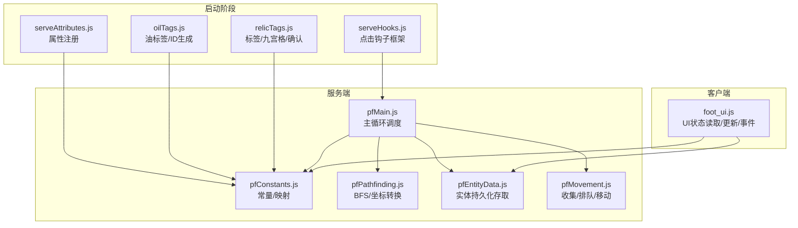
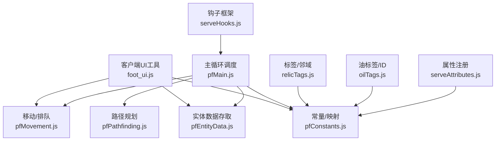
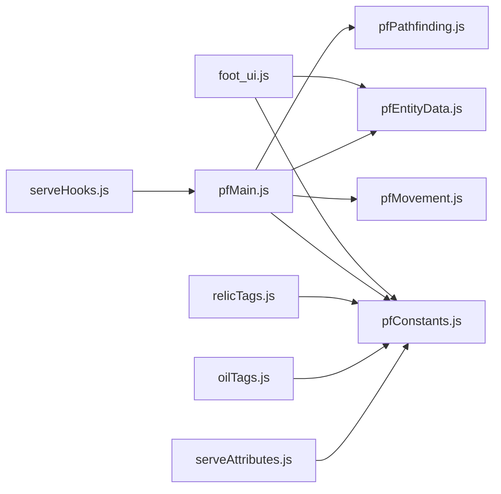

# 工具函数API

<cite>
**本文引用的文件**
- [kubejs/client_scripts/ui/foot_ui.js](file://kubejs/client_scripts/ui/foot_ui.js)
- [kubejs/startup_scripts/relic/relicTags.js](file://kubejs/startup_scripts/relic/relicTags.js)
- [kubejs/server_scripts/pathfinder/pfConstants.js](file://kubejs/server_scripts/pathfinder/pfConstants.js)
- [kubejs/server_scripts/pathfinder/pfPathfinding.js](file://kubejs/server_scripts/pathfinder/pfPathfinding.js)
- [kubejs/server_scripts/pathfinder/pfEntityData.js](file://kubejs/server_scripts/pathfinder/pfEntityData.js)
- [kubejs/server_scripts/pathfinder/pfMovement.js](file://kubejs/server_scripts/pathfinder/pfMovement.js)
- [kubejs/server_scripts/pathfinder/pfMain.js](file://kubejs/server_scripts/pathfinder/pfMain.js)
- [kubejs/startup_scripts/serveHooks.js](file://kubejs/startup_scripts/serveHooks.js)
- [kubejs/startup_scripts/oil/oilTags.js](file://kubejs/startup_scripts/oil/oilTags.js)
- [kubejs/startup_scripts/attributes/serveAttributes.js](file://kubejs/startup_scripts/attributes/serveAttributes.js)
</cite>

## 目录
1. [简介](#简介)
2. [项目结构](#项目结构)
3. [核心组件](#核心组件)
4. [架构总览](#架构总览)
5. [详细组件分析](#详细组件分析)
6. [依赖分析](#依赖分析)
7. [性能考虑](#性能考虑)
8. [故障排查指南](#故障排查指南)
9. [结论](#结论)
10. [附录](#附录)

## 简介
本文件系统性梳理项目中的工具函数与辅助方法，覆盖数据处理、数学计算、字符串处理、对象操作、路径规划、实体状态管理、UI状态读取与更新、钩子机制、标签与常量、属性注册等模块。文档面向不同技术背景的开发者，既提供函数级别的能力说明，也给出组合使用、链式调用与批量处理的实践建议，并包含扩展开发与性能优化要点。

## 项目结构
项目采用按功能域划分的组织方式，工具函数主要分布在以下区域：
- 客户端UI工具：负责实体状态读取、UI显示更新、事件绑定与粒子特效
- 服务端寻路与实体管理：封装实体持久化数据访问、路径规划、移动与排队、主循环调度
- 启动阶段工具：钩子框架、标签常量、属性注册
- 常量与映射：方向、部位、需求键值等统一管理

**图表来源**
- [kubejs/client_scripts/ui/foot_ui.js:1-1026](file://kubejs/client_scripts/ui/foot_ui.js#L1-L1026)
- [kubejs/server_scripts/pathfinder/pfConstants.js:1-65](file://kubejs/server_scripts/pathfinder/pfConstants.js#L1-L65)
- [kubejs/server_scripts/pathfinder/pfPathfinding.js:1-91](file://kubejs/server_scripts/pathfinder/pfPathfinding.js#L1-L91)
- [kubejs/server_scripts/pathfinder/pfEntityData.js:1-218](file://kubejs/server_scripts/pathfinder/pfEntityData.js#L1-L218)
- [kubejs/server_scripts/pathfinder/pfMovement.js:1-186](file://kubejs/server_scripts/pathfinder/pfMovement.js#L1-L186)
- [kubejs/server_scripts/pathfinder/pfMain.js:1-177](file://kubejs/server_scripts/pathfinder/pfMain.js#L1-L177)
- [kubejs/startup_scripts/serveHooks.js:1-31](file://kubejs/startup_scripts/serveHooks.js#L1-L31)
- [kubejs/startup_scripts/relic/relicTags.js:1-192](file://kubejs/startup_scripts/relic/relicTags.js#L1-L192)
- [kubejs/startup_scripts/oil/oilTags.js:1-19](file://kubejs/startup_scripts/oil/oilTags.js#L1-L19)
- [kubejs/startup_scripts/attributes/serveAttributes.js:1-53](file://kubejs/startup_scripts/attributes/serveAttributes.js#L1-L53)

**章节来源**
- [kubejs/client_scripts/ui/foot_ui.js:1-1026](file://kubejs/client_scripts/ui/foot_ui.js#L1-L1026)
- [kubejs/server_scripts/pathfinder/pfConstants.js:1-65](file://kubejs/server_scripts/pathfinder/pfConstants.js#L1-L65)
- [kubejs/server_scripts/pathfinder/pfPathfinding.js:1-91](file://kubejs/server_scripts/pathfinder/pfPathfinding.js#L1-L91)
- [kubejs/server_scripts/pathfinder/pfEntityData.js:1-218](file://kubejs/server_scripts/pathfinder/pfEntityData.js#L1-L218)
- [kubejs/server_scripts/pathfinder/pfMovement.js:1-186](file://kubejs/server_scripts/pathfinder/pfMovement.js#L1-L186)
- [kubejs/server_scripts/pathfinder/pfMain.js:1-177](file://kubejs/server_scripts/pathfinder/pfMain.js#L1-L177)
- [kubejs/startup_scripts/serveHooks.js:1-31](file://kubejs/startup_scripts/serveHooks.js#L1-L31)
- [kubejs/startup_scripts/relic/relicTags.js:1-192](file://kubejs/startup_scripts/relic/relicTags.js#L1-L192)
- [kubejs/startup_scripts/oil/oilTags.js:1-19](file://kubejs/startup_scripts/oil/oilTags.js#L1-L19)
- [kubejs/startup_scripts/attributes/serveAttributes.js:1-53](file://kubejs/startup_scripts/attributes/serveAttributes.js#L1-L53)

## 核心组件
- 客户端UI工具：提供实体状态读取、倒计时/满意度/步骤/油状态更新、鼠标拖动触发、窗口创建/移除等
- 服务端寻路与实体管理：提供实体持久化数据存取、网格坐标转换、BFS路径搜索、实体收集/排队/移动、主循环调度
- 启动阶段工具：提供点击钩子注册与执行框架、标签常量、油标签与ID生成、属性注册与同步
- 数学与网格工具：提供九宫格/十宫格邻域计算、底部判断、确认逻辑等

**章节来源**
- [kubejs/client_scripts/ui/foot_ui.js:520-774](file://kubejs/client_scripts/ui/foot_ui.js#L520-L774)
- [kubejs/server_scripts/pathfinder/pfEntityData.js:1-218](file://kubejs/server_scripts/pathfinder/pfEntityData.js#L1-L218)
- [kubejs/server_scripts/pathfinder/pfPathfinding.js:13-83](file://kubejs/server_scripts/pathfinder/pfPathfinding.js#L13-L83)
- [kubejs/server_scripts/pathfinder/pfMovement.js:7-186](file://kubejs/server_scripts/pathfinder/pfMovement.js#L7-L186)
- [kubejs/server_scripts/pathfinder/pfMain.js:11-177](file://kubejs/server_scripts/pathfinder/pfMain.js#L11-L177)
- [kubejs/startup_scripts/serveHooks.js:11-30](file://kubejs/startup_scripts/serveHooks.js#L11-L30)
- [kubejs/startup_scripts/relic/relicTags.js:66-192](file://kubejs/startup_scripts/relic/relicTags.js#L66-L192)
- [kubejs/startup_scripts/oil/oilTags.js:8-19](file://kubejs/startup_scripts/oil/oilTags.js#L8-L19)
- [kubejs/startup_scripts/attributes/serveAttributes.js:4-12](file://kubejs/startup_scripts/attributes/serveAttributes.js#L4-L12)

## 架构总览
下图展示工具函数在系统中的角色与交互关系，强调“客户端UI工具”与“服务端寻路/实体管理”的协作，以及“启动阶段工具”对运行期行为的扩展能力。

**图表来源**
- [kubejs/client_scripts/ui/foot_ui.js:1-1026](file://kubejs/client_scripts/ui/foot_ui.js#L1-L1026)
- [kubejs/server_scripts/pathfinder/pfMain.js:1-177](file://kubejs/server_scripts/pathfinder/pfMain.js#L1-L177)
- [kubejs/server_scripts/pathfinder/pfPathfinding.js:1-91](file://kubejs/server_scripts/pathfinder/pfPathfinding.js#L1-L91)
- [kubejs/server_scripts/pathfinder/pfEntityData.js:1-218](file://kubejs/server_scripts/pathfinder/pfEntityData.js#L1-L218)
- [kubejs/server_scripts/pathfinder/pfMovement.js:1-186](file://kubejs/server_scripts/pathfinder/pfMovement.js#L1-L186)
- [kubejs/startup_scripts/serveHooks.js:1-31](file://kubejs/startup_scripts/serveHooks.js#L1-L31)
- [kubejs/startup_scripts/relic/relicTags.js:1-192](file://kubejs/startup_scripts/relic/relicTags.js#L1-L192)
- [kubejs/startup_scripts/oil/oilTags.js:1-19](file://kubejs/startup_scripts/oil/oilTags.js#L1-L19)
- [kubejs/startup_scripts/attributes/serveAttributes.js:1-53](file://kubejs/startup_scripts/attributes/serveAttributes.js#L1-L53)

## 详细组件分析

### 客户端UI工具（foot_ui.js）
- 功能概览
  - 从实体主手物品NBT读取床坐标/朝向，计算脚部位置
  - 创建/移除睡眠/泡脚UI窗口，设置旋转与缩放
  - 鼠标拖动触发搓脚，粒子特效与轨迹生成
  - 更新倒计时、需求清单、满意度、步骤、油状态显示
  - 客户端Tick中检测附近实体并管理UI生命周期

- 关键函数与职责
  - pfGetFootPosition：根据床坐标与朝向计算脚部中心位置
  - createSleepWindow/removeSleepWindow/createSoakWindow/removeSoakWindow：窗口生命周期管理
  - updateCountdownDisplay/updateDemandListDisplay/updateSatisfactionDisplay/updateStepsDisplay/updateOilDisplay：UI状态更新
  - isSleeping/isSoakDone/getSoakTimeLeft/isSoaking：状态查询
  - getDemandList/getCountdown/getSatisfaction/getSteps/getOilInfo：数据读取与解码
  - decodeStepsString：将编码步骤字符串解码为中文
  - ensureCursorFxLayer/spawnParticle：全屏Overlay层与粒子生成

- 使用示例（路径引用）
  - [创建睡眠窗口:87-300](file://kubejs/client_scripts/ui/foot_ui.js#L87-L300)
  - [更新满意度显示:696-720](file://kubejs/client_scripts/ui/foot_ui.js#L696-L720)
  - [解码步骤字符串:606-628](file://kubejs/client_scripts/ui/foot_ui.js#L606-L628)

- 设计理念与性能特性
  - 通过NBT同步减少网络通信，UI层仅做轻量渲染与交互
  - 粒子特效在独立Overlay层渲染，避免WorldWindow裁剪影响
  - 拖动阈值与轨迹密度控制，平衡交互体验与性能

- 适用场景
  - 实体服务流程可视化、倒计时与满意度反馈、搓脚交互引导

**章节来源**
- [kubejs/client_scripts/ui/foot_ui.js:58-82](file://kubejs/client_scripts/ui/foot_ui.js#L58-L82)
- [kubejs/client_scripts/ui/foot_ui.js:87-300](file://kubejs/client_scripts/ui/foot_ui.js#L87-L300)
- [kubejs/client_scripts/ui/foot_ui.js:332-387](file://kubejs/client_scripts/ui/foot_ui.js#L332-L387)
- [kubejs/client_scripts/ui/foot_ui.js:434-457](file://kubejs/client_scripts/ui/foot_ui.js#L434-L457)
- [kubejs/client_scripts/ui/foot_ui.js:463-518](file://kubejs/client_scripts/ui/foot_ui.js#L463-L518)
- [kubejs/client_scripts/ui/foot_ui.js:524-541](file://kubejs/client_scripts/ui/foot_ui.js#L524-L541)
- [kubejs/client_scripts/ui/foot_ui.js:547-559](file://kubejs/client_scripts/ui/foot_ui.js#L547-L559)
- [kubejs/client_scripts/ui/foot_ui.js:565-577](file://kubejs/client_scripts/ui/foot_ui.js#L565-L577)
- [kubejs/client_scripts/ui/foot_ui.js:591-604](file://kubejs/client_scripts/ui/foot_ui.js#L591-L604)
- [kubejs/client_scripts/ui/foot_ui.js:611-628](file://kubejs/client_scripts/ui/foot_ui.js#L611-L628)
- [kubejs/client_scripts/ui/foot_ui.js:633-694](file://kubejs/client_scripts/ui/foot_ui.js#L633-L694)
- [kubejs/client_scripts/ui/foot_ui.js:696-720](file://kubejs/client_scripts/ui/foot_ui.js#L696-L720)
- [kubejs/client_scripts/ui/foot_ui.js:724-741](file://kubejs/client_scripts/ui/foot_ui.js#L724-L741)
- [kubejs/client_scripts/ui/foot_ui.js:743-774](file://kubejs/client_scripts/ui/foot_ui.js#L743-L774)
- [kubejs/client_scripts/ui/foot_ui.js:777-984](file://kubejs/client_scripts/ui/foot_ui.js#L777-L984)

### 服务端寻路与实体管理（pf* 模块）
- 功能概览
  - 常量与映射：方向、部位、需求键值与整数代码映射
  - 实体数据存取：origin/route/time/subStep/phase/bedInfo/sleep相关/等待位置/最后处理tick/清除睡眠tick/床位列表
  - 路径规划：坐标转网格索引、NSWE移动、BFS搜索（含避让）
  - 移动与排队：实体收集、排队检测、进度计算、单步移动、清除残留睡眠NBT
  - 主循环：按阶段处理蓝色地毯等待、躺床、排队与行走

- 关键函数与职责
  - pfPos2num/pfPosmv：网格坐标与移动
  - pfBfs：广度优先搜索，支持避让已有路径
  - pfGenerateDemandList/pfGet*/pfSet*：实体持久化数据存取
  - pfCollectEntities/pfBuildWalkerInfos/pfCheckQueue/pfCalcCurrentPos/pfMoveStep/pfClearSleepNbt：移动与排队
  - pathfinderTick：主循环调度

- 使用示例（路径引用）
  - [BFS路径搜索:46-83](file://kubejs/server_scripts/pathfinder/pfPathfinding.js#L46-L83)
  - [生成需求清单:9-16](file://kubejs/server_scripts/pathfinder/pfEntityData.js#L9-L16)
  - [实体收集与阶段分类:8-34](file://kubejs/server_scripts/pathfinder/pfMovement.js#L8-L34)
  - [单步移动与终点处理:101-162](file://kubejs/server_scripts/pathfinder/pfMovement.js#L101-L162)
  - [主循环调度:11-177](file://kubejs/server_scripts/pathfinder/pfMain.js#L11-L177)

- 设计理念与性能特性
  - 网格化地图与方向表减少分支判断，BFS在小范围内高效
  - 持久化数据集中管理，避免频繁I/O
  - 防重复处理tick与排队检测，降低冲突与无效计算

- 适用场景
  - 实体寻路、排队、睡眠与泡脚流程编排

**章节来源**
- [kubejs/server_scripts/pathfinder/pfConstants.js:7-64](file://kubejs/server_scripts/pathfinder/pfConstants.js#L7-L64)
- [kubejs/server_scripts/pathfinder/pfEntityData.js:9-217](file://kubejs/server_scripts/pathfinder/pfEntityData.js#L9-L217)
- [kubejs/server_scripts/pathfinder/pfPathfinding.js:13-83](file://kubejs/server_scripts/pathfinder/pfPathfinding.js#L13-L83)
- [kubejs/server_scripts/pathfinder/pfMovement.js:8-186](file://kubejs/server_scripts/pathfinder/pfMovement.js#L8-L186)
- [kubejs/server_scripts/pathfinder/pfMain.js:11-177](file://kubejs/server_scripts/pathfinder/pfMain.js#L11-L177)

### 启动阶段工具（serveHooks.js、relicTags.js、oilTags.js、serveAttributes.js）
- 功能概览
  - serveHooks：点击钩子注册与执行框架，支持取消传播
  - relicTags：标签常量、九宫格/十宫格邻域计算、底部判断、确认逻辑
  - oilTags：油标签与ID生成
  - serveAttributes：属性注册与同步（满意度/金钱/体力消耗）

- 关键函数与职责
  - registerServeClickHook/runServeClickHooks：钩子注册与顺序执行
  - getNineGrid/getTenGrid/checkIfInBottom/confirmRelic：邻域与确认
  - getOilId：油ID生成
  - createRangedAttribute/属性注册：创建可同步的RangedAttribute

- 使用示例（路径引用）
  - [注册与执行钩子:13-30](file://kubejs/startup_scripts/serveHooks.js#L13-L30)
  - [九宫格邻域:66-97](file://kubejs/startup_scripts/relic/relicTags.js#L66-L97)
  - [十宫格邻域:99-147](file://kubejs/startup_scripts/relic/relicTags.js#L99-L147)
  - [底部判断:149-179](file://kubejs/startup_scripts/relic/relicTags.js#L149-L179)
  - [确认遗物:182-192](file://kubejs/startup_scripts/relic/relicTags.js#L182-L192)
  - [油ID生成:16-18](file://kubejs/startup_scripts/oil/oilTags.js#L16-L18)
  - [属性注册与同步:4-12](file://kubejs/startup_scripts/attributes/serveAttributes.js#L4-L12)

- 设计理念与性能特性
  - 钩子框架解耦扩展点，便于模块化接入
  - 标签与映射集中管理，减少重复定义
  - 属性同步到客户端，便于UI与调试

- 适用场景
  - 扩展点击行为、邻域计算、油与遗物系统、属性增益

**章节来源**
- [kubejs/startup_scripts/serveHooks.js:11-30](file://kubejs/startup_scripts/serveHooks.js#L11-L30)
- [kubejs/startup_scripts/relic/relicTags.js:66-192](file://kubejs/startup_scripts/relic/relicTags.js#L66-L192)
- [kubejs/startup_scripts/oil/oilTags.js:16-18](file://kubejs/startup_scripts/oil/oilTags.js#L16-L18)
- [kubejs/startup_scripts/attributes/serveAttributes.js:4-12](file://kubejs/startup_scripts/attributes/serveAttributes.js#L4-L12)

## 依赖分析
- 模块耦合
  - 客户端UI工具依赖服务端常量与实体数据存取
  - 主循环调度依赖移动、路径规划、实体数据与常量
  - 启动阶段工具为运行期扩展提供接口，不直接耦合业务逻辑

- 外部依赖
  - Java类加载（WorldWindow、ApricityUI、Minecraft、AABB等）
  - Forge/KubeJS事件与注册机制

**图表来源**
- [kubejs/client_scripts/ui/foot_ui.js:1-1026](file://kubejs/client_scripts/ui/foot_ui.js#L1-L1026)
- [kubejs/server_scripts/pathfinder/pfMain.js:1-177](file://kubejs/server_scripts/pathfinder/pfMain.js#L1-L177)
- [kubejs/server_scripts/pathfinder/pfPathfinding.js:1-91](file://kubejs/server_scripts/pathfinder/pfPathfinding.js#L1-L91)
- [kubejs/server_scripts/pathfinder/pfEntityData.js:1-218](file://kubejs/server_scripts/pathfinder/pfEntityData.js#L1-L218)
- [kubejs/server_scripts/pathfinder/pfMovement.js:1-186](file://kubejs/server_scripts/pathfinder/pfMovement.js#L1-L186)
- [kubejs/startup_scripts/serveHooks.js:1-31](file://kubejs/startup_scripts/serveHooks.js#L1-L31)
- [kubejs/startup_scripts/relic/relicTags.js:1-192](file://kubejs/startup_scripts/relic/relicTags.js#L1-L192)
- [kubejs/startup_scripts/oil/oilTags.js:1-19](file://kubejs/startup_scripts/oil/oilTags.js#L1-L19)
- [kubejs/startup_scripts/attributes/serveAttributes.js:1-53](file://kubejs/startup_scripts/attributes/serveAttributes.js#L1-L53)

**章节来源**
- [kubejs/client_scripts/ui/foot_ui.js:1-1026](file://kubejs/client_scripts/ui/foot_ui.js#L1-L1026)
- [kubejs/server_scripts/pathfinder/pfMain.js:1-177](file://kubejs/server_scripts/pathfinder/pfMain.js#L1-L177)
- [kubejs/server_scripts/pathfinder/pfPathfinding.js:1-91](file://kubejs/server_scripts/pathfinder/pfPathfinding.js#L1-L91)
- [kubejs/server_scripts/pathfinder/pfEntityData.js:1-218](file://kubejs/server_scripts/pathfinder/pfEntityData.js#L1-L218)
- [kubejs/server_scripts/pathfinder/pfMovement.js:1-186](file://kubejs/server_scripts/pathfinder/pfMovement.js#L1-L186)
- [kubejs/startup_scripts/serveHooks.js:1-31](file://kubejs/startup_scripts/serveHooks.js#L1-L31)
- [kubejs/startup_scripts/relic/relicTags.js:1-192](file://kubejs/startup_scripts/relic/relicTags.js#L1-L192)
- [kubejs/startup_scripts/oil/oilTags.js:1-19](file://kubejs/startup_scripts/oil/oilTags.js#L1-L19)
- [kubejs/startup_scripts/attributes/serveAttributes.js:1-53](file://kubejs/startup_scripts/attributes/serveAttributes.js#L1-L53)

## 性能考虑
- 客户端UI
  - 粒子特效与轨迹数量应受阈值控制，避免高频帧率下的卡顿
  - UI窗口按需创建/销毁，避免Map长期持有导致内存增长
- 服务端寻路
  - BFS在小网格范围内高效，注意避免大规模重复计算
  - 排队检测与进度比较应尽量使用整型运算与缓存结果
  - 防重复处理tick确保每tick仅处理一次
- 启动阶段工具
  - 钩子执行顺序固定，避免在热路径中进行昂贵操作
  - 标签与映射集中初始化，减少运行期查找成本

[本节为通用指导，无需特定文件引用]

## 故障排查指南
- 客户端UI
  - 若倒计时/满意度不更新：检查NBT读取与UI元素ID一致性
  - 若粒子特效不出现：确认Overlay层创建成功与父容器存在
- 服务端寻路
  - 若实体不动：检查route/time/subStep是否正确推进
  - 若BFS失败：检查地图数组与避让逻辑，确认起点/终点索引合法
- 启动阶段工具
  - 钩子未生效：确认注册与执行顺序，检查ctx.cancel传播
  - 属性未同步：确认setSyncable与注册事件回调

**章节来源**
- [kubejs/client_scripts/ui/foot_ui.js:434-457](file://kubejs/client_scripts/ui/foot_ui.js#L434-L457)
- [kubejs/client_scripts/ui/foot_ui.js:970-984](file://kubejs/client_scripts/ui/foot_ui.js#L970-L984)
- [kubejs/server_scripts/pathfinder/pfMovement.js:101-162](file://kubejs/server_scripts/pathfinder/pfMovement.js#L101-L162)
- [kubejs/server_scripts/pathfinder/pfPathfinding.js:46-83](file://kubejs/server_scripts/pathfinder/pfPathfinding.js#L46-L83)
- [kubejs/startup_scripts/serveHooks.js:19-30](file://kubejs/startup_scripts/serveHooks.js#L19-L30)

## 结论
本项目的工具函数API围绕“客户端UI状态展示”、“服务端寻路与实体管理”、“启动阶段扩展框架”三大支柱构建，具备清晰的职责分离与良好的可扩展性。通过统一的常量与映射、稳定的钩子机制、以及轻量的UI渲染策略，开发者可以在不破坏整体架构的前提下快速扩展新功能。

[本节为总结性内容，无需特定文件引用]

## 附录

### 函数组合与链式调用建议
- UI更新链：getDemandList → updateDemandListDisplay；getSatisfaction → updateSatisfactionDisplay；getSteps → updateStepsDisplay
- 寻路流程：pfPos2num → pfBfs → pfMoveStep → pfCalcCurrentPos
- 邻域计算：getNineGrid/getTenGrid → 业务判断 → confirmRelic

[本节为方法论建议，无需特定文件引用]

### 批量处理与并发注意事项
- 批量实体处理时，先pfCollectEntities再逐个执行pfMoveStep，避免并发修改共享状态
- UI窗口Map清理应在退出世界时统一执行，防止资源泄漏

[本节为方法论建议，无需特定文件引用]

### 扩展开发与自定义函数创建
- 新增钩子：使用registerServeClickHook注册，runServeClickHooks顺序执行
- 新增标签/映射：在relicTags.js或oilTags.js中新增常量，保持命名规范
- 新增属性：在serveAttributes.js中注册，确保setSyncable与事件回调

**章节来源**
- [kubejs/startup_scripts/serveHooks.js:13-30](file://kubejs/startup_scripts/serveHooks.js#L13-L30)
- [kubejs/startup_scripts/relic/relicTags.js:3-64](file://kubejs/startup_scripts/relic/relicTags.js#L3-L64)
- [kubejs/startup_scripts/oil/oilTags.js:8-19](file://kubejs/startup_scripts/oil/oilTags.js#L8-L19)
- [kubejs/startup_scripts/attributes/serveAttributes.js:27-52](file://kubejs/startup_scripts/attributes/serveAttributes.js#L27-L52)