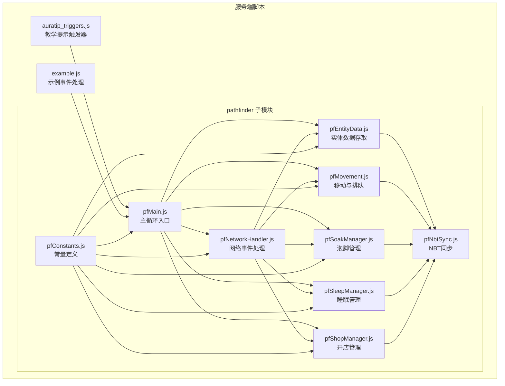
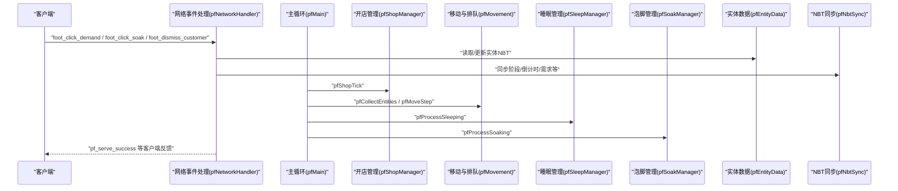
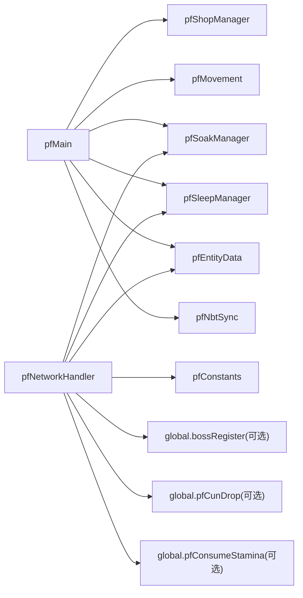

# 服务端API

<cite>
**本文引用的文件**
- [README.md](file://README.md)
- [auratip_triggers.js](file://kubejs/server_scripts/auratip_triggers.js)
- [example.js](file://kubejs/server_scripts/example.js)
- [pfMain.js](file://kubejs/server_scripts/pathfinder/pfMain.js)
- [pfNetworkHandler.js](file://kubejs/server_scripts/pathfinder/pfNetworkHandler.js)
- [pfEntityData.js](file://kubejs/server_scripts/pathfinder/pfEntityData.js)
- [pfMovement.js](file://kubejs/server_scripts/pathfinder/pfMovement.js)
- [pfSoakManager.js](file://kubejs/server_scripts/pathfinder/pfSoakManager.js)
- [pfSleepManager.js](file://kubejs/server_scripts/pathfinder/pfSleepManager.js)
- [pfShopManager.js](file://kubejs/server_scripts/pathfinder/pfShopManager.js)
- [pfConstants.js](file://kubejs/server_scripts/pathfinder/pfConstants.js)
- [pfNbtSync.js](file://kubejs/server_scripts/pathfinder/pfNbtSync.js)
</cite>

## 目录
1. [简介](#简介)
2. [项目结构](#项目结构)
3. [核心组件](#核心组件)
4. [架构总览](#架构总览)
5. [详细组件分析](#详细组件分析)
6. [依赖分析](#依赖分析)
7. [性能考虑](#性能考虑)
8. [故障排查指南](#故障排查指南)
9. [结论](#结论)
10. [附录](#附录)

## 简介
本文件面向服务端开发者，系统性梳理本项目中与服务端交互相关的公共接口与工具函数，覆盖实体管理、网络通信、事件触发、游戏机制等模块。内容包括：
- API参数类型、返回值、调用时机与使用示例
- 服务端与客户端的数据同步机制与状态管理
- 性能优化策略、错误处理与调试技巧
- 为服务端开发者提供的接口规范与最佳实践

## 项目结构
本项目基于 KubeJS 的服务端脚本组织，核心服务端API集中在 kubejs/server_scripts 下的多个模块中，其中 pathfinder 子模块提供完整的寻路、开店、睡眠、泡脚、实体移动与排队、网络事件处理等功能。

图表来源
- [pfMain.js:11-177](file://kubejs/server_scripts/pathfinder/pfMain.js#L11-L177)
- [pfNetworkHandler.js:37-317](file://kubejs/server_scripts/pathfinder/pfNetworkHandler.js#L37-L317)
- [pfEntityData.js:185-218](file://kubejs/server_scripts/pathfinder/pfEntityData.js#L185-L218)
- [pfMovement.js:178-186](file://kubejs/server_scripts/pathfinder/pfMovement.js#L178-L186)
- [pfSoakManager.js:189-197](file://kubejs/server_scripts/pathfinder/pfSoakManager.js#L189-L197)
- [pfSleepManager.js:226-232](file://kubejs/server_scripts/pathfinder/pfSleepManager.js#L226-L232)
- [pfShopManager.js:287-300](file://kubejs/server_scripts/pathfinder/pfShopManager.js#L287-L300)
- [pfConstants.js:53-65](file://kubejs/server_scripts/pathfinder/pfConstants.js#L53-L65)
- [pfNbtSync.js:87-94](file://kubejs/server_scripts/pathfinder/pfNbtSync.js#L87-L94)

章节来源
- [README.md:1-6](file://README.md#L1-L6)
- [pfMain.js:11-177](file://kubejs/server_scripts/pathfinder/pfMain.js#L11-L177)

## 核心组件
- 教学提示触发器（AuraTip）
  - 提供阶段管理、队列展示、命令触发与调试功能
  - 关键函数：获取/设置阶段、关闭提示、队列展示、阶段推进、命令注册
- 示例事件处理
  - 展示服务端事件绑定与网络数据发送的基本用法
- 寻路主循环（pfMain）
  - 每 tick 驱动：收集实体、处理蓝色地毯等待、处理睡眠、构建排队信息、执行移动
- 网络事件处理（pfNetworkHandler）
  - 处理客户端点击“需求按钮”“泡脚按钮”“送客按钮”等事件，更新实体 NBT、消耗体力、发放收益、掉落奖励
- 实体数据存取（pfEntityData）
  - 封装实体 persistentData 的读写，统一管理路径、阶段、床位、睡眠、等待位置、最后处理 tick 等状态
- 移动与排队（pfMovement）
  - 实体收集、排队检测、进度计算、单步移动、清除残留睡眠 NBT
- 泡脚管理（pfSoakManager）
  - 泡脚状态机：开始泡脚、倒计时推进、水桶有效性判定、效果应用、完成回调
- 睡眠管理（pfSleepManager）
  - 开始睡眠、每 tick 处理、倒计时同步、起床、下床位置恢复与路径进度更新
- 开店管理（pfShopManager）
  - 开店/关店、白夜判定、计数器驱动、生成顾客、清理实体
- 常量定义（pfConstants）
  - 同步物品 ID、网格参数、实体类型、方向列表、羊毛/手物品与部位映射、需求键与代码映射
- NBT 同步（pfNbtSync）
  - 将阶段、床位、倒计时、需求清单等状态写入实体主手物品 NBT，自动同步至客户端

章节来源
- [auratip_triggers.js:9-212](file://kubejs/server_scripts/auratip_triggers.js#L9-L212)
- [example.js:1-24](file://kubejs/server_scripts/example.js#L1-L24)
- [pfMain.js:11-177](file://kubejs/server_scripts/pathfinder/pfMain.js#L11-L177)
- [pfNetworkHandler.js:37-317](file://kubejs/server_scripts/pathfinder/pfNetworkHandler.js#L37-L317)
- [pfEntityData.js:185-218](file://kubejs/server_scripts/pathfinder/pfEntityData.js#L185-L218)
- [pfMovement.js:178-186](file://kubejs/server_scripts/pathfinder/pfMovement.js#L178-L186)
- [pfSoakManager.js:189-197](file://kubejs/server_scripts/pathfinder/pfSoakManager.js#L189-L197)
- [pfSleepManager.js:226-232](file://kubejs/server_scripts/pathfinder/pfSleepManager.js#L226-L232)
- [pfShopManager.js:287-300](file://kubejs/server_scripts/pathfinder/pfShopManager.js#L287-L300)
- [pfConstants.js:53-65](file://kubejs/server_scripts/pathfinder/pfConstants.js#L53-L65)
- [pfNbtSync.js:87-94](file://kubejs/server_scripts/pathfinder/pfNbtSync.js#L87-L94)

## 架构总览
服务端 API 采用“主循环 + 模块化职责分离”的设计：
- 主循环（pfMain）负责调度各子模块
- 网络事件（pfNetworkHandler）接收客户端输入，修改实体状态并触发后续流程
- 数据层（pfEntityData、pfNbtSync）统一状态存储与同步
- 业务流程（pfShopManager、pfMovement、pfSoakManager、pfSleepManager）各自封装状态机与算法

图表来源
- [pfMain.js:11-177](file://kubejs/server_scripts/pathfinder/pfMain.js#L11-L177)
- [pfNetworkHandler.js:37-317](file://kubejs/server_scripts/pathfinder/pfNetworkHandler.js#L37-L317)
- [pfShopManager.js:237-284](file://kubejs/server_scripts/pathfinder/pfShopManager.js#L237-L284)
- [pfMovement.js:101-162](file://kubejs/server_scripts/pathfinder/pfMovement.js#L101-L162)
- [pfSleepManager.js:65-128](file://kubejs/server_scripts/pathfinder/pfSleepManager.js#L65-L128)
- [pfSoakManager.js:92-145](file://kubejs/server_scripts/pathfinder/pfSoakManager.js#L92-L145)
- [pfEntityData.js:185-218](file://kubejs/server_scripts/pathfinder/pfEntityData.js#L185-L218)
- [pfNbtSync.js:87-94](file://kubejs/server_scripts/pathfinder/pfNbtSync.js#L87-L94)

## 详细组件分析

### 教学提示触发器（AuraTip）
- 功能要点
  - 阶段管理：记录玩家教学阶段，防止越级推进
  - 队列展示：延迟展示提示，避免频繁弹窗
  - 关闭与调试：支持关闭当前提示、按 ID 调试展示
  - 命令接口：提供启动、重置、调试展示命令
- 关键 API
  - 获取/设置阶段：getStage(player)、setStage(player, stage)、clearStage(player)
  - 关闭提示：closePlayerTip(player)、canClose()
  - 展示与队列：show(id, player)、queueShow(player, tipId, delayTicks)、closeThenShow(player, tipId, delayTicks)
  - 阶段推进：advance(player, expectedStage, nextStage, nextTipId)
  - 命令：auratip_openshop、auratip_reset、auratip_debug_show
- 调用时机
  - 服务端 tick 循环中处理 pendingShows 队列
  - 事件触发（如点击商店、泡脚等）推进阶段
- 使用示例
  - 启动开店教学：执行 auratip_openshop，等待提示出现后点击商店
  - 调试展示：auratip_debug_show pathfinder_open_shop_tip
- 错误处理
  - TipTriggers 未就绪时记录日志并返回
  - 参数缺失或玩家无效时快速返回
- 性能建议
  - 队列长度过大时可限制最大队列长度
  - 避免在高频 tick 中重复创建对象

章节来源
- [auratip_triggers.js:9-212](file://kubejs/server_scripts/auratip_triggers.js#L9-L212)

### 示例事件处理（ItemEvents）
- 功能要点
  - 监听物品右击事件，打开 UI 并根据实体是否为寻路实体决定是否发送网络包
- 关键 API
  - rightClickedEntity(event)：解析目标实体、判断 pfPhase、发送 open_foot_ui 数据包
- 使用示例
  - 右击带有特定 NBT 的实体，打开脚部 UI
- 注意事项
  - 仅在实体存在且携带持久化数据时生效

章节来源
- [example.js:1-24](file://kubejs/server_scripts/example.js#L1-L24)

### 寻路主循环（pfMain）
- 功能要点
  - 每 tick 调度：开店定时生成、实体收集、蓝色地毯等待处理、睡眠处理、排队与移动
  - 防重复处理：基于 lastTick 字段避免同 tick 重复处理
- 关键 API
  - pathfinderTick(entity)：主入口，按阶段处理各类实体
- 使用示例
  - 由寻路方块实体每 tick 调用，内部调度各子模块
- 性能建议
  - 合理设置搜索范围（GRID_HALF），避免过度扫描
  - 对 blueWaiters/sleepers 等进行短路判断

章节来源
- [pfMain.js:11-177](file://kubejs/server_scripts/pathfinder/pfMain.js#L11-L177)

### 网络事件处理（pfNetworkHandler）
- 功能要点
  - 处理三类客户端事件：
    - 足部需求点击：更新需求、消耗体力、计算满意度与金钱、掉落奖励、记录操作玩家 UUID
    - 泡脚点击：校验水桶、开始泡脚、推进教学阶段
    - 送客：直接唤醒，不结算
- 关键 API
  - foot_click_demand：更新需求与收益
  - foot_click_soak：开始泡脚
  - foot_dismiss_customer：送客
- 参数与返回
  - 事件数据包含 entityUuid、partKey 等
  - 成功/失败返回布尔值
- 使用示例
  - 客户端点击“搓脚”按钮，服务端根据部位与属性计算消耗与收益
- 错误处理
  - 未找到实体、水桶无效、体力不足等情况均记录日志并回滚 NBT
- 性能建议
  - 一次性批量处理 pendingShows，避免逐 tick 遍历

章节来源
- [pfNetworkHandler.js:37-317](file://kubejs/server_scripts/pathfinder/pfNetworkHandler.js#L37-L317)

### 实体数据存取（pfEntityData）
- 功能要点
  - 统一封装 persistentData 的读写，包括：起点、路径、时间/子步、阶段、床位、睡眠、等待位置、最后处理 tick、床列表等
- 关键 API
  - 基础数据：pfGetOrigin/pfSetOrigin、pfGetRoute/pfSetRoute、pfGetTime/pfSetTime、pfGetSubStep/pfSetSubStep、pfGetPhase/pfSetPhase
  - 床位信息：pfGetBedInfo/pfSetBedInfo
  - 睡眠相关：pfGetSleepStartTick/pfSetSleepStartTick、pfGetBeforeSleepPos/pfSetBeforeSleepPos、pfHasSlept/pfSetHasSlept、pfIsFromBlueWait/pfSetFromBlueWait
  - 蓝色地毯位置：pfGetBlueCarpetPos/pfSetBlueCarpetPos
  - 等待位置：pfGetWaitPos/pfSetWaitPos
  - 最后处理 tick：pfGetLastTick/pfSetLastTick
  - 清除睡眠 NBT 的 tick 计数：pfGetClearSleepTick/pfSetClearSleepTick
  - 床位列表：pfGetBedList/pfSetBedList
- 使用示例
  - 在移动模块中读取/更新实体进度与阶段
  - 在睡眠模块中设置/读取床坐标与睡眠起始 tick
- 性能建议
  - 读写频率高时尽量合并 NBT 写入

章节来源
- [pfEntityData.js:185-218](file://kubejs/server_scripts/pathfinder/pfEntityData.js#L185-L218)

### 移动与排队（pfMovement）
- 功能要点
  - 实体收集与分类（行走/睡眠/等待/蓝色地毯等待）
  - 排队检测：基于距离与进度优先级
  - 位置计算与单步移动：按路径字符推进，子步 0~9 插值
  - 清除残留睡眠 NBT
- 关键 API
  - pfCollectEntities(level, pos)：收集并分类实体
  - pfBuildWalkerInfos(entities)：构建排队信息
  - pfCheckQueue(myInfo, allInfos)：检查是否需要排队
  - pfCalcCurrentPos(ent)：计算当前位置
  - pfMoveStep(ent, level)：执行一步移动
  - pfClearSleepNbt(ent, level)：清理睡眠 NBT
- 使用示例
  - 在主循环中对行走实体执行移动与排队检测
- 性能建议
  - 排队检测复杂度 O(n^2)，建议限制搜索范围与实体数量

章节来源
- [pfMovement.js:178-186](file://kubejs/server_scripts/pathfinder/pfMovement.js#L178-L186)

### 泡脚管理（pfSoakManager）
- 功能要点
  - 泡脚状态机：开始泡脚、倒计时推进、水桶有效性判定、效果应用、完成回调
  - 时间状态以“秒”为单位存储，避免跨重启失效
- 关键 API
  - pfIsSoaking(ent)/pfIsSoakDone(ent)/pfGetSoakTimeLeft(ent)
  - pfGetSoakWaterType(ent)
  - pfProcessSoaking(ent, currTick)：每 tick 推进倒计时
  - pfStartSoak(ent, player, bucketId)：开始泡脚
- 使用示例
  - 客户端点击“泡脚”按钮后，服务端校验水桶并开始倒计时
- 性能建议
  - 仅在 isSoaking 且未完成时推进倒计时

章节来源
- [pfSoakManager.js:189-197](file://kubejs/server_scripts/pathfinder/pfSoakManager.js#L189-L197)

### 睡眠管理（pfSleepManager）
- 功能要点
  - 开始睡眠：设置床坐标、重置秒驱动字段、设置实体位置
  - 每 tick 处理：设置睡姿 NBT、倒计时同步、自动泡脚驱动
  - 起床：stopSleeping 并移除睡眠 NBT，恢复下床位置与路径进度
- 关键 API
  - pfStartSleep(ent, level, bedPos, currTick)
  - pfProcessSleeping(ent, level, currTick)
  - pfWakeUp(ent, level)
  - pfResetSleepSubTick(ent)
- 使用示例
  - 实体到达蓝色地毯后进入等待，随后躺床并按秒计时
- 性能建议
  - 使用独立的 subTick/seconds 字段，避免依赖差值

章节来源
- [pfSleepManager.js:226-232](file://kubejs/server_scripts/pathfinder/pfSleepManager.js#L226-L232)

### 开店管理（pfShopManager）
- 功能要点
  - 开店/关店：写入/清除方块实体 persistentData，记录玩家 UUID、路径、蓝色地毯位置
  - 白夜判定：日落自动关店
  - 计数器驱动：每 5 秒判定一次生成顾客
  - 生成顾客：根据顾客类型池抽取并生成实体
- 关键 API
  - pfOpenShop(player, level, baseX, baseY, baseZ, routeStr, blueCarpetPos)
  - pfCloseShop(level, beOrPosOrReason, reason)
  - pfShopTick(level, entity)
  - pfIsOpenAt(level, baseX, baseY, baseZ)
  - pfAddSpawnedAt(level, baseX, baseY, baseZ, uuid)
- 使用示例
  - 右键寻路方块开店，等待白天结束自动关店或手动关店
- 性能建议
  - 仅在白天且计数器满时才尝试生成，降低 CPU 压力

章节来源
- [pfShopManager.js:287-300](file://kubejs/server_scripts/pathfinder/pfShopManager.js#L287-L300)

### 常量定义（pfConstants）
- 功能要点
  - 统一管理常量：同步物品 ID、网格参数、实体类型、方向列表、羊毛/手物品与部位映射、需求键与代码映射
- 关键 API
  - 导出 global.pfConstants，供其他模块使用
- 使用示例
  - 网络事件中根据手物品 ID 映射部位键值

章节来源
- [pfConstants.js:53-65](file://kubejs/server_scripts/pathfinder/pfConstants.js#L53-L65)

### NBT 同步（pfNbtSync）
- 功能要点
  - 将阶段、床位、倒计时、需求清单等状态写入实体主手物品 NBT，自动同步至客户端
- 关键 API
  - pfSyncPhase/entity、pfSyncBed(entity, x,y,z,yaw)、pfSyncCountdown(entity, countdown)、pfSyncDemandList(entity, demandList, skipSoak)
  - pfGetPhase(entity)
- 使用示例
  - 生成实体后同步需求清单与初始状态

章节来源
- [pfNbtSync.js:87-94](file://kubejs/server_scripts/pathfinder/pfNbtSync.js#L87-L94)

## 依赖分析
- 模块耦合
  - pfMain 作为中枢，依赖 pfShopManager、pfMovement、pfSoakManager、pfSleepManager、pfEntityData、pfNbtSync
  - pfNetworkHandler 依赖 pfConstants、pfEntityData、pfSoakManager、pfSleepManager、pfCunDrop（可选）、pfConsumeStamina（可选）
  - pfEntityData 与 pfNbtSync 双向协作，前者提供读写，后者负责同步
- 外部依赖
  - 依赖 global.bossRegister（可选）用于满意度倍率
  - 依赖 global.soakWaterRegister（可选）用于泡脚水桶注册
  - 依赖 global.pfCustomerTypes、global.pfEntitySpawner（可选）用于生成顾客
- 循环依赖
  - 未发现直接循环依赖；模块间通过 global.* 注入形成弱耦合

图表来源
- [pfMain.js:11-177](file://kubejs/server_scripts/pathfinder/pfMain.js#L11-L177)
- [pfNetworkHandler.js:37-317](file://kubejs/server_scripts/pathfinder/pfNetworkHandler.js#L37-L317)
- [pfEntityData.js:185-218](file://kubejs/server_scripts/pathfinder/pfEntityData.js#L185-L218)
- [pfNbtSync.js:87-94](file://kubejs/server_scripts/pathfinder/pfNbtSync.js#L87-L94)

## 性能考虑
- 主循环节流
  - 使用 lastTick 防重复处理，避免同 tick 内多次计算
- 搜索范围控制
  - GRID_HALF 控制实体扫描半径，避免大范围扫描
- 批处理网络事件
  - pendingShows 队列在 tick 结束时统一处理，减少频繁触发
- 状态存储优化
  - 将时间状态以“秒/计数”存储于 persistentData，避免依赖 server.getTickCount() 差值
- 条件推进
  - 仅在 isSoaking/hasSlept 等条件下推进倒计时或睡眠流程

## 故障排查指南
- 教学提示未显示
  - 检查 TipTriggers 是否可用（canClose）
  - 确认 trigger id 是否存在于 triggers 映射
  - 使用 auratip_debug_show 命令验证
- 泡脚无效
  - 检查玩家是否持有有效水桶（原版水桶或已注册洗脚水桶）
  - 确认实体主手物品是否为同步物品且包含水桶类型
- 体力不足
  - 网络事件中会检查 pfConsumeStamina 回调，确认回调返回 true
- 送客无效
  - 确认实体处于可唤醒状态，pfSleepManager.pfWakeUp 是否可用
- 开店/关店异常
  - 检查寻路方块实体是否存在，persistentData 是否正确读写
- 日志定位
  - 大量日志输出用于定位问题，关注“未找到实体”“水桶无效”“体力不足”等关键字

章节来源
- [auratip_triggers.js:31-57](file://kubejs/server_scripts/auratip_triggers.js#L31-L57)
- [pfNetworkHandler.js:58-218](file://kubejs/server_scripts/pathfinder/pfNetworkHandler.js#L58-L218)
- [pfSoakManager.js:109-145](file://kubejs/server_scripts/pathfinder/pfSoakManager.js#L109-L145)
- [pfSleepManager.js:131-223](file://kubejs/server_scripts/pathfinder/pfSleepManager.js#L131-L223)
- [pfShopManager.js:151-231](file://kubejs/server_scripts/pathfinder/pfShopManager.js#L151-L231)

## 结论
本服务端 API 以模块化设计为核心，通过主循环统一调度，网络事件驱动状态变更，实体数据与 NBT 同步保障客户端一致性。建议在生产环境中：
- 严格遵循状态机与条件推进原则
- 控制搜索范围与批处理规模
- 使用日志与命令进行调试与验证
- 通过 global.* 注入扩展能力，保持低耦合

## 附录
- 安装与运行
  - 使用 1.20.1 客户端与最新 Forge，拉取仓库后创建存档即可运行
- 常用命令
  - auratip_openshop：启动教学提示
  - auratip_reset：重置教学阶段
  - auratip_debug_show：<提示ID>：调试展示指定提示

章节来源
- [README.md:1-6](file://README.md#L1-L6)