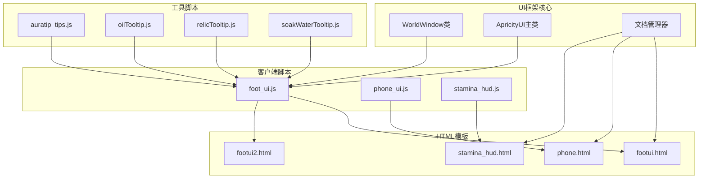
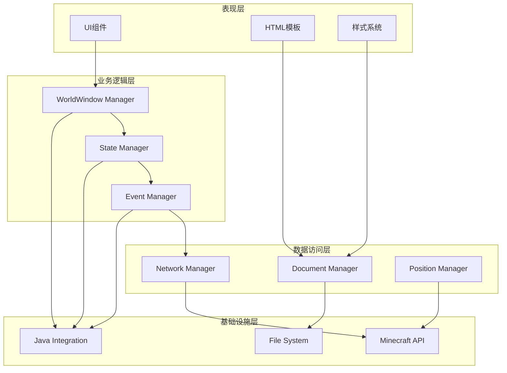
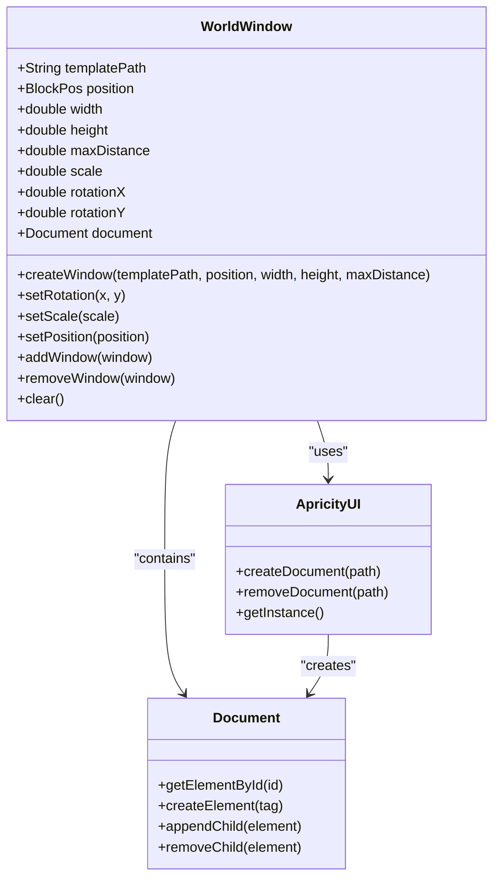
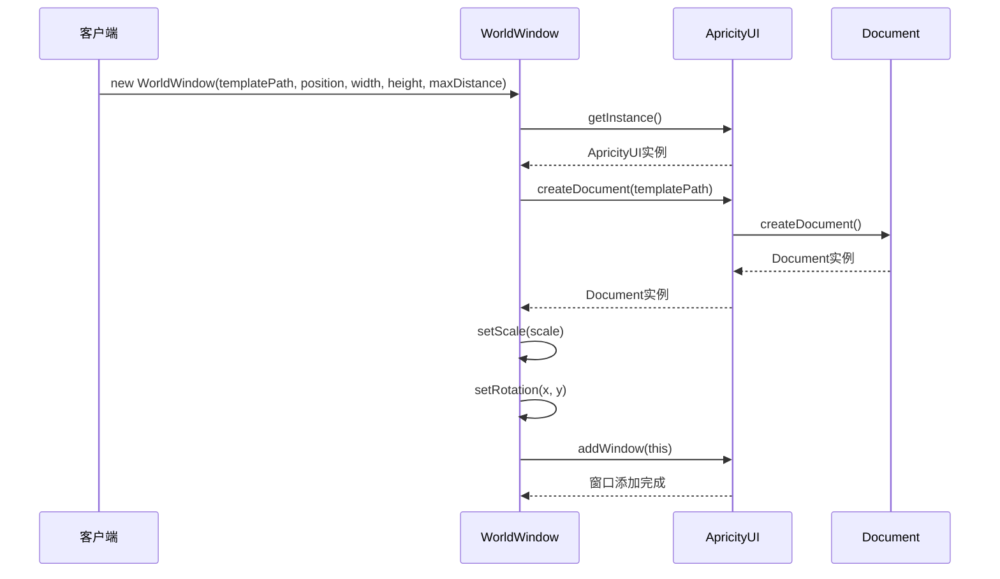
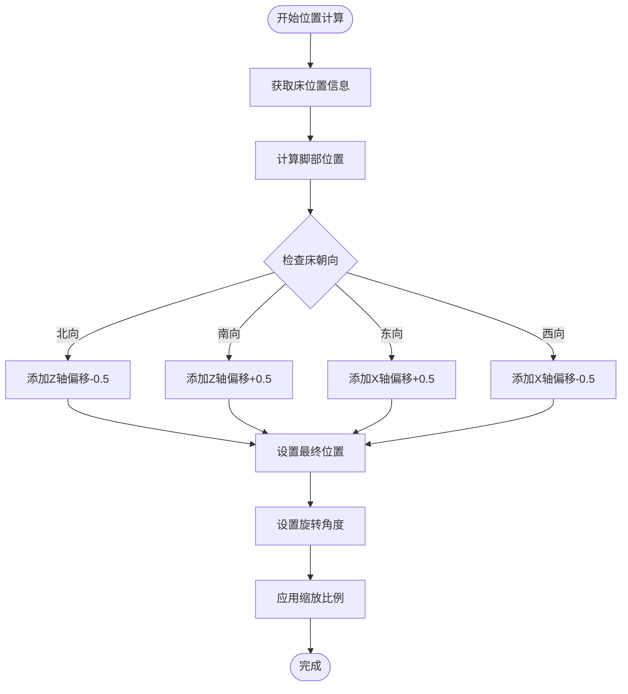
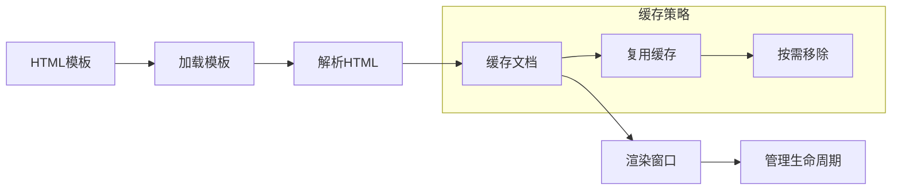
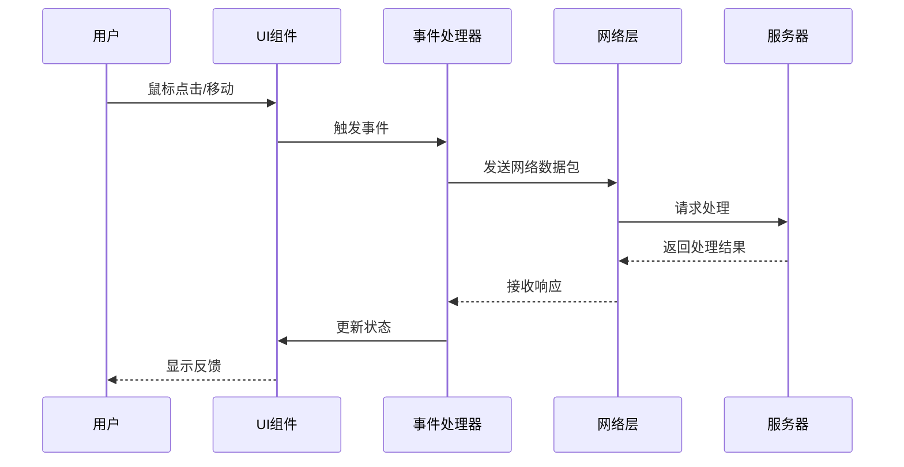
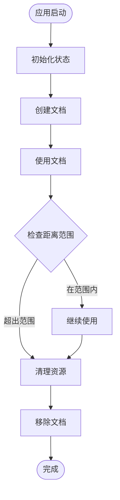
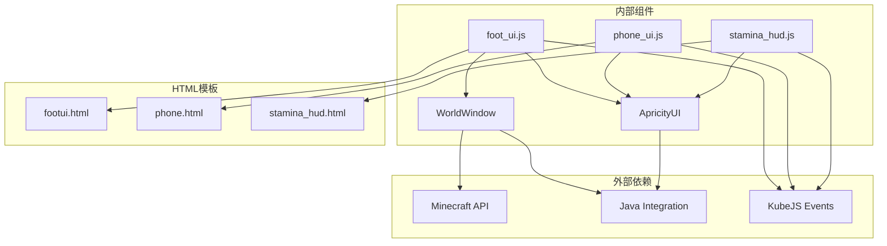
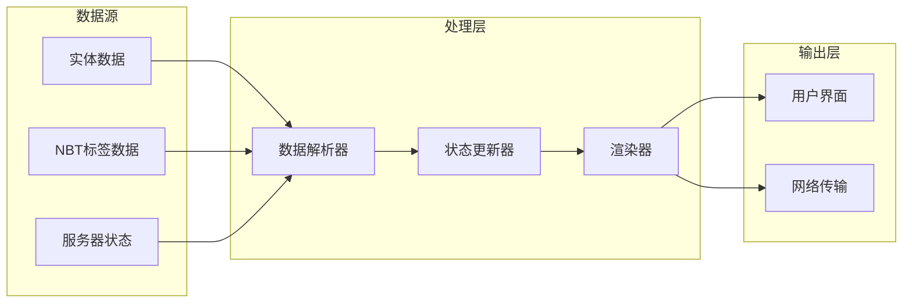

# ApriCity UI框架

<cite>
**本文档引用的文件**
- [foot_ui.js](file://kubejs/client_scripts/ui/foot_ui.js)
- [phone_ui.js](file://kubejs/client_scripts/ui/phone_ui.js)
- [stamina_hud.js](file://kubejs/client_scripts/ui/stamina_hud.js)
- [footui.html](file://apricity/kubejs/footui.html)
- [footui2.html](file://apricity/kubejs/footui2.html)
- [phone.html](file://apricity/kubejs/phone.html)
- [stamina_hud.html](file://apricity/kubejs/stamina_hud.html)
- [auratip_tips.js](file://kubejs/client_scripts/auratip/auratip_tips.js)
- [oilTooltip.js](file://kubejs/client_scripts/tooltip/oilTooltip.js)
- [relicTooltip.js](file://kubejs/client_scripts/tooltip/relicTooltip.js)
- [soakWaterTooltip.js](file://kubejs/client_scripts/tooltip/soakWaterTooltip.js)
</cite>

## 目录
1. [简介](#简介)
2. [项目结构](#项目结构)
3. [核心组件](#核心组件)
4. [架构概览](#架构概览)
5. [详细组件分析](#详细组件分析)
6. [依赖关系分析](#依赖关系分析)
7. [性能考虑](#性能考虑)
8. [故障排除指南](#故障排除指南)
9. [结论](#结论)
10. [附录](#附录)

## 简介

ApriCity UI框架是一个基于WorldWindow类的3D界面系统架构，专为Minecraft KubeJS环境设计。该框架提供了沉浸式的3D用户界面体验，支持多种UI组件类型，包括睡眠实体UI、手机界面、体力HUD等。

框架的核心特性包括：
- 基于WorldWindow的3D窗口系统
- 实时位置计算和旋转设置
- HTML模板加载机制
- 事件驱动的状态管理系统
- 性能优化的渲染策略
- 丰富的交互体验

## 项目结构

ApriCity UI框架采用模块化设计，主要包含以下结构：

**图表来源**
- [foot_ui.js:13-15](file://kubejs/client_scripts/ui/foot_ui.js#L13-L15)
- [phone_ui.js:7](file://kubejs/client_scripts/ui/phone_ui.js#L7)
- [stamina_hud.js:7](file://kubejs/client_scripts/ui/stamina_hud.js#L7)

**章节来源**
- [foot_ui.js:1-50](file://kubejs/client_scripts/ui/foot_ui.js#L1-L50)
- [phone_ui.js:1-25](file://kubejs/client_scripts/ui/phone_ui.js#L1-L25)
- [stamina_hud.js:1-25](file://kubejs/client_scripts/ui/stamina_hud.js#L1-L25)

## 核心组件

### WorldWindow类

WorldWindow是ApriCity UI框架的核心组件，负责创建和管理3D窗口。其主要功能包括：

- **窗口创建**：通过构造函数创建新的3D窗口实例
- **位置管理**：支持基于世界坐标的精确位置设置
- **缩放控制**：提供统一的缩放比例管理
- **旋转设置**：支持水平和垂直方向的旋转调整
- **生命周期管理**：包含窗口的添加、移除和清理功能

### ApricityUI主类

ApricityUI作为框架的入口点，提供以下核心功能：
- 文档创建和管理
- 全局状态维护
- 事件分发机制
- 资源加载和缓存

### 文档管理器

负责HTML模板的加载、解析和管理，支持懒加载和缓存机制。

**章节来源**
- [foot_ui.js:13-15](file://kubejs/client_scripts/ui/foot_ui.js#L13-L15)
- [foot_ui.js:127-134](file://kubejs/client_scripts/ui/foot_ui.js#L127-L134)
- [foot_ui.js:358-364](file://kubejs/client_scripts/ui/foot_ui.js#L358-L364)

## 架构概览

ApriCity UI框架采用分层架构设计，确保了良好的模块分离和可扩展性：

**图表来源**
- [foot_ui.js:13-15](file://kubejs/client_scripts/ui/foot_ui.js#L13-L15)
- [phone_ui.js:7](file://kubejs/client_scripts/ui/phone_ui.js#L7)
- [stamina_hud.js:7](file://kubejs/client_scripts/ui/stamina_hud.js#L7)

## 详细组件分析

### WorldWindow类详细分析

#### 类结构图

**图表来源**
- [foot_ui.js:13](file://kubejs/client_scripts/ui/foot_ui.js#L13)
- [foot_ui.js:127](file://kubejs/client_scripts/ui/foot_ui.js#L127)
- [foot_ui.js:358](file://kubejs/client_scripts/ui/foot_ui.js#L358)

#### 窗口创建流程

**图表来源**
- [foot_ui.js:127-134](file://kubejs/client_scripts/ui/foot_ui.js#L127-L134)
- [foot_ui.js:358-364](file://kubejs/client_scripts/ui/foot_ui.js#L358-L364)

#### 位置计算和旋转设置

**图表来源**
- [foot_ui.js:68-89](file://kubejs/client_scripts/ui/foot_ui.js#L68-L89)
- [foot_ui.js:128-132](file://kubejs/client_scripts/ui/foot_ui.js#L128-L132)

**章节来源**
- [foot_ui.js:65-89](file://kubejs/client_scripts/ui/foot_ui.js#L65-L89)
- [foot_ui.js:127-134](file://kubejs/client_scripts/ui/foot_ui.js#L127-L134)
- [foot_ui.js:358-364](file://kubejs/client_scripts/ui/foot_ui.js#L358-L364)

### UI框架核心概念

#### 窗口缩放机制

ApriCity UI框架实现了统一的缩放管理机制：

- **缩放比例**：默认0.01的比例系数
- **缩放范围**：支持任意正数比例
- **性能优化**：通过统一缩放减少渲染开销

#### 最大距离限制

框架实现了智能的距离管理：
- **距离阈值**：默认16格的最大显示距离
- **动态清理**：超出范围的窗口自动移除
- **内存管理**：防止内存泄漏和性能下降

#### HTML模板加载机制

**图表来源**
- [foot_ui.js:19-35](file://kubejs/client_scripts/ui/foot_ui.js#L19-L35)

**章节来源**
- [foot_ui.js:58-63](file://kubejs/client_scripts/ui/foot_ui.js#L58-L63)
- [foot_ui.js:19-35](file://kubejs/client_scripts/ui/foot_ui.js#L19-L35)

### 事件处理系统

#### 事件流分析

**图表来源**
- [foot_ui.js:160-276](file://kubejs/client_scripts/ui/foot_ui.js#L160-L276)
- [phone_ui.js:13-23](file://kubejs/client_scripts/ui/phone_ui.js#L13-L23)

#### 状态管理

框架采用Map数据结构进行状态管理：
- **实体跟踪**：Map存储实体UUID到窗口的映射
- **倒计时管理**：独立的倒计时状态存储
- **泡脚状态**：专门的状态管理对象

**章节来源**
- [foot_ui.js:37-42](file://kubejs/client_scripts/ui/foot_ui.js#L37-L42)
- [foot_ui.js:785-893](file://kubejs/client_scripts/ui/foot_ui.js#L785-L893)

### 性能优化策略

#### 渲染优化

ApriCity UI框架实施了多项性能优化措施：

- **懒加载机制**：文档按需创建，减少启动时间
- **缓存策略**：重复使用的文档进行缓存管理
- **动态清理**：超出范围的窗口自动清理
- **事件节流**：鼠标移动事件进行频率控制

#### 内存管理

**图表来源**
- [foot_ui.js:895-907](file://kubejs/client_scripts/ui/foot_ui.js#L895-L907)

**章节来源**
- [foot_ui.js:895-907](file://kubejs/client_scripts/ui/foot_ui.js#L895-L907)
- [stamina_hud.js:60-86](file://kubejs/client_scripts/ui/stamina_hud.js#L60-L86)

## 依赖关系分析

### 组件依赖图

**图表来源**
- [foot_ui.js:13-15](file://kubejs/client_scripts/ui/foot_ui.js#L13-L15)
- [phone_ui.js:7](file://kubejs/client_scripts/ui/phone_ui.js#L7)
- [stamina_hud.js:7](file://kubejs/client_scripts/ui/stamina_hud.js#L7)

### 数据流分析

**图表来源**
- [foot_ui.js:527-544](file://kubejs/client_scripts/ui/foot_ui.js#L527-L544)
- [foot_ui.js:568-580](file://kubejs/client_scripts/ui/foot_ui.js#L568-L580)

**章节来源**
- [foot_ui.js:527-580](file://kubejs/client_scripts/ui/foot_ui.js#L527-L580)
- [phone_ui.js:13-47](file://kubejs/client_scripts/ui/phone_ui.js#L13-L47)

## 性能考虑

### 性能监控指标

ApriCity UI框架关注以下性能指标：

- **渲染帧率**：确保UI渲染不影响游戏主循环
- **内存占用**：监控文档和窗口的内存使用情况
- **网络延迟**：优化数据同步的网络开销
- **CPU使用率**：控制事件处理的CPU消耗

### 优化建议

1. **批量更新**：合并多个UI更新操作
2. **延迟加载**：非关键UI组件延迟创建
3. **缓存策略**：合理利用文档和资源缓存
4. **事件去抖**：对高频事件进行去抖处理

## 故障排除指南

### 常见问题及解决方案

#### 窗口不显示问题

**症状**：WorldWindow创建后无法显示
**可能原因**：
- 模板路径错误
- 位置坐标无效
- 距离超出限制

**解决方法**：
1. 验证HTML模板路径
2. 检查位置坐标的有效性
3. 调整MAX_DISTANCE参数

#### 事件无响应问题

**症状**：UI交互无反应
**可能原因**：
- 事件监听器未正确绑定
- 网络数据包发送失败
- 状态更新逻辑错误

**解决方法**：
1. 检查事件绑定代码
2. 验证网络通信
3. 添加调试日志

#### 性能问题

**症状**：UI渲染卡顿
**可能原因**：
- 过多的DOM操作
- 频繁的重绘
- 内存泄漏

**解决方法**：
1. 优化DOM操作
2. 减少重绘次数
3. 实施内存清理

**章节来源**
- [foot_ui.js:97-99](file://kubejs/client_scripts/ui/foot_ui.js#L97-L99)
- [foot_ui.js:281-291](file://kubejs/client_scripts/ui/foot_ui.js#L281-L291)
- [stamina_hud.js:70-74](file://kubejs/client_scripts/ui/stamina_hud.js#L70-L74)

## 结论

ApriCity UI框架通过WorldWindow类实现了强大的3D界面系统，具有以下优势：

1. **模块化设计**：清晰的组件分离和职责划分
2. **性能优化**：多层优化策略确保流畅的用户体验
3. **扩展性强**：灵活的架构支持功能扩展
4. **易用性**：简洁的API接口降低使用门槛

框架在Minecraft KubeJS环境中提供了完整的UI解决方案，适用于各种复杂的游戏场景。

## 附录

### 最佳实践建议

1. **合理使用WorldWindow**：避免创建过多同时存在的窗口
2. **优化模板结构**：保持HTML模板的简洁和高效
3. **实施错误处理**：为关键操作添加适当的错误处理
4. **监控性能指标**：定期检查UI性能表现

### 扩展指南

#### 添加新UI组件

1. 创建HTML模板文件
2. 编写JavaScript处理逻辑
3. 注册事件监听器
4. 集成到主框架中

#### 自定义样式

1. 修改CSS样式文件
2. 调整布局参数
3. 测试响应式设计
4. 验证跨设备兼容性