# ApriCity UI框架

<cite>
**本文档引用的文件**
- [foot_ui.js](file://kubejs/client_scripts/ui/foot_ui.js)
- [phone_ui.js](file://kubejs/client_scripts/ui/phone_ui.js)
- [stamina_hud.js](file://kubejs/client_scripts/ui/stamina_hud.js)
- [maid_stats_ui.js](file://kubejs/client_scripts/ui/maid_stats_ui.js)
- [maid_stats.html](file://apricity/kubejs/maid_stats.html)
- [maid_stats_ui.js](file://kubejs/startup_scripts/ui/maid_stats_ui.js)
- [maid_stats.js](file://kubejs/server_scripts/backpack/maid_stats.js)
- [footui.html](file://apricity/kubejs/footui.html)
- [phone.html](file://apricity/kubejs/phone.html)
- [stamina_hud.html](file://apricity/kubejs/stamina_hud.html)
</cite>

## 更新摘要
**变更内容**
- 新增女仆统计叠加系统（Maid Statistics Overlay System）完整实现
- 扩展UI框架的3D界面系统架构，支持交互式叠加层
- 添加服务端-客户端数据同步机制
- 集成TLM（Touhou Little Maid）模块的UI交互
- 增强状态管理和生命周期控制

## 目录
1. [简介](#简介)
2. [项目结构](#项目结构)
3. [核心组件](#核心组件)
4. [架构概览](#架构概览)
5. [详细组件分析](#详细组件分析)
6. [女仆统计叠加系统](#女仆统计叠加系统)
7. [依赖关系分析](#依赖关系分析)
8. [性能考虑](#性能考虑)
9. [故障排除指南](#故障排除指南)
10. [结论](#结论)
11. [附录](#附录)

## 简介

ApriCity UI框架是一个基于WorldWindow类的3D界面系统架构，专为Minecraft KubeJS环境设计。该框架提供了沉浸式的3D用户界面体验，支持多种UI组件类型，包括睡眠实体UI、手机界面、体力HUD以及最新的女仆统计叠加系统。

框架的核心特性包括：
- 基于WorldWindow的3D窗口系统
- 实时位置计算和旋转设置
- HTML模板加载机制
- 事件驱动的状态管理系统
- 性能优化的渲染策略
- 丰富的交互体验
- **新增**：交互式叠加层支持
- **新增**：服务端-客户端数据同步
- **新增**：第三方模块UI集成

## 项目结构

ApriCity UI框架采用模块化设计，主要包含以下结构：

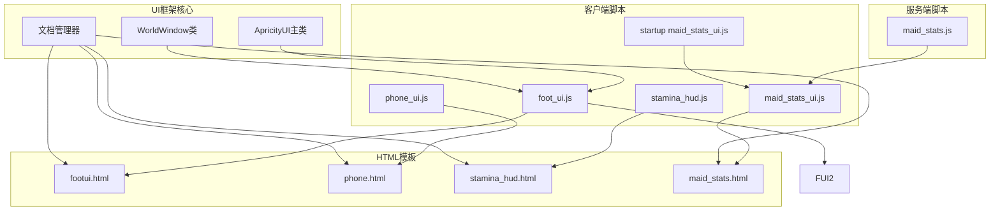

**图表来源**
- [foot_ui.js:13-15](file://kubejs/client_scripts/ui/foot_ui.js#L13-L15)
- [phone_ui.js:7](file://kubejs/client_scripts/ui/phone_ui.js#L7)
- [stamina_hud.js:7](file://kubejs/client_scripts/ui/stamina_hud.js#L7)
- [maid_stats_ui.js:17-20](file://kubejs/client_scripts/ui/maid_stats_ui.js#L17-L20)
- [maid_stats_ui.js:31-49](file://kubejs/startup_scripts/ui/maid_stats_ui.js#L31-L49)

## 核心组件

### WorldWindow类

WorldWindow是ApriCity UI框架的核心组件，负责创建和管理3D窗口。其主要功能包括：

- **窗口创建**：通过构造函数创建新的3D窗口实例
- **位置管理**：支持基于世界坐标的精确位置设置
- **缩放控制**：提供统一的缩放比例管理
- **旋转设置**：支持水平和垂直方向的旋转调整
- **生命周期管理**：包含窗口的添加、移除和清理功能

### ApricityUI主类

ApricityUI作为框架的入口点，提供以下核心功能：
- 文档创建和管理
- 全局状态维护
- 事件分发机制
- 资源加载和缓存

### 文档管理器

负责HTML模板的加载、解析和管理，支持懒加载和缓存机制。

**章节来源**
- [foot_ui.js:13-15](file://kubejs/client_scripts/ui/foot_ui.js#L13-L15)
- [foot_ui.js:127-134](file://kubejs/client_scripts/ui/foot_ui.js#L127-L134)
- [foot_ui.js:358-364](file://kubejs/client_scripts/ui/foot_ui.js#L358-L364)

## 架构概览

ApriCity UI框架采用分层架构设计，确保了良好的模块分离和可扩展性：

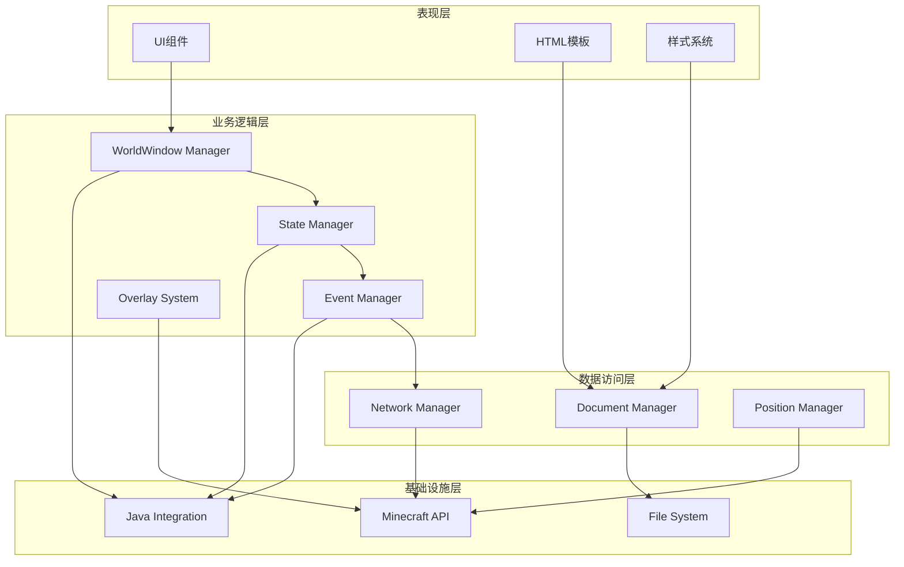

**图表来源**
- [maid_stats_ui.js:17-20](file://kubejs/client_scripts/ui/maid_stats_ui.js#L17-L20)
- [maid_stats_ui.js:31-49](file://kubejs/startup_scripts/ui/maid_stats_ui.js#L31-L49)

## 详细组件分析

### WorldWindow类详细分析

#### 类结构图

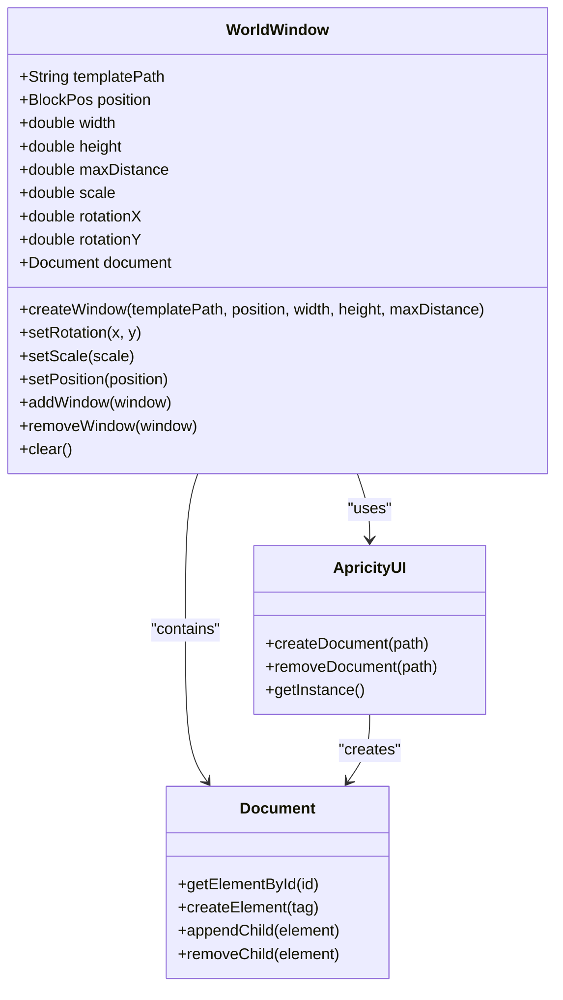

**图表来源**
- [foot_ui.js:13](file://kubejs/client_scripts/ui/foot_ui.js#L13)
- [foot_ui.js:127](file://kubejs/client_scripts/ui/foot_ui.js#L127)
- [foot_ui.js:358](file://kubejs/client_scripts/ui/foot_ui.js#L358)

#### 窗口创建流程

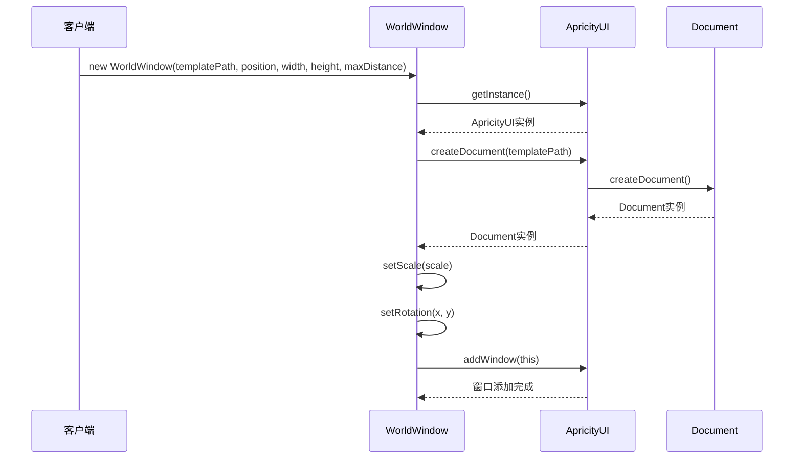

**图表来源**
- [foot_ui.js:127-134](file://kubejs/client_scripts/ui/foot_ui.js#L127-L134)
- [foot_ui.js:358-364](file://kubejs/client_scripts/ui/foot_ui.js#L358-L364)

#### 位置计算和旋转设置

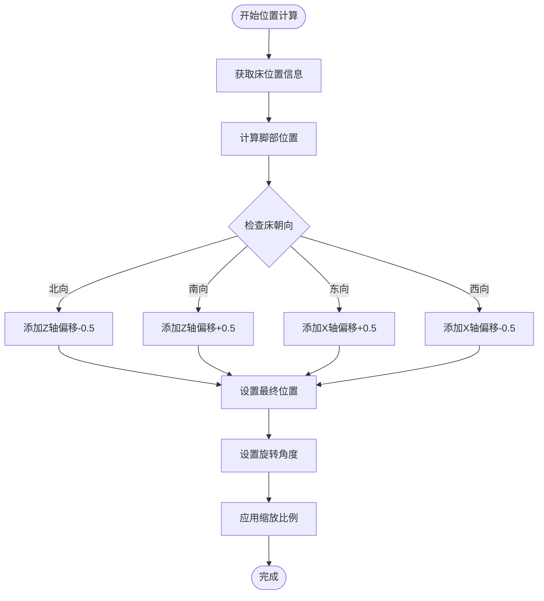

**图表来源**
- [foot_ui.js:68-89](file://kubejs/client_scripts/ui/foot_ui.js#L68-L89)
- [foot_ui.js:128-132](file://kubejs/client_scripts/ui/foot_ui.js#L128-L132)

**章节来源**
- [foot_ui.js:65-89](file://kubejs/client_scripts/ui/foot_ui.js#L65-L89)
- [foot_ui.js:127-134](file://kubejs/client_scripts/ui/foot_ui.js#L127-L134)
- [foot_ui.js:358-364](file://kubejs/client_scripts/ui/foot_ui.js#L358-L364)

### UI框架核心概念

#### 窗口缩放机制

ApriCity UI框架实现了统一的缩放管理机制：

- **缩放比例**：默认0.01的比例系数
- **缩放范围**：支持任意正数比例
- **性能优化**：通过统一缩放减少渲染开销

#### 最大距离限制

框架实现了智能的距离管理：
- **距离阈值**：默认16格的最大显示距离
- **动态清理**：超出范围的窗口自动移除
- **内存管理**：防止内存泄漏和性能下降

#### HTML模板加载机制

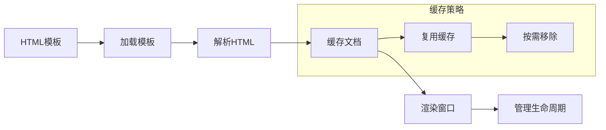

**图表来源**
- [foot_ui.js:19-35](file://kubejs/client_scripts/ui/foot_ui.js#L19-L35)

**章节来源**
- [foot_ui.js:58-63](file://kubejs/client_scripts/ui/foot_ui.js#L58-L63)
- [foot_ui.js:19-35](file://kubejs/client_scripts/ui/foot_ui.js#L19-L35)

### 事件处理系统

#### 事件流分析

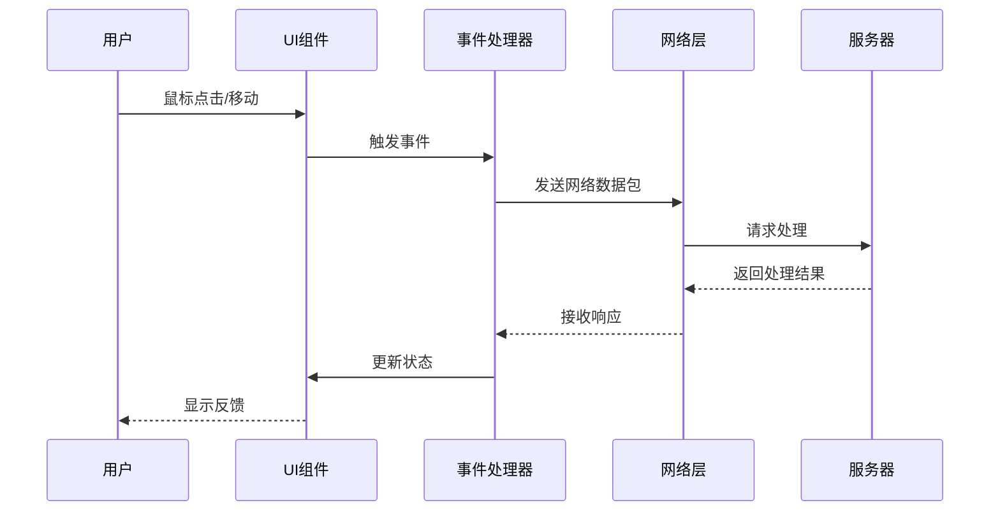

**图表来源**
- [foot_ui.js:160-276](file://kubejs/client_scripts/ui/foot_ui.js#L160-L276)
- [phone_ui.js:13-23](file://kubejs/client_scripts/ui/phone_ui.js#L13-L23)

#### 状态管理

框架采用Map数据结构进行状态管理：
- **实体跟踪**：Map存储实体UUID到窗口的映射
- **倒计时管理**：独立的倒计时状态存储
- **泡脚状态**：专门的状态管理对象

**章节来源**
- [foot_ui.js:37-42](file://kubejs/client_scripts/ui/foot_ui.js#L37-L42)
- [foot_ui.js:785-893](file://kubejs/client_scripts/ui/foot_ui.js#L785-L893)

### 性能优化策略

#### 渲染优化

ApriCity UI框架实施了多项性能优化措施：

- **懒加载机制**：文档按需创建，减少启动时间
- **缓存策略**：重复使用的文档进行缓存管理
- **动态清理**：超出范围的窗口自动清理
- **事件节流**：鼠标移动事件进行频率控制

#### 内存管理

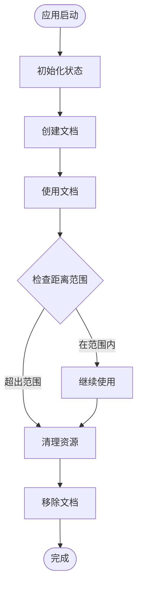

**图表来源**
- [foot_ui.js:895-907](file://kubejs/client_scripts/ui/foot_ui.js#L895-L907)

**章节来源**
- [foot_ui.js:895-907](file://kubejs/client_scripts/ui/foot_ui.js#L895-L907)
- [stamina_hud.js:60-86](file://kubejs/client_scripts/ui/stamina_hud.js#L60-L86)

## 女仆统计叠加系统

女仆统计叠加系统是ApriCity UI框架的最新扩展，为Touhou Little Maid模块提供了完整的饰品属性统计界面。该系统采用三层架构设计，实现了从服务端数据收集到客户端可视化展示的完整流程。

### 系统架构

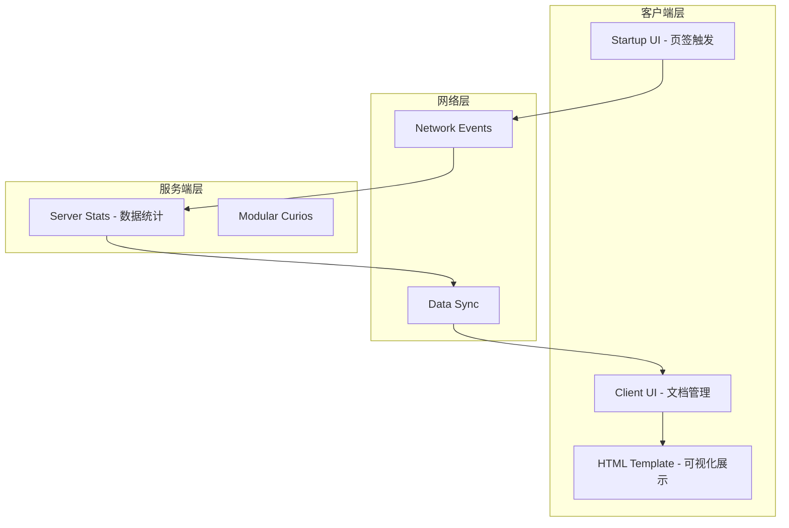

**图表来源**
- [maid_stats_ui.js:17-20](file://kubejs/client_scripts/ui/maid_stats_ui.js#L17-L20)
- [maid_stats_ui.js:31-49](file://kubejs/startup_scripts/ui/maid_stats_ui.js#L31-L49)
- [maid_stats.js:419-457](file://kubejs/server_scripts/backpack/maid_stats.js#L419-L457)

### 核心组件详解

#### 客户端文档管理器

客户端文档管理器负责Overlay的生命周期控制和数据渲染：

- **状态管理**：维护`pfMaidStatsOpen`全局状态
- **文档创建**：动态创建和销毁HTML文档
- **数据同步**：监听服务端推送的统计数据
- **渲染优化**：避免重复DOM操作

#### 服务端统计引擎

服务端统计引擎负责收集和计算女仆的饰品属性：

- **饰品扫描**：遍历Curios装备槽位
- **属性捕获**：模拟遗物onLoad过程
- **数据聚合**：计算属性合计和明细
- **网络传输**：序列化并发送JSON数据

#### HTML可视化模板

HTML模板提供了完整的用户界面：

- **透明背景**：完全透明的Overlay效果
- **凸起面板**：与TLM风格一致的灰面板
- **交互元素**：关闭按钮和悬停提示
- **响应式布局**：自适应不同屏幕尺寸

### 数据流分析

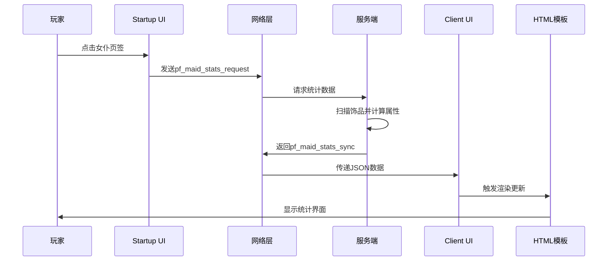

**图表来源**
- [maid_stats_ui.js:207-216](file://kubejs/startup_scripts/ui/maid_stats_ui.js#L207-L216)
- [maid_stats.js:419-457](file://kubejs/server_scripts/backpack/maid_stats.js#L419-L457)
- [maid_stats_ui.js:123-126](file://kubejs/client_scripts/ui/maid_stats_ui.js#L123-L126)

### 状态机设计

女仆统计叠加系统采用了三态状态机设计：

1. **未选中状态**：显示铁剑图标，提供Tooltip提示
2. **选中状态**：绘制凸起背景，激活Overlay
3. **交互状态**：显示统计面板，支持关闭操作

**章节来源**
- [maid_stats_ui.js:1-199](file://kubejs/client_scripts/ui/maid_stats_ui.js#L1-L199)
- [maid_stats_ui.js:1-229](file://kubejs/startup_scripts/ui/maid_stats_ui.js#L1-L229)
- [maid_stats.js:1-460](file://kubejs/server_scripts/backpack/maid_stats.js#L1-L460)
- [maid_stats.html:1-387](file://apricity/kubejs/maid_stats.html#L1-L387)

## 依赖关系分析

### 组件依赖图

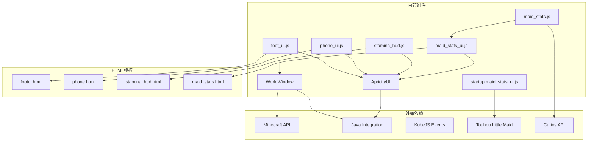

**图表来源**
- [maid_stats_ui.js:17-20](file://kubejs/client_scripts/ui/maid_stats_ui.js#L17-L20)
- [maid_stats_ui.js:31-49](file://kubejs/startup_scripts/ui/maid_stats_ui.js#L31-L49)
- [maid_stats.js:13-18](file://kubejs/server_scripts/backpack/maid_stats.js#L13-L18)

### 数据流分析

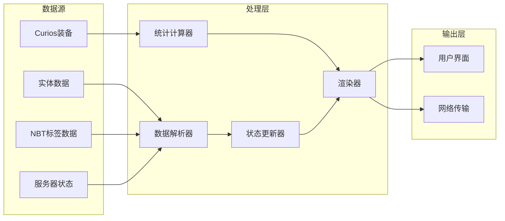

**图表来源**
- [maid_stats.js:326-415](file://kubejs/server_scripts/backpack/maid_stats.js#L326-L415)
- [maid_stats_ui.js:59-98](file://kubejs/client_scripts/ui/maid_stats_ui.js#L59-L98)

**章节来源**
- [maid_stats.js:326-415](file://kubejs/server_scripts/backpack/maid_stats.js#L326-L415)
- [maid_stats_ui.js:59-98](file://kubejs/client_scripts/ui/maid_stats_ui.js#L59-L98)
- [phone_ui.js:13-47](file://kubejs/client_scripts/ui/phone_ui.js#L13-L47)

## 性能考虑

### 性能监控指标

ApriCity UI框架关注以下性能指标：

- **渲染帧率**：确保UI渲染不影响游戏主循环
- **内存占用**：监控文档和窗口的内存使用情况
- **网络延迟**：优化数据同步的网络开销
- **CPU使用率**：控制事件处理的CPU消耗
- **Overlay性能**：监控叠加层的渲染效率

### 优化建议

1. **批量更新**：合并多个UI更新操作
2. **延迟加载**：非关键UI组件延迟创建
3. **缓存策略**：合理利用文档和资源缓存
4. **事件去抖**：对高频事件进行去抖处理
5. **透明渲染优化**：最小化透明背景的渲染开销

## 故障排除指南

### 常见问题及解决方案

#### 窗口不显示问题

**症状**：WorldWindow创建后无法显示
**可能原因**：
- 模板路径错误
- 位置坐标无效
- 距离超出限制

**解决方法**：
1. 验证HTML模板路径
2. 检查位置坐标的有效性
3. 调整MAX_DISTANCE参数

#### 女仆统计Overlay不显示

**症状**：点击女仆页签后统计界面不出现
**可能原因**：
- 网络连接失败
- 服务端统计计算异常
- HTML模板加载失败

**解决方法**：
1. 检查网络事件是否正确注册
2. 查看服务端日志中的统计计算错误
3. 验证HTML模板路径和权限

#### 事件无响应问题

**症状**：UI交互无反应
**可能原因**：
- 事件监听器未正确绑定
- 网络数据包发送失败
- 状态更新逻辑错误

**解决方法**：
1. 检查事件绑定代码
2. 验证网络通信
3. 添加调试日志

#### 性能问题

**症状**：UI渲染卡顿
**可能原因**：
- 过多的DOM操作
- 频繁的重绘
- 内存泄漏

**解决方法**：
1. 优化DOM操作
2. 减少重绘次数
3. 实施内存清理

**章节来源**
- [foot_ui.js:97-99](file://kubejs/client_scripts/ui/foot_ui.js#L97-L99)
- [foot_ui.js:281-291](file://kubejs/client_scripts/ui/foot_ui.js#L281-L291)
- [stamina_hud.js:70-74](file://kubejs/client_scripts/ui/stamina_hud.js#L70-L74)
- [maid_stats_ui.js:167-174](file://kubejs/client_scripts/ui/maid_stats_ui.js#L167-L174)

## 结论

ApriCity UI框架通过WorldWindow类实现了强大的3D界面系统，具有以下优势：

1. **模块化设计**：清晰的组件分离和职责划分
2. **性能优化**：多层优化策略确保流畅的用户体验
3. **扩展性强**：灵活的架构支持功能扩展
4. **易用性**：简洁的API接口降低使用门槛
5. **新增特性**：完整的女仆统计叠加系统支持
6. **第三方集成**：良好的TLM模块兼容性

框架在Minecraft KubeJS环境中提供了完整的UI解决方案，适用于各种复杂的游戏场景，特别是需要交互式叠加层和复杂数据可视化的应用场景。

## 附录

### 最佳实践建议

1. **合理使用WorldWindow**：避免创建过多同时存在的窗口
2. **优化模板结构**：保持HTML模板的简洁和高效
3. **实施错误处理**：为关键操作添加适当的错误处理
4. **监控性能指标**：定期检查UI性能表现
5. **Overlay设计原则**：使用透明背景避免遮挡底层UI
6. **状态管理**：合理设计状态机，避免状态冲突

### 扩展指南

#### 添加新UI组件

1. 创建HTML模板文件
2. 编写JavaScript处理逻辑
3. 注册事件监听器
4. 集成到主框架中

#### 自定义样式

1. 修改CSS样式文件
2. 调整布局参数
3. 测试响应式设计
4. 验证跨设备兼容性

#### 集成第三方模块

1. 研究模块的API接口
2. 创建适配层封装
3. 实现数据转换逻辑
4. 测试兼容性