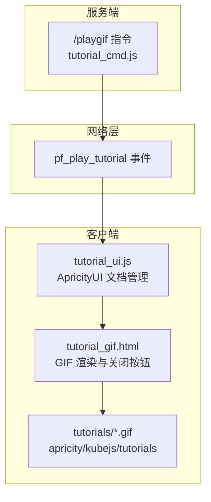
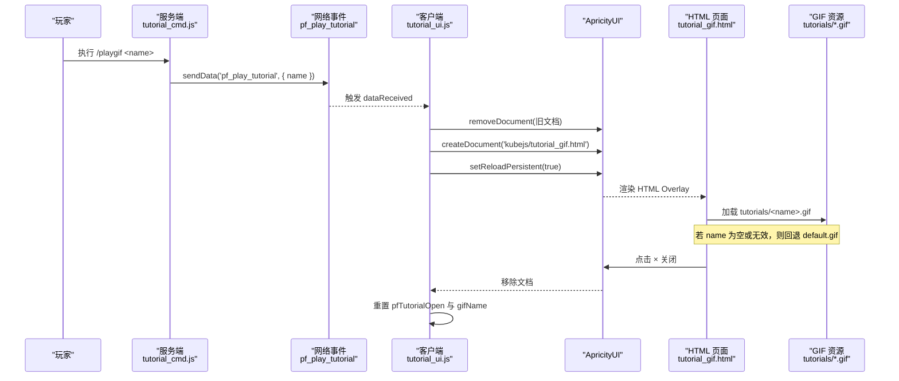
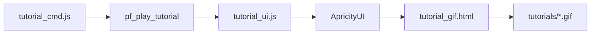

# GIF教程系统

<cite>
**本文引用的文件**   
- [tutorial_ui.js](file://kubejs/client_scripts/ui/tutorial_ui.js)
- [tutorial_gif.html](file://apricity/kubejs/tutorial_gif.html)
- [tutorial_cmd.js](file://kubejs/server_scripts/tutorial_cmd.js)
- [README.md](file://README.md)
- [PLAN.md](file://PLAN.md)
</cite>

## 目录
1. [简介](#简介)
2. [项目结构](#项目结构)
3. [核心组件](#核心组件)
4. [架构总览](#架构总览)
5. [详细组件分析](#详细组件分析)
6. [依赖关系分析](#依赖关系分析)
7. [性能与资源注意事项](#性能与资源注意事项)
8. [故障排查指南](#故障排查指南)
9. [结论](#结论)

## 简介
本文件聚焦于整合包中的“GIF教程系统”，该系统通过 KubeJS 在服务端触发、客户端渲染的方式，在游戏内任意界面（包括 FTB Quests）之上叠加播放教学 GIF。其设计目标是：以最小侵入的方式为游戏机制提供可视化引导，例如顾客生成、搓脚流程、科技产线说明等。

该系统的入口是服务端指令 `/playgif <name>`；客户端收到网络事件后，使用 ApricityUI 创建并显示一个 HTML Overlay，最终在 `apricity/kubejs/tutorials/<name>.gif` 路径下加载对应 GIF 进行全屏播放。

**章节来源**
- [README.md:1-6](file://README.md#L1-L6)
- [PLAN.md:1-58](file://PLAN.md#L1-L58)

## 项目结构
GIF教程系统涉及三类关键位置：
- 服务端脚本：注册命令并发送网络事件
- 客户端脚本：监听网络事件、管理 Overlay 生命周期
- HTML 页面：负责渲染 GIF、处理关闭按钮

**图表来源**
- [tutorial_cmd.js:1-27](file://kubejs/server_scripts/tutorial_cmd.js#L1-L27)
- [tutorial_ui.js:1-57](file://kubejs/client_scripts/ui/tutorial_ui.js#L1-L57)
- [tutorial_gif.html:1-121](file://apricity/kubejs/tutorial_gif.html#L1-L121)

**章节来源**
- [tutorial_cmd.js:1-27](file://kubejs/server_scripts/tutorial_cmd.js#L1-L27)
- [tutorial_ui.js:1-57](file://kubejs/client_scripts/ui/tutorial_ui.js#L1-L57)
- [tutorial_gif.html:1-121](file://apricity/kubejs/tutorial_gif.html#L1-L121)

## 核心组件
- 服务端指令模块：提供 `/playgif <name>`，将 `<name>` 作为参数发送给客户端。
- 客户端 Overlay 管理器：监听 `pf_play_tutorial`，创建并持久化显示 HTML 文档，维护打开状态。
- HTML 渲染页面：读取全局变量中的 GIF 名称，动态设置图片源，并提供右上角关闭按钮。
- 资源目录：`apricity/kubejs/tutorials/<name>.gif`，默认回退到 `default.gif`。

**章节来源**
- [tutorial_cmd.js:1-27](file://kubejs/server_scripts/tutorial_cmd.js#L1-L27)
- [tutorial_ui.js:1-57](file://kubejs/client_scripts/ui/tutorial_ui.js#L1-L57)
- [tutorial_gif.html:1-121](file://apricity/kubejs/tutorial_gif.html#L1-L121)

## 架构总览
下图展示从玩家执行指令到 GIF 播放的完整调用链，以及关闭时的清理流程。

**图表来源**
- [tutorial_cmd.js:1-27](file://kubejs/server_scripts/tutorial_cmd.js#L1-L27)
- [tutorial_ui.js:1-57](file://kubejs/client_scripts/ui/tutorial_ui.js#L1-L57)
- [tutorial_gif.html:1-121](file://apricity/kubejs/tutorial_gif.html#L1-L121)

## 详细组件分析

### 服务端指令模块
职责：
- 注册 `/playgif` 指令，支持可选参数 `<name>`。
- 无参数时默认播放 `default`。
- 通过 `player.sendData('pf_play_tutorial', { name })` 向客户端发送事件。

关键点：
- 参数直接透传，未做严格校验，因此建议外部调用方保证 `<name>` 合法。
- 返回值为 Brigadier 命令标准返回值，用于指示执行成功与否。

潜在问题：
- 如果传入空字符串或非法文件名，HTML 侧会回退到 `default`，但不会报错提示。

**章节来源**
- [tutorial_cmd.js:1-27](file://kubejs/server_scripts/tutorial_cmd.js#L1-L27)

### 客户端 Overlay 管理器
职责：
- 监听 `pf_play_tutorial` 事件。
- 解析 `event.data.name`，写入 `global.pfTutorialGifName`。
- 重复触发时先移除旧文档，再创建新文档。
- 设置 `setReloadPersistent(true)`，确保 Overlay 覆盖当前 MC Screen。
- 每 tick 检查文档是否存在，不存在则重置打开状态。
- 登出时清理文档和全局状态。

关键点：
- 使用 `global.pfTutorialOpen` 标记是否已打开，避免重复逻辑。
- 使用 try/catch 包裹 ApricityUI 调用，增强鲁棒性。

优化建议：
- 可在日志中记录失败原因，便于定位资源缺失或权限问题。

**章节来源**
- [tutorial_ui.js:1-57](file://kubejs/client_scripts/ui/tutorial_ui.js#L1-L57)

### HTML 渲染页面
职责：
- 全屏背景遮罩 + 居中显示 GIF。
- 右上角关闭按钮，调用 `ApricityUI.removeDocument` 关闭 Overlay。
- 从 `global.pfTutorialGifName` 读取 GIF 名称，拼接资源路径。
- 若名称为空或异常，回退到 `tutorials/default.gif`。

关键点：
- CSS 使用 `object-fit: contain` 保持宽高比，适配不同分辨率。
- GIF 元素本身不响应鼠标事件，避免遮挡关闭按钮。
- 底部提示条仅用于用户引导，不参与交互。

风险点：
- 如果 `tutorials/<name>.gif` 不存在，浏览器可能显示空白或错误图标，但当前没有额外错误提示。

**章节来源**
- [tutorial_gif.html:1-121](file://apricity/kubejs/tutorial_gif.html#L1-L121)

### GIF 资源目录
当前仓库中可见资源：
- `apricity/kubejs/tutorials/1.gif`

命名约定：
- 文件名应与 `<name>` 一致，例如 `/playgif 1` 对应 `1.gif`。
- 默认回退文件名为 `default.gif`，若不存在则无法显示内容。

建议：
- 为每个教程 GIF 添加简短命名规范，例如按章节编号或功能模块命名。
- 对 GIF 大小和帧率进行限制，避免影响游戏性能。

**章节来源**
- [tutorial_gif.html:94-103](file://apricity/kubejs/tutorial_gif.html#L94-L103)

## 依赖关系分析
- 服务端依赖 KubeJS 命令注册 API。
- 客户端依赖 ApricityUI 提供的文档创建、移除与持久化能力。
- HTML 页面依赖浏览器 img 标签与 CSS 布局。
- 资源依赖文件系统路径 `apricity/kubejs/tutorials/<name>.gif`。

**图表来源**
- [tutorial_cmd.js:1-27](file://kubejs/server_scripts/tutorial_cmd.js#L1-L27)
- [tutorial_ui.js:1-57](file://kubejs/client_scripts/ui/tutorial_ui.js#L1-L57)
- [tutorial_gif.html:1-121](file://apricity/kubejs/tutorial_gif.html#L1-L121)

**章节来源**
- [tutorial_cmd.js:1-27](file://kubejs/server_scripts/tutorial_cmd.js#L1-L27)
- [tutorial_ui.js:1-57](file://kubejs/client_scripts/ui/tutorial_ui.js#L1-L57)
- [tutorial_gif.html:1-121](file://apricity/kubejs/tutorial_gif.html#L1-L121)

## 性能与资源注意事项
- GIF 尺寸与帧率：过大的 GIF 会增加内存占用与解码开销，建议在制作阶段控制文件大小。
- 频繁切换教程：重复触发会销毁并重建文档，应避免高频调用。
- 多 Overlay 场景：当前实现只维护单个教程文档，后续如需多教程并行需扩展文档标识。
- 资源缺失：若 GIF 不存在，页面不会主动报错，建议在 HTML 中添加占位图或提示文本。

[本节为通用指导，不直接分析具体文件]

## 故障排查指南
常见问题与处理建议：
- 执行 `/playgif` 后无反应：
  - 检查服务端是否正确发送 `pf_play_tutorial` 事件。
  - 检查客户端是否加载 `tutorial_ui.js`。
  - 查看控制台是否有 `createDocument 失败` 日志。
- GIF 不显示：
  - 确认 `apricity/kubejs/tutorials/<name>.gif` 存在。
  - 若未指定 `<name>`，确认 `default.gif` 存在。
  - 检查浏览器控制台是否有资源加载错误。
- 关闭按钮无效：
  - 检查 HTML 中关闭按钮事件绑定是否正常。
  - 确认 ApricityUI 的 `removeDocument` 调用未被拦截。
- 退出游戏后仍残留状态：
  - 检查 `ClientEvents.loggedOut` 是否清理了文档与全局变量。

**章节来源**
- [tutorial_ui.js:21-57](file://kubejs/client_scripts/ui/tutorial_ui.js#L21-L57)
- [tutorial_gif.html:94-117](file://apricity/kubejs/tutorial_gif.html#L94-L117)

## 结论
GIF教程系统以简洁的服务端指令驱动客户端 Overlay，借助 ApricityUI 实现在任意游戏界面上播放教学 GIF。其优势在于低侵入、易扩展；需要注意资源管理与性能控制。未来可考虑增加教程队列、进度保存、错误提示与多文档管理等能力，以提升用户体验与可维护性。

[本节为总结性内容，不直接分析具体文件]