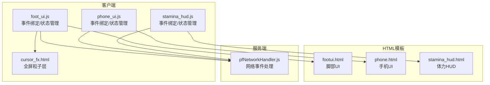
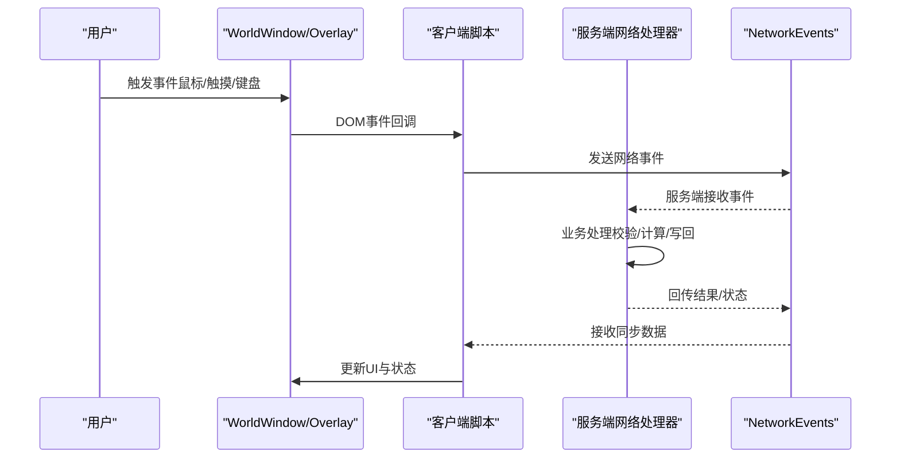
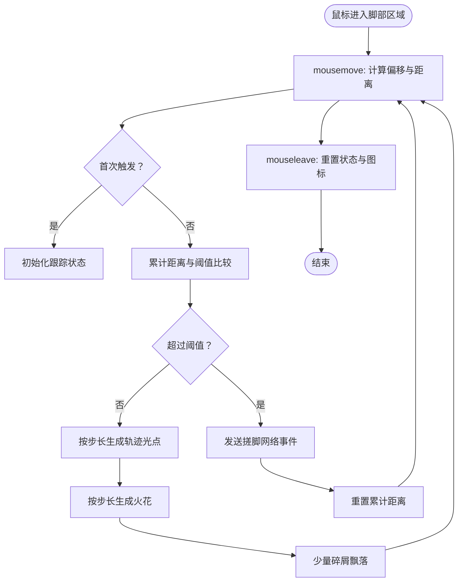
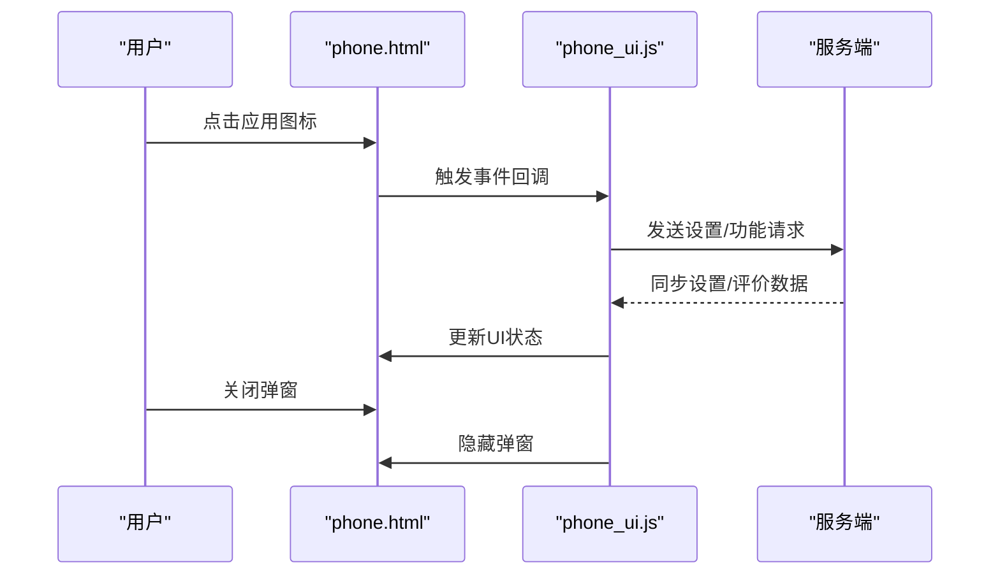
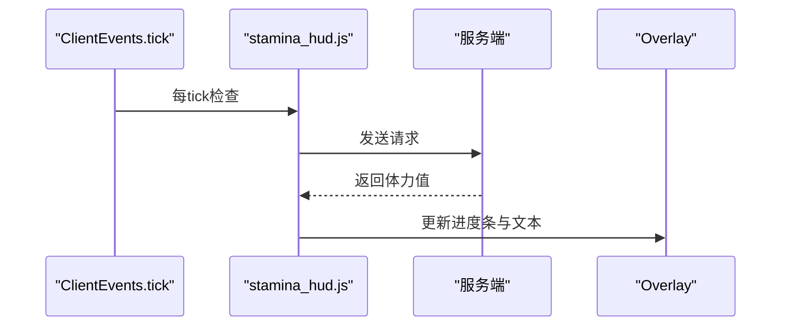
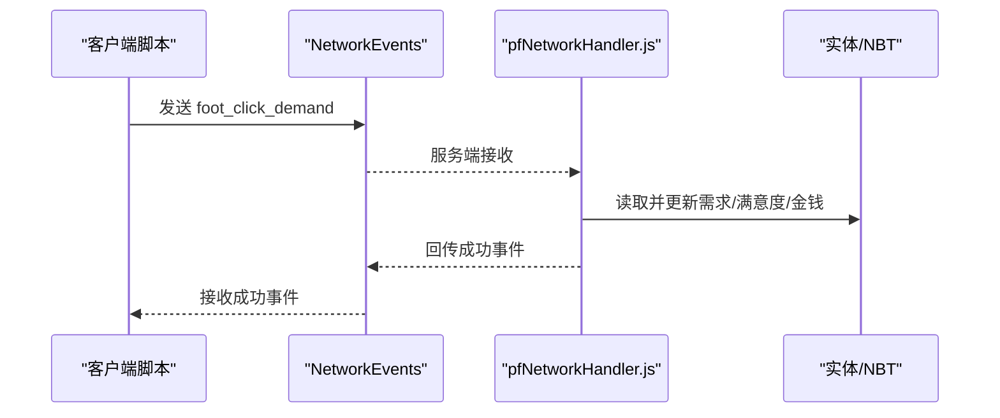
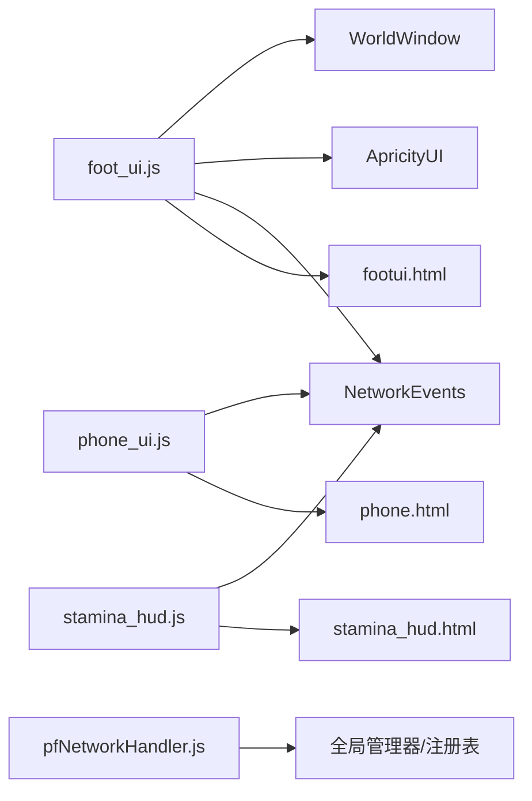

# UI事件处理

<cite>
**本文引用的文件**
- [footui.html](file://apricity/kubejs/footui.html)
- [phone.html](file://apricity/kubejs/phone.html)
- [stamina_hud.html](file://apricity/kubejs/stamina_hud.html)
- [cursor_fx.html](file://apricity/kubejs/cursor_fx.html)
- [foot_ui.js](file://kubejs/client_scripts/ui/foot_ui.js)
- [phone_ui.js](file://kubejs/client_scripts/ui/phone_ui.js)
- [stamina_hud.js](file://kubejs/client_scripts/ui/stamina_hud.js)
- [pfNetworkHandler.js](file://kubejs/server_scripts/pathfinder/pfNetworkHandler.js)
</cite>

## 目录
1. [简介](#简介)
2. [项目结构](#项目结构)
3. [核心组件](#核心组件)
4. [架构总览](#架构总览)
5. [详细组件分析](#详细组件分析)
6. [依赖关系分析](#依赖关系分析)
7. [性能考量](#性能考量)
8. [故障排查指南](#故障排查指南)
9. [结论](#结论)
10. [附录](#附录)

## 简介
本文件面向UI事件处理系统，聚焦于客户端UI组件的事件绑定与处理机制，覆盖鼠标事件监听、触摸交互响应、键盘输入处理、事件冒泡与委托、事件生命周期管理，以及UI组件间事件通信、网络事件转发与状态同步。文档同时提供最佳实践、性能优化建议与调试技巧，帮助开发者理解并维护该系统的事件流与交互体验。

## 项目结构
本项目采用“HTML模板 + 客户端脚本 + 服务端网络处理器”的分层设计：
- HTML模板：定义UI结构与样式，承载事件监听器与DOM节点。
- 客户端脚本：负责事件绑定、状态更新、网络事件接收与UI渲染。
- 服务端脚本：负责网络事件处理、业务逻辑与状态写回。

图表来源
- [foot_ui.js:121-130](file://kubejs/client_scripts/ui/foot_ui.js#L121-L130)
- [phone_ui.js:13-23](file://kubejs/client_scripts/ui/phone_ui.js#L13-L23)
- [stamina_hud.js:53-86](file://kubejs/client_scripts/ui/stamina_hud.js#L53-L86)
- [cursor_fx.html:1-22](file://apricity/kubejs/cursor_fx.html#L1-L22)
- [pfNetworkHandler.js:39-219](file://kubejs/server_scripts/pathfinder/pfNetworkHandler.js#L39-L219)

章节来源
- [foot_ui.js:121-130](file://kubejs/client_scripts/ui/foot_ui.js#L121-L130)
- [phone_ui.js:13-23](file://kubejs/client_scripts/ui/phone_ui.js#L13-L23)
- [stamina_hud.js:53-86](file://kubejs/client_scripts/ui/stamina_hud.js#L53-L86)
- [cursor_fx.html:1-22](file://apricity/kubejs/cursor_fx.html#L1-L22)
- [pfNetworkHandler.js:39-219](file://kubejs/server_scripts/pathfinder/pfNetworkHandler.js#L39-L219)

## 核心组件
- 脚部UI（WorldWindow + DOM事件）：鼠标移动/离开、点击事件；拖动累积距离触发搓脚；粒子特效层。
- 手机UI（Screen类型）：应用图标点击、弹窗显示、设置与评价数据同步。
- 体力HUD（Overlay）：定时请求体力值，接收服务端同步，动态更新进度条与文本。
- 网络事件处理：客户端发送事件，服务端解析并执行业务逻辑，再回传结果或状态。

章节来源
- [footui.html:57-61](file://apricity/kubejs/footui.html#L57-L61)
- [phone.html:129-166](file://apricity/kubejs/phone.html#L129-L166)
- [stamina_hud.html:21-10](file://apricity/kubejs/stamina_hud.html#L21-L10)
- [foot_ui.js:157-273](file://kubejs/client_scripts/ui/foot_ui.js#L157-L273)
- [phone_ui.js:13-47](file://kubejs/client_scripts/ui/phone_ui.js#L13-L47)
- [stamina_hud.js:53-86](file://kubejs/client_scripts/ui/stamina_hud.js#L53-L86)
- [pfNetworkHandler.js:39-219](file://kubejs/server_scripts/pathfinder/pfNetworkHandler.js#L39-L219)

## 架构总览
客户端通过WorldWindow/Overlay创建UI文档，绑定DOM事件；通过NetworkEvents与服务端进行双向通信；服务端处理业务逻辑并回传结果，客户端据此更新UI与状态。

图表来源
- [foot_ui.js:157-273](file://kubejs/client_scripts/ui/foot_ui.js#L157-L273)
- [phone_ui.js:13-23](file://kubejs/client_scripts/ui/phone_ui.js#L13-L23)
- [stamina_hud.js:53-86](file://kubejs/client_scripts/ui/stamina_hud.js#L53-L86)
- [pfNetworkHandler.js:39-219](file://kubejs/server_scripts/pathfinder/pfNetworkHandler.js#L39-L219)

## 详细组件分析

### 脚部UI事件处理（鼠标/触摸/粒子）
- 事件绑定
  - 鼠标移动：在脚部图像区域绑定mousemove，计算鼠标坐标与拖动距离，累积超过阈值后触发搓脚事件。
  - 鼠标离开：mouseleave时重置拖动状态与跟随图标。
  - 点击事件：送客按钮绑定mousedown，发送“送客”网络事件。
- 事件委托与冒泡
  - 事件直接绑定在具体元素上，未见显式事件委托实现；但脚部图像作为容器，可通过事件冒泡在父级统一处理。
- 状态管理
  - 拖动状态存储在事件回调闭包中，避免跨元素共享状态。
  - 通过WorldWindow.document访问DOM节点，更新满意度、步骤、需求清单等。
- 粒子特效
  - 通过全屏Overlay（cursor_fx.html）创建粒子层，避免被WorldWindow裁剪；在mousemove中按阈值生成波纹、轨迹光点、火花等。

图表来源
- [foot_ui.js:157-273](file://kubejs/client_scripts/ui/foot_ui.js#L157-L273)
- [cursor_fx.html:24-92](file://apricity/kubejs/cursor_fx.html#L24-L92)

章节来源
- [foot_ui.js:133-299](file://kubejs/client_scripts/ui/foot_ui.js#L133-L299)
- [cursor_fx.html:1-93](file://apricity/kubejs/cursor_fx.html#L1-L93)

### 手机UI事件处理（应用图标/弹窗）
- 事件绑定
  - 应用图标点击：切换泡脚开关、清除UI、显示体力HUD、一键满足等。
  - 弹窗关闭：评分弹窗与抽卡弹窗的关闭按钮绑定点击事件。
- 数据同步
  - 接收服务端推送的设置与评价数据，更新UI显示。
- 生命周期
  - 登出时清理文档与全局状态，避免内存泄漏。

图表来源
- [phone.html:129-166](file://apricity/kubejs/phone.html#L129-L166)
- [phone_ui.js:13-47](file://kubejs/client_scripts/ui/phone_ui.js#L13-L47)

章节来源
- [phone.html:1-176](file://apricity/kubejs/phone.html#L1-L176)
- [phone_ui.js:1-56](file://kubejs/client_scripts/ui/phone_ui.js#L1-L56)

### 体力HUD事件处理（Overlay）
- 事件绑定
  - 定时请求体力值：每20tick向服务端发送请求。
  - 接收同步：NetworkEvents.dataReceived接收体力值并更新显示。
- 生命周期
  - 首次进入世界创建Overlay；登出时清理Overlay与状态。

图表来源
- [stamina_hud.js:60-86](file://kubejs/client_scripts/ui/stamina_hud.js#L60-L86)

章节来源
- [stamina_hud.js:1-101](file://kubejs/client_scripts/ui/stamina_hud.js#L1-L101)

### 网络事件处理（服务端）
- 事件类型
  - 搓脚点击：根据手持物品与部位键减少需求、更新满意度与金钱、记录步骤、掉落奖励。
  - 泡脚点击：校验水桶合法性，启动泡脚流程。
  - 送客：直接唤醒顾客，跳过结算。
  - 成功回调：客户端收到成功事件，用于日志确认。
- 数据来源
  - 客户端发送实体UUID与部位键；服务端查找实体、读取NBT并更新。
- 权限与校验
  - 体力消耗校验、一键满足模式、Boss倍率应用等。

图表来源
- [pfNetworkHandler.js:39-219](file://kubejs/server_scripts/pathfinder/pfNetworkHandler.js#L39-L219)
- [foot_ui.js:204-205](file://kubejs/client_scripts/ui/foot_ui.js#L204-L205)

章节来源
- [pfNetworkHandler.js:1-317](file://kubejs/server_scripts/pathfinder/pfNetworkHandler.js#L1-L317)

## 依赖关系分析
- 客户端脚本依赖
  - WorldWindow：创建与管理UI窗口。
  - ApricityUI：创建Overlay与文档。
  - NetworkEvents：网络事件收发。
  - HTML模板：提供DOM节点与样式。
- 服务端脚本依赖
  - 全局注册表与管理器：如泡脚管理器、Boss倍率、掉落系统等。
  - 玩家属性系统：体力消耗与收益参数。

图表来源
- [foot_ui.js:13-15](file://kubejs/client_scripts/ui/foot_ui.js#L13-L15)
- [phone_ui.js:7-7](file://kubejs/client_scripts/ui/phone_ui.js#L7-L7)
- [stamina_hud.js:7-7](file://kubejs/client_scripts/ui/stamina_hud.js#L7-L7)
- [pfNetworkHandler.js:1-34](file://kubejs/server_scripts/pathfinder/pfNetworkHandler.js#L1-L34)

章节来源
- [foot_ui.js:13-15](file://kubejs/client_scripts/ui/foot_ui.js#L13-L15)
- [phone_ui.js:7-7](file://kubejs/client_scripts/ui/phone_ui.js#L7-L7)
- [stamina_hud.js:7-7](file://kubejs/client_scripts/ui/stamina_hud.js#L7-L7)
- [pfNetworkHandler.js:1-34](file://kubejs/server_scripts/pathfinder/pfNetworkHandler.js#L1-L34)

## 性能考量
- 事件频率控制
  - 鼠标移动事件在高帧率下可能频繁触发，应避免在回调中执行昂贵操作；本实现通过阈值与步长控制粒子生成频率，降低开销。
- DOM操作优化
  - 优先批量更新样式/文本，减少重排重绘；使用Overlay层渲染特效，避免影响WorldWindow布局。
- 网络通信节流
  - 体力HUD每20tick请求一次，避免频繁网络抖动；其他UI事件按需发送，避免冗余。
- 内存与生命周期
  - 登出/登录时清理Overlay与窗口，防止内存泄漏；及时移除事件监听器与定时器。

## 故障排查指南
- 事件未触发
  - 检查事件绑定是否正确挂载到目标元素；确认HTML模板中ID/类名一致。
  - 确认WorldWindow/Overlay已创建且可见。
- 粒子特效不显示
  - 检查全屏Overlay是否创建成功；确认fxLayer存在；确保pointer-events: none未阻止事件穿透。
- 网络事件未生效
  - 检查客户端是否正确发送事件；服务端是否注册对应NetworkEvents处理器；确认实体UUID与部位键传递正确。
- 状态不同步
  - 检查NetworkEvents.dataReceived回调是否执行；确认全局状态更新逻辑；必要时增加日志定位。

章节来源
- [foot_ui.js:970-1014](file://kubejs/client_scripts/ui/foot_ui.js#L970-L1014)
- [stamina_hud.js:53-86](file://kubejs/client_scripts/ui/stamina_hud.js#L53-L86)
- [pfNetworkHandler.js:39-219](file://kubejs/server_scripts/pathfinder/pfNetworkHandler.js#L39-L219)

## 结论
该UI事件处理系统通过“HTML模板 + 客户端脚本 + 服务端网络处理器”的分层架构，实现了鼠标/触摸事件监听、事件冒泡与委托、事件生命周期管理、UI组件间通信与网络事件转发。系统在性能与可维护性之间取得平衡：通过阈值与步长控制事件频率，使用Overlay渲染特效，利用NetworkEvents实现状态同步。建议在扩展新功能时遵循现有模式，保持事件绑定清晰、状态管理集中、网络通信最小化。

## 附录
- 最佳实践
  - 明确事件绑定范围，避免过度捕获；使用事件委托统一处理相似元素。
  - 控制高频事件回调中的计算量，必要时使用节流/防抖。
  - 将UI状态与业务状态分离，通过NetworkEvents进行解耦。
  - 为关键流程增加日志与自检，便于定位问题。
- 调试技巧
  - 利用浏览器开发者工具查看事件绑定与DOM结构。
  - 在Overlay中插入探针元素，快速验证可见性与层级。
  - 在NetworkEvents两端分别输出日志，追踪事件流转。