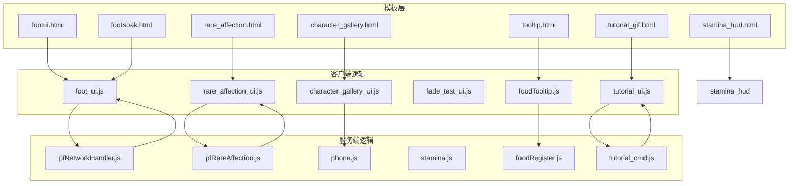
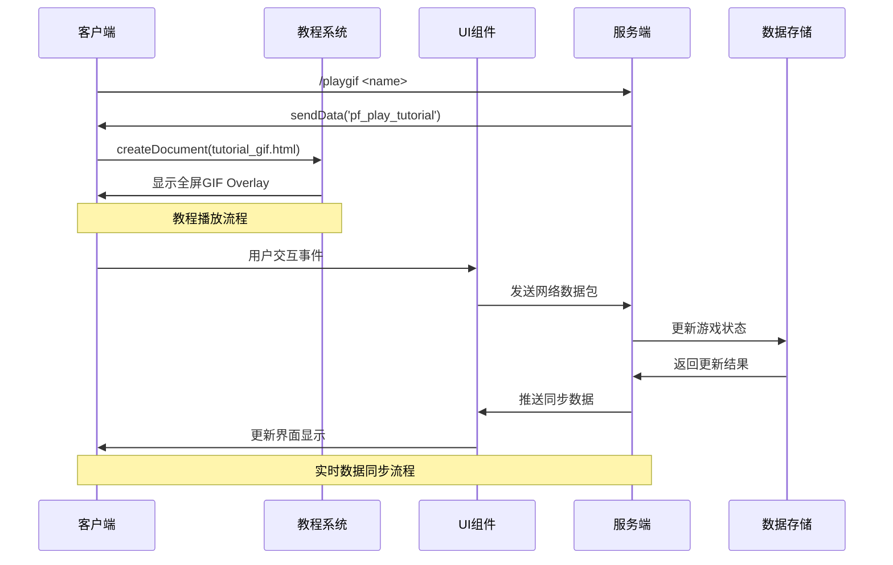
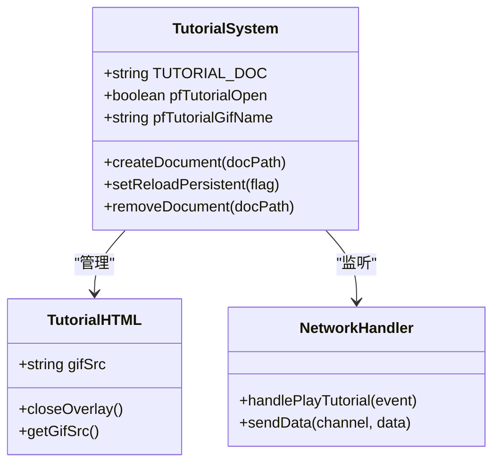
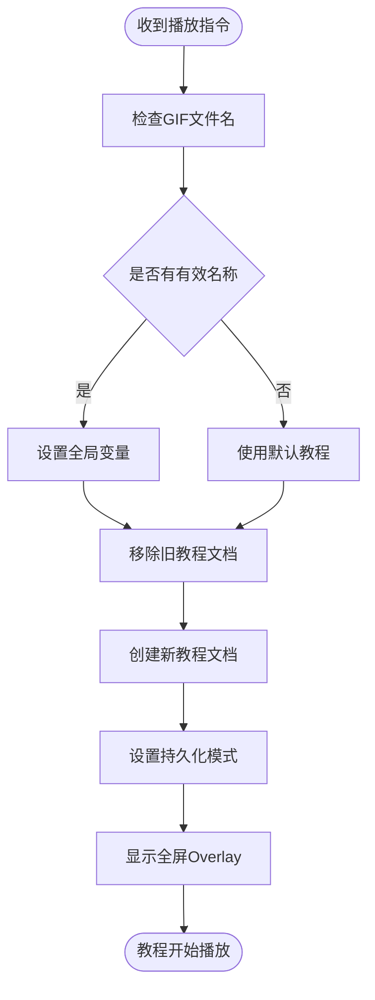
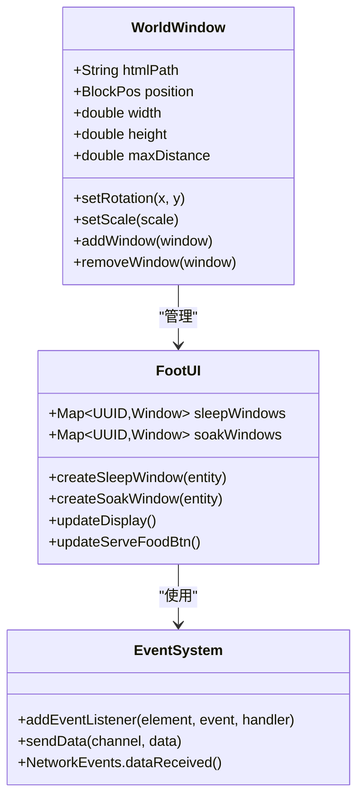
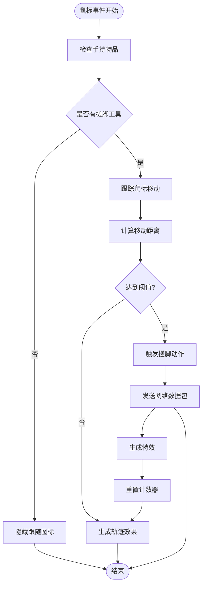
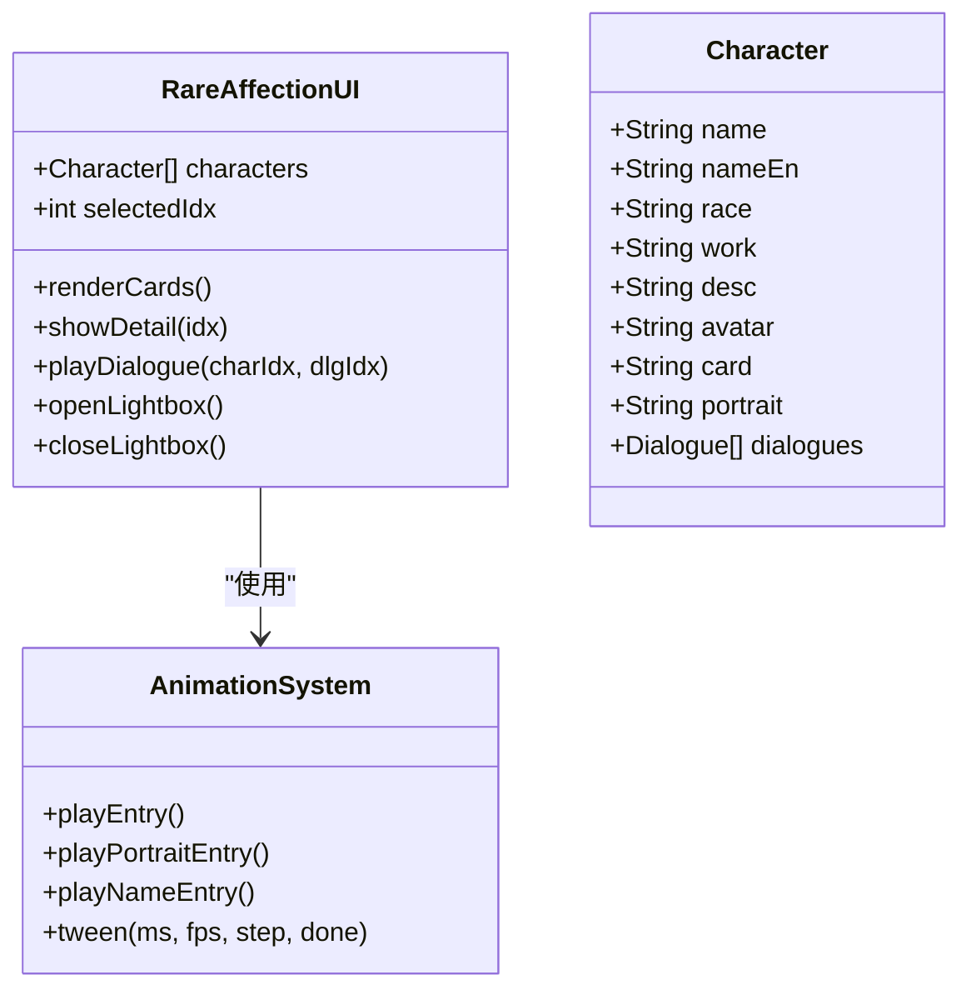
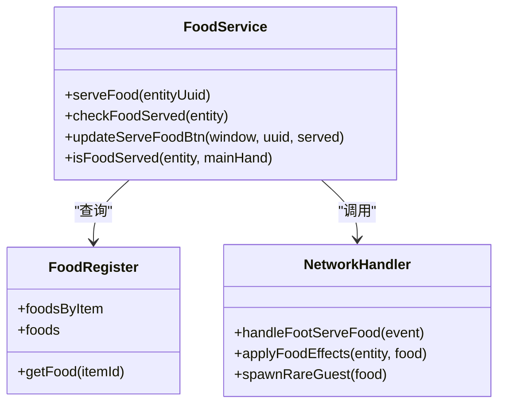
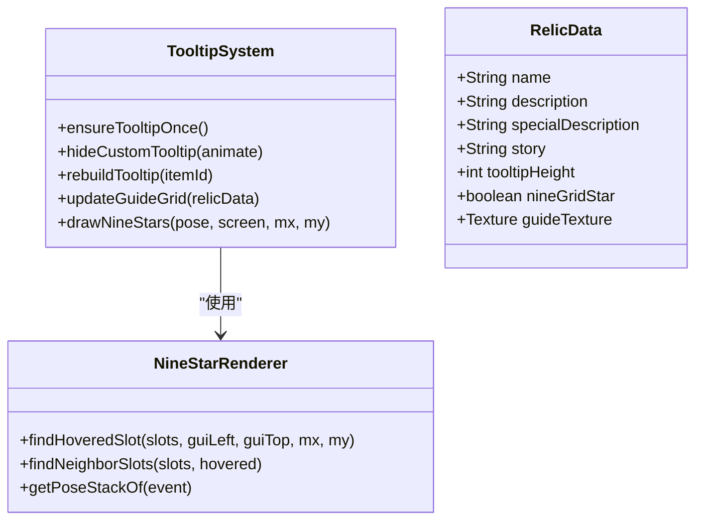
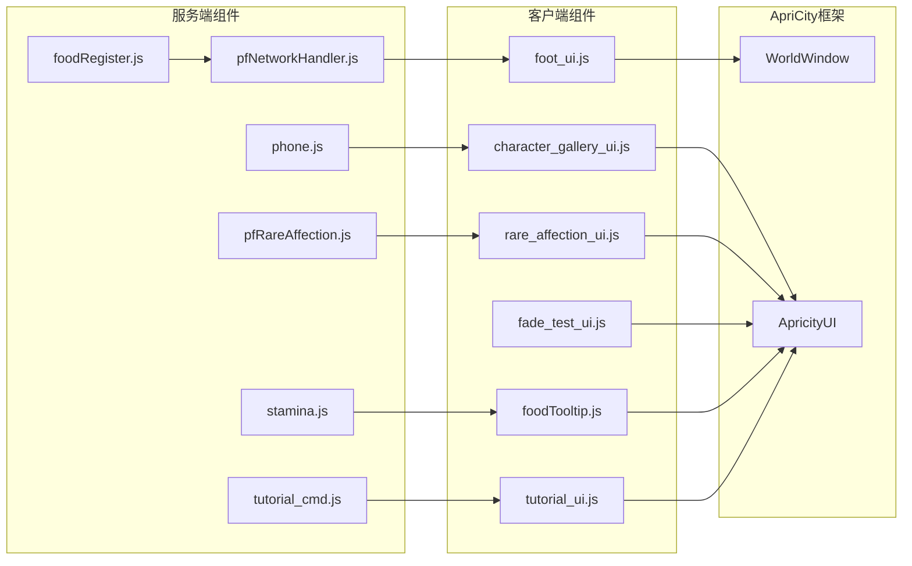

# UI界面系统

<cite>
**本文档引用的文件**
- [tutorial_gif.html](file://apricity/kubejs/tutorial_gif.html)
- [tutorial_ui.js](file://kubejs/client_scripts/ui/tutorial_ui.js)
- [tutorial_cmd.js](file://kubejs/server_scripts/tutorial_cmd.js)
- [footui.html](file://apricity/kubejs/footui.html)
- [footsoak.html](file://apricity/kubejs/footsoak.html)
- [character_gallery.html](file://apricity/kubejs/character_gallery.html)
- [rare_affection.html](file://apricity/kubejs/rare_affection.html)
- [tooltip.html](file://apricity/kubejs/tooltip.html)
- [stamina_hud.html](file://apricity/kubejs/stamina_hud.html)
- [foot_ui.js](file://kubejs/client_scripts/ui/foot_ui.js)
- [character_gallery_ui.js](file://kubejs/client_scripts/ui/character_gallery_ui.js)
- [rare_affection_ui.js](file://kubejs/client_scripts/ui/rare_affection_ui.js)
- [fade_test_ui.js](file://kubejs/client_scripts/ui/fade_test_ui.js)
- [foodTooltip.js](file://kubejs/client_scripts/tooltip/foodTooltip.js)
- [pfRareAffection.js](file://kubejs/server_scripts/pathfinder/pfRareAffection.js)
- [pfNetworkHandler.js](file://kubejs/server_scripts/pathfinder/pfNetworkHandler.js)
- [pfConfigUiHandler.js](file://kubejs/server_scripts/pathfinder/pfConfigUiHandler.js)
- [foodRegister.js](file://kubejs/startup_scripts/food/foodRegister.js)
</cite>

## 更新摘要
**已进行的更改**
- 新增了完整的GIF教程系统作为UI界面系统的重要组成部分，增强了用户引导和教学功能
- 新增了食物服务按钮功能，允许玩家消耗手持茶水来服务顾客并召唤稀客
- 添加了羽毛交互功能，支持送客操作和特殊互动效果
- 完全重构了稀有顾客好感度界面，采用全新的HTML结构和JavaScript逻辑
- 移除了旧的步骤跟踪显示，优化了用户界面简洁性
- 增强了工具提示系统，新增奉茶食物tooltip功能
- 改进了3D交互系统，支持更多物品类型和动画效果

## 目录
1. [简介](#简介)
2. [项目结构](#项目结构)
3. [核心组件](#核心组件)
4. [架构概览](#架构概览)
5. [详细组件分析](#详细组件分析)
6. [依赖关系分析](#依赖关系分析)
7. [性能考量](#性能考量)
8. [故障排除指南](#故障排除指南)
9. [结论](#结论)
10. [附录](#附录)

## 简介
本项目基于 ApriCity 框架构建了完整的3D UI界面系统，覆盖脚部UI、手机界面、体力HUD、角色画廊、稀有顾客好感度界面、工具提示和GIF教程系统等核心组件。系统采用HTML/CSS模板与JavaScript事件绑定相结合的方式，在Minecraft客户端中实现沉浸式的3D交互体验。界面通过ApriCity的WorldWindow和Overlay机制实现在世界空间中的3D显示，并通过KubeJS的网络事件系统实现与服务端的数据同步。

**更新** 新增了GIF教程系统，提供全屏自适应的教学动画播放功能，增强了用户引导和教学体验。同时新增了食物服务按钮、羽毛交互功能和改进的稀有顾客好感度界面，提供了更加丰富的游戏机制和用户交互体验。

## 项目结构
UI系统主要分为六个层次：
- **模板层**：HTML文件定义界面结构和样式
- **逻辑层**：JavaScript脚本处理用户交互和业务逻辑
- **数据层**：服务端脚本管理游戏状态和数据同步
- **渲染层**：ApriCity框架提供3D渲染和窗口管理
- **网络层**：KubeJS网络事件系统处理客户端-服务端通信
- **教程层**：GIF教程系统提供用户引导和教学功能

**图表来源**
- [footui.html:1-324](file://apricity/kubejs/footui.html#L1-L324)
- [rare_affection.html:1-621](file://apricity/kubejs/rare_affection.html#L1-L621)
- [tutorial_gif.html:1-120](file://apricity/kubejs/tutorial_gif.html#L1-L120)
- [foot_ui.js:1-800](file://kubejs/client_scripts/ui/foot_ui.js#L1-L800)

## 核心组件
UI系统包含七大核心组件：

### GIF教程系统（全新）
- **全屏Overlay**：全屏自适应播放指定GIF动画，叠在当前MC Screen之上
- **动态内容**：根据全局变量`global.pfTutorialGifName`动态加载不同教程
- **关闭机制**：仅支持右上角X按钮关闭，不响应ESC键
- **资源管理**：GIF文件存放在`apricity/kubejs/tutorials/<name>.gif`路径
- **状态管理**：使用`global.pfTutorialOpen`跟踪教程打开状态

### 脚部UI组件（增强版）
- **需求清单显示**：实时展示脚掌、脚心、脚趾、脚跟的需求次数
- **满意度进度条**：横向进度条显示顾客满意度
- **茶水按钮**：新增奉茶功能，消耗手持已登记的茶水来服务顾客
- **羽毛交互**：支持羽毛物品的特殊交互，用于送客操作
- **3D交互**：支持鼠标拖动产生粒子效果和动画，改进的拖动检测算法

### 泡脚UI组件
- **泡脚按钮**：触发泡脚流程，仅接受右键操作
- **倒计时显示**：显示泡脚剩余时间
- **进度条**：泡脚过程中的进度指示
- **水桶图标**：根据泡脚状态切换空桶和水桶贴图

### 角色画廊界面
- **六角色头像**：顶部固定头像栏，支持主题色边框
- **角色详情**：左侧姓名/资料，中央透明立绘，右侧简介/回想
- **动画效果**：页面入场动画、立绘切换动画、名称滑入动画
- **大图查看**：点击立绘可查看完整角色卡片
- **对话系统**：支持播放角色剧情对话

### 稀有顾客好感度界面（全新）
- **双页签设计**：角色图鉴和稀客好感度两个主要页签
- **左栏卡片网格**：三列布局显示稀客信息，支持滚动浏览
- **右栏详情面板**：显示选中稀客的详细信息、好感度和报酬
- **爱心系统**：三级爱心表示好感度等级
- **报酬预览**：显示不同好感度等级的掉落物品

### 工具提示系统（增强版）
- **遗物Tooltip**：自定义HTML tooltip，支持标题栏和描述面板
- **九宫格星标**：在背包界面叠加星形标记
- **奉茶食物Tooltip**：显示食物的茶水效果和稀客召唤信息
- **动态内容**：根据物品类型显示不同的引导网格
- **颜色分级**：根据稀有度设置不同标题颜色

### 体力HUD组件
- **体力条**：垂直进度条显示体力值
- **颜色分级**：低、中、高体力值的颜色区分
- **自动更新**：每20tick向服务端请求更新

**章节来源**
- [tutorial_gif.html:1-120](file://apricity/kubejs/tutorial_gif.html#L1-L120)
- [tutorial_ui.js:1-56](file://kubejs/client_scripts/ui/tutorial_ui.js#L1-L56)
- [foot_ui.js:1-800](file://kubejs/client_scripts/ui/foot_ui.js#L1-L800)
- [rare_affection.html:1-621](file://apricity/kubejs/rare_affection.html#L1-L621)
- [foodTooltip.js:1-35](file://kubejs/client_scripts/tooltip/foodTooltip.js#L1-L35)

## 架构概览
系统采用客户端-服务端分离的架构，通过ApriCity框架实现3D界面渲染。

## 详细组件分析

### GIF教程系统分析（全新）

#### 全屏Overlay架构
GIF教程系统采用全屏Overlay架构，提供沉浸式的学习体验。

**图表来源**
- [tutorial_ui.js:12-38](file://kubejs/client_scripts/ui/tutorial_ui.js#L12-L38)
- [tutorial_gif.html:91-117](file://apricity/kubejs/tutorial_gif.html#L91-L117)

#### 动态GIF加载机制
教程系统支持动态加载不同的GIF文件，通过全局变量控制播放内容。

**图表来源**
- [tutorial_ui.js:21-38](file://kubejs/client_scripts/ui/tutorial_ui.js#L21-L38)

#### 服务端命令接口
教程系统提供了简单的服务端命令接口，便于集成到各种游戏场景中。

**更新** 新增了`/playgif`命令，支持参数化和默认值处理。

**章节来源**
- [tutorial_cmd.js:1-27](file://kubejs/server_scripts/tutorial_cmd.js#L1-L27)
- [tutorial_ui.js:19-38](file://kubejs/client_scripts/ui/tutorial_ui.js#L19-L38)
- [tutorial_gif.html:94-103](file://apricity/kubejs/tutorial_gif.html#L94-L103)

### 脚部UI组件分析（增强版）

#### 3D窗口管理系统
脚部UI通过WorldWindow实现3D显示，支持动态定位和旋转。

**图表来源**
- [foot_ui.js:13-15](file://kubejs/client_scripts/ui/foot_ui.js#L13-L15)

#### 改进的交互事件处理机制
脚部UI实现了复杂的鼠标交互系统，包括拖动检测、粒子效果生成和茶水按钮功能。

**图表来源**
- [foot_ui.js:140-257](file://kubejs/client_scripts/ui/foot_ui.js#L140-L257)

**更新** 新增了茶水按钮功能，允许玩家消耗手持已登记的茶水来服务顾客，同时支持羽毛物品的特殊交互。

**章节来源**
- [foot_ui.js:76-284](file://kubejs/client_scripts/ui/foot_ui.js#L76-L284)
- [footui.html:1-324](file://apricity/kubejs/footui.html#L1-L324)

### 稀有顾客好感度界面分析（全新）

#### Screen类型界面架构
稀有顾客好感度界面采用Screen类型的界面架构，提供完整的用户交互体验。

**图表来源**
- [rare_affection.html:194-302](file://apricity/kubejs/rare_affection.html#L194-L302)

#### 动画系统
稀有顾客好感度界面实现了多种动画效果，包括页面入场、卡片选择和滚动条动画。

**更新** 完全重构了动画系统，采用更流畅的补间动画和更好的性能优化。

**章节来源**
- [rare_affection.html:330-400](file://apricity/kubejs/rare_affection.html#L330-L400)
- [rare_affection_ui.js:1-49](file://kubejs/client_scripts/ui/rare_affection_ui.js#L1-L49)

### 食物服务系统分析（新增）

#### 茶水按钮功能
食物服务系统允许玩家通过茶水按钮消耗手持茶水来服务顾客。

**图表来源**
- [pfNetworkHandler.js:428-528](file://kubejs/server_scripts/pathfinder/pfNetworkHandler.js#L428-L528)

#### 羽毛交互系统
羽毛物品被集成到搓脚工具系统中，支持特殊的送客交互。

**更新** 新增了羽毛物品的特殊处理逻辑，支持送客功能和相应的视觉效果。

**章节来源**
- [foot_ui.js:65-81](file://kubejs/client_scripts/ui/foot_ui.js#L65-L81)
- [pfNetworkHandler.js:428-528](file://kubejs/server_scripts/pathfinder/pfNetworkHandler.js#L428-L528)

### 工具提示系统分析（增强版）

#### 遗物Tooltip架构
工具提示系统采用独立的HTML文档架构，支持动态内容和样式调整。

**图表来源**
- [tooltip.js:67-96](file://kubejs/startup_scripts/tooltip.js#L67-L96)

#### 九宫格星标系统
工具提示系统集成了九宫格星标功能，在背包界面中为特定遗物添加视觉标记。

**更新** 增强了九宫格星标的渲染性能，使用原版RenderSystem直接绘制，避免依赖AUI绘制。

**章节来源**
- [tooltip.js:112-202](file://kubejs/startup_scripts/tooltip.js#L112-L202)
- [tooltip.html:1-249](file://apricity/kubejs/tooltip.html#L1-L249)

## 依赖关系分析

### 组件耦合关系
UI系统各组件之间保持松耦合，通过统一的事件系统进行通信。

**图表来源**
- [foot_ui.js:13-15](file://kubejs/client_scripts/ui/foot_ui.js#L13-L15)
- [rare_affection_ui.js:13-13](file://kubejs/client_scripts/ui/rare_affection_ui.js#L13-L13)
- [tutorial_ui.js:12-14](file://kubejs/client_scripts/ui/tutorial_ui.js#L12-L14)

### 数据流管理
系统采用双向数据流，客户端负责界面更新，服务端负责状态管理。

**章节来源**
- [pfNetworkHandler.js:428-528](file://kubejs/server_scripts/pathfinder/pfNetworkHandler.js#L428-L528)
- [tutorial_cmd.js:7-25](file://kubejs/server_scripts/tutorial_cmd.js#L7-L25)

## 性能考量
系统在性能优化方面采用了多项策略：

### 内存管理
- 使用Map结构管理窗口实例，及时清理不再使用的窗口
- 通过客户端Tick事件控制更新频率，避免过度渲染
- 实现文档缓存机制，复用已有的ApricityUI文档实例
- 教程系统使用全局状态变量跟踪文档生命周期

### 网络优化
- 采用批量数据同步，减少网络通信次数
- 实现数据缓存机制，避免重复请求
- 使用延迟移除队列，避免框架内部NPE

### 渲染优化
- 使用CSS3硬件加速特性
- 控制粒子效果数量，避免影响游戏性能
- 采用原生RenderSystem进行九宫格星标绘制，提升性能
- 教程GIF使用`image-rendering: pixelated`优化像素艺术效果

**更新** 新增了教程系统的内存管理和状态跟踪机制，确保教程Overlay的正确生命周期管理。

## 故障排除指南

### 常见问题及解决方案

#### GIF教程不显示问题
1. **检查教程文件是否存在**：确认`tutorials/<name>.gif`文件存在
2. **验证全局变量设置**：检查`global.pfTutorialGifName`是否正确设置
3. **确认文档创建成功**：查看控制台日志中的`[TUTORIAL]`相关消息
4. **检查权限配置**：确保`aui-mouse-events`设置为`intercept`

#### UI不显示问题
1. **检查ApriCity框架是否正确加载**
2. **确认HTML文件路径是否正确**
3. **验证WorldWindow初始化参数**
4. **检查Screen类型界面的生命周期管理**

#### 交互无响应问题
1. **检查事件绑定是否成功**
2. **确认NetworkEvents监听器是否注册**
3. **验证sendData方法调用是否正确**
4. **检查鼠标事件拦截配置**

#### 数据同步错误
1. **检查persistentData字段是否存在**
2. **确认NetworkEvents.dataReceived回调是否正确处理**
3. **验证数据格式是否符合预期**
4. **检查文档重建后的事件监听器清理**

**更新** 新增了GIF教程系统的故障排除指南，包括教程文件检查和全局变量验证。

**章节来源**
- [foot_ui.js:766-947](file://kubejs/client_scripts/ui/foot_ui.js#L766-L947)
- [rare_affection_ui.js:33-42](file://kubejs/client_scripts/ui/rare_affection_ui.js#L33-L42)
- [tutorial_ui.js:42-48](file://kubejs/client_scripts/ui/tutorial_ui.js#L42-L48)

## 结论
本UI界面系统通过ApriCity框架实现了Minecraft中的3D界面功能，具有以下特点：

1. **模块化设计**：各组件职责明确，便于维护和扩展
2. **实时同步**：通过网络事件实现客户端与服务端的实时数据交换
3. **用户体验**：提供丰富的视觉效果和交互反馈
4. **性能优化**：采用多种优化策略确保流畅运行
5. **可扩展性**：支持新增不同类型的UI组件
6. **教学支持**：新增GIF教程系统，提供直观的用户引导

**更新** 新增的GIF教程系统显著提升了用户体验，为玩家提供了直观的操作指导。同时，食物服务按钮、羽毛交互功能和改进的稀有顾客好感度界面进一步丰富了游戏体验，提供了更加专业和美观的界面效果。

系统为Minecraft模组开发提供了完整的UI解决方案，可以作为其他3D界面项目的参考模板。

## 附录

### 开发最佳实践
1. **事件处理**：确保所有事件都有对应的错误处理机制
2. **内存管理**：及时清理不再使用的DOM元素和事件监听器
3. **数据验证**：对所有网络数据进行格式和范围验证
4. **性能监控**：定期检查渲染性能和内存使用情况
5. **文档管理**：正确处理ApricityUI文档的生命周期
6. **教程管理**：使用全局状态变量跟踪教程Overlay的生命周期

### 自定义选项
- **界面样式**：可通过修改CSS变量调整颜色和布局
- **交互行为**：通过修改JavaScript逻辑调整事件响应
- **数据格式**：支持自定义数据结构和同步协议
- **动画效果**：可自定义补间动画和过渡效果
- **教程内容**：通过放置不同的GIF文件自定义教学内容

### 响应式设计
系统支持不同分辨率和屏幕尺寸的适配，通过相对单位和flex布局实现灵活的界面布局。

**更新** 新增了GIF教程系统的响应式设计，支持全屏自适应播放和动态内容加载。

### GIF教程开发指南
1. **文件命名**：将教程GIF文件命名为`<name>.gif`并放置在`apricity/kubejs/tutorials/`目录下
2. **触发方式**：使用`/playgif <name>`命令或从服务端发送`pf_play_tutorial`数据包
3. **默认教程**：未指定名称时自动播放`default.gif`
4. **关闭方式**：仅支持点击右上角X按钮关闭
5. **尺寸建议**：建议使用与原游戏画面比例相近的GIF尺寸以获得最佳效果

**章节来源**
- [tutorial_cmd.js:7-25](file://kubejs/server_scripts/tutorial_cmd.js#L7-L25)
- [tutorial_gif.html:94-103](file://apricity/kubejs/tutorial_gif.html#L94-L103)