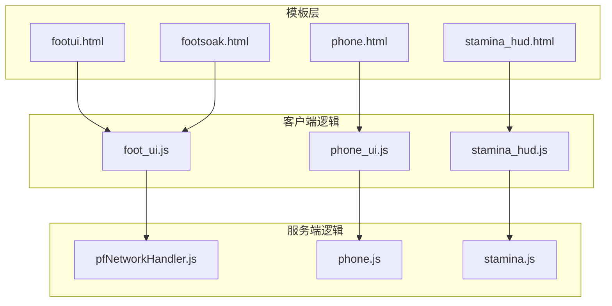
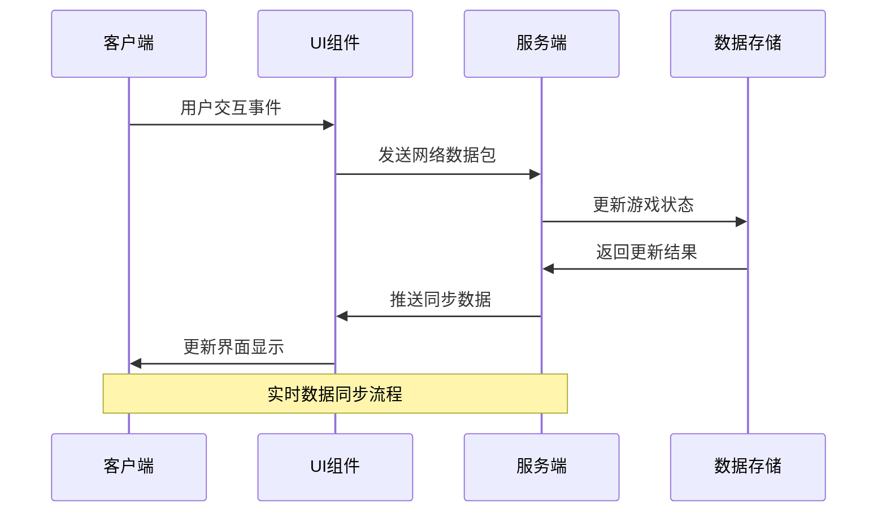
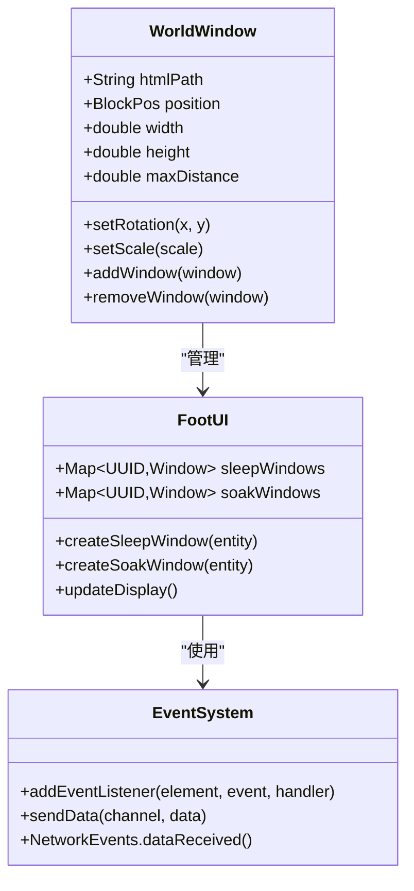
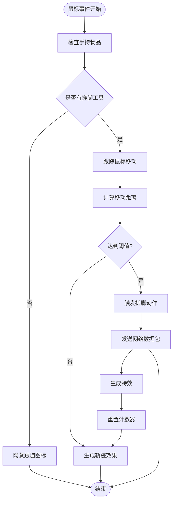
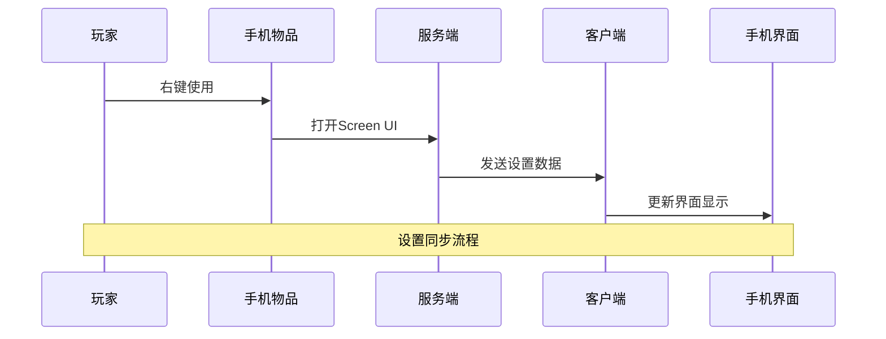
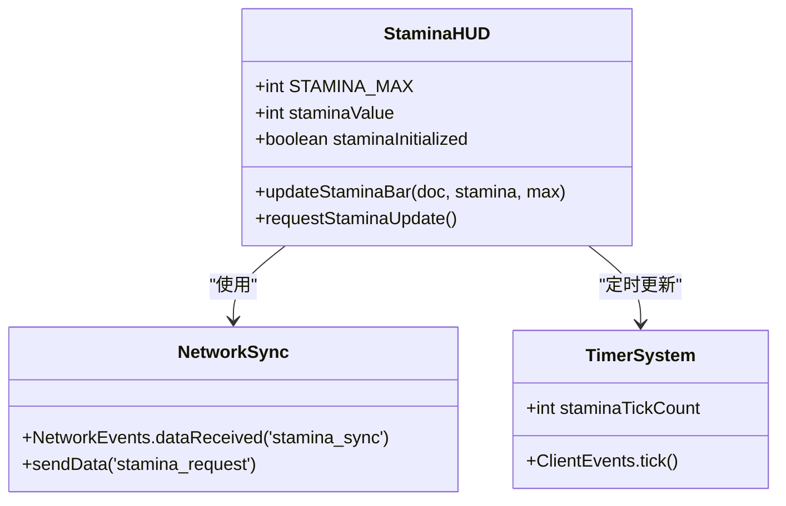
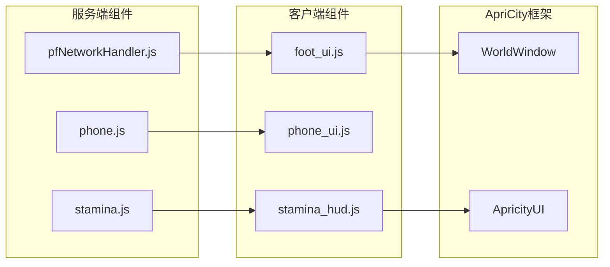

# UI界面系统

<cite>
**本文档引用的文件**
- [footui.html](file://apricity\kubejs\footui.html)
- [footsoak.html](file://apricity\kubejs\footsoak.html)
- [phone.html](file://apricity\kubejs\phone.html)
- [stamina_hud.html](file://apricity\kubejs\stamina_hud.html)
- [foot_ui.js](file://kubejs\client_scripts\ui\foot_ui.js)
- [phone_ui.js](file://kubejs\client_scripts\ui\phone_ui.js)
- [stamina_hud.js](file://kubejs\client_scripts\ui\stamina_hud.js)
- [pfNetworkHandler.js](file://kubejs\server_scripts\pathfinder\pfNetworkHandler.js)
- [phone.js](file://kubejs\server_scripts\phone.js)
- [stamina.js](file://kubejs\server_scripts\stamina.js)
- [footui.html](file://kubejs\assets\kubejs\apricity\footui.html)
</cite>

## 目录
1. [简介](#简介)
2. [项目结构](#项目结构)
3. [核心组件](#核心组件)
4. [架构概览](#架构概览)
5. [详细组件分析](#详细组件分析)
6. [依赖关系分析](#依赖关系分析)
7. [性能考量](#性能考量)
8. [故障排除指南](#故障排除指南)
9. [结论](#结论)
10. [附录](#附录)

## 简介
本项目基于 ApriCity 框架构建了完整的3D UI界面系统，覆盖脚部UI、手机界面、体力HUD等核心组件。系统采用HTML/CSS模板与JavaScript事件绑定相结合的方式，在Minecraft客户端中实现沉浸式的3D交互体验。界面通过ApriCity的WorldWindow和Overlay机制实现在世界空间中的3D显示，并通过KubeJS的网络事件系统实现与服务端的数据同步。

## 项目结构
UI系统主要分为三个层次：
- **模板层**：HTML文件定义界面结构和样式
- **逻辑层**：JavaScript脚本处理用户交互和业务逻辑
- **数据层**：服务端脚本管理游戏状态和数据同步

**图表来源**
- [footui.html:1-425](file://apricity\kubejs\footui.html#L1-L425)
- [footsoak.html:1-155](file://apricity\kubejs\footsoak.html#L1-L155)
- [phone.html:1-800](file://apricity\kubejs\phone.html#L1-L800)
- [stamina_hud.html:1-86](file://apricity\kubejs\stamina_hud.html#L1-L86)

**章节来源**
- [footui.html:1-425](file://apricity\kubejs\footui.html#L1-L425)
- [footsoak.html:1-155](file://apricity\kubejs\footsoak.html#L1-L155)
- [phone.html:1-800](file://apricity\kubejs\phone.html#L1-L800)
- [stamina_hud.html:1-86](file://apricity\kubejs\stamina_hud.html#L1-L86)

## 核心组件
UI系统包含四大核心组件：

### 脚部UI组件
- **需求清单显示**：实时展示脚掌、脚心、脚趾、脚跟的需求次数
- **满意度进度条**：横向进度条显示顾客满意度
- **步骤记录**：显示已执行的服务步骤
- **3D交互**：支持鼠标拖动产生粒子效果和动画

### 泡脚UI组件
- **泡脚按钮**：触发泡脚流程
- **倒计时显示**：显示泡脚剩余时间
- **进度条**：泡脚过程中的进度指示

### 手机UI组件
- **应用界面**：模拟手机应用的图标布局
- **时间显示**：实时显示Minecraft时间
- **设置管理**：泡脚跳过、一键满足等功能
- **评价系统**：顾客类型评价展示

### 体力HUD组件
- **体力条**：垂直进度条显示体力值
- **颜色分级**：低、中、高体力值的颜色区分
- **自动更新**：每20tick向服务端请求更新

**章节来源**
- [foot_ui.js:1-958](file://kubejs\client_scripts\ui\foot_ui.js#L1-L958)
- [phone_ui.js:1-56](file://kubejs\client_scripts\ui\phone_ui.js#L1-L56)
- [stamina_hud.js:1-101](file://kubejs\client_scripts\ui\stamina_hud.js#L1-L101)

## 架构概览
系统采用客户端-服务端分离的架构，通过ApriCity框架实现3D界面渲染。

**图表来源**
- [pfNetworkHandler.js:1-317](file://kubejs\server_scripts\pathfinder\pfNetworkHandler.js#L1-L317)
- [foot_ui.js:766-947](file://kubejs\client_scripts\ui\foot_ui.js#L766-L947)

## 详细组件分析

### 脚部UI组件分析

#### 3D窗口管理系统
脚部UI通过WorldWindow实现3D显示，支持动态定位和旋转。

**图表来源**
- [foot_ui.js:13-15](file://kubejs\client_scripts\ui\foot_ui.js#L13-L15)

#### 交互事件处理机制
脚部UI实现了复杂的鼠标交互系统，包括拖动检测、粒子效果生成等。

**图表来源**
- [foot_ui.js:140-257](file://kubejs\client_scripts\ui\foot_ui.js#L140-L257)

**章节来源**
- [foot_ui.js:76-284](file://kubejs\client_scripts\ui\foot_ui.js#L76-L284)
- [footui.html:1-425](file://apricity\kubejs\footui.html#L1-L425)

### 手机UI组件分析

#### 网络事件处理
手机UI通过NetworkEvents实现与服务端的数据同步。

**图表来源**
- [phone.js:8-23](file://kubejs\server_scripts\phone.js#L8-L23)
- [phone_ui.js:13-47](file://kubejs\client_scripts\ui\phone_ui.js#L13-L47)

#### 设置管理系统
手机UI支持多种设置选项的动态管理。

**章节来源**
- [phone.html:1-800](file://apricity\kubejs\phone.html#L1-L800)
- [phone_ui.js:1-56](file://kubejs\client_scripts\ui\phone_ui.js#L1-L56)

### 体力HUD组件分析

#### HUD渲染机制
体力HUD通过ApriCity的Overlay系统实现屏幕固定显示。

**图表来源**
- [stamina_hud.js:1-101](file://kubejs\client_scripts\ui\stamina_hud.js#L1-L101)

**章节来源**
- [stamina_hud.js:1-101](file://kubejs\client_scripts\ui\stamina_hud.js#L1-L101)
- [stamina_hud.html:1-86](file://apricity\kubejs\stamina_hud.html#L1-L86)

## 依赖关系分析

### 组件耦合关系
UI系统各组件之间保持松耦合，通过统一的事件系统进行通信。

**图表来源**
- [foot_ui.js:13-15](file://kubejs\client_scripts\ui\foot_ui.js#L13-L15)
- [stamina_hud.js:7-7](file://kubejs\client_scripts\ui\stamina_hud.js#L7-L7)

### 数据流管理
系统采用双向数据流，客户端负责界面更新，服务端负责状态管理。

**章节来源**
- [pfNetworkHandler.js:39-219](file://kubejs\server_scripts\pathfinder\pfNetworkHandler.js#L39-L219)
- [stamina.js:17-21](file://kubejs\server_scripts\stamina.js#L17-L21)

## 性能考量
系统在性能优化方面采用了多项策略：

### 内存管理
- 使用Map结构管理窗口实例，及时清理不再使用的窗口
- 通过客户端Tick事件控制更新频率，避免过度渲染

### 网络优化
- 采用批量数据同步，减少网络通信次数
- 实现数据缓存机制，避免重复请求

### 渲染优化
- 使用CSS3硬件加速特性
- 控制粒子效果数量，避免影响游戏性能

## 故障排除指南

### 常见问题及解决方案

#### UI不显示问题
1. **检查ApriCity框架是否正确加载**
2. **确认HTML文件路径是否正确**
3. **验证WorldWindow初始化参数**

#### 交互无响应问题
1. **检查事件绑定是否成功**
2. **确认NetworkEvents监听器是否注册**
3. **验证sendData方法调用是否正确**

#### 数据同步错误
1. **检查persistentData字段是否存在**
2. **确认NetworkEvents.dataReceived回调是否正确处理**
3. **验证数据格式是否符合预期**

**章节来源**
- [foot_ui.js:766-947](file://kubejs\client_scripts\ui\foot_ui.js#L766-L947)
- [stamina_hud.js:50-101](file://kubejs\client_scripts\ui\stamina_hud.js#L50-L101)

## 结论
本UI界面系统通过ApriCity框架实现了Minecraft中的3D界面功能，具有以下特点：

1. **模块化设计**：各组件职责明确，便于维护和扩展
2. **实时同步**：通过网络事件实现客户端与服务端的实时数据交换
3. **用户体验**：提供丰富的视觉效果和交互反馈
4. **性能优化**：采用多种优化策略确保流畅运行

系统为Minecraft模组开发提供了完整的UI解决方案，可以作为其他3D界面项目的参考模板。

## 附录

### 开发最佳实践
1. **事件处理**：确保所有事件都有对应的错误处理机制
2. **内存管理**：及时清理不再使用的DOM元素和事件监听器
3. **数据验证**：对所有网络数据进行格式和范围验证
4. **性能监控**：定期检查渲染性能和内存使用情况

### 自定义选项
- **界面样式**：可通过修改CSS变量调整颜色和布局
- **交互行为**：通过修改JavaScript逻辑调整事件响应
- **数据格式**：支持自定义数据结构和同步协议

### 响应式设计
系统支持不同分辨率和屏幕尺寸的适配，通过相对单位和flex布局实现灵活的界面布局。