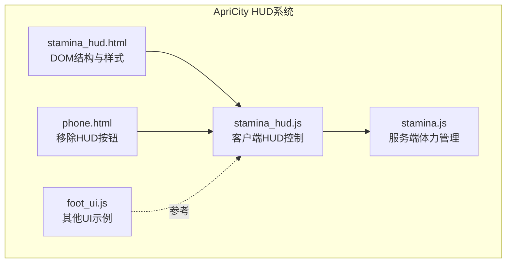
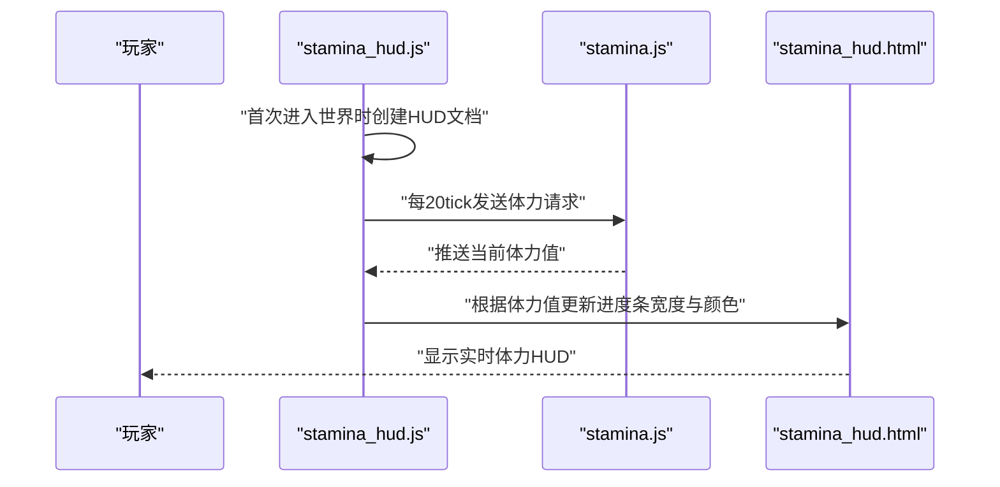
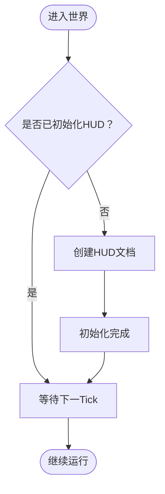
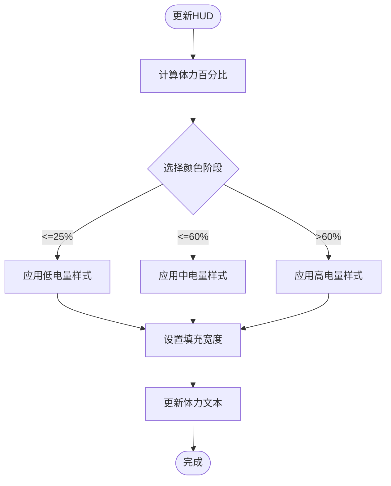
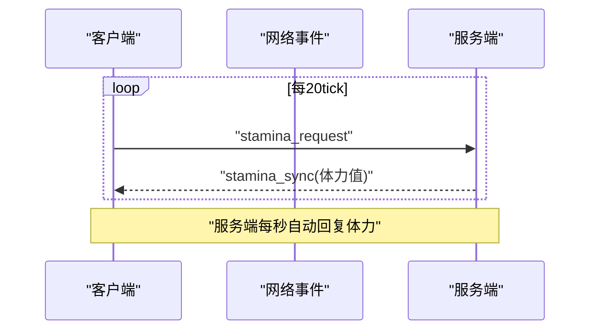
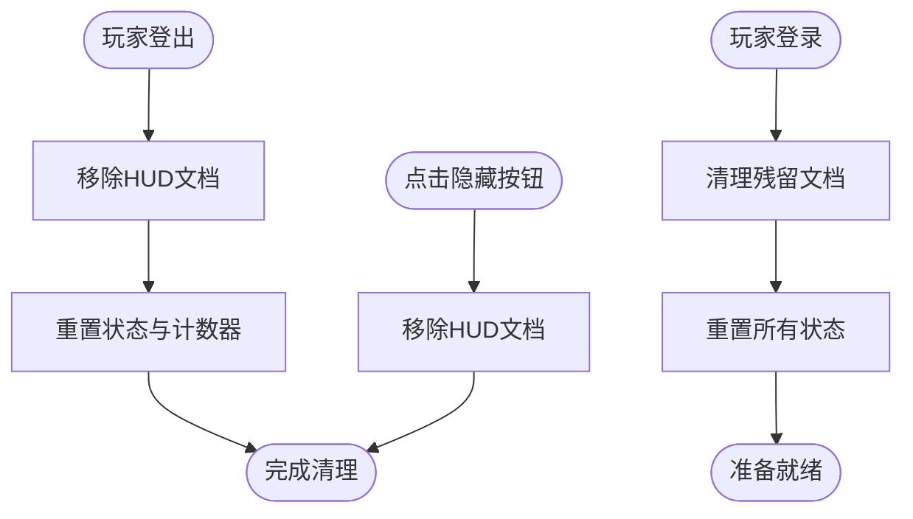
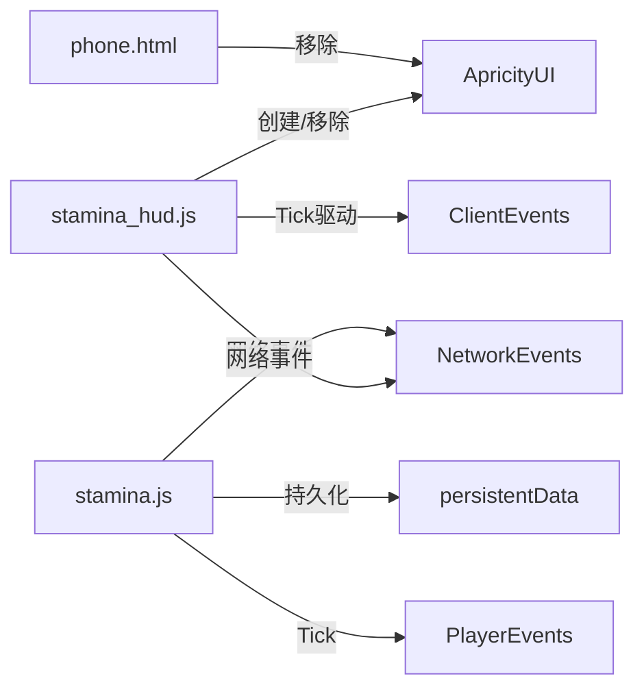

基于对代码的分析，我现在了解了体力HUD系统的性能优化变更。让我更新文档以反映这些重要的改进：

# 体力HUD组件

<cite>
**本文档引用的文件**
- [stamina_hud.html](file://apricity/kubejs/stamina_hud.html)
- [stamina_hud.js](file://kubejs/client_scripts/ui/stamina_hud.js)
- [stamina.js](file://kubejs/server_scripts/stamina/stamina.js)
- [phone.html](file://apricity/kubejs/phone.html)
- [foot_ui.js](file://kubejs/client_scripts/ui/foot_ui.js)
</cite>

## 更新摘要
**变更内容**
- 渲染方式从高度定位改为宽度定位，提升性能表现
- 文本显示修复，使用setTextContent方法确保跨平台兼容性
- 清理机制改进，防止脚本重载和重登时的残留问题
- 透明度优化，使用translateZ(-1000px)实现正确的层级控制

## 目录
1. [简介](#简介)
2. [项目结构](#项目结构)
3. [核心组件](#核心组件)
4. [架构总览](#架构总览)
5. [详细组件分析](#详细组件分析)
6. [依赖关系分析](#依赖关系分析)
7. [性能考虑](#性能考虑)
8. [故障排除指南](#故障排除指南)
9. [结论](#结论)

## 简介
本文件面向ApriCity框架下的体力HUD组件，系统性阐述基于HTML/CSS/JavaScript的HUD界面实现，包括HUD的创建、定位与样式配置，体力值的实时更新机制、进度条与颜色变化逻辑，以及HUD与游戏状态的同步方式。文档同时提供自定义样式、位置调整与与其他UI元素协调显示的实践建议，并总结数据获取与显示优化策略。

**更新** 本次更新重点介绍了性能优化改进，包括渲染方式从高度改为宽度定位、文本显示修复和清理机制增强。

## 项目结构
体力HUD相关的核心文件分布如下：
- HTML模板：apricity/kubejs/stamina_hud.html 提供HUD的DOM结构与CSS样式
- 客户端脚本：kubejs/client_scripts/ui/stamina_hud.js 负责HUD的创建、更新与清理
- 服务端脚本：kubejs/server_scripts/stamina/stamina.js 维护体力值并进行网络同步
- UI集成：apricity/kubejs/phone.html 展示如何通过按钮移除HUD
- 其他UI参考：kubejs/client_scripts/ui/foot_ui.js 展示ApricityUI的Overlay创建与层级管理

**图表来源**
- [stamina_hud.html:1-109](file://apricity/kubejs/stamina_hud.html#L1-L109)
- [stamina_hud.js:1-152](file://kubejs/client_scripts/ui/stamina_hud.js#L1-L152)
- [stamina.js:1-81](file://kubejs/server_scripts/stamina/stamina.js#L1-L81)
- [phone.html:932-975](file://apricity/kubejs/phone.html#L932-L975)
- [foot_ui.js:1-200](file://kubejs/client_scripts/ui/foot_ui.js#L1-L200)

**章节来源**
- [stamina_hud.html:1-109](file://apricity/kubejs/stamina_hud.html#L1-L109)
- [stamina_hud.js:1-152](file://kubejs/client_scripts/ui/stamina_hud.js#L1-L152)
- [stamina.js:1-81](file://kubejs/server_scripts/stamina/stamina.js#L1-L81)
- [phone.html:932-975](file://apricity/kubejs/phone.html#L932-L975)
- [foot_ui.js:1-200](file://kubejs/client_scripts/ui/foot_ui.js#L1-L200)

## 核心组件
- HUD模板与样式：stamina_hud.html定义了固定定位的HUD容器、图标、文本与水平进度条背景及填充元素，并内置低/中/高三个阶段的颜色渐变类。
- 客户端控制器：stamina_hud.js负责首次创建HUD文档、周期性向服务端请求体力值、接收服务端推送并更新显示、以及登出时清理。
- 服务端体力系统：stamina.js维护玩家持久化体力值、处理体力消耗与恢复、按tick自动回复，并通过网络事件与客户端同步。
- UI集成与移除：phone.html提供移除HUD的按钮入口，展示与HUD在同一框架下的交互方式。
- 其他UI参考：foot_ui.js展示了ApricityUI的Overlay创建流程与层级管理，可作为HUD布局与层级设计的参考。

**更新** 主要改进包括：
- 进度条从垂直高度改为水平宽度渲染，提升性能
- 文本显示使用setTextContent方法确保跨平台兼容性
- 增强的清理机制防止脚本重载时的残留问题

**章节来源**
- [stamina_hud.html:1-109](file://apricity/kubejs/stamina_hud.html#L1-L109)
- [stamina_hud.js:1-152](file://kubejs/client_scripts/ui/stamina_hud.js#L1-L152)
- [stamina.js:1-81](file://kubejs/server_scripts/stamina/stamina.js#L1-L81)
- [phone.html:932-975](file://apricity/kubejs/phone.html#L932-L975)
- [foot_ui.js:1-200](file://kubejs/client_scripts/ui/foot_ui.js#L1-L200)

## 架构总览
体力HUD采用"服务端持有数据、客户端呈现"的分层架构。服务端通过持久化存储维护体力值，客户端通过网络事件接收更新并在HUD中实时显示。客户端每20tick向服务端请求一次体力值，确保显示与实际状态一致。

**图表来源**
- [stamina_hud.js:77-127](file://kubejs/client_scripts/ui/stamina_hud.js#L77-L127)
- [stamina.js:17-21](file://kubejs/server_scripts/stamina/stamina.js#L17-L21)
- [stamina_hud.html:37-106](file://apricity/kubejs/stamina_hud.html#L37-L106)

## 详细组件分析

### HUD界面创建与定位
- 创建时机：客户端在首次Tick中检测到未初始化时，通过ApricityUI创建HUD文档。
- 定位策略：HUD采用固定定位，左下角固定在屏幕左侧底部，使用left: 14px和bottom: 14px精确定位。
- 层级控制：HUD容器的z-index被设置为-1，并使用transform: translateZ(-1000px)确保其位于所有AUI页面最底层。

**更新** 层级控制得到显著改进，现在使用translateZ(-1000px)替代传统的z-index方案，确保在所有AUI页面中正确显示。

**图表来源**
- [stamina_hud.js:94-115](file://kubejs/client_scripts/ui/stamina_hud.js#L94-L115)
- [stamina_hud.html:37-47](file://apricity/kubejs/stamina_hud.html#L37-L47)

**章节来源**
- [stamina_hud.js:94-115](file://kubejs/client_scripts/ui/stamina_hud.js#L94-L115)
- [stamina_hud.html:37-47](file://apricity/kubejs/stamina_hud.html#L37-L47)

### 样式配置与颜色变化逻辑
- 进度条结构：包含背景容器与填充元素，填充元素宽度随体力百分比变化（从高度改为宽度）。
- 颜色阶段：
  - 低电量：≤25%，使用红色系渐变
  - 中电量：25<percent≤60%，使用橙色系渐变
  - 高电量：>60%，使用绿色系渐变
- 文本显示：显示当前体力整数值，限制在最大值范围内，使用setTextContent方法确保兼容性。

**更新** 关键性能改进：
- 进度条渲染从height属性改为width属性，减少重排开销
- 文本更新使用setTextContent方法，解决Rhino包装对象兼容性问题
- 添加transition动画使宽度变化更平滑

**图表来源**
- [stamina_hud.js:25-60](file://kubejs/client_scripts/ui/stamina_hud.js#L25-L60)
- [stamina_hud.html:73-94](file://apricity/kubejs/stamina_hud.html#L73-L94)

**章节来源**
- [stamina_hud.js:25-60](file://kubejs/client_scripts/ui/stamina_hud.js#L25-L60)
- [stamina_hud.html:73-94](file://apricity/kubejs/stamina_hud.html#L73-L94)

### 数据获取与实时更新机制
- 请求频率：客户端每20tick向服务端发送一次体力请求。
- 同步方式：服务端通过网络事件推送当前体力值给客户端；客户端接收后更新本地状态并刷新HUD。
- 自动回复：服务端每秒（20tick）为在线玩家自动恢复一定体力，跨重启友好地使用子tick计数器。

**图表来源**
- [stamina_hud.js:117-127](file://kubejs/client_scripts/ui/stamina_hud.js#L117-L127)
- [stamina.js:17-21](file://kubejs/server_scripts/stamina/stamina.js#L17-L21)
- [stamina.js:62-79](file://kubejs/server_scripts/stamina/stamina.js#L62-L79)

**章节来源**
- [stamina_hud.js:117-127](file://kubejs/client_scripts/ui/stamina_hud.js#L117-L127)
- [stamina.js:17-21](file://kubejs/server_scripts/stamina/stamina.js#L17-L21)
- [stamina.js:62-79](file://kubejs/server_scripts/stamina/stamina.js#L62-L79)

### HUD清理与生命周期管理
- 登出清理：客户端登出时移除HUD文档，重置本地状态与计数器，防止残留。
- 交互移除：手机UI中提供按钮，点击后通过ApricityUI移除HUD文档，便于用户临时隐藏。
- 增强清理：登录时主动清理可能存在的残留文档，防止脚本重载导致的重复创建。

**更新** 清理机制得到显著增强：
- 添加了登录时的清理逻辑，防止脚本重载后的残留问题
- 改进了错误处理，确保清理操作不会中断主流程
- 增加了全局可见性控制，支持动态显示/隐藏HUD

**图表来源**
- [stamina_hud.js:131-151](file://kubejs/client_scripts/ui/stamina_hud.js#L131-L151)
- [phone.html:958-975](file://apricity/kubejs/phone.html#L958-L975)

**章节来源**
- [stamina_hud.js:131-151](file://kubejs/client_scripts/ui/stamina_hud.js#L131-L151)
- [phone.html:958-975](file://apricity/kubejs/phone.html#L958-L975)

### 与其他UI元素的协调显示
- 层级与遮挡：HUD的z-index为-1，并使用translateZ(-1000px)确保位于所有AUI页面最底层，避免遮挡游戏主界面。
- 位置与间距：HUD固定在左下角，与右侧UI保持水平间距；如需调整，可在样式中修改left/bottom与transform参数。
- 与其他HUD对比：foot_ui.js展示了WorldWindow的Overlay创建与层级管理，可作为HUD布局与层级设计的参考。

**更新** 层级控制得到重大改进，现在使用translateZ(-1000px)确保在所有AUI页面中正确显示，解决了之前可能出现的层级冲突问题。

**章节来源**
- [stamina_hud.html:32-47](file://apricity/kubejs/stamina_hud.html#L32-L47)
- [foot_ui.js:948-1002](file://kubejs/client_scripts/ui/foot_ui.js#L948-L1002)

## 依赖关系分析
- 客户端依赖：stamina_hud.js依赖ApricityUI进行HUD文档创建与移除；依赖NetworkEvents接收服务端推送；依赖ClientEvents进行Tick驱动。
- 服务端依赖：stamina.js依赖PlayerEvents进行登录初始化与Tick自动回复；依赖NetworkEvents处理客户端请求；依赖persistentData存储体力值。
- UI集成：phone.html通过按钮调用ApricityUI移除HUD文档，形成完整的HUD生命周期闭环。

**图表来源**
- [stamina_hud.js:7,77-127](file://kubejs/client_scripts/ui/stamina_hud.js#L7,L77-L127)
- [stamina.js:11-14,17-21,24-31,62-79](file://kubejs/server_scripts/stamina/stamina.js#L11-L14,L17-L21,L24-L31,L62-L79)
- [phone.html:958-975](file://apricity/kubejs/phone.html#L958-L975)

**章节来源**
- [stamina_hud.js:7,77-127](file://kubejs/client_scripts/ui/stamina_hud.js#L7,L77-L127)
- [stamina.js:11-14,17-21,24-31,62-79](file://kubejs/server_scripts/stamina/stamina.js#L11-L14,L17-L21,L24-L31,L62-L79)
- [phone.html:958-975](file://apricity/kubejs/phone.html#L958-L975)

## 性能考虑
- 更新频率：每20tick一次请求与更新，平衡了实时性与网络负载。
- DOM操作优化：**新增** 进度条渲染从height改为width属性，减少重排开销；使用transition动画提升视觉流畅度。
- 文本显示优化：**新增** 使用setTextContent方法确保跨平台兼容性，避免innerText在Rhino环境中的兼容性问题。
- 层级控制优化：**新增** 使用translateZ(-1000px)替代传统z-index方案，确保在所有AUI页面中正确显示。
- 自动回复：服务端按tick递增体力，避免频繁网络同步，降低服务器压力。
- 清理策略：**增强** 登录时主动清理残留文档，登出时及时移除HUD文档，防止内存泄漏与残留渲染。

**更新** 主要性能改进包括：
- 渲染方式从高度改为宽度，显著提升性能表现
- 文本显示方法优化，确保跨平台兼容性
- 层级控制改进，使用translateZ确保正确显示
- 清理机制增强，防止脚本重载时的资源泄漏

## 故障排除指南
- HUD不显示：检查客户端是否成功创建HUD文档；确认HTML路径正确且样式未被覆盖；验证translateZ层级设置是否正确。
- 体力值不更新：确认客户端每20tick发送请求；检查服务端是否推送体力值；排查网络事件监听是否生效。
- 颜色不变化：检查百分比计算逻辑与颜色类拼接；确认CSS类名与样式表一致。
- 文本显示异常：**新增** 检查setTextContent方法是否可用，如不可用会回退到innerText方法。
- 层级冲突：**新增** 确认translateZ(-1000px)设置是否正确，确保HUD位于所有AUI页面之下。
- 脚本重载后残留：**新增** 检查登录时的清理逻辑是否正常执行，确保旧文档被正确移除。
- 登出后残留：确认登出事件是否触发移除文档；检查是否有其他脚本持有HUD引用。

**更新** 新增故障排除项：
- 文本显示问题：检查setTextContent方法的可用性
- 层级冲突问题：验证translateZ设置
- 脚本重载残留：确认清理逻辑执行情况

**章节来源**
- [stamina_hud.js:94-115,131-151](file://kubejs/client_scripts/ui/stamina_hud.js#L94-L115,L131-L151)
- [stamina.js:17-21,62-79](file://kubejs/server_scripts/stamina/stamina.js#L17-L21,L62-L79)

## 结论
体力HUD组件通过ApriCity框架实现了稳定、可定制的HUD显示系统。服务端负责数据一致性与自动回复，客户端负责高效更新与用户体验。经过性能优化后，HUD现在使用宽度渲染而非高度渲染，文本显示更加可靠，层级控制更加精确，清理机制更加健壮。通过合理的样式与层级设计，HUD能够与其他UI元素和谐共存。建议在实际部署中关注更新频率、DOM最小化更新与清理策略，以获得最佳性能与稳定性。

**更新** 本次性能优化显著提升了HUD的稳定性和性能表现，特别是在脚本重载和多层级UI环境下的表现得到了大幅改善。