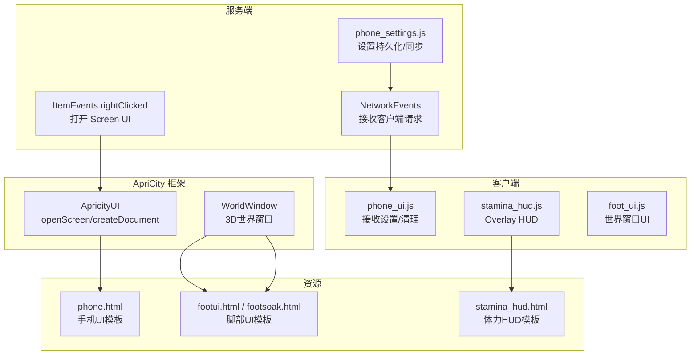
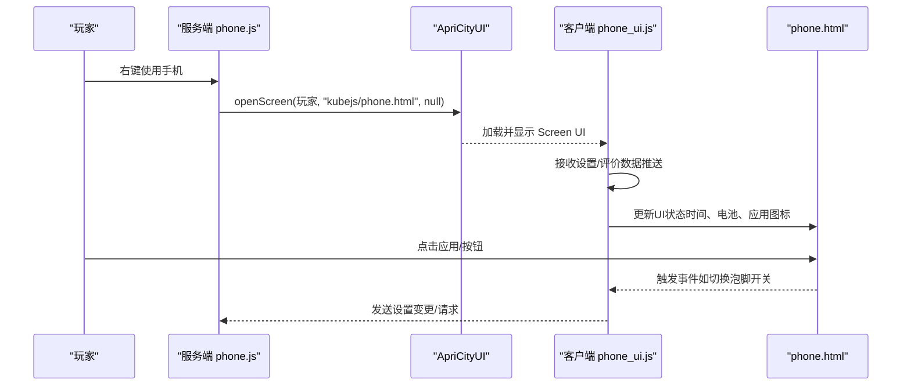
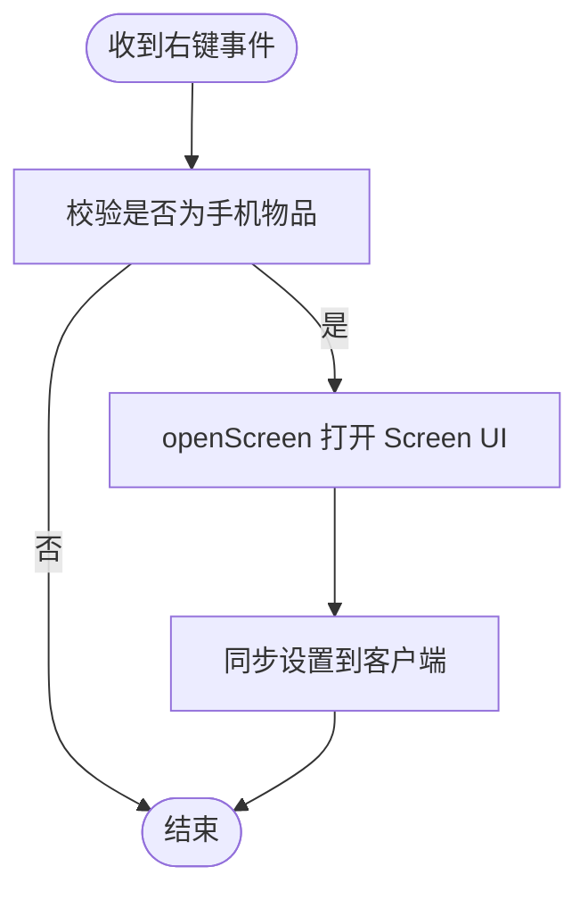
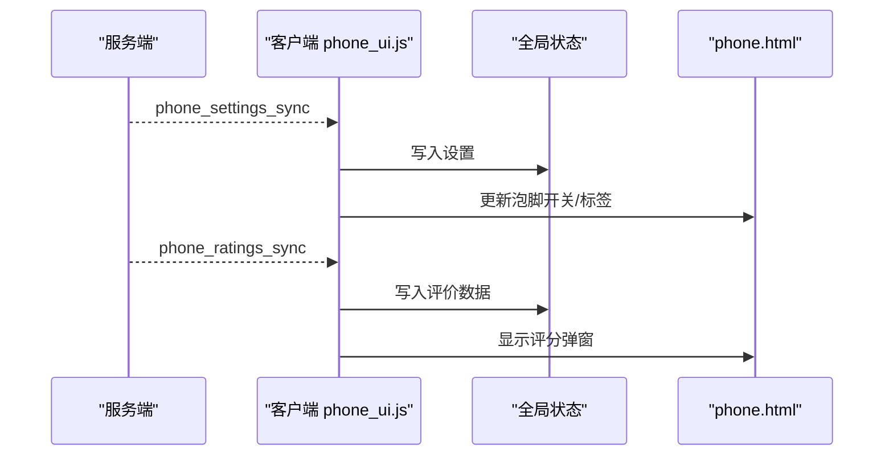
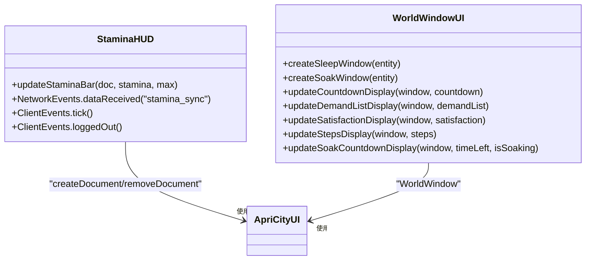
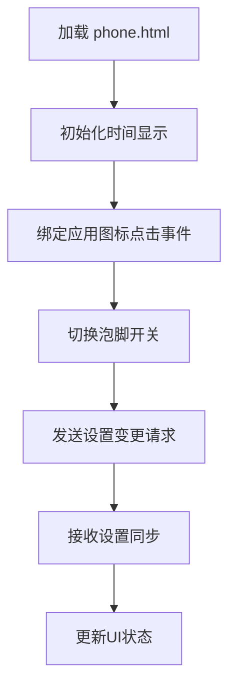
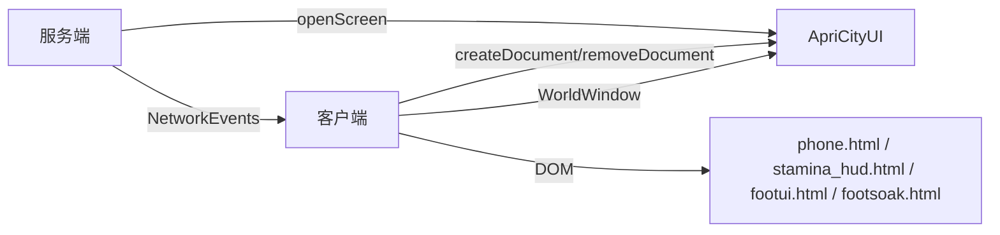

# 手机UI组件

<cite>
**本文引用的文件**
- [phone_ui.js](file://kubejs/client_scripts/ui/phone_ui.js)
- [phone.js](file://kubejs/server_scripts/phone.js)
- [phone.html](file://apricity/kubejs/phone.html)
- [phone_settings.js](file://kubejs/server_scripts/phone_settings.js)
- [stamina_hud.js](file://kubejs/client_scripts/ui/stamina_hud.js)
- [stamina_hud.html](file://apricity/kubejs/stamina_hud.html)
- [foot_ui.js](file://kubejs/client_scripts/ui/foot_ui.js)
- [footui.html](file://kubejs/assets/kubejs/apricity/footui.html)
- [footsoak.html](file://apricity/kubejs/footsoak.html)
- [serveHooks.js](file://kubejs/startup_scripts/serveHooks.js)
</cite>

## 目录
1. [简介](#简介)
2. [项目结构](#项目结构)
3. [核心组件](#核心组件)
4. [架构总览](#架构总览)
5. [详细组件分析](#详细组件分析)
6. [依赖关系分析](#依赖关系分析)
7. [性能考量](#性能考量)
8. [故障排查指南](#故障排查指南)
9. [结论](#结论)
10. [附录](#附录)

## 简介
本文件面向基于 ApriCity 框架实现的3D手机界面系统，系统性阐述手机UI的创建、定位、交互与状态同步机制。文档覆盖以下主题：
- 手机界面的创建与定位（Screen 类型UI）
- 布局设计与按钮事件处理
- 数据展示（时间、电池、应用图标、弹窗等）
- 与游戏世界的集成（与世界窗口、HUD、服务端设置系统联动）
- 用户交互响应与状态同步（网络事件、持久化设置）
- 自定义选项、样式调整与扩展开发指南

## 项目结构
该系统围绕 ApriCity 提供的 UI 宿主能力构建，主要由三部分组成：
- 服务端：负责打开 Screen 类型UI、设置持久化与同步、接收客户端请求
- 客户端：负责创建/移除文档、接收服务端推送、驱动UI交互与状态更新
- HTML/CSS/JS：提供手机外观、应用布局、弹窗与交互逻辑

**图表来源**
- [phone.js:1-24](file://kubejs/server_scripts/phone.js#L1-L24)
- [phone_settings.js:1-135](file://kubejs/server_scripts/phone_settings.js#L1-L135)
- [phone_ui.js:1-56](file://kubejs/client_scripts/ui/phone_ui.js#L1-L56)
- [stamina_hud.js:1-101](file://kubejs/client_scripts/ui/stamina_hud.js#L1-L101)
- [foot_ui.js:1-1015](file://kubejs/client_scripts/ui/foot_ui.js#L1-L1015)
- [phone.html:1-1169](file://apricity/kubejs/phone.html#L1-L1169)
- [stamina_hud.html:1-86](file://apricity/kubejs/stamina_hud.html#L1-L86)
- [footui.html:1-14](file://kubejs/assets/kubejs/apricity/footui.html#L1-L14)
- [footsoak.html:1-155](file://apricity/kubejs/footsoak.html#L1-L155)

**章节来源**
- [phone.js:1-24](file://kubejs/server_scripts/phone.js#L1-L24)
- [phone_settings.js:1-135](file://kubejs/server_scripts/phone_settings.js#L1-L135)
- [phone_ui.js:1-56](file://kubejs/client_scripts/ui/phone_ui.js#L1-L56)
- [stamina_hud.js:1-101](file://kubejs/client_scripts/ui/stamina_hud.js#L1-L101)
- [foot_ui.js:1-1015](file://kubejs/client_scripts/ui/foot_ui.js#L1-L1015)
- [phone.html:1-1169](file://apricity/kubejs/phone.html#L1-L1169)
- [stamina_hud.html:1-86](file://apricity/kubejs/stamina_hud.html#L1-L86)
- [footui.html:1-14](file://kubejs/assets/kubejs/apricity/footui.html#L1-L14)
- [footsoak.html:1-155](file://apricity/kubejs/footsoak.html#L1-L155)

## 核心组件
- 服务端手机UI入口与设置系统
  - 通过 ItemEvents.rightClicked 触发，调用 ApriCityUI.openScreen 打开 Screen 类型UI
  - 提供设置持久化与双向同步（设置键、默认值、读写接口、网络事件）
- 客户端手机UI与状态同步
  - 接收服务端推送的设置与评价数据，更新UI状态
  - 登出时清理文档与全局状态
- 客户端HUD与世界窗口UI
  - Stamina HUD 作为 Overlay 显示体力条
  - Foot UI 作为 WorldWindow 在世界中显示脚部UI，支持拖动、粒子特效与交互
- HTML/CSS/JS 资源
  - phone.html 提供手机外观、应用图标、弹窗与交互逻辑
  - stamina_hud.html 提供HUD布局
  - footui.html / footsoak.html 提供脚部UI布局

**章节来源**
- [phone.js:1-24](file://kubejs/server_scripts/phone.js#L1-L24)
- [phone_settings.js:1-135](file://kubejs/server_scripts/phone_settings.js#L1-L135)
- [phone_ui.js:1-56](file://kubejs/client_scripts/ui/phone_ui.js#L1-L56)
- [stamina_hud.js:1-101](file://kubejs/client_scripts/ui/stamina_hud.js#L1-L101)
- [foot_ui.js:1-1015](file://kubejs/client_scripts/ui/foot_ui.js#L1-L1015)
- [phone.html:1-1169](file://apricity/kubejs/phone.html#L1-L1169)
- [stamina_hud.html:1-86](file://apricity/kubejs/stamina_hud.html#L1-L86)
- [footui.html:1-14](file://kubejs/assets/kubejs/apricity/footui.html#L1-L14)
- [footsoak.html:1-155](file://apricity/kubejs/footsoak.html#L1-L155)

## 架构总览
手机UI系统采用“服务端打开UI + 客户端渲染”的分层架构，结合 ApriCity 的 Screen/WorldWindow/Overlay 能力，实现3D世界中的UI集成。

**图表来源**
- [phone.js:8-23](file://kubejs/server_scripts/phone.js#L8-L23)
- [phone_ui.js:13-47](file://kubejs/client_scripts/ui/phone_ui.js#L13-L47)
- [phone.html:712-800](file://apricity/kubejs/phone.html#L712-L800)

**章节来源**
- [phone.js:1-24](file://kubejs/server_scripts/phone.js#L1-L24)
- [phone_ui.js:1-56](file://kubejs/client_scripts/ui/phone_ui.js#L1-L56)
- [phone.html:1-1169](file://apricity/kubejs/phone.html#L1-L1169)

## 详细组件分析

### 服务端：手机UI入口与设置系统
- 打开UI
  - 监听 ItemEvents.rightClicked，当玩家右键使用特定手机物品时，调用 ApriCityUI.openScreen 打开 Screen 类型UI
- 设置持久化与同步
  - 使用 player.persistentData 的复合标签存储设置，提供读取/写入接口
  - 通过 NetworkEvents 与客户端双向通信，支持设置变更请求、设置拉取、评价数据查询与推送
- 评价数据同步
  - 服务端聚合各类顾客类型的评价与权重，打包发送至客户端

**图表来源**
- [phone.js:8-23](file://kubejs/server_scripts/phone.js#L8-L23)

**章节来源**
- [phone.js:1-24](file://kubejs/server_scripts/phone.js#L1-L24)
- [phone_settings.js:1-135](file://kubejs/server_scripts/phone_settings.js#L1-L135)

### 客户端：手机UI与状态同步
- 接收设置与评价数据
  - 监听 NetworkEvents.dataReceived，分别处理设置同步与评价数据同步
  - 将数据写入全局状态，供UI使用
- 登出清理
  - 监听 ClientEvents.loggedOut，移除对应文档并重置全局状态
- UI更新
  - phone.html 中包含时间动态更新、泡脚开关切换、弹窗（评分、抽卡）等交互逻辑

**图表来源**
- [phone_ui.js:13-47](file://kubejs/client_scripts/ui/phone_ui.js#L13-L47)
- [phone.html:712-800](file://apricity/kubejs/phone.html#L712-L800)

**章节来源**
- [phone_ui.js:1-56](file://kubejs/client_scripts/ui/phone_ui.js#L1-L56)
- [phone.html:1-1169](file://apricity/kubejs/phone.html#L1-L1169)

### 客户端：HUD与世界窗口UI
- Stamina HUD（Overlay）
  - 定期向服务端请求体力值，更新HUD显示
  - 登出时清理Overlay
- WorldWindow UI（脚部UI）
  - 基于 ApriCity 的 WorldWindow 在世界中创建UI窗口，支持旋转、缩放、定位
  - 支持鼠标拖动、粒子特效、送客按钮、泡脚按钮等交互
  - 通过 NBT 读取实体状态（倒计时、满意度、需求清单、泡脚状态等）

**图表来源**
- [stamina_hud.js:1-101](file://kubejs/client_scripts/ui/stamina_hud.js#L1-L101)
- [foot_ui.js:1-1015](file://kubejs/client_scripts/ui/foot_ui.js#L1-L1015)

**章节来源**
- [stamina_hud.js:1-101](file://kubejs/client_scripts/ui/stamina_hud.js#L1-L101)
- [foot_ui.js:1-1015](file://kubejs/client_scripts/ui/foot_ui.js#L1-L1015)

### HTML/CSS/JS：手机UI布局与交互
- phone.html
  - 提供手机外观（边框、状态栏、时间显示、壁纸）、应用图标区、手势条
  - 弹窗区域：美团风格评分弹窗、抽卡弹窗
  - JavaScript：动态时间更新、泡脚开关切换、弹窗显示/隐藏、按钮事件绑定
- stamina_hud.html
  - 提供HUD布局（图标、进度条、文本），配合 stamina_hud.js 更新
- footui.html / footsoak.html
  - 脚部UI布局，支持需求清单、满意度、步骤记录、泡脚进度条等

**图表来源**
- [phone.html:712-800](file://apricity/kubejs/phone.html#L712-L800)

**章节来源**
- [phone.html:1-1169](file://apricity/kubejs/phone.html#L1-L1169)
- [stamina_hud.html:1-86](file://apricity/kubejs/stamina_hud.html#L1-L86)
- [footui.html:1-14](file://kubejs/assets/kubejs/apricity/footui.html#L1-L14)
- [footsoak.html:1-155](file://apricity/kubejs/footsoak.html#L1-L155)

## 依赖关系分析
- 服务端依赖
  - ApriCityUI：openScreen
  - NetworkEvents：设置/评价数据推送
  - player.persistentData：设置持久化
- 客户端依赖
  - ApriCityUI：createDocument/removeDocument
  - WorldWindow：3D世界窗口
  - NetworkEvents：接收服务端推送
  - DOM：phone.html、stamina_hud.html、footui.html、footsoak.html
- 耦合与内聚
  - 服务端与客户端通过网络事件耦合，UI与逻辑分离，内聚良好
  - 设置系统集中管理，便于扩展新设置项

**图表来源**
- [phone.js:6-16](file://kubejs/server_scripts/phone.js#L6-L16)
- [phone_ui.js:7-55](file://kubejs/client_scripts/ui/phone_ui.js#L7-L55)
- [stamina_hud.js:7-100](file://kubejs/client_scripts/ui/stamina_hud.js#L7-L100)
- [foot_ui.js:13-327](file://kubejs/client_scripts/ui/foot_ui.js#L13-L327)

**章节来源**
- [phone.js:1-24](file://kubejs/server_scripts/phone.js#L1-L24)
- [phone_ui.js:1-56](file://kubejs/client_scripts/ui/phone_ui.js#L1-L56)
- [stamina_hud.js:1-101](file://kubejs/client_scripts/ui/stamina_hud.js#L1-L101)
- [foot_ui.js:1-1015](file://kubejs/client_scripts/ui/foot_ui.js#L1-L1015)

## 性能考量
- UI创建与销毁
  - Screen UI 与 Overlay 在登录/登出时创建/销毁，避免长期驻留
- 网络同步频率
  - 设置与评价数据按需推送，减少带宽占用
  - Stamina HUD 每20tick请求一次，平衡刷新率与性能
- 世界窗口渲染
  - WorldWindow 限制最大距离与缩放，避免远距离渲染开销
- 事件处理
  - DOM事件绑定集中在HTML中，逻辑清晰，避免重复监听

[本节为通用指导，无需列出具体文件来源]

## 故障排查指南
- 打不开手机UI
  - 检查服务端是否正确调用 openScreen
  - 确认资源路径与HTML文件存在
- 设置不同步
  - 检查 NetworkEvents 是否正确接收/发送
  - 确认 persistentData 结构与键名一致
- UI不更新
  - 检查客户端是否正确接收 phone_settings_sync/phone_ratings_sync
  - 确认全局状态写入与UI更新逻辑
- 登出后残留UI
  - 检查 loggedOut 事件是否调用 removeDocument 并重置全局状态

**章节来源**
- [phone.js:8-23](file://kubejs/server_scripts/phone.js#L8-L23)
- [phone_ui.js:49-56](file://kubejs/client_scripts/ui/phone_ui.js#L49-L56)
- [stamina_hud.js:88-101](file://kubejs/client_scripts/ui/stamina_hud.js#L88-L101)

## 结论
该手机UI系统通过 ApriCity 的 Screen/WorldWindow/Overlay 能力，实现了与游戏世界的深度融合。服务端负责打开UI与设置持久化，客户端负责渲染与交互，HTML/CSS/JS 提供直观的界面与丰富的交互体验。系统具备良好的扩展性，可通过新增设置键、弹窗与应用图标进一步增强功能。

[本节为总结性内容，无需列出具体文件来源]

## 附录

### 自定义选项与样式调整
- 手机外观与布局
  - 修改 phone.html 的CSS类与结构，调整尺寸、颜色、背景图
  - 应用图标区可增减应用，调整布局与间距
- 弹窗样式
  - 评分弹窗与抽卡弹窗的样式与尺寸可在对应CSS区域调整
- HUD样式
  - stamina_hud.html 的进度条、文字与颜色可按需修改
- 世界窗口UI
  - footui.html / footsoak.html 的布局与样式可独立定制

**章节来源**
- [phone.html:178-710](file://apricity/kubejs/phone.html#L178-L710)
- [stamina_hud.html:13-85](file://apricity/kubejs/stamina_hud.html#L13-L85)
- [footui.html:1-14](file://kubejs/assets/kubejs/apricity/footui.html#L1-L14)
- [footsoak.html:23-151](file://apricity/kubejs/footsoak.html#L23-L151)

### 扩展开发指南
- 新增设置项
  - 在服务端设置系统中添加键与默认值，提供读写接口与网络事件处理
  - 在客户端接收并更新UI状态
- 新增应用图标
  - 在 phone.html 的应用区添加图标与事件绑定
  - 在服务端或客户端编写对应的处理逻辑
- 新增弹窗
  - 在 phone.html 中添加弹窗结构与样式
  - 编写显示/隐藏逻辑与交互事件
- Hook 扩展
  - 可参考 serveHooks.js 的注册与执行机制，在关键节点插入自定义逻辑

**章节来源**
- [phone_settings.js:7-135](file://kubejs/server_scripts/phone_settings.js#L7-L135)
- [phone.html:102-176](file://apricity/kubejs/phone.html#L102-L176)
- [serveHooks.js:1-31](file://kubejs/startup_scripts/serveHooks.js#L1-L31)