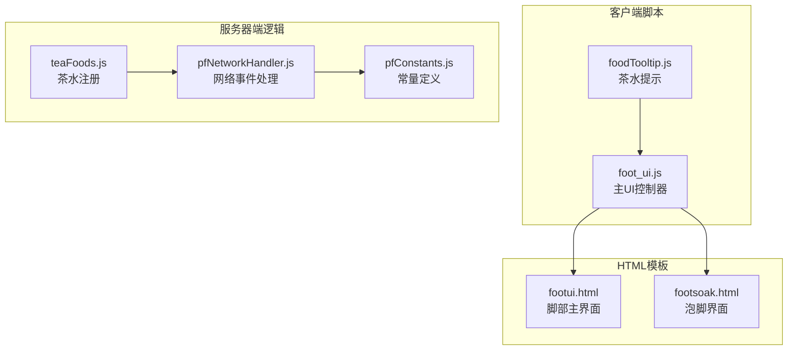
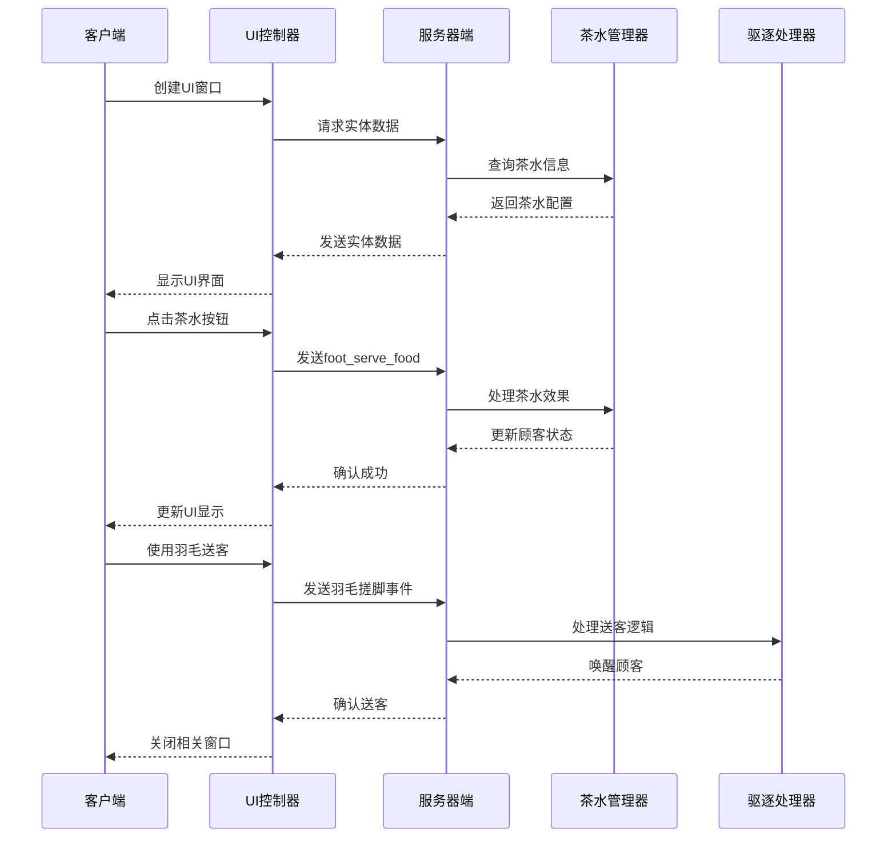
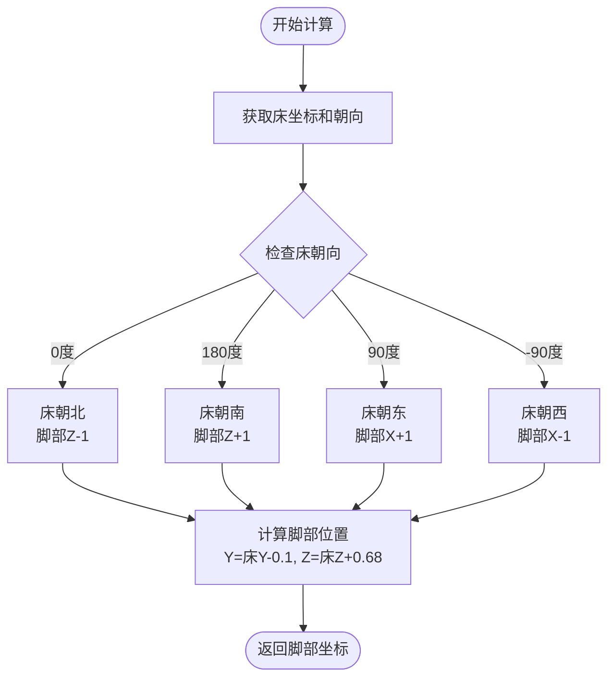
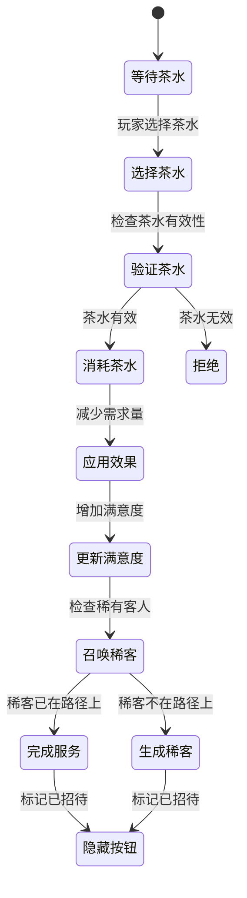
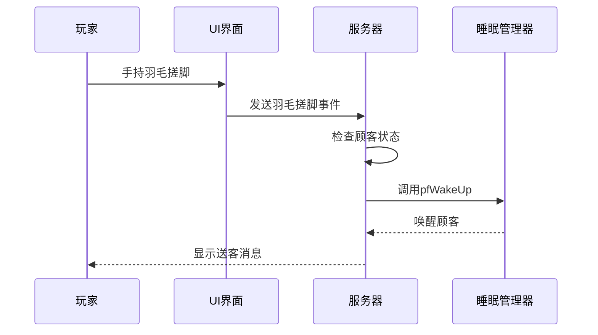
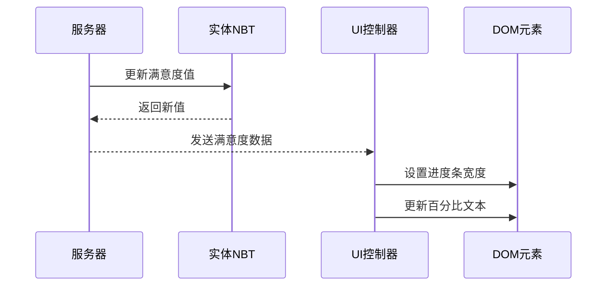
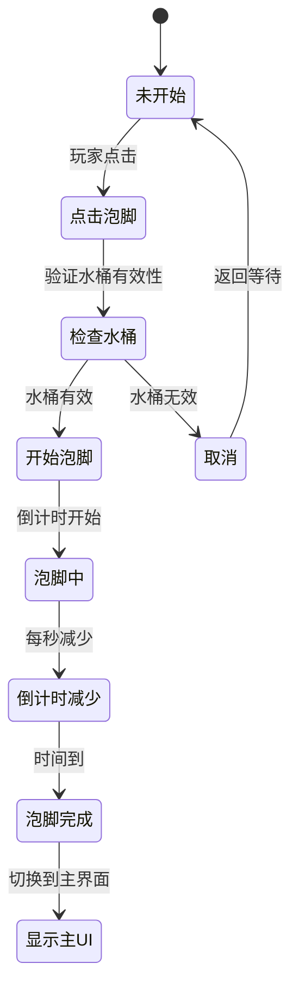
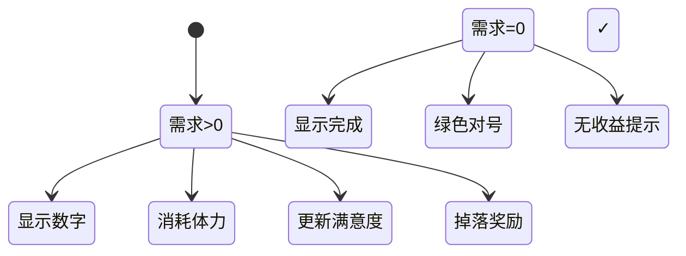
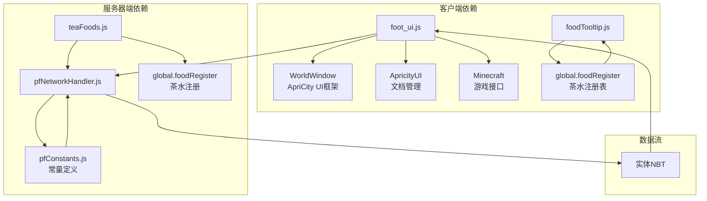

# 脚部UI组件

<cite>
**本文引用的文件**
- [foot_ui.js](file://kubejs/client_scripts/ui/foot_ui.js)
- [footui.html](file://apricity/kubejs/footui.html)
- [pfNetworkHandler.js](file://kubejs/server_scripts/pathfinder/pfNetworkHandler.js)
- [pfConstants.js](file://kubejs/server_scripts/pathfinder/pfConstants.js)
- [teaFoods.js](file://kubejs/startup_scripts/food/teaFoods.js)
- [foodTooltip.js](file://kubejs/client_scripts/tooltip/foodTooltip.js)
</cite>

## 更新摘要
**变更内容**
- 新增茶水服务系统，支持多种茶水和稀客召唤功能
- 新增羽毛驱逐机制，允许玩家直接送客离开
- 移除步骤跟踪系统，简化了UI显示逻辑
- 改进UI布局和视觉设计，新增茶水按钮和满意度进度条
- 优化了拖动检测和坐标计算算法

## 目录
1. [简介](#简介)
2. [项目结构](#项目结构)
3. [核心组件](#核心组件)
4. [架构概览](#架构概览)
5. [详细组件分析](#详细组件分析)
6. [依赖关系分析](#依赖关系分析)
7. [性能考虑](#性能考虑)
8. [故障排除指南](#故障排除指南)
9. [结论](#结论)

## 简介

脚部UI组件是基于ApriCity框架实现的3D脚部界面系统，专为《洗手》模组设计。该系统提供了完整的脚部按摩体验，包括需求清单显示、倒计时系统、满意度进度条、搓脚交互系统、泡脚状态管理、油品显示、茶水服务和羽毛驱逐等功能。

系统采用客户端-服务器架构，通过ApriCity的WorldWindow技术在3D世界中渲染UI界面，同时实现了丰富的粒子效果和网络事件通信机制。最新版本包含了茶水服务系统和羽毛驱逐机制等重大功能更新，显著提升了用户体验和游戏深度。

## 项目结构

脚部UI组件系统主要由以下部分组成：



**图表来源**
- [foot_ui.js:1-50](file://kubejs/client_scripts/ui/foot_ui.js#L1-L50)
- [pfNetworkHandler.js:1-50](file://kubejs/server_scripts/pathfinder/pfNetworkHandler.js#L1-L50)
- [teaFoods.js:1-48](file://kubejs/startup_scripts/food/teaFoods.js#L1-L48)

**章节来源**
- [foot_ui.js:1-100](file://kubejs/client_scripts/ui/foot_ui.js#L1-L100)
- [pfNetworkHandler.js:1-50](file://kubejs/server_scripts/pathfinder/pfNetworkHandler.js#L1-L50)

## 核心组件

### 1. 增强的UI窗口管理系统

系统使用ApriCity的WorldWindow技术创建和管理3D UI窗口：

- **主UI窗口**：显示需求清单、满意度进度条和茶水按钮
- **泡脚UI窗口**：显示泡脚倒计时和进度条
- **延迟移除机制**：防止鼠标悬停时立即移除窗口导致的NPE错误

### 2. 全新的茶水服务系统

实现了完整的茶水服务功能：

- **多种茶水类型**：基础茶（绿茶、白茶、红茶、乌龙茶）、黑茶（随机需求）和稀客召唤茶
- **茶水效果**：增加特定部位需求、提升满意度、召唤稀有客人
- **容器返还**：使用后返还玻璃瓶容器
- **防重复机制**：每位顾客只能招待一次茶水

### 3. 羽毛驱逐机制

新增了特殊的羽毛工具用于送客：

- **特殊物品识别**：手持羽毛进行搓脚操作会触发送客
- **无结算送客**：顾客直接起床离开，不进行结算、不发奖励
- **状态检查**：只对躺床状态的顾客执行送客

### 4. 改进的搓脚交互系统

实现了精确的拖动检测和距离计算机制：

- **改进的鼠标跟踪**：使用`getBoundingClientRect()`获取精确坐标
- **增强的拖动阈值检测**：累计移动距离达到200像素触发搓脚
- **优化的实时距离计算**：使用欧几里得距离公式计算移动距离
- **扩展的工具支持**：支持多种筋膜枪变体和羽毛工具

**章节来源**
- [foot_ui.js:45-90](file://kubejs/client_scripts/ui/foot_ui.js#L45-L90)
- [foot_ui.js:182-247](file://kubejs/client_scripts/ui/foot_ui.js#L182-L247)

## 架构概览

脚部UI组件采用分层架构设计，确保客户端和服务器端的职责分离：



**图表来源**
- [foot_ui.js:95-303](file://kubejs/client_scripts/ui/foot_ui.js#L95-L303)
- [pfNetworkHandler.js:428-528](file://kubejs/server_scripts/pathfinder/pfNetworkHandler.js#L428-L528)

## 详细组件分析

### 1. 床朝向处理和UI窗口定位

#### 床位置计算算法

系统根据床的朝向精确计算顾客脚部位置：



**图表来源**
- [foot_ui.js:102-116](file://kubejs/client_scripts/ui/foot_ui.js#L102-L116)

#### UI窗口定位策略

- **最大距离限制**：16格范围内的实体才显示UI
- **缩放设置**：0.01倍缩放确保UI在3D空间中的合适大小
- **旋转对齐**：根据床朝向调整UI旋转角度
- **边界防卡顿**：18格范围内才回收窗口，避免频繁创建销毁

**章节来源**
- [foot_ui.js:102-116](file://kubejs/client_scripts/ui/foot_ui.js#L102-L116)
- [foot_ui.js:132-177](file://kubejs/client_scripts/ui/foot_ui.js#L132-L177)

### 2. 全新的茶水服务系统

#### 茶水类型和效果

茶水系统支持多种不同类型的茶水：

| 茶水类型 | 效果 | 稀有客人 |
|----------|------|----------|
| 绿茶 | +1脚掌需求，+5满意度 | 无 |
| 白茶 | +1脚心需求，+5满意度 | 无 |
| 红茶 | +1脚跟需求，+5满意度 | 无 |
| 乌龙茶 | +1脚趾需求，+5满意度 | 无 |
| 黑茶 | +2随机部位需求，无满意度 | 无 |
| 红魔馆红茶 | +5满意度 | 蕾米莉亚·斯卡蕾特 |
| 樱花蜜茶 | +5满意度 | 西行寺幽幽子 |
| 玄米茶 | +5满意度 | 魂魄妖梦 |
| 其他召唤茶 | +5满意度 | 对应稀有客人 |

#### 茶水服务流程



**图表来源**
- [pfNetworkHandler.js:428-528](file://kubejs/server_scripts/pathfinder/pfNetworkHandler.js#L428-L528)

#### 茶水UI集成

- **茶水按钮**：位于需求清单正下方，背景为专用按钮贴图
- **防重复机制**：服务端写入pfFoodServed=1后隐藏按钮
- **视觉效果**：按钮点击时有缩放动画反馈

**章节来源**
- [pfNetworkHandler.js:428-528](file://kubejs/server_scripts/pathfinder/pfNetworkHandler.js#L428-L528)
- [teaFoods.js:1-48](file://kubejs/startup_scripts/food/teaFoods.js#L1-L48)
- [footui.html:48-51](file://apricity/kubejs/footui.html#L48-L51)

### 3. 羽毛驱逐机制

#### 羽毛工具实现

羽毛作为一种特殊的搓脚工具，具有独特的送客功能：

- **物品识别**：检测玩家手持minecraft:feather
- **特殊处理**：跳过正常的搓脚逻辑，直接执行送客
- **状态验证**：只对处于睡眠状态（phase=3）的顾客执行

#### 送客流程



**图表来源**
- [pfNetworkHandler.js:65-89](file://kubejs/server_scripts/pathfinder/pfNetworkHandler.js#L65-L89)

#### 用户反馈

- **成功消息**："已送客（未结算，无奖励）"
- **即时生效**：顾客立即起床离开
- **无收益**：不给予任何金钱或满意度奖励

**章节来源**
- [pfNetworkHandler.js:65-89](file://kubejs/server_scripts/pathfinder/pfNetworkHandler.js#L65-L89)

### 4. 改进的搓脚交互系统

#### 改进的鼠标跟踪算法

**更新** 搓脚交互系统现在使用`getBoundingClientRect()`方法获取精确的鼠标坐标，替代了之前的`offsetX/offsetY`方法：

```javascript
// 新的精确坐标计算方法
let bounds = footImage.getBoundingClientRect()
let mouseX = event.clientX - bounds.left
let mouseY = event.clientY - bounds.top
```

这种方法的优势：
- **更高的坐标精度**：避免了子元素命中时的坐标跳变问题
- **更好的兼容性**：在不同浏览器和渲染环境下表现一致
- **更稳定的拖动检测**：减少了误判和漏判的情况

#### 增强的拖动检测机制

**更新** 拖动检测现在支持单帧多次阈值跨越处理：

```javascript
// 每累计 200 像素触发一次；保留余量，并处理单帧跨过多个阈值的情况
while (tracking.totalDist >= DRAG_THRESHOLD) {
    tracking.totalDist -= DRAG_THRESHOLD
    tracking.requestSeq++
    let clientRequestId = tracking.requestSeq
    // 发送搓脚事件
    player.sendData('foot_click_demand', {
        entityUuid: uuid,
        clientRequestId: clientRequestId
    })
}
```

这种改进确保了：
- **快速拖动的正确处理**：即使单次移动超过阈值也能正确计数
- **准确的搓脚次数统计**：避免快速拖动时丢失搓脚事件
- **更好的用户体验**：流畅的拖动操作获得预期的反馈

#### 扩展的工具支持

**更新** 系统现在支持多种工具的图标映射：

| 物品类型 | 对应图标 | 触发条件 |
|----------|----------|----------|
| 基础搓脚工具 | hand_jiaozhang.png等 | 手持对应工具 |
| 强化版筋膜枪 | hand_jiaozhang.png等 | 手持强化版工具 |
| 四合一筋膜枪 | fascia_gun.png | 手持通用工具 |
| 羽毛 | feather.png | 送客功能 |

支持的工具体系包括：
- `marguerite:hand_*` - 基础搓手工具
- `marguerite:fascia_gun_*` - 各种筋膜枪变体
- `marguerite:fascia_gun_*_advanced` - 强化版筋膜枪
- `marguerite:fascia_gun_universal` - 四合一通用筋膜枪
- `minecraft:feather` - 羽毛（送客）

**章节来源**
- [foot_ui.js:65-81](file://kubejs/client_scripts/ui/foot_ui.js#L65-L81)
- [foot_ui.js:182-247](file://kubejs/client_scripts/ui/foot_ui.js#L182-L247)

### 5. 满意度进度条

#### 进度条设计

满意度进度条采用横向条形设计，颜色固定为#844c24：

- **显示格式**：满意度：[██████░░░░] 80%
- **宽度计算**：基于百分比的宽度设置
- **平滑过渡**：使用CSS transition实现平滑动画效果

#### 数据更新流程



**图表来源**
- [foot_ui.js:704-723](file://kubejs/client_scripts/ui/foot_ui.js#L704-L723)

**章节来源**
- [foot_ui.js:704-723](file://kubejs/client_scripts/ui/foot_ui.js#L704-L723)

### 6. 泡脚状态管理系统

#### 泡脚状态流程



**图表来源**
- [pfNetworkHandler.js:377-424](file://kubejs/server_scripts/pathfinder/pfNetworkHandler.js#L377-L424)

#### 泡脚倒计时实现

- **默认时长**：10秒
- **更新频率**：每tick检查状态变化
- **状态同步**：客户端实时更新倒计时显示

**章节来源**
- [pfNetworkHandler.js:377-424](file://kubejs/server_scripts/pathfinder/pfNetworkHandler.js#L377-L424)
- [foot_ui.js:359-424](file://kubejs/client_scripts/ui/foot_ui.js#L359-L424)

### 7. 油品显示系统

#### 油品状态管理

油品显示系统监控实体的油品状态：

- **数据来源**：实体主手物品NBT中的油品信息
- **显示格式**：油品名称(剩余量)
- **状态指示**：无油品时显示红色叉号

#### 油品信息结构

| 字段 | 类型 | 描述 |
|------|------|------|
| pfOilId | String | 油品ID |
| pfOilLeft | Integer | 剩余量 |

**章节来源**
- [foot_ui.js:741-772](file://kubejs/client_scripts/ui/foot_ui.js#L741-L772)

### 8. 需求清单显示系统

#### 数据结构设计

需求清单包含四个主要部位的需求次数：

| 部位 | NBT键值 | 显示状态 |
|------|---------|----------|
| 脚掌 | pfDemandJiaozhang | 数字显示 |
| 脚后跟 | pfDemandJiaogen | 数字显示 |
| 脚趾 | pfDemandJiaozhi | 数字显示 |
| 脚心 | pfDemandJiaoxin | 数字显示 |

#### 状态转换逻辑



**图表来源**
- [foot_ui.js:637-698](file://kubejs/client_scripts/ui/foot_ui.js#L637-L698)

**章节来源**
- [foot_ui.js:579-596](file://kubejs/client_scripts/ui/foot_ui.js#L579-L596)
- [foot_ui.js:637-698](file://kubejs/client_scripts/ui/foot_ui.js#L637-L698)

## 依赖关系分析

### 1. 组件依赖图



**图表来源**
- [foot_ui.js:13-15](file://kubejs/client_scripts/ui/foot_ui.js#L13-L15)
- [pfNetworkHandler.js:1-5](file://kubejs/server_scripts/pathfinder/pfNetworkHandler.js#L1-L5)
- [teaFoods.js:1-48](file://kubejs/startup_scripts/food/teaFoods.js#L1-L48)

### 2. 关键依赖关系

- **WorldWindow**：负责3D UI窗口的创建和管理
- **ApricityUI**：提供HTML文档的创建和管理功能
- **Minecraft**：访问游戏客户端状态和玩家信息
- **pfConstants**：提供系统常量和配置信息
- **global.foodRegister**：管理茶水物品的注册和查询
- **pfShopManager**：处理稀有客人的召唤逻辑

**章节来源**
- [foot_ui.js:13-15](file://kubejs/client_scripts/ui/foot_ui.js#L13-L15)
- [pfNetworkHandler.js:1-5](file://kubejs/server_scripts/pathfinder/pfNetworkHandler.js#L1-L5)
- [teaFoods.js:1-48](file://kubejs/startup_scripts/food/teaFoods.js#L1-L48)

## 性能考虑

### 1. 内存管理优化

- **延迟移除队列**：使用windowRemovalQueue延迟2tick后实际移除窗口，避免NPE错误
- **状态缓存**：使用Map结构缓存实体状态，避免重复查询
- **智能清理**：超出范围或死亡的实体自动清理相关窗口和状态

### 2. 网络优化

- **数据同步**：通过实体NBT传递状态，减少网络传输
- **批量更新**：客户端每tick统一处理多个实体的状态更新
- **事件去重**：避免重复发送相同的网络事件

### 3. 渲染优化

- **DOM最小化**：使用setTextIfChanged和setAttributeIfChanged避免不必要的DOM操作
- **缩放优化**：使用WorldWindow的缩放功能避免重复计算
- **窗口生命周期管理**：合理的窗口创建和销毁时机

## 故障排除指南

### 1. 常见问题诊断

#### UI不显示问题

**可能原因**：
- 实体不在16格范围内
- 床朝向数据缺失
- 红石纸物品NBT损坏

**解决方法**：
- 检查实体与玩家的距离
- 确认床朝向数据正确性
- 验证红石纸物品的NBT结构

#### 茶水服务无效问题

**可能原因**：
- 手中没有正确的茶水
- 顾客已经喝过茶
- 店铺未开张无法召唤稀客

**解决方法**：
- 使用正确的茶水物品
- 检查顾客的pfFoodServed状态
- 确认店铺状态和稀有客人配置

#### 羽毛送客失败问题

**可能原因**：
- 顾客不在睡眠状态
- 实体UUID不匹配
- 服务器端状态不同步

**解决方法**：
- 确认顾客处于睡眠状态
- 检查实体UUID是否正确
- 重新登录游戏刷新状态

#### 鼠标坐标异常问题

**更新** 如果鼠标坐标出现异常，可能是由于DOM结构变化导致的：

**可能原因**：
- 子元素命中导致坐标跳变
- 浏览器兼容性问题
- CSS变换影响坐标计算

**解决方法**：
- 确认使用了`getBoundingClientRect()`方法
- 检查父元素的CSS变换属性
- 验证事件监听器绑定在正确的元素上

#### 满意度进度条显示异常

**可能原因**：
- NBT数据格式错误
- CSS样式冲突
- DOM元素引用失效

**解决方法**：
- 检查实体NBT中的pfSatisfaction字段
- 验证CSS样式是否正确加载
- 重新创建UI窗口

**章节来源**
- [foot_ui.js:818-831](file://kubejs/client_scripts/ui/foot_ui.js#L818-L831)
- [pfNetworkHandler.js:437-462](file://kubejs/server_scripts/pathfinder/pfNetworkHandler.js#L437-L462)

## 结论

脚部UI组件系统是一个功能完整、架构清晰的3D交互界面解决方案。最新版本包含了茶水服务系统、羽毛驱逐机制等重大功能更新，以及多项重要的bug修复和功能改进，显著提升了系统的稳定性和用户体验。

主要特点包括：

1. **精确的3D定位**：基于床朝向的准确位置计算
2. **全新的茶水服务系统**：支持多种茶水和稀客召唤功能
3. **羽毛驱逐机制**：提供便捷的送客功能
4. **增强的交互反馈**：改进的拖动检测和图标跟随系统，使用`getBoundingClientRect()`提高坐标精度
5. **稳健的状态管理**：从需求清单到满意度的全流程管理
6. **可靠的网络同步**：客户端-服务器的稳定通信机制
7. **优化的性能表现**：改进的内存管理和渲染效率
8. **完善的错误处理**：延迟移除机制防止NPE错误
9. **扩展的工具支持**：支持多种工具和高级功能

通过这些重大更新，系统现在能够提供更丰富的游戏玩法、更精确的鼠标跟踪、更可靠的拖动检测和更强大的工具支持，为玩家带来更加沉浸式的脚部按摩体验。该系统为《洗手》模组提供了高质量的用户界面，是ApriCity框架在复杂UI场景下的优秀实践案例。