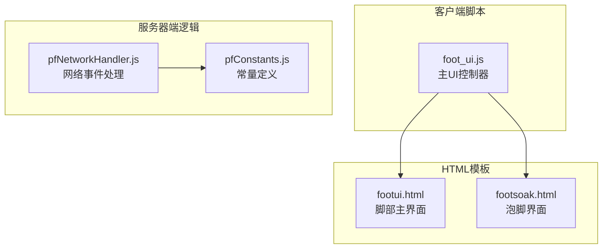
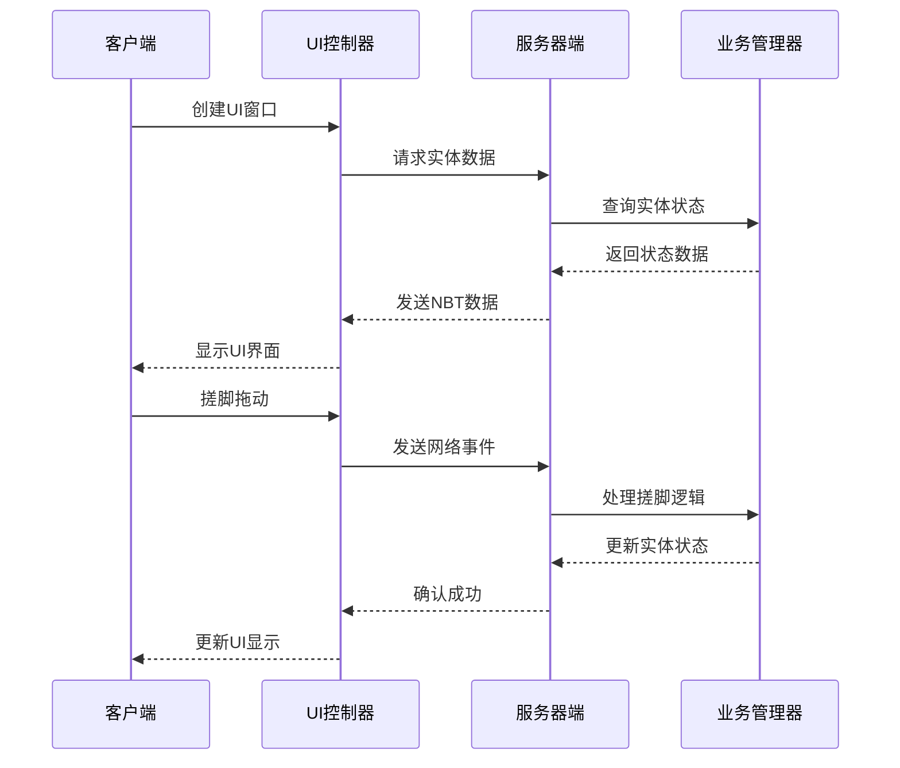
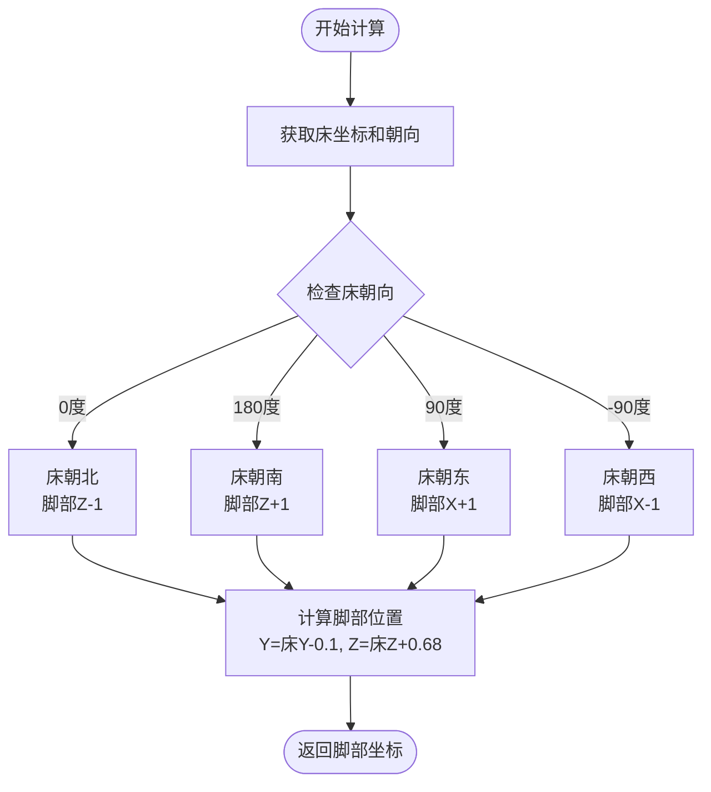
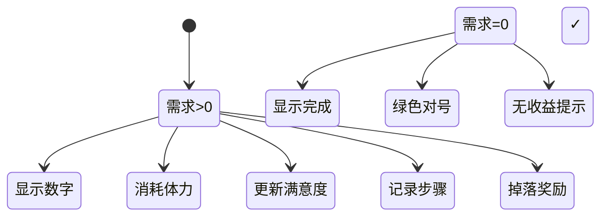
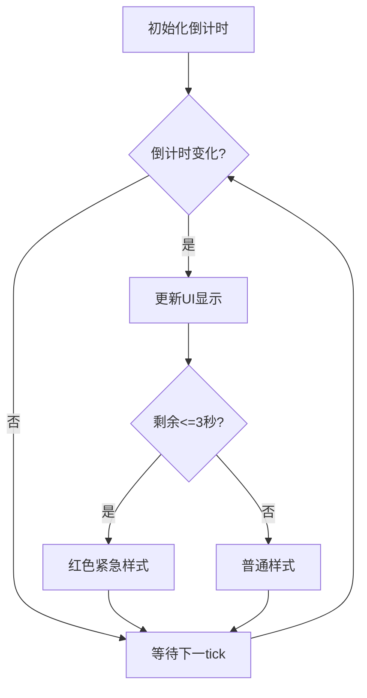
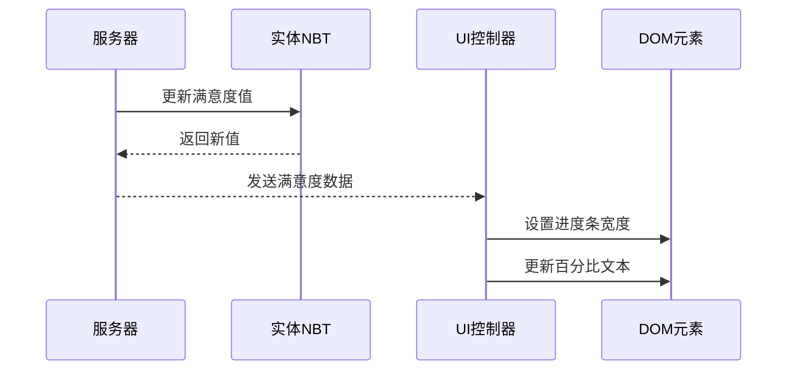
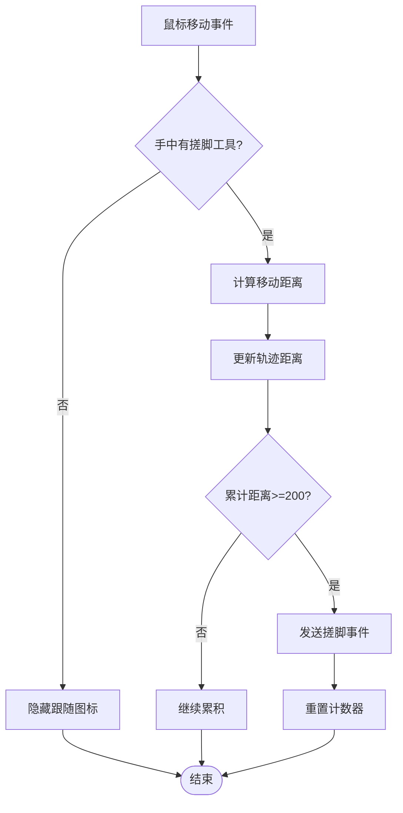
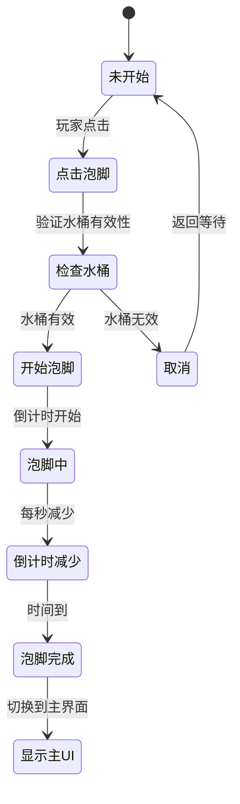
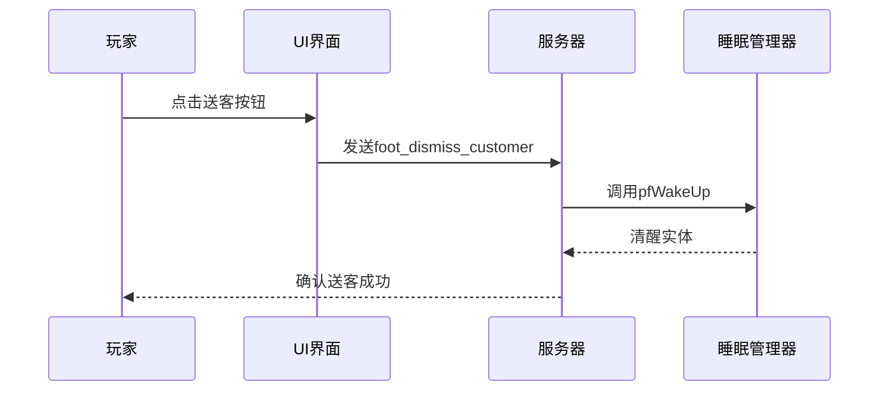
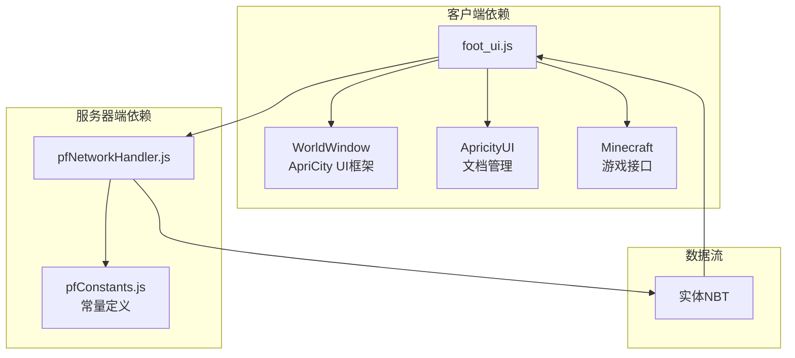

# 脚部UI组件

<cite>
**本文引用的文件**
- [foot_ui.js](file://kubejs/client_scripts/ui/foot_ui.js)
- [footui.html](file://apricity/kubejs/footui.html)
- [footsoak.html](file://apricity/kubejs/footsoak.html)
- [pfNetworkHandler.js](file://kubejs/server_scripts/pathfinder/pfNetworkHandler.js)
- [pfConstants.js](file://kubejs/server_scripts/pathfinder/pfConstants.js)
</cite>

## 更新摘要
**变更内容**
- 更新了拖动检测算法，优化了距离计算逻辑
- 改进了窗口管理机制，增加了延迟移除队列防止NPE错误
- 增强了泡脚状态管理系统，支持更稳定的状态切换
- 优化了网络事件处理，提升了搓脚交互的响应性
- 修复了多个UI显示和内存管理相关的bug

## 目录
1. [简介](#简介)
2. [项目结构](#项目结构)
3. [核心组件](#核心组件)
4. [架构概览](#架构概览)
5. [详细组件分析](#详细组件分析)
6. [依赖关系分析](#依赖关系分析)
7. [性能考虑](#性能考虑)
8. [故障排除指南](#故障排除指南)
9. [结论](#结论)

## 简介

脚部UI组件是基于ApriCity框架实现的3D脚部界面系统，专为《洗手》模组设计。该系统提供了完整的脚部按摩体验，包括需求清单显示、倒计时系统、满意度进度条、步骤记录、搓脚交互系统、泡脚状态管理和油品显示等功能。

系统采用客户端-服务器架构，通过ApriCity的WorldWindow技术在3D世界中渲染UI界面，同时实现了丰富的粒子效果和网络事件通信机制。最新版本包含了多项bug修复和功能改进，显著提升了用户体验和系统稳定性。

## 项目结构

脚部UI组件系统主要由以下部分组成：



**图表来源**
- [foot_ui.js:1-50](file://kubejs/client_scripts/ui/foot_ui.js#L1-L50)
- [pfNetworkHandler.js:1-50](file://kubejs/server_scripts/pathfinder/pfNetworkHandler.js#L1-L50)

**章节来源**
- [foot_ui.js:1-100](file://kubejs/client_scripts/ui/foot_ui.js#L1-L100)
- [pfNetworkHandler.js:1-50](file://kubejs/server_scripts/pathfinder/pfNetworkHandler.js#L1-L50)

## 核心组件

### 1. UI窗口管理系统

系统使用ApriCity的WorldWindow技术创建和管理3D UI窗口：

- **主UI窗口**：显示需求清单、满意度进度条和步骤记录
- **泡脚UI窗口**：显示泡脚倒计时和进度条
- **延迟移除机制**：防止鼠标悬停时立即移除窗口导致的NPE错误

### 2. 增强的搓脚交互系统

实现了精确的拖动检测和距离计算机制：

- **改进的拖动阈值检测**：累计移动距离达到200像素触发搓脚
- **优化的实时距离计算**：使用欧几里得距离公式计算移动距离
- **增强的图标跟随**：根据手持物品动态显示对应的搓脚工具图标

### 3. 稳健的状态管理系统

- **实体跟踪**：维护睡眠实体的UI状态，包含待处理的窗口转换
- **倒计时管理**：1-10秒倒计时系统，支持紧急状态样式
- **满意度追踪**：0-100%满意度进度条，颜色固定为#844c24

**章节来源**
- [foot_ui.js:45-90](file://kubejs/client_scripts/ui/foot_ui.js#L45-L90)
- [foot_ui.js:140-300](file://kubejs/client_scripts/ui/foot_ui.js#L140-L300)

## 架构概览

脚部UI组件采用分层架构设计，确保客户端和服务器端的职责分离：



**图表来源**
- [foot_ui.js:95-303](file://kubejs/client_scripts/ui/foot_ui.js#L95-L303)
- [pfNetworkHandler.js:39-219](file://kubejs/server_scripts/pathfinder/pfNetworkHandler.js#L39-L219)

## 详细组件分析

### 1. 床朝向处理和UI窗口定位

#### 床位置计算算法

系统根据床的朝向精确计算顾客脚部位置：



**图表来源**
- [foot_ui.js:95-109](file://kubejs/client_scripts/ui/foot_ui.js#L95-L109)

#### UI窗口定位策略

- **最大距离限制**：16格范围内的实体才显示UI
- **缩放设置**：0.01倍缩放确保UI在3D空间中的合适大小
- **旋转对齐**：根据床朝向调整UI旋转角度
- **边界防卡顿**：18格范围内才回收窗口，避免频繁创建销毁

**章节来源**
- [foot_ui.js:95-135](file://kubejs/client_scripts/ui/foot_ui.js#L95-L135)

### 2. 需求清单显示系统

#### 数据结构设计

需求清单包含四个主要部位的需求次数：

| 部位 | NBT键值 | 显示状态 |
|------|---------|----------|
| 脚掌 | pfDemandJiaozhang | 数字显示 |
| 脚后跟 | pfDemandJiaogen | 数字显示 |
| 脚趾 | pfDemandJiaozhi | 数字显示 |
| 脚心 | pfDemandJiaoxin | 数字显示 |

#### 状态转换逻辑



**图表来源**
- [foot_ui.js:663-724](file://kubejs/client_scripts/ui/foot_ui.js#L663-L724)

**章节来源**
- [foot_ui.js:554-571](file://kubejs/client_scripts/ui/foot_ui.js#L554-L571)
- [foot_ui.js:663-724](file://kubejs/client_scripts/ui/foot_ui.js#L663-L724)

### 3. 倒计时系统

#### 倒计时实现机制

倒计时系统采用1-10秒的递减计时：

- **数据来源**：从实体主手物品的NBT读取
- **更新频率**：每tick检查倒计时变化
- **紧急状态**：剩余3秒以下时改变UI样式为红色

#### 倒计时状态管理



**图表来源**
- [foot_ui.js:465-487](file://kubejs/client_scripts/ui/foot_ui.js#L465-L487)
- [foot_ui.js:911-919](file://kubejs/client_scripts/ui/foot_ui.js#L911-L919)

**章节来源**
- [foot_ui.js:577-589](file://kubejs/client_scripts/ui/foot_ui.js#L577-L589)
- [foot_ui.js:465-487](file://kubejs/client_scripts/ui/foot_ui.js#L465-L487)

### 4. 满意度进度条

#### 进度条设计

满意度进度条采用横向条形设计，颜色固定为#844c24：

- **显示格式**：满意度：[██████░░░░] 80%
- **宽度计算**：基于百分比的宽度设置
- **平滑过渡**：使用CSS transition实现平滑动画效果

#### 数据更新流程



**图表来源**
- [foot_ui.js:730-749](file://kubejs/client_scripts/ui/foot_ui.js#L730-L749)

**章节来源**
- [foot_ui.js:730-749](file://kubejs/client_scripts/ui/foot_ui.js#L730-L749)

### 5. 步骤记录系统

#### 步骤编码机制

步骤记录使用整数代码编码：

| 代码 | 部位 | 显示名称 |
|------|------|----------|
| 1 | 脚掌 | 脚掌 |
| 2 | 脚后跟 | 脚跟 |
| 3 | 脚趾 | 脚趾 |
| 4 | 脚心 | 脚心 |

#### 步骤显示格式

步骤记录以箭头连接符显示：
```
脚掌 → 脚心 → 脚趾
```

**章节来源**
- [foot_ui.js:610-658](file://kubejs/client_scripts/ui/foot_ui.js#L610-L658)
- [foot_ui.js:754-771](file://kubejs/client_scripts/ui/foot_ui.js#L754-L771)

### 6. 增强的搓脚交互系统

#### 改进的拖动检测算法

搓脚交互系统实现了精确的拖动检测：



**图表来源**
- [foot_ui.js:182-247](file://kubejs/client_scripts/ui/foot_ui.js#L182-L247)

#### 距离计算实现

使用欧几里得距离公式计算两点间距离：
```
距离 = √[(x2-x1)² + (y2-y1)²]
```

#### 图标跟随系统

系统提供动态图标跟随功能：

| 物品类型 | 对应图标 | 触发条件 |
|----------|----------|----------|
| 脚掌工具 | hand_jiaozhang.png | 手持对应工具 |
| 脚心工具 | hand_jiaoxin.png | 手持对应工具 |
| 脚跟工具 | hand_jiaogen.png | 手持对应工具 |
| 脚趾工具 | hand_jiaozhi.png | 手持对应工具 |

**章节来源**
- [foot_ui.js:65-74](file://kubejs/client_scripts/ui/foot_ui.js#L65-L74)
- [foot_ui.js:182-247](file://kubejs/client_scripts/ui/foot_ui.js#L182-L247)

### 7. 泡脚状态管理系统

#### 泡脚状态流程



**图表来源**
- [pfNetworkHandler.js:277-327](file://kubejs/server_scripts/pathfinder/pfNetworkHandler.js#L277-L327)

#### 泡脚倒计时实现

- **默认时长**：10秒
- **更新频率**：每tick检查状态变化
- **状态同步**：客户端实时更新倒计时显示

**章节来源**
- [pfNetworkHandler.js:277-327](file://kubejs/server_scripts/pathfinder/pfNetworkHandler.js#L277-L327)
- [foot_ui.js:336-401](file://kubejs/client_scripts/ui/foot_ui.js#L336-L401)

### 8. 油品显示系统

#### 油品状态管理

油品显示系统监控实体的油品状态：

- **数据来源**：实体主手物品NBT中的油品信息
- **显示格式**：油品名称(剩余量)
- **状态指示**：无油品时显示红色叉号

#### 油品信息结构

| 字段 | 类型 | 描述 |
|------|------|------|
| pfOilId | String | 油品ID |
| pfOilLeft | Integer | 剩余量 |

**章节来源**
- [foot_ui.js:773-804](file://kubejs/client_scripts/ui/foot_ui.js#L773-L804)

### 9. 送客功能

#### 送客实现机制

送客功能允许玩家直接结束服务流程：

- **功能行为**：顾客直接起床，不进行结算
- **网络事件**：发送foot_dismiss_customer事件
- **服务器处理**：调用pfSleepManager.pfWakeUp

#### 送客状态流程



**图表来源**
- [pfNetworkHandler.js:332-365](file://kubejs/server_scripts/pathfinder/pfNetworkHandler.js#L332-L365)

**章节来源**
- [pfNetworkHandler.js:332-365](file://kubejs/server_scripts/pathfinder/pfNetworkHandler.js#L332-L365)

## 依赖关系分析

### 1. 组件依赖图



**图表来源**
- [foot_ui.js:13-15](file://kubejs/client_scripts/ui/foot_ui.js#L13-L15)
- [pfNetworkHandler.js:1-5](file://kubejs/server_scripts/pathfinder/pfNetworkHandler.js#L1-L5)

### 2. 关键依赖关系

- **WorldWindow**：负责3D UI窗口的创建和管理
- **ApricityUI**：提供HTML文档的创建和管理功能
- **Minecraft**：访问游戏客户端状态和玩家信息
- **pfConstants**：提供系统常量和配置信息

**章节来源**
- [foot_ui.js:13-15](file://kubejs/client_scripts/ui/foot_ui.js#L13-L15)
- [pfNetworkHandler.js:1-5](file://kubejs/server_scripts/pathfinder/pfNetworkHandler.js#L1-L5)

## 性能考虑

### 1. 内存管理优化

- **延迟移除队列**：使用windowRemovalQueue延迟2tick后实际移除窗口，避免NPE错误
- **状态缓存**：使用Map结构缓存实体状态，避免重复查询
- **智能清理**：超出范围或死亡的实体自动清理相关窗口和状态

### 2. 网络优化

- **数据同步**：通过实体NBT传递状态，减少网络传输
- **批量更新**：客户端每tick统一处理多个实体的状态更新
- **事件去重**：避免重复发送相同的网络事件

### 3. 渲染优化

- **DOM最小化**：使用setTextIfChanged和setAttributeIfChanged避免不必要的DOM操作
- **缩放优化**：使用WorldWindow的缩放功能避免重复计算
- **窗口生命周期管理**：合理的窗口创建和销毁时机

## 故障排除指南

### 1. 常见问题诊断

#### UI不显示问题

**可能原因**：
- 实体不在16格范围内
- 床朝向数据缺失
- 红石纸物品NBT损坏

**解决方法**：
- 检查实体与玩家的距离
- 确认床朝向数据正确性
- 验证红石纸物品的NBT结构

#### 搓脚无效问题

**可能原因**：
- 手中没有正确的搓脚工具
- 移动距离未达到阈值
- 拖动检测逻辑异常

**解决方法**：
- 使用正确的搓脚工具（marguerite:hand_*）
- 确保拖动距离超过200像素
- 检查拖动状态是否正确初始化

#### 倒计时异常问题

**可能原因**：
- NBT数据格式错误
- 服务器端状态不同步
- 客户端缓存问题

**解决方法**：
- 检查实体NBT中的pfCountdown字段
- 重新登录游戏刷新状态
- 清理客户端缓存

#### 窗口切换问题

**可能原因**：
- 窗口延迟移除队列阻塞
- 待处理窗口转换冲突
- 实体状态不一致

**解决方法**：
- 检查pendingWindowTransitions状态
- 确认实体是否存活
- 查看控制台日志中的窗口切换错误

**章节来源**
- [foot_ui.js:818-831](file://kubejs/client_scripts/ui/foot_ui.js#L818-L831)
- [foot_ui.js:983-1024](file://kubejs/client_scripts/ui/foot_ui.js#L983-L1024)

## 结论

脚部UI组件系统是一个功能完整、架构清晰的3D交互界面解决方案。最新版本包含了多项重要的bug修复和功能改进，显著提升了系统的稳定性和用户体验。

主要特点包括：

1. **精确的3D定位**：基于床朝向的准确位置计算
2. **增强的交互反馈**：改进的拖动检测和图标跟随系统
3. **稳健的状态管理**：从需求清单到满意度的全流程管理
4. **可靠的网络同步**：客户端-服务器的稳定通信机制
5. **优化的性能表现**：改进的内存管理和渲染效率
6. **完善的错误处理**：延迟移除机制防止NPE错误

该系统为《洗手》模组提供了高质量的用户界面，是ApriCity框架在复杂UI场景下的优秀实践案例。通过持续的bug修复和功能改进，系统已经具备了生产环境所需的稳定性和可靠性。