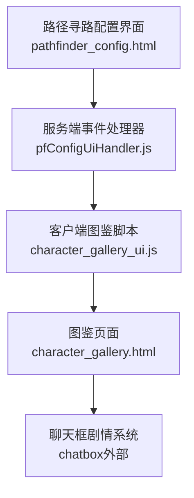
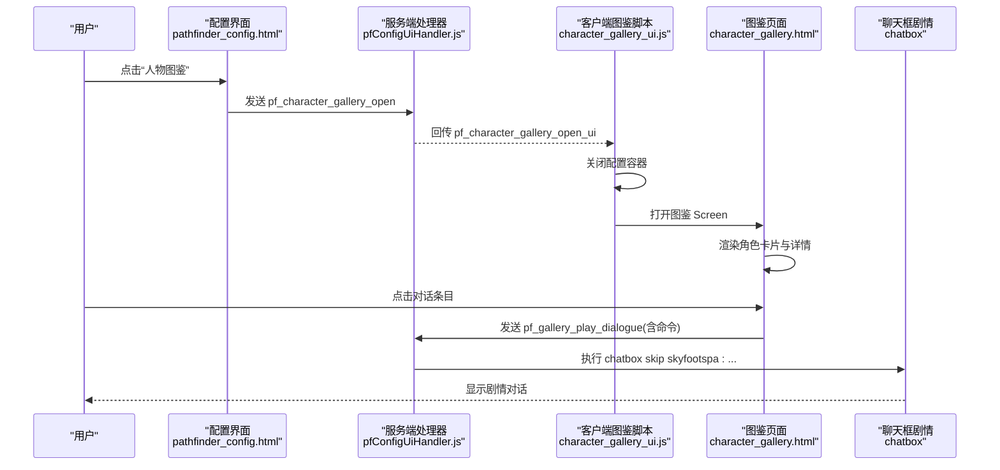
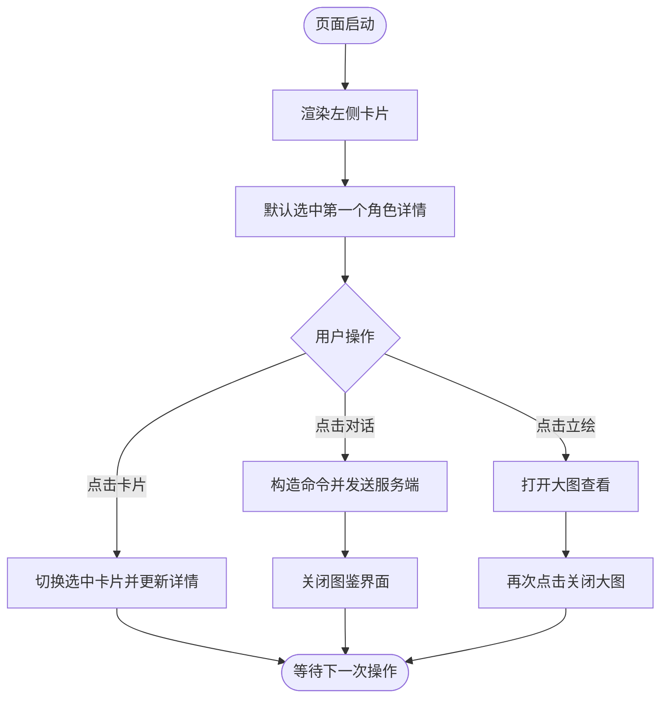
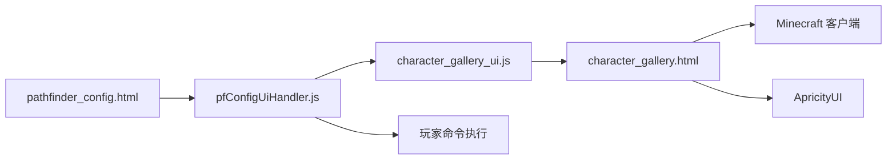

# 角色画廊系统

<cite>
**本文引用的文件**   
- [character_gallery_ui.js](file://kubejs/client_scripts/ui/character_gallery_ui.js)
- [character_gallery.html](file://apricity/kubejs/character_gallery.html)
- [pfConfigUiHandler.js](file://kubejs/server_scripts/pathfinder/pfConfigUiHandler.js)
- [pathfinder_config.html](file://apricity/kubejs/pathfinder_config.html)
- [README.md](file://README.md)
</cite>

## 目录
1. [简介](#简介)
2. [项目结构](#项目结构)
3. [核心组件](#核心组件)
4. [架构总览](#架构总览)
5. [详细组件分析](#详细组件分析)
6. [依赖关系分析](#依赖关系分析)
7. [性能与稳定性考虑](#性能与稳定性考虑)
8. [故障排查指南](#故障排查指南)
9. [结论](#结论)

## 简介
角色画廊系统是“洗手”整合包中用于展示已确立绘角色的图鉴界面。它通过 ApricityUI 的 Screen 机制，在客户端以和风纸质风格呈现角色卡片、立绘大图、角色情报与剧情对话列表；点击对话条目后，经服务端校验并执行 chatbox 命令跳转对应剧情。该功能由配置界面的“人物图鉴”按钮触发，采用“客户端脚本 + HTML 页面 + 服务端事件处理”的分层协作方式。

## 项目结构
角色画廊相关代码分布在客户端脚本、HTML 页面与服务端事件处理器三个位置：
- 客户端脚本负责监听网络事件、关闭旧容器并打开图鉴 Screen。
- HTML 页面承载 UI 布局、静态角色数据、交互逻辑与大图查看。
- 服务端处理器负责接收“打开图鉴”和“播放对话”两类事件，并对对话命令进行安全校验。

图示来源
- [pathfinder_config.html:90-114](file://apricity/kubejs/pathfinder_config.html#L90-L114)
- [pfConfigUiHandler.js:57-77](file://kubejs/server_scripts/pathfinder/pfConfigUiHandler.js#L57-L77)
- [character_gallery_ui.js:13-24](file://kubejs/client_scripts/ui/character_gallery_ui.js#L13-L24)
- [character_gallery.html:453-463](file://apricity/kubejs/character_gallery.html#L453-L463)

章节来源
- [README.md:1-6](file://README.md#L1-L6)

## 核心组件
- 客户端图鉴入口脚本：监听服务器回传事件，关闭配置容器并打开图鉴 Screen。
- 图鉴 HTML 页面：定义左右布局、角色卡片网格、详情面板、对话列表与大图查看覆盖层；内嵌 6 位角色的静态数据。
- 服务端事件处理器：转发“打开图鉴”请求，并校验与执行“播放对话”命令。
- 配置界面按钮：作为用户入口，向服务端发送打开图鉴的请求。

章节来源
- [character_gallery_ui.js:1-24](file://kubejs/client_scripts/ui/character_gallery_ui.js#L1-L24)
- [character_gallery.html:1-527](file://apricity/kubejs/character_gallery.html#L1-L527)
- [pfConfigUiHandler.js:57-77](file://kubejs/server_scripts/pathfinder/pfConfigUiHandler.js#L57-L77)
- [pathfinder_config.html:90-114](file://apricity/kubejs/pathfinder_config.html#L90-L114)

## 架构总览
角色画廊系统的整体流程如下：
1. 用户在路径寻路配置界面点击“人物图鉴”。
2. 配置界面将事件发送至服务端。
3. 服务端校验玩家存在后，回传“打开图鉴”事件给客户端。
4. 客户端脚本关闭当前配置容器，再打开图鉴 Screen。
5. 图鉴页面加载静态角色数据，渲染左侧卡片与右侧详情。
6. 用户点击对话条目时，客户端构造 chatbox 命令并通过网络发送给服务端。
7. 服务端校验命令前缀后执行命令，跳转到对应剧情。

图示来源
- [pathfinder_config.html:100-108](file://apricity/kubejs/pathfinder_config.html#L100-L108)
- [pfConfigUiHandler.js:57-77](file://kubejs/server_scripts/pathfinder/pfConfigUiHandler.js#L57-L77)
- [character_gallery_ui.js:15-24](file://kubejs/client_scripts/ui/character_gallery_ui.js#L15-L24)
- [character_gallery.html:453-463](file://apricity/kubejs/character_gallery.html#L453-L463)

## 详细组件分析

### 客户端图鉴入口脚本
职责：
- 监听“打开图鉴”的网络事件。
- 先关闭配置容器 Screen，再打开图鉴 Screen。
- 记录日志便于调试。

关键点：
- 使用 ApricityUI 提供的 closeScreen 与 screen 方法控制界面切换。
- 对异常进行捕获，避免崩溃。

章节来源
- [character_gallery_ui.js:13-24](file://kubejs/client_scripts/ui/character_gallery_ui.js#L13-L24)

### 图鉴 HTML 页面
职责：
- 定义和风纸质风格的界面布局。
- 维护 6 位角色的静态数据（头像、立绘、种族、能力、初登场、简介、对话）。
- 渲染左侧卡片网格与右侧详情面板。
- 支持点击立绘查看大图。
- 点击对话条目时构造命令并通知服务端执行。

关键结构与行为：
- 左侧卡片：固定槽位，使用 texture 元素显示头像，文本显示名称与种族标签。
- 右侧详情：显示选中角色的立绘大图与文字信息。
- 对话列表：最多 4 条静态槽位，按角色数据填充。
- 大图查看：通过 lightbox 覆盖层显示完整比例立绘。
- 对话跳转：构建 chatbox 命令，通过 player.sendData 发送到服务端。

复杂度说明：
- 渲染循环为 O(N)，N 为卡片数量（固定为 6），开销稳定。
- 详情切换与对话列表更新均为线性遍历固定槽位，常数级操作。

图示来源
- [character_gallery.html:387-451](file://apricity/kubejs/character_gallery.html#L387-L451)
- [character_gallery.html:453-480](file://apricity/kubejs/character_gallery.html#L453-L480)
- [character_gallery.html:482-523](file://apricity/kubejs/character_gallery.html#L482-L523)

章节来源
- [character_gallery.html:1-527](file://apricity/kubejs/character_gallery.html#L1-L527)

### 服务端事件处理器
职责：
- 接收“打开图鉴”请求，校验玩家存在后回传“打开图鉴”事件。
- 接收“播放对话”请求，校验命令前缀后执行命令。

安全策略：
- 仅允许以 “chatbox skip skyfootspa:” 开头的命令，防止任意命令注入。

章节来源
- [pfConfigUiHandler.js:57-77](file://kubejs/server_scripts/pathfinder/pfConfigUiHandler.js#L57-L77)

### 配置界面按钮
职责：
- 提供“人物图鉴”按钮，点击后将事件发送至服务端。

章节来源
- [pathfinder_config.html:100-108](file://apricity/kubejs/pathfinder_config.html#L100-L108)

## 依赖关系分析
- 客户端图鉴脚本依赖 ApricityUI 的 Java 类以控制界面。
- 图鉴页面依赖 Minecraft 客户端对象获取玩家实例，并依赖 ApricityUI 关闭界面。
- 服务端处理器依赖 NetworkEvents 与玩家命令执行接口。
- 配置界面依赖 Minecraft 客户端对象获取玩家实例。

图示来源
- [pathfinder_config.html:100-108](file://apricity/kubejs/pathfinder_config.html#L100-L108)
- [pfConfigUiHandler.js:57-77](file://kubejs/server_scripts/pathfinder/pfConfigUiHandler.js#L57-L77)
- [character_gallery_ui.js:13-24](file://kubejs/client_scripts/ui/character_gallery_ui.js#L13-L24)
- [character_gallery.html:453-463](file://apricity/kubejs/character_gallery.html#L453-L463)

章节来源
- [character_gallery_ui.js:13-24](file://kubejs/client_scripts/ui/character_gallery_ui.js#L13-L24)
- [character_gallery.html:453-463](file://apricity/kubejs/character_gallery.html#L453-L463)
- [pfConfigUiHandler.js:57-77](file://kubejs/server_scripts/pathfinder/pfConfigUiHandler.js#L57-L77)
- [pathfinder_config.html:100-108](file://apricity/kubejs/pathfinder_config.html#L100-L108)

## 性能与稳定性考虑
- 静态数据渲染：图鉴页面使用预置 DOM 槽位与 getElementById 填充，避免频繁增删节点，降低重排成本。
- 固定规模：卡片数量为 6，对话槽位最大为 4，渲染与交互均为常数级开销。
- 图片尺寸：立绘源图为 860×1536，页面显式设置宽高保持比例，避免 object-fit 带来的兼容性问题。
- 背景样式：使用实色或单色渐变规避 AUI 下半透明与渐变混合不稳定的问题。
- 异常处理：客户端与服务端均对关键操作进行 try/catch 或条件判断，提升鲁棒性。

[本节为通用指导，不直接分析具体文件]

## 故障排查指南
常见问题与定位建议：
- 点击“人物图鉴”无反应：
  - 检查配置界面是否成功发送 pf_character_gallery_open 事件。
  - 检查服务端是否回传 pf_character_gallery_open_ui。
  - 检查客户端是否调用 closeScreen 与 screen 打开图鉴。
- 图鉴界面打开但内容空白：
  - 检查角色静态数据是否正确加载。
  - 检查头像与立绘资源路径是否有效。
- 点击对话条目无效：
  - 检查客户端是否构造了正确的 chatbox 命令。
  - 检查服务端是否允许该命令前缀。
  - 检查聊天框剧情系统是否可用。

章节来源
- [pfConfigUiHandler.js:57-77](file://kubejs/server_scripts/pathfinder/pfConfigUiHandler.js#L57-L77)
- [character_gallery_ui.js:15-24](file://kubejs/client_scripts/ui/character_gallery_ui.js#L15-L24)
- [character_gallery.html:453-463](file://apricity/kubejs/character_gallery.html#L453-L463)

## 结论
角色画廊系统以清晰的三层分工实现了图鉴展示与剧情跳转：配置界面提供入口，服务端负责事件转发与安全校验，客户端脚本与 HTML 页面负责界面渲染与交互。系统采用静态数据与固定槽位设计，兼顾性能与稳定性；同时通过命令白名单保障安全性。未来如需扩展角色或对话，可在 HTML 静态数据与服务端命令白名单范围内进行增量调整。