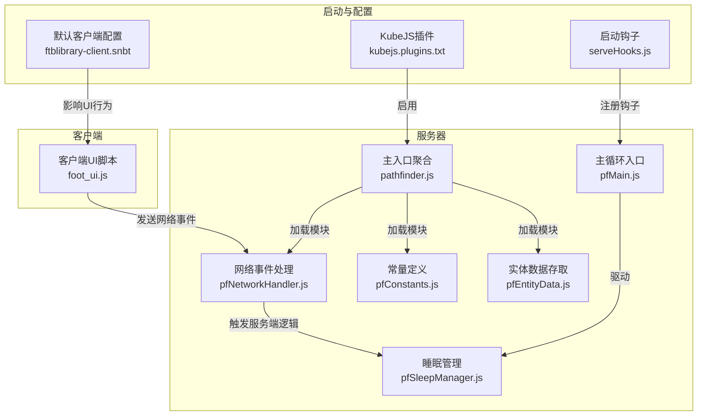
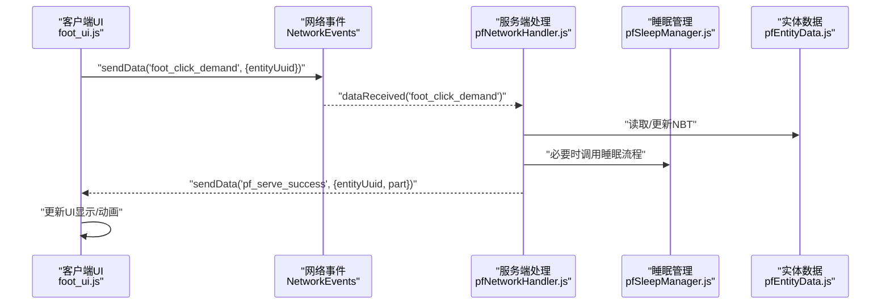
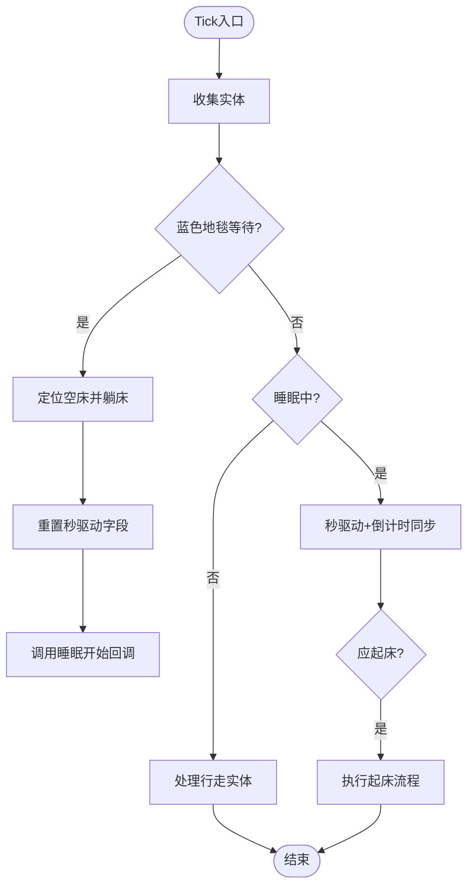
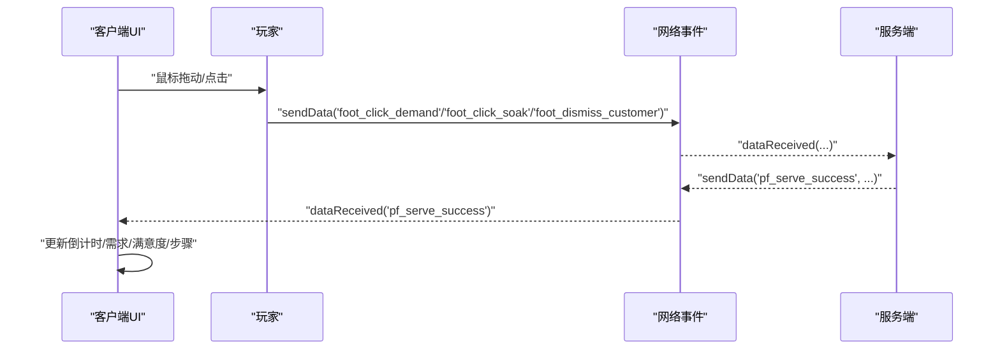
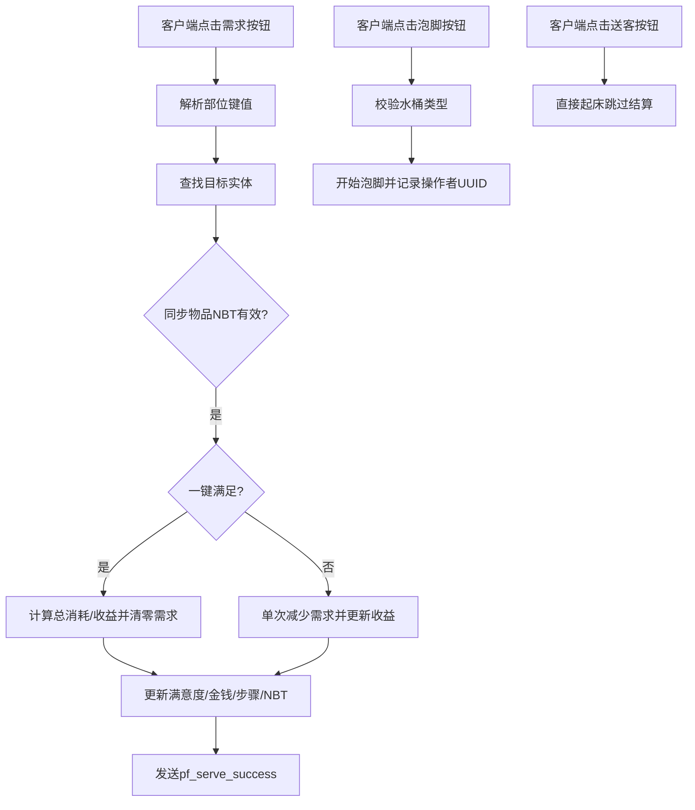
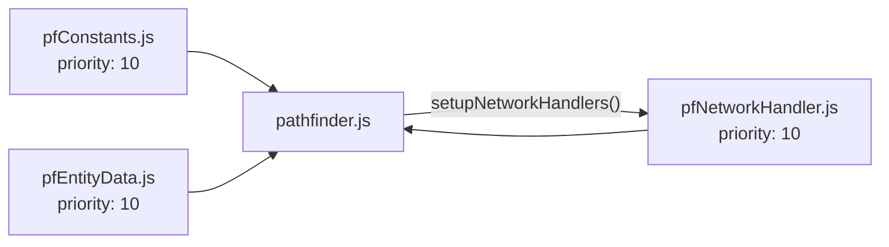
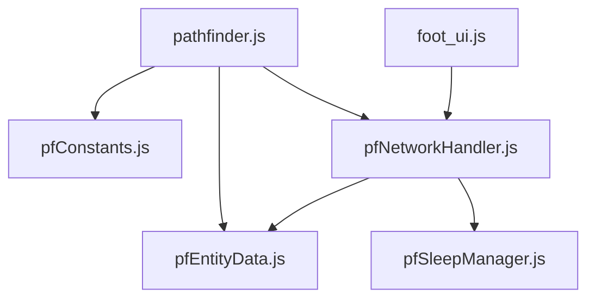

# 事件系统

<cite>
**本文引用的文件**
- [README.md](file://README.md)
- [kubejs/plugins.txt](file://mods/kubejs.plugins.txt)
- [defaultconfigs/ftblibrary-client.snbt](file://defaultconfigs/ftblibrary/ftblibrary-client.snbt)
- [kubejs/startup_scripts/serveHooks.js](file://kubejs/startup_scripts/serveHooks.js)
- [kubejs/server_scripts/pathfinder.js](file://kubejs/server_scripts/pathfinder.js)
- [kubejs/server_scripts/pathfinder/pfConstants.js](file://kubejs/server_scripts/pathfinder/pfConstants.js)
- [kubejs/server_scripts/pathfinder/pfEntityData.js](file://kubejs/server_scripts/pathfinder/pfEntityData.js)
- [kubejs/server_scripts/pathfinder/pfSleepManager.js](file://kubejs/server_scripts/pathfinder/pfSleepManager.js)
- [kubejs/server_scripts/pathfinder/pfNetworkHandler.js](file://kubejs/server_scripts/pathfinder/pfNetworkHandler.js)
- [kubejs/server_scripts/pathfinder/pfMain.js](file://kubejs/server_scripts/pathfinder/pfMain.js)
- [kubejs/client_scripts/ui/foot_ui.js](file://kubejs/client_scripts/ui/foot_ui.js)
- [kubejs/server_scripts/example.js](file://kubejs/server_scripts/example.js)
- [kubejs/server_scripts/auratip_triggers.js](file://kubejs/server_scripts/auratip_triggers.js)
</cite>

## 目录
1. [简介](#简介)
2. [项目结构](#项目结构)
3. [核心组件](#核心组件)
4. [架构总览](#架构总览)
5. [详细组件分析](#详细组件分析)
6. [依赖分析](#依赖分析)
7. [性能考虑](#性能考虑)
8. [故障排查指南](#故障排查指南)
9. [结论](#结论)
10. [附录](#附录)

## 简介
本文件系统性梳理基于 KubeJS 的 Minecraft 事件框架，围绕事件系统的三大类：服务端事件、客户端事件与网络事件，给出完整的处理流程、注册方式、触发条件、回调函数、事件传播与优先级、异步处理与错误处理策略，并提供自定义事件的创建方法、监听器实现与事件数据传递的最佳实践与性能优化建议。内容以仓库中的实际脚本为依据，确保可追溯与可落地。

## 项目结构
该项目为基于 KubeJS 的模组工程，采用“启动脚本 + 服务器脚本 + 客户端脚本”的分层组织方式，事件系统贯穿其中：
- 启动脚本：负责全局钩子注册与运行时环境准备
- 服务器脚本：负责服务端 Tick 循环、实体状态管理、网络事件处理与业务逻辑
- 客户端脚本：负责 UI 展示、输入交互与网络事件接收
- 插件与默认配置：声明 KubeJS 插件与默认客户端配置

**图表来源**
- [kubejs/client_scripts/ui/foot_ui.js:186-273](file://kubejs/client_scripts/ui/foot_ui.js#L186-L273)
- [kubejs/server_scripts/pathfinder/pfNetworkHandler.js:37-311](file://kubejs/server_scripts/pathfinder/pfNetworkHandler.js#L37-L311)
- [kubejs/server_scripts/pathfinder/pfSleepManager.js:24-128](file://kubejs/server_scripts/pathfinder/pfSleepManager.js#L24-L128)
- [kubejs/server_scripts/pathfinder/pfMain.js:11-174](file://kubejs/server_scripts/pathfinder/pfMain.js#L11-L174)
- [kubejs/server_scripts/pathfinder/pfConstants.js:53-64](file://kubejs/server_scripts/pathfinder/pfConstants.js#L53-L64)
- [kubejs/server_scripts/pathfinder/pfEntityData.js:185-217](file://kubejs/server_scripts/pathfinder/pfEntityData.js#L185-L217)
- [kubejs/server_scripts/pathfinder.js:25-29](file://kubejs/server_scripts/pathfinder.js#L25-L29)
- [kubejs/startup_scripts/serveHooks.js:11-30](file://kubejs/startup_scripts/serveHooks.js#L11-L30)
- [mods/kubejs.plugins.txt:1-1](file://mods/kubejs.plugins.txt#L1-L1)
- [defaultconfigs/ftblibrary/ftblibrary-client.snbt:1-5](file://defaultconfigs/ftblibrary/ftblibrary-client.snbt#L1-L5)

**章节来源**
- [README.md:1-6](file://README.md#L1-L6)
- [mods/kubejs.plugins.txt:1-1](file://mods/kubejs.plugins.txt#L1-L1)
- [defaultconfigs/ftblibrary/ftblibrary-client.snbt:1-5](file://defaultconfigs/ftblibrary/ftblibrary-client.snbt#L1-L5)

## 核心组件
- 事件注册与优先级
  - 通过文件头部注释声明优先级，确保模块加载顺序与依赖链正确
  - 示例：网络事件处理器在模块加载后被主入口调用注册
- 事件触发条件
  - 客户端 UI 通过 sendData 发送网络事件
  - 服务端 Tick 驱动实体状态推进
- 回调函数与事件传播
  - 服务端通过 NetworkEvents.dataReceived 注册回调
  - 客户端通过 NetworkEvents.dataReceived 接收回调
- 异步与错误处理
  - 服务端事件处理中广泛使用 try/catch 与日志输出
  - 客户端 UI 使用异步事件与 UI 更新
- 事件数据传递
  - 通过实体 NBT 与网络包数据进行跨端传递
  - 常量映射与键值转换保证一致性

**章节来源**
- [kubejs/server_scripts/pathfinder/pfNetworkHandler.js:37-311](file://kubejs/server_scripts/pathfinder/pfNetworkHandler.js#L37-L311)
- [kubejs/client_scripts/ui/foot_ui.js:186-273](file://kubejs/client_scripts/ui/foot_ui.js#L186-L273)
- [kubejs/server_scripts/pathfinder/pfMain.js:11-174](file://kubejs/server_scripts/pathfinder/pfMain.js#L11-L174)
- [kubejs/server_scripts/pathfinder/pfConstants.js:53-64](file://kubejs/server_scripts/pathfinder/pfConstants.js#L53-L64)

## 架构总览
事件系统以“客户端 UI → 网络事件 → 服务端处理 → 实体状态变更 → 客户端 UI 更新”的闭环为核心，辅以服务端 Tick 驱动的状态机推进与实体数据持久化。

**图表来源**
- [kubejs/client_scripts/ui/foot_ui.js:186-208](file://kubejs/client_scripts/ui/foot_ui.js#L186-L208)
- [kubejs/server_scripts/pathfinder/pfNetworkHandler.js:39-219](file://kubejs/server_scripts/pathfinder/pfNetworkHandler.js#L39-L219)
- [kubejs/server_scripts/pathfinder/pfSleepManager.js:24-128](file://kubejs/server_scripts/pathfinder/pfSleepManager.js#L24-L128)
- [kubejs/server_scripts/pathfinder/pfEntityData.js:185-217](file://kubejs/server_scripts/pathfinder/pfEntityData.js#L185-L217)

## 详细组件分析

### 服务端事件：Tick 驱动与实体状态机
- 主循环入口
  - 全局导出 pathfinderTick，由特定方块实体触发
  - 聚合收集实体、处理蓝色地毯等待、睡眠中实体、行走实体
- 睡眠状态推进
  - 以秒为单位的独立计时字段，避免跨重启失效
  - 支持倒计时同步、床边自动泡脚等扩展
- 错误处理
  - 对可选模块（如 Basin 泡脚管理）使用 try/catch 包裹

**图表来源**
- [kubejs/server_scripts/pathfinder/pfMain.js:11-174](file://kubejs/server_scripts/pathfinder/pfMain.js#L11-L174)
- [kubejs/server_scripts/pathfinder/pfSleepManager.js:24-128](file://kubejs/server_scripts/pathfinder/pfSleepManager.js#L24-L128)

**章节来源**
- [kubejs/server_scripts/pathfinder/pfMain.js:11-174](file://kubejs/server_scripts/pathfinder/pfMain.js#L11-L174)
- [kubejs/server_scripts/pathfinder/pfSleepManager.js:17-128](file://kubejs/server_scripts/pathfinder/pfSleepManager.js#L17-L128)

### 客户端事件：UI 交互与网络事件接收
- UI 生命周期
  - ClientEvents.tick 驱动窗口创建/更新/销毁
  - 根据实体睡眠状态切换主 UI 与泡脚 UI
- 事件发送
  - 搓脚：鼠标拖动达到阈值后发送 foot_click_demand
  - 泡脚：点击泡脚按钮发送 foot_click_soak
  - 送客：点击送客按钮发送 foot_dismiss_customer
- 事件接收
  - 接收服务端 pf_serve_success，用于确认动画与日志

**图表来源**
- [kubejs/client_scripts/ui/foot_ui.js:186-273](file://kubejs/client_scripts/ui/foot_ui.js#L186-L273)
- [kubejs/client_scripts/ui/foot_ui.js:949-957](file://kubejs/client_scripts/ui/foot_ui.js#L949-L957)
- [kubejs/server_scripts/pathfinder/pfNetworkHandler.js:39-311](file://kubejs/server_scripts/pathfinder/pfNetworkHandler.js#L39-L311)

**章节来源**
- [kubejs/client_scripts/ui/foot_ui.js:766-909](file://kubejs/client_scripts/ui/foot_ui.js#L766-L909)
- [kubejs/client_scripts/ui/foot_ui.js:949-957](file://kubejs/client_scripts/ui/foot_ui.js#L949-L957)

### 网络事件：客户端到服务端的请求与服务端到客户端的反馈
- 客户端点击需求按钮
  - 解析部位键值（羊毛/手物品映射）
  - 查找目标实体与同步物品 NBT
  - 一键满足/正常模式分别计算体力消耗与收益
  - 更新满意度、金钱、步骤记录
  - 成功后向客户端发送 pf_serve_success
- 客户端点击泡脚按钮
  - 校验手持水桶类型
  - 调用泡脚管理器开始泡脚
  - 记录操作玩家 UUID
- 客户端点击送客按钮
  - 直接调用睡眠管理器的 pfWakeUp，跳过结算

**图表来源**
- [kubejs/server_scripts/pathfinder/pfNetworkHandler.js:39-219](file://kubejs/server_scripts/pathfinder/pfNetworkHandler.js#L39-L219)
- [kubejs/server_scripts/pathfinder/pfNetworkHandler.js:222-272](file://kubejs/server_scripts/pathfinder/pfNetworkHandler.js#L222-L272)
- [kubejs/server_scripts/pathfinder/pfNetworkHandler.js:277-311](file://kubejs/server_scripts/pathfinder/pfNetworkHandler.js#L277-L311)

**章节来源**
- [kubejs/server_scripts/pathfinder/pfNetworkHandler.js:39-311](file://kubejs/server_scripts/pathfinder/pfNetworkHandler.js#L39-L311)

### 事件注册与优先级
- 优先级声明
  - 通过文件头部注释声明 priority，确保加载顺序
- 注册方式
  - 服务端：NetworkEvents.dataReceived 注册回调
  - 客户端：NetworkEvents.dataReceived 注册回调
- 主入口聚合
  - pathfinder.js 加载各模块并设置网络事件处理器

**图表来源**
- [kubejs/server_scripts/pathfinder/pfConstants.js:1-6](file://kubejs/server_scripts/pathfinder/pfConstants.js#L1-L6)
- [kubejs/server_scripts/pathfinder/pfEntityData.js:1-6](file://kubejs/server_scripts/pathfinder/pfEntityData.js#L1-L6)
- [kubejs/server_scripts/pathfinder/pfNetworkHandler.js:1-6](file://kubejs/server_scripts/pathfinder/pfNetworkHandler.js#L1-L6)
- [kubejs/server_scripts/pathfinder.js:25-29](file://kubejs/server_scripts/pathfinder.js#L25-L29)

**章节来源**
- [kubejs/server_scripts/pathfinder/pfConstants.js:1-6](file://kubejs/server_scripts/pathfinder/pfConstants.js#L1-L6)
- [kubejs/server_scripts/pathfinder/pfEntityData.js:1-6](file://kubejs/server_scripts/pathfinder/pfEntityData.js#L1-L6)
- [kubejs/server_scripts/pathfinder/pfNetworkHandler.js:1-6](file://kubejs/server_scripts/pathfinder/pfNetworkHandler.js#L1-L6)
- [kubejs/server_scripts/pathfinder.js:25-29](file://kubejs/server_scripts/pathfinder.js#L25-L29)

### 自定义事件与监听器实现
- 自定义事件创建
  - 客户端通过 player.sendData 发送自定义事件名与数据
  - 服务端通过 NetworkEvents.dataReceived 注册同名回调
- 监听器实现
  - 服务端：在回调中解析 event.data，访问 event.player 与 event.level
  - 客户端：在回调中解析 event.data，更新 UI 或播放动画
- 数据传递
  - 使用实体 NBT 与网络包数据进行跨端共享
  - 常量映射（如部位键值）保证一致性

**章节来源**
- [kubejs/client_scripts/ui/foot_ui.js:186-273](file://kubejs/client_scripts/ui/foot_ui.js#L186-L273)
- [kubejs/server_scripts/pathfinder/pfNetworkHandler.js:39-311](file://kubejs/server_scripts/pathfinder/pfNetworkHandler.js#L39-L311)

### 事件传播机制与回调链
- 传播路径
  - 客户端 UI → 网络事件 → 服务端处理 → 实体状态更新 → 客户端 UI 反馈
- 回调链
  - 服务端：NetworkEvents.dataReceived → 业务模块（睡眠/泡脚/移动）→ UI 同步
  - 客户端：NetworkEvents.dataReceived → UI 更新/动画

**章节来源**
- [kubejs/server_scripts/pathfinder/pfNetworkHandler.js:39-311](file://kubejs/server_scripts/pathfinder/pfNetworkHandler.js#L39-L311)
- [kubejs/client_scripts/ui/foot_ui.js:949-957](file://kubejs/client_scripts/ui/foot_ui.js#L949-L957)

### 异步处理与错误处理策略
- 异步处理
  - 客户端 UI 通过 ClientEvents.tick 驱动，非阻塞
  - 服务端 Tick 驱动，按 tick 推进状态机
- 错误处理
  - 广泛使用 try/catch 包裹可选模块调用
  - 日志输出便于定位问题

**章节来源**
- [kubejs/server_scripts/pathfinder/pfSleepManager.js:110-116](file://kubejs/server_scripts/pathfinder/pfSleepManager.js#L110-L116)
- [kubejs/server_scripts/pathfinder/pfNetworkHandler.js:26-28](file://kubejs/server_scripts/pathfinder/pfNetworkHandler.js#L26-L28)
- [kubejs/server_scripts/pathfinder/pfNetworkHandler.js:147-154](file://kubejs/server_scripts/pathfinder/pfNetworkHandler.js#L147-L154)

## 依赖分析
- 模块耦合
  - pathfinder.js 作为聚合入口，依赖常量、实体数据、网络事件与主循环
  - 网络事件处理依赖实体数据与睡眠管理等模块
- 外部依赖
  - KubeJS 插件启用与默认客户端配置影响 UI 行为
  - 事件系统依赖 Minecraft 侧的 NetworkEvents 与 ClientEvents

**图表来源**
- [kubejs/server_scripts/pathfinder.js:25-29](file://kubejs/server_scripts/pathfinder.js#L25-L29)
- [kubejs/server_scripts/pathfinder/pfConstants.js:53-64](file://kubejs/server_scripts/pathfinder/pfConstants.js#L53-L64)
- [kubejs/server_scripts/pathfinder/pfEntityData.js:185-217](file://kubejs/server_scripts/pathfinder/pfEntityData.js#L185-L217)
- [kubejs/server_scripts/pathfinder/pfNetworkHandler.js:37-311](file://kubejs/server_scripts/pathfinder/pfNetworkHandler.js#L37-L311)
- [kubejs/server_scripts/pathfinder/pfSleepManager.js:226-231](file://kubejs/server_scripts/pathfinder/pfSleepManager.js#L226-L231)
- [kubejs/client_scripts/ui/foot_ui.js:186-273](file://kubejs/client_scripts/ui/foot_ui.js#L186-L273)

**章节来源**
- [kubejs/server_scripts/pathfinder.js:25-29](file://kubejs/server_scripts/pathfinder.js#L25-L29)
- [kubejs/server_scripts/pathfinder/pfNetworkHandler.js:37-311](file://kubejs/server_scripts/pathfinder/pfNetworkHandler.js#L37-L311)

## 性能考虑
- Tick 驱动的节流
  - 使用实体 lastTick 防重复处理，避免同一 tick 内重复计算
- 查询与遍历优化
  - 通过实体集合分类（walkers/sleepers/waiters/blueWaiters）减少无关实体处理
- NBT 访问与合并
  - 合理使用 NBT 字段读写，避免频繁大对象合并
- UI 更新频率
  - 仅在倒计时或状态变化时更新 UI，降低 DOM 操作频率

**章节来源**
- [kubejs/server_scripts/pathfinder/pfMain.js:34-37](file://kubejs/server_scripts/pathfinder/pfMain.js#L34-L37)
- [kubejs/server_scripts/pathfinder/pfMain.js:99-103](file://kubejs/server_scripts/pathfinder/pfMain.js#L99-L103)
- [kubejs/client_scripts/ui/foot_ui.js:842-850](file://kubejs/client_scripts/ui/foot_ui.js#L842-L850)

## 故障排查指南
- 网络事件未触发
  - 检查客户端是否正确发送事件名与数据
  - 检查服务端是否注册同名回调
- 服务端逻辑未生效
  - 检查实体 NBT 是否正确读取/写入
  - 检查模块加载顺序与优先级声明
- UI 未更新
  - 检查客户端 Tick 事件是否运行
  - 检查 NetworkEvents.dataReceived 是否收到服务端反馈
- 跨重启状态丢失
  - 确认使用独立的秒驱动字段而非依赖 server.getTickCount()

**章节来源**
- [kubejs/server_scripts/pathfinder/pfNetworkHandler.js:39-311](file://kubejs/server_scripts/pathfinder/pfNetworkHandler.js#L39-L311)
- [kubejs/client_scripts/ui/foot_ui.js:766-909](file://kubejs/client_scripts/ui/foot_ui.js#L766-L909)
- [kubejs/server_scripts/pathfinder/pfSleepManager.js:17-21](file://kubejs/server_scripts/pathfinder/pfSleepManager.js#L17-L21)

## 结论
该事件系统以 KubeJS 事件框架为基础，结合服务端 Tick 驱动与网络事件，实现了从客户端 UI 到服务端状态机再到客户端反馈的完整闭环。通过明确的优先级声明、模块化设计与完善的错误处理，系统具备良好的可维护性与扩展性。建议在新增事件时遵循现有模式：声明优先级、注册回调、传递最小必要数据、在 UI 中及时反馈，并注意性能与可跨重启状态的持久化。

## 附录
- 事件清单与用途
  - foot_click_demand：客户端搓脚请求
  - foot_click_soak：客户端泡脚请求
  - foot_dismiss_customer：客户端送客请求
  - pf_serve_success：服务端搓脚成功反馈
- 常量与映射
  - 部位键值映射（羊毛/手物品 → 需求键）
  - 需求键 → 整数代码映射（用于步骤记录）

**章节来源**
- [kubejs/server_scripts/pathfinder/pfNetworkHandler.js:39-311](file://kubejs/server_scripts/pathfinder/pfNetworkHandler.js#L39-L311)
- [kubejs/server_scripts/pathfinder/pfConstants.js:25-50](file://kubejs/server_scripts/pathfinder/pfConstants.js#L25-L50)
- [kubejs/client_scripts/ui/foot_ui.js:564-612](file://kubejs/client_scripts/ui/foot_ui.js#L564-L612)