# 启动事件

<cite>
**本文引用的文件**
- [README.md](file://README.md)
- [serveAttributes.js](file://kubejs/startup_scripts/attributes/serveAttributes.js)
- [cun_block.js](file://kubejs/startup_scripts/block/cun_block.js)
- [cun_item.js](file://kubejs/startup_scripts/item/cun_item.js)
- [electrolyte_water.js](file://kubejs/startup_scripts/fluid/electrolyte_water.js)
- [oil.js](file://kubejs/startup_scripts/oil/oil.js)
- [bossRegister.js](file://kubejs/startup_scripts/boss/bossRegister.js)
- [soakWaterRegister.js](file://kubejs/startup_scripts/soakwater/soakWaterRegister.js)
- [relicRegister.js](file://kubejs/startup_scripts/relic/relicRegister.js)
- [serveHooks.js](file://kubejs/startup_scripts/serveHooks.js)
- [example.js](file://kubejs/startup_scripts/example.js)
- [backpackUpdate.js](file://kubejs/server_scripts/backpack/backpackUpdate.js)
- [phone_settings.js](file://kubejs/server_scripts/phone_settings.js)
- [pfEntityData.js](file://kubejs/server_scripts/pathfinder/pfEntityData.js)
- [relicAttack.js](file://kubejs/server_scripts/backpack/relic/relicAttack.js)
- [relicKill.js](file://kubejs/server_scripts/backpack/relic/relicKill.js)
</cite>

## 目录
1. [简介](#简介)
2. [项目结构](#项目结构)
3. [核心组件](#核心组件)
4. [架构总览](#架构总览)
5. [组件详解](#组件详解)
6. [依赖关系分析](#依赖关系分析)
7. [性能考量](#性能考量)
8. [故障排查指南](#故障排查指南)
9. [结论](#结论)
10. [附录](#附录)

## 简介
本文件围绕模组加载时的“启动事件”机制进行系统化说明，重点解释 KubeJS 的 StartupEvents 在模组启动阶段如何用于注册资源、系统初始化与依赖装配。文档覆盖以下主题：
- StartupEvents 的使用方法与注册类型
- 启动阶段的初始化顺序与依赖管理
- 启动事件的执行时机、错误处理与回滚思路
- 自定义启动事件的创建方法与初始化流程设计
- 模组配置加载、资源注册与系统组件初始化的实现示例
- 启动事件与其他事件类型（如 Forge 事件、实体事件）的关系与最佳实践

## 项目结构
本项目基于 KubeJS 的启动脚本组织方式，将“启动阶段”的资源注册与系统初始化集中在 kubejs/startup_scripts 目录下，形成清晰的职责边界：
- attributes：注册自定义属性，供后续系统使用
- block/item/fluid：注册方块、物品、流体等基础资源
- boss/soakwater/relic：注册复杂系统所需的实体/物品/配方数据
- oil：批量注册油类物品
- serveHooks：启动阶段占位的钩子框架，供运行时扩展
- example：演示如何注册自定义实体类型

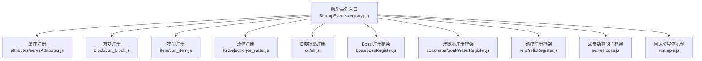

图表来源
- [serveAttributes.js:27-40](file://kubejs/startup_scripts/attributes/serveAttributes.js#L27-L40)
- [cun_block.js:10-27](file://kubejs/startup_scripts/block/cun_block.js#L10-L27)
- [cun_item.js:12-25](file://kubejs/startup_scripts/item/cun_item.js#L12-L25)
- [electrolyte_water.js:10-23](file://kubejs/startup_scripts/fluid/electrolyte_water.js#L10-L23)
- [oil.js:9-27](file://kubejs/startup_scripts/oil/oil.js#L9-L27)
- [bossRegister.js:60-99](file://kubejs/startup_scripts/boss/bossRegister.js#L60-L99)
- [soakWaterRegister.js:40-83](file://kubejs/startup_scripts/soakwater/soakWaterRegister.js#L40-L83)
- [relicRegister.js:3-42](file://kubejs/startup_scripts/relic/relicRegister.js#L3-L42)
- [serveHooks.js:11-30](file://kubejs/startup_scripts/serveHooks.js#L11-L30)
- [example.js:2-26](file://kubejs/startup_scripts/example.js#L2-L26)

章节来源
- [README.md:1-6](file://README.md#L1-L6)

## 核心组件
- 启动事件入口：StartupEvents.registry(type, callback)
  - 用于在模组加载早期注册各类资源或系统组件
  - 支持的类型包括 attribute、block、item、fluid、entity_type 等
- 属性注册器：attributes/serveAttributes.js
  - 在启动阶段注册自定义属性，并在后续通过 Forge 事件确保属性可用
- 资源注册器：block/item/fluid/oil
  - 在启动阶段完成基础资源的注册与元数据配置
- 复杂系统注册器：bossRegister、soakWaterRegister、relicRegister
  - 提供链式 API 与集中注册能力，支持延迟依赖与统一处理
- 启动钩子框架：serveHooks.js
  - 提供运行时可扩展的点击结算钩子，启动阶段占位并允许后续注入

章节来源
- [serveAttributes.js:27-40](file://kubejs/startup_scripts/attributes/serveAttributes.js#L27-L40)
- [cun_block.js:10-27](file://kubejs/startup_scripts/block/cun_block.js#L10-L27)
- [cun_item.js:12-25](file://kubejs/startup_scripts/item/cun_item.js#L12-L25)
- [electrolyte_water.js:10-23](file://kubejs/startup_scripts/fluid/electrolyte_water.js#L10-L23)
- [oil.js:9-27](file://kubejs/startup_scripts/oil/oil.js#L9-L27)
- [bossRegister.js:60-99](file://kubejs/startup_scripts/boss/bossRegister.js#L60-L99)
- [soakWaterRegister.js:40-83](file://kubejs/startup_scripts/soakwater/soakWaterRegister.js#L40-L83)
- [relicRegister.js:3-42](file://kubejs/startup_scripts/relic/relicRegister.js#L3-L42)
- [serveHooks.js:11-30](file://kubejs/startup_scripts/serveHooks.js#L11-L30)

## 架构总览
启动事件贯穿“资源注册 → 系统初始化 → 运行时扩展”的完整生命周期。下图展示了启动阶段的关键交互：

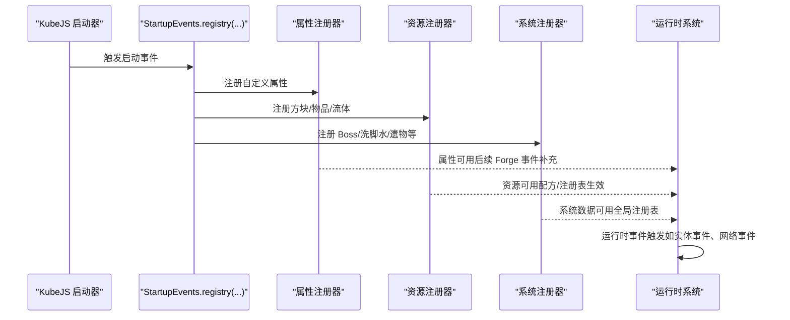

图表来源
- [serveAttributes.js:27-40](file://kubejs/startup_scripts/attributes/serveAttributes.js#L27-L40)
- [cun_block.js:10-27](file://kubejs/startup_scripts/block/cun_block.js#L10-L27)
- [cun_item.js:12-25](file://kubejs/startup_scripts/item/cun_item.js#L12-L25)
- [electrolyte_water.js:10-23](file://kubejs/startup_scripts/fluid/electrolyte_water.js#L10-L23)
- [oil.js:9-27](file://kubejs/startup_scripts/oil/oil.js#L9-L27)
- [bossRegister.js:60-99](file://kubejs/startup_scripts/boss/bossRegister.js#L60-L99)
- [soakWaterRegister.js:40-83](file://kubejs/startup_scripts/soakwater/soakWaterRegister.js#L40-L83)
- [relicRegister.js:3-42](file://kubejs/startup_scripts/relic/relicRegister.js#L3-L42)
- [serveHooks.js:11-30](file://kubejs/startup_scripts/serveHooks.js#L11-L30)

## 组件详解

### 属性注册（attribute）
- 目标：在启动阶段注册自定义属性，供后续系统使用
- 关键点：
  - 使用 StartupEvents.registry('attribute', ...) 完成属性创建
  - 通过 Forge 事件确保属性被添加到玩家实体上
  - 属性值域与同步性在创建时配置
- 依赖关系：
  - 后续背包更新逻辑依赖这些属性进行动态重算

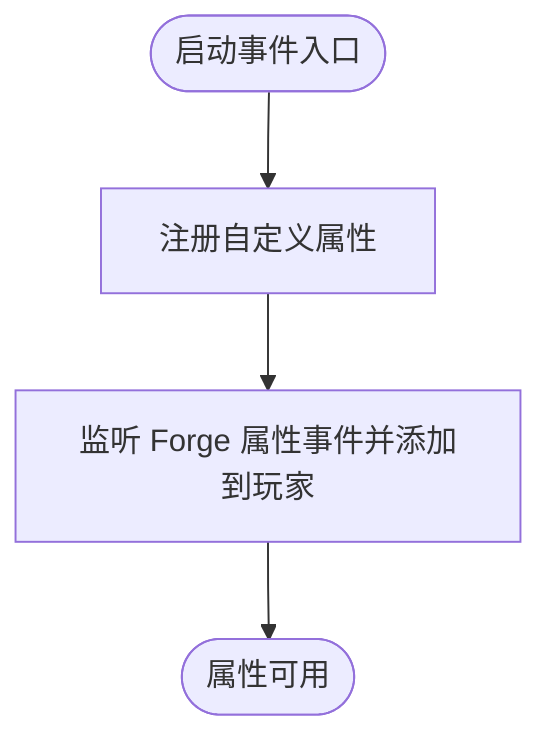

图表来源
- [serveAttributes.js:27-40](file://kubejs/startup_scripts/attributes/serveAttributes.js#L27-L40)
- [serveAttributes.js:42-52](file://kubejs/startup_scripts/attributes/serveAttributes.js#L42-L52)

章节来源
- [serveAttributes.js:27-40](file://kubejs/startup_scripts/attributes/serveAttributes.js#L27-L40)
- [serveAttributes.js:42-52](file://kubejs/startup_scripts/attributes/serveAttributes.js#L42-L52)
- [backpackUpdate.js:26-31](file://kubejs/server_scripts/backpack/backpackUpdate.js#L26-L31)

### 方块与物品注册（block/item）
- 目标：在启动阶段完成基础资源注册与元数据配置
- 关键点：
  - 使用 StartupEvents.registry('block'|'item', ...) 创建资源
  - 配置显示名、材质、标签、耐久、堆叠等属性
  - 异常捕获与日志输出，避免单个资源失败影响整体注册
- 依赖关系：
  - 后续配方与实体行为可能依赖这些资源

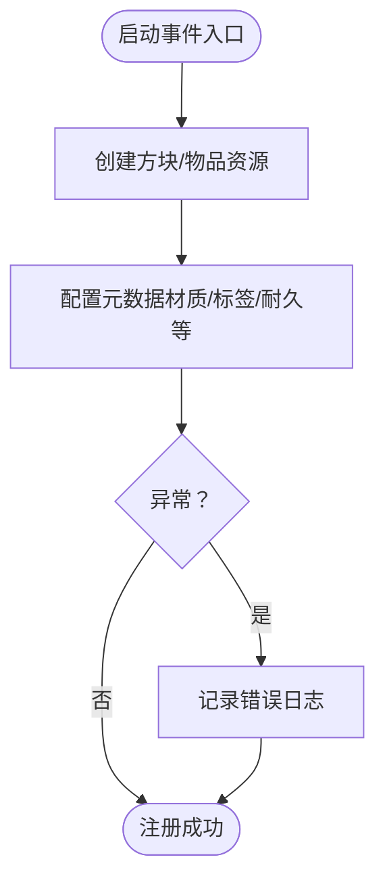

图表来源
- [cun_block.js:10-27](file://kubejs/startup_scripts/block/cun_block.js#L10-L27)
- [cun_item.js:12-25](file://kubejs/startup_scripts/item/cun_item.js#L12-L25)

章节来源
- [cun_block.js:10-27](file://kubejs/startup_scripts/block/cun_block.js#L10-L27)
- [cun_item.js:12-25](file://kubejs/startup_scripts/item/cun_item.js#L12-L25)

### 流体注册（fluid）
- 目标：注册自定义流体及其桶物品
- 关键点：
  - 使用 StartupEvents.registry('fluid', ...) 创建流体
  - 配置显示名、颜色、纹理、液体外观等
  - 导出常量供运行时使用（如桶 ID、容量）

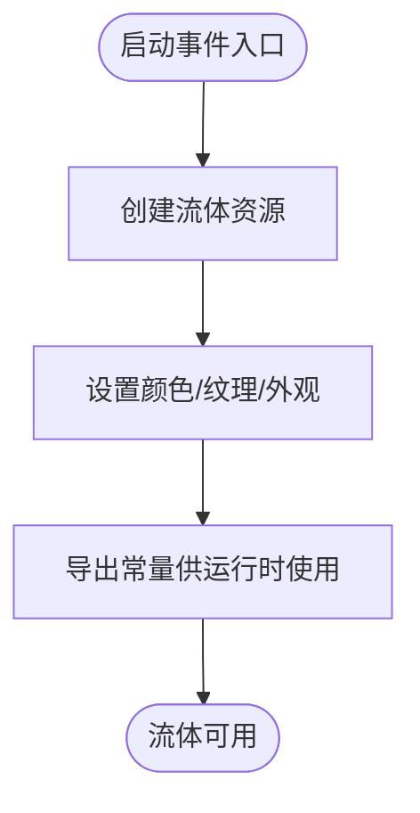

图表来源
- [electrolyte_water.js:10-23](file://kubejs/startup_scripts/fluid/electrolyte_water.js#L10-L23)
- [electrolyte_water.js:25-31](file://kubejs/startup_scripts/fluid/electrolyte_water.js#L25-L31)

章节来源
- [electrolyte_water.js:10-23](file://kubejs/startup_scripts/fluid/electrolyte_water.js#L10-L23)
- [electrolyte_water.js:25-31](file://kubejs/startup_scripts/fluid/electrolyte_water.js#L25-L31)

### 油类批量注册（oil）
- 目标：将集中定义的油类批量转换为物品注册
- 关键点：
  - 通过全局注册表收集定义
  - 在启动阶段统一注册，减少重复代码
  - 支持标签批量应用与属性配置

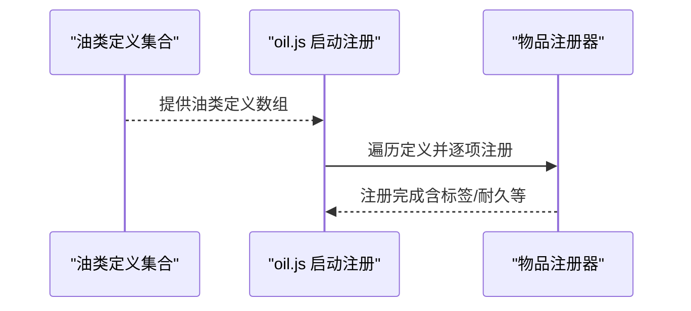

图表来源
- [oil.js:9-27](file://kubejs/startup_scripts/oil/oil.js#L9-L27)

章节来源
- [oil.js:9-27](file://kubejs/startup_scripts/oil/oil.js#L9-L27)

### Boss 注册框架（bossRegister）
- 目标：提供统一的 Boss 注册接口与冲突检测
- 关键点：
  - 提供链式 API 设置 Boss 属性与触发物品
  - 支持自动创建触发物品 ID
  - 冲突检测（ID/触发物品重复）与日志提示
  - 启动阶段仅加载框架，具体注册在同目录其他文件完成

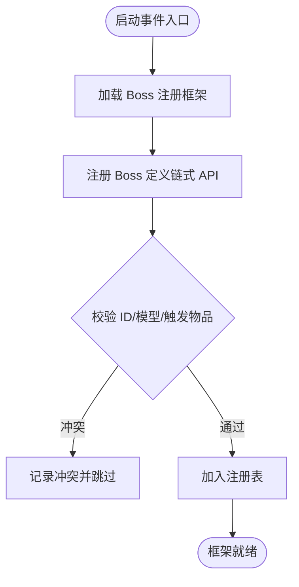

图表来源
- [bossRegister.js:60-99](file://kubejs/startup_scripts/boss/bossRegister.js#L60-L99)
- [bossRegister.js:65-96](file://kubejs/startup_scripts/boss/bossRegister.js#L65-L96)

章节来源
- [bossRegister.js:60-99](file://kubejs/startup_scripts/boss/bossRegister.js#L60-L99)
- [bossRegister.js:65-96](file://kubejs/startup_scripts/boss/bossRegister.js#L65-L96)

### 洗脚水注册框架（soakWaterRegister）
- 目标：以插件化方式注册多种洗脚水，支持效果与合成配置
- 关键点：
  - 提供链式 API 设置名称、颜色、描述、合成配方、效果等
  - 支持按部位的额外需求与掉落配置
  - 提供查询接口（按桶 ID/流体 ID/名称）

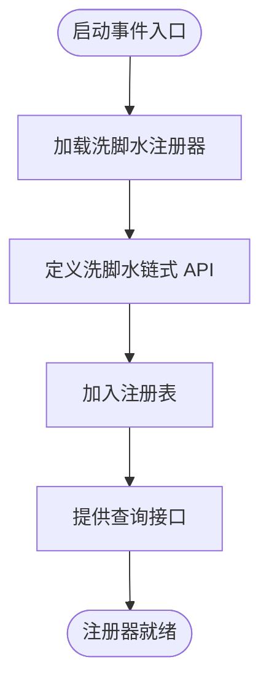

图表来源
- [soakWaterRegister.js:40-83](file://kubejs/startup_scripts/soakwater/soakWaterRegister.js#L40-L83)
- [soakWaterRegister.js:85-118](file://kubejs/startup_scripts/soakwater/soakWaterRegister.js#L85-L118)

章节来源
- [soakWaterRegister.js:40-83](file://kubejs/startup_scripts/soakwater/soakWaterRegister.js#L40-L83)
- [soakWaterRegister.js:85-118](file://kubejs/startup_scripts/soakwater/soakWaterRegister.js#L85-L118)

### 遗物注册框架（relicRegister）
- 目标：提供统一的遗物注册接口，支持阶段化与池分类
- 关键点：
  - 提供链式 API 设置名称、稀有度、故事、标签、阶段等
  - 支持生命周期回调（装备/卸下/伤害/击杀等）
  - 提供按池类型（普通/商店/诅咒/特殊）的筛选接口

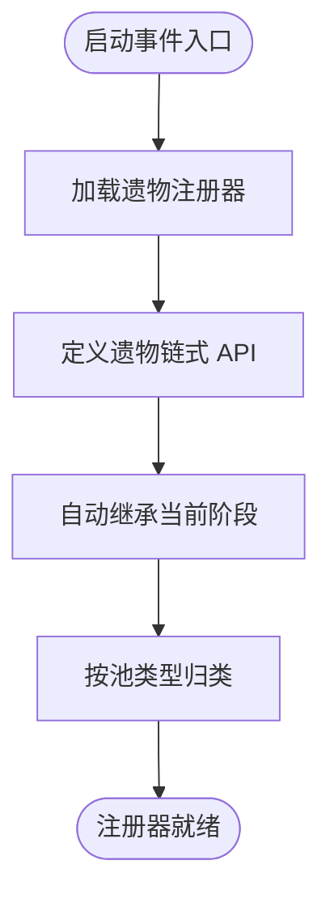

图表来源
- [relicRegister.js:3-42](file://kubejs/startup_scripts/relic/relicRegister.js#L3-L42)
- [relicRegister.js:81-176](file://kubejs/startup_scripts/relic/relicRegister.js#L81-L176)

章节来源
- [relicRegister.js:3-42](file://kubejs/startup_scripts/relic/relicRegister.js#L3-L42)
- [relicRegister.js:81-176](file://kubejs/startup_scripts/relic/relicRegister.js#L81-L176)

### 启动钩子框架（serveHooks）
- 目标：在启动阶段占位，运行时注入钩子函数
- 关键点：
  - 提供注册与执行接口
  - 支持中断（取消）机制与异常保护
  - 与运行时系统解耦，便于扩展

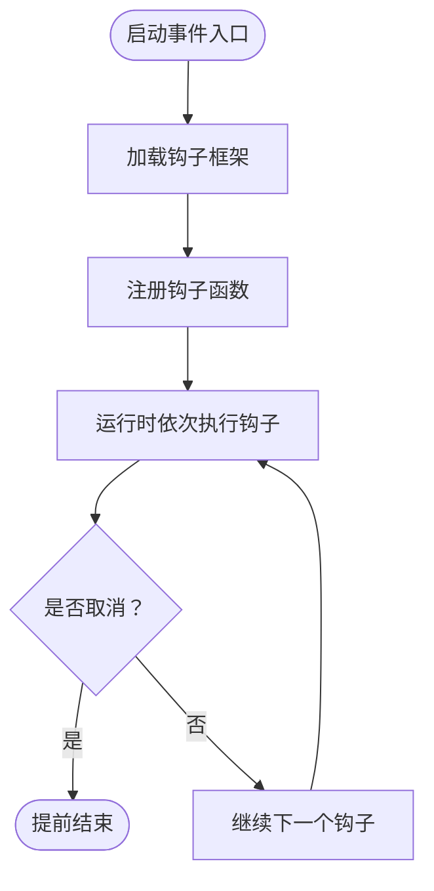

图表来源
- [serveHooks.js:11-30](file://kubejs/startup_scripts/serveHooks.js#L11-L30)

章节来源
- [serveHooks.js:11-30](file://kubejs/startup_scripts/serveHooks.js#L11-L30)

### 自定义实体注册示例（example）
- 目标：演示如何在启动阶段注册自定义实体类型
- 关键点：
  - 使用 StartupEvents.registry('entity_type', ...)
  - 配置尺寸、动画控制器、纹理、渲染缩放与模型资源
  - 适合配合 Geo 模型与动画系统

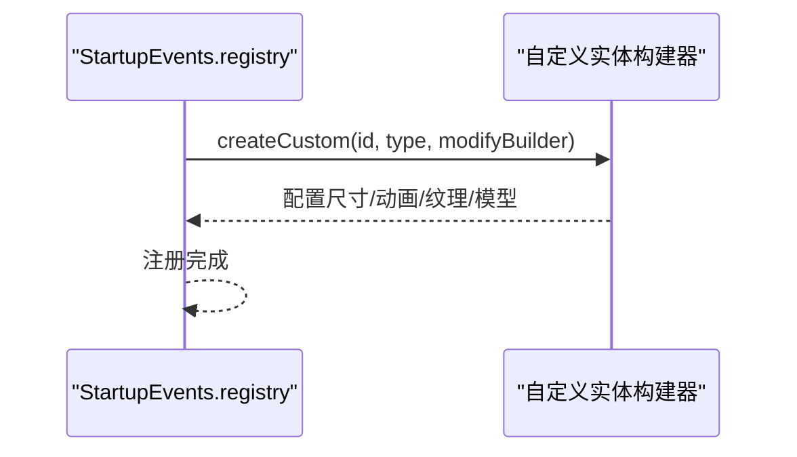

图表来源
- [example.js:2-26](file://kubejs/startup_scripts/example.js#L2-L26)

章节来源
- [example.js:2-26](file://kubejs/startup_scripts/example.js#L2-L26)

## 依赖关系分析
- 启动阶段依赖
  - 属性注册依赖后续 Forge 事件完成绑定
  - 资源注册完成后，配方与实体行为方可生效
  - 复杂系统注册器依赖全局注册表（oil/boss/soakwater/relic）
- 运行时依赖
  - 运行时事件（如实体受伤/死亡）读取全局注册表并触发相应回调
  - 背包更新逻辑依赖属性注册结果进行动态重算

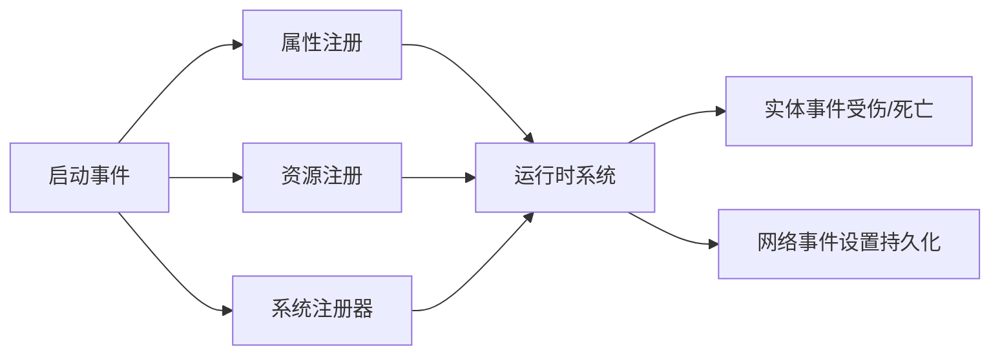

图表来源
- [serveAttributes.js:42-52](file://kubejs/startup_scripts/attributes/serveAttributes.js#L42-L52)
- [oil.js:9-27](file://kubejs/startup_scripts/oil/oil.js#L9-L27)
- [bossRegister.js:60-99](file://kubejs/startup_scripts/boss/bossRegister.js#L60-L99)
- [soakWaterRegister.js:40-83](file://kubejs/startup_scripts/soakwater/soakWaterRegister.js#L40-L83)
- [relicRegister.js:3-42](file://kubejs/startup_scripts/relic/relicRegister.js#L3-L42)
- [relicAttack.js:3-33](file://kubejs/server_scripts/backpack/relic/relicAttack.js#L3-L33)
- [relicKill.js:3-33](file://kubejs/server_scripts/backpack/relic/relicKill.js#L3-L33)
- [phone_settings.js:1-40](file://kubejs/server_scripts/phone_settings.js#L1-L40)
- [pfEntityData.js:185-217](file://kubejs/server_scripts/pathfinder/pfEntityData.js#L185-L217)

章节来源
- [serveAttributes.js:42-52](file://kubejs/startup_scripts/attributes/serveAttributes.js#L42-L52)
- [oil.js:9-27](file://kubejs/startup_scripts/oil/oil.js#L9-L27)
- [bossRegister.js:60-99](file://kubejs/startup_scripts/boss/bossRegister.js#L60-L99)
- [soakWaterRegister.js:40-83](file://kubejs/startup_scripts/soakwater/soakWaterRegister.js#L40-L83)
- [relicRegister.js:3-42](file://kubejs/startup_scripts/relic/relicRegister.js#L3-L42)
- [relicAttack.js:3-33](file://kubejs/server_scripts/backpack/relic/relicAttack.js#L3-L33)
- [relicKill.js:3-33](file://kubejs/server_scripts/backpack/relic/relicKill.js#L3-L33)
- [phone_settings.js:1-40](file://kubejs/server_scripts/phone_settings.js#L1-L40)
- [pfEntityData.js:185-217](file://kubejs/server_scripts/pathfinder/pfEntityData.js#L185-L217)

## 性能考量
- 启动阶段注册应尽量避免重型操作（如大量 IO 或外部网络请求）
- 将批量注册逻辑集中在启动阶段，减少运行时重复计算
- 对属性与实体事件的监听应保持轻量，必要时延迟到首次使用
- 利用全局注册表集中管理复杂系统，降低运行时查找成本

## 故障排查指南
- 启动阶段报错
  - 检查资源注册是否在 StartupEvents.registry 回调内完成
  - 查看日志输出，定位具体失败项（如方块/物品/流体注册）
- 属性未生效
  - 确认已通过 Forge 事件将属性添加到玩家实体
  - 检查属性范围与同步性配置
- 运行时异常
  - 钩子框架对异常有保护，检查日志中的异常信息
  - 实体事件回调需确保参数有效性（如玩家、实体、维度）
- 数据不一致
  - 检查全局注册表是否正确加载
  - 确认注册顺序与依赖关系（如 Boss 框架注释提示的统一处理）

章节来源
- [cun_block.js:24-26](file://kubejs/startup_scripts/block/cun_block.js#L24-L26)
- [cun_item.js:22-24](file://kubejs/startup_scripts/item/cun_item.js#L22-L24)
- [electrolyte_water.js:20-22](file://kubejs/startup_scripts/fluid/electrolyte_water.js#L20-L22)
- [serveHooks.js:23-29](file://kubejs/startup_scripts/serveHooks.js#L23-L29)
- [relicAttack.js:24-28](file://kubejs/server_scripts/backpack/relic/relicAttack.js#L24-L28)
- [relicKill.js:24-28](file://kubejs/server_scripts/backpack/relic/relicKill.js#L24-L28)

## 结论
通过 StartupEvents，本项目在模组启动阶段完成了资源注册、系统初始化与扩展框架的搭建。启动事件的使用遵循“集中注册、延迟绑定、运行时扩展”的原则，既保证了初始化的稳定性，又为后续功能扩展提供了灵活的钩子与注册表机制。

## 附录
- 最佳实践
  - 将资源注册与系统初始化放在启动阶段，避免运行时阻塞
  - 使用全局注册表统一管理复杂系统，便于查询与维护
  - 对运行时事件进行异常保护与参数校验
  - 启动阶段日志输出有助于问题定位与回溯