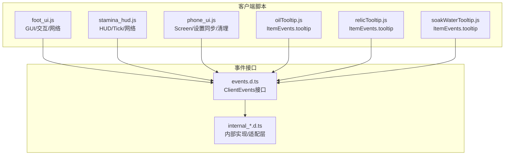
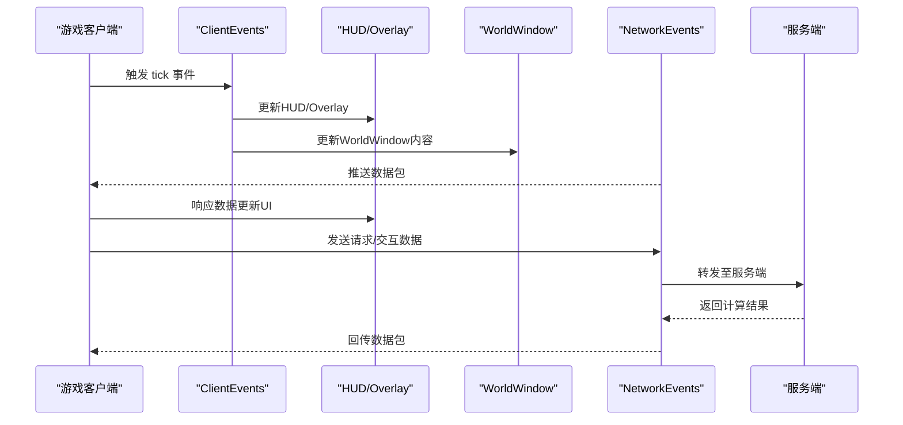
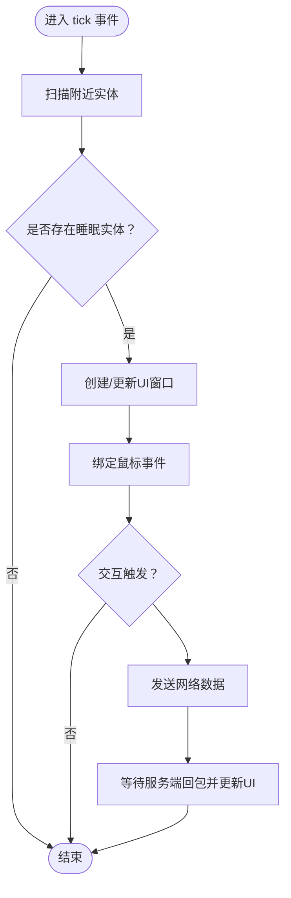
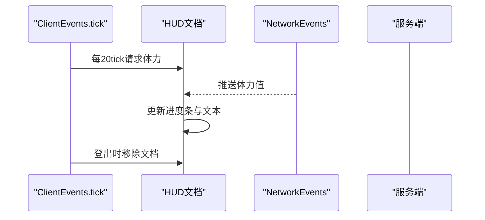
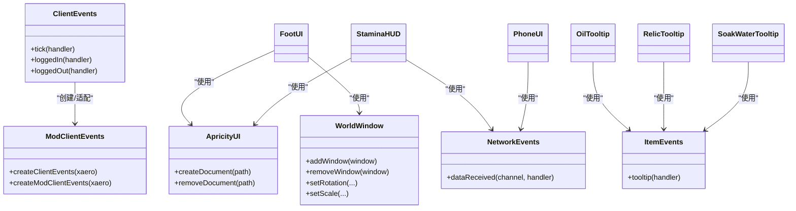

# 客户端事件

<cite>
**本文引用的文件**
- [README.md](file://README.md)
- [kubejs/client_scripts/ui/foot_ui.js](file://kubejs/client_scripts/ui/foot_ui.js)
- [kubejs/client_scripts/ui/stamina_hud.js](file://kubejs/client_scripts/ui/stamina_hud.js)
- [kubejs/client_scripts/ui/phone_ui.js](file://kubejs/client_scripts/ui/phone_ui.js)
- [kubejs/client_scripts/tooltip/oilTooltip.js](file://kubejs/client_scripts/tooltip/oilTooltip.js)
- [kubejs/client_scripts/tooltip/relicTooltip.js](file://kubejs/client_scripts/tooltip/relicTooltip.js)
- [kubejs/client_scripts/tooltip/soakWaterTooltip.js](file://kubejs/client_scripts/tooltip/soakWaterTooltip.js)
- [kubejs/probe/generated/events.d.ts](file://kubejs/probe/generated/events.d.ts)
- [kubejs/probe/generated/internals/internal_0.d.ts](file://kubejs/probe/generated/internals/internal_0.d.ts)
- [kubejs/probe/generated/internals/internal_10.d.ts](file://kubejs/probe/generated/internals/internal_10.d.ts)
- [kubejs/probe/generated/internals/internal_16.d.ts](file://kubejs/probe/generated/internals/internal_16.d.ts)
</cite>

## 目录
1. [简介](#简介)
2. [项目结构](#项目结构)
3. [核心组件](#核心组件)
4. [架构总览](#架构总览)
5. [详细组件分析](#详细组件分析)
6. [依赖关系分析](#依赖关系分析)
7. [性能考量](#性能考量)
8. [故障排查指南](#故障排查指南)
9. [结论](#结论)
10. [附录](#附录)

## 简介
本文件面向Minecraft客户端事件系统，围绕KubeJS提供的ClientEvents框架，系统化阐述客户端事件的注册、监听与处理机制。重点覆盖以下方面：
- GUI事件：屏幕Overlay与WorldWindow窗口的创建、交互与生命周期管理
- 渲染事件：基于Tick的周期性刷新与HUD更新策略
- 输入事件：鼠标事件、按键事件与网络数据交互
- UI事件：动态内容更新、Tooltip增强与跨脚本状态共享
- 客户端状态管理：全局状态、窗口集合与资源清理
- 与服务端事件的协调：NetworkEvents数据同步与事件驱动的UI更新
- 自定义客户端事件与处理器的性能优化及用户体验建议
- 具体实现示例：UI事件处理、Tooltip显示与HUD更新

## 项目结构
本项目以KubeJS脚本为核心，客户端事件主要分布在client_scripts目录下的UI与Tooltip脚本中；同时通过probe生成的类型声明文件了解ClientEvents接口与事件模型。

**图表来源**
- [kubejs/client_scripts/ui/foot_ui.js](file://kubejs/client_scripts/ui/foot_ui.js)
- [kubejs/client_scripts/ui/stamina_hud.js](file://kubejs/client_scripts/ui/stamina_hud.js)
- [kubejs/client_scripts/ui/phone_ui.js](file://kubejs/client_scripts/ui/phone_ui.js)
- [kubejs/client_scripts/tooltip/oilTooltip.js](file://kubejs/client_scripts/tooltip/oilTooltip.js)
- [kubejs/client_scripts/tooltip/relicTooltip.js](file://kubejs/client_scripts/tooltip/relicTooltip.js)
- [kubejs/client_scripts/tooltip/soakWaterTooltip.js](file://kubejs/client_scripts/tooltip/soakWaterTooltip.js)
- [kubejs/probe/generated/events.d.ts](file://kubejs/probe/generated/events.d.ts)
- [kubejs/probe/generated/internals/internal_0.d.ts](file://kubejs/probe/generated/internals/internal_0.d.ts)
- [kubejs/probe/generated/internals/internal_10.d.ts](file://kubejs/probe/generated/internals/internal_10.d.ts)
- [kubejs/probe/generated/internals/internal_16.d.ts](file://kubejs/probe/generated/internals/internal_16.d.ts)

**章节来源**
- [README.md:1-6](file://README.md#L1-L6)

## 核心组件
- ClientEvents接口：提供tick、loggedIn、loggedOut等客户端事件钩子，用于注册事件监听器与处理逻辑。
- ApricityUI：提供Overlay文档创建与移除能力，用于HUD与全屏特效层展示。
- WorldWindow：用于在世界空间中挂载UI窗口，支持旋转、缩放与距离裁剪。
- NetworkEvents：用于接收服务端推送的数据，驱动客户端UI状态更新。
- ItemEvents.tooltip：用于增强物品提示信息，提升用户交互体验。

**章节来源**
- [kubejs/probe/generated/events.d.ts:651-651](file://kubejs/probe/generated/events.d.ts#L651-L651)
- [kubejs/client_scripts/ui/foot_ui.js:13-16](file://kubejs/client_scripts/ui/foot_ui.js#L13-L16)
- [kubejs/client_scripts/ui/stamina_hud.js:7-8](file://kubejs/client_scripts/ui/stamina_hud.js#L7-L8)
- [kubejs/client_scripts/tooltip/oilTooltip.js:1-1](file://kubejs/client_scripts/tooltip/oilTooltip.js#L1-L1)
- [kubejs/client_scripts/tooltip/relicTooltip.js:4-4](file://kubejs/client_scripts/tooltip/relicTooltip.js#L4-L4)
- [kubejs/client_scripts/tooltip/soakWaterTooltip.js:9-9](file://kubejs/client_scripts/tooltip/soakWaterTooltip.js#L9-L9)

## 架构总览
客户端事件系统采用“事件驱动 + 数据同步”的模式：
- 通过ClientEvents.tick定期刷新UI状态
- 通过NetworkEvents接收服务端推送的实时数据
- 通过ApricityUI与WorldWindow构建UI层
- 通过ItemEvents.tooltip增强物品提示

**图表来源**
- [kubejs/client_scripts/ui/stamina_hud.js:60-86](file://kubejs/client_scripts/ui/stamina_hud.js#L60-L86)
- [kubejs/client_scripts/ui/foot_ui.js:785-800](file://kubejs/client_scripts/ui/foot_ui.js#L785-L800)
- [kubejs/client_scripts/ui/phone_ui.js:13-23](file://kubejs/client_scripts/ui/phone_ui.js#L13-L23)

## 详细组件分析

### GUI事件与WorldWindow窗口管理
- 功能要点
  - 在世界中按床方向与位置创建UI窗口，支持旋转与缩放
  - 管理多个窗口的生命周期（创建、更新、移除）
  - 通过鼠标事件驱动交互（拖动距离累计、粒子特效、发送网络数据）
  - 提供“送客”等交互按钮，触发服务端流程
- 关键实现路径
  - 窗口创建与布局：[kubejs/client_scripts/ui/foot_ui.js:95-140](file://kubejs/client_scripts/ui/foot_ui.js#L95-L140)
  - 鼠标事件与粒子特效：[kubejs/client_scripts/ui/foot_ui.js:160-276](file://kubejs/client_scripts/ui/foot_ui.js#L160-L276)
  - 送客按钮交互：[kubejs/client_scripts/ui/foot_ui.js:281-292](file://kubejs/client_scripts/ui/foot_ui.js#L281-L292)
  - 泡脚窗口创建与倒计时更新：[kubejs/client_scripts/ui/foot_ui.js:335-433](file://kubejs/client_scripts/ui/foot_ui.js#L335-L433)
  - 窗口移除与状态清理：[kubejs/client_scripts/ui/foot_ui.js:308-330](file://kubejs/client_scripts/ui/foot_ui.js#L308-L330), [kubejs/client_scripts/ui/foot_ui.js:951-967](file://kubejs/client_scripts/ui/foot_ui.js#L951-L967)

**图表来源**
- [kubejs/client_scripts/ui/foot_ui.js:785-800](file://kubejs/client_scripts/ui/foot_ui.js#L785-L800)
- [kubejs/client_scripts/ui/foot_ui.js:207-221](file://kubejs/client_scripts/ui/foot_ui.js#L207-L221)

**章节来源**
- [kubejs/client_scripts/ui/foot_ui.js:95-140](file://kubejs/client_scripts/ui/foot_ui.js#L95-L140)
- [kubejs/client_scripts/ui/foot_ui.js:160-276](file://kubejs/client_scripts/ui/foot_ui.js#L160-L276)
- [kubejs/client_scripts/ui/foot_ui.js:281-292](file://kubejs/client_scripts/ui/foot_ui.js#L281-L292)
- [kubejs/client_scripts/ui/foot_ui.js:335-433](file://kubejs/client_scripts/ui/foot_ui.js#L335-L433)
- [kubejs/client_scripts/ui/foot_ui.js:308-330](file://kubejs/client_scripts/ui/foot_ui.js#L308-L330)
- [kubejs/client_scripts/ui/foot_ui.js:951-967](file://kubejs/client_scripts/ui/foot_ui.js#L951-L967)

### 渲染事件与HUD更新（Stamina HUD）
- 功能要点
  - 每20tick向服务端请求体力值，接收后更新HUD
  - 使用ApricityUI创建Overlay文档，按百分比动态调整颜色与高度
  - 登出时清理Overlay与状态
- 关键实现路径
  - Overlay创建与初始化：[kubejs/client_scripts/ui/stamina_hud.js:65-74](file://kubejs/client_scripts/ui/stamina_hud.js#L65-L74)
  - 请求与接收数据：[kubejs/client_scripts/ui/stamina_hud.js:78-82](file://kubejs/client_scripts/ui/stamina_hud.js#L78-L82), [kubejs/client_scripts/ui/stamina_hud.js:53-56](file://kubejs/client_scripts/ui/stamina_hud.js#L53-L56)
  - HUD更新逻辑：[kubejs/client_scripts/ui/stamina_hud.js:21-49](file://kubejs/client_scripts/ui/stamina_hud.js#L21-L49)
  - 登出清理：[kubejs/client_scripts/ui/stamina_hud.js:90-100](file://kubejs/client_scripts/ui/stamina_hud.js#L90-L100)

**图表来源**
- [kubejs/client_scripts/ui/stamina_hud.js:60-86](file://kubejs/client_scripts/ui/stamina_hud.js#L60-L86)
- [kubejs/client_scripts/ui/stamina_hud.js:53-56](file://kubejs/client_scripts/ui/stamina_hud.js#L53-L56)
- [kubejs/client_scripts/ui/stamina_hud.js:90-100](file://kubejs/client_scripts/ui/stamina_hud.js#L90-L100)

**章节来源**
- [kubejs/client_scripts/ui/stamina_hud.js:65-74](file://kubejs/client_scripts/ui/stamina_hud.js#L65-L74)
- [kubejs/client_scripts/ui/stamina_hud.js:78-82](file://kubejs/client_scripts/ui/stamina_hud.js#L78-L82)
- [kubejs/client_scripts/ui/stamina_hud.js:53-56](file://kubejs/client_scripts/ui/stamina_hud.js#L53-L56)
- [kubejs/client_scripts/ui/stamina_hud.js:21-49](file://kubejs/client_scripts/ui/stamina_hud.js#L21-L49)
- [kubejs/client_scripts/ui/stamina_hud.js:90-100](file://kubejs/client_scripts/ui/stamina_hud.js#L90-L100)

### UI事件与Screen清理（Phone UI）
- 功能要点
  - 接收服务端推送的手机设置与评价数据，保存到全局对象
  - 登出时移除Screen文档并重置全局状态
- 关键实现路径
  - 设置同步：[kubejs/client_scripts/ui/phone_ui.js:13-23](file://kubejs/client_scripts/ui/phone_ui.js#L13-L23)
  - 评价数据同步：[kubejs/client_scripts/ui/phone_ui.js:26-47](file://kubejs/client_scripts/ui/phone_ui.js#L26-L47)
  - 登出清理：[kubejs/client_scripts/ui/phone_ui.js:50-55](file://kubejs/client_scripts/ui/phone_ui.js#L50-L55)

**章节来源**
- [kubejs/client_scripts/ui/phone_ui.js:13-23](file://kubejs/client_scripts/ui/phone_ui.js#L13-L23)
- [kubejs/client_scripts/ui/phone_ui.js:26-47](file://kubejs/client_scripts/ui/phone_ui.js#L26-L47)
- [kubejs/client_scripts/ui/phone_ui.js:50-55](file://kubejs/client_scripts/ui/phone_ui.js#L50-L55)

### Tooltip增强（ItemEvents.tooltip）
- 功能要点
  - 为精油、遗物、洗脚水桶等物品追加描述、标签与故事背景
  - 支持多语言与颜色标记，提升可读性
- 关键实现路径
  - 精油Tooltip：[kubejs/client_scripts/tooltip/oilTooltip.js:1-46](file://kubejs/client_scripts/tooltip/oilTooltip.js#L1-L46)
  - 遗物Tooltip：[kubejs/client_scripts/tooltip/relicTooltip.js:1-79](file://kubejs/client_scripts/tooltip/relicTooltip.js#L1-L79)
  - 洗脚水Tooltip：[kubejs/client_scripts/tooltip/soakWaterTooltip.js:1-57](file://kubejs/client_scripts/tooltip/soakWaterTooltip.js#L1-L57)

**章节来源**
- [kubejs/client_scripts/tooltip/oilTooltip.js:1-46](file://kubejs/client_scripts/tooltip/oilTooltip.js#L1-L46)
- [kubejs/client_scripts/tooltip/relicTooltip.js:1-79](file://kubejs/client_scripts/tooltip/relicTooltip.js#L1-L79)
- [kubejs/client_scripts/tooltip/soakWaterTooltip.js:1-57](file://kubejs/client_scripts/tooltip/soakWaterTooltip.js#L1-L57)

### 客户端事件注册与监听器实现
- 注册方式
  - 使用ClientEvents.tick、ClientEvents.loggedIn、ClientEvents.loggedOut等接口注册监听器
  - 使用NetworkEvents.dataReceived注册数据接收回调
  - 使用ItemEvents.tooltip注册物品提示增强
- 监听器实现
  - Tick事件中进行UI状态扫描与更新
  - 登录/登出事件中进行资源初始化与清理
  - 数据事件中根据服务端推送更新UI
- 客户端状态管理
  - 使用Map维护窗口、实体追踪、倒计时与状态
  - 在登出时统一清理，避免内存泄漏

**章节来源**
- [kubejs/client_scripts/ui/foot_ui.js:785-789](file://kubejs/client_scripts/ui/foot_ui.js#L785-L789)
- [kubejs/client_scripts/ui/stamina_hud.js:60-62](file://kubejs/client_scripts/ui/stamina_hud.js#L60-L62)
- [kubejs/client_scripts/ui/phone_ui.js:50-55](file://kubejs/client_scripts/ui/phone_ui.js#L50-L55)
- [kubejs/client_scripts/tooltip/oilTooltip.js:1-1](file://kubejs/client_scripts/tooltip/oilTooltip.js#L1-L1)

### 事件数据同步与UI更新策略
- 与服务端事件的协调
  - 客户端通过player.sendData发送交互与请求数据
  - 服务端通过NetworkEvents.dataReceived回传计算结果
  - 客户端在Tick中周期性请求状态，减少频繁网络调用
- UI更新策略
  - Overlay与WorldWindow按需创建与销毁
  - 通过NBT字段与全局对象共享状态，降低重复查询成本
  - 使用节流与阈值控制（如拖动距离阈值）优化交互体验

**章节来源**
- [kubejs/client_scripts/ui/foot_ui.js:207-221](file://kubejs/client_scripts/ui/foot_ui.js#L207-L221)
- [kubejs/client_scripts/ui/stamina_hud.js:78-82](file://kubejs/client_scripts/ui/stamina_hud.js#L78-L82)
- [kubejs/client_scripts/ui/phone_ui.js:13-23](file://kubejs/client_scripts/ui/phone_ui.js#L13-L23)

### 自定义客户端事件与扩展建议
- 基于现有接口扩展
  - 可在ClientEvents.tick中加入更多状态扫描与UI更新逻辑
  - 可通过NetworkEvents.dataReceived扩展更多数据通道
- 事件处理器性能优化
  - 将高频操作（如鼠标事件）限制在必要范围内，避免过度重绘
  - 使用节流/去抖策略减少重复计算
  - 合理使用缓存（如全局状态、窗口集合）避免重复查找
- 用户体验考虑
  - Tooltip与HUD应简洁明了，突出关键信息
  - 交互反馈（粒子、音效）需适度，避免干扰

**章节来源**
- [kubejs/client_scripts/ui/foot_ui.js:160-276](file://kubejs/client_scripts/ui/foot_ui.js#L160-L276)
- [kubejs/client_scripts/ui/stamina_hud.js:21-49](file://kubejs/client_scripts/ui/stamina_hud.js#L21-L49)

## 依赖关系分析
- 类型与接口
  - ClientEvents接口定义了tick、loggedIn、loggedOut等事件
  - ModClientEvents与内部适配层提供具体实现
- 组件耦合
  - GUI组件依赖ApricityUI与WorldWindow
  - HUD组件依赖Overlay文档与NetworkEvents
  - Tooltip组件依赖ItemEvents接口
- 外部依赖
  - 与服务端通过NetworkEvents进行数据交换
  - 与Minecraft客户端API交互（如Minecraft.getInstance().player）

**图表来源**
- [kubejs/probe/generated/events.d.ts:651-651](file://kubejs/probe/generated/events.d.ts#L651-L651)
- [kubejs/probe/generated/internals/internal_10.d.ts:869-883](file://kubejs/probe/generated/internals/internal_10.d.ts#L869-L883)
- [kubejs/probe/generated/internals/internal_16.d.ts:11705-11733](file://kubejs/probe/generated/internals/internal_16.d.ts#L11705-L11733)
- [kubejs/client_scripts/ui/foot_ui.js:13-16](file://kubejs/client_scripts/ui/foot_ui.js#L13-L16)
- [kubejs/client_scripts/ui/stamina_hud.js:7-8](file://kubejs/client_scripts/ui/stamina_hud.js#L7-L8)
- [kubejs/client_scripts/ui/phone_ui.js:7-7](file://kubejs/client_scripts/ui/phone_ui.js#L7-L7)
- [kubejs/client_scripts/tooltip/oilTooltip.js:1-1](file://kubejs/client_scripts/tooltip/oilTooltip.js#L1-L1)
- [kubejs/client_scripts/tooltip/relicTooltip.js:4-4](file://kubejs/client_scripts/tooltip/relicTooltip.js#L4-L4)
- [kubejs/client_scripts/tooltip/soakWaterTooltip.js:9-9](file://kubejs/client_scripts/tooltip/soakWaterTooltip.js#L9-L9)

**章节来源**
- [kubejs/probe/generated/events.d.ts:651-651](file://kubejs/probe/generated/events.d.ts#L651-L651)
- [kubejs/probe/generated/internals/internal_0.d.ts:13467-13495](file://kubejs/probe/generated/internals/internal_0.d.ts#L13467-L13495)
- [kubejs/probe/generated/internals/internal_16.d.ts:11788-11833](file://kubejs/probe/generated/internals/internal_16.d.ts#L11788-L11833)

## 性能考量
- Tick频率控制
  - 通过每N tick请求一次数据，平衡实时性与性能
- 事件处理优化
  - 将高频率事件（如mousemove）限制在必要区域
  - 使用阈值与节流减少无效计算
- 资源管理
  - 登出时统一清理Overlay与WorldWindow，避免残留
  - 使用Map集中管理状态，便于批量清理

[本节为通用指导，无需特定文件来源]

## 故障排查指南
- HUD不显示或闪烁
  - 检查Overlay创建是否成功与文档路径正确
  - 确认NetworkEvents数据接收正常
  - 参考：[kubejs/client_scripts/ui/stamina_hud.js:65-74](file://kubejs/client_scripts/ui/stamina_hud.js#L65-L74), [kubejs/client_scripts/ui/stamina_hud.js:53-56](file://kubejs/client_scripts/ui/stamina_hud.js#L53-L56)
- WorldWindow不更新或消失
  - 检查Tick中实体扫描与窗口创建逻辑
  - 确认鼠标事件绑定与状态更新
  - 参考：[kubejs/client_scripts/ui/foot_ui.js:785-800](file://kubejs/client_scripts/ui/foot_ui.js#L785-L800), [kubejs/client_scripts/ui/foot_ui.js:160-276](file://kubejs/client_scripts/ui/foot_ui.js#L160-L276)
- Tooltip未生效
  - 确认脚本放置于client_scripts目录下
  - 检查物品ID与全局注册表是否正确
  - 参考：[kubejs/client_scripts/tooltip/oilTooltip.js:1-46](file://kubejs/client_scripts/tooltip/oilTooltip.js#L1-L46), [kubejs/client_scripts/tooltip/relicTooltip.js:1-79](file://kubejs/client_scripts/tooltip/relicTooltip.js#L1-L79), [kubejs/client_scripts/tooltip/soakWaterTooltip.js:1-57](file://kubejs/client_scripts/tooltip/soakWaterTooltip.js#L1-L57)
- 登出后残留UI
  - 确认loggedOut事件中的清理逻辑执行
  - 参考：[kubejs/client_scripts/ui/stamina_hud.js:90-100](file://kubejs/client_scripts/ui/stamina_hud.js#L90-L100), [kubejs/client_scripts/ui/phone_ui.js:50-55](file://kubejs/client_scripts/ui/phone_ui.js#L50-L55), [kubejs/client_scripts/ui/foot_ui.js:951-967](file://kubejs/client_scripts/ui/foot_ui.js#L951-L967)

**章节来源**
- [kubejs/client_scripts/ui/stamina_hud.js:65-74](file://kubejs/client_scripts/ui/stamina_hud.js#L65-L74)
- [kubejs/client_scripts/ui/stamina_hud.js:53-56](file://kubejs/client_scripts/ui/stamina_hud.js#L53-L56)
- [kubejs/client_scripts/ui/foot_ui.js:785-800](file://kubejs/client_scripts/ui/foot_ui.js#L785-L800)
- [kubejs/client_scripts/ui/foot_ui.js:160-276](file://kubejs/client_scripts/ui/foot_ui.js#L160-L276)
- [kubejs/client_scripts/ui/stamina_hud.js:90-100](file://kubejs/client_scripts/ui/stamina_hud.js#L90-L100)
- [kubejs/client_scripts/ui/phone_ui.js:50-55](file://kubejs/client_scripts/ui/phone_ui.js#L50-L55)
- [kubejs/client_scripts/ui/foot_ui.js:951-967](file://kubejs/client_scripts/ui/foot_ui.js#L951-L967)
- [kubejs/client_scripts/tooltip/oilTooltip.js:1-46](file://kubejs/client_scripts/tooltip/oilTooltip.js#L1-L46)
- [kubejs/client_scripts/tooltip/relicTooltip.js:1-79](file://kubejs/client_scripts/tooltip/relicTooltip.js#L1-L79)
- [kubejs/client_scripts/tooltip/soakWaterTooltip.js:1-57](file://kubejs/client_scripts/tooltip/soakWaterTooltip.js#L1-L57)

## 结论
本客户端事件系统通过ClientEvents、ApricityUI、WorldWindow与NetworkEvents协同工作，实现了从Tick驱动到数据同步再到UI更新的完整闭环。GUI事件、渲染事件、输入事件与UI事件在脚本中得到清晰分离与高效实现。配合合理的状态管理与清理策略，系统在保证用户体验的同时兼顾性能与稳定性。

[本节为总结性内容，无需特定文件来源]

## 附录
- 安装与运行
  - 参考项目根目录说明，确保版本与Forge环境正确
  - 参考：[README.md:1-6](file://README.md#L1-L6)

**章节来源**
- [README.md:1-6](file://README.md#L1-L6)