# 服务端事件

<cite>
**本文引用的文件**
- [README.md](file://README.md)
- [example.js](file://kubejs/server_scripts/example.js)
- [auratip_triggers.js](file://kubejs/server_scripts/auratip_triggers.js)
- [sleep.js](file://kubejs/server_scripts/sleep.js)
- [stamina.js](file://kubejs/server_scripts/stamina.js)
- [serveHooks.js](file://kubejs/startup_scripts/serveHooks.js)
- [pathfinder.js](file://kubejs/server_scripts/pathfinder.js)
- [pfMain.js](file://kubejs/server_scripts/pathfinder/pfMain.js)
- [pfBlockHandler.js](file://kubejs/server_scripts/pathfinder/pfBlockHandler.js)
- [pfSoakManager.js](file://kubejs/server_scripts/pathfinder/pfSoakManager.js)
</cite>

## 目录
1. [简介](#简介)
2. [项目结构](#项目结构)
3. [核心组件](#核心组件)
4. [架构总览](#架构总览)
5. [详细组件分析](#详细组件分析)
6. [依赖关系分析](#依赖关系分析)
7. [性能考量](#性能考量)
8. [故障排查指南](#故障排查指南)
9. [结论](#结论)
10. [附录](#附录)

## 简介
本文件围绕基于 KubeJS 的 Minecraft 服务端事件系统进行系统化说明，重点覆盖以下方面：
- 事件类型与监听：实体事件、方块事件、玩家事件、世界事件的监听与处理
- 事件注册方式与监听器实现
- 事件数据的获取与修改（持久化数据、网络数据包）
- 事件优先级、事件取消机制与事件传播控制
- 自定义服务端事件的创建方法与最佳实践
- 性能优化策略与常见问题处理

本项目通过 KubeJS 的事件 API（如 ServerEvents、BlockEvents、PlayerEvents、NetworkEvents 等）组织服务端逻辑，并结合模块化脚本（如寻路系统）实现复杂交互。

## 项目结构
本项目采用按功能域划分的目录结构，服务端脚本主要位于 kubejs/server_scripts 与 kubejs/startup_scripts，客户端脚本位于 kubejs/client_scripts。事件处理集中在服务端脚本中，部分网络事件通过 NetworkEvents 与客户端通信。

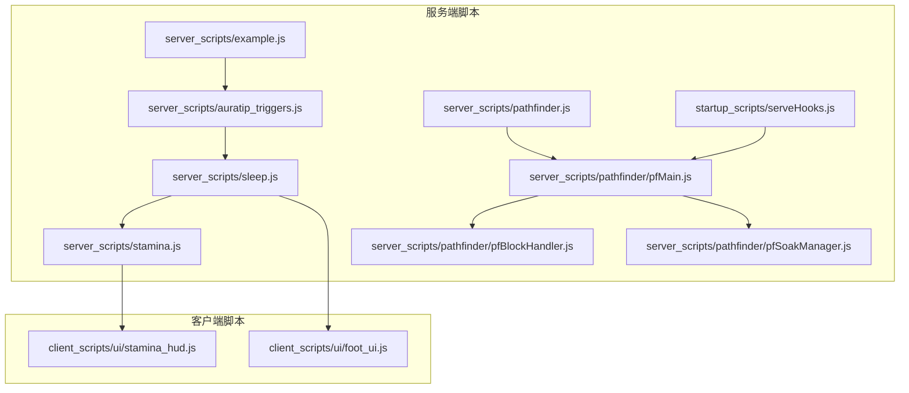

图表来源
- [pathfinder.js:1-30](file://kubejs/server_scripts/pathfinder.js#L1-L30)
- [pfMain.js:1-177](file://kubejs/server_scripts/pathfinder/pfMain.js#L1-L177)
- [pfBlockHandler.js:1-148](file://kubejs/server_scripts/pathfinder/pfBlockHandler.js#L1-L148)
- [pfSoakManager.js:1-197](file://kubejs/server_scripts/pathfinder/pfSoakManager.js#L1-L197)
- [auratip_triggers.js:1-212](file://kubejs/server_scripts/auratip_triggers.js#L1-L212)
- [sleep.js:1-313](file://kubejs/server_scripts/sleep.js#L1-L313)
- [stamina.js:1-81](file://kubejs/server_scripts/stamina.js#L1-L81)
- [serveHooks.js:1-31](file://kubejs/startup_scripts/serveHooks.js#L1-L31)

章节来源
- [README.md:1-6](file://README.md#L1-L6)

## 核心组件
- 事件注册与监听器
  - 使用 KubeJS 事件 API 注册监听器，如 ItemEvents、BlockEvents、PlayerEvents、ServerEvents、NetworkEvents 等。
  - 监听器可接收事件对象，读取上下文信息（如玩家、方块、实体、世界），并执行业务逻辑。
- 数据存储与同步
  - 使用实体或玩家的 persistentData 存储状态（如寻路阶段、泡脚状态、体力值等）。
  - 使用 NetworkEvents.dataReceived/sendData 在服务端与客户端之间传递数据包，实现 UI 同步与状态反馈。
- 模块化与优先级
  - 通过注释中的 priority 指令控制加载顺序，确保依赖模块先于使用者加载。
  - 将复杂逻辑拆分为多个模块（如寻路主循环、方块事件处理、泡脚管理等），通过全局接口组合。

章节来源
- [example.js:1-24](file://kubejs/server_scripts/example.js#L1-L24)
- [auratip_triggers.js:160-186](file://kubejs/server_scripts/auratip_triggers.js#L160-L186)
- [stamina.js:17-31](file://kubejs/server_scripts/stamina.js#L17-L31)
- [serveHooks.js:1-31](file://kubejs/startup_scripts/serveHooks.js#L1-L31)

## 架构总览
下图展示了事件驱动的服务端架构：事件监听器响应外部输入（方块右键、玩家登录/心跳、网络数据包），读取或修改持久化数据，必要时广播 UI 更新或执行业务流程（如泡脚、睡眠、开店）。

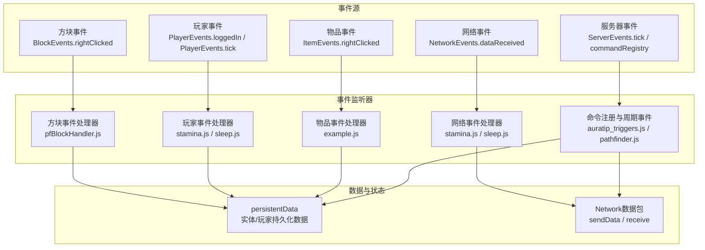

图表来源
- [pfBlockHandler.js:8-145](file://kubejs/server_scripts/pathfinder/pfBlockHandler.js#L8-L145)
- [stamina.js:17-81](file://kubejs/server_scripts/stamina.js#L17-L81)
- [example.js:1-24](file://kubejs/server_scripts/example.js#L1-L24)
- [auratip_triggers.js:160-212](file://kubejs/server_scripts/auratip_triggers.js#L160-L212)
- [pathfinder.js:25-30](file://kubejs/server_scripts/pathfinder.js#L25-L30)

## 详细组件分析

### 方块事件：右键触发与开店/关店
- 监听目标：特定标识的方块右键事件
- 关键行为：
  - 校验手部物品类型（凭证、Boss 触发物、普通右键）
  - 校验昼夜条件（白天才允许开店/Boss）
  - 扫描地图生成路径，定位蓝色地毯，决定后续流程
  - 凭证模式：消耗凭证并生成指定类别顾客
  - Boss 模式：消耗触发物并沿路径生成 Boss
  - 普通模式：保存路线数据并开启定时生成
- 数据与传播：
  - 事件对象包含玩家、方块位置、世界等上下文
  - 通过 BlockEntity NBT 保存商店状态，避免跨重启丢失
  - 可通过全局教学系统推进教学阶段

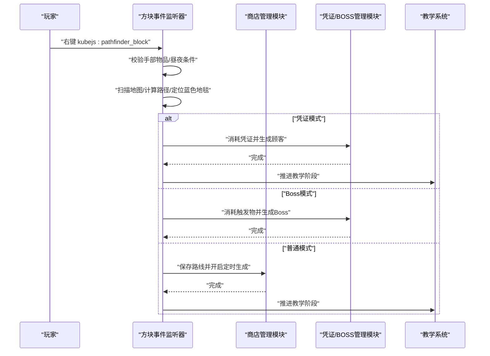

图表来源
- [pfBlockHandler.js:8-145](file://kubejs/server_scripts/pathfinder/pfBlockHandler.js#L8-L145)
- [auratip_triggers.js:140-144](file://kubejs/server_scripts/auratip_triggers.js#L140-L144)

章节来源
- [pfBlockHandler.js:8-145](file://kubejs/server_scripts/pathfinder/pfBlockHandler.js#L8-L145)

### 玩家事件：登录初始化、心跳恢复与体力同步
- 登录初始化：在玩家首次登录时初始化持久化体力值，并同步到客户端
- 心跳恢复：每秒为在线玩家恢复固定体力，使用子 tick 计数器实现跨重启友好
- 体力消费/恢复：提供统一接口，消费失败时返回 false，避免负值
- 网络同步：客户端通过请求数据包触发服务端推送当前体力值

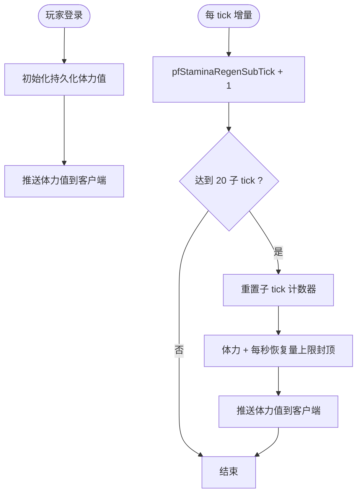

图表来源
- [stamina.js:24-81](file://kubejs/server_scripts/stamina.js#L24-L81)

章节来源
- [stamina.js:17-81](file://kubejs/server_scripts/stamina.js#L17-L81)

### 实体事件：点击物品与实体交互
- 监听目标：物品右键事件，获取目标实体
- 关键行为：
  - 读取目标实体的持久化数据，判断是否为特定系统生成的实体
  - 根据条件打开 UI 或发送网络数据包
  - 可结合全局 UI 系统进行联动

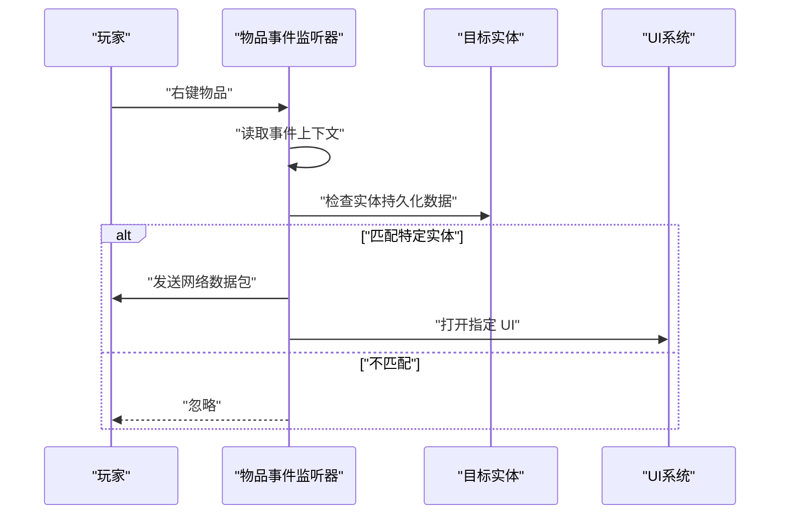

图表来源
- [example.js:1-24](file://kubejs/server_scripts/example.js#L1-L24)

章节来源
- [example.js:1-24](file://kubejs/server_scripts/example.js#L1-L24)

### 世界事件：服务器 tick 与命令注册
- 服务器 tick：用于周期性任务（如教学提示队列推进）
- 命令注册：注册教学调试命令，支持手动触发与重置教学阶段

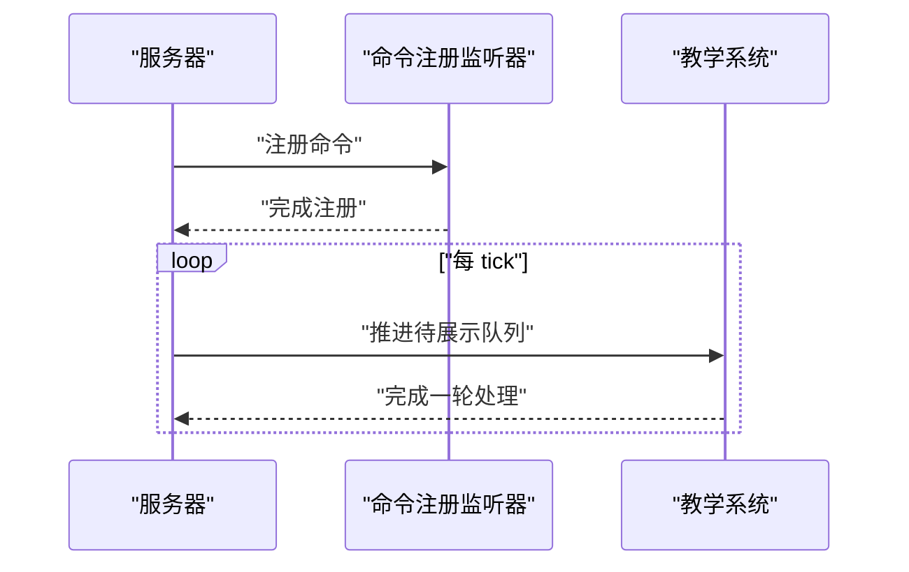

图表来源
- [auratip_triggers.js:160-212](file://kubejs/server_scripts/auratip_triggers.js#L160-L212)

章节来源
- [auratip_triggers.js:160-212](file://kubejs/server_scripts/auratip_triggers.js#L160-L212)

### 寻路系统主循环与模块化
- 主循环：每 tick 驱动寻路系统，整合商店、实体收集、移动、睡眠、泡脚等模块
- 模块职责：
  - 蓝色地毯等待 → 躺床 → 泡脚倒计时 → 睡眠判定 → 服务完成结算
  - 通过实体 persistentData 保存阶段、位置、倒计时等状态
- 网络事件：由网络处理器模块设置，负责接收客户端请求并调用相应模块

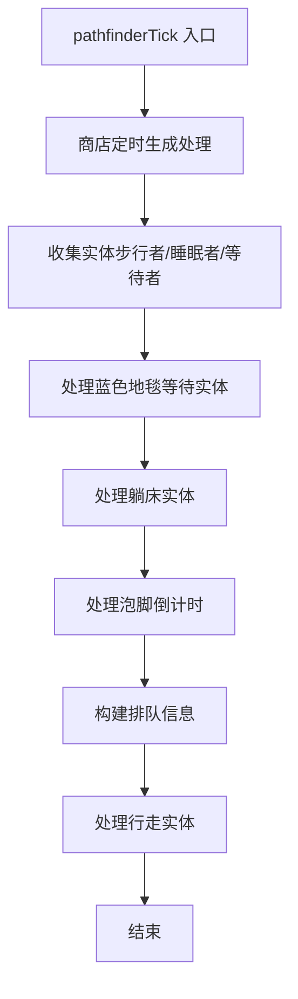

图表来源
- [pfMain.js:11-177](file://kubejs/server_scripts/pathfinder/pfMain.js#L11-L177)
- [pathfinder.js:25-30](file://kubejs/server_scripts/pathfinder.js#L25-L30)

章节来源
- [pfMain.js:1-177](file://kubejs/server_scripts/pathfinder/pfMain.js#L1-L177)
- [pathfinder.js:1-30](file://kubejs/server_scripts/pathfinder.js#L1-L30)

### 泡脚管理：倒计时与效果应用
- 状态机：通过手持物品 NBT 维护泡脚状态（进行中/已完成/剩余秒数）
- 倒计时：以“秒”为单位，使用实体 persistentData 的子 tick 计数器推进
- 水桶判定：支持原版水桶与注册表中的自定义洗脚水桶
- 效果应用：倒计时结束后根据桶类型应用附加效果

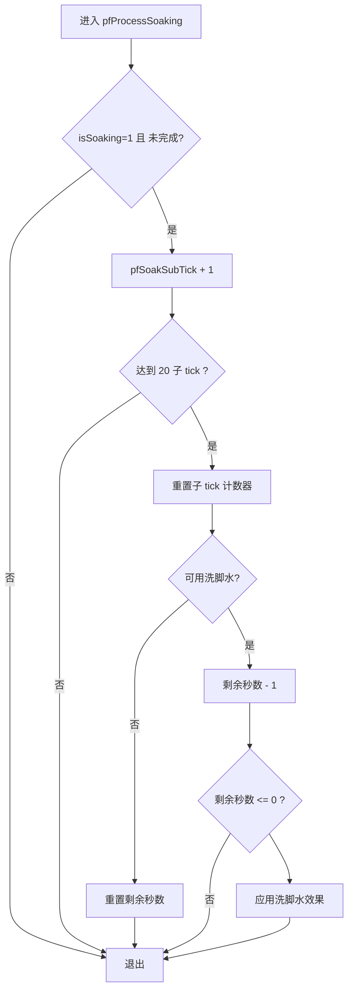

图表来源
- [pfSoakManager.js:92-145](file://kubejs/server_scripts/pathfinder/pfSoakManager.js#L92-L145)

章节来源
- [pfSoakManager.js:1-197](file://kubejs/server_scripts/pathfinder/pfSoakManager.js#L1-L197)

### 教学系统：阶段推进与延迟展示
- 阶段管理：通过玩家 persistentData 维护教学阶段
- 延迟展示：将 UI 展示请求加入队列，按服务器 tick 推进
- 命令接口：提供调试命令快速触发或重置教学阶段

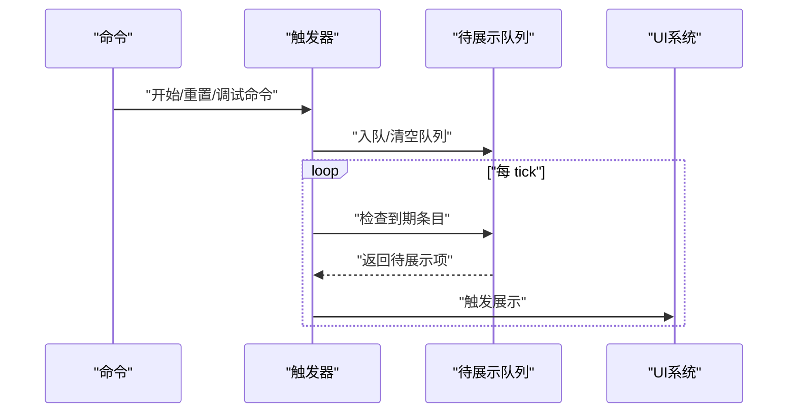

图表来源
- [auratip_triggers.js:160-212](file://kubejs/server_scripts/auratip_triggers.js#L160-L212)

章节来源
- [auratip_triggers.js:1-212](file://kubejs/server_scripts/auratip_triggers.js#L1-L212)

### 服务端钩子：点击结算扩展点
- 设计目标：将“额外功能”（如抹油、连击奖励）从主流程拆分，通过注册钩子接入
- 执行机制：遍历已注册钩子，依次执行；若任一钩子设置取消标志，则提前终止

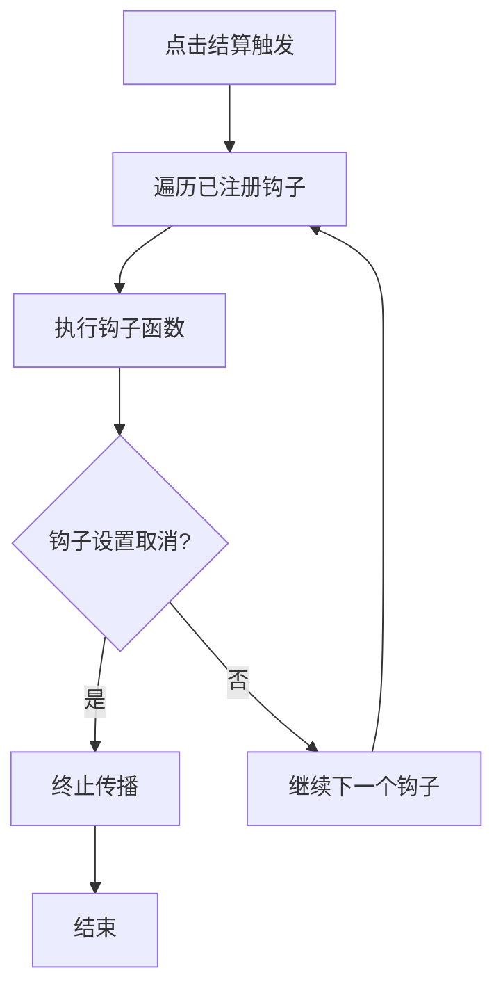

图表来源
- [serveHooks.js:19-30](file://kubejs/startup_scripts/serveHooks.js#L19-L30)

章节来源
- [serveHooks.js:1-31](file://kubejs/startup_scripts/serveHooks.js#L1-L31)

## 依赖关系分析
- 低耦合高内聚：事件监听器只关注自身职责，通过全局模块接口协作
- 优先级控制：通过注释中的 priority 指令保证模块加载顺序（如寻路主模块优先于子模块）
- 数据一致性：持久化数据集中于 persistentData，网络数据包用于 UI 同步，避免重复计算

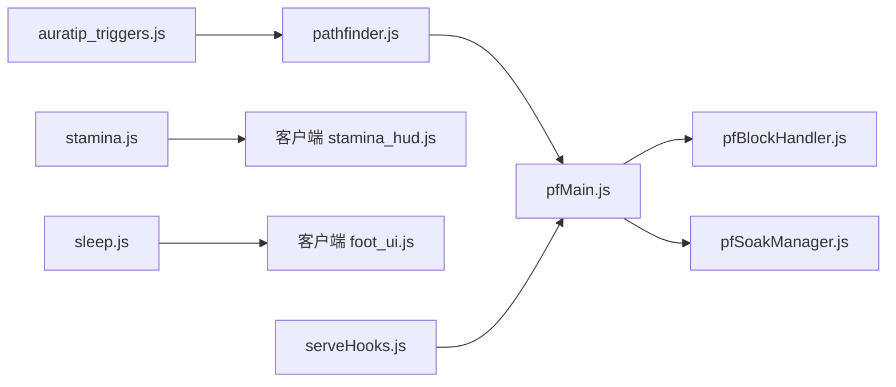

图表来源
- [pathfinder.js:1-30](file://kubejs/server_scripts/pathfinder.js#L1-L30)
- [pfMain.js:1-177](file://kubejs/server_scripts/pathfinder/pfMain.js#L1-L177)
- [pfBlockHandler.js:1-148](file://kubejs/server_scripts/pathfinder/pfBlockHandler.js#L1-L148)
- [pfSoakManager.js:1-197](file://kubejs/server_scripts/pathfinder/pfSoakManager.js#L1-L197)
- [stamina.js:1-81](file://kubejs/server_scripts/stamina.js#L1-L81)
- [sleep.js:1-313](file://kubejs/server_scripts/sleep.js#L1-L313)
- [auratip_triggers.js:1-212](file://kubejs/server_scripts/auratip_triggers.js#L1-L212)
- [serveHooks.js:1-31](file://kubejs/startup_scripts/serveHooks.js#L1-L31)

章节来源
- [pathfinder.js:1-30](file://kubejs/server_scripts/pathfinder.js#L1-L30)
- [pfMain.js:1-177](file://kubejs/server_scripts/pathfinder/pfMain.js#L1-L177)
- [pfBlockHandler.js:1-148](file://kubejs/server_scripts/pathfinder/pfBlockHandler.js#L1-L148)
- [pfSoakManager.js:1-197](file://kubejs/server_scripts/pathfinder/pfSoakManager.js#L1-L197)
- [stamina.js:1-81](file://kubejs/server_scripts/stamina.js#L1-L81)
- [sleep.js:1-313](file://kubejs/server_scripts/sleep.js#L1-L313)
- [auratip_triggers.js:1-212](file://kubejs/server_scripts/auratip_triggers.js#L1-L212)
- [serveHooks.js:1-31](file://kubejs/startup_scripts/serveHooks.js#L1-L31)

## 性能考量
- 事件频率控制
  - 使用子 tick 计数器（如 pfStaminaRegenSubTick、pfSoakSubTick）降低每 tick 的计算量
  - 将昂贵操作（如路径搜索、世界扫描）限制在必要时机（如方块右键）
- 数据访问优化
  - 优先使用 persistentData 缓存状态，避免频繁查询数据库或远程调用
  - 对实体/玩家集合的遍历应尽早短路（如已处理过的 tick 跳过）
- 网络开销
  - 仅在必要时发送网络数据包（如 UI 同步、状态变更）
  - 合并 UI 更新批次，减少包数量
- 模块化与优先级
  - 通过优先级指令确保依赖模块先加载，避免运行时查找失败带来的开销

## 故障排查指南
- 事件未触发
  - 检查事件监听器是否正确注册（命名空间、事件类型、过滤条件）
  - 确认优先级顺序是否导致模块未加载
- 状态不一致
  - 检查 persistentData 的读写是否成对出现，是否存在遗漏清理
  - 确认跨重启状态是否通过持久化字段保存
- 网络不同步
  - 确认客户端是否正确发送请求数据包，服务端是否及时推送
  - 检查网络处理器是否已设置
- 性能问题
  - 检查是否存在每 tick 重复计算的逻辑，考虑引入子 tick 计数器
  - 优化实体/玩家集合遍历，尽早短路

章节来源
- [stamina.js:17-81](file://kubejs/server_scripts/stamina.js#L17-L81)
- [pfSoakManager.js:92-145](file://kubejs/server_scripts/pathfinder/pfSoakManager.js#L92-L145)
- [auratip_triggers.js:188-212](file://kubejs/server_scripts/auratip_triggers.js#L188-L212)

## 结论
本项目通过 KubeJS 事件系统与模块化脚本实现了完善的服务器端事件处理机制。事件监听器围绕方块、玩家、实体、世界与网络五大维度展开，配合持久化数据与网络数据包实现状态同步与 UI 交互。通过优先级控制与钩子扩展，系统具备良好的可维护性与可扩展性。建议在实际开发中遵循本文的最佳实践，持续优化性能与稳定性。

## 附录
- 事件类型与常用 API
  - 方块事件：BlockEvents.rightClicked
  - 玩家事件：PlayerEvents.loggedIn、PlayerEvents.tick
  - 物品事件：ItemEvents.rightClicked
  - 服务器事件：ServerEvents.tick、ServerEvents.commandRegistry
  - 网络事件：NetworkEvents.dataReceived
- 事件数据与修改
  - 使用事件对象提供的上下文（如 player、block、entity、level）获取与修改数据
  - 使用 persistentData 存储跨生命周期状态
  - 使用 sendData/sendData 进行 UI 同步
- 事件优先级与传播
  - 使用注释中的 priority 指令控制加载顺序
  - 事件传播可通过钩子机制进行控制（如 serveHooks）