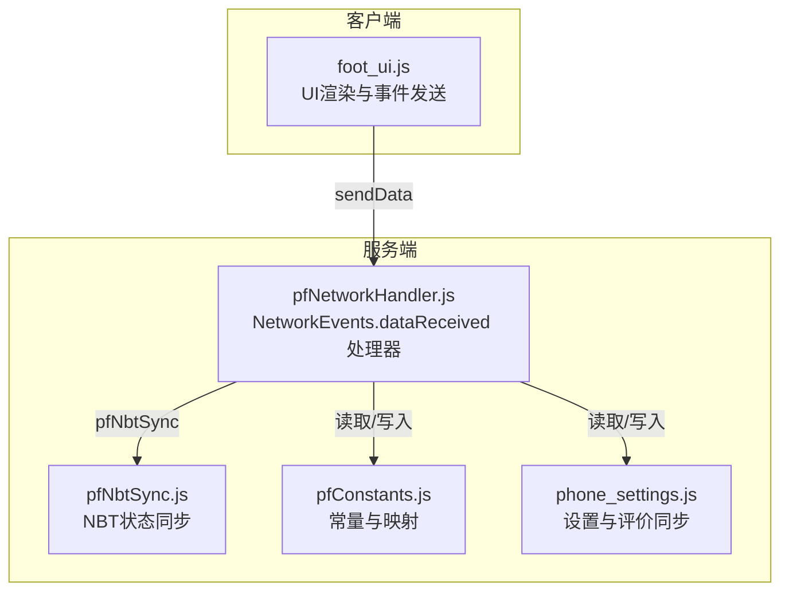
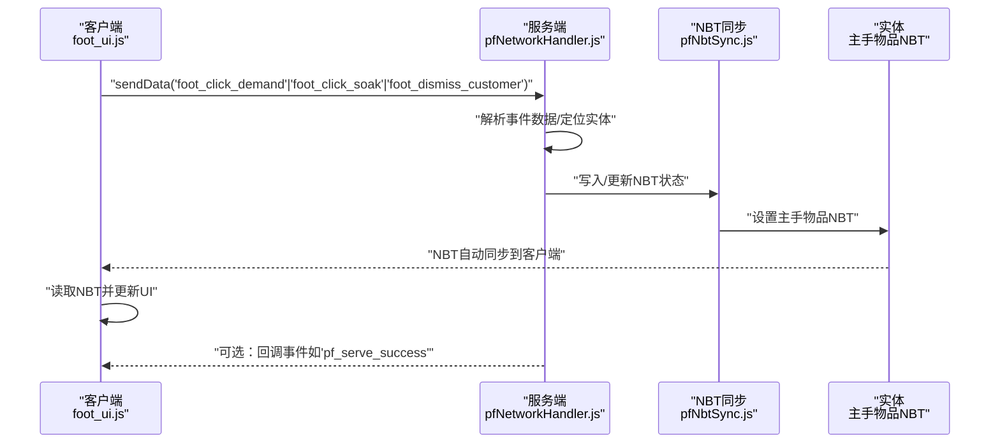
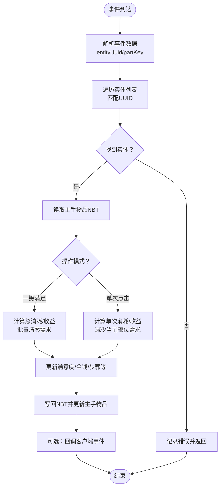
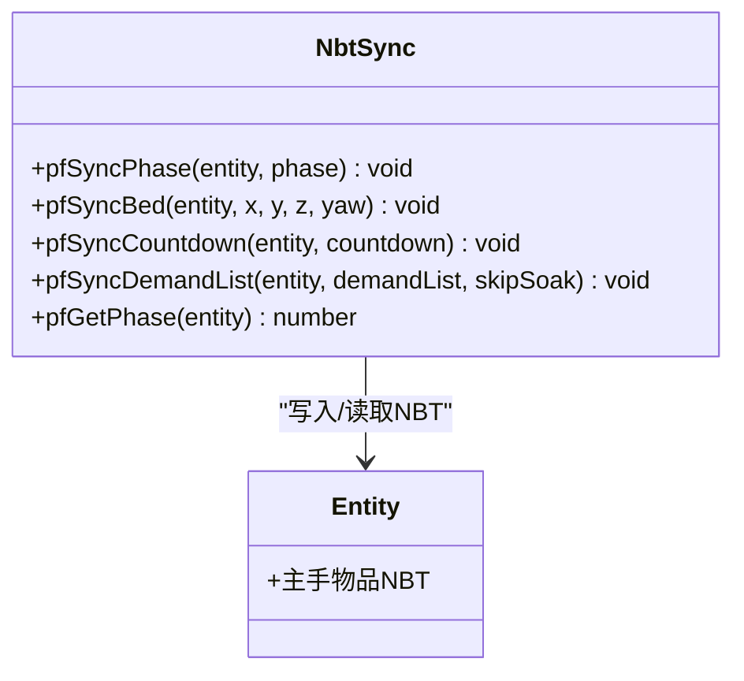
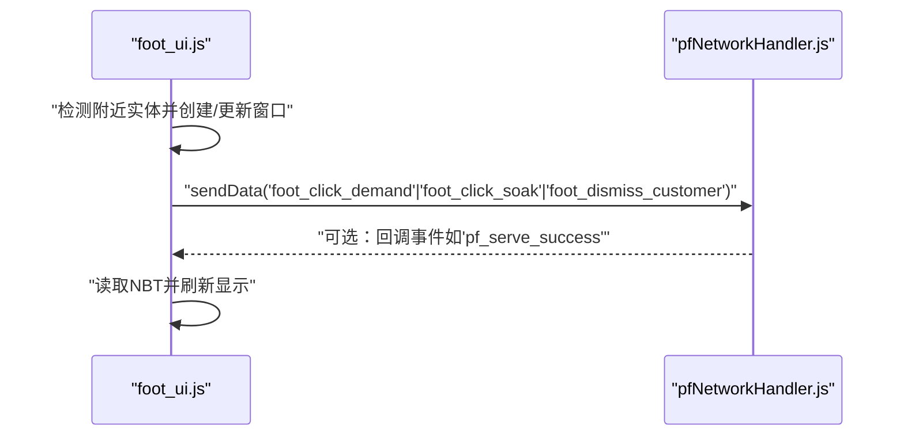
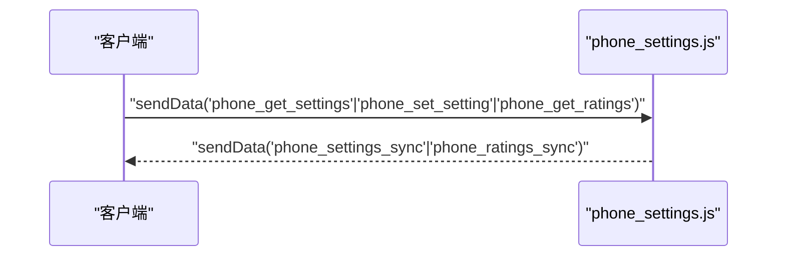
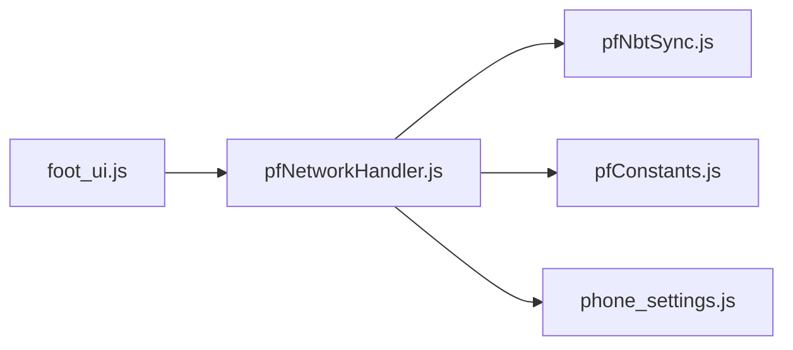

# 网络事件

<cite>
**本文引用的文件**
- [pfNetworkHandler.js](file://kubejs/server_scripts/pathfinder/pfNetworkHandler.js)
- [pfNbtSync.js](file://kubejs/server_scripts/pathfinder/pfNbtSync.js)
- [foot_ui.js](file://kubejs/client_scripts/ui/foot_ui.js)
- [phone_settings.js](file://kubejs/server_scripts/phone_settings.js)
- [pfConstants.js](file://kubejs/server_scripts/pathfinder/pfConstants.js)
- [README.md](file://README.md)
</cite>

## 目录
1. [简介](#简介)
2. [项目结构](#项目结构)
3. [核心组件](#核心组件)
4. [架构总览](#架构总览)
5. [详细组件分析](#详细组件分析)
6. [依赖关系分析](#依赖关系分析)
7. [性能考量](#性能考量)
8. [故障排查指南](#故障排查指南)
9. [结论](#结论)
10. [附录](#附录)

## 简介
本文件面向Minecraft KubeJS环境下的网络事件系统，聚焦服务端与客户端之间的实时交互机制。内容覆盖：
- NetworkEvents的使用方法：事件注册、消息格式、数据序列化与广播
- 状态同步与事件广播：基于实体主手物品NBT的自动同步
- 可靠性、延迟与冲突处理策略
- 自定义网络事件的创建、事件处理器实现与性能优化
- 实体状态同步、UI数据传输与实时交互的实践示例
- NBT数据同步机制与调试方法

## 项目结构
本项目的网络事件系统主要由三部分组成：
- 服务端网络处理器：接收客户端事件并执行业务逻辑，同时通过NBT同步状态
- 客户端UI与事件发送：负责渲染界面、收集用户输入并通过sendData发送事件
- NBT同步模块：将关键状态写入实体主手物品的NBT，实现自动广播与客户端读取

图表来源
- [pfNetworkHandler.js:36-311](file://kubejs/server_scripts/pathfinder/pfNetworkHandler.js#L36-L311)
- [pfNbtSync.js:8-93](file://kubejs/server_scripts/pathfinder/pfNbtSync.js#L8-L93)
- [foot_ui.js:204-289](file://kubejs/client_scripts/ui/foot_ui.js#L204-L289)
- [phone_settings.js:55-134](file://kubejs/server_scripts/phone_settings.js#L55-L134)
- [pfConstants.js:36-64](file://kubejs/server_scripts/pathfinder/pfConstants.js#L36-L64)

章节来源
- [README.md:1-6](file://README.md#L1-L6)
- [pfNetworkHandler.js:36-311](file://kubejs/server_scripts/pathfinder/pfNetworkHandler.js#L36-L311)
- [pfNbtSync.js:8-93](file://kubejs/server_scripts/pathfinder/pfNbtSync.js#L8-L93)
- [foot_ui.js:204-289](file://kubejs/client_scripts/ui/foot_ui.js#L204-L289)
- [phone_settings.js:55-134](file://kubejs/server_scripts/phone_settings.js#L55-L134)
- [pfConstants.js:36-64](file://kubejs/server_scripts/pathfinder/pfConstants.js#L36-L64)

## 核心组件
- 服务端网络处理器
  - 注册NetworkEvents.dataReceived事件，处理客户端发送的“点击需求”、“点击泡脚”、“送客”等请求
  - 根据事件数据定位目标实体，读取/更新其主手物品NBT，驱动状态变更与收益计算
- NBT同步模块
  - 提供统一接口将阶段、床位、倒计时、需求清单、满意度、金钱等状态写入NBT
  - 由于NBT随实体主手物品自动同步至客户端，UI可直接读取并渲染
- 客户端UI与事件发送
  - 基于WorldWindow创建悬浮UI，监听鼠标拖动与点击，通过sendData发送事件
  - 定期扫描附近实体，动态创建/更新/销毁UI窗口
  - 接收服务端回调，进行动画与日志确认

章节来源
- [pfNetworkHandler.js:36-311](file://kubejs/server_scripts/pathfinder/pfNetworkHandler.js#L36-L311)
- [pfNbtSync.js:8-93](file://kubejs/server_scripts/pathfinder/pfNbtSync.js#L8-L93)
- [foot_ui.js:782-925](file://kubejs/client_scripts/ui/foot_ui.js#L782-L925)

## 架构总览
下图展示从客户端发起事件到服务端处理再到状态同步的完整流程。

图表来源
- [pfNetworkHandler.js:39-310](file://kubejs/server_scripts/pathfinder/pfNetworkHandler.js#L39-L310)
- [pfNbtSync.js:8-93](file://kubejs/server_scripts/pathfinder/pfNbtSync.js#L8-L93)
- [foot_ui.js:204-289](file://kubejs/client_scripts/ui/foot_ui.js#L204-L289)
- [foot_ui.js:1006-1014](file://kubejs/client_scripts/ui/foot_ui.js#L1006-L1014)

## 详细组件分析

### 服务端网络处理器（pfNetworkHandler.js）
职责与流程
- 注册多个NetworkEvents.dataReceived处理器，分别处理“点击需求”、“点击泡脚”、“送客”
- 事件处理流程：校验参数→查找实体→读取/更新NBT→计算收益与状态→必要时回调客户端
- 支持一键满足、体力消耗、满意度倍率、掉落奖励等复杂逻辑

图表来源
- [pfNetworkHandler.js:39-219](file://kubejs/server_scripts/pathfinder/pfNetworkHandler.js#L39-L219)

章节来源
- [pfNetworkHandler.js:36-311](file://kubejs/server_scripts/pathfinder/pfNetworkHandler.js#L36-L311)

### NBT同步模块（pfNbtSync.js）
职责与数据模型
- 将阶段、床位、倒计时、需求清单、满意度、金钱、泡脚状态等写入实体主手物品NBT
- 通过统一接口简化状态写入，确保客户端可直接读取

图表来源
- [pfNbtSync.js:8-93](file://kubejs/server_scripts/pathfinder/pfNbtSync.js#L8-L93)

章节来源
- [pfNbtSync.js:8-93](file://kubejs/server_scripts/pathfinder/pfNbtSync.js#L8-L93)

### 客户端UI与事件发送（foot_ui.js）
职责与交互
- 基于WorldWindow创建悬浮UI，支持倒计时、需求清单、满意度、步骤等显示
- 监听鼠标拖动与点击，通过sendData发送事件到服务端
- 定期扫描附近实体，动态创建/更新/销毁UI窗口
- 接收服务端回调，进行日志确认

图表来源
- [foot_ui.js:204-289](file://kubejs/client_scripts/ui/foot_ui.js#L204-L289)
- [foot_ui.js:782-925](file://kubejs/client_scripts/ui/foot_ui.js#L782-L925)
- [foot_ui.js:1006-1014](file://kubejs/client_scripts/ui/foot_ui.js#L1006-L1014)

章节来源
- [foot_ui.js:782-925](file://kubejs/client_scripts/ui/foot_ui.js#L782-L925)
- [foot_ui.js:204-289](file://kubejs/client_scripts/ui/foot_ui.js#L204-L289)
- [foot_ui.js:1006-1014](file://kubejs/client_scripts/ui/foot_ui.js#L1006-L1014)

### 设置与评价同步（phone_settings.js）
职责与数据流
- 将玩家设置持久化到persistentData复合标签
- 通过NetworkEvents双向同步设置与评价数据
- 客户端可请求设置与评价，服务端打包返回

图表来源
- [phone_settings.js:55-134](file://kubejs/server_scripts/phone_settings.js#L55-L134)

章节来源
- [phone_settings.js:55-134](file://kubejs/server_scripts/phone_settings.js#L55-L134)

### 常量与映射（pfConstants.js）
职责与作用
- 定义需求键值与部位映射、整数代码与部位映射
- 为网络事件处理提供统一的键值与编码规则

章节来源
- [pfConstants.js:36-64](file://kubejs/server_scripts/pathfinder/pfConstants.js#L36-L64)

## 依赖关系分析
- 服务端网络处理器依赖NBT同步模块进行状态写入，并依赖常量模块进行键值与编码转换
- 客户端UI依赖NBT自动同步机制读取状态，同时通过sendData与服务端通信
- 设置与评价模块独立运行，但同样使用NetworkEvents进行双向同步

图表来源
- [pfNetworkHandler.js:36-311](file://kubejs/server_scripts/pathfinder/pfNetworkHandler.js#L36-L311)
- [pfNbtSync.js:8-93](file://kubejs/server_scripts/pathfinder/pfNbtSync.js#L8-L93)
- [foot_ui.js:204-289](file://kubejs/client_scripts/ui/foot_ui.js#L204-L289)
- [phone_settings.js:55-134](file://kubejs/server_scripts/phone_settings.js#L55-L134)
- [pfConstants.js:36-64](file://kubejs/server_scripts/pathfinder/pfConstants.js#L36-L64)

章节来源
- [pfNetworkHandler.js:36-311](file://kubejs/server_scripts/pathfinder/pfNetworkHandler.js#L36-L311)
- [pfNbtSync.js:8-93](file://kubejs/server_scripts/pathfinder/pfNbtSync.js#L8-L93)
- [foot_ui.js:204-289](file://kubejs/client_scripts/ui/foot_ui.js#L204-L289)
- [phone_settings.js:55-134](file://kubejs/server_scripts/phone_settings.js#L55-L134)
- [pfConstants.js:36-64](file://kubejs/server_scripts/pathfinder/pfConstants.js#L36-L64)

## 性能考量
- 事件频率控制
  - 客户端拖动触发事件采用阈值累积，避免高频事件风暴
  - 服务端事件处理应尽量短小、幂等，避免重复计算
- 数据同步粒度
  - 使用NBT同步关键状态，减少冗余广播；仅在必要时更新主手物品
- UI刷新节流
  - 客户端按帧扫描附近实体，对显示项进行增量更新，避免全量重绘
- 网络带宽
  - 事件负载轻量（UUID、部位键、布尔标志等），NBT同步由引擎负责，无需额外序列化

## 故障排查指南
- 事件未到达服务端
  - 检查客户端是否正确调用sendData，事件名与数据结构是否匹配
  - 确认服务端NetworkEvents.dataReceived是否已注册
- 实体未找到
  - 核对entityUuid是否正确传递，服务端遍历实体列表是否包含目标
- NBT未更新
  - 确认实体主手物品是否为目标ID，NBT写入是否成功
  - 客户端是否正确读取NBT并刷新UI
- 设置不同步
  - 检查persistentData是否存在复合标签，服务端是否正确读取/写入
  - 确认客户端是否发送请求并接收回包

章节来源
- [pfNetworkHandler.js:39-310](file://kubejs/server_scripts/pathfinder/pfNetworkHandler.js#L39-L310)
- [foot_ui.js:204-289](file://kubejs/client_scripts/ui/foot_ui.js#L204-L289)
- [phone_settings.js:55-134](file://kubejs/server_scripts/phone_settings.js#L55-L134)

## 结论
本网络事件系统通过KubeJS的NetworkEvents与NBT同步机制，实现了服务端与客户端之间的低耦合、高可靠的状态同步与事件交互。客户端负责直观的UI与输入，服务端负责业务逻辑与状态维护，二者通过统一的消息协议与NBT数据模型协同工作。该设计具备良好的扩展性与可维护性，适合在复杂玩法中复用与演进。

## 附录

### 自定义网络事件创建步骤
- 选择事件名并保持唯一
- 客户端使用sendData发送事件与数据
- 服务端使用NetworkEvents.dataReceived注册处理器
- 在处理器中解析数据、定位实体、更新状态
- 必要时通过回调事件向客户端确认

章节来源
- [foot_ui.js:204-289](file://kubejs/client_scripts/ui/foot_ui.js#L204-L289)
- [pfNetworkHandler.js:39-310](file://kubejs/server_scripts/pathfinder/pfNetworkHandler.js#L39-L310)

### 事件处理器实现要点
- 参数校验与容错：捕获异常、记录日志、及时返回
- 幂等性：多次相同事件不应产生副作用
- 状态一致性：先读取再更新，避免竞态条件
- 回调确认：对关键操作进行客户端回调，提升体验

章节来源
- [pfNetworkHandler.js:39-310](file://kubejs/server_scripts/pathfinder/pfNetworkHandler.js#L39-L310)

### 网络性能优化建议
- 减少事件频率：采用阈值触发与去抖
- 增量更新UI：仅更新变化的数据项
- 控制NBT大小：仅写入必要字段
- 合理使用回调：避免过度频繁的回包

章节来源
- [foot_ui.js:782-925](file://kubejs/client_scripts/ui/foot_ui.js#L782-L925)
- [pfNbtSync.js:8-93](file://kubejs/server_scripts/pathfinder/pfNbtSync.js#L8-L93)

### 实体状态同步与UI数据传输示例
- 实体状态：阶段、倒计时、需求清单、满意度、金钱、泡脚状态
- UI数据：倒计时、需求清单、满意度、步骤、抹油状态
- 同步路径：服务端写入NBT → 引擎自动同步 → 客户端读取并刷新

章节来源
- [pfNbtSync.js:8-93](file://kubejs/server_scripts/pathfinder/pfNbtSync.js#L8-L93)
- [foot_ui.js:463-577](file://kubejs/client_scripts/ui/foot_ui.js#L463-L577)

### NBT数据同步机制与调试
- NBT写入：通过NBT同步模块统一写入
- 自动同步：主手物品NBT随实体自动同步到客户端
- 调试方法：打印NBT字段、检查UI读取结果、核对事件回调

章节来源
- [pfNbtSync.js:8-93](file://kubejs/server_scripts/pathfinder/pfNbtSync.js#L8-L93)
- [foot_ui.js:96-118](file://kubejs/client_scripts/ui/foot_ui.js#L96-L118)