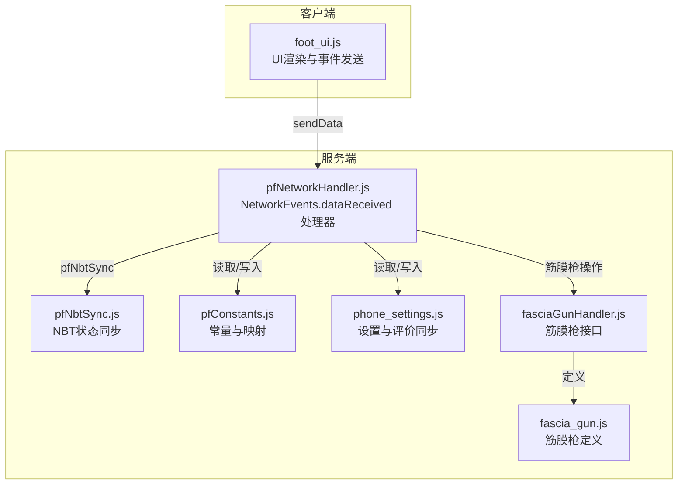
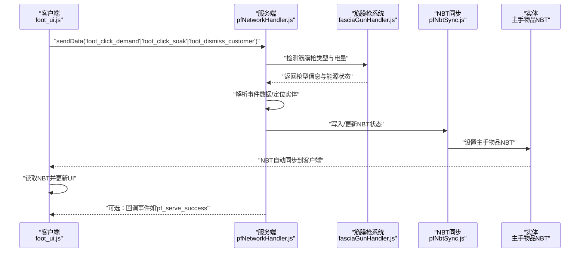
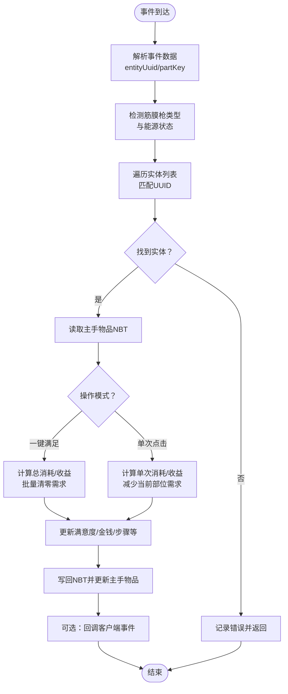
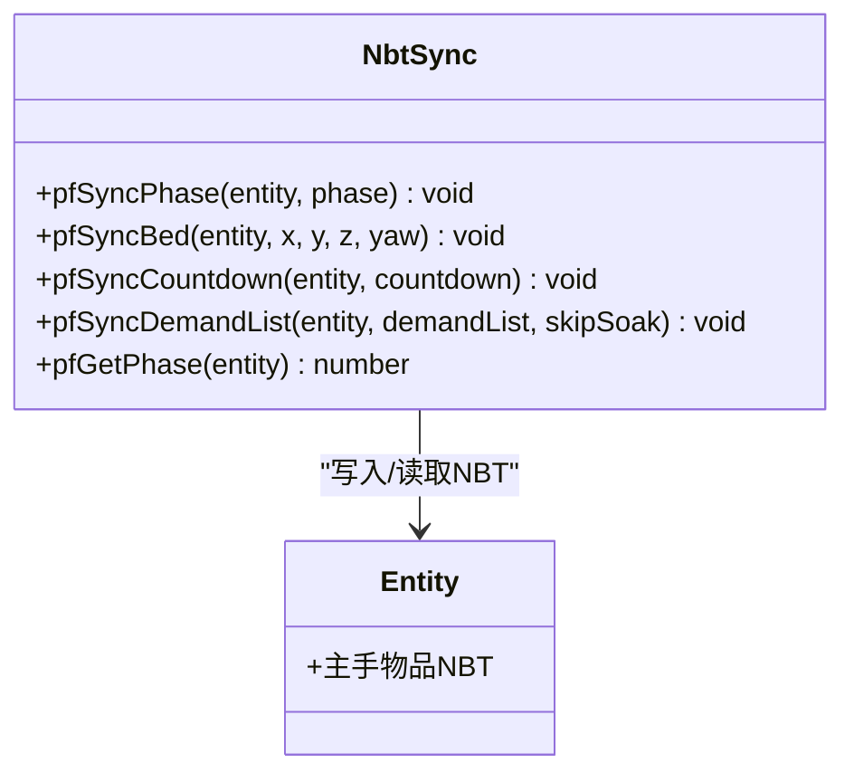
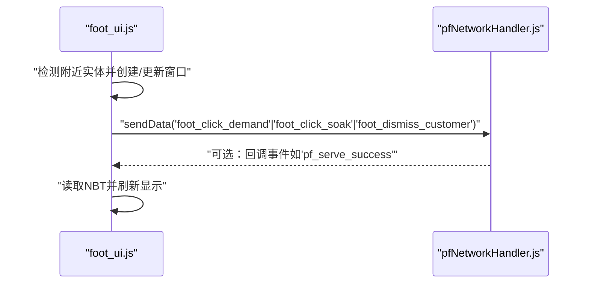
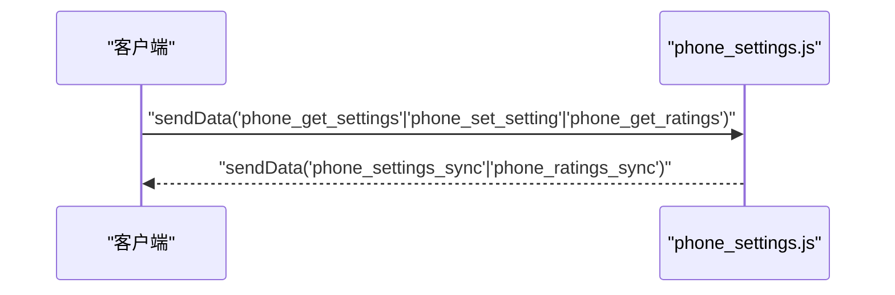
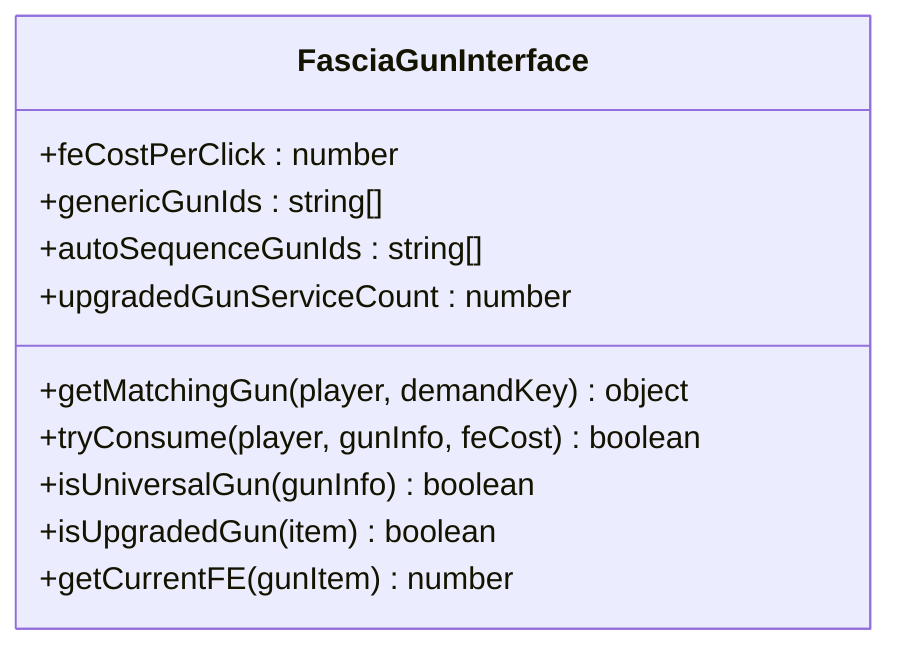
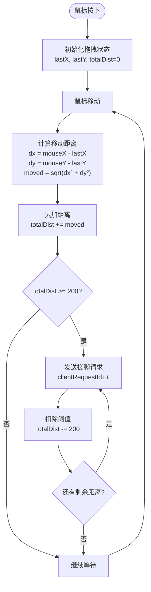
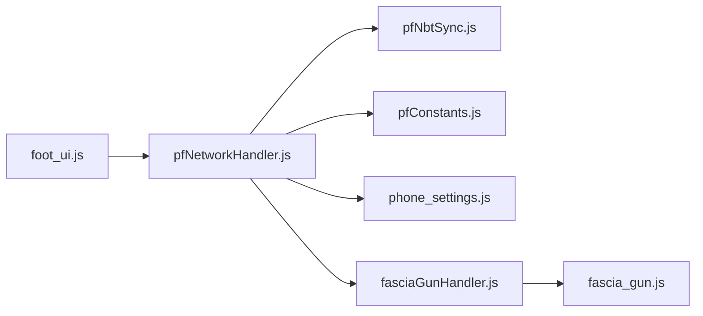

# 网络事件

<cite>
**本文引用的文件**
- [pfNetworkHandler.js](file://kubejs/server_scripts/pathfinder/pfNetworkHandler.js)
- [pfNbtSync.js](file://kubejs/server_scripts/pathfinder/pfNbtSync.js)
- [foot_ui.js](file://kubejs/client_scripts/ui/foot_ui.js)
- [phone_settings.js](file://kubejs/server_scripts/phone_settings.js)
- [pfConstants.js](file://kubejs/server_scripts/pathfinder/pfConstants.js)
- [fasciaGunHandler.js](file://kubejs/server_scripts/item/fasciaGunHandler.js)
- [fascia_gun.js](file://kubejs/startup_scripts/item/fascia_gun.js)
- [README.md](file://README.md)
</cite>

## 更新摘要
**变更内容**
- 新增筋膜枪变体支持：强化版筋膜枪、四合一筋膜枪的完整集成
- 改进拖拽机制：增强的坐标计算、错误处理和边缘情况处理
- 优化网络处理器：更好的筋膜枪能源管理和服务计数逻辑
- 完善错误处理：更可靠的实体查找和数据验证

## 目录
1. [简介](#简介)
2. [项目结构](#项目结构)
3. [核心组件](#核心组件)
4. [架构总览](#架构总览)
5. [详细组件分析](#详细组件分析)
6. [筋膜枪系统增强](#筋膜枪系统增强)
7. [拖拽机制改进](#拖拽机制改进)
8. [依赖关系分析](#依赖关系分析)
9. [性能考量](#性能考量)
10. [故障排查指南](#故障排查指南)
11. [结论](#结论)
12. [附录](#附录)

## 简介
本文件面向Minecraft KubeJS环境下的网络事件系统，聚焦服务端与客户端之间的实时交互机制。内容覆盖：
- NetworkEvents的使用方法：事件注册、消息格式、数据序列化与广播
- 状态同步与事件广播：基于实体主手物品NBT的自动同步
- 可靠性、延迟与冲突处理策略
- 自定义网络事件的创建、事件处理器实现与性能优化
- 实体状态同步、UI数据传输与实时交互的实践示例
- NBT数据同步机制与调试方法
- **新增**：筋膜枪变体系统的完整支持与拖拽机制的显著改进

## 项目结构
本项目的网络事件系统主要由三部分组成：
- 服务端网络处理器：接收客户端事件并执行业务逻辑，同时通过NBT同步状态
- 客户端UI与事件发送：负责渲染界面、收集用户输入并通过sendData发送事件
- NBT同步模块：将关键状态写入实体主手物品的NBT，实现自动广播与客户端读取
- **新增**：筋膜枪系统：提供多种变体的电力管理与服务增强功能

**图表来源**
- [pfNetworkHandler.js:36-311](file://kubejs/server_scripts/pathfinder/pfNetworkHandler.js#L36-L311)
- [pfNbtSync.js:8-93](file://kubejs/server_scripts/pathfinder/pfNbtSync.js#L8-L93)
- [foot_ui.js:204-289](file://kubejs/client_scripts/ui/foot_ui.js#L204-L289)
- [phone_settings.js:55-134](file://kubejs/server_scripts/phone_settings.js#L55-L134)
- [fasciaGunHandler.js:108-215](file://kubejs/server_scripts/item/fasciaGunHandler.js#L108-L215)
- [fascia_gun.js:80-169](file://kubejs/startup_scripts/item/fascia_gun.js#L80-L169)

## 核心组件
- 服务端网络处理器
  - 注册NetworkEvents.dataReceived事件，处理客户端发送的"点击需求"、"点击泡脚"、"送客"等请求
  - 根据事件数据定位目标实体，读取/更新其主手物品NBT，驱动状态变更与收益计算
  - **增强**：支持筋膜枪变体的智能识别与服务计数优化
- NBT同步模块
  - 提供统一接口将阶段、床位、倒计时、需求清单、满意度、金钱等状态写入NBT
  - 由于NBT随实体主手物品自动同步至客户端，UI可直接读取并渲染
- 客户端UI与事件发送
  - 基于WorldWindow创建悬浮UI，监听鼠标拖动与点击，通过sendData发送事件
  - 定期扫描附近实体，动态创建/更新/销毁UI窗口
  - 接收服务端回调，进行动画与日志确认
  - **改进**：更精确的坐标计算和拖拽阈值处理
- **新增**：筋膜枪系统
  - 支持基础筋膜枪、四合一筋膜枪、四种部位专用筋膜枪及对应强化版本
  - 提供电力管理、拆卸合成、自动序列等功能
  - 与服务端网络处理器深度集成，实现智能能源消耗

**章节来源**
- [pfNetworkHandler.js:36-311](file://kubejs/server_scripts/pathfinder/pfNetworkHandler.js#L36-L311)
- [pfNbtSync.js:8-93](file://kubejs/server_scripts/pathfinder/pfNbtSync.js#L8-L93)
- [foot_ui.js:782-925](file://kubejs/client_scripts/ui/foot_ui.js#L782-L925)
- [fasciaGunHandler.js:108-215](file://kubejs/server_scripts/item/fasciaGunHandler.js#L108-L215)

## 架构总览
下图展示从客户端发起事件到服务端处理再到状态同步的完整流程，包含筋膜枪系统的集成。

**图表来源**
- [pfNetworkHandler.js:39-310](file://kubejs/server_scripts/pathfinder/pfNetworkHandler.js#L39-L310)
- [pfNbtSync.js:8-93](file://kubejs/server_scripts/pathfinder/pfNbtSync.js#L8-L93)
- [foot_ui.js:204-289](file://kubejs/client_scripts/ui/foot_ui.js#L204-L289)
- [fasciaGunHandler.js:108-215](file://kubejs/server_scripts/item/fasciaGunHandler.js#L108-L215)

## 详细组件分析

### 服务端网络处理器（pfNetworkHandler.js）
职责与流程
- 注册多个NetworkEvents.dataReceived处理器，分别处理"点击需求"、"点击泡脚"、"送客"
- 事件处理流程：校验参数→查找实体→读取/更新NBT→计算收益与状态→必要时回调客户端
- 支持一键满足、体力消耗、满意度倍率、掉落奖励等复杂逻辑
- **增强**：集成筋膜枪系统，支持智能能源消耗和服务计数优化

**图表来源**
- [pfNetworkHandler.js:39-219](file://kubejs/server_scripts/pathfinder/pfNetworkHandler.js#L39-L219)

**章节来源**
- [pfNetworkHandler.js:36-311](file://kubejs/server_scripts/pathfinder/pfNetworkHandler.js#L36-L311)

### NBT同步模块（pfNbtSync.js）
职责与数据模型
- 将阶段、床位、倒计时、需求清单、满意度、金钱、泡脚状态等写入实体主手物品NBT
- 通过统一接口简化状态写入，确保客户端可直接读取

**图表来源**
- [pfNbtSync.js:8-93](file://kubejs/server_scripts/pathfinder/pfNbtSync.js#L8-L93)

**章节来源**
- [pfNbtSync.js:8-93](file://kubejs/server_scripts/pathfinder/pfNbtSync.js#L8-L93)

### 客户端UI与事件发送（foot_ui.js）
职责与交互
- 基于WorldWindow创建悬浮UI，支持倒计时、需求清单、满意度、步骤等显示
- 监听鼠标拖动与点击，通过sendData发送事件到服务端
- 定期扫描附近实体，动态创建/更新/销毁UI窗口
- 接收服务端回调，进行日志确认
- **改进**：增强的坐标计算、拖拽阈值处理和错误处理

**图表来源**
- [foot_ui.js:204-289](file://kubejs/client_scripts/ui/foot_ui.js#L204-L289)
- [foot_ui.js:782-925](file://kubejs/client_scripts/ui/foot_ui.js#L782-L925)
- [foot_ui.js:1006-1014](file://kubejs/client_scripts/ui/foot_ui.js#L1006-L1014)

**章节来源**
- [foot_ui.js:782-925](file://kubejs/client_scripts/ui/foot_ui.js#L782-L925)
- [foot_ui.js:204-289](file://kubejs/client_scripts/ui/foot_ui.js#L204-L289)
- [foot_ui.js:1006-1014](file://kubejs/client_scripts/ui/foot_ui.js#L1006-L1014)

### 设置与评价同步（phone_settings.js）
职责与数据流
- 将玩家设置持久化到persistentData复合标签
- 通过NetworkEvents双向同步设置与评价数据
- 客户端可请求设置与评价，服务端打包返回

**图表来源**
- [phone_settings.js:55-134](file://kubejs/server_scripts/phone_settings.js#L55-L134)

**章节来源**
- [phone_settings.js:55-134](file://kubejs/server_scripts/phone_settings.js#L55-L134)

### 常量与映射（pfConstants.js）
职责与作用
- 定义需求键值与部位映射、整数代码与部位映射
- 为网络事件处理提供统一的键值与编码规则
- **增强**：新增筋膜枪变体的映射支持

**章节来源**
- [pfConstants.js:36-64](file://kubejs/server_scripts/pathfinder/pfConstants.js#L36-L64)

## 筋膜枪系统增强

### 筋膜枪变体支持
系统现在支持以下筋膜枪变体：
- **基础筋膜枪**：`marguerite:fascia_gun` - 无头基础款
- **四合一筋膜枪**：`marguerite:fascia_gun_universal` - 通用型，支持所有部位
- **部位专用筋膜枪**：四种部位对应的专用筋膜枪
- **强化版筋膜枪**：四种部位的强化版本，提供更高效的服务能力

### 筋膜枪接口设计
筋膜枪系统通过全局接口提供服务：

**图表来源**
- [fasciaGunHandler.js:108-215](file://kubejs/server_scripts/item/fasciaGunHandler.js#L108-L215)

### 筋膜枪与服务端集成
- **智能能源管理**：优先消耗筋膜枪电力，不足时提示充电
- **服务计数优化**：强化版筋膜枪每次服务完成2次搓脚动作
- **自动序列支持**：四合一筋膜枪支持按顺序自动处理不同部位需求
- **拆卸合成系统**：支持有头/无头筋膜枪的相互转换，保留电力

**章节来源**
- [fasciaGunHandler.js:1-215](file://kubejs/server_scripts/item/fasciaGunHandler.js#L1-215)
- [fascia_gun.js:1-169](file://kubejs/startup_scripts/item/fascia_gun.js#L1-169)
- [pfNetworkHandler.js:252-286](file://kubejs/server_scripts/pathfinder/pfNetworkHandler.js#L252-L286)

## 拖拽机制改进

### 坐标计算优化
- **精确坐标获取**：使用`getBoundingClientRect()`获取准确的鼠标位置
- **容器原点校正**：以监听容器为坐标原点，避免子元素命中时的坐标跳变
- **边界检查增强**：完善的空值和边界条件检查

### 拖拽阈值处理
- **累积距离计算**：每累计200像素触发一次搓脚动作
- **多阈值处理**：单帧内可能跨越多个阈值，使用while循环处理
- **请求序列号**：每个拖拽请求都有唯一序列号，便于调试和追踪

### 错误处理改进
- **空值防护**：对鼠标事件坐标进行严格检查
- **状态重置**：鼠标离开时正确重置拖拽状态
- **日志增强**：详细的拖拽过程日志，便于问题诊断

**图表来源**
- [foot_ui.js:204-289](file://kubejs/client_scripts/ui/foot_ui.js#L204-L289)

**章节来源**
- [foot_ui.js:204-289](file://kubejs/client_scripts/ui/foot_ui.js#L204-L289)

## 依赖关系分析
- 服务端网络处理器依赖NBT同步模块进行状态写入，并依赖常量模块进行键值与编码转换
- 客户端UI依赖NBT自动同步机制读取状态，同时通过sendData与服务端通信
- 设置与评价模块独立运行，但同样使用NetworkEvents进行双向同步
- **新增**：筋膜枪系统与网络处理器深度集成，提供智能能源管理

**图表来源**
- [pfNetworkHandler.js:36-311](file://kubejs/server_scripts/pathfinder/pfNetworkHandler.js#L36-L311)
- [pfNbtSync.js:8-93](file://kubejs/server_scripts/pathfinder/pfNbtSync.js#L8-L93)
- [foot_ui.js:204-289](file://kubejs/client_scripts/ui/foot_ui.js#L204-L289)
- [phone_settings.js:55-134](file://kubejs/server_scripts/phone_settings.js#L55-L134)
- [fasciaGunHandler.js:108-215](file://kubejs/server_scripts/item/fasciaGunHandler.js#L108-L215)
- [fascia_gun.js:80-169](file://kubejs/startup_scripts/item/fascia_gun.js#L80-L169)

**章节来源**
- [pfNetworkHandler.js:36-311](file://kubejs/server_scripts/pathfinder/pfNetworkHandler.js#L36-L311)
- [pfNbtSync.js:8-93](file://kubejs/server_scripts/pathfinder/pfNbtSync.js#L8-L93)
- [foot_ui.js:204-289](file://kubejs/client_scripts/ui/foot_ui.js#L204-L289)
- [phone_settings.js:55-134](file://kubejs/server_scripts/phone_settings.js#L55-L134)
- [pfConstants.js:36-64](file://kubejs/server_scripts/pathfinder/pfConstants.js#L36-L64)

## 性能考量
- 事件频率控制
  - 客户端拖动触发事件采用阈值累积，避免高频事件风暴
  - 服务端事件处理应尽量短小、幂等，避免重复计算
- 数据同步粒度
  - 使用NBT同步关键状态，减少冗余广播；仅在必要时更新主手物品
- UI刷新节流
  - 客户端按帧扫描附近实体，对显示项进行增量更新，避免全量重绘
- 网络带宽
  - 事件负载轻量（UUID、部位键、布尔标志等），NBT同步由引擎负责，无需额外序列化
- **新增**：筋膜枪性能优化
  - 智能能源消耗，避免不必要的体力消耗
  - 批量服务处理，减少网络往返次数

## 故障排查指南
- 事件未到达服务端
  - 检查客户端是否正确调用sendData，事件名与数据结构是否匹配
  - 确认服务端NetworkEvents.dataReceived是否已注册
- 实体未找到
  - 核对entityUuid是否正确传递，服务端遍历实体列表是否包含目标
- NBT未更新
  - 确认实体主手物品是否为目标ID，NBT写入是否成功
  - 客户端是否正确读取NBT并刷新UI
- 设置不同步
  - 检查persistentData是否存在复合标签，服务端是否正确读取/写入
  - 确认客户端是否发送请求并接收回包
- **新增**：筋膜枪相关问题
  - 检查筋膜枪电力是否正常，是否正确识别枪型
  - 确认强化版筋膜枪的服务计数逻辑
  - 验证拆卸合成功能的电力转移

**章节来源**
- [pfNetworkHandler.js:39-310](file://kubejs/server_scripts/pathfinder/pfNetworkHandler.js#L39-L310)
- [foot_ui.js:204-289](file://kubejs/client_scripts/ui/foot_ui.js#L204-L289)
- [phone_settings.js:55-134](file://kubejs/server_scripts/phone_settings.js#L55-L134)

## 结论
本网络事件系统通过KubeJS的NetworkEvents与NBT同步机制，实现了服务端与客户端之间的低耦合、高可靠的状态同步与事件交互。客户端负责直观的UI与输入，服务端负责业务逻辑与状态维护，二者通过统一的消息协议与NBT数据模型协同工作。

**重大改进**包括：
- **筋膜枪系统**：完整的变体支持，从基础款到强化版的全面覆盖
- **拖拽机制**：更精确的坐标计算和更可靠的错误处理
- **性能优化**：智能能源管理和批量服务处理

该设计具备良好的扩展性与可维护性，适合在复杂玩法中复用与演进。

## 附录

### 自定义网络事件创建步骤
- 选择事件名并保持唯一
- 客户端使用sendData发送事件与数据
- 服务端使用NetworkEvents.dataReceived注册处理器
- 在处理器中解析数据、定位实体、更新状态
- 必要时通过回调事件向客户端确认

**章节来源**
- [foot_ui.js:204-289](file://kubejs/client_scripts/ui/foot_ui.js#L204-L289)
- [pfNetworkHandler.js:39-310](file://kubejs/server_scripts/pathfinder/pfNetworkHandler.js#L39-L310)

### 事件处理器实现要点
- 参数校验与容错：捕获异常、记录日志、及时返回
- 幂等性：多次相同事件不应产生副作用
- 状态一致性：先读取再更新，避免竞态条件
- 回调确认：对关键操作进行客户端回调，提升体验

**章节来源**
- [pfNetworkHandler.js:39-310](file://kubejs/server_scripts/pathfinder/pfNetworkHandler.js#L39-L310)

### 网络性能优化建议
- 减少事件频率：采用阈值触发与去抖
- 增量更新UI：仅更新变化的数据项
- 控制NBT大小：仅写入必要字段
- 合理使用回调：避免过度频繁的回包

**章节来源**
- [foot_ui.js:782-925](file://kubejs/client_scripts/ui/foot_ui.js#L782-L925)
- [pfNbtSync.js:8-93](file://kubejs/server_scripts/pathfinder/pfNbtSync.js#L8-L93)

### 实体状态同步与UI数据传输示例
- 实体状态：阶段、倒计时、需求清单、满意度、金钱、泡脚状态
- UI数据：倒计时、需求清单、满意度、步骤、抹油状态
- 同步路径：服务端写入NBT → 引擎自动同步 → 客户端读取并刷新

**章节来源**
- [pfNbtSync.js:8-93](file://kubejs/server_scripts/pathfinder/pfNbtSync.js#L8-L93)
- [foot_ui.js:463-577](file://kubejs/client_scripts/ui/foot_ui.js#L463-L577)

### NBT数据同步机制与调试
- NBT写入：通过NBT同步模块统一写入
- 自动同步：主手物品NBT随实体自动同步到客户端
- 调试方法：打印NBT字段、检查UI读取结果、核对事件回调

**章节来源**
- [pfNbtSync.js:8-93](file://kubejs/server_scripts/pathfinder/pfNbtSync.js#L8-L93)
- [foot_ui.js:96-118](file://kubejs/client_scripts/ui/foot_ui.js#L96-L118)

### 筋膜枪系统使用指南
- **基本操作**：右键使用筋膜枪进行搓脚，优先消耗电力而非体力
- **拆卸合成**：Shift+右键拆卸有头筋膜枪，主手无头枪+副手头合成有头枪
- **电力管理**：10000 FE容量，满电时隐藏耐久条，低电量时红色警告
- **强化版优势**：每次服务完成2次搓脚动作，提高效率

**章节来源**
- [fasciaGunHandler.js:1-215](file://kubejs/server_scripts/item/fasciaGunHandler.js#L1-215)
- [fascia_gun.js:1-169](file://kubejs/startup_scripts/item/fascia_gun.js#L1-169)

### 拖拽机制调试技巧
- **日志查看**：关注[FOOT-DRAG]相关日志，了解拖拽过程
- **坐标检查**：确认鼠标坐标计算是否正确
- **阈值调整**：根据需要调整DRAG_THRESHOLD常量
- **状态监控**：跟踪tracking对象的状态变化

**章节来源**
- [foot_ui.js:204-289](file://kubejs/client_scripts/ui/foot_ui.js#L204-L289)