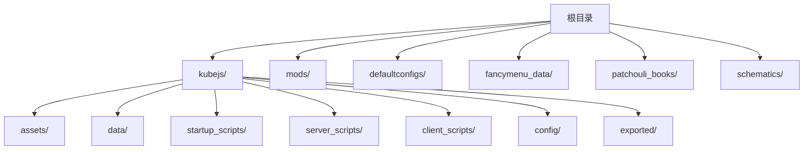
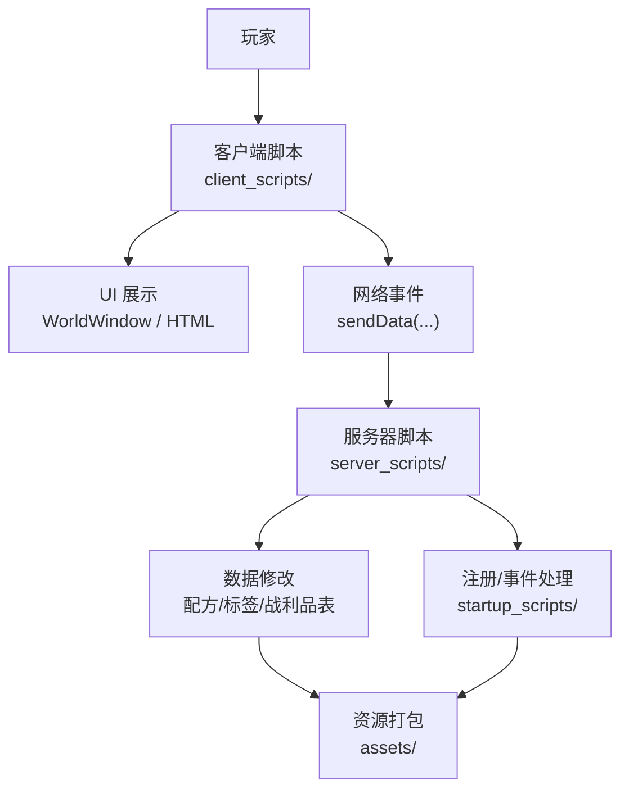
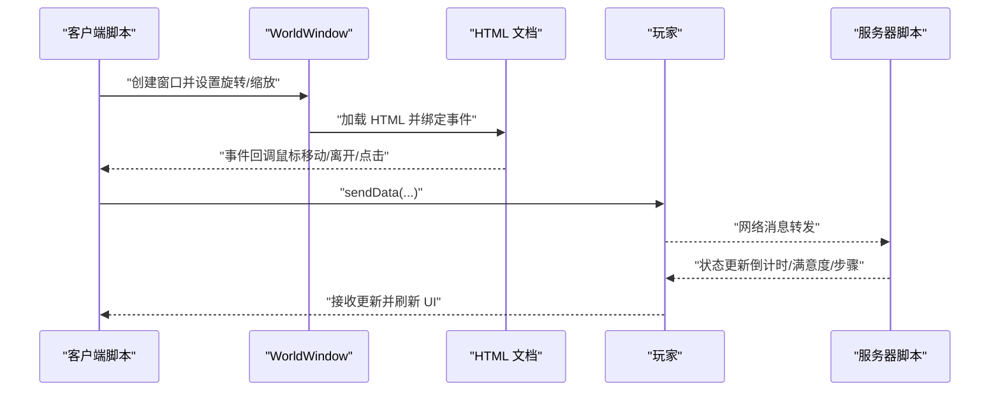
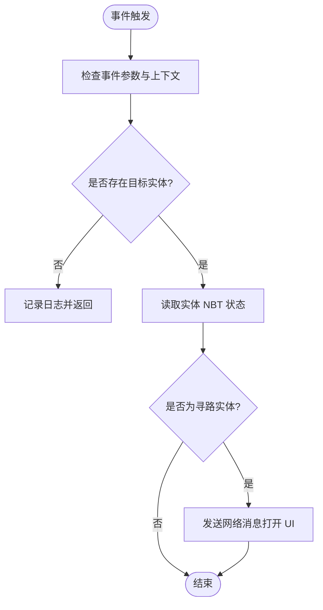
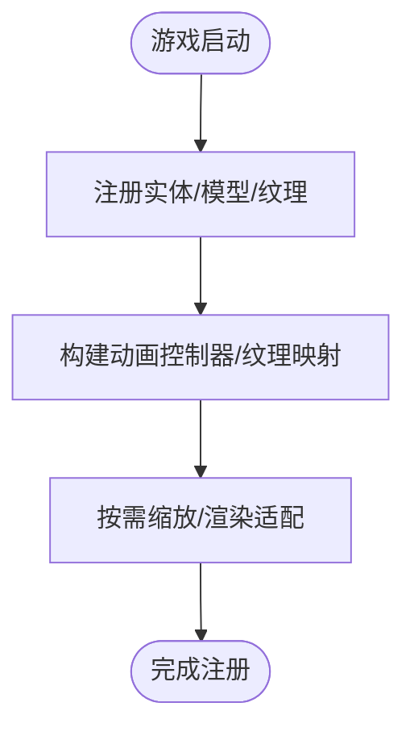

# 代码贡献指南

<cite>
**本文引用的文件**   
- [README.md](file://README.md)
- [kubejs/README.txt](file://kubejs/README.txt)
- [kubejs/jsconfig.json](file://kubejs/jsconfig.json)
- [kubejs/startup_scripts/example.js](file://kubejs/startup_scripts/example.js)
- [kubejs/server_scripts/example.js](file://kubejs/server_scripts/example.js)
- [kubejs/client_scripts/ui/foot_ui.js](file://kubejs/client_scripts/ui/foot_ui.js)
- [mods/LICENSE](file://mods/LICENSE)
- [kubejs/data/ftb/pack.mcmeta](file://kubejs/data/ftb/pack.mcmeta)
</cite>

## 目录
1. [简介](#简介)
2. [项目结构](#项目结构)
3. [核心组件](#核心组件)
4. [架构总览](#架构总览)
5. [详细组件分析](#详细组件分析)
6. [依赖关系分析](#依赖关系分析)
7. [性能注意事项](#性能注意事项)
8. [故障排查指南](#故障排查指南)
9. [结论](#结论)
10. [附录](#附录)

## 简介
本指南面向社区贡献者，帮助您高效参与本 Minecraft KubeJS 项目的开发与维护。内容涵盖：
- 如何参与开发、提交变更与参与讨论
- 代码风格与提交信息规范
- Pull Request 流程与审查要点
- 许可证、版权与贡献者协议
- 新功能开发原则、向后兼容性与文档更新要求
- 行为准则与社区交流规范

## 项目结构
本仓库为 Minecraft 1.20.1 + Forge + KubeJS 的整合包资源与脚本集合，核心目录与职责如下：
- kubejs/
  - assets：客户端资源（纹理、模型等）
  - data：服务端数据（配方、战利品表、标签等）
  - startup_scripts：启动期一次性加载的脚本（如注册实体、物品等）
  - server_scripts：服务器重载时加载的脚本（处理事件、修改数据）
  - client_scripts：客户端重载时加载的脚本（UI、JEI、提示等）
  - config：KubeJS 配置存储（脚本可访问世界目录外的该目录）
  - exported：导出的数据与资源（如图集）
- 默认配置与资源：defaultconfigs、fancymenu_data、patchouli_books、schematics 等
- mods：模组相关元数据与许可证
- 根目录：README.md 提供安装与运行指引

**图表来源**
- [README.md:1-6](file://README.md#L1-L6)
- [kubejs/README.txt:1-15](file://kubejs/README.txt#L1-L15)

**章节来源**
- [README.md:1-6](file://README.md#L1-L6)
- [kubejs/README.txt:1-15](file://kubejs/README.txt#L1-L15)

## 核心组件
- 启动脚本（startup_scripts）
  - 用途：仅在游戏启动阶段加载，适合注册实体、物品等只能在加载时进行的操作
  - 示例参考：[示例脚本:1-26](file://kubejs/startup_scripts/example.js#L1-L26)
- 服务器脚本（server_scripts）
  - 用途：每次服务器资源重载时加载，处理事件、修改配方与数据
  - 示例参考：[示例脚本:1-24](file://kubejs/server_scripts/example.js#L1-L24)
- 客户端脚本（client_scripts）
  - 用途：每次客户端资源重载时加载，处理 UI、JEI、提示等
  - 示例参考：[UI 脚本:1-800](file://kubejs/client_scripts/ui/foot_ui.js#L1-L800)
- 配置与编译选项（jsconfig.json）
  - 目标语言与根目录设置，便于 IDE 与类型检查
  - 参考：[编译配置:1-16](file://kubejs/jsconfig.json#L1-L16)

**章节来源**
- [kubejs/README.txt:8-11](file://kubejs/README.txt#L8-L11)
- [kubejs/startup_scripts/example.js:1-26](file://kubejs/startup_scripts/example.js#L1-L26)
- [kubejs/server_scripts/example.js:1-24](file://kubejs/server_scripts/example.js#L1-L24)
- [kubejs/client_scripts/ui/foot_ui.js:1-800](file://kubejs/client_scripts/ui/foot_ui.js#L1-L800)
- [kubejs/jsconfig.json:1-16](file://kubejs/jsconfig.json#L1-L16)

## 架构总览
KubeJS 在本项目中的作用是作为“资源包 + 数据包”的扩展层，通过脚本注册与修改游戏内容，并与客户端 UI、网络事件协同工作。

**图表来源**
- [kubejs/client_scripts/ui/foot_ui.js:782-800](file://kubejs/client_scripts/ui/foot_ui.js#L782-L800)
- [kubejs/server_scripts/example.js:1-24](file://kubejs/server_scripts/example.js#L1-L24)
- [kubejs/startup_scripts/example.js:1-26](file://kubejs/startup_scripts/example.js#L1-L26)
- [kubejs/README.txt:5-11](file://kubejs/README.txt#L5-L11)

## 详细组件分析

### 客户端 UI 与事件流（foot_ui.js）
该脚本负责在世界中为睡眠实体创建 UI 窗口，处理鼠标拖动、粒子特效、网络消息发送与状态更新。

**图表来源**
- [kubejs/client_scripts/ui/foot_ui.js:87-300](file://kubejs/client_scripts/ui/foot_ui.js#L87-L300)
- [kubejs/client_scripts/ui/foot_ui.js:332-387](file://kubejs/client_scripts/ui/foot_ui.js#L332-L387)
- [kubejs/client_scripts/ui/foot_ui.js:782-800](file://kubejs/client_scripts/ui/foot_ui.js#L782-L800)
- [kubejs/server_scripts/example.js:9-23](file://kubejs/server_scripts/example.js#L9-L23)

**章节来源**
- [kubejs/client_scripts/ui/foot_ui.js:1-800](file://kubejs/client_scripts/ui/foot_ui.js#L1-L800)
- [kubejs/server_scripts/example.js:1-24](file://kubejs/server_scripts/example.js#L1-L24)

### 服务器事件处理（server_scripts）
服务器脚本通过事件监听器响应客户端交互，例如右键点击、实体交互等，并与客户端 UI 协同完成业务逻辑。

**图表来源**
- [kubejs/server_scripts/example.js:1-24](file://kubejs/server_scripts/example.js#L1-L24)

**章节来源**
- [kubejs/server_scripts/example.js:1-24](file://kubejs/server_scripts/example.js#L1-L24)

### 启动期注册（startup_scripts）
启动脚本用于在游戏加载阶段注册自定义实体、模型与纹理等，确保后续流程可用。

**图表来源**
- [kubejs/startup_scripts/example.js:1-26](file://kubejs/startup_scripts/example.js#L1-L26)

**章节来源**
- [kubejs/startup_scripts/example.js:1-26](file://kubejs/startup_scripts/example.js#L1-L26)

## 依赖关系分析
- 目录结构与编译目标
  - jsconfig.json 指定 ES2015 目标与 rootDirs，覆盖 probe、server_scripts、startup_scripts、client_scripts 等目录，便于统一管理与类型检查
  - 参考：[编译配置:1-16](file://kubejs/jsconfig.json#L1-L16)
- 资源与数据组织
  - assets 与 data 分别对应资源包与数据包职责，遵循 KubeJS 目录约定
  - 参考：[目录说明:5-11](file://kubejs/README.txt#L5-L11)
- 许可证与版权
  - 项目采用 GNU GPLv3 许可证，所有贡献需遵守该许可证条款
  - 参考：[许可证全文:1-675](file://mods/LICENSE#L1-L675)

**章节来源**
- [kubejs/jsconfig.json:1-16](file://kubejs/jsconfig.json#L1-L16)
- [kubejs/README.txt:5-11](file://kubejs/README.txt#L5-L11)
- [mods/LICENSE:1-675](file://mods/LICENSE#L1-L675)

## 性能注意事项
- 客户端 UI 与事件
  - 避免在高频事件（如鼠标移动）中执行昂贵操作；必要时进行节流或缓存
  - 参考：[UI 脚本事件处理:157-273](file://kubejs/client_scripts/ui/foot_ui.js#L157-L273)
- 网络通信
  - 使用 sendData 发送必要的状态更新，避免频繁广播大量数据
  - 参考：[网络消息发送:204-205](file://kubejs/client_scripts/ui/foot_ui.js#L204-L205)
- 注册与初始化
  - 将一次性注册逻辑置于 startup_scripts，减少运行时开销
  - 参考：[启动脚本示例:1-26](file://kubejs/startup_scripts/example.js#L1-L26)

**章节来源**
- [kubejs/client_scripts/ui/foot_ui.js:157-273](file://kubejs/client_scripts/ui/foot_ui.js#L157-L273)
- [kubejs/client_scripts/ui/foot_ui.js:204-205](file://kubejs/client_scripts/ui/foot_ui.js#L204-L205)
- [kubejs/startup_scripts/example.js:1-26](file://kubejs/startup_scripts/example.js#L1-L26)

## 故障排查指南
- 日志定位
  - 客户端/服务器脚本中广泛使用 console.log 输出调试信息，可通过日志快速定位问题
  - 参考：[UI 调试输出:90-120](file://kubejs/client_scripts/ui/foot_ui.js#L90-L120)
- 事件链路
  - 若 UI 不响应，检查客户端事件绑定与网络消息是否正确发送至服务器
  - 参考：[事件绑定与消息发送:157-205](file://kubejs/client_scripts/ui/foot_ui.js#L157-L205)
- 数据一致性
  - 确保实体 NBT 字段命名与读取一致，避免因字段缺失导致 UI 显示异常
  - 参考：[NBT 读取示例:14-21](file://kubejs/server_scripts/example.js#L14-L21)

**章节来源**
- [kubejs/client_scripts/ui/foot_ui.js:90-120](file://kubejs/client_scripts/ui/foot_ui.js#L90-L120)
- [kubejs/client_scripts/ui/foot_ui.js:157-205](file://kubejs/client_scripts/ui/foot_ui.js#L157-L205)
- [kubejs/server_scripts/example.js:14-21](file://kubejs/server_scripts/example.js#L14-L21)

## 结论
本指南提供了参与本项目贡献的完整路径：理解项目结构、遵循脚本职责边界、保持代码与提交规范、尊重 GPLv3 许可证与版权要求，并通过日志与事件链路进行高效调试。建议在提交前充分测试客户端 UI 与服务器数据一致性，确保向后兼容与最小化破坏性变更。

## 附录

### 贡献流程与规范
- 参与方式
  - 在版本根目录拉取仓库并安装 1.20.1 + 最新 Forge
  - 运行游戏创建存档，确认脚本加载正常
  - 参考：[安装说明:1-6](file://README.md#L1-L6)
- 代码风格与提交信息
  - 统一使用 ES2015 目标与模块化脚本组织
  - 提交信息建议包含“类型: 概要”格式，如“feat: 添加新的 UI 交互”、“fix: 修复 NBT 字段读取错误”
  - 参考：[编译配置:1-16](file://kubejs/jsconfig.json#L1-L16)
- Pull Request 流程
  - 在 GitHub 上创建 PR，简述变更目的与影响范围
  - 包含测试步骤与日志截图（如有）
  - 等待维护者审查与 CI 检查
- 许可证与版权
  - 本项目采用 GPLv3，请确保贡献内容不引入第三方侵权材料
  - 参考：[许可证全文:1-675](file://mods/LICENSE#L1-L675)
- 行为准则与社区交流
  - 尊重他人，保持友善与专业
  - 在讨论区或 Issue 中清晰描述问题与复现步骤
  - 遵守模组与整合包的使用条款
- 新功能开发原则
  - 保持向后兼容，避免破坏现有实体 NBT 与 UI 结构
  - 优先在 server_scripts 与 client_scripts 中分离职责
  - 更新相关资源与数据文件，确保 assets 与 data 一致
  - 参考：[目录职责:5-11](file://kubejs/README.txt#L5-L11)

**章节来源**
- [README.md:1-6](file://README.md#L1-L6)
- [kubejs/README.txt:5-11](file://kubejs/README.txt#L5-L11)
- [kubejs/jsconfig.json:1-16](file://kubejs/jsconfig.json#L1-L16)
- [mods/LICENSE:1-675](file://mods/LICENSE#L1-L675)