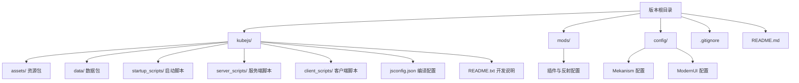
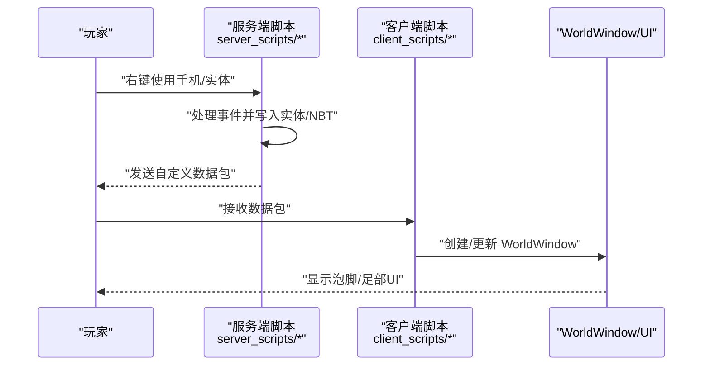
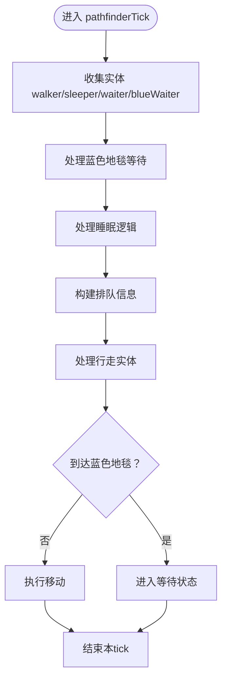
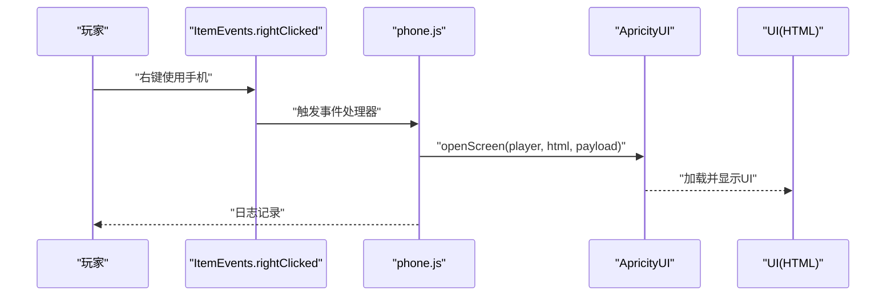
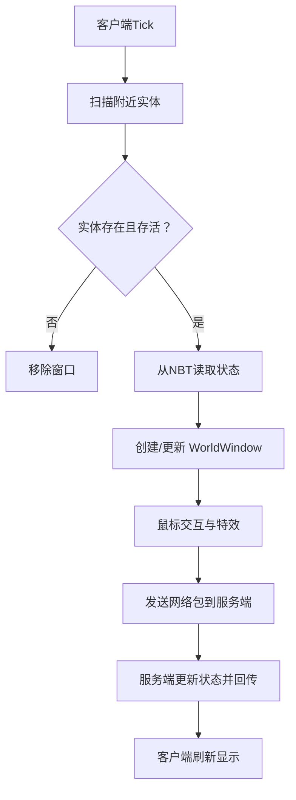
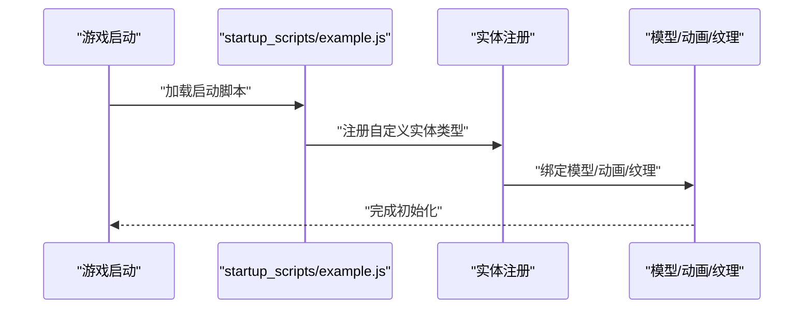
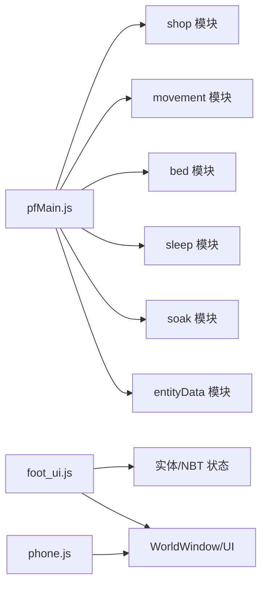

# 开发指南

<cite>
**本文引用的文件**
- [README.md](file://README.md)
- [kubejs/README.txt](file://kubejs/README.txt)
- [kubejs/jsconfig.json](file://kubejs/jsconfig.json)
- [kubejs/startup_scripts/example.js](file://kubejs/startup_scripts/example.js)
- [kubejs/server_scripts/example.js](file://kubejs/server_scripts/example.js)
- [kubejs/server_scripts/phone.js](file://kubejs/server_scripts/phone.js)
- [kubejs/client_scripts/ui/foot_ui.js](file://kubejs/client_scripts/ui/foot_ui.js)
- [kubejs/server_scripts/pathfinder/pfMain.js](file://kubejs/server_scripts/pathfinder/pfMain.js)
- [config/Mekanism/common.toml](file://config/Mekanism/common.toml)
- [config/ModernUI/common.toml](file://config/ModernUI/common.toml)
</cite>

## 目录
1. [简介](#简介)
2. [项目结构](#项目结构)
3. [核心组件](#核心组件)
4. [架构总览](#架构总览)
5. [详细组件分析](#详细组件分析)
6. [依赖关系分析](#依赖关系分析)
7. [性能考量](#性能考量)
8. [故障排查指南](#故障排查指南)
9. [结论](#结论)
10. [附录](#附录)

## 简介
本开发指南面向希望参与本 Minecraft 版本（基于 KubeJS 的模组与资源包）开发的贡献者，覆盖从环境准备、调试工具使用、代码组织规范到功能扩展、版本控制与发布流程的全流程。文档结合仓库中的实际脚本与配置，帮助你快速理解项目结构、掌握开发模式，并建立一致的质量与安全标准。

## 项目结构
该版本以 KubeJS 为核心，配合 Forge 1.20.1 运行时，通过资源包与数据包形式扩展内容；同时包含若干服务端/客户端脚本、默认配置以及第三方模组配置。下图展示与开发相关的核心目录与职责：

图表来源
- [kubejs/README.txt:1-15](file://kubejs/README.txt#L1-L15)
- [kubejs/jsconfig.json:1-16](file://kubejs/jsconfig.json#L1-L16)
- [config/Mekanism/common.toml:1-13](file://config/Mekanism/common.toml#L1-L13)
- [config/ModernUI/common.toml:1-16](file://config/ModernUI/common.toml#L1-L16)

章节来源
- [kubejs/README.txt:1-15](file://kubejs/README.txt#L1-L15)
- [kubejs/jsconfig.json:1-16](file://kubejs/jsconfig.json#L1-L16)
- [README.md:1-6](file://README.md#L1-L6)

## 核心组件
- KubeJS 脚本体系
  - 启动脚本：仅在游戏启动阶段加载，适合注册实体、方块、物品等一次性内容。
  - 服务端脚本：每次服务器资源重载时加载，适合配方、标签、战利品表与事件处理。
  - 客户端脚本：每次客户端资源重载时加载，适合 JEI 事件、提示与 UI。
- 配置与默认设置
  - Mekanism 通用配置：能量单位、温度单位、衰变计时器等。
  - ModernUI 开发者配置：开发者模式开关、自动关机策略等。
- UI 与交互
  - 通过 ApricityUI 提供的 WorldWindow 机制在世界中渲染 HTML/UI，实现与实体状态联动的可视化界面。

章节来源
- [kubejs/README.txt:8-13](file://kubejs/README.txt#L8-L13)
- [config/Mekanism/common.toml:1-13](file://config/Mekanism/common.toml#L1-L13)
- [config/ModernUI/common.toml:1-16](file://config/ModernUI/common.toml#L1-L16)

## 架构总览
下图展示了从玩家交互到服务端逻辑再到客户端 UI 的典型流程，体现服务端驱动、客户端渲染与网络数据同步的协作关系。

图表来源
- [kubejs/server_scripts/phone.js:1-24](file://kubejs/server_scripts/phone.js#L1-L24)
- [kubejs/server_scripts/example.js:1-24](file://kubejs/server_scripts/example.js#L1-L24)
- [kubejs/client_scripts/ui/foot_ui.js:1-800](file://kubejs/client_scripts/ui/foot_ui.js#L1-L800)

## 详细组件分析

### 组件A：寻路系统主循环（pfMain）
- 职责
  - 每 tick 驱动寻路系统，整合商店、移动、睡眠、泡脚等子模块，维护实体状态机与队列。
- 关键流程
  - 蓝色地毯等待 → 上床睡眠 → 泡脚倒计时 → 行走与路径推进 → 到达蓝色地毯进入等待。
- 并发与幂等
  - 使用 lastTick 防重复处理，确保单 tick 内不重复计算。
- 依赖模块
  - shop、movement、bed、sleep、entityData、soak 等模块通过全局对象调用。

图表来源
- [kubejs/server_scripts/pathfinder/pfMain.js:1-177](file://kubejs/server_scripts/pathfinder/pfMain.js#L1-L177)

章节来源
- [kubejs/server_scripts/pathfinder/pfMain.js:1-177](file://kubejs/server_scripts/pathfinder/pfMain.js#L1-L177)

### 组件B：手机交互与 UI 打开（phone）
- 职责
  - 监听右键事件，打开 ApricityUI 的 Screen 类型 UI，并同步手机设置。
- 关键点
  - 通过 Java 加载类调用 openScreen，确保与 UI 模块对接。
  - 日志输出便于调试。

图表来源
- [kubejs/server_scripts/phone.js:1-24](file://kubejs/server_scripts/phone.js#L1-L24)

章节来源
- [kubejs/server_scripts/phone.js:1-24](file://kubejs/server_scripts/phone.js#L1-L24)

### 组件C：足部 UI（foot_ui）
- 职责
  - 在世界中为睡眠实体创建 WorldWindow，显示倒计时、需求清单、满意度、步骤与泡脚状态。
  - 处理鼠标拖动、粒子特效与送客按钮交互。
- 数据来源
  - 通过持有物品 NBT 读取实体状态（倒计时、需求、满意度、步骤、泡脚状态等）。
- 客户端 Tick
  - 每 tick 扫描附近实体，动态创建/移除窗口，保持与服务端状态同步。

图表来源
- [kubejs/client_scripts/ui/foot_ui.js:1-800](file://kubejs/client_scripts/ui/foot_ui.js#L1-L800)

章节来源
- [kubejs/client_scripts/ui/foot_ui.js:1-800](file://kubejs/client_scripts/ui/foot_ui.js#L1-L800)

### 组件D：启动脚本示例（example）
- 职责
  - 展示如何注册自定义实体类型，配置模型与动画控制器，绑定纹理与渲染缩放。
- 适用场景
  - 在启动阶段一次性注册实体、模型、动画等资源。

图表来源
- [kubejs/startup_scripts/example.js:1-26](file://kubejs/startup_scripts/example.js#L1-L26)

章节来源
- [kubejs/startup_scripts/example.js:1-26](file://kubejs/startup_scripts/example.js#L1-L26)

### 组件E：服务端事件示例（example）
- 职责
  - 展示如何监听右键事件，打开 UI 或与寻路系统交互。
- 与 UI 的联动
  - 通过发送自定义数据包通知客户端打开特定 UI。

章节来源
- [kubejs/server_scripts/example.js:1-24](file://kubejs/server_scripts/example.js#L1-L24)

## 依赖关系分析
- 模块耦合
  - pfMain 作为主调度，依赖多个子模块（shop/movement/bed/sleep/entityData/soak），呈现高扇入特征。
  - 客户端 foot_ui 依赖服务端同步的数据包与 NBT 字段，形成“服务端驱动、客户端渲染”的弱耦合。
- 外部依赖
  - ApricityUI：提供 WorldWindow 与 openScreen 能力，贯穿 UI 打开与渲染。
  - Java 类加载：通过 Java.loadClass 访问 Minecraft/Forge/Mod 的运行时类。
- 配置依赖
  - Mekanism 与 ModernUI 的配置影响游戏体验与开发者调试能力。

图表来源
- [kubejs/server_scripts/pathfinder/pfMain.js:1-177](file://kubejs/server_scripts/pathfinder/pfMain.js#L1-L177)
- [kubejs/client_scripts/ui/foot_ui.js:1-800](file://kubejs/client_scripts/ui/foot_ui.js#L1-L800)
- [kubejs/server_scripts/phone.js:1-24](file://kubejs/server_scripts/phone.js#L1-L24)

章节来源
- [kubejs/server_scripts/pathfinder/pfMain.js:1-177](file://kubejs/server_scripts/pathfinder/pfMain.js#L1-L177)
- [kubejs/client_scripts/ui/foot_ui.js:1-800](file://kubejs/client_scripts/ui/foot_ui.js#L1-L800)
- [kubejs/server_scripts/phone.js:1-24](file://kubejs/server_scripts/phone.js#L1-L24)

## 性能考量
- tick 级调度
  - 寻路系统在每 tick 内进行多次实体扫描与状态判断，应避免重复计算与冗余操作；已采用 lastTick 防重复处理，建议继续沿用。
- 客户端渲染
  - WorldWindow 的创建/销毁与 DOM 更新需谨慎，尽量批量更新与延迟渲染，减少主线程压力。
- 网络数据
  - 通过 NBT 与自定义数据包传递状态，建议合并更新频率，避免高频小包导致网络抖动。
- 资源加载
  - 模型与纹理数量较多时，注意资源包压缩与按需加载，降低启动与运行时内存占用。

## 故障排查指南
- 环境与安装
  - 确认使用 1.20.1 客户端与最新 Forge；版本根目录拉取仓库后正常启动游戏并创建存档。
- 脚本重载
  - 服务端脚本通过重载命令生效；客户端脚本通过快捷键触发重载；启动脚本重载可能不生效，需重启游戏。
- 日志定位
  - KubeJS 类型日志位于日志目录对应子目录，有助于定位事件处理与 UI 渲染问题。
- 配置检查
  - 若出现能量单位或温度单位显示异常，检查通用配置项；若 UI 自动关机策略影响测试，调整相应配置。
- 常见问题
  - UI 不显示：确认 WorldWindow 参数（HTML 路径、尺寸、最大距离）正确，且服务端已发送数据包。
  - 状态不同步：检查 NBT 字段命名与读取逻辑，确保客户端与服务端一致。

章节来源
- [README.md:1-6](file://README.md#L1-L6)
- [kubejs/README.txt:8-15](file://kubejs/README.txt#L8-L15)
- [config/Mekanism/common.toml:1-13](file://config/Mekanism/common.toml#L1-L13)
- [config/ModernUI/common.toml:1-16](file://config/ModernUI/common.toml#L1-L16)

## 结论
本指南围绕 KubeJS 脚本体系、UI 渲染与服务端驱动的交互模式，提供了从环境搭建到功能扩展、从性能优化到故障排查的完整开发指引。遵循本文的组织规范与最佳实践，可显著提升开发效率与代码质量，并为后续版本迭代与发布奠定基础。

## 附录

### 开发环境与工具
- 安装与启动
  - 使用 1.20.1 客户端与最新 Forge；在版本根目录拉取仓库后启动游戏并创建存档。
- 调试与日志
  - 使用重载命令与快捷键触发脚本重载；关注 KubeJS 日志目录下的分类日志。
- 代码组织
  - 启动脚本用于一次性注册；服务端脚本用于事件与数据；客户端脚本用于 UI 与交互。
- 配置管理
  - 通用配置项位于 config 目录，按模组分别管理。

章节来源
- [README.md:1-6](file://README.md#L1-L6)
- [kubejs/README.txt:8-15](file://kubejs/README.txt#L8-L15)
- [kubejs/jsconfig.json:1-16](file://kubejs/jsconfig.json#L1-L16)
- [config/Mekanism/common.toml:1-13](file://config/Mekanism/common.toml#L1-L13)
- [config/ModernUI/common.toml:1-16](file://config/ModernUI/common.toml#L1-L16)