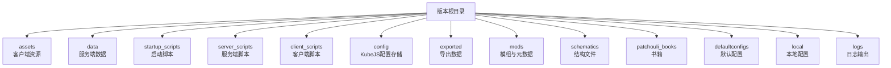
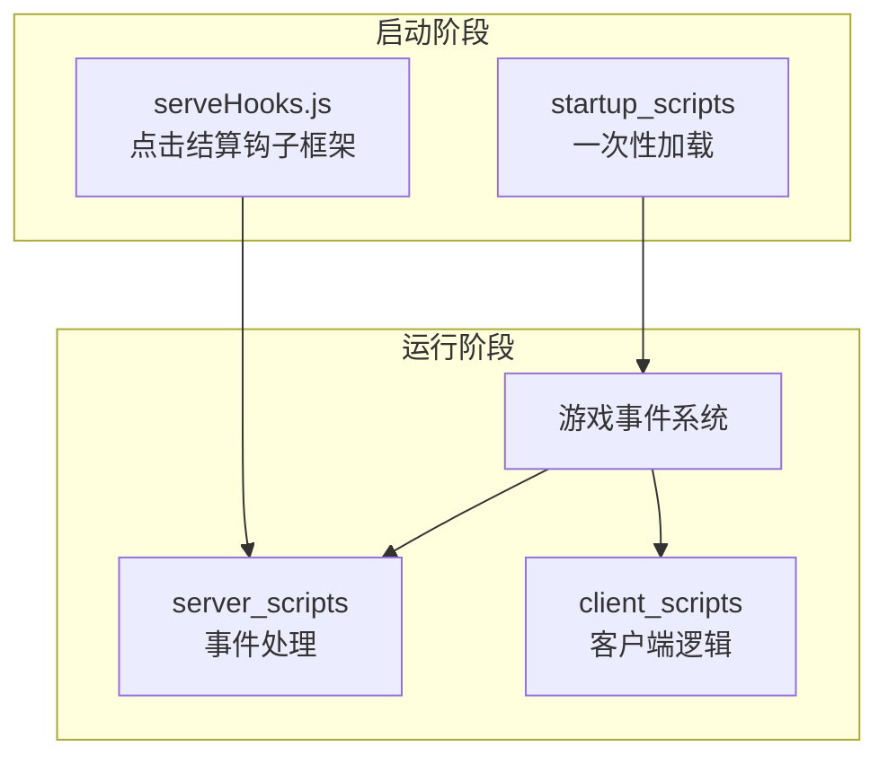
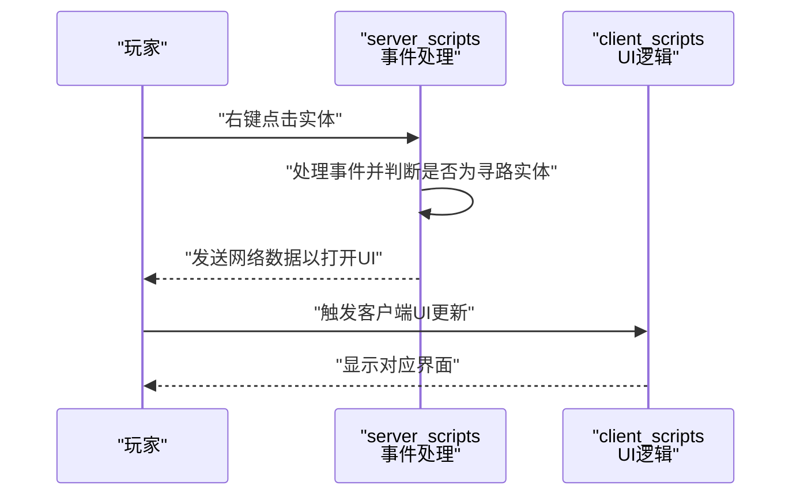
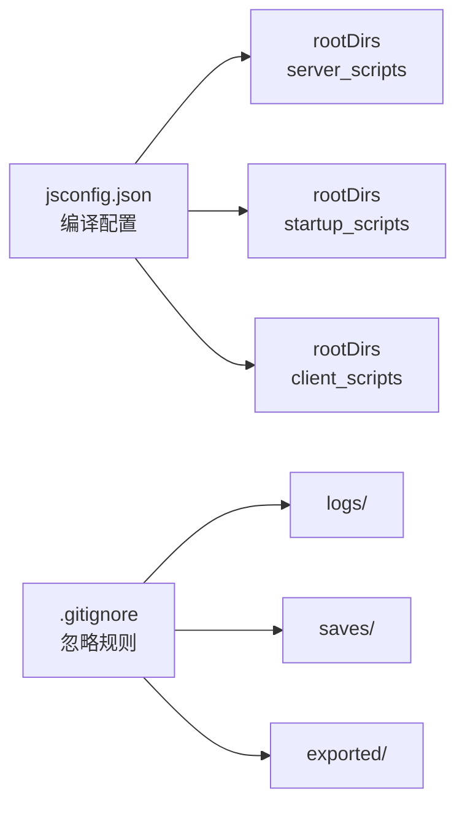

# 开发流程规范

<cite>
**本文引用的文件**
- [README.md](file://README.md)
- [kubejs/README.txt](file://kubejs/README.txt)
- [kubejs/jsconfig.json](file://kubejs/jsconfig.json)
- [.gitignore](file://.gitignore)
- [kubejs/startup_scripts/example.js](file://kubejs/startup_scripts/example.js)
- [kubejs/server_scripts/example.js](file://kubejs/server_scripts/example.js)
- [kubejs/startup_scripts/serveHooks.js](file://kubejs/startup_scripts/serveHooks.js)
</cite>

## 目录
1. [引言](#引言)
2. [项目结构](#项目结构)
3. [核心组件](#核心组件)
4. [架构总览](#架构总览)
5. [详细组件分析](#详细组件分析)
6. [依赖关系分析](#依赖关系分析)
7. [性能考虑](#性能考虑)
8. [故障排查指南](#故障排查指南)
9. [结论](#结论)
10. [附录](#附录)

## 引言
本规范面向使用 KubeJS 的 Minecraft 1.20.1 项目，覆盖从需求分析到代码发布的完整开发流程。内容包括代码组织结构与命名约定、文件管理规范、三类脚本（startup、server、client）的开发模式与加载机制、版本控制策略与分支管理、代码审查标准、测试流程以及发布管理规范。目标是帮助团队建立一致、可维护且可扩展的开发实践。

## 项目结构
该版本根目录即为 KubeJS 工程所在位置，包含资源与数据包目录、KubeJS 脚本目录、默认配置与本地配置、以及版本元数据等。KubeJS 核心目录结构如下：
- assets：客户端资源（纹理、模型、声音等），作为资源包使用
- data：服务端数据（配方、战利品表、函数等），作为数据包使用
- startup_scripts：启动阶段一次性加载的脚本，用于注册实体、物品等仅能在启动时进行的操作
- server_scripts：每次服务器重载时加载的脚本，用于修改配方、标签、处理事件等
- client_scripts：每次客户端重载时加载的脚本，用于 JEI 事件、提示信息等客户端逻辑
- config：KubeJS 配置存储，脚本可访问的唯一目录之一（除世界目录外）
- exported：导出的数据转储（如纹理图集）

图表来源
- [kubejs/README.txt:3-14](file://kubejs/README.txt#L3-L14)

章节来源
- [kubejs/README.txt:3-14](file://kubejs/README.txt#L3-L14)
- [README.md:1-6](file://README.md#L1-L6)

## 核心组件
- 启动脚本（startup_scripts）
  - 加载时机：游戏启动阶段一次性加载
  - 用途：注册实体、物品、标签等只能在启动时进行的操作
  - 重载方式：/kubejs reload_startup_scripts（可能不生效）
- 服务端脚本（server_scripts）
  - 加载时机：每次服务器重载时加载
  - 用途：修改配方、标签、战利品表，处理服务器事件
  - 重载方式：/reload
- 客户端脚本（client_scripts）
  - 加载时机：每次客户端资源重载时加载
  - 用途：JEI 事件、提示信息、HUD 等客户端逻辑
  - 重载方式：F3+T
- 配置与导出
  - config：KubeJS 配置存储，脚本可访问
  - exported：数据转储产物

章节来源
- [kubejs/README.txt:8-14](file://kubejs/README.txt#L8-L14)

## 架构总览
下图展示了 KubeJS 三类脚本在生命周期中的加载与交互关系，以及与游戏事件系统的对接。

图表来源
- [kubejs/startup_scripts/example.js:1-26](file://kubejs/startup_scripts/example.js#L1-L26)
- [kubejs/server_scripts/example.js:1-24](file://kubejs/server_scripts/example.js#L1-L24)
- [kubejs/startup_scripts/serveHooks.js:1-31](file://kubejs/startup_scripts/serveHooks.js#L1-L31)

## 详细组件分析

### 启动脚本（startup_scripts）开发模式
- 设计原则
  - 仅在启动阶段执行一次，避免重复注册
  - 使用事件注册器完成实体、物品、标签等的初始化
  - 将复杂逻辑拆分为模块化文件，便于维护
- 示例参考
  - 实体注册与模型绑定：[kubejs/startup_scripts/example.js:1-26](file://kubejs/startup_scripts/example.js#L1-L26)
- 加载机制
  - 一次性加载，适合注册类操作
  - 重载命令：/kubejs reload_startup_scripts（可能不生效）

章节来源
- [kubejs/README.txt:8-10](file://kubejs/README.txt#L8-L10)
- [kubejs/startup_scripts/example.js:1-26](file://kubejs/startup_scripts/example.js#L1-L26)

### 服务端脚本（server_scripts）开发模式
- 设计原则
  - 基于事件驱动，按需处理服务器生命周期事件
  - 将业务逻辑拆分到独立文件，保持主流程简洁
  - 使用钩子框架实现可插拔的功能扩展
- 示例参考
  - 事件监听与 UI 打开：[kubejs/server_scripts/example.js:1-24](file://kubejs/server_scripts/example.js#L1-L24)
  - 点击结算钩子框架：[kubejs/startup_scripts/serveHooks.js:1-31](file://kubejs/startup_scripts/serveHooks.js#L1-L31)
- 加载机制
  - 每次 /reload 时重新加载
  - 适合处理配方、标签、事件等

章节来源
- [kubejs/README.txt:9-10](file://kubejs/README.txt#L9-L10)
- [kubejs/server_scripts/example.js:1-24](file://kubejs/server_scripts/example.js#L1-L24)
- [kubejs/startup_scripts/serveHooks.js:1-31](file://kubejs/startup_scripts/serveHooks.js#L1-L31)

### 客户端脚本（client_scripts）开发模式
- 设计原则
  - 专注于客户端体验，如 JEI 事件、提示信息、HUD
  - 与服务端通过网络数据或事件进行解耦交互
- 加载机制
  - 每次 F3+T 重载客户端资源时加载
  - 适合 UI、渲染、输入响应等逻辑

章节来源
- [kubejs/README.txt:10-10](file://kubejs/README.txt#L10-L10)

### 代码组织结构与命名约定
- 目录与职责
  - assets：客户端资源，按功能域分层（如 textures、sounds、models）
  - data：服务端数据，按功能域分层（如 loot_tables、recipes、tags）
  - startup_scripts：启动期注册类逻辑
  - server_scripts：事件驱动的服务端逻辑
  - client_scripts：客户端 UI/提示等逻辑
- 命名约定
  - 功能域命名：按模块划分（如 pathfinder、backpack、auratip 等）
  - 文件命名：采用语义化小写加下划线（如 pfMain.js、oil.js、phone_ui.js）
  - 事件回调：使用清晰的函数名描述触发条件与行为（如 rightClickedEntity）
- 文件管理
  - 仅在允许的目录内进行脚本与配置访问
  - 导出产物统一存放至 exported 目录

章节来源
- [kubejs/README.txt:3-14](file://kubejs/README.txt#L3-L14)

### 代码加载序列（示例：点击事件到 UI 打开）

图表来源
- [kubejs/server_scripts/example.js:1-24](file://kubejs/server_scripts/example.js#L1-L24)

## 依赖关系分析
- 目录结构与编译配置
  - jsconfig.json 指定 ES2015 目标与 rootDirs，确保三类脚本目录被纳入编译范围
- 忽略项
  - .gitignore 中排除了 IDE、日志、存档、导出产物等，避免污染版本库

图表来源
- [kubejs/jsconfig.json:7-13](file://kubejs/jsconfig.json#L7-L13)
- [.gitignore:1-43](file://.gitignore#L1-L43)

章节来源
- [kubejs/jsconfig.json:1-16](file://kubejs/jsconfig.json#L1-L16)
- [.gitignore:1-43](file://.gitignore#L1-L43)

## 性能考虑
- 启动脚本尽量轻量，避免阻塞启动流程
- 服务端脚本按需加载，减少不必要的全局状态
- 客户端脚本避免频繁重绘与高频事件处理
- 使用钩子框架将次要逻辑从主流程剥离，降低耦合度

## 故障排查指南
- 启动脚本重载无效
  - 现象：执行 /kubejs reload_startup_scripts 后未生效
  - 处理：确认脚本是否属于启动期注册类，必要时重启游戏验证
- 服务端脚本未生效
  - 现象：修改后执行 /reload 无变化
  - 处理：检查事件监听是否正确、模块是否被正确引入、是否存在语法错误
- 客户端脚本未生效
  - 现象：修改后按 F3+T 未更新
  - 处理：确认客户端资源已重载、UI 逻辑是否依赖网络数据或事件
- 日志定位
  - KubeJS 类型日志位于 logs/kubejs/ 目录，按类型区分

章节来源
- [kubejs/README.txt:15-15](file://kubejs/README.txt#L15-L15)

## 结论
本规范基于现有项目结构与脚本实践，明确了 KubeJS 三类脚本的职责边界、加载机制与开发模式，并提供了版本控制、审查、测试与发布的流程建议。建议团队在后续迭代中持续完善模块化与文档化，确保代码质量与可维护性。

## 附录

### 版本控制策略与分支管理
- 分支策略
  - main：稳定发布分支
  - develop：集成开发分支
  - feature/*：功能开发分支，完成后合并至 develop
  - hotfix/*：紧急修复分支，完成后同时合并至 main 与 develop
- 提交规范
  - 标准格式：type(scope): subject
  - 常见类型：feat、fix、docs、style、refactor、test、chore
- 合并与审查
  - Pull Request 必须通过至少一名维护者审查
  - 合并前确保通过自动化测试与本地验证

### 代码审查标准
- 代码风格
  - 统一缩进与换行，注释清晰
  - 函数与变量命名语义明确
- 逻辑健壮性
  - 边界条件与异常路径覆盖
  - 避免全局状态滥用
- 性能与安全
  - 避免阻塞主线程
  - 不在客户端脚本中进行敏感操作

### 测试流程
- 单元与集成测试
  - 对关键事件处理器与工具函数编写测试用例
- 回归测试
  - 每次重大改动后进行全量功能回归
- 环境一致性
  - 使用相同的 Forge/KubeJS 版本与依赖版本

### 发布管理规范
- 标签与版本
  - 使用语义化版本号（如 v1.2.3）
  - 发布前生成变更日志
- 发布渠道
  - 通过版本根目录打包发布物
  - 保留 exported 与必要的配置文件