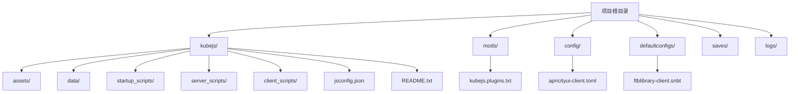
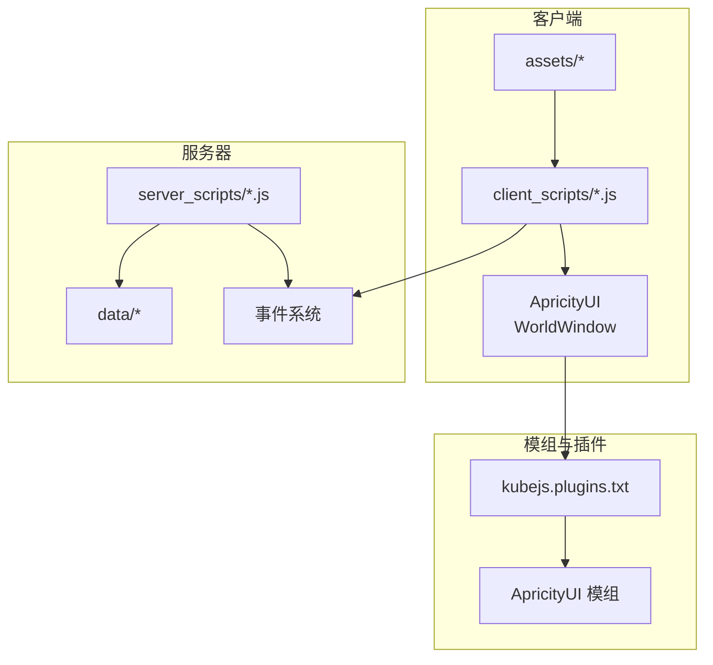
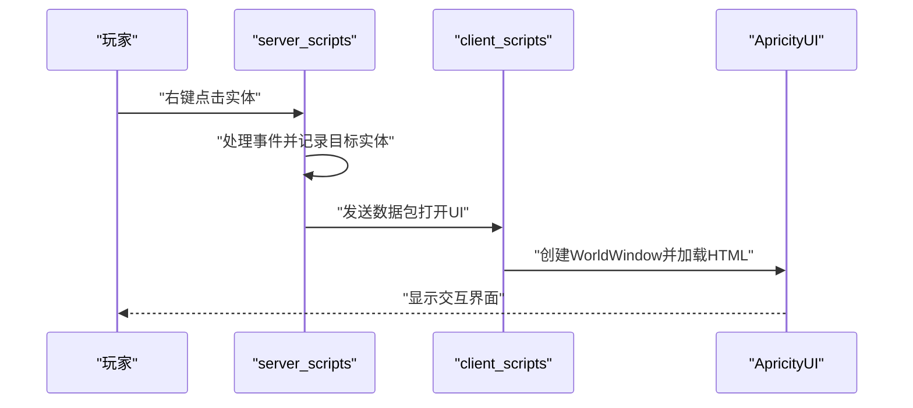
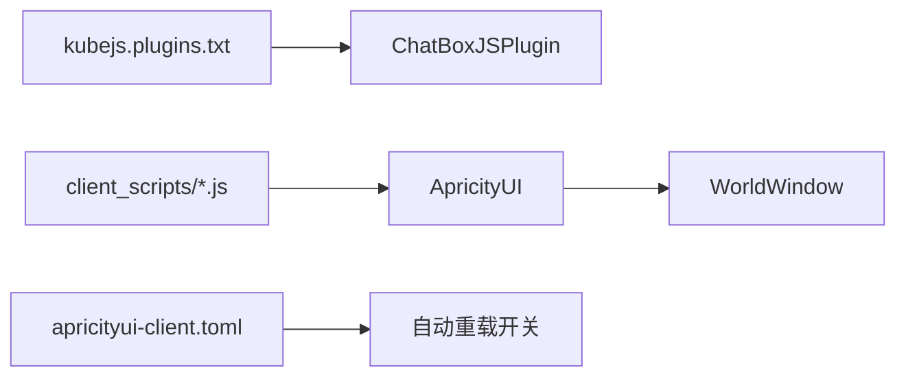

# 开发环境搭建

<cite>
**本文引用的文件**
- [README.md](file://README.md)
- [kubejs/README.txt](file://kubejs/README.txt)
- [kubejs/jsconfig.json](file://kubejs/jsconfig.json)
- [kubejs/startup_scripts/example.js](file://kubejs/startup_scripts/example.js)
- [kubejs/server_scripts/example.js](file://kubejs/server_scripts/example.js)
- [kubejs/client_scripts/ui/foot_ui.js](file://kubejs/client_scripts/ui/foot_ui.js)
- [kubejs/assets/kubejs/lang/zh_cn.json](file://kubejs/assets/kubejs/lang/zh_cn.json)
- [kubejs/assets/kubejs/sounds.json](file://kubejs/assets/kubejs/sounds.json)
- [mods/kubejs.plugins.txt](file://mods/kubejs.plugins.txt)
- [config/apricityui-client.toml](file://config/apricityui-client.toml)
- [defaultconfigs/ftblibrary/ftblibrary-client.snbt](file://defaultconfigs/ftblibrary/ftblibrary-client.snbt)
</cite>

## 目录
1. [简介](#简介)
2. [项目结构](#项目结构)
3. [核心组件](#核心组件)
4. [架构概览](#架构概览)
5. [详细组件分析](#详细组件分析)
6. [依赖分析](#依赖分析)
7. [性能考虑](#性能考虑)
8. [故障排除指南](#故障排除指南)
9. [结论](#结论)
10. [附录](#附录)

## 简介
本指南面向KubeJS开发者，帮助您快速搭建并验证开发环境。内容涵盖安装要求、IDE配置、调试工具设置、项目目录结构理解、开发工具链配置、调试环境设置以及常见问题排查。该仓库已包含完整的KubeJS项目结构与示例脚本，可直接在此基础上进行二次开发。

## 项目结构
仓库采用标准的KubeJS项目布局，核心目录包括：
- kubejs/assets：资源包目录，放置客户端资源（纹理、模型、声音、语言文件等）
- kubejs/data：数据包目录，放置服务端数据（配方、战利品表、标签等）
- kubejs/startup_scripts：启动脚本，仅在游戏启动时加载一次
- kubejs/server_scripts：服务器脚本，每次数据重载时执行
- kubejs/client_scripts：客户端脚本，每次客户端资源重载时执行
- kubejs/jsconfig.json：TypeScript/JavaScript编译配置，定义源码根目录
- kubejs/README.txt：KubeJS目录用途说明
- mods/kubejs.plugins.txt：插件声明文件
- config/*：各类模组配置文件
- defaultconfigs/*：默认配置模板
- README.md：安装说明

图表来源
- [kubejs/README.txt:3-15](file://kubejs/README.txt#L3-L15)
- [kubejs/jsconfig.json:1-16](file://kubejs/jsconfig.json#L1-L16)
- [mods/kubejs.plugins.txt:1-1](file://mods/kubejs.plugins.txt#L1-L1)
- [config/apricityui-client.toml:1-8](file://config/apricityui-client.toml#L1-L8)
- [defaultconfigs/ftblibrary/ftblibrary-client.snbt:1-5](file://defaultconfigs/ftblibrary/ftblibrary-client.snbt#L1-L5)

章节来源
- [kubejs/README.txt:3-15](file://kubejs/README.txt#L3-L15)
- [kubejs/jsconfig.json:1-16](file://kubejs/jsconfig.json#L1-L16)
- [README.md:1-6](file://README.md#L1-L6)

## 核心组件
- 启动脚本（startup_scripts）：用于注册实体、物品等只能在启动阶段完成的操作，支持重载命令但可能不完全生效
- 服务器脚本（server_scripts）：处理配方、标签、战利品表及服务器事件，支持/reload重载
- 客户端脚本（client_scripts）：处理JEI事件、提示信息与客户端UI逻辑，支持F3+T重载
- 资源（assets）：作为资源包，放置纹理、模型、声音与语言文件
- 数据（data）：作为数据包，放置配方、战利品表、标签等数据文件
- 配置（config/defaultconfigs）：模组默认配置与本地覆盖配置

章节来源
- [kubejs/README.txt:8-10](file://kubejs/README.txt#L8-L10)
- [kubejs/jsconfig.json:7-13](file://kubejs/jsconfig.json#L7-L13)

## 架构概览
下图展示了KubeJS脚本在客户端与服务器之间的交互关系，以及与模组插件的集成：

图表来源
- [kubejs/client_scripts/ui/foot_ui.js:1-50](file://kubejs/client_scripts/ui/foot_ui.js#L1-L50)
- [kubejs/server_scripts/example.js:1-24](file://kubejs/server_scripts/example.js#L1-L24)
- [mods/kubejs.plugins.txt:1-1](file://mods/kubejs.plugins.txt#L1-L1)
- [config/apricityui-client.toml:1-8](file://config/apricityui-client.toml#L1-L8)

## 详细组件分析

### 目录结构详解与使用方法
- assets：客户端资源目录，如纹理、模型、声音与语言文件。示例：语言文件与声音定义
- data：服务端数据目录，如配方、标签、战利品表等
- startup_scripts：启动阶段一次性加载，适合注册实体、物品等
- server_scripts：每次数据重载时执行，适合修改配方、标签、处理事件
- client_scripts：每次客户端资源重载时执行，适合UI、提示与客户端逻辑
- jsconfig.json：定义源码根目录与编译目标，确保IDE正确识别脚本路径
- README.txt：KubeJS目录用途说明与日志位置

章节来源
- [kubejs/README.txt:5-15](file://kubejs/README.txt#L5-L15)
- [kubejs/jsconfig.json:7-13](file://kubejs/jsconfig.json#L7-L13)

### 示例脚本分析
- 启动脚本示例：展示如何注册自定义实体类型与模型资源
- 服务器脚本示例：展示右键事件处理与UI打开逻辑
- 客户端脚本示例：展示UI窗口创建、事件绑定与数据同步

图表来源
- [kubejs/server_scripts/example.js:1-24](file://kubejs/server_scripts/example.js#L1-L24)
- [kubejs/client_scripts/ui/foot_ui.js:1-50](file://kubejs/client_scripts/ui/foot_ui.js#L1-L50)

章节来源
- [kubejs/startup_scripts/example.js:1-26](file://kubejs/startup_scripts/example.js#L1-L26)
- [kubejs/server_scripts/example.js:1-24](file://kubejs/server_scripts/example.js#L1-L24)
- [kubejs/client_scripts/ui/foot_ui.js:1-100](file://kubejs/client_scripts/ui/foot_ui.js#L1-L100)

### 资源与数据文件
- 语言文件：用于多语言支持，示例中包含属性名称的中文映射
- 声音定义：定义声音事件与资源映射

章节来源
- [kubejs/assets/kubejs/lang/zh_cn.json:1-15](file://kubejs/assets/kubejs/lang/zh_cn.json#L1-L15)
- [kubejs/assets/kubejs/sounds.json:1-5](file://kubejs/assets/kubejs/sounds.json#L1-L5)

## 依赖分析
- 插件依赖：kubejs.plugins.txt声明了ChatBoxJSPlugin插件
- UI依赖：client_scripts依赖ApricityUI模组提供的WorldWindow与文档对象
- 配置依赖：apricityui-client.toml控制开发模式下的自动重载与截图功能

图表来源
- [mods/kubejs.plugins.txt:1-1](file://mods/kubejs.plugins.txt#L1-L1)
- [kubejs/client_scripts/ui/foot_ui.js:1-20](file://kubejs/client_scripts/ui/foot_ui.js#L1-L20)
- [config/apricityui-client.toml:1-8](file://config/apricityui-client.toml#L1-L8)

章节来源
- [mods/kubejs.plugins.txt:1-1](file://mods/kubejs.plugins.txt#L1-L1)
- [config/apricityui-client.toml:1-8](file://config/apricityui-client.toml#L1-L8)

## 性能考虑
- 启动脚本仅在启动时运行，避免重复初始化
- 服务器脚本与客户端脚本按需重载，减少不必要的重启
- 使用事件驱动而非轮询，降低CPU占用
- 合理使用缓存与延迟加载，优化UI渲染性能

## 故障排除指南
- 安装与启动
  - 确认已下载1.20.1客户端并安装最新Forge
  - 在版本根目录拉取仓库后，启动游戏并创建存档
- 目录与权限
  - 确保kubejs目录存在且具有读写权限
  - 检查jsconfig.json中的rootDirs是否包含所有脚本目录
- 脚本重载
  - 启动脚本重载：使用/kubejs reload_startup_scripts（可能不完全生效）
  - 服务器脚本重载：使用/reload
  - 客户端脚本重载：使用F3+T
- UI与插件
  - 若UI不显示，检查apricityui-client.toml中的autoReload设置
  - 确认kubejs.plugins.txt中声明的插件已正确加载
- 日志定位
  - 查看logs/kubejs/目录下的类型特定日志以定位问题

章节来源
- [README.md:1-6](file://README.md#L1-L6)
- [kubejs/README.txt:12-15](file://kubejs/README.txt#L12-L15)
- [kubejs/jsconfig.json:7-13](file://kubejs/jsconfig.json#L7-L13)
- [config/apricityui-client.toml:1-8](file://config/apricityui-client.toml#L1-L8)

## 结论
通过本指南，您可以基于现有仓库快速搭建KubeJS开发环境，理解项目目录结构与脚本职责，并掌握调试与重载流程。建议在开发过程中遵循事件驱动与最小化重载的原则，结合日志与配置文件进行问题定位，逐步完善UI与业务逻辑。

## 附录
- 快速验证清单
  - 游戏版本与Forge版本匹配
  - kubejs目录结构完整
  - jsconfig.json配置正确
  - 插件声明与模组配置无误
  - 重载命令可用且日志正常输出