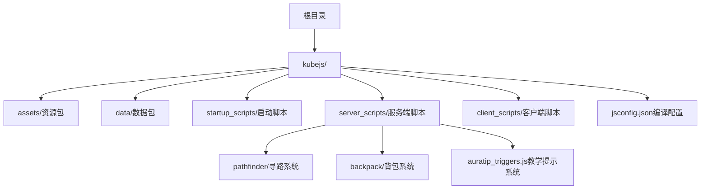
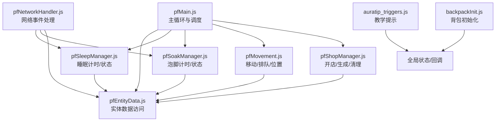
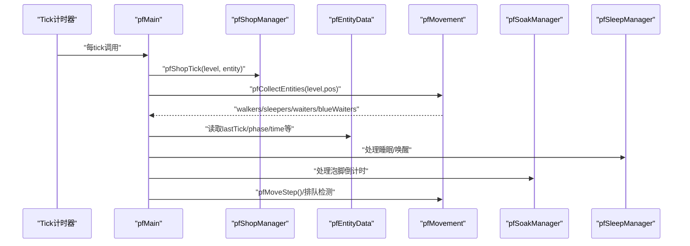
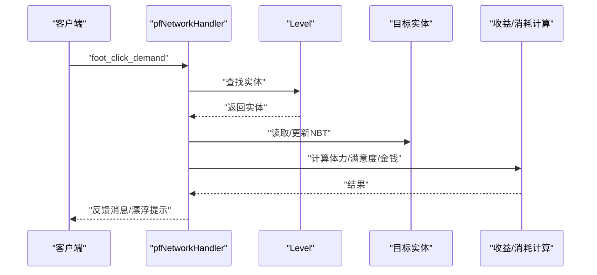
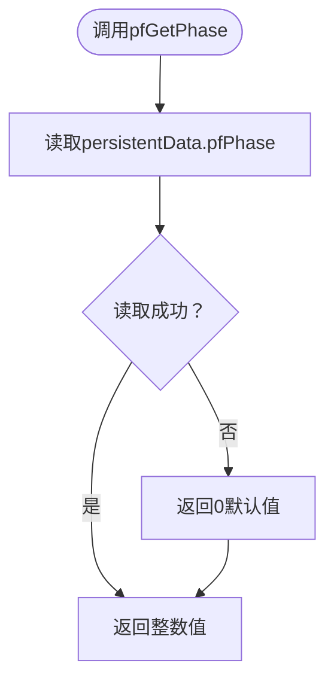
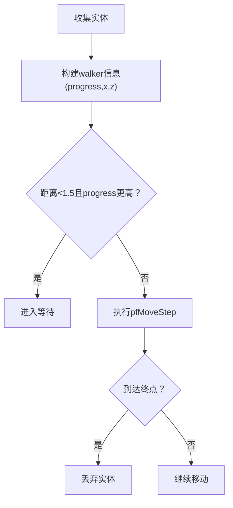
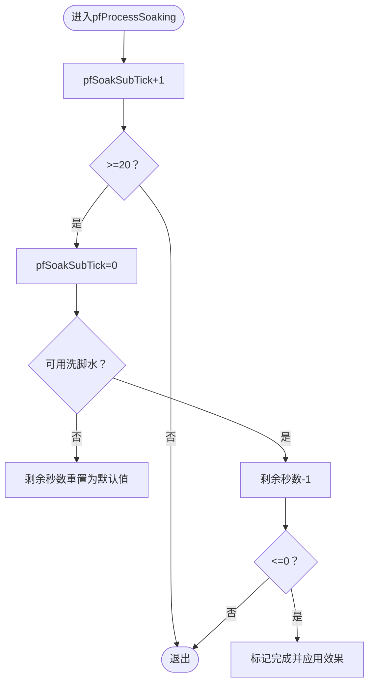
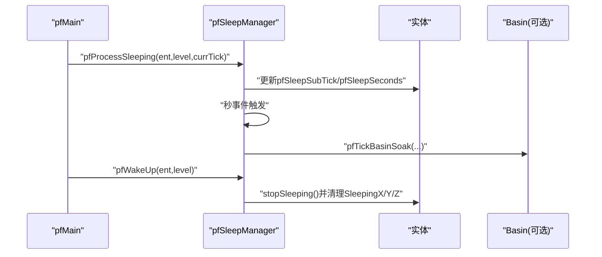
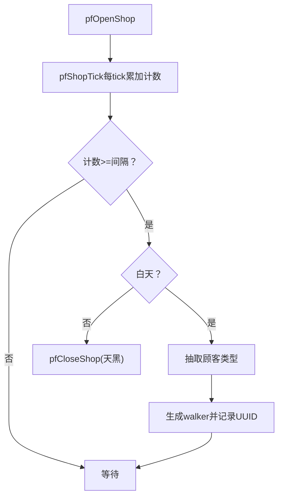
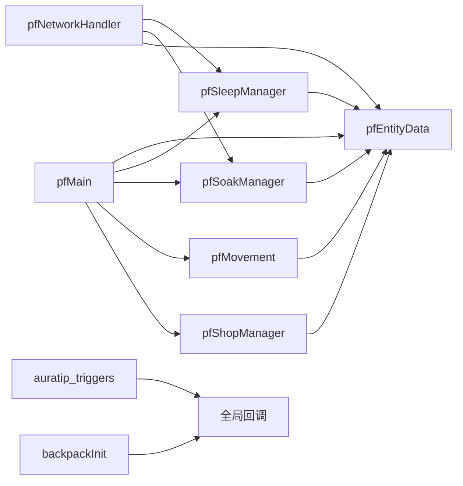

# 最佳实践指南

<cite>
**本文引用的文件**
- [README.md](file://README.md)
- [kubejs/README.txt](file://kubejs/README.txt)
- [kubejs/jsconfig.json](file://kubejs/jsconfig.json)
- [kubejs/server_scripts/pathfinder/pfMain.js](file://kubejs/server_scripts/pathfinder/pfMain.js)
- [kubejs/server_scripts/pathfinder/pfConstants.js](file://kubejs/server_scripts/pathfinder/pfConstants.js)
- [kubejs/server_scripts/pathfinder/pfNetworkHandler.js](file://kubejs/server_scripts/pathfinder/pfNetworkHandler.js)
- [kubejs/server_scripts/pathfinder/pfEntityData.js](file://kubejs/server_scripts/pathfinder/pfEntityData.js)
- [kubejs/server_scripts/pathfinder/pfMovement.js](file://kubejs/server_scripts/pathfinder/pfMovement.js)
- [kubejs/server_scripts/pathfinder/pfSoakManager.js](file://kubejs/server_scripts/pathfinder/pfSoakManager.js)
- [kubejs/server_scripts/pathfinder/pfSleepManager.js](file://kubejs/server_scripts/pathfinder/pfSleepManager.js)
- [kubejs/server_scripts/pathfinder/pfShopManager.js](file://kubejs/server_scripts/pathfinder/pfShopManager.js)
- [kubejs/server_scripts/backpack/backpackInit.js](file://kubejs/server_scripts/backpack/backpackInit.js)
- [kubejs/server_scripts/auratip_triggers.js](file://kubejs/server_scripts/auratip_triggers.js)
</cite>

## 目录
1. [简介](#简介)
2. [项目结构](#项目结构)
3. [核心组件](#核心组件)
4. [架构总览](#架构总览)
5. [详细组件分析](#详细组件分析)
6. [依赖分析](#依赖分析)
7. [性能考虑](#性能考虑)
8. [故障排查指南](#故障排查指南)
9. [结论](#结论)
10. [附录](#附录)

## 简介
本指南总结了该项目在KubeJS环境下的开发最佳实践与经验教训，覆盖代码设计模式、性能优化、内存管理、事件系统、数据持久化、错误处理、可维护性与模块化设计、API设计规范、常见反模式与重构策略。内容基于实际代码文件进行提炼，旨在帮助开发者在保持功能正确的同时提升可扩展性与可维护性。

## 项目结构
项目采用KubeJS标准目录组织，结合资源包与数据包能力，将客户端与服务端脚本清晰分离，并通过模块化子目录承载复杂业务逻辑。

图示来源
- [kubejs/README.txt:3-14](file://kubejs/README.txt#L3-L14)
- [kubejs/jsconfig.json:1-16](file://kubejs/jsconfig.json#L1-L16)

章节来源
- [kubejs/README.txt:1-15](file://kubejs/README.txt#L1-L15)
- [kubejs/jsconfig.json:1-16](file://kubejs/jsconfig.json#L1-L16)

## 核心组件
- 寻路主循环与调度：负责每tick整合各子模块，驱动实体状态流转与行为执行。
- 常量与配置：集中管理寻路系统所需的基础常量与映射。
- 网络事件处理：接收客户端交互，校验与更新实体/玩家状态。
- 实体数据层：封装persistentData读写，提供统一的数据访问接口。
- 移动与排队：实体路径追踪、排队检测与位置插值。
- 泡脚管理：基于秒级计时的状态机，支持多种洗脚水类型。
- 睡眠管理：独立的秒驱动睡眠流程，兼容外部唤醒条件。
- 开店管理：以方块实体为载体的持久化状态机，负责顾客生成与清理。
- 背包初始化：首次登录时按矩阵填充Curios槽位，保证体验一致性。
- 教学提示系统：基于阶段化的提示触发与队列化展示。

章节来源
- [kubejs/server_scripts/pathfinder/pfMain.js:1-177](file://kubejs/server_scripts/pathfinder/pfMain.js#L1-L177)
- [kubejs/server_scripts/pathfinder/pfConstants.js:1-65](file://kubejs/server_scripts/pathfinder/pfConstants.js#L1-L65)
- [kubejs/server_scripts/pathfinder/pfNetworkHandler.js:1-317](file://kubejs/server_scripts/pathfinder/pfNetworkHandler.js#L1-L317)
- [kubejs/server_scripts/pathfinder/pfEntityData.js:1-218](file://kubejs/server_scripts/pathfinder/pfEntityData.js#L1-L218)
- [kubejs/server_scripts/pathfinder/pfMovement.js:1-186](file://kubejs/server_scripts/pathfinder/pfMovement.js#L1-L186)
- [kubejs/server_scripts/pathfinder/pfSoakManager.js:1-197](file://kubejs/server_scripts/pathfinder/pfSoakManager.js#L1-L197)
- [kubejs/server_scripts/pathfinder/pfSleepManager.js:1-232](file://kubejs/server_scripts/pathfinder/pfSleepManager.js#L1-L232)
- [kubejs/server_scripts/pathfinder/pfShopManager.js:1-300](file://kubejs/server_scripts/pathfinder/pfShopManager.js#L1-L300)
- [kubejs/server_scripts/backpack/backpackInit.js:1-67](file://kubejs/server_scripts/backpack/backpackInit.js#L1-L67)
- [kubejs/server_scripts/auratip_triggers.js:1-212](file://kubejs/server_scripts/auratip_triggers.js#L1-L212)

## 架构总览
整体采用“主循环 + 模块化子系统”的分层架构。主循环在每tick收集实体并调度各子模块；子模块之间通过全局命名空间共享状态，同时严格区分职责边界，降低耦合。

图示来源
- [kubejs/server_scripts/pathfinder/pfMain.js:11-177](file://kubejs/server_scripts/pathfinder/pfMain.js#L11-L177)
- [kubejs/server_scripts/pathfinder/pfNetworkHandler.js:36-311](file://kubejs/server_scripts/pathfinder/pfNetworkHandler.js#L36-L311)
- [kubejs/server_scripts/pathfinder/pfShopManager.js:237-284](file://kubejs/server_scripts/pathfinder/pfShopManager.js#L237-L284)
- [kubejs/server_scripts/pathfinder/pfMovement.js:1-186](file://kubejs/server_scripts/pathfinder/pfMovement.js#L1-L186)
- [kubejs/server_scripts/pathfinder/pfSoakManager.js:90-145](file://kubejs/server_scripts/pathfinder/pfSoakManager.js#L90-L145)
- [kubejs/server_scripts/pathfinder/pfSleepManager.js:63-128](file://kubejs/server_scripts/pathfinder/pfSleepManager.js#L63-L128)
- [kubejs/server_scripts/backpack/backpackInit.js:29-67](file://kubejs/server_scripts/backpack/backpackInit.js#L29-L67)
- [kubejs/server_scripts/auratip_triggers.js:1-212](file://kubejs/server_scripts/auratip_triggers.js#L1-L212)

## 详细组件分析

### 组件A：主循环与调度（pfMain）
- 设计要点
  - 每tick从触发方块实体读取当前tick，避免依赖server.getTickCount()差值，增强跨重启稳定性。
  - 分阶段处理实体：蓝色地毯等待、躺床中、行走、等待床位等，每个阶段独立处理并防重复执行。
  - 通过全局模块协作完成路径追踪、泡脚、睡眠、排队与移动。
- 性能与内存
  - 使用局部变量缓存实体状态，减少重复查询。
  - 对实体集合进行分类收集，避免重复遍历。
- 错误处理
  - 对回调函数存在性进行检查，防止未就绪导致崩溃。
- 可维护性
  - 逻辑清晰分段，注释明确，便于扩展新阶段。

图示来源
- [kubejs/server_scripts/pathfinder/pfMain.js:11-177](file://kubejs/server_scripts/pathfinder/pfMain.js#L11-L177)
- [kubejs/server_scripts/pathfinder/pfShopManager.js:237-284](file://kubejs/server_scripts/pathfinder/pfShopManager.js#L237-L284)
- [kubejs/server_scripts/pathfinder/pfMovement.js:101-162](file://kubejs/server_scripts/pathfinder/pfMovement.js#L101-L162)
- [kubejs/server_scripts/pathfinder/pfSoakManager.js:90-145](file://kubejs/server_scripts/pathfinder/pfSoakManager.js#L90-L145)
- [kubejs/server_scripts/pathfinder/pfSleepManager.js:63-128](file://kubejs/server_scripts/pathfinder/pfSleepManager.js#L63-L128)

章节来源
- [kubejs/server_scripts/pathfinder/pfMain.js:1-177](file://kubejs/server_scripts/pathfinder/pfMain.js#L1-L177)

### 组件B：网络事件处理（pfNetworkHandler）
- 设计要点
  - 通过NetworkEvents.dataReceived接收客户端指令，解析实体与部位键，更新NBT并计算收益。
  - 支持一键满足与单点满足两种模式，分别统计体力消耗与收益。
  - 对Boss满意度倍率进行应用，增强可扩展性。
- 性能与内存
  - 使用属性值缓存与fallBack机制，避免频繁查询失败带来的开销。
  - 一次性批量计算总消耗与总收益，减少多次读写。
- 错误处理
  - 对实体查找、属性读取、掉落发放等过程进行try/catch保护。
- 可维护性
  - 将事件处理逻辑集中在单一模块，便于扩展新的交互类型。

图示来源
- [kubejs/server_scripts/pathfinder/pfNetworkHandler.js:36-219](file://kubejs/server_scripts/pathfinder/pfNetworkHandler.js#L36-L219)

章节来源
- [kubejs/server_scripts/pathfinder/pfNetworkHandler.js:1-317](file://kubejs/server_scripts/pathfinder/pfNetworkHandler.js#L1-L317)

### 组件C：实体数据层（pfEntityData）
- 设计要点
  - 统一封装persistentData的读写，提供多组getter/setter，避免分散的NBT操作。
  - 区分“实体侧”与“客户端同步”字段，减少不必要的网络传输。
- 性能与内存
  - 字段粒度细，按需读写，避免大块NBT序列化。
- 错误处理
  - getter默认值处理，防止null/undefined导致异常。
- 可维护性
  - 数据访问接口集中，便于替换底层存储或迁移格式。

图示来源
- [kubejs/server_scripts/pathfinder/pfEntityData.js:56-63](file://kubejs/server_scripts/pathfinder/pfEntityData.js#L56-L63)

章节来源
- [kubejs/server_scripts/pathfinder/pfEntityData.js:1-218](file://kubejs/server_scripts/pathfinder/pfEntityData.js#L1-L218)

### 组件D：移动与排队（pfMovement）
- 设计要点
  - 基于路径字符串与进度计数，对实体位置进行格内插值，保证移动平滑。
  - 排队检测依据距离与progress，必要时引入实体ID作为次级排序，确保确定性。
- 性能与内存
  - AABB范围搜索限制在固定半径内，避免全服扫描。
  - 临时数组构建walker信息，处理完立即被GC回收。
- 错误处理
  - 对越界与空路径进行保护，避免异常中断。
- 可维护性
  - 将排队、位置计算与移动解耦，便于独立测试与演进。

图示来源
- [kubejs/server_scripts/pathfinder/pfMovement.js:7-79](file://kubejs/server_scripts/pathfinder/pfMovement.js#L7-L79)
- [kubejs/server_scripts/pathfinder/pfMovement.js:101-162](file://kubejs/server_scripts/pathfinder/pfMovement.js#L101-L162)

章节来源
- [kubejs/server_scripts/pathfinder/pfMovement.js:1-186](file://kubejs/server_scripts/pathfinder/pfMovement.js#L1-L186)

### 组件E：泡脚管理（pfSoakManager）
- 设计要点
  - 完全以“秒”为单位的状态机，避免依赖tick差值，跨重启稳定。
  - 以persistentData维护秒内计数器，每20tick触发一次秒事件。
  - 支持多种洗脚水类型，通过注册表判定可用性并应用效果。
- 性能与内存
  - 仅在秒事件时进行状态更新与副作用触发，降低频率。
  - 水桶类型通过注册表查询，避免硬编码。
- 错误处理
  - 对注册表查询与效果应用进行异常捕获。
- 可维护性
  - 将“倒计时”与“效果应用”解耦，便于扩展新水类型。

图示来源
- [kubejs/server_scripts/pathfinder/pfSoakManager.js:90-145](file://kubejs/server_scripts/pathfinder/pfSoakManager.js#L90-L145)
- [kubejs/server_scripts/pathfinder/pfSoakManager.js:147-186](file://kubejs/server_scripts/pathfinder/pfSoakManager.js#L147-L186)

章节来源
- [kubejs/server_scripts/pathfinder/pfSoakManager.js:1-197](file://kubejs/server_scripts/pathfinder/pfSoakManager.js#L1-L197)

### 组件F：睡眠管理（pfSleepManager）
- 设计要点
  - 独立的秒驱动睡眠流程，前60tick设置睡姿NBT，随后每秒事件同步倒计时与触发周边逻辑。
  - 提供可插拔的唤醒条件接口，增强灵活性。
- 性能与内存
  - 仅在秒事件与起床时进行命令写入/删除，其余tick仅更新计数器。
- 错误处理
  - 对外部回调与周边模块调用进行异常捕获。
- 可维护性
  - 将“设置睡姿”“倒计时同步”“唤醒逻辑”拆分，便于独立演进。

图示来源
- [kubejs/server_scripts/pathfinder/pfSleepManager.js:63-128](file://kubejs/server_scripts/pathfinder/pfSleepManager.js#L63-L128)
- [kubejs/server_scripts/pathfinder/pfSleepManager.js:131-223](file://kubejs/server_scripts/pathfinder/pfSleepManager.js#L131-L223)

章节来源
- [kubejs/server_scripts/pathfinder/pfSleepManager.js:1-232](file://kubejs/server_scripts/pathfinder/pfSleepManager.js#L1-L232)

### 组件G：开店管理（pfShopManager）
- 设计要点
  - 以触发方块实体为载体的持久化状态机，所有状态写入BE的persistentData。
  - 每PF_SPAWN_INTERVAL tick判定一次是否生成顾客，支持白天/夜晚自动开关店。
- 性能与内存
  - 仅在计数器满时进行生成判定，降低频率。
  - 关店时仅清理行走中与蓝色地毯等待中的顾客，保留正在服务中的顾客。
- 错误处理
  - 对BE获取、实体清理与玩家消息进行异常捕获。
- 可维护性
  - 将“开店/关店/生成”三者解耦，便于扩展新顾客类型与规则。

图示来源
- [kubejs/server_scripts/pathfinder/pfShopManager.js:237-284](file://kubejs/server_scripts/pathfinder/pfShopManager.js#L237-L284)
- [kubejs/server_scripts/pathfinder/pfShopManager.js:151-170](file://kubejs/server_scripts/pathfinder/pfShopManager.js#L151-L170)
- [kubejs/server_scripts/pathfinder/pfShopManager.js:179-231](file://kubejs/server_scripts/pathfinder/pfShopManager.js#L179-L231)

章节来源
- [kubejs/server_scripts/pathfinder/pfShopManager.js:1-300](file://kubejs/server_scripts/pathfinder/pfShopManager.js#L1-L300)

### 组件H：背包初始化（backpackInit）
- 设计要点
  - 首次登录时按预设矩阵填充Curios槽位，防止重复初始化。
  - 调用全局回调触发属性重算，确保状态一致。
- 性能与内存
  - 仅在首次登录执行，避免重复写入。
- 错误处理
  - 对API调用与异常进行捕获与日志输出。
- 可维护性
  - 矩阵与槽位映射清晰，便于调整布局。

章节来源
- [kubejs/server_scripts/backpack/backpackInit.js:1-67](file://kubejs/server_scripts/backpack/backpackInit.js#L1-L67)

### 组件I：教学提示系统（auratip_triggers）
- 设计要点
  - 基于阶段化触发器，支持延迟队列与关闭/重置命令。
  - 通过TipTriggers进行提示展示，提供调试命令辅助验证。
- 性能与内存
  - pendingShows数组按tick迭代，及时清理无效条目。
- 错误处理
  - 对TipTriggers存在性与参数有效性进行检查。
- 可维护性
  - 触发器ID集中管理，便于扩展新提示链路。

章节来源
- [kubejs/server_scripts/auratip_triggers.js:1-212](file://kubejs/server_scripts/auratip_triggers.js#L1-L212)

## 依赖分析
- 模块间耦合
  - pfMain作为中枢，依赖所有子模块；子模块之间尽量通过pfEntityData与全局回调间接通信，降低直接耦合。
  - pfNetworkHandler与pfShopManager/pfSoakManager/pfSleepManager通过全局状态与回调交互。
- 外部依赖
  - Curios API用于背包槽位管理。
  - Minecraft Level/Entity API用于实体与世界交互。
  - AuraTip/TipTriggers用于教学提示展示。

图示来源
- [kubejs/server_scripts/pathfinder/pfMain.js:11-177](file://kubejs/server_scripts/pathfinder/pfMain.js#L11-L177)
- [kubejs/server_scripts/pathfinder/pfNetworkHandler.js:36-311](file://kubejs/server_scripts/pathfinder/pfNetworkHandler.js#L36-L311)
- [kubejs/server_scripts/backpack/backpackInit.js:29-49](file://kubejs/server_scripts/backpack/backpackInit.js#L29-L49)
- [kubejs/server_scripts/auratip_triggers.js:1-212](file://kubejs/server_scripts/auratip_triggers.js#L1-L212)

章节来源
- [kubejs/server_scripts/pathfinder/pfMain.js:1-177](file://kubejs/server_scripts/pathfinder/pfMain.js#L1-L177)
- [kubejs/server_scripts/pathfinder/pfNetworkHandler.js:1-317](file://kubejs/server_scripts/pathfinder/pfNetworkHandler.js#L1-L317)
- [kubejs/server_scripts/backpack/backpackInit.js:1-67](file://kubejs/server_scripts/backpack/backpackInit.js#L1-L67)
- [kubejs/server_scripts/auratip_triggers.js:1-212](file://kubejs/server_scripts/auratip_triggers.js#L1-L212)

## 性能考虑
- 时间驱动策略
  - 采用“秒驱动”与“子tick计数器”的组合，避免依赖server.getTickCount()差值，提高跨重启稳定性与可预测性。
- 范围与频率控制
  - AABB搜索范围固定，避免全服扫描；生成判定与状态更新按固定间隔进行。
- 状态最小化
  - 仅在必要时写入NBT，减少序列化与网络传输；将仅本地使用的字段放在persistentData而非同步字段。
- 回调与副作用
  - 将副作用（如命令执行、粒子生成）集中在秒事件或明确触发点，避免高频调用。
- 内存管理
  - 使用局部变量与短生命周期数组，及时释放引用；对异常路径进行日志输出但不阻断主流程。

## 故障排查指南
- 常见问题与定位
  - 实体状态异常：检查pfEntityData的getter/setter调用是否匹配；确认lastTick防重复逻辑生效。
  - 网络事件无响应：确认NetworkEvents监听是否注册；检查实体查找与UUID匹配。
  - 泡脚/睡眠不生效：检查水桶可用性与注册表查询；确认pfSoakSubTick/pfSleepSubTick是否递增。
  - 开店不生成顾客：检查白天判定与计数器；确认pfCustomerTypes.pfRollCustomer返回有效类型。
- 日志与调试
  - 各模块均输出详细日志，建议结合服务器日志定位问题。
  - 使用auratip_triggers的调试命令快速验证提示链路。
- 容错与降级
  - 对外部回调与注册表查询进行try/catch保护，避免单点故障影响整体流程。

章节来源
- [kubejs/server_scripts/pathfinder/pfEntityData.js:154-162](file://kubejs/server_scripts/pathfinder/pfEntityData.js#L154-L162)
- [kubejs/server_scripts/pathfinder/pfNetworkHandler.js:36-311](file://kubejs/server_scripts/pathfinder/pfNetworkHandler.js#L36-L311)
- [kubejs/server_scripts/pathfinder/pfSoakManager.js:74-88](file://kubejs/server_scripts/pathfinder/pfSoakManager.js#L74-L88)
- [kubejs/server_scripts/pathfinder/pfShopManager.js:250-254](file://kubejs/server_scripts/pathfinder/pfShopManager.js#L250-L254)
- [kubejs/server_scripts/auratip_triggers.js:102-125](file://kubejs/server_scripts/auratip_triggers.js#L102-L125)

## 结论
本项目在KubeJS环境下实现了高内聚、低耦合的模块化系统，通过“秒驱动”时间模型与集中式数据访问，显著提升了可维护性与跨重启稳定性。建议在后续迭代中持续遵循以下原则：集中式配置、最小化状态、明确的职责边界、完善的错误处理与可观测性日志。

## 附录

### 代码设计模式与最佳实践
- 模块化与分层
  - 将复杂流程拆分为多个小模块，主循环仅负责编排，子模块专注单一职责。
- 数据持久化
  - 以方块实体或实体persistentData为载体，集中管理状态，避免全局变量污染。
- 事件系统
  - 使用NetworkEvents进行客户端交互，配合全局回调实现松耦合扩展。
- API设计规范
  - 统一的getter/setter命名与默认值处理，提供清晰的接口契约。
- 可维护性
  - 注释与日志完善，模块职责清晰，便于扩展与重构。

### 性能优化技巧
- 控制更新频率：仅在必要时刻进行状态写入与副作用触发。
- 限制搜索范围：使用AABB与固定半径，避免全服扫描。
- 减少NBT序列化：仅在需要时合并/写入，避免频繁序列化。
- 使用子tick计数器：将高频更新拆分为低频事件，降低CPU占用。

### 内存管理策略
- 短生命周期对象：在函数作用域内创建临时数组与对象，尽快释放。
- 避免循环引用：模块间通过函数回调传递，不持有长期引用。
- 异常不影响主流程：捕获异常并记录日志，确保主循环稳定运行。

### 错误处理机制
- 防御性编程：对输入参数与外部依赖进行存在性检查与默认值处理。
- 异常捕获：对外部回调、注册表查询与副作用调用进行try/catch保护。
- 日志可观测：在关键节点输出详细日志，便于定位问题。

### 可维护性代码编写指南
- 命名规范：使用语义化命名，明确模块职责与函数用途。
- 文档注释：为公共接口与关键流程添加注释，说明输入输出与边界条件。
- 单元测试：对关键算法（如排队、路径计算）进行单元测试，确保稳定性。

### 模块化设计原则
- 单一职责：每个模块只负责一个领域功能。
- 依赖倒置：模块间通过抽象接口交互，降低耦合。
- 开闭原则：对扩展开放，对修改封闭，通过回调与注册表扩展功能。

### API设计规范
- 参数校验：对必填参数进行校验，提供合理默认值。
- 返回约定：明确成功/失败的返回结构，便于上层处理。
- 版本兼容：对可能变更的外部API提供兼容层。

### 常见反模式与重构策略
- 反模式
  - 全局变量滥用：将状态分散在多处，难以维护。
  - 硬编码：将配置与逻辑混合，难以扩展。
  - 频繁全服扫描：导致性能瓶颈。
- 重构策略
  - 提取配置到常量模块，集中管理。
  - 将逻辑拆分为独立函数，便于测试与复用。
  - 引入注册表与回调，实现动态扩展。