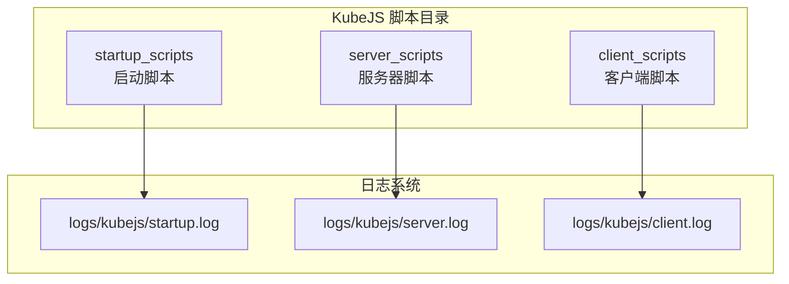
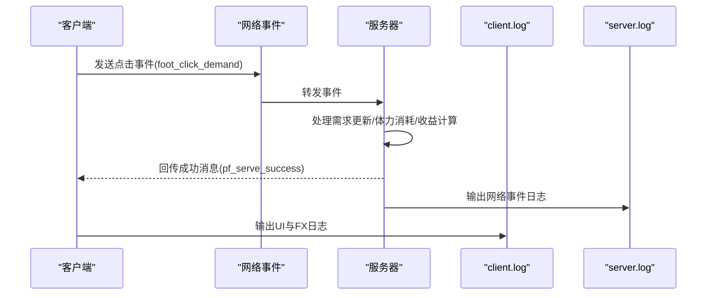
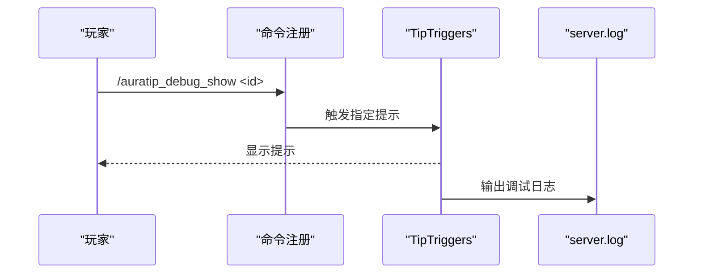
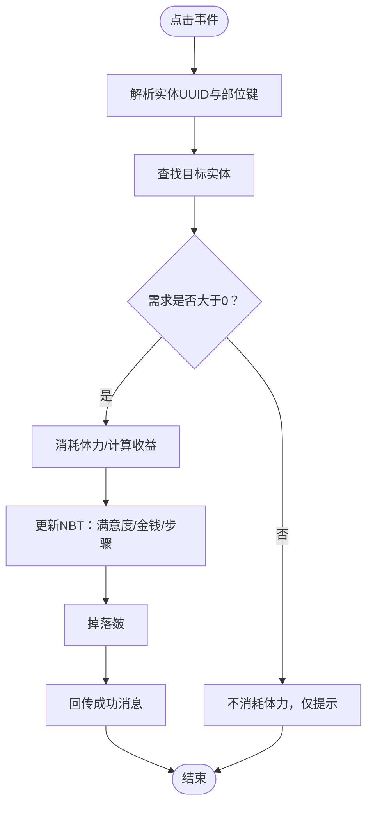
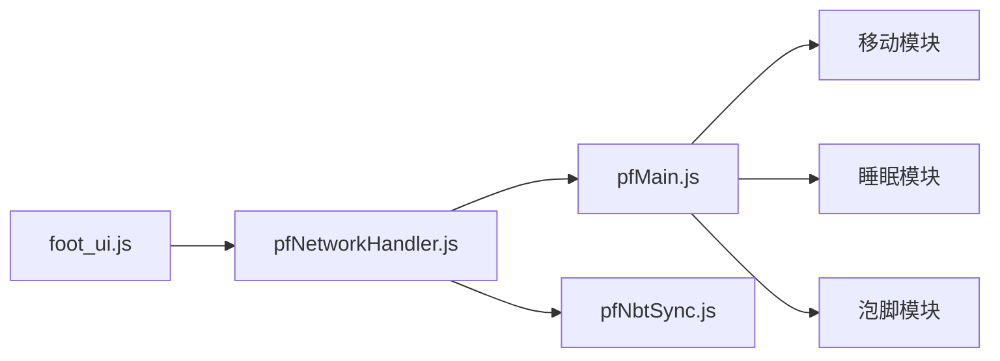

# 调试工具与技巧

<cite>
**本文引用的文件**
- [README.txt](file://kubejs/README.txt)
- [client.log](file://logs/kubejs/client.log)
- [server.log](file://logs/kubejs/server.log)
- [startup.log](file://logs/kubejs/startup.log)
- [jsconfig.json](file://kubejs/jsconfig.json)
- [auratip_tips.js](file://kubejs/client_scripts/auratip/auratip_tips.js)
- [foot_ui.js](file://kubejs/client_scripts/ui/foot_ui.js)
- [auratip_triggers.js](file://kubejs/server_scripts/auratip_triggers.js)
- [pfNetworkHandler.js](file://kubejs/server_scripts/pathfinder/pfNetworkHandler.js)
- [pfNbtSync.js](file://kubejs/server_scripts/pathfinder/pfNbtSync.js)
- [pfMain.js](file://kubejs/server_scripts/pathfinder/pfMain.js)
- [pfSoakWaterEffects.js](file://kubejs/server_scripts/pathfinder/pfSoakWaterEffects.js)
- [ftblibrary-client.snbt](file://defaultconfigs/ftblibrary/ftblibrary-client.snbt)
- [sdmshop-common.snbt](file://defaultconfigs/sdmshop/sdmshop-common.snbt)
</cite>

## 目录
1. [简介](#简介)
2. [项目结构](#项目结构)
3. [核心组件](#核心组件)
4. [架构总览](#架构总览)
5. [详细组件分析](#详细组件分析)
6. [依赖关系分析](#依赖关系分析)
7. [性能考量](#性能考量)
8. [故障排查指南](#故障排查指南)
9. [结论](#结论)
10. [附录](#附录)

## 简介
本指南聚焦于KubeJS在本项目中的调试工具与故障排查实践，涵盖：
- 内置日志系统与日志分类
- 调试命令与手动触发方式
- 客户端与服务器资源重载机制
- 网络事件调试与数据同步问题排查
- 性能分析与优化建议
- 常见错误的诊断步骤与解决方案

## 项目结构
KubeJS脚本按职责分为三类目录：
- startup_scripts：游戏启动一次性加载，适合注册物品、流体等
- server_scripts：服务器资源重载时重新加载，适合处理事件、配方、标签
- client_scripts：客户端资源重载时重新加载，适合UI、提示、JEI事件

图表来源
- [README.txt:8-15](file://kubejs/README.txt#L8-L15)
- [jsconfig.json:7-13](file://kubejs/jsconfig.json#L7-L13)

章节来源
- [README.txt:1-15](file://kubejs/README.txt#L1-L15)
- [jsconfig.json:1-16](file://kubejs/jsconfig.json#L1-L16)

## 核心组件
- 日志系统
  - 启动日志：logs/kubejs/startup.log，记录启动脚本加载与注册结果
  - 服务器日志：logs/kubejs/server.log，记录服务器脚本加载、事件与网络交互
  - 客户端日志：logs/kubejs/client.log，记录客户端脚本加载与UI事件
- 资源重载
  - 客户端：F3+T
  - 服务器：/reload
  - 启动脚本：/kubejs reload_startup_scripts
- 调试命令
  - AuraTip：auratip_openshop、auratip_reset、auratip_debug_show
- 网络事件
  - 客户端向服务器发送点击事件，服务器处理并回传成功消息

章节来源
- [README.txt:8-15](file://kubejs/README.txt#L8-L15)
- [client.log:1-200](file://logs/kubejs/client.log#L1-L200)
- [server.log:1-209](file://logs/kubejs/server.log#L1-L209)
- [startup.log:1-110](file://logs/kubejs/startup.log#L1-L110)

## 架构总览
下图展示了客户端与服务器之间的交互流程，以及日志输出位置：

图表来源
- [pfNetworkHandler.js:39-219](file://kubejs/server_scripts/pathfinder/pfNetworkHandler.js#L39-L219)
- [foot_ui.js:1017-1025](file://kubejs/client_scripts/ui/foot_ui.js#L1017-L1025)
- [server.log:156-209](file://logs/kubejs/server.log#L156-L209)
- [client.log:1-200](file://logs/kubejs/client.log#L1-L200)

## 详细组件分析

### 日志系统与日志分类
- 启动日志（startup.log）
  - 记录启动脚本加载顺序、注册结果与警告
  - 示例：流体注册、物品注册、Boss召唤符自动创建等
- 服务器日志（server.log）
  - 记录服务器脚本加载、事件处理、网络事件与配方处理
  - 示例：网络点击事件、泡脚事件、送客事件、配方警告
- 客户端日志（client.log）
  - 记录客户端脚本加载、UI初始化、粒子特效与网络回传确认
  - 示例：UI窗口创建、粒子层自检、服务端成功回调

章节来源
- [startup.log:1-110](file://logs/kubejs/startup.log#L1-L110)
- [server.log:1-209](file://logs/kubejs/server.log#L1-L209)
- [client.log:1-800](file://logs/kubejs/client.log#L1-L800)

### 资源重载与调试命令
- 客户端重载：F3+T
  - 适用于client_scripts，快速验证UI与提示变化
- 服务器重载：/reload
  - 适用于server_scripts，重新加载事件与配方
- 启动脚本重载：/kubejs reload_startup_scripts
  - 适用于startup_scripts，但可能不完全生效（文档注释明确）

章节来源
- [README.txt:8-15](file://kubejs/README.txt#L8-L15)

### AuraTip 调试命令
- auratip_openshop：开启商店流程
- auratip_reset：重置状态
- auratip_debug_show：<子命令>：按提示ID强制显示

图表来源
- [auratip_triggers.js:160-186](file://kubejs/server_scripts/auratip_triggers.js#L160-L186)
- [server.log:1-209](file://logs/kubejs/server.log#L1-L209)

章节来源
- [auratip_triggers.js:41-77](file://kubejs/server_scripts/auratip_triggers.js#L41-L77)
- [auratip_triggers.js:160-186](file://kubejs/server_scripts/auratip_triggers.js#L160-L186)

### 网络事件与数据同步
- 客户端点击事件
  - foot_click_demand：处理需求点击
  - foot_click_soak：处理泡脚点击
  - foot_dismiss_customer：处理送客
- 数据同步
  - 服务器通过NBT存储需求、满意度、金钱、步骤等
  - 客户端通过NetworkEvents接收成功消息并触发UI反馈

图表来源
- [pfNetworkHandler.js:39-219](file://kubejs/server_scripts/pathfinder/pfNetworkHandler.js#L39-L219)
- [pfNbtSync.js:77-93](file://kubejs/server_scripts/pathfinder/pfNbtSync.js#L77-L93)

章节来源
- [pfNetworkHandler.js:1-317](file://kubejs/server_scripts/pathfinder/pfNetworkHandler.js#L1-L317)
- [pfNbtSync.js:1-93](file://kubejs/server_scripts/pathfinder/pfNbtSync.js#L1-L93)

### 客户端UI与粒子特效
- UI初始化与自检
  - 创建ApricityUI文档与Overlay层
  - 插入探针元素进行自检
- 网络回传确认
  - 接收pf_serve_success，记录UUID与部位

章节来源
- [foot_ui.js:948-1025](file://kubejs/client_scripts/ui/foot_ui.js#L948-L1025)
- [client.log:948-1025](file://logs/kubejs/client.log#L948-L1025)

### 配方与数据同步问题排查
- 配方警告
  - 服务器日志中出现“缺少经验键/结果为空”等警告，需检查配方JSON字段
- 泡脚水效果
  - 按水类型追加需求、满意度与皴加成，确保水定义正确

章节来源
- [server.log:96-155](file://logs/kubejs/server.log#L96-L155)
- [pfSoakWaterEffects.js:127-159](file://kubejs/server_scripts/pathfinder/pfSoakWaterEffects.js#L127-L159)

## 依赖关系分析
- 模块耦合
  - pfNetworkHandler依赖pfNbtSync进行NBT读写
  - pfMain作为主循环，协调移动、睡眠、泡脚等模块
- 日志依赖
  - 各模块通过console.log输出到对应日志文件
- 配置依赖
  - defaultconfigs目录下的snbt文件为默认配置模板

图表来源
- [pfMain.js:1-177](file://kubejs/server_scripts/pathfinder/pfMain.js#L1-L177)
- [pfNetworkHandler.js:1-317](file://kubejs/server_scripts/pathfinder/pfNetworkHandler.js#L1-L317)
- [pfNbtSync.js:1-93](file://kubejs/server_scripts/pathfinder/pfNbtSync.js#L1-L93)
- [foot_ui.js:948-1025](file://kubejs/client_scripts/ui/foot_ui.js#L948-L1025)

章节来源
- [pfMain.js:1-177](file://kubejs/server_scripts/pathfinder/pfMain.js#L1-L177)
- [pfNetworkHandler.js:1-317](file://kubejs/server_scripts/pathfinder/pfNetworkHandler.js#L1-L317)
- [pfNbtSync.js:1-93](file://kubejs/server_scripts/pathfinder/pfNbtSync.js#L1-L93)
- [foot_ui.js:948-1025](file://kubejs/client_scripts/ui/foot_ui.js#L948-L1025)

## 性能考量
- 主循环节流
  - pfMain在每tick内对实体进行去重处理，避免重复计算
- 事件处理粒度
  - 点击事件按需查找实体与部位，尽量减少不必要的遍历
- UI初始化
  - 客户端Overlay仅在首次进入世界后初始化，避免重复创建

章节来源
- [pfMain.js:34-37](file://kubejs/server_scripts/pathfinder/pfMain.js#L34-L37)
- [foot_ui.js:970-1014](file://kubejs/client_scripts/ui/foot_ui.js#L970-L1014)

## 故障排查指南

### 日志定位法
- 启动阶段
  - 检查startup.log中注册项是否存在、是否有警告
- 服务器阶段
  - 检查server.log中事件日志与配方警告
- 客户端阶段
  - 检查client.log中UI初始化与网络回传

章节来源
- [startup.log:1-110](file://logs/kubejs/startup.log#L1-L110)
- [server.log:1-209](file://logs/kubejs/server.log#L1-L209)
- [client.log:1-800](file://logs/kubejs/client.log#L1-L800)

### 网络事件调试
- 现象
  - 客户端点击无效或无回显
- 步骤
  1. 确认客户端是否发送foot_click_demand事件
  2. 查看服务器server.log中对应UUID与部位键的日志
  3. 检查目标实体是否存在、需求是否大于0
  4. 若需求为0，确认客户端提示逻辑
- 关联文件
  - pfNetworkHandler.js事件处理
  - foot_ui.js网络回传确认

章节来源
- [pfNetworkHandler.js:39-219](file://kubejs/server_scripts/pathfinder/pfNetworkHandler.js#L39-L219)
- [client.log:1017-1025](file://logs/kubejs/client.log#L1017-L1025)

### 数据同步问题排查
- 现象
  - 客户端显示与服务器不一致
- 步骤
  1. 检查pfNbtSync.js中NBT字段读写是否正确
  2. 确认实体主手物品ID与同步项一致
  3. 核对pfNetworkHandler.js中NBT更新逻辑
- 关联文件
  - pfNbtSync.js
  - pfNetworkHandler.js

章节来源
- [pfNbtSync.js:77-93](file://kubejs/server_scripts/pathfinder/pfNbtSync.js#L77-L93)
- [pfNetworkHandler.js:173-218](file://kubejs/server_scripts/pathfinder/pfNetworkHandler.js#L173-L218)

### 配方与数据问题
- 现象
  - 服务器日志出现配方警告
- 步骤
  1. 根据server.log中的警告定位具体配方
  2. 检查配方JSON字段是否符合要求（如experience键、result非空）
  3. 修复后使用/reload重载服务器资源
- 关联文件
  - server.log配方警告
  - README.txt中服务器重载说明

章节来源
- [server.log:96-155](file://logs/kubejs/server.log#L96-L155)
- [README.txt:8-15](file://kubejs/README.txt#L8-L15)

### AuraTip 调试
- 现象
  - 提示未显示或显示异常
- 步骤
  1. 使用auratip_debug_show按ID强制显示
  2. 检查auratip_triggers.js中的触发器注册与队列逻辑
  3. 查看server.log中的调试输出
- 关联文件
  - auratip_triggers.js
  - server.log

章节来源
- [auratip_triggers.js:160-186](file://kubejs/server_scripts/auratip_triggers.js#L160-L186)
- [server.log:1-209](file://logs/kubejs/server.log#L1-L209)

### 客户端UI与粒子
- 现象
  - UI未显示或粒子层异常
- 步骤
  1. 检查client.log中Overlay创建与探针自检日志
  2. 确认ApricityUI文档路径与layer选择器存在
  3. 重载客户端资源（F3+T）验证修复
- 关联文件
  - foot_ui.js
  - client.log

章节来源
- [foot_ui.js:970-1014](file://kubejs/client_scripts/ui/foot_ui.js#L970-L1014)
- [client.log:948-1025](file://logs/kubejs/client.log#L948-L1025)

## 结论
- 使用日志文件进行分层定位是本项目调试的核心方法
- 网络事件与数据同步是问题高发区，应重点检查NBT字段与事件处理
- 资源重载命令与调试命令可显著提升迭代效率
- 配方与UI问题可通过对应日志与重载手段快速修复

## 附录

### 常用命令与快捷键
- 客户端重载：F3+T
- 服务器重载：/reload
- 启动脚本重载：/kubejs reload_startup_scripts
- AuraTip调试命令：
  - /auratip_openshop
  - /auratip_reset
  - /auratip_debug_show <提示ID>

章节来源
- [README.txt:8-15](file://kubejs/README.txt#L8-L15)
- [auratip_triggers.js:160-186](file://kubejs/server_scripts/auratip_triggers.js#L160-L186)

### 默认配置参考
- ftblibrary-client.snbt：客户端默认配置模板
- sdmshop-common.snbt：通用默认配置模板

章节来源
- [ftblibrary-client.snbt:1-4](file://defaultconfigs/ftblibrary/ftblibrary-client.snbt#L1-L4)
- [sdmshop-common.snbt:1-4](file://defaultconfigs/sdmshop/sdmshop-common.snbt#L1-L4)