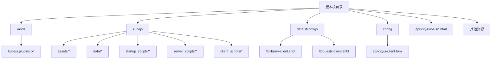
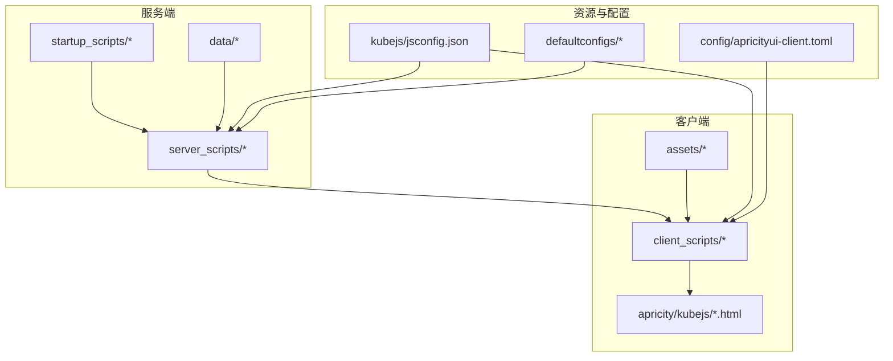
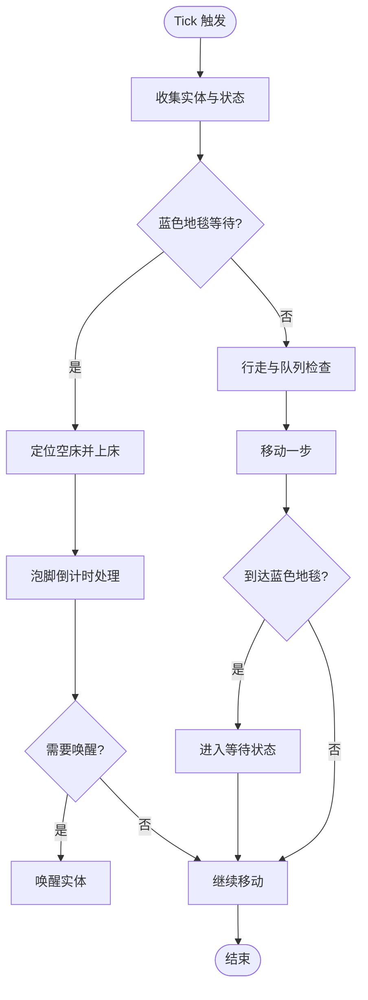
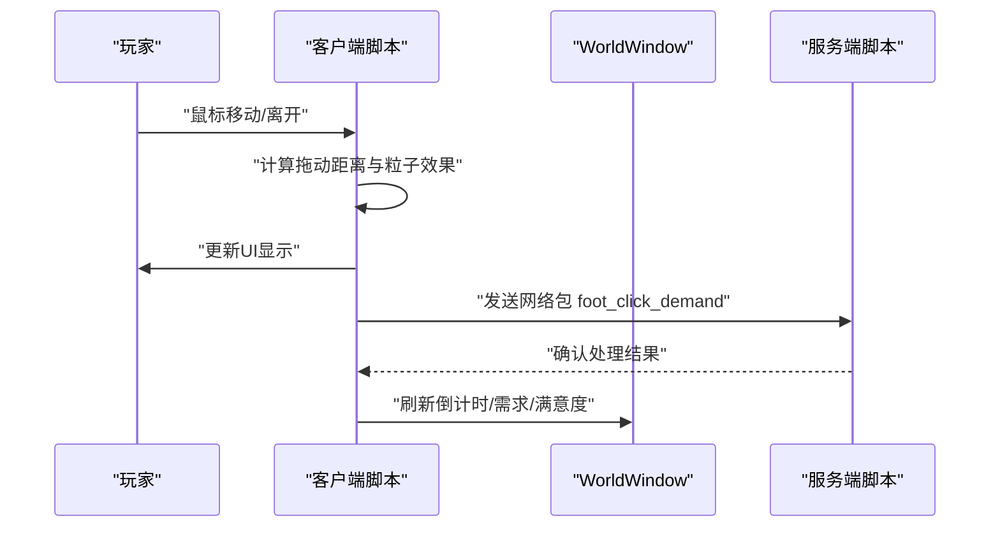
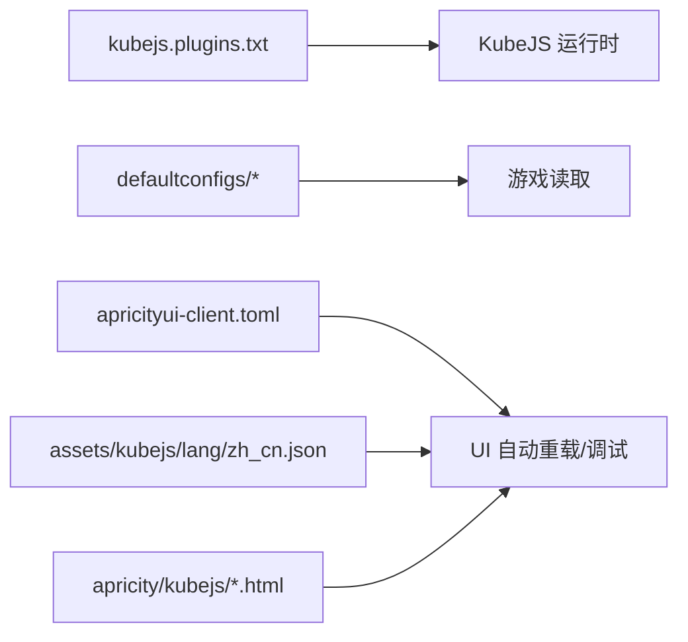

# 快速开始

<cite>
**本文引用的文件**
- [README.md](file://README.md)
- [kubejs/README.txt](file://kubejs/README.txt)
- [kubejs/jsconfig.json](file://kubejs/jsconfig.json)
- [mods/kubejs.plugins.txt](file://mods/kubejs.plugins.txt)
- [defaultconfigs/ftblibrary/ftblibrary-client.snbt](file://defaultconfigs/ftblibrary/ftblibrary-client.snbt)
- [defaultconfigs/ftbquests/client-config.snbt](file://defaultconfigs/ftbquests/client-config.snbt)
- [config/apricityui-client.toml](file://config/apricityui-client.toml)
- [kubejs/startup_scripts/example.js](file://kubejs/startup_scripts/example.js)
- [kubejs/server_scripts/example.js](file://kubejs/server_scripts/example.js)
- [kubejs/client_scripts/ui/foot_ui.js](file://kubejs/client_scripts/ui/foot_ui.js)
- [apricity/kubejs/footui.html](file://apricity/kubejs/footui.html)
- [kubejs/assets/kubejs/lang/zh_cn.json](file://kubejs/assets/kubejs/lang/zh_cn.json)
- [kubejs/server_scripts/pathfinder/pfMain.js](file://kubejs/server_scripts/pathfinder/pfMain.js)
- [kubejs/server_scripts/recipes/recipes_farmersdelight_salt.js](file://kubejs/server_scripts/recipes/recipes_farmersdelight_salt.js)
- [kubejs/server_scripts/recipes/recipes_create_precision_mechanism.js](file://kubejs/server_scripts/recipes/recipes_create_precision_mechanism.js)
</cite>

## 目录
1. [简介](#简介)
2. [项目结构](#项目结构)
3. [核心组件](#核心组件)
4. [架构总览](#架构总览)
5. [详细组件解析](#详细组件解析)
6. [依赖关系分析](#依赖关系分析)
7. [性能与优化建议](#性能与优化建议)
8. [故障排除指南](#故障排除指南)
9. [结论](#结论)
10. [附录](#附录)

## 简介
本指南面向首次接触该 KubeJS 模组项目的用户，帮助你在最短时间内完成安装、前置条件检查、基础配置与首次运行验证，并快速体验项目的核心功能（如寻路系统、泡脚 UI、服务属性等）。文档同时提供开发环境设置建议、常用配置示例与常见问题排查，让你能够顺利上手并为进一步学习打下基础。

## 项目结构
该版本仓库位于 Minecraft 版本目录中，包含以下与 KubeJS 相关的关键目录与文件：
- mods：存放模组与插件元数据，例如 KubeJS 插件声明文件
- kubejs：KubeJS 脚本与资源目录，包含 assets、data、startup_scripts、server_scripts、client_scripts 等
- defaultconfigs：默认配置文件（如 FTB Library、FTB Quests）
- config：各类模组的客户端/通用配置（如 ApricityUI）
- 其他资源：apricity UI 模板、语言包、蓝图导出等

图表来源
- [kubejs/README.txt:1-15](file://kubejs/README.txt#L1-L15)
- [mods/kubejs.plugins.txt:1](file://mods/kubejs.plugins.txt#L1-L1)
- [defaultconfigs/ftblibrary/ftblibrary-client.snbt:1-5](file://defaultconfigs/ftblibrary/ftblibrary-client.snbt#L1-L5)
- [defaultconfigs/ftbquests/client-config.snbt:1-5](file://defaultconfigs/ftbquests/client-config.snbt#L1-L5)
- [config/apricityui-client.toml:1-8](file://config/apricityui-client.toml#L1-L8)

章节来源
- [kubejs/README.txt:1-15](file://kubejs/README.txt#L1-L15)
- [README.md:1-6](file://README.md#L1-L6)

## 核心组件
- KubeJS 目录结构与用途
  - assets：作为资源包，放置客户端资源（纹理、模型等）
  - data：作为数据包，放置服务端资源（配方、标签、函数等）
  - startup_scripts：游戏启动时加载一次，适合注册实体、物品等一次性内容
  - server_scripts：每次服务器资源重载时加载，适合修改配方、标签、处理事件
  - client_scripts：每次客户端资源重载时加载，适合 JEI、提示、UI 等客户端逻辑
  - config/exported：KubeJS 配置存储与导出目录
- 插件与配置
  - mods/kubejs.plugins.txt：声明 KubeJS 插件（如 ChatBox 插件）
  - defaultconfigs：默认客户端配置拷贝至本地后可进行覆盖
  - config/apricityui-client.toml：ApricityUI 客户端调试与自动重载开关

章节来源
- [kubejs/README.txt:1-15](file://kubejs/README.txt#L1-L15)
- [mods/kubejs.plugins.txt:1](file://mods/kubejs.plugins.txt#L1-L1)
- [defaultconfigs/ftblibrary/ftblibrary-client.snbt:1-5](file://defaultconfigs/ftblibrary/ftblibrary-client.snbt#L1-L5)
- [defaultconfigs/ftbquests/client-config.snbt:1-5](file://defaultconfigs/ftbquests/client-config.snbt#L1-L5)
- [config/apricityui-client.toml:1-8](file://config/apricityui-client.toml#L1-L8)

## 架构总览
该模组项目围绕 KubeJS 的脚本体系组织，结合服务端与客户端脚本实现复杂的游戏玩法。整体架构分为三层：
- 服务端层：负责实体行为、寻路系统、配方与数据处理
- 客户端层：负责 UI 展示、事件交互与渲染
- 资源层：提供语言、纹理、HTML 模板与声音等资源

图表来源
- [kubejs/README.txt:1-15](file://kubejs/README.txt#L1-L15)
- [kubejs/jsconfig.json:1-16](file://kubejs/jsconfig.json#L1-L16)
- [config/apricityui-client.toml:1-8](file://config/apricityui-client.toml#L1-L8)

## 详细组件解析

### 1) 安装与前置条件
- 安装步骤
  - 使用 1.20.1 客户端并安装最新 Forge
  - 在版本根目录拉取本仓库
  - 启动游戏并创建存档
- 前置条件检查
  - 确认已安装 KubeJS 与相关依赖（例如 ChatBox 插件已在 plugins 中声明）
  - 确认 defaultconfigs 与 config 目录存在且可被游戏读取

章节来源
- [README.md:1-6](file://README.md#L1-L6)
- [mods/kubejs.plugins.txt:1](file://mods/kubejs.plugins.txt#L1-L1)

### 2) 基础配置与首次运行验证
- KubeJS 目录与脚本类型
  - assets/data：放置资源与数据包内容
  - startup_scripts/server_scripts/client_scripts：按需放置脚本，首次运行后生效
- 验证方法
  - 启动游戏后，观察日志目录 logs/kubejs/ 是否有对应脚本的日志输出
  - 通过命令重载脚本（如 /reload、F3+T）验证改动是否生效

章节来源
- [kubejs/README.txt:1-15](file://kubejs/README.txt#L1-L15)

### 3) 寻路系统（Pathfinder）
- 核心逻辑
  - 通过方块实体触发主循环，按阶段推进实体行为（等待、行走、睡眠、泡脚等）
  - 支持排队、路径计算、床占用检测与睡眠倒计时
- 关键要点
  - 每 tick 防重复处理，避免重复推进
  - 蓝色地毯触发等待状态，到达后进入排队与睡眠流程
  - 睡眠结束后根据结果决定是否唤醒

图表来源
- [kubejs/server_scripts/pathfinder/pfMain.js:1-177](file://kubejs/server_scripts/pathfinder/pfMain.js#L1-L177)

章节来源
- [kubejs/server_scripts/pathfinder/pfMain.js:1-177](file://kubejs/server_scripts/pathfinder/pfMain.js#L1-L177)

### 4) 泡脚 UI 与交互（Foot UI）
- 客户端 UI
  - 通过 WorldWindow 在世界中显示 HTML 窗口，展示需求清单、满意度、步骤与泡脚进度
  - 支持鼠标拖动触发搓脚、粒子特效与送客按钮
- 数据来源
  - UI 通过实体主手物品的 NBT 读取床坐标、倒计时、需求、满意度、步骤与精油状态
- 交互流程
  - 鼠标悬停显示手持物品图标，拖动累计距离达到阈值后发送网络包到服务端
  - 服务端根据手持物品判断搓脚部位并处理

图表来源
- [kubejs/client_scripts/ui/foot_ui.js:1-958](file://kubejs/client_scripts/ui/foot_ui.js#L1-L958)
- [apricity/kubejs/footui.html:1-200](file://apricity/kubejs/footui.html#L1-L200)

章节来源
- [kubejs/client_scripts/ui/foot_ui.js:1-958](file://kubejs/client_scripts/ui/foot_ui.js#L1-L958)
- [apricity/kubejs/footui.html:1-200](file://apricity/kubejs/footui.html#L1-L200)

### 5) 示例脚本与实体注册
- 启动脚本示例
  - 展示如何注册自定义实体类型与模型/动画绑定
- 服务端脚本示例
  - 展示右键物品事件与打开 UI 的流程，以及通过 NBT 判断寻路实体

章节来源
- [kubejs/startup_scripts/example.js:1-26](file://kubejs/startup_scripts/example.js#L1-L26)
- [kubejs/server_scripts/example.js:1-24](file://kubejs/server_scripts/example.js#L1-L24)

### 6) 语言与属性展示
- 语言包
  - 提供服务属性（脚掌/脚跟/脚趾/脚心）的中文名称映射
- 用途
  - UI 与日志中显示更友好的属性名称

章节来源
- [kubejs/assets/kubejs/lang/zh_cn.json:1-15](file://kubejs/assets/kubejs/lang/zh_cn.json#L1-L15)

### 7) 配方与数据处理示例
- 农夫乐事厨锅配方
  - 将“泡脚废水桶”转换为“盐”，并返还空桶
- Create 精密机械装置配方
  - 替换原版 Sequenced Assembly 流程，采用多种 API 尝试与兜底策略

章节来源
- [kubejs/server_scripts/recipes/recipes_farmersdelight_salt.js:1-36](file://kubejs/server_scripts/recipes/recipes_farmersdelight_salt.js#L1-L36)
- [kubejs/server_scripts/recipes/recipes_create_precision_mechanism.js:25-89](file://kubejs/server_scripts/recipes/recipes_create_precision_mechanism.js#L25-L89)

## 依赖关系分析
- 模组与插件
  - KubeJS 插件声明：ChatBox 插件
- 配置依赖
  - defaultconfigs：客户端配置默认值
  - config/apricityui-client.toml：调试与自动重载开关
- 资源依赖
  - HTML 模板与语言包为 UI 显示提供基础

图表来源
- [mods/kubejs.plugins.txt:1](file://mods/kubejs.plugins.txt#L1-L1)
- [defaultconfigs/ftblibrary/ftblibrary-client.snbt:1-5](file://defaultconfigs/ftblibrary/ftblibrary-client.snbt#L1-L5)
- [defaultconfigs/ftbquests/client-config.snbt:1-5](file://defaultconfigs/ftbquests/client-config.snbt#L1-L5)
- [config/apricityui-client.toml:1-8](file://config/apricityui-client.toml#L1-L8)
- [kubejs/assets/kubejs/lang/zh_cn.json:1-15](file://kubejs/assets/kubejs/lang/zh_cn.json#L1-L15)
- [apricity/kubejs/footui.html:1-200](file://apricity/kubejs/footui.html#L1-L200)

章节来源
- [mods/kubejs.plugins.txt:1](file://mods/kubejs.plugins.txt#L1-L1)
- [defaultconfigs/ftblibrary/ftblibrary-client.snbt:1-5](file://defaultconfigs/ftblibrary/ftblibrary-client.snbt#L1-L5)
- [defaultconfigs/ftbquests/client-config.snbt:1-5](file://defaultconfigs/ftbquests/client-config.snbt#L1-L5)
- [config/apricityui-client.toml:1-8](file://config/apricityui-client.toml#L1-L8)
- [kubejs/assets/kubejs/lang/zh_cn.json:1-15](file://kubejs/assets/kubejs/lang/zh_cn.json#L1-L15)
- [apricity/kubejs/footui.html:1-200](file://apricity/kubejs/footui.html#L1-L200)

## 性能与优化建议
- 减少重复处理
  - 服务端每 tick 防重复处理，避免同一 tick 内多次推进
- 降低客户端 UI 更新频率
  - UI 更新尽量批量处理，减少频繁 DOM 操作
- 合理使用自动重载
  - 开发阶段可开启 ApricityUI 自动重载，但发布版本建议关闭以减少开销

## 故障排除指南
- 无法加载 KubeJS 插件
  - 检查 plugins 文件是否存在且内容正确
- 配置未生效
  - 确认 defaultconfigs 是否被复制到本地，或在 config 中进行覆盖
- UI 不显示或不响应
  - 检查 ApricityUI 客户端配置与 HTML 模板路径
  - 确认客户端脚本已加载并打印日志
- 寻路系统无反应
  - 检查方块实体触发逻辑与实体 NBT 字段是否正确写入
  - 查看服务端日志中每 tick 的推进日志

章节来源
- [mods/kubejs.plugins.txt:1](file://mods/kubejs.plugins.txt#L1-L1)
- [config/apricityui-client.toml:1-8](file://config/apricityui-client.toml#L1-L8)
- [kubejs/client_scripts/ui/foot_ui.js:1-958](file://kubejs/client_scripts/ui/foot_ui.js#L1-L958)
- [kubejs/server_scripts/pathfinder/pfMain.js:1-177](file://kubejs/server_scripts/pathfinder/pfMain.js#L1-L177)

## 结论
通过本快速开始指南，你已掌握安装、前置检查、基础配置与首次运行验证的方法，并对寻路系统、泡脚 UI、配方与数据处理等核心功能有了初步认识。建议在熟悉这些内容后，逐步探索脚本重载、日志定位与资源扩展，以进一步提升开发效率与功能深度。

## 附录
- 常用命令
  - /reload：重载服务器脚本
  - F3+T：重载客户端脚本
- 日志位置
  - logs/kubejs/：按类型分类的日志目录

章节来源
- [kubejs/README.txt:1-15](file://kubejs/README.txt#L1-L15)