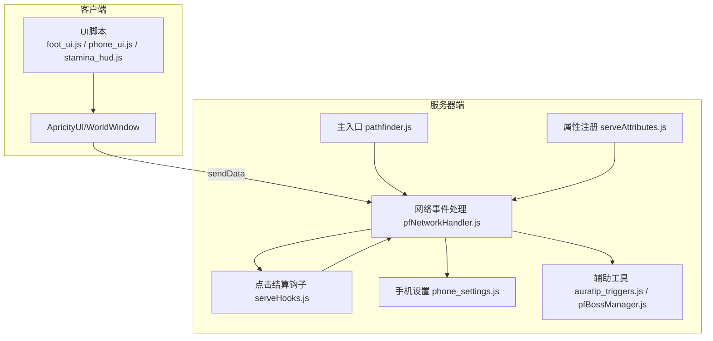
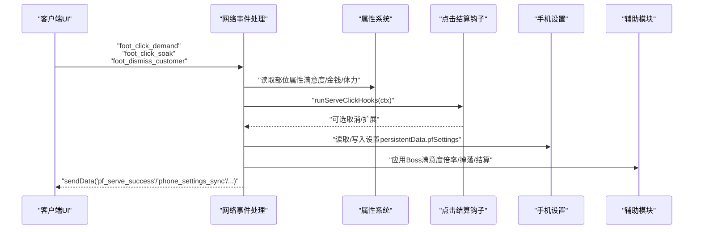
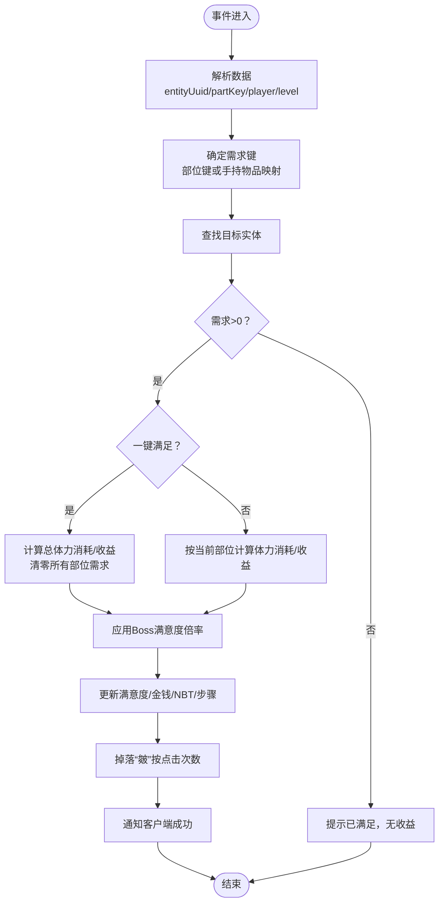
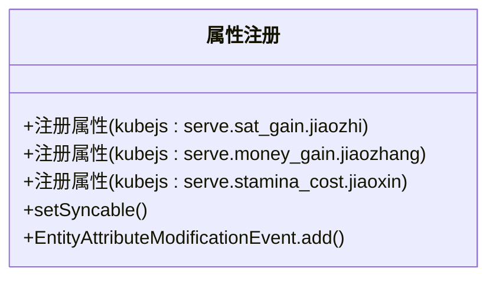
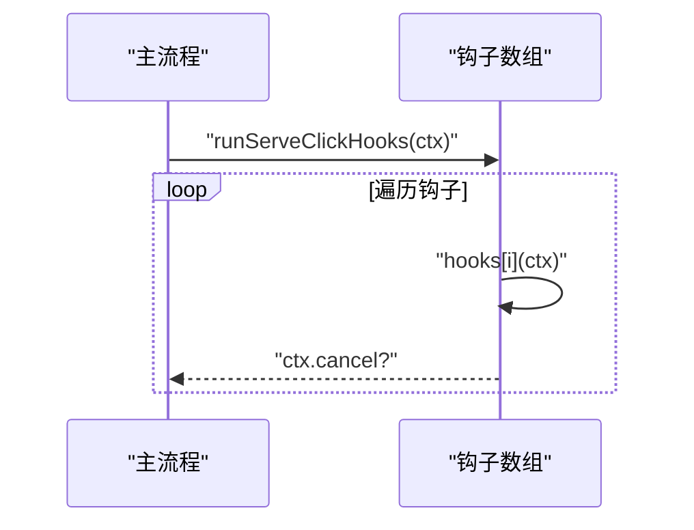
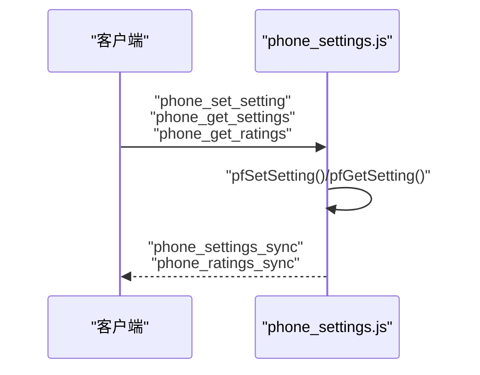
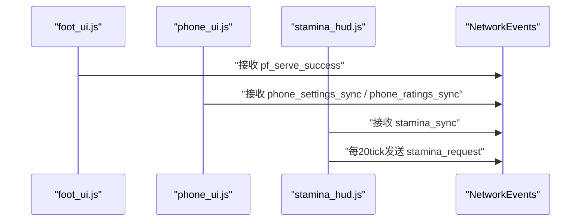
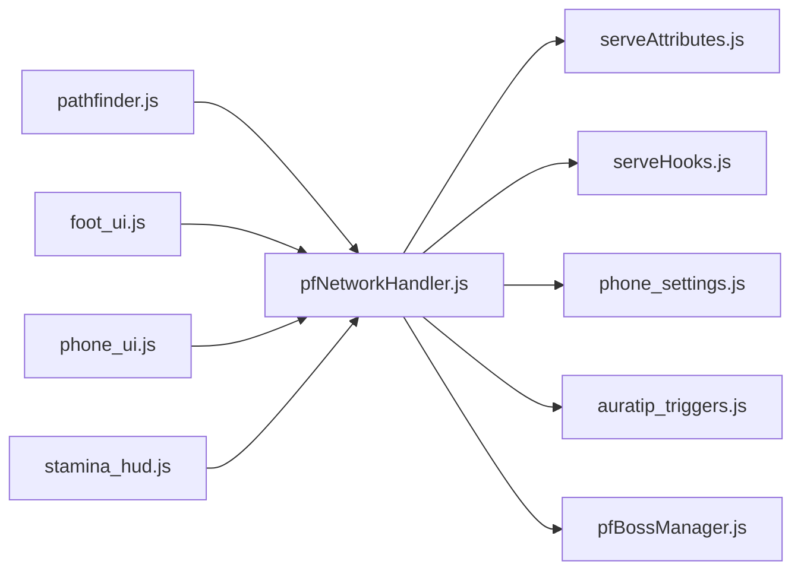

# API集成扩展

<cite>
**本文引用的文件**
- [README.md](file://README.md)
- [pfNetworkHandler.js](file://kubejs/server_scripts/pathfinder/pfNetworkHandler.js)
- [serveHooks.js](file://kubejs/startup_scripts/serveHooks.js)
- [serveAttributes.js](file://kubejs/startup_scripts/attributes/serveAttributes.js)
- [phone_settings.js](file://kubejs/server_scripts/phone_settings.js)
- [foot_ui.js](file://kubejs/client_scripts/ui/foot_ui.js)
- [stamina_hud.js](file://kubejs/client_scripts/ui/stamina_hud.js)
- [phone_ui.js](file://kubejs/client_scripts/ui/phone_ui.js)
- [pathfinder.js](file://kubejs/server_scripts/pathfinder.js)
- [auratip_triggers.js](file://kubejs/server_scripts/auratip_triggers.js)
- [pfBossManager.js](file://kubejs/server_scripts/pathfinder/pfBossManager.js)
- [phone.html](file://apricity/kubejs/phone.html)
</cite>

## 目录
1. [简介](#简介)
2. [项目结构](#项目结构)
3. [核心组件](#核心组件)
4. [架构总览](#架构总览)
5. [详细组件分析](#详细组件分析)
6. [依赖关系分析](#依赖关系分析)
7. [性能考量](#性能考量)
8. [故障排除指南](#故障排除指南)
9. [结论](#结论)
10. [附录](#附录)

## 简介
本技术文档围绕KubeJS项目中的API集成扩展展开，重点解释如何将外部API与内部系统进行集成，涵盖事件系统的扩展、属性系统的集成以及交易系统的扩展。文档详细说明API接口的设计原则、参数规范与返回值处理，并提供完整的API集成示例，展示如何扩展现有API、添加新的API端点与处理API调用。同时，文档覆盖安全考虑、错误处理与性能优化，包含测试方法、监控策略与故障排除建议，为开发者提供一套可落地的API集成开发指南。

## 项目结构
该项目采用KubeJS模块化脚本组织方式，核心API集成涉及以下层次：
- 服务器端：事件接收与业务逻辑处理（NetworkEvents、PersistentData、全局钩子）
- 客户端：UI与状态同步（ApricityUI、WorldWindow、Overlay）
- 启动阶段：属性注册、钩子框架、常量与工具模块
- 数据持久化：玩家持久化数据复合标签（persistentData）

图表来源
- [pathfinder.js:25-29](file://kubejs/server_scripts/pathfinder.js#L25-L29)
- [pfNetworkHandler.js:37-311](file://kubejs/server_scripts/pathfinder/pfNetworkHandler.js#L37-L311)
- [serveHooks.js:11-30](file://kubejs/startup_scripts/serveHooks.js#L11-L30)
- [serveAttributes.js:27-52](file://kubejs/startup_scripts/attributes/serveAttributes.js#L27-L52)
- [phone_settings.js:55-135](file://kubejs/server_scripts/phone_settings.js#L55-L135)
- [foot_ui.js:1017-1025](file://kubejs/client_scripts/ui/foot_ui.js#L1017-L1025)
- [phone_ui.js:13-23](file://kubejs/client_scripts/ui/phone_ui.js#L13-L23)
- [stamina_hud.js:53-86](file://kubejs/client_scripts/ui/stamina_hud.js#L53-L86)

章节来源
- [README.md:1-6](file://README.md#L1-L6)
- [pathfinder.js:1-30](file://kubejs/server_scripts/pathfinder.js#L1-L30)

## 核心组件
- 事件系统扩展（NetworkEvents）
  - 客户端通过sendData向服务器发送事件，服务器端通过NetworkEvents.dataReceived接收并处理。
  - 示例事件：点击需求、泡脚、送客、设置变更、设置请求、评价查询、体力请求、服务成功回调等。
- 属性系统集成（Attributes）
  - 通过StartupEvents.registry注册自定义属性，支持客户端同步与实体修饰器（AttributeModifier）叠加。
  - 属性命名空间：kubejs:serve.{sat_gain|money_gain|stamina_cost}.{部位}。
- 交易系统扩展（持久化与同步）
  - 玩家设置持久化于player.persistentData.pfSettings复合标签，通过sendData与客户端双向同步。
  - 服务收益（金钱、满意度）与需求（NBT）在实体主手物品NBT中同步。
- 钩子框架（Serve Click Hooks）
  - 启动阶段注册钩子数组，运行时遍历执行，支持取消上下文，便于模块化扩展额外功能。

章节来源
- [pfNetworkHandler.js:37-311](file://kubejs/server_scripts/pathfinder/pfNetworkHandler.js#L37-L311)
- [serveAttributes.js:27-52](file://kubejs/startup_scripts/attributes/serveAttributes.js#L27-L52)
- [phone_settings.js:19-62](file://kubejs/server_scripts/phone_settings.js#L19-L62)
- [serveHooks.js:11-30](file://kubejs/startup_scripts/serveHooks.js#L11-L30)

## 架构总览
下图展示了API集成的整体交互流程：客户端UI触发事件，服务器端网络处理器接收并执行业务逻辑，必要时读写持久化数据与全局模块，最后通过sendData回推状态到客户端。

图表来源
- [pfNetworkHandler.js:37-311](file://kubejs/server_scripts/pathfinder/pfNetworkHandler.js#L37-L311)
- [serveAttributes.js:27-52](file://kubejs/startup_scripts/attributes/serveAttributes.js#L27-L52)
- [serveHooks.js:19-30](file://kubejs/startup_scripts/serveHooks.js#L19-L30)
- [phone_settings.js:55-135](file://kubejs/server_scripts/phone_settings.js#L55-L135)
- [auratip_triggers.js:139-158](file://kubejs/server_scripts/auratip_triggers.js#L139-L158)

## 详细组件分析

### 组件A：网络事件处理模块（pfNetworkHandler）
职责与行为
- 接收客户端点击事件（需求、泡脚、送客），解析实体UUID与部位键，查找目标实体，读取并更新NBT需求与状态。
- 通过属性系统读取部位收益与体力消耗，应用Boss满意度倍率，计算金钱与满意度增长。
- 与手机设置模块协作，支持一键满足与跳过泡脚等设置。
- 与掉落、睡眠管理等模块协作，实现完整服务链路。
- 回传服务成功事件到客户端，驱动UI反馈。

图表来源
- [pfNetworkHandler.js:37-311](file://kubejs/server_scripts/pathfinder/pfNetworkHandler.js#L37-L311)

章节来源
- [pfNetworkHandler.js:7-34](file://kubejs/server_scripts/pathfinder/pfNetworkHandler.js#L7-L34)
- [pfNetworkHandler.js:37-311](file://kubejs/server_scripts/pathfinder/pfNetworkHandler.js#L37-L311)

### 组件B：属性系统集成（serveAttributes）
职责与行为
- 注册4部位（脚趾、脚掌、脚心、脚跟）与1部位（脚背）的三类属性：满意度增量、金钱增量、体力消耗。
- 属性创建后标记为可同步，确保客户端能读取数值，便于UI与调试。
- 通过EntityAttributeModificationEvent为玩家实体添加属性，避免缺失导致的空指针。

图表来源
- [serveAttributes.js:27-52](file://kubejs/startup_scripts/attributes/serveAttributes.js#L27-L52)

章节来源
- [serveAttributes.js:14-25](file://kubejs/startup_scripts/attributes/serveAttributes.js#L14-L25)
- [serveAttributes.js:27-52](file://kubejs/startup_scripts/attributes/serveAttributes.js#L27-L52)

### 组件C：点击结算钩子框架（serveHooks）
职责与行为
- 启动阶段初始化全局钩子数组，提供注册与执行函数。
- 执行时遍历钩子，允许钩子在上下文中设置cancel以中断后续处理。
- 异常捕获，避免单个钩子错误影响整体流程。

图表来源
- [serveHooks.js:11-30](file://kubejs/startup_scripts/serveHooks.js#L11-L30)

章节来源
- [serveHooks.js:11-30](file://kubejs/startup_scripts/serveHooks.js#L11-L30)

### 组件D：手机设置持久化与同步（phone_settings）
职责与行为
- 将玩家设置存储在player.persistentData.pfSettings复合标签中，支持默认值与合法性校验。
- 通过NetworkEvents接收客户端设置变更请求，写入后回推最新设置。
- 支持客户端请求设置与评价查询，服务端聚合数据并分字段推送。

图表来源
- [phone_settings.js:55-135](file://kubejs/server_scripts/phone_settings.js#L55-L135)

章节来源
- [phone_settings.js:8-11](file://kubejs/server_scripts/phone_settings.js#L8-L11)
- [phone_settings.js:19-62](file://kubejs/server_scripts/phone_settings.js#L19-L62)
- [phone_settings.js:79-110](file://kubejs/server_scripts/phone_settings.js#L79-L110)

### 组件E：客户端UI与状态同步（foot_ui / phone_ui / stamina_hud）
职责与行为
- foot_ui：基于WorldWindow与ApricityUI创建脚部UI，响应鼠标拖动与粒子特效，接收服务成功回调以确认动画。
- phone_ui：接收phone_settings_sync与phone_ratings_sync，维护全局设置副本。
- stamina_hud：每20tick请求体力值，接收stamina_sync并更新HUD。

图表来源
- [foot_ui.js:1017-1025](file://kubejs/client_scripts/ui/foot_ui.js#L1017-L1025)
- [phone_ui.js:13-23](file://kubejs/client_scripts/ui/phone_ui.js#L13-L23)
- [stamina_hud.js:53-86](file://kubejs/client_scripts/ui/stamina_hud.js#L53-L86)

章节来源
- [foot_ui.js:1017-1025](file://kubejs/client_scripts/ui/foot_ui.js#L1017-L1025)
- [phone_ui.js:13-23](file://kubejs/client_scripts/ui/phone_ui.js#L13-L23)
- [stamina_hud.js:53-86](file://kubejs/client_scripts/ui/stamina_hud.js#L53-L86)

### 组件F：主入口与模块加载（pathfinder.js）
职责与行为
- 作为模块化入口，确保网络事件处理器在主循环前加载。
- 通过全局对象调用setupNetworkHandlers，建立事件监听。

章节来源
- [pathfinder.js:25-29](file://kubejs/server_scripts/pathfinder.js#L25-L29)

### 组件G：辅助与联动（auratip_triggers / pfBossManager）
职责与行为
- auratip_triggers：提供查找玩家与动作玩家的工具，支持通过实体持久化数据反查操作者。
- pfBossManager：生成Boss时推送提示与粒子特效，并记录到商店管理模块。

章节来源
- [auratip_triggers.js:139-158](file://kubejs/server_scripts/auratip_triggers.js#L139-L158)
- [pfBossManager.js:24-50](file://kubejs/server_scripts/pathfinder/pfBossManager.js#L24-L50)

## 依赖关系分析
- 模块耦合
  - pfNetworkHandler依赖serveAttributes（读取属性）、serveHooks（钩子执行）、phone_settings（读取设置）、全局模块（掉落、睡眠、商店等）。
  - 客户端UI依赖NetworkEvents回推的数据，形成松耦合的事件驱动模型。
- 外部依赖
  - ApricityUI/WorldWindow用于UI渲染与Overlay管理。
  - Forge/KubeJS事件系统（NetworkEvents、StartupEvents、PlayerEvents）提供生命周期与事件机制。
- 潜在风险
  - 全局模块访问需前置加载与存在性检查，避免空指针。
  - 客户端与服务器间数据一致性依赖NBT与persistentData，需统一命名与格式。

图表来源
- [pathfinder.js:25-29](file://kubejs/server_scripts/pathfinder.js#L25-L29)
- [pfNetworkHandler.js:37-311](file://kubejs/server_scripts/pathfinder/pfNetworkHandler.js#L37-L311)
- [serveAttributes.js:27-52](file://kubejs/startup_scripts/attributes/serveAttributes.js#L27-L52)
- [serveHooks.js:11-30](file://kubejs/startup_scripts/serveHooks.js#L11-L30)
- [phone_settings.js:55-135](file://kubejs/server_scripts/phone_settings.js#L55-L135)
- [foot_ui.js:1017-1025](file://kubejs/client_scripts/ui/foot_ui.js#L1017-L1025)
- [phone_ui.js:13-23](file://kubejs/client_scripts/ui/phone_ui.js#L13-L23)
- [stamina_hud.js:53-86](file://kubejs/client_scripts/ui/stamina_hud.js#L53-L86)

## 性能考量
- 事件处理复杂度
  - 实体查找采用线性扫描，建议在高频场景下引入索引或缓存（如trackedEntities）以降低O(n)成本。
- 属性读取
  - 属性访问封装了异常保护与fallback，避免频繁抛错影响性能。
- UI同步频率
  - 体力HUD每20tick请求一次，建议根据帧率动态调整节流策略，减少网络压力。
- 数据序列化
  - 评价数据采用分字段推送（k0/n0/r0/w0...），减少单包体积，提升传输效率。

## 故障排除指南
常见问题与定位
- 事件未到达
  - 检查客户端是否正确调用sendData，服务器端NetworkEvents监听是否注册（主入口已确保）。
- 实体未找到
  - 确认entityUuid与level匹配，排查实体是否存活或已被移除。
- 属性为空
  - 确认属性已注册并通过EntityAttributeModificationEvent添加至玩家实体。
- 设置未生效
  - 检查key是否在默认集合中，persistentData结构是否正确写入。
- UI无反馈
  - 确认客户端NetworkEvents已接收对应同步事件，Overlay是否创建成功。

章节来源
- [pathfinder.js:25-29](file://kubejs/server_scripts/pathfinder.js#L25-L29)
- [pfNetworkHandler.js:63-77](file://kubejs/server_scripts/pathfinder/pfNetworkHandler.js#L63-L77)
- [serveAttributes.js:42-52](file://kubejs/startup_scripts/attributes/serveAttributes.js#L42-L52)
- [phone_settings.js:37-49](file://kubejs/server_scripts/phone_settings.js#L37-L49)
- [foot_ui.js:1017-1025](file://kubejs/client_scripts/ui/foot_ui.js#L1017-L1025)

## 结论
本项目通过NetworkEvents实现了客户端与服务器端的事件驱动集成，结合属性系统与持久化数据，构建了可扩展的服务与交易闭环。模块化设计使事件处理、属性与钩子框架解耦，便于新增功能与第三方API接入。建议在生产环境中进一步完善实体索引、事件节流与数据校验，以提升稳定性与性能。

## 附录

### API接口设计原则与规范
- 设计原则
  - 明确事件命名与数据结构，保持前后端一致。
  - 优先幂等与可重试，避免副作用。
  - 参数最小化，返回值结构化，便于前端渲染。
- 参数规范
  - 客户端发送：统一使用sendData，携带必要字段（如entityUuid、partKey、key/value）。
  - 服务器接收：严格校验参数类型与范围，必要时提供默认值。
- 返回值处理
  - 服务器通过sendData回推状态，客户端在NetworkEvents.dataReceived中解析并更新UI。
  - 对于批量数据（如评价），采用分字段推送，减少单包大小。

### 完整API集成示例（步骤）
- 扩展现有API
  - 在服务器端新增NetworkEvents.dataReceived监听，解析事件并调用业务模块。
  - 在客户端新增UI交互，调用sendData发送事件。
- 添加新API端点
  - 定义事件名与数据结构，编写客户端发送逻辑与服务器端接收处理。
  - 若涉及持久化，确保在PlayerEvents.loggedIn中初始化默认值。
- 处理API调用
  - 服务器端执行业务逻辑，读取属性与全局模块，更新NBT与persistentData。
  - 通过sendData回推结果，客户端更新UI与状态。

### 测试方法与监控策略
- 单元测试
  - 对属性读取与倍率计算进行边界测试（负值、零值、越界）。
  - 对事件处理流程进行模拟输入，验证输出与副作用。
- 集成测试
  - 模拟客户端交互（点击、拖动、设置变更），验证服务器端状态更新与UI反馈。
- 监控
  - 记录关键事件日志（收到/处理/失败），观察CPU与内存占用。
  - 对高频事件（如体力请求）增加采样与告警阈值。

### 安全考虑
- 输入校验
  - 对所有外部输入进行类型与范围校验，拒绝非法键名与值。
- 权限控制
  - 事件处理中区分操作者与目标实体，避免越权操作。
- 数据隔离
  - 使用player.persistentData与实体NBT进行数据隔离，避免跨玩家污染。