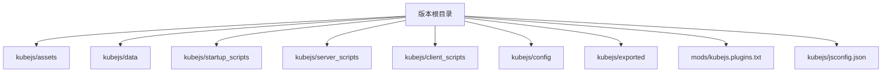
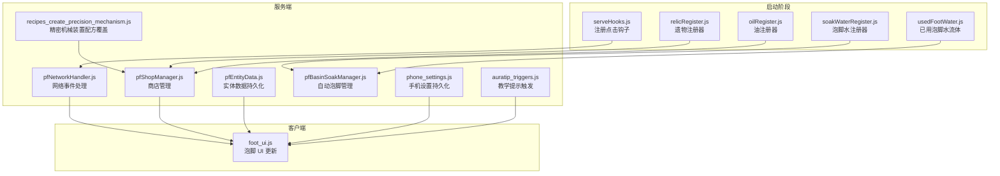
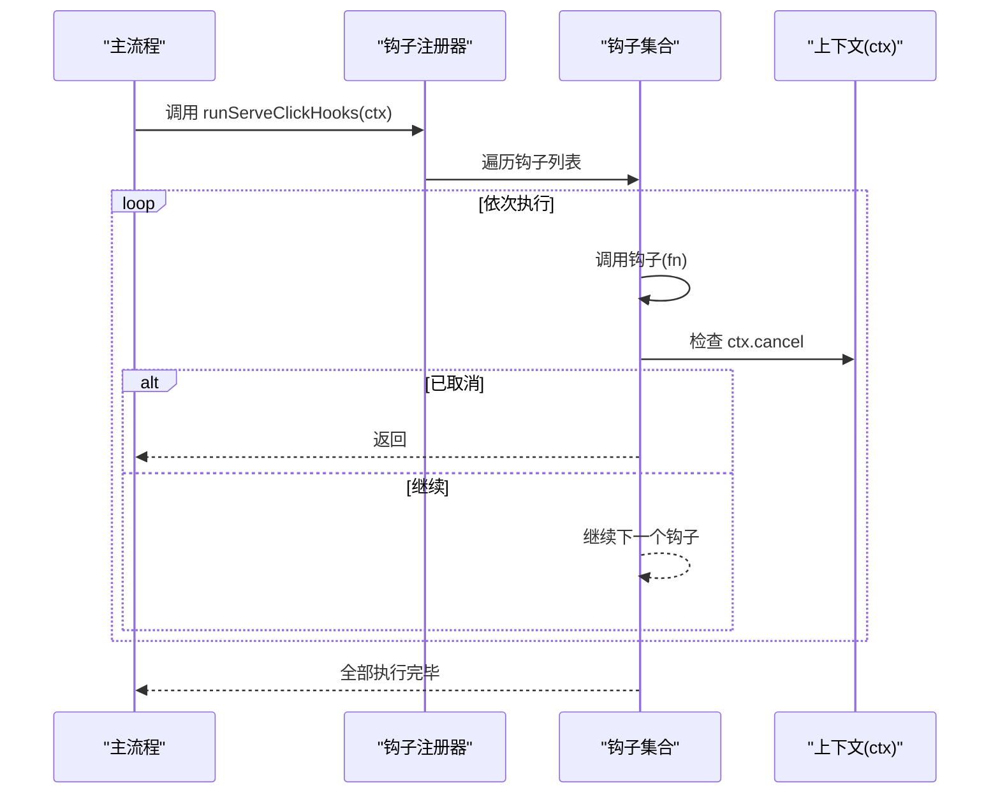
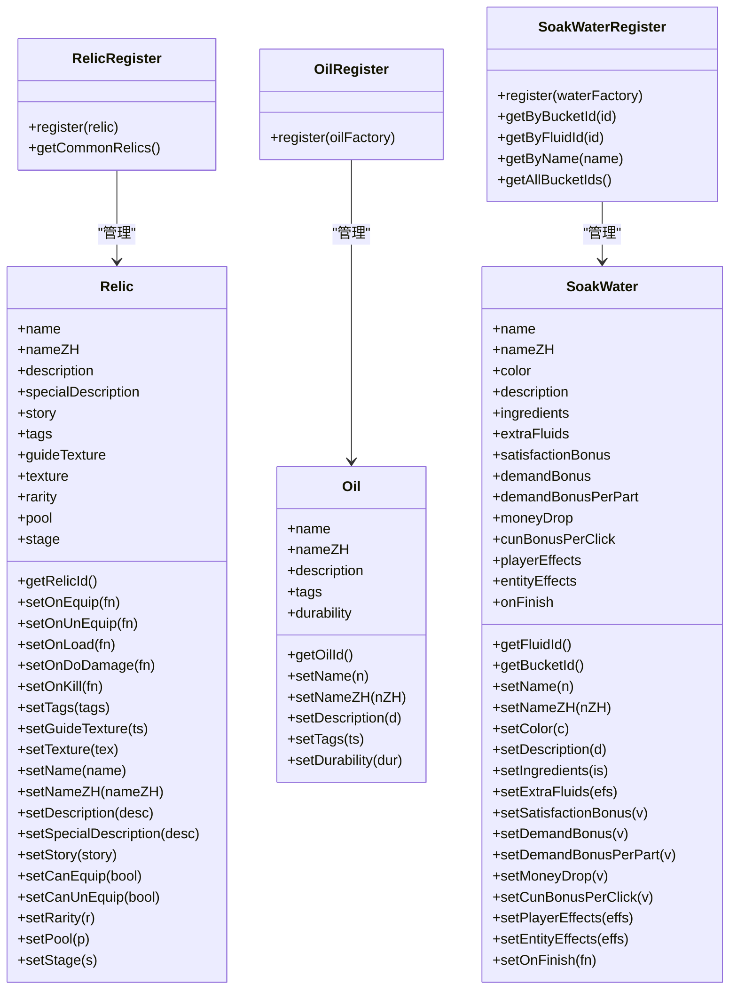
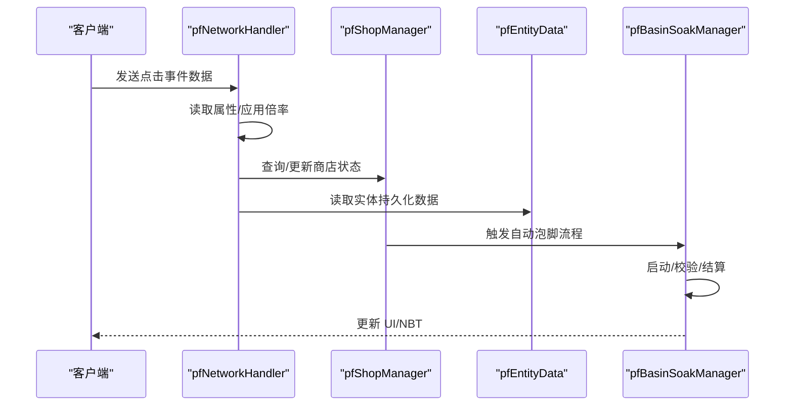
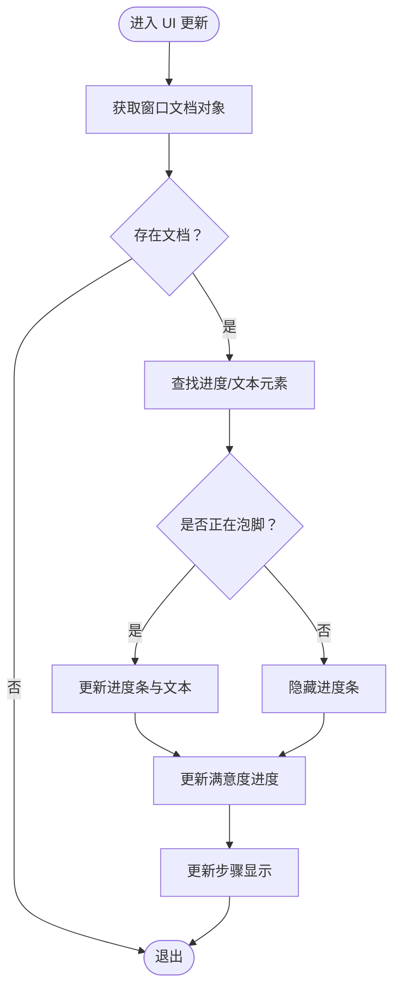
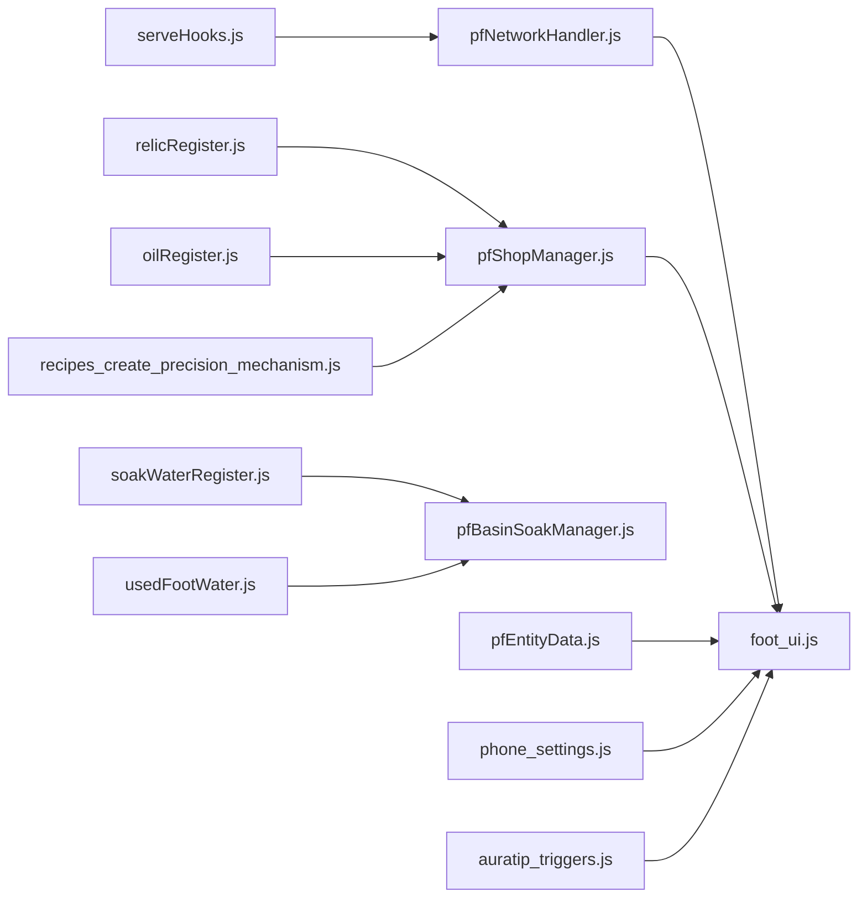

# 扩展开发

<cite>
**本文引用的文件**
- [README.md](file://README.md)
- [kubejs/README.txt](file://kubejs/README.txt)
- [mods/kubejs.plugins.txt](file://mods/kubejs.plugins.txt)
- [kubejs/jsconfig.json](file://kubejs/jsconfig.json)
- [kubejs/startup_scripts/serveHooks.js](file://kubejs/startup_scripts/serveHooks.js)
- [kubejs/startup_scripts/example.js](file://kubejs/startup_scripts/example.js)
- [kubejs/startup_scripts/soakwater/soakWaterRegister.js](file://kubejs/startup_scripts/soakwater/soakWaterRegister.js)
- [kubejs/startup_scripts/soakwater/usedFootWater.js](file://kubejs/startup_scripts/soakwater/usedFootWater.js)
- [kubejs/startup_scripts/oil/oilRegister.js](file://kubejs/startup_scripts/oil/oilRegister.js)
- [kubejs/startup_scripts/relic/relicRegister.js](file://kubejs/startup_scripts/relic/relicRegister.js)
- [kubejs/server_scripts/pathfinder/pfBasinSoakManager.js](file://kubejs/server_scripts/pathfinder/pfBasinSoakManager.js)
- [kubejs/server_scripts/pathfinder/pfNetworkHandler.js](file://kubejs/server_scripts/pathfinder/pfNetworkHandler.js)
- [kubejs/server_scripts/pathfinder/pfShopManager.js](file://kubejs/server_scripts/pathfinder/pfShopManager.js)
- [kubejs/server_scripts/pathfinder/pfEntityData.js](file://kubejs/server_scripts/pathfinder/pfEntityData.js)
- [kubejs/server_scripts/phone_settings.js](file://kubejs/server_scripts/phone_settings.js)
- [kubejs/server_scripts/auratip_triggers.js](file://kubejs/server_scripts/auratip_triggers.js)
- [kubejs/client_scripts/ui/foot_ui.js](file://kubejs/client_scripts/ui/foot_ui.js)
- [kubejs/server_scripts/recipes/recipes_create_precision_mechanism.js](file://kubejs/server_scripts/recipes/recipes_create_precision_mechanism.js)
</cite>

## 目录
1. [简介](#简介)
2. [项目结构](#项目结构)
3. [核心组件](#核心组件)
4. [架构总览](#架构总览)
5. [详细组件分析](#详细组件分析)
6. [依赖分析](#依赖分析)
7. [性能考虑](#性能考虑)
8. [故障排查指南](#故障排查指南)
9. [结论](#结论)
10. [附录](#附录)

## 简介
本指南面向希望在现有框架基础上开发新功能模块与插件的社区贡献者。内容涵盖：
- 钩子系统的扩展机制与使用
- 注册器模式的设计与实现
- 插件开发最佳实践与流程
- 接口设计规范与向后兼容性保障
- 集成测试方法与常见问题排查
- 示例路径与模板建议

## 项目结构
该版本仓库围绕 KubeJS 脚本体系组织扩展资源，主要目录与职责如下：
- kubejs/assets：客户端资源包，包含纹理、模型、语言等
- kubejs/data：服务端数据包，包含函数、战利品表、标签等
- kubejs/startup_scripts：启动阶段一次性加载的脚本，用于注册实体、流体、注册器等
- kubejs/server_scripts：服务器资源重载时加载的脚本，用于处理事件、网络、配方等
- kubejs/client_scripts：客户端资源重载时加载的脚本，用于 UI、提示、JEI 等
- kubejs/config：KubeJS 配置存储（脚本可访问）
- kubejs/exported：数据转储输出
- mods/kubejs.plugins.txt：声明启用的插件类
- kubejs/jsconfig.json：脚本编译配置（ES 版本、根目录）

图表来源
- [kubejs/README.txt:1-15](file://kubejs/README.txt#L1-L15)
- [mods/kubejs.plugins.txt:1-1](file://mods/kubejs.plugins.txt#L1-L1)
- [kubejs/jsconfig.json:1-16](file://kubejs/jsconfig.json#L1-L16)

章节来源
- [kubejs/README.txt:1-15](file://kubejs/README.txt#L1-L15)
- [mods/kubejs.plugins.txt:1-1](file://mods/kubejs.plugins.txt#L1-L1)
- [kubejs/jsconfig.json:1-16](file://kubejs/jsconfig.json#L1-L16)

## 核心组件
- 钩子系统（Serve Click Hooks）
  - 通过全局数组维护钩子函数列表，在关键节点集中执行，支持中途取消
  - 支持注册与运行两个阶段，便于将“额外功能”从主流程拆分
- 注册器模式（Relic/Oil/SoakWater）
  - 统一收集扩展定义，提供链式 API，便于扩展与维护
  - 支持按类型分类、阶段划分、查询检索等能力
- 服务端模块（Pathfinder 系列）
  - 包含网络事件处理、商店管理、实体数据持久化、自动泡脚管理等
- 客户端 UI（Foot UI）
  - 提供泡脚倒计时、满意度、步骤数等界面更新逻辑
- 插件入口（KubeJS Plugins）
  - 通过 plugins.txt 声明启用的插件类，确保运行期加载

章节来源
- [kubejs/startup_scripts/serveHooks.js:1-31](file://kubejs/startup_scripts/serveHooks.js#L1-L31)
- [kubejs/startup_scripts/relic/relicRegister.js:1-178](file://kubejs/startup_scripts/relic/relicRegister.js#L1-L178)
- [kubejs/startup_scripts/oil/oilRegister.js:1-61](file://kubejs/startup_scripts/oil/oilRegister.js#L1-L61)
- [kubejs/startup_scripts/soakwater/soakWaterRegister.js:1-121](file://kubejs/startup_scripts/soakwater/soakWaterRegister.js#L1-L121)
- [kubejs/server_scripts/pathfinder/pfNetworkHandler.js:1-40](file://kubejs/server_scripts/pathfinder/pfNetworkHandler.js#L1-L40)
- [kubejs/server_scripts/pathfinder/pfShopManager.js:69-299](file://kubejs/server_scripts/pathfinder/pfShopManager.js#L69-L299)
- [kubejs/server_scripts/pathfinder/pfEntityData.js:178-217](file://kubejs/server_scripts/pathfinder/pfEntityData.js#L178-L217)
- [kubejs/server_scripts/pathfinder/pfBasinSoakManager.js:1-26](file://kubejs/server_scripts/pathfinder/pfBasinSoakManager.js#L1-L26)
- [kubejs/client_scripts/ui/foot_ui.js:376-716](file://kubejs/client_scripts/ui/foot_ui.js#L376-L716)
- [mods/kubejs.plugins.txt:1-1](file://mods/kubejs.plugins.txt#L1-L1)

## 架构总览
整体架构以 KubeJS 事件驱动为核心，通过启动阶段注册器与服务端/客户端脚本协同工作，形成“注册-事件-交互-持久化”的闭环。

图表来源
- [kubejs/startup_scripts/serveHooks.js:1-31](file://kubejs/startup_scripts/serveHooks.js#L1-L31)
- [kubejs/startup_scripts/relic/relicRegister.js:1-178](file://kubejs/startup_scripts/relic/relicRegister.js#L1-L178)
- [kubejs/startup_scripts/oil/oilRegister.js:1-61](file://kubejs/startup_scripts/oil/oilRegister.js#L1-L61)
- [kubejs/startup_scripts/soakwater/soakWaterRegister.js:1-121](file://kubejs/startup_scripts/soakwater/soakWaterRegister.js#L1-L121)
- [kubejs/startup_scripts/soakwater/usedFootWater.js:1-30](file://kubejs/startup_scripts/soakwater/usedFootWater.js#L1-L30)
- [kubejs/server_scripts/pathfinder/pfNetworkHandler.js:1-40](file://kubejs/server_scripts/pathfinder/pfNetworkHandler.js#L1-L40)
- [kubejs/server_scripts/pathfinder/pfShopManager.js:69-299](file://kubejs/server_scripts/pathfinder/pfShopManager.js#L69-L299)
- [kubejs/server_scripts/pathfinder/pfEntityData.js:178-217](file://kubejs/server_scripts/pathfinder/pfEntityData.js#L178-L217)
- [kubejs/server_scripts/pathfinder/pfBasinSoakManager.js:1-26](file://kubejs/server_scripts/pathfinder/pfBasinSoakManager.js#L1-L26)
- [kubejs/server_scripts/phone_settings.js:1-40](file://kubejs/server_scripts/phone_settings.js#L1-L40)
- [kubejs/server_scripts/auratip_triggers.js:1-212](file://kubejs/server_scripts/auratip_triggers.js#L1-L212)
- [kubejs/server_scripts/recipes/recipes_create_precision_mechanism.js:52-130](file://kubejs/server_scripts/recipes/recipes_create_precision_mechanism.js#L52-L130)
- [kubejs/client_scripts/ui/foot_ui.js:376-716](file://kubejs/client_scripts/ui/foot_ui.js#L376-L716)

## 详细组件分析

### 钩子系统（Serve Click Hooks）
- 设计目标
  - 将“额外功能”（如抹油、连击奖励等）从主流程拆分
  - 主流程只在关键节点调用一次钩子
  - 通过独立 server_scripts 文件注册钩子接入
- 关键接口
  - 注册：registerServeClickHook(fn)
  - 运行：runServeClickHooks(ctx)，支持 ctx.cancel 中断
- 执行流程
  - 启动阶段收集钩子
  - 关键节点遍历执行，异常捕获并记录日志
  - 若 ctx.cancel 为真，则提前终止后续钩子

图表来源
- [kubejs/startup_scripts/serveHooks.js:11-30](file://kubejs/startup_scripts/serveHooks.js#L11-L30)

章节来源
- [kubejs/startup_scripts/serveHooks.js:1-31](file://kubejs/startup_scripts/serveHooks.js#L1-L31)

### 注册器模式（Relic/Oil/SoakWater）
- 设计目标
  - 统一收集扩展定义，提供链式 API，保持一致的注册体验
  - 支持按类型分类、阶段划分、查询检索等能力
- 关键接口
  - register(factory)：接收工厂函数，生成实例并加入集合
  - getByXxx：按桶 ID、流体 ID、名称等查询
  - 链式 setter：setName、setNameZH、setColor、setIngredients、setSatisfactionBonus、setPlayerEffects、setOnFinish 等
- 实现要点
  - 通过全局对象暴露注册器实例
  - 工厂函数内调用链式 API 完成配置
  - 服务端/客户端脚本通过注册器查询并应用效果

图表来源
- [kubejs/startup_scripts/relic/relicRegister.js:3-42](file://kubejs/startup_scripts/relic/relicRegister.js#L3-L42)
- [kubejs/startup_scripts/relic/relicRegister.js:81-176](file://kubejs/startup_scripts/relic/relicRegister.js#L81-L176)
- [kubejs/startup_scripts/oil/oilRegister.js:9-61](file://kubejs/startup_scripts/oil/oilRegister.js#L9-L61)
- [kubejs/startup_scripts/soakwater/soakWaterRegister.js:40-121](file://kubejs/startup_scripts/soakwater/soakWaterRegister.js#L40-L121)

章节来源
- [kubejs/startup_scripts/relic/relicRegister.js:1-178](file://kubejs/startup_scripts/relic/relicRegister.js#L1-L178)
- [kubejs/startup_scripts/oil/oilRegister.js:1-61](file://kubejs/startup_scripts/oil/oilRegister.js#L1-L61)
- [kubejs/startup_scripts/soakwater/soakWaterRegister.js:1-121](file://kubejs/startup_scripts/soakwater/soakWaterRegister.js#L1-L121)

### 服务端模块（Pathfinder 系列）
- 网络事件处理（pfNetworkHandler）
  - 读取属性值（带 fallback）
  - 应用 Boss 满意度倍率
  - 监听客户端点击事件并处理
- 商店管理（pfShopManager）
  - 持久化商店基础坐标、蓝标位置、已生成实体 UUID 列表
  - 提供开关店、计时、状态查询等 API
- 实体数据持久化（pfEntityData）
  - 存取实体的路线、时间、阶段、床信息、睡眠相关状态等
- 自动泡脚管理（pfBasinSoakManager）
  - 与 Create 工作盆联动，自动触发泡脚、校验与结算
  - 与 UI 共享 NBT 字段，保持倒计时 HUD 兼容

图表来源
- [kubejs/server_scripts/pathfinder/pfNetworkHandler.js:1-40](file://kubejs/server_scripts/pathfinder/pfNetworkHandler.js#L1-L40)
- [kubejs/server_scripts/pathfinder/pfShopManager.js:69-299](file://kubejs/server_scripts/pathfinder/pfShopManager.js#L69-L299)
- [kubejs/server_scripts/pathfinder/pfEntityData.js:178-217](file://kubejs/server_scripts/pathfinder/pfEntityData.js#L178-L217)
- [kubejs/server_scripts/pathfinder/pfBasinSoakManager.js:1-26](file://kubejs/server_scripts/pathfinder/pfBasinSoakManager.js#L1-L26)

章节来源
- [kubejs/server_scripts/pathfinder/pfNetworkHandler.js:1-40](file://kubejs/server_scripts/pathfinder/pfNetworkHandler.js#L1-L40)
- [kubejs/server_scripts/pathfinder/pfShopManager.js:69-299](file://kubejs/server_scripts/pathfinder/pfShopManager.js#L69-L299)
- [kubejs/server_scripts/pathfinder/pfEntityData.js:178-217](file://kubejs/server_scripts/pathfinder/pfEntityData.js#L178-L217)
- [kubejs/server_scripts/pathfinder/pfBasinSoakManager.js:1-26](file://kubejs/server_scripts/pathfinder/pfBasinSoakManager.js#L1-L26)

### 客户端 UI（Foot UI）
- 功能概述
  - 更新泡脚倒计时进度条与文本
  - 更新满意度横向进度条
  - 更新步骤显示
- 实现要点
  - 通过 DOM 查询与属性设置更新界面
  - 异常捕获并记录日志，避免 UI 更新导致崩溃

图表来源
- [kubejs/client_scripts/ui/foot_ui.js:376-716](file://kubejs/client_scripts/ui/foot_ui.js#L376-L716)

章节来源
- [kubejs/client_scripts/ui/foot_ui.js:376-716](file://kubejs/client_scripts/ui/foot_ui.js#L376-L716)

### 插件入口（KubeJS Plugins）
- 通过 mods/kubejs.plugins.txt 声明启用的插件类
- 确保运行期加载，避免遗漏导致功能缺失

章节来源
- [mods/kubejs.plugins.txt:1-1](file://mods/kubejs.plugins.txt#L1-L1)

## 依赖分析
- 组件耦合
  - 钩子系统与网络事件处理存在直接调用关系
  - 注册器为服务端/客户端提供统一的数据源
  - 自动泡脚管理依赖流体注册与实体数据持久化
- 外部依赖
  - KubeJS 事件系统（StartupEvents、ServerEvents、NetworkEvents 等）
  - Forge/Mod API（Create、JEI、TipTriggers 等）
- 循环依赖
  - 未发现明显循环依赖；各模块通过全局对象与事件进行解耦

图表来源
- [kubejs/startup_scripts/serveHooks.js:1-31](file://kubejs/startup_scripts/serveHooks.js#L1-L31)
- [kubejs/server_scripts/pathfinder/pfNetworkHandler.js:1-40](file://kubejs/server_scripts/pathfinder/pfNetworkHandler.js#L1-L40)
- [kubejs/startup_scripts/relic/relicRegister.js:1-178](file://kubejs/startup_scripts/relic/relicRegister.js#L1-L178)
- [kubejs/startup_scripts/oil/oilRegister.js:1-61](file://kubejs/startup_scripts/oil/oilRegister.js#L1-L61)
- [kubejs/startup_scripts/soakwater/soakWaterRegister.js:1-121](file://kubejs/startup_scripts/soakwater/soakWaterRegister.js#L1-L121)
- [kubejs/startup_scripts/soakwater/usedFootWater.js:1-30](file://kubejs/startup_scripts/soakwater/usedFootWater.js#L1-L30)
- [kubejs/server_scripts/pathfinder/pfShopManager.js:69-299](file://kubejs/server_scripts/pathfinder/pfShopManager.js#L69-L299)
- [kubejs/server_scripts/pathfinder/pfBasinSoakManager.js:1-26](file://kubejs/server_scripts/pathfinder/pfBasinSoakManager.js#L1-L26)
- [kubejs/server_scripts/pathfinder/pfEntityData.js:178-217](file://kubejs/server_scripts/pathfinder/pfEntityData.js#L178-L217)
- [kubejs/server_scripts/phone_settings.js:1-40](file://kubejs/server_scripts/phone_settings.js#L1-L40)
- [kubejs/server_scripts/auratip_triggers.js:1-212](file://kubejs/server_scripts/auratip_triggers.js#L1-L212)
- [kubejs/client_scripts/ui/foot_ui.js:376-716](file://kubejs/client_scripts/ui/foot_ui.js#L376-L716)
- [kubejs/server_scripts/recipes/recipes_create_precision_mechanism.js:52-130](file://kubejs/server_scripts/recipes/recipes_create_precision_mechanism.js#L52-L130)

章节来源
- [kubejs/startup_scripts/serveHooks.js:1-31](file://kubejs/startup_scripts/serveHooks.js#L1-L31)
- [kubejs/server_scripts/pathfinder/pfNetworkHandler.js:1-40](file://kubejs/server_scripts/pathfinder/pfNetworkHandler.js#L1-L40)
- [kubejs/startup_scripts/relic/relicRegister.js:1-178](file://kubejs/startup_scripts/relic/relicRegister.js#L1-L178)
- [kubejs/startup_scripts/oil/oilRegister.js:1-61](file://kubejs/startup_scripts/oil/oilRegister.js#L1-L61)
- [kubejs/startup_scripts/soakwater/soakWaterRegister.js:1-121](file://kubejs/startup_scripts/soakwater/soakWaterRegister.js#L1-L121)
- [kubejs/startup_scripts/soakwater/usedFootWater.js:1-30](file://kubejs/startup_scripts/soakwater/usedFootWater.js#L1-L30)
- [kubejs/server_scripts/pathfinder/pfShopManager.js:69-299](file://kubejs/server_scripts/pathfinder/pfShopManager.js#L69-L299)
- [kubejs/server_scripts/pathfinder/pfBasinSoakManager.js:1-26](file://kubejs/server_scripts/pathfinder/pfBasinSoakManager.js#L1-L26)
- [kubejs/server_scripts/pathfinder/pfEntityData.js:178-217](file://kubejs/server_scripts/pathfinder/pfEntityData.js#L178-L217)
- [kubejs/server_scripts/phone_settings.js:1-40](file://kubejs/server_scripts/phone_settings.js#L1-L40)
- [kubejs/server_scripts/auratip_triggers.js:1-212](file://kubejs/server_scripts/auratip_triggers.js#L1-L212)
- [kubejs/client_scripts/ui/foot_ui.js:376-716](file://kubejs/client_scripts/ui/foot_ui.js#L376-L716)
- [kubejs/server_scripts/recipes/recipes_create_precision_mechanism.js:52-130](file://kubejs/server_scripts/recipes/recipes_create_precision_mechanism.js#L52-L130)

## 性能考虑
- 钩子执行
  - 避免在钩子中执行重型同步操作；必要时异步或延迟处理
  - 使用 ctx.cancel 提前中断无效后续处理
- 注册器查询
  - 对频繁查询的集合建立索引（如按桶 ID/流体 ID）以降低遍历成本
- UI 更新
  - 批量更新 DOM，减少重排与重绘
  - 对异常进行捕获，避免单次更新失败影响整体 UI
- 事件处理
  - 服务端事件处理应尽量轻量化，复杂逻辑放入后台任务或延迟队列

## 故障排查指南
- 插件未加载
  - 检查 mods/kubejs.plugins.txt 是否包含正确的插件类名
- 钩子不生效
  - 确认钩子已通过 registerServeClickHook 注册
  - 检查 runServeClickHooks 的调用时机与 ctx.cancel 逻辑
- 注册器未找到数据
  - 确认扩展脚本在启动阶段正确执行
  - 检查注册器查询方法（按桶 ID/流体 ID/名称）是否传入正确参数
- UI 不更新
  - 检查窗口文档对象是否存在
  - 查看客户端日志中是否有异常信息
- 网络事件无响应
  - 确认客户端发送了正确的数据键
  - 检查服务端网络处理器是否正确注册监听

章节来源
- [mods/kubejs.plugins.txt:1-1](file://mods/kubejs.plugins.txt#L1-L1)
- [kubejs/startup_scripts/serveHooks.js:11-30](file://kubejs/startup_scripts/serveHooks.js#L11-L30)
- [kubejs/startup_scripts/soakwater/soakWaterRegister.js:53-82](file://kubejs/startup_scripts/soakwater/soakWaterRegister.js#L53-L82)
- [kubejs/client_scripts/ui/foot_ui.js:376-716](file://kubejs/client_scripts/ui/foot_ui.js#L376-L716)
- [kubejs/server_scripts/pathfinder/pfNetworkHandler.js:36-40](file://kubejs/server_scripts/pathfinder/pfNetworkHandler.js#L36-L40)

## 结论
本项目通过钩子系统与注册器模式实现了高内聚、低耦合的扩展机制，配合服务端/客户端脚本协同，形成了完整的功能闭环。遵循本文提供的接口设计规范与最佳实践，可以高效、安全地开发新功能模块与插件，并保证向后兼容性与可维护性。

## 附录
- 新功能开发流程
  - 识别扩展点：确定钩子位置、注册器入口或事件监听点
  - 设计接口：定义链式 API 或工厂函数，保持与现有注册器一致
  - 编写脚本：在 startup_scripts/server_scripts/client_scripts 中实现
  - 集成测试：使用命令与日志验证功能，检查 UI 与服务端状态
  - 文档与回滚：补充说明与注释，保留兼容方案
- 接口设计规范
  - 链式 API：每个 setter 返回 this，便于连续调用
  - 查询接口：提供多维度查询方法（ID/名称/类型）
  - 事件契约：明确请求/响应字段与错误处理
- 集成测试方法
  - 使用命令触发事件（如 auratip_*、phone 设置）
  - 观察日志输出与 UI 变化
  - 检查持久化数据（persistentData）是否正确更新
- 示例与模板
  - 遗物注册器模板：参考 [relicRegister.js:1-178](file://kubejs/startup_scripts/relic/relicRegister.js#L1-L178)
  - 油注册器模板：参考 [oilRegister.js:1-61](file://kubejs/startup_scripts/oil/oilRegister.js#L1-L61)
  - 泡脚水注册器模板：参考 [soakWaterRegister.js:1-121](file://kubejs/startup_scripts/soakwater/soakWaterRegister.js#L1-L121)
  - 钩子注册与运行：参考 [serveHooks.js:1-31](file://kubejs/startup_scripts/serveHooks.js#L1-L31)
  - 教学提示触发器：参考 [auratip_triggers.js:1-212](file://kubejs/server_scripts/auratip_triggers.js#L1-L212)
  - 精密机械装置配方覆盖：参考 [recipes_create_precision_mechanism.js:52-130](file://kubejs/server_scripts/recipes/recipes_create_precision_mechanism.js#L52-L130)
  - 安装与环境：参考 [README.md:1-6](file://README.md#L1-L6)

章节来源
- [kubejs/startup_scripts/relic/relicRegister.js:1-178](file://kubejs/startup_scripts/relic/relicRegister.js#L1-L178)
- [kubejs/startup_scripts/oil/oilRegister.js:1-61](file://kubejs/startup_scripts/oil/oilRegister.js#L1-L61)
- [kubejs/startup_scripts/soakwater/soakWaterRegister.js:1-121](file://kubejs/startup_scripts/soakwater/soakWaterRegister.js#L1-L121)
- [kubejs/startup_scripts/serveHooks.js:1-31](file://kubejs/startup_scripts/serveHooks.js#L1-L31)
- [kubejs/server_scripts/auratip_triggers.js:1-212](file://kubejs/server_scripts/auratip_triggers.js#L1-L212)
- [kubejs/server_scripts/recipes/recipes_create_precision_mechanism.js:52-130](file://kubejs/server_scripts/recipes/recipes_create_precision_mechanism.js#L52-L130)
- [README.md:1-6](file://README.md#L1-L6)