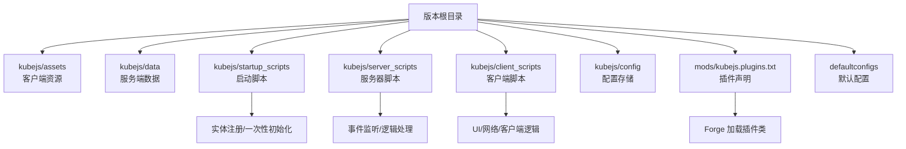
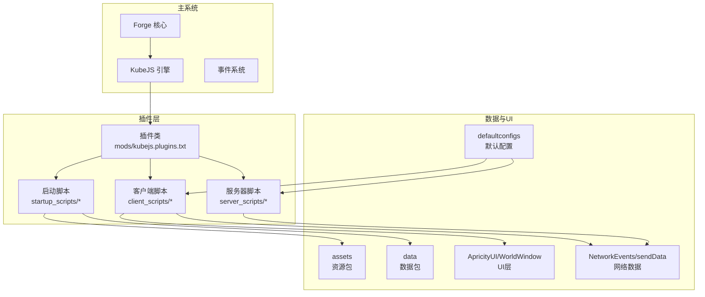
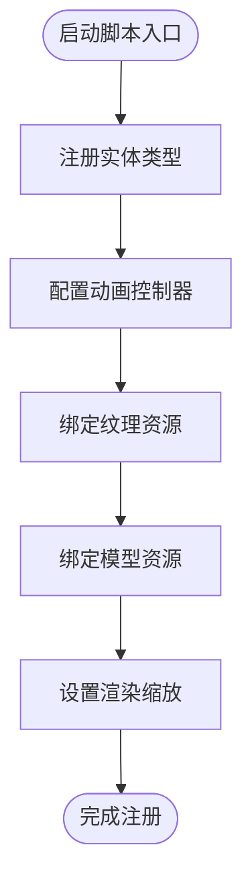
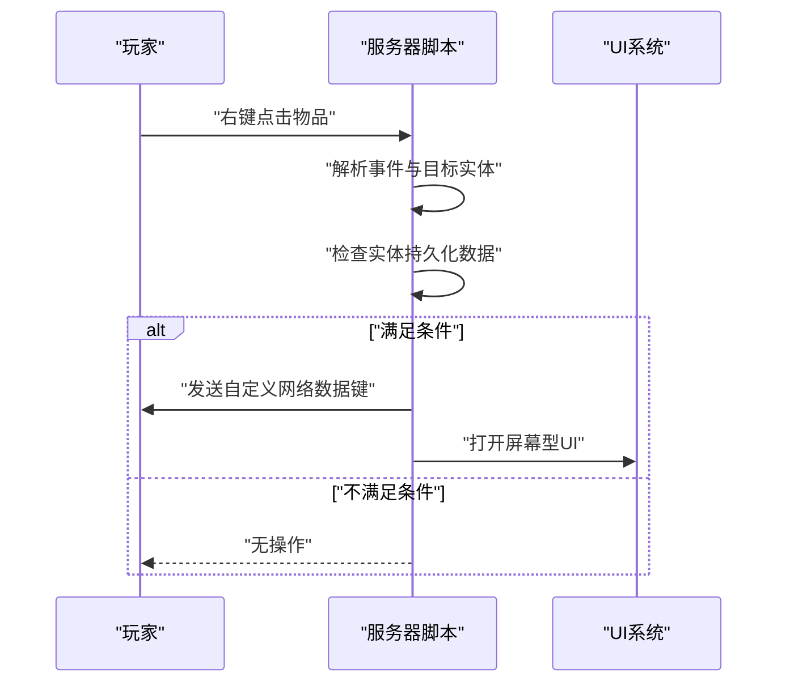
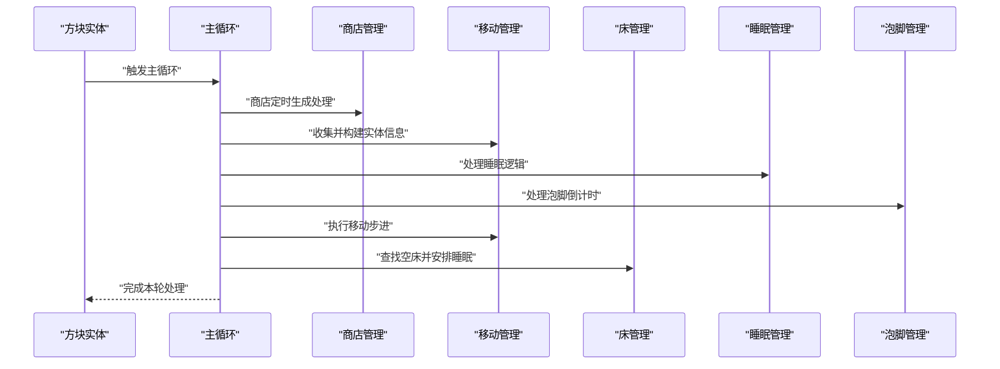
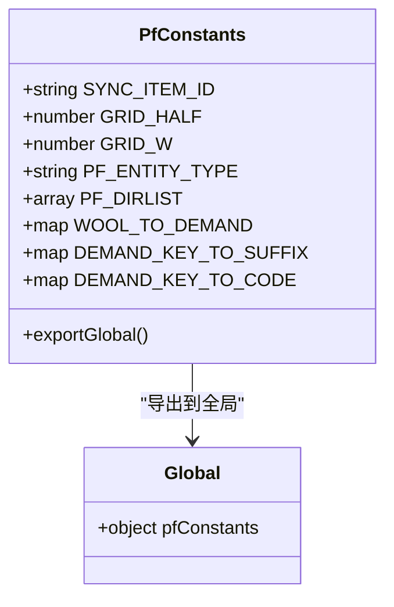
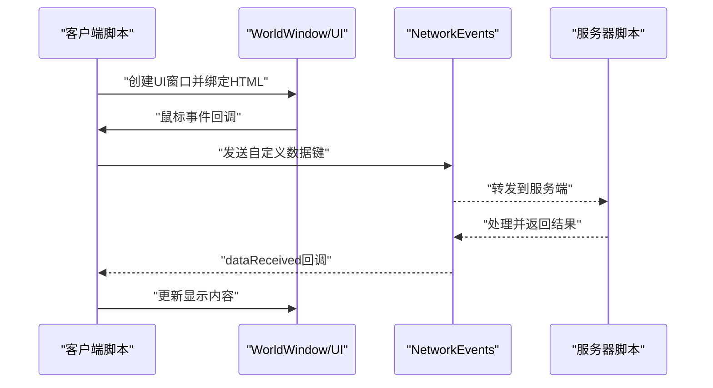
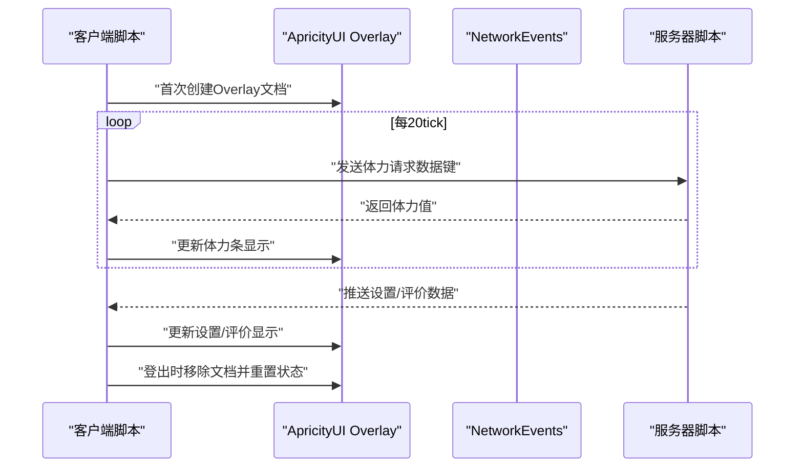
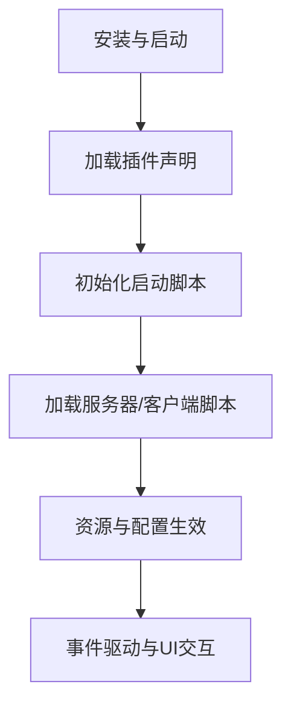
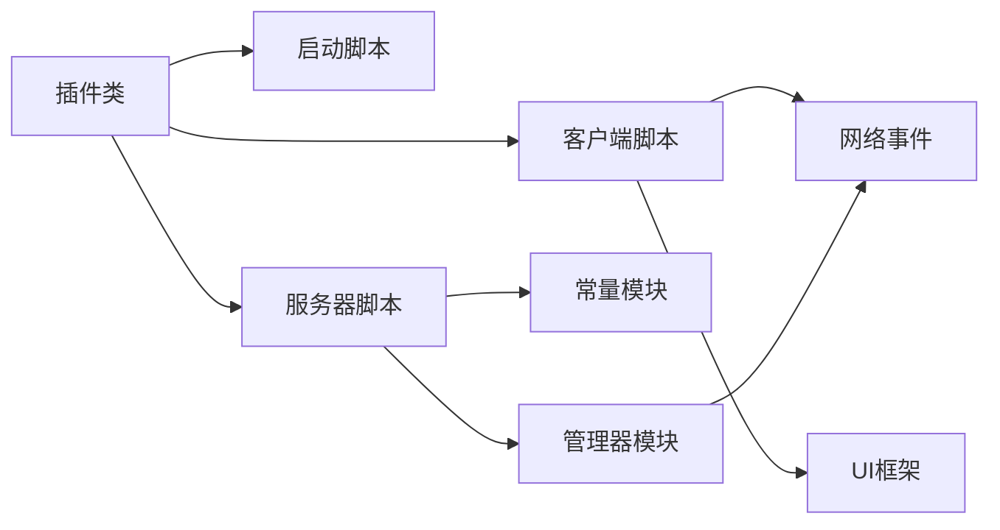

# 插件开发指南

<cite>
**本文引用的文件**
- [README.md](file://README.md)
- [kubejs/README.txt](file://kubejs/README.txt)
- [kubejs/jsconfig.json](file://kubejs/jsconfig.json)
- [mods/kubejs.plugins.txt](file://mods/kubejs.plugins.txt)
- [kubejs/startup_scripts/example.js](file://kubejs/startup_scripts/example.js)
- [kubejs/server_scripts/example.js](file://kubejs/server_scripts/example.js)
- [kubejs/server_scripts/pathfinder/pfMain.js](file://kubejs/server_scripts/pathfinder/pfMain.js)
- [kubejs/server_scripts/pathfinder/pfConstants.js](file://kubejs/server_scripts/pathfinder/pfConstants.js)
- [kubejs/client_scripts/ui/foot_ui.js](file://kubejs/client_scripts/ui/foot_ui.js)
- [kubejs/client_scripts/ui/stamina_hud.js](file://kubejs/client_scripts/ui/stamina_hud.js)
- [kubejs/client_scripts/ui/phone_ui.js](file://kubejs/client_scripts/ui/phone_ui.js)
- [kubejs/assets/kubejs/apricity/footui.html](file://kubejs/assets/kubejs/apricity/footui.html)
- [defaultconfigs/ftblibrary/ftblibrary-client.snbt](file://defaultconfigs/ftblibrary/ftblibrary-client.snbt)
</cite>

## 目录
1. [引言](#引言)
2. [项目结构](#项目结构)
3. [核心组件](#核心组件)
4. [架构总览](#架构总览)
5. [详细组件分析](#详细组件分析)
6. [依赖分析](#依赖分析)
7. [性能考虑](#性能考虑)
8. [故障排查指南](#故障排查指南)
9. [结论](#结论)
10. [附录](#附录)

## 引言
本指南面向希望在现有Minecraft Forge + KubeJS环境中开发插件的开发者，提供从概念到实现的完整路径。该仓库展示了如何通过KubeJS脚本系统扩展实体注册、事件监听、客户端UI与网络数据交换，并通过插件声明文件进行集成。读者将学会插件生命周期、配置管理、依赖处理、测试与调试、性能优化以及发布与版本管理策略。

## 项目结构
该版本目录采用“资源包+数据包”的组织方式，配合KubeJS脚本目录与插件声明文件，形成可热加载、可维护的插件体系。核心目录与职责如下：
- kubejs/assets：客户端资源（纹理、模型、语言、声音等），作为资源包被游戏加载
- kubejs/data：服务端数据（配方、战利品表、函数等），作为数据包被游戏加载
- kubejs/startup_scripts：启动脚本，仅在游戏启动时加载一次，适合注册实体、标签等一次性操作
- kubejs/server_scripts：服务器脚本，每次资源重载时加载，适合事件监听与逻辑处理
- kubejs/client_scripts：客户端脚本，每次资源重载时加载，适合UI、事件与网络数据处理
- kubejs/config：KubeJS配置存储目录（脚本可访问）
- kubejs/exported：导出的数据（如图集等）
- mods/kubejs.plugins.txt：声明插件类，使Forge识别并加载插件
- defaultconfigs：默认配置文件，用于客户端/服务端默认行为覆盖
- README.md：安装与运行说明

图表来源
- [kubejs/README.txt:1-15](file://kubejs/README.txt#L1-L15)
- [mods/kubejs.plugins.txt:1-1](file://mods/kubejs.plugins.txt#L1-L1)

章节来源
- [kubejs/README.txt:1-15](file://kubejs/README.txt#L1-L15)
- [README.md:1-6](file://README.md#L1-L6)

## 核心组件
- 插件声明与加载
  - 通过mods/kubejs.plugins.txt声明插件类，Forge在启动时加载该类，实现与主系统的集成
- 脚本生命周期
  - 启动脚本：仅一次加载，适合实体注册、一次性初始化
  - 服务器脚本：每次重载时加载，适合事件监听与逻辑处理
  - 客户端脚本：每次重载时加载，适合UI、事件与网络数据处理
- 数据交换机制
  - 服务器与客户端通过sendData/NetworkEvents进行轻量数据同步
  - 客户端UI通过WorldWindow/ApricityUI创建屏幕空间UI
- 配置管理
  - defaultconfigs提供默认配置文件，支持按需覆盖
  - KubeJS config目录提供脚本可访问的配置存储

章节来源
- [mods/kubejs.plugins.txt:1-1](file://mods/kubejs.plugins.txt#L1-L1)
- [kubejs/README.txt:8-12](file://kubejs/README.txt#L8-L12)
- [kubejs/client_scripts/ui/foot_ui.js:13-800](file://kubejs/client_scripts/ui/foot_ui.js#L1-L800)
- [kubejs/client_scripts/ui/stamina_hud.js:53-86](file://kubejs/client_scripts/ui/stamina_hud.js#L53-L86)
- [defaultconfigs/ftblibrary/ftblibrary-client.snbt:1-5](file://defaultconfigs/ftblibrary/ftblibrary-client.snbt#L1-L5)

## 架构总览
下图展示插件与主系统的集成方式、事件流与数据交换：

图表来源
- [mods/kubejs.plugins.txt:1-1](file://mods/kubejs.plugins.txt#L1-L1)
- [kubejs/README.txt:8-12](file://kubejs/README.txt#L8-L12)
- [kubejs/client_scripts/ui/foot_ui.js:13-800](file://kubejs/client_scripts/ui/foot_ui.js#L1-L800)
- [kubejs/client_scripts/ui/stamina_hud.js:53-86](file://kubejs/client_scripts/ui/stamina_hud.js#L53-L86)
- [defaultconfigs/ftblibrary/ftblibrary-client.snbt:1-5](file://defaultconfigs/ftblibrary/ftblibrary-client.snbt#L1-L5)

## 详细组件分析

### 组件A：实体注册与动画控制（启动脚本）
- 目标：在启动阶段注册自定义实体类型，配置尺寸、动画控制器、纹理与渲染缩放
- 关键点
  - 使用StartupEvents.registry注册实体类型
  - 通过animation controller定义可触发动画
  - 通过textureResource与modelResource绑定纹理与模型
  - 在scaleModelForRender中调整渲染缩放
- 流程图

图表来源
- [kubejs/startup_scripts/example.js:1-26](file://kubejs/startup_scripts/example.js#L1-L26)

章节来源
- [kubejs/startup_scripts/example.js:1-26](file://kubejs/startup_scripts/example.js#L1-L26)

### 组件B：事件监听与UI交互（服务器脚本）
- 目标：监听物品右键事件，根据目标实体状态决定打开UI或发送网络数据
- 关键点
  - ItemEvents.rightClicked监听事件
  - 通过persistentData判断实体状态（如寻路系统标记）
  - 使用ApricityUI.openScreen打开屏幕型UI
  - 通过player.sendData发送自定义数据键
- 时序图

图表来源
- [kubejs/server_scripts/example.js:1-24](file://kubejs/server_scripts/example.js#L1-L24)

章节来源
- [kubejs/server_scripts/example.js:1-24](file://kubejs/server_scripts/example.js#L1-L24)

### 组件C：寻路系统主循环（服务器脚本）
- 目标：整合多个子模块，提供每tick的主循环，协调实体收集、移动、睡眠、泡脚等逻辑
- 关键点
  - 从方块实体获取所在层级与坐标，计算当前tick
  - 分阶段处理不同状态的实体（等待、睡眠、行走、蓝色地毯）
  - 调用子模块处理商店、床、移动、睡眠、泡脚等逻辑
  - 使用pfEntityData读写实体持久化状态
- 时序图

图表来源
- [kubejs/server_scripts/pathfinder/pfMain.js:1-177](file://kubejs/server_scripts/pathfinder/pfMain.js#L1-L177)

章节来源
- [kubejs/server_scripts/pathfinder/pfMain.js:1-177](file://kubejs/server_scripts/pathfinder/pfMain.js#L1-L177)

### 组件D：常量定义与全局共享（服务器脚本）
- 目标：集中定义寻路系统相关常量，统一导出到全局命名空间
- 关键点
  - 定义同步物品ID、网格参数、实体类型、方向映射、部位映射等
  - 将常量集合导出到global.pfConstants供其他模块使用
- 类图

图表来源
- [kubejs/server_scripts/pathfinder/pfConstants.js:1-65](file://kubejs/server_scripts/pathfinder/pfConstants.js#L1-L65)

章节来源
- [kubejs/server_scripts/pathfinder/pfConstants.js:1-65](file://kubejs/server_scripts/pathfinder/pfConstants.js#L1-L65)

### 组件E：客户端UI与网络数据（客户端脚本）
- 目标：创建世界空间UI窗口，响应鼠标事件，与服务端进行数据交换
- 关键点
  - 使用WorldWindow创建UI窗口，绑定HTML资源
  - 通过mousemove事件计算拖动轨迹，达到阈值后发送自定义数据键
  - 通过NetworkEvents.dataReceived接收服务端推送的数据（如满意度、步骤、泡脚状态）
  - 通过sendData向服务端请求操作（如开始泡脚、送客）
- 时序图

图表来源
- [kubejs/client_scripts/ui/foot_ui.js:1-800](file://kubejs/client_scripts/ui/foot_ui.js#L1-L800)
- [kubejs/assets/kubejs/apricity/footui.html:1-14](file://kubejs/assets/kubejs/apricity/footui.html#L1-L14)

章节来源
- [kubejs/client_scripts/ui/foot_ui.js:1-800](file://kubejs/client_scripts/ui/foot_ui.js#L1-L800)
- [kubejs/assets/kubejs/apricity/footui.html:1-14](file://kubejs/assets/kubejs/apricity/footui.html#L1-L14)

### 组件F：HUD与设置同步（客户端脚本）
- 目标：通过Overlay显示体力条，周期性请求服务端数据并更新显示；接收服务端推送的设置与评价数据
- 关键点
  - 使用ApricityUI创建文档并保持初始化状态
  - 每20tick向服务端请求体力值
  - 通过NetworkEvents.dataReceived接收stamina_sync、phone_settings_sync、phone_ratings_sync等数据
  - 登出时清理UI与状态
- 时序图

图表来源
- [kubejs/client_scripts/ui/stamina_hud.js:53-86](file://kubejs/client_scripts/ui/stamina_hud.js#L53-L86)
- [kubejs/client_scripts/ui/phone_ui.js:13-56](file://kubejs/client_scripts/ui/phone_ui.js#L13-L56)

章节来源
- [kubejs/client_scripts/ui/stamina_hud.js:53-86](file://kubejs/client_scripts/ui/stamina_hud.js#L53-L86)
- [kubejs/client_scripts/ui/phone_ui.js:13-56](file://kubejs/client_scripts/ui/phone_ui.js#L13-L56)

### 概念总览
- 生命周期管理
  - 启动脚本：一次性初始化，注册实体与资源
  - 服务器脚本：随资源重载加载，处理事件与逻辑
  - 客户端脚本：随资源重载加载，处理UI与网络
- 配置管理
  - defaultconfigs提供默认配置，支持按需覆盖
  - KubeJS config目录提供脚本可访问的配置存储
- 依赖处理
  - 通过mods/kubejs.plugins.txt声明插件类，确保Forge正确加载
  - 通过jsconfig.json统一编译目标与根目录，便于IDE支持

图表来源
- [README.md:1-6](file://README.md#L1-L6)
- [mods/kubejs.plugins.txt:1-1](file://mods/kubejs.plugins.txt#L1-L1)
- [kubejs/README.txt:8-12](file://kubejs/README.txt#L8-L12)

## 依赖分析
- 组件耦合
  - 服务器脚本依赖常量模块与子管理器模块（商店、移动、睡眠、泡脚）
  - 客户端脚本依赖UI框架与网络事件，与服务器脚本通过数据键解耦
- 外部依赖
  - Forge：插件加载与事件调度
  - KubeJS：脚本引擎与资源包/数据包机制
  - ApricityUI：世界空间UI与Overlay
- 潜在风险
  - 服务器与客户端数据一致性：通过NBT与网络数据键同步
  - 性能热点：主循环中对实体的频繁查询与状态更新

图表来源
- [mods/kubejs.plugins.txt:1-1](file://mods/kubejs.plugins.txt#L1-L1)
- [kubejs/server_scripts/pathfinder/pfMain.js:1-177](file://kubejs/server_scripts/pathfinder/pfMain.js#L1-L177)
- [kubejs/server_scripts/pathfinder/pfConstants.js:1-65](file://kubejs/server_scripts/pathfinder/pfConstants.js#L1-L65)
- [kubejs/client_scripts/ui/foot_ui.js:1-800](file://kubejs/client_scripts/ui/foot_ui.js#L1-L800)

章节来源
- [kubejs/server_scripts/pathfinder/pfMain.js:1-177](file://kubejs/server_scripts/pathfinder/pfMain.js#L1-L177)
- [kubejs/server_scripts/pathfinder/pfConstants.js:1-65](file://kubejs/server_scripts/pathfinder/pfConstants.js#L1-L65)
- [kubejs/client_scripts/ui/foot_ui.js:1-800](file://kubejs/client_scripts/ui/foot_ui.js#L1-L800)

## 性能考虑
- 服务器主循环
  - 使用pfEntityData记录lastTick避免重复处理同一tick
  - 对实体状态判断与计算进行短路与边界检查
  - 将耗时操作拆分为子模块，减少单次循环负载
- 客户端UI
  - 使用WorldWindow按需创建与销毁窗口，避免常驻对象
  - 通过Overlay减少频繁DOM重建
  - 限制网络数据频率（如每20tick请求一次）
- 资源与配置
  - 将常量集中管理，减少重复计算
  - defaultconfigs仅存放必要默认项，避免冗余

## 故障排查指南
- 插件未加载
  - 检查mods/kubejs.plugins.txt是否存在且类名正确
  - 确认Forge版本与KubeJS版本兼容
- UI不显示或异常
  - 检查客户端脚本是否成功创建Overlay与WorldWindow
  - 确认HTML资源路径与文件存在
- 网络数据不同步
  - 检查sendData键名与NetworkEvents.dataReceived监听是否一致
  - 确认事件触发时机与数据结构
- 配置不生效
  - 检查defaultconfigs文件是否正确放置与命名
  - 确认脚本读取逻辑与键名一致

章节来源
- [mods/kubejs.plugins.txt:1-1](file://mods/kubejs.plugins.txt#L1-L1)
- [kubejs/client_scripts/ui/foot_ui.js:1-800](file://kubejs/client_scripts/ui/foot_ui.js#L1-L800)
- [kubejs/client_scripts/ui/stamina_hud.js:53-86](file://kubejs/client_scripts/ui/stamina_hud.js#L53-L86)
- [defaultconfigs/ftblibrary/ftblibrary-client.snbt:1-5](file://defaultconfigs/ftblibrary/ftblibrary-client.snbt#L1-L5)

## 结论
本指南基于现有仓库展示了在Forge + KubeJS环境下的插件开发路径：通过插件声明文件集成主系统，利用启动/服务器/客户端脚本实现功能扩展，借助UI框架与网络事件完成数据交换，并通过配置文件与常量模块实现可维护的架构。遵循生命周期管理、配置管理与依赖处理的最佳实践，可构建高性能、易维护的插件系统。

## 附录
- 开发模板与最佳实践
  - 启动脚本：仅做一次性初始化，避免复杂逻辑
  - 服务器脚本：事件驱动，模块化拆分，注意性能与幂等性
  - 客户端脚本：UI与网络分离，按需创建与销毁，降低内存占用
- 测试策略
  - 单元测试：针对纯函数与工具函数
  - 集成测试：模拟事件触发与网络数据交换
  - 回归测试：资源重载与配置覆盖场景
- 调试方法
  - 使用日志输出关键路径与状态
  - 利用IDE断点与脚本重载能力定位问题
- 发布与版本管理
  - 使用语义化版本，明确破坏性变更
  - 提供迁移指南与默认配置回退
- 向后兼容性
  - 保留旧键名与默认值，提供过渡期支持
  - 通过模块化设计隔离变更影响面