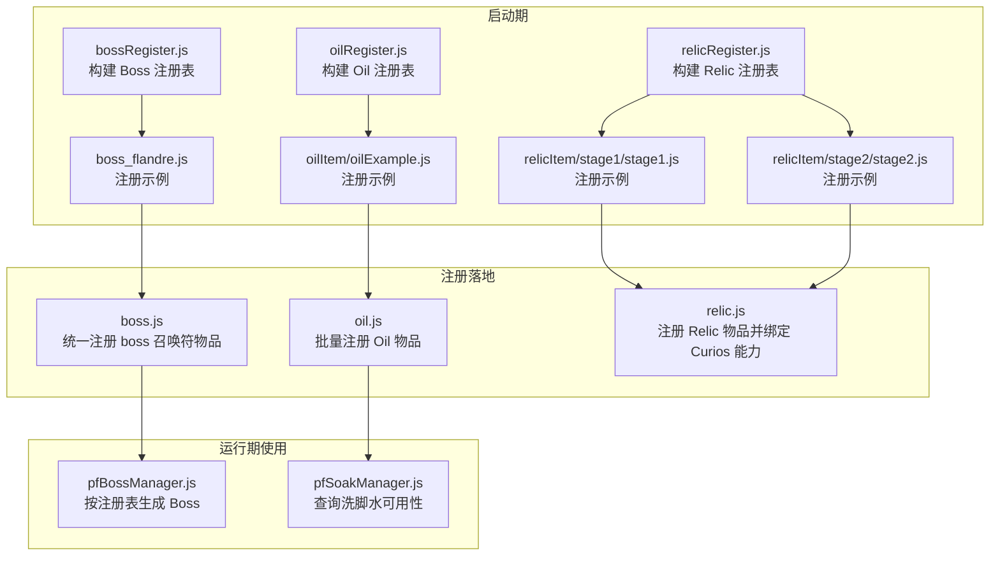
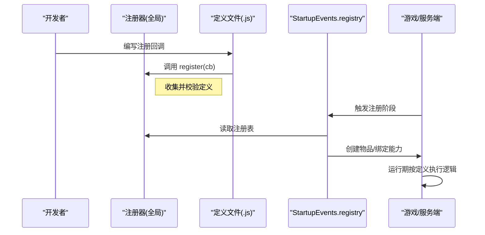
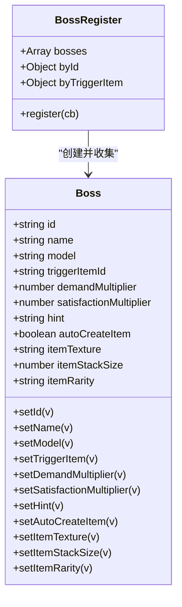
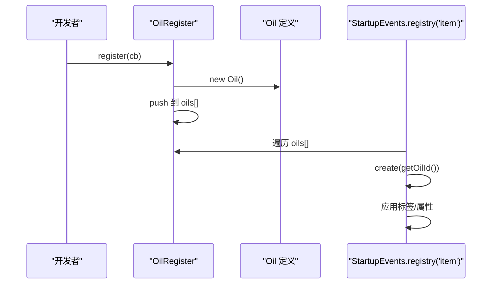
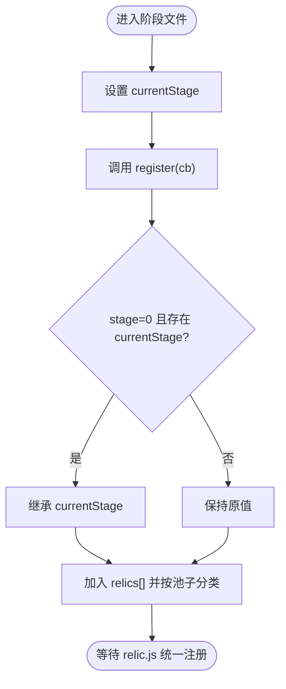
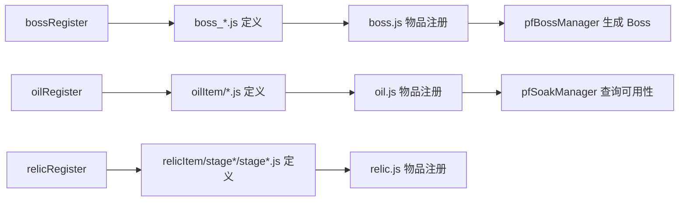

# 注册器模式扩展

<cite>
**本文引用的文件**   
- [kubejs/startup_scripts/boss/bossRegister.js](file://kubejs/startup_scripts/boss/bossRegister.js)
- [kubejs/startup_scripts/boss/boss.js](file://kubejs/startup_scripts/boss/boss.js)
- [kubejs/startup_scripts/boss/boss_flandre.js](file://kubejs/startup_scripts/boss/boss_flandre.js)
- [kubejs/startup_scripts/oil/oilRegister.js](file://kubejs/startup_scripts/oil/oilRegister.js)
- [kubejs/startup_scripts/oil/oil.js](file://kubejs/startup_scripts/oil/oil.js)
- [kubejs/startup_scripts/oil/oilItem/oilExample.js](file://kubejs/startup_scripts/oil/oilItem/oilExample.js)
- [kubejs/startup_scripts/relic/relicRegister.js](file://kubejs/startup_scripts/relic/relicRegister.js)
- [kubejs/startup_scripts/relic/relic.js](file://kubejs/startup_scripts/relic/relic.js)
- [kubejs/startup_scripts/relic/relicItem/stage1/stage1.js](file://kubejs/startup_scripts/relic/relicItem/stage1/stage1.js)
- [kubejs/startup_scripts/relic/relicItem/stage2/stage2.js](file://kubejs/startup_scripts/relic/relicItem/stage2/stage2.js)
- [kubejs/startup_scripts/relic/relicTags.js](file://kubejs/startup_scripts/relic/relicTags.js)
- [kubejs/startup_scripts/oil/oilTags.js](file://kubejs/startup_scripts/oil/oilTags.js)
- [kubejs/server_scripts/pathfinder/pfBossManager.js](file://kubejs/server_scripts/pathfinder/pfBossManager.js)
- [kubejs/server_scripts/pathfinder/pfSoakManager.js](file://kubejs/server_scripts/pathfinder/pfSoakManager.js)
</cite>

## 目录
1. [引言](#引言)
2. [项目结构](#项目结构)
3. [核心组件](#核心组件)
4. [架构总览](#架构总览)
5. [详细组件分析](#详细组件分析)
6. [依赖关系分析](#依赖关系分析)
7. [性能考量](#性能考量)
8. [故障排查指南](#故障排查指南)
9. [结论](#结论)
10. [附录](#附录)

## 引言
本技术指导文档围绕注册器模式在 KubeJS 项目中的实践展开，重点解析 bossRegister、oilRegister、relicRegister 三大注册器的设计思想、实现原理与扩展方法，并结合实际代码梳理注册流程、查找机制与生命周期管理。文档同时提供可直接落地的扩展示例、性能与内存管理建议、以及测试与调试技巧，帮助开发者在不破坏现有架构的前提下快速扩展新功能。

## 项目结构
本项目采用“启动期注册 + 运行期消费”的分层组织方式：
- 启动期注册：在 KubeJS StartupEvents 阶段收集定义，构建注册表。
- 运行期消费：在 KubeJS StartupEvents.registry 或服务端逻辑中按需读取注册表，完成物品/行为/规则的落地。

图表来源
- [kubejs/startup_scripts/boss/bossRegister.js:60-97](file://kubejs/startup_scripts/boss/bossRegister.js#L60-L97)
- [kubejs/startup_scripts/boss/boss.js:9-36](file://kubejs/startup_scripts/boss/boss.js#L9-L36)
- [kubejs/startup_scripts/oil/oilRegister.js:9-21](file://kubejs/startup_scripts/oil/oilRegister.js#L9-L21)
- [kubejs/startup_scripts/oil/oil.js:9-27](file://kubejs/startup_scripts/oil/oil.js#L9-L27)
- [kubejs/startup_scripts/relic/relicRegister.js:3-42](file://kubejs/startup_scripts/relic/relicRegister.js#L3-L42)
- [kubejs/startup_scripts/relic/relic.js:7-79](file://kubejs/startup_scripts/relic/relic.js#L7-L79)
- [kubejs/server_scripts/pathfinder/pfBossManager.js:11-50](file://kubejs/server_scripts/pathfinder/pfBossManager.js#L11-L50)
- [kubejs/server_scripts/pathfinder/pfSoakManager.js:77-88](file://kubejs/server_scripts/pathfinder/pfSoakManager.js#L77-L88)

章节来源
- [kubejs/startup_scripts/boss/bossRegister.js:1-103](file://kubejs/startup_scripts/boss/bossRegister.js#L1-L103)
- [kubejs/startup_scripts/oil/oilRegister.js:1-61](file://kubejs/startup_scripts/oil/oilRegister.js#L1-L61)
- [kubejs/startup_scripts/relic/relicRegister.js:1-178](file://kubejs/startup_scripts/relic/relicRegister.js#L1-L178)

## 核心组件
- Boss 注册器：集中收集 Boss 定义，校验唯一性，支持自动创建触发物品，提供按 id/触发物检索能力。
- Oil 注册器：收集 Oil 定义，统一生成物品 ID，支持标签与耐久度等属性。
- Relic 注册器：收集 Relic 定义，按稀有度/池子分类，支持阶段继承与事件钩子。

章节来源
- [kubejs/startup_scripts/boss/bossRegister.js:60-97](file://kubejs/startup_scripts/boss/bossRegister.js#L60-L97)
- [kubejs/startup_scripts/oil/oilRegister.js:9-21](file://kubejs/startup_scripts/oil/oilRegister.js#L9-L21)
- [kubejs/startup_scripts/relic/relicRegister.js:3-42](file://kubejs/startup_scripts/relic/relicRegister.js#L3-L42)

## 架构总览
注册器模式将“定义收集”与“落地注册”解耦：
- 定义收集：在各自模块的 startup 脚本中通过 register 回调注入数据。
- 落地注册：在统一的 StartupEvents.registry 阶段，按注册表批量创建物品或绑定能力。
- 运行期使用：服务端逻辑通过全局注册表读取定义，执行业务流程。

图表来源
- [kubejs/startup_scripts/boss/bossRegister.js:65-96](file://kubejs/startup_scripts/boss/bossRegister.js#L65-L96)
- [kubejs/startup_scripts/boss/boss.js:9-36](file://kubejs/startup_scripts/boss/boss.js#L9-L36)
- [kubejs/startup_scripts/oil/oilRegister.js:16-20](file://kubejs/startup_scripts/oil/oilRegister.js#L16-L20)
- [kubejs/startup_scripts/oil/oil.js:9-27](file://kubejs/startup_scripts/oil/oil.js#L9-L27)
- [kubejs/startup_scripts/relic/relicRegister.js:14-31](file://kubejs/startup_scripts/relic/relicRegister.js#L14-L31)
- [kubejs/startup_scripts/relic/relic.js:7-79](file://kubejs/startup_scripts/relic/relic.js#L7-L79)

## 详细组件分析

### Boss 注册器（bossRegister）
- 设计要点
  - 通过 register 回调收集 Boss 定义，内置 id/model/触发物/倍率/提示等字段。
  - 支持自动创建触发物品（当启用 autoCreateItem 且未显式设置触发物时，按短 id 自动生成）。
  - 注册时进行冲突检查（id 与触发物唯一性），并记录日志。
- 查找机制
  - 提供按 id 与按触发物的映射表，便于运行期快速定位。
- 生命周期
  - 启动期收集，落地阶段统一创建触发物品；服务端按定义生成 Boss。

图表来源
- [kubejs/startup_scripts/boss/bossRegister.js:18-97](file://kubejs/startup_scripts/boss/bossRegister.js#L18-L97)

章节来源
- [kubejs/startup_scripts/boss/bossRegister.js:1-103](file://kubejs/startup_scripts/boss/bossRegister.js#L1-L103)
- [kubejs/startup_scripts/boss/boss.js:1-37](file://kubejs/startup_scripts/boss/boss.js#L1-L37)
- [kubejs/startup_scripts/boss/boss_flandre.js:1-22](file://kubejs/startup_scripts/boss/boss_flandre.js#L1-L22)
- [kubejs/server_scripts/pathfinder/pfBossManager.js:11-50](file://kubejs/server_scripts/pathfinder/pfBossManager.js#L11-L50)

### Oil 注册器（oilRegister）
- 设计要点
  - 通过 register 接受工厂回调，收集 Oil 定义（名称、描述、标签、耐久等）。
  - 统一生成物品 ID（marguerite:name），落地阶段批量创建物品并应用标签。
- 扩展方法
  - 新增 Oil：复制示例文件，调用 global.oilRegister.register(...) 完成定义。
  - 标签复用：通过 global.oilTags 提供的常量统一添加标签。

图表来源
- [kubejs/startup_scripts/oil/oilRegister.js:9-21](file://kubejs/startup_scripts/oil/oilRegister.js#L9-L21)
- [kubejs/startup_scripts/oil/oil.js:9-27](file://kubejs/startup_scripts/oil/oil.js#L9-L27)
- [kubejs/startup_scripts/oil/oilItem/oilExample.js:9-15](file://kubejs/startup_scripts/oil/oilItem/oilExample.js#L9-L15)
- [kubejs/startup_scripts/oil/oilTags.js:8-18](file://kubejs/startup_scripts/oil/oilTags.js#L8-L18)

章节来源
- [kubejs/startup_scripts/oil/oilRegister.js:1-61](file://kubejs/startup_scripts/oil/oilRegister.js#L1-L61)
- [kubejs/startup_scripts/oil/oil.js:1-28](file://kubejs/startup_scripts/oil/oil.js#L1-L28)
- [kubejs/startup_scripts/oil/oilItem/oilExample.js:1-16](file://kubejs/startup_scripts/oil/oilItem/oilExample.js#L1-L16)
- [kubejs/startup_scripts/oil/oilTags.js:1-19](file://kubejs/startup_scripts/oil/oilTags.js#L1-L19)

### Relic 注册器（relicRegister）
- 设计要点
  - 通过 register 接受 Relic 工厂回调，收集定义并按池子分类（普通/特殊/诅咒/商店）。
  - 支持阶段 currentStage 自动继承，统一生成物品 ID。
  - 提供丰富的事件钩子（onLoad/onEquip/onUnEquip/onDoDamage/onKill 等）。
- 扩展方法
  - 新增 Relic：在对应阶段文件中设置 global.relicRegister.currentStage，然后调用 register(...) 完成定义。
  - 标签与布局辅助：通过 global.relicTags 提供的常量与九宫格/十格/对角线等工具函数辅助设计。

图表来源
- [kubejs/startup_scripts/relic/relicRegister.js:14-31](file://kubejs/startup_scripts/relic/relicRegister.js#L14-L31)
- [kubejs/startup_scripts/relic/relic.js:7-79](file://kubejs/startup_scripts/relic/relic.js#L7-L79)
- [kubejs/startup_scripts/relic/relicItem/stage1/stage1.js](file://kubejs/startup_scripts/relic/relicItem/stage1/stage1.js#L7)
- [kubejs/startup_scripts/relic/relicItem/stage2/stage2.js](file://kubejs/startup_scripts/relic/relicItem/stage2/stage2.js#L4)
- [kubejs/startup_scripts/relic/relicTags.js:66-147](file://kubejs/startup_scripts/relic/relicTags.js#L66-L147)

章节来源
- [kubejs/startup_scripts/relic/relicRegister.js:1-178](file://kubejs/startup_scripts/relic/relicRegister.js#L1-L178)
- [kubejs/startup_scripts/relic/relic.js:1-81](file://kubejs/startup_scripts/relic/relic.js#L1-L81)
- [kubejs/startup_scripts/relic/relicItem/stage1/stage1.js:1-224](file://kubejs/startup_scripts/relic/relicItem/stage1/stage1.js#L1-L224)
- [kubejs/startup_scripts/relic/relicItem/stage2/stage2.js:1-726](file://kubejs/startup_scripts/relic/relicItem/stage2/stage2.js#L1-L726)
- [kubejs/startup_scripts/relic/relicTags.js:1-192](file://kubejs/startup_scripts/relic/relicTags.js#L1-L192)

## 依赖关系分析
- 模块间耦合
  - 定义文件与注册器：通过 register 回调建立弱耦合，定义文件仅依赖全局注册器实例。
  - 落地注册：统一在 StartupEvents.registry 阶段执行，避免跨模块直接操作物品注册。
  - 运行期使用：服务端模块通过全局注册表读取定义，避免硬编码 ID。
- 关键依赖链
  - bossRegister → boss.js → pfBossManager
  - oilRegister → oil.js → pfSoakManager（通过查询可用性）
  - relicRegister → relic.js → Curios 能力绑定

图表来源
- [kubejs/startup_scripts/boss/bossRegister.js](file://kubejs/startup_scripts/boss/bossRegister.js#L99)
- [kubejs/startup_scripts/boss/boss.js:9-36](file://kubejs/startup_scripts/boss/boss.js#L9-L36)
- [kubejs/server_scripts/pathfinder/pfBossManager.js:53-55](file://kubejs/server_scripts/pathfinder/pfBossManager.js#L53-L55)
- [kubejs/startup_scripts/oil/oilRegister.js](file://kubejs/startup_scripts/oil/oilRegister.js#L60)
- [kubejs/startup_scripts/oil/oil.js:9-27](file://kubejs/startup_scripts/oil/oil.js#L9-L27)
- [kubejs/server_scripts/pathfinder/pfSoakManager.js:77-88](file://kubejs/server_scripts/pathfinder/pfSoakManager.js#L77-L88)
- [kubejs/startup_scripts/relic/relicRegister.js](file://kubejs/startup_scripts/relic/relicRegister.js#L178)
- [kubejs/startup_scripts/relic/relic.js:7-79](file://kubejs/startup_scripts/relic/relic.js#L7-L79)

章节来源
- [kubejs/startup_scripts/boss/bossRegister.js:1-103](file://kubejs/startup_scripts/boss/bossRegister.js#L1-L103)
- [kubejs/startup_scripts/oil/oilRegister.js:1-61](file://kubejs/startup_scripts/oil/oilRegister.js#L1-L61)
- [kubejs/startup_scripts/relic/relicRegister.js:1-178](file://kubejs/startup_scripts/relic/relicRegister.js#L1-L178)
- [kubejs/server_scripts/pathfinder/pfBossManager.js:1-58](file://kubejs/server_scripts/pathfinder/pfBossManager.js#L1-L58)
- [kubejs/server_scripts/pathfinder/pfSoakManager.js:1-197](file://kubejs/server_scripts/pathfinder/pfSoakManager.js#L1-L197)

## 性能考量
- 注册阶段复杂度
  - Boss/Oil/Relic 注册表均为数组+字典组合，注册与冲突检查的时间复杂度近似 O(1) 查找与 O(n) 收集。
- 运行期访问
  - 通过 byId/byTriggerItem 映射快速定位 Boss；通过全局数组遍历 Relic 池子。
- 内存管理
  - 注册表在进程生命周期内常驻，注意避免重复注册与冗余对象；必要时在定义阶段做去重与默认值收敛。
- I/O 与事件
  - 物品注册集中在 StartupEvents.registry，避免在热路径频繁创建/销毁对象。

## 故障排查指南
- 常见问题
  - 缺少 id 或 model：注册失败并输出日志，检查定义文件。
  - 触发物冲突：注册失败并提示冲突项，确保唯一性。
  - 自动创建物品失败：检查 rarity/texture 等参数合法性。
  - Relic 标签为空：落地阶段会警告，检查 tags 数组元素。
- 调试技巧
  - 利用注册器日志输出定位问题（如 [BOSS]、[RELIC-EQUIP] 等前缀）。
  - 在运行期模块中打印注册表内容，确认定义是否正确加载。
  - 对于 Curios 能力异常，分别捕获 onEquip/onUnEquip/canEquip/canUnequip 的错误并记录。

章节来源
- [kubejs/startup_scripts/boss/bossRegister.js:65-96](file://kubejs/startup_scripts/boss/bossRegister.js#L65-L96)
- [kubejs/startup_scripts/boss/boss.js:29-33](file://kubejs/startup_scripts/boss/boss.js#L29-L33)
- [kubejs/startup_scripts/relic/relic.js:15-27](file://kubejs/startup_scripts/relic/relic.js#L15-L27)
- [kubejs/server_scripts/pathfinder/pfSoakManager.js:77-88](file://kubejs/server_scripts/pathfinder/pfSoakManager.js#L77-L88)

## 结论
注册器模式在本项目中实现了“定义与落地分离、弱耦合扩展、强一致校验”的目标。通过统一的注册表与落地阶段，开发者可以以最小成本扩展新功能；通过严格的冲突检查与事件钩子，保证了运行期行为的可控性与可维护性。建议在新增注册器时遵循现有模式：定义文件只负责 register 回调，落地阶段统一处理物品/能力绑定，运行期通过全局注册表安全访问。

## 附录

### 扩展示例清单（步骤说明）
- 新增 Boss
  - 在 boss 目录下新建定义文件，调用 global.bossRegister.register(...) 完成注册。
  - 如需自动创建触发物品，设置 autoCreateItem 并提供必要属性。
  - 参考文件路径：
    - [kubejs/startup_scripts/boss/boss_flandre.js:10-21](file://kubejs/startup_scripts/boss/boss_flandre.js#L10-L21)
    - [kubejs/startup_scripts/boss/bossRegister.js:65-96](file://kubejs/startup_scripts/boss/bossRegister.js#L65-L96)
    - [kubejs/startup_scripts/boss/boss.js:9-36](file://kubejs/startup_scripts/boss/boss.js#L9-L36)
- 新增 Oil
  - 在 oilItem 目录下新建定义文件，调用 global.oilRegister.register(...)。
  - 使用 global.oilTags 常量添加标签。
  - 参考文件路径：
    - [kubejs/startup_scripts/oil/oilItem/oilExample.js:9-15](file://kubejs/startup_scripts/oil/oilItem/oilExample.js#L9-L15)
    - [kubejs/startup_scripts/oil/oilRegister.js:16-20](file://kubejs/startup_scripts/oil/oilRegister.js#L16-L20)
    - [kubejs/startup_scripts/oil/oil.js:9-27](file://kubejs/startup_scripts/oil/oil.js#L9-L27)
    - [kubejs/startup_scripts/oil/oilTags.js:8-18](file://kubejs/startup_scripts/oil/oilTags.js#L8-L18)
- 新增 Relic（阶段内）
  - 在对应阶段文件中设置 global.relicRegister.currentStage，再调用 register(...)。
  - 使用 global.relicTags 常量与九宫格/十格等工具函数辅助设计。
  - 参考文件路径：
    - [kubejs/startup_scripts/relic/relicItem/stage1/stage1.js](file://kubejs/startup_scripts/relic/relicItem/stage1/stage1.js#L7)
    - [kubejs/startup_scripts/relic/relicItem/stage2/stage2.js](file://kubejs/startup_scripts/relic/relicItem/stage2/stage2.js#L4)
    - [kubejs/startup_scripts/relic/relicRegister.js:14-31](file://kubejs/startup_scripts/relic/relicRegister.js#L14-L31)
    - [kubejs/startup_scripts/relic/relic.js:7-79](file://kubejs/startup_scripts/relic/relic.js#L7-L79)
    - [kubejs/startup_scripts/relic/relicTags.js:66-147](file://kubejs/startup_scripts/relic/relicTags.js#L66-L147)

### 运行期使用参考
- Boss 生成：通过注册表定义与服务端管理器协同，按需求倍率与满意度倍率执行。
  - 参考文件路径：
    - [kubejs/server_scripts/pathfinder/pfBossManager.js:11-50](file://kubejs/server_scripts/pathfinder/pfBossManager.js#L11-L50)
- Oil 可用性：在泡脚流程中查询可用性，若不可用则重置倒计时。
  - 参考文件路径：
    - [kubejs/server_scripts/pathfinder/pfSoakManager.js:77-88](file://kubejs/server_scripts/pathfinder/pfSoakManager.js#L77-L88)