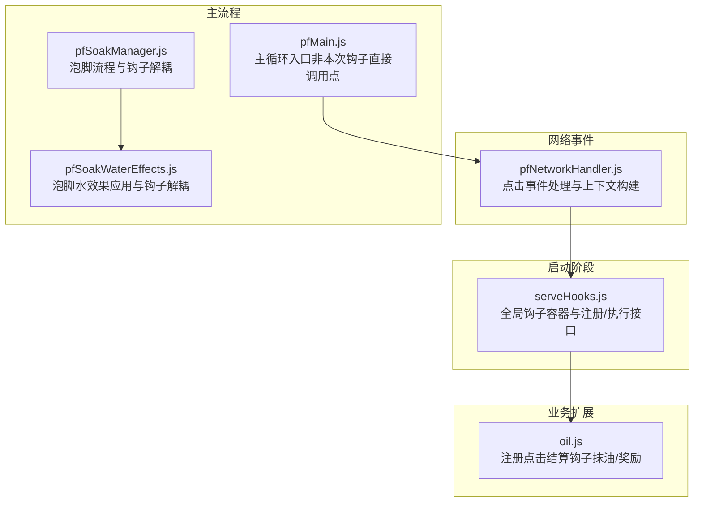
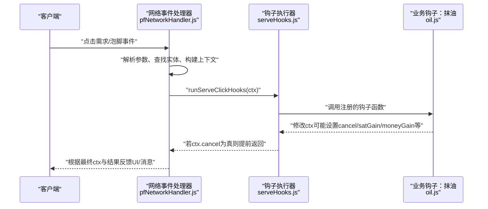
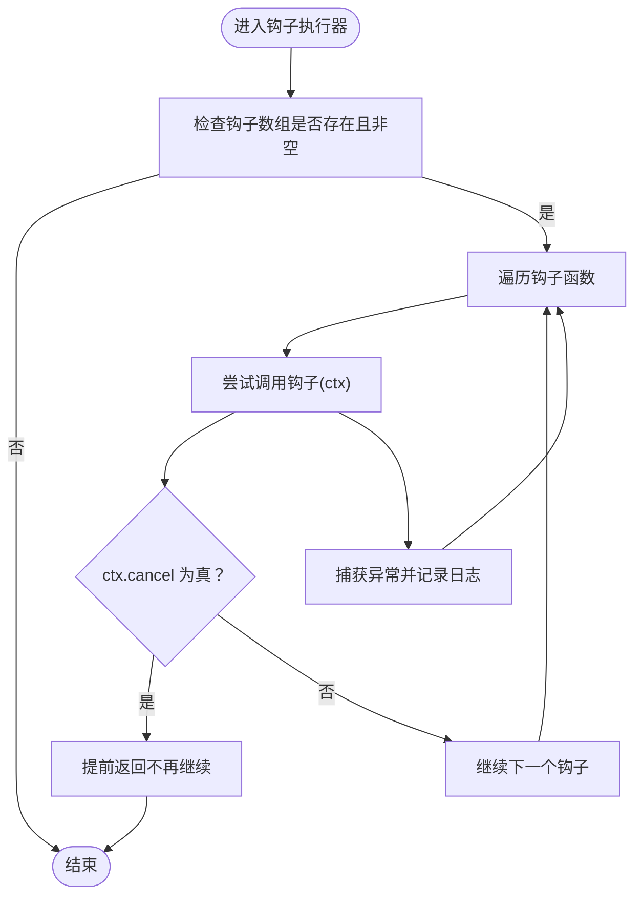
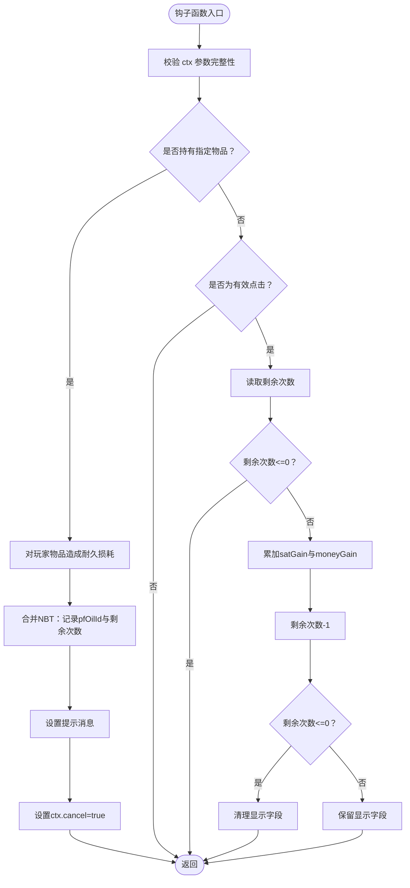
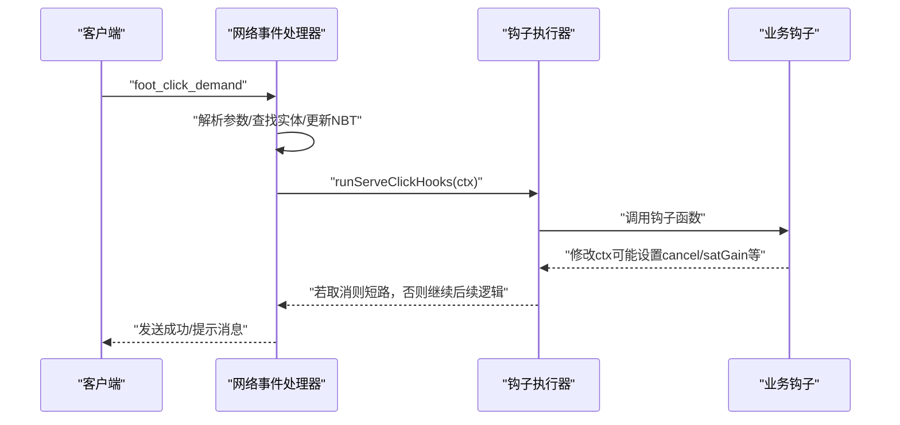
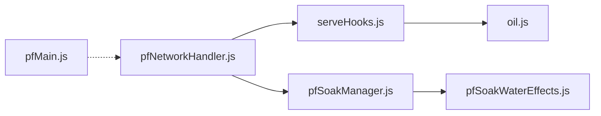

# 钩子系统扩展

<cite>
**本文引用的文件**
- [serveHooks.js](file://kubejs/startup_scripts/serveHooks.js)
- [oil.js](file://kubejs/server_scripts/serve/oil.js)
- [pfNetworkHandler.js](file://kubejs/server_scripts/pathfinder/pfNetworkHandler.js)
- [pfSoakManager.js](file://kubejs/server_scripts/pathfinder/pfSoakManager.js)
- [pfSoakWaterEffects.js](file://kubejs/server_scripts/pathfinder/pfSoakWaterEffects.js)
- [pfMain.js](file://kubejs/server_scripts/pathfinder/pfMain.js)
</cite>

## 目录
1. [简介](#简介)
2. [项目结构](#项目结构)
3. [核心组件](#核心组件)
4. [架构总览](#架构总览)
5. [详细组件分析](#详细组件分析)
6. [依赖关系分析](#依赖关系分析)
7. [性能考量](#性能考量)
8. [故障排查指南](#故障排查指南)
9. [结论](#结论)
10. [附录](#附录)

## 简介
本文件围绕 KubeJS 钩子系统扩展进行技术文档整理，重点解释 serveClickHooks 钩子框架的设计原理、注册机制与执行流程，明确钩子函数的定义规范、参数传递与上下文管理，覆盖优先级处理、错误处理与取消机制，并提供完整的开发示例与最佳实践。文档同时阐述钩子系统与主流程的解耦设计及性能优化策略，帮助开发者在不侵入主流程的前提下，通过钩子扩展“点击结算”等关键节点的功能。

## 项目结构
本钩子系统主要分布在以下模块：
- 启动阶段钩子框架：提供全局钩子容器与注册/执行接口
- 业务扩展钩子：在服务端脚本中注册具体钩子函数
- 网络事件处理：在关键点击事件发生时构建上下文并触发钩子
- 泡脚管理：在泡脚流程中集成钩子与效果应用

图表来源
- [serveHooks.js:11-30](file://kubejs/startup_scripts/serveHooks.js#L11-L30)
- [oil.js:28-55](file://kubejs/server_scripts/serve/oil.js#L28-L55)
- [pfNetworkHandler.js:37-219](file://kubejs/server_scripts/pathfinder/pfNetworkHandler.js#L37-L219)
- [pfMain.js:11-177](file://kubejs/server_scripts/pathfinder/pfMain.js#L11-L177)
- [pfSoakManager.js:147-186](file://kubejs/server_scripts/pathfinder/pfSoakManager.js#L147-L186)
- [pfSoakWaterEffects.js:228-234](file://kubejs/server_scripts/pathfinder/pfSoakWaterEffects.js#L228-L234)

章节来源
- [serveHooks.js:1-31](file://kubejs/startup_scripts/serveHooks.js#L1-L31)
- [oil.js:1-56](file://kubejs/server_scripts/serve/oil.js#L1-L56)
- [pfNetworkHandler.js:35-234](file://kubejs/server_scripts/pathfinder/pfNetworkHandler.js#L35-L234)
- [pfSoakManager.js:1-197](file://kubejs/server_scripts/pathfinder/pfSoakManager.js#L1-L197)
- [pfSoakWaterEffects.js:185-218](file://kubejs/server_scripts/pathfinder/pfSoakWaterEffects.js#L185-L218)
- [pfMain.js:1-177](file://kubejs/server_scripts/pathfinder/pfMain.js#L1-L177)

## 核心组件
- 全局钩子容器与接口
  - 提供全局数组保存钩子函数
  - 提供注册函数将钩子加入容器
  - 提供执行函数遍历并调用钩子，支持上下文与取消标志
- 业务钩子示例
  - 注册点击结算钩子，处理“抹油”判定、奖励叠加与取消后续处理
- 网络事件上下文构建
  - 在点击事件到达时，解析参数、查找目标实体、构建上下文并调用钩子
- 泡脚流程（与钩子解耦）
  - 泡脚状态与效果应用独立于点击钩子，保证职责分离

章节来源
- [serveHooks.js:11-30](file://kubejs/startup_scripts/serveHooks.js#L11-L30)
- [oil.js:28-55](file://kubejs/server_scripts/serve/oil.js#L28-L55)
- [pfNetworkHandler.js:37-219](file://kubejs/server_scripts/pathfinder/pfNetworkHandler.js#L37-L219)
- [pfSoakManager.js:147-186](file://kubejs/server_scripts/pathfinder/pfSoakManager.js#L147-L186)

## 架构总览
serveClickHooks 钩子框架采用“启动阶段占位 + 业务脚本注册 + 网络事件触发”的分层设计。主流程不直接感知具体扩展逻辑，仅在关键节点调用统一的钩子执行器，扩展通过独立脚本注册钩子函数，实现高内聚、低耦合的可插拔架构。

图表来源
- [pfNetworkHandler.js:37-219](file://kubejs/server_scripts/pathfinder/pfNetworkHandler.js#L37-L219)
- [serveHooks.js:19-30](file://kubejs/startup_scripts/serveHooks.js#L19-L30)
- [oil.js:28-55](file://kubejs/server_scripts/serve/oil.js#L28-L55)

## 详细组件分析

### serveClickHooks 钩子框架
- 设计目标
  - 将“额外功能（如抹油、连击奖励等）”从主流程中拆分
  - 主流程仅在关键节点调用一次钩子
  - 具体功能以独立脚本注册的方式接入
- 关键接口
  - 注册：将钩子函数加入全局数组
  - 执行：遍历钩子，捕获异常，支持 ctx.cancel 提前终止
- 上下文 ctx
  - 由网络事件处理器构建并传递
  - 包含玩家、目标实体、物品、NBT 等关键信息
  - 可写字段：取消标志、奖励增益、消息提示等

图表来源
- [serveHooks.js:19-30](file://kubejs/startup_scripts/serveHooks.js#L19-L30)

章节来源
- [serveHooks.js:1-31](file://kubejs/startup_scripts/serveHooks.js#L1-L31)

### 业务钩子：抹油与奖励
- 功能概述
  - 当玩家手持特定物品点击按钮时，判定为“抹油”，不消耗需求、不开始泡脚
  - 抹油成功后，接下来若干次“有效点击”（需求>0）会获得额外奖励
  - 奖励次数耗尽后，清除 UI 显示字段
- 关键行为
  - 注册钩子：在业务脚本中通过注册函数加入全局钩子数组
  - 判定与修改：读取 ctx，判断持有物品与有效性，修改 ctx 的奖励、消息与取消标志
  - 状态持久化：通过 ctx.nbt 合并字段，实现跨点击状态保存

图表来源
- [oil.js:28-55](file://kubejs/server_scripts/serve/oil.js#L28-L55)

章节来源
- [oil.js:1-56](file://kubejs/server_scripts/serve/oil.js#L1-L56)

### 网络事件与上下文构建
- 点击需求事件
  - 解析实体 UUID、部位键、玩家主手物品
  - 查找目标实体，读取并更新需求 NBT
  - 计算满意度与金钱增益，记录步骤与掉落
  - 构建 ctx 并调用钩子执行器
- 点击泡脚事件
  - 校验玩家是否手持水桶（原版或注册的洗脚水桶）
  - 查找目标实体，调用泡脚管理器开始泡脚
  - 记录操作玩家 UUID，便于后续结算回查

图表来源
- [pfNetworkHandler.js:37-219](file://kubejs/server_scripts/pathfinder/pfNetworkHandler.js#L37-L219)
- [serveHooks.js:19-30](file://kubejs/startup_scripts/serveHooks.js#L19-L30)
- [oil.js:28-55](file://kubejs/server_scripts/serve/oil.js#L28-L55)

章节来源
- [pfNetworkHandler.js:35-234](file://kubejs/server_scripts/pathfinder/pfNetworkHandler.js#L35-L234)

### 泡脚流程与钩子解耦
- 泡脚管理器
  - 独立的状态读取/写入、可用性判定与倒计时推进
  - 在倒计时结束时调用泡脚水效果应用模块
- 钩子与泡脚的边界
  - 点击结算钩子不参与泡脚状态机，二者通过上下文与 NBT 解耦
  - 效果应用与奖励发放由各自模块负责，避免交叉污染

章节来源
- [pfSoakManager.js:1-197](file://kubejs/server_scripts/pathfinder/pfSoakManager.js#L1-L197)
- [pfSoakWaterEffects.js:185-218](file://kubejs/server_scripts/pathfinder/pfSoakWaterEffects.js#L185-L218)

## 依赖关系分析
- serveClickHooks 框架
  - 依赖：全局数组 serveClickHooks
  - 被依赖：各业务钩子脚本（通过注册函数接入）
- 业务钩子
  - 依赖：上下文 ctx（由网络事件处理器构建）
  - 影响：修改 ctx 的取消标志与奖励字段
- 网络事件处理器
  - 依赖：全局模块（如泡脚管理器、提示系统等）
  - 调用：钩子执行器与业务钩子
- 主流程
  - 与钩子解耦：主循环不直接调用钩子，仅在网络事件中触发

图表来源
- [serveHooks.js:11-30](file://kubejs/startup_scripts/serveHooks.js#L11-L30)
- [oil.js:28-55](file://kubejs/server_scripts/serve/oil.js#L28-L55)
- [pfNetworkHandler.js:37-219](file://kubejs/server_scripts/pathfinder/pfNetworkHandler.js#L37-L219)
- [pfSoakManager.js:147-186](file://kubejs/server_scripts/pathfinder/pfSoakManager.js#L147-L186)
- [pfSoakWaterEffects.js:228-234](file://kubejs/server_scripts/pathfinder/pfSoakWaterEffects.js#L228-L234)
- [pfMain.js:11-177](file://kubejs/server_scripts/pathfinder/pfMain.js#L11-L177)

章节来源
- [serveHooks.js:1-31](file://kubejs/startup_scripts/serveHooks.js#L1-L31)
- [oil.js:1-56](file://kubejs/server_scripts/serve/oil.js#L1-L56)
- [pfNetworkHandler.js:35-234](file://kubejs/server_scripts/pathfinder/pfNetworkHandler.js#L35-L234)
- [pfSoakManager.js:1-197](file://kubejs/server_scripts/pathfinder/pfSoakManager.js#L1-L197)
- [pfSoakWaterEffects.js:185-218](file://kubejs/server_scripts/pathfinder/pfSoakWaterEffects.js#L185-L218)
- [pfMain.js:1-177](file://kubejs/server_scripts/pathfinder/pfMain.js#L1-L177)

## 性能考量
- 钩子执行成本控制
  - 钩子数组遍历为线性复杂度，建议控制钩子数量与单个钩子内部逻辑复杂度
  - 使用 ctx.cancel 提前短路，避免无效计算
- 异常隔离
  - 钩子执行在 try/catch 内，异常不影响主流程，但应避免频繁抛错
- 状态持久化最小化
  - 仅通过 ctx.nbt 合并必要字段，避免频繁读写
- 与主流程解耦
  - 点击结算钩子不参与泡脚状态机，降低耦合带来的额外计算

[本节为通用性能讨论，无需列出章节来源]

## 故障排查指南
- 常见问题
  - 钩子未生效：确认钩子是否正确注册到全局数组，以及网络事件是否触发钩子执行
  - ctx 缺失字段：检查网络事件处理器是否完整构建上下文
  - 奖励未叠加：确认钩子是否正确读取并修改 ctx 的奖励字段
  - 取消无效：确认钩子是否设置 ctx.cancel 并在执行器中被检测
- 调试技巧
  - 在钩子函数中输出关键字段（如持有物品、剩余次数、是否有效点击）
  - 在钩子执行器中打印异常日志，定位具体钩子与错误原因
  - 使用最小化复现：仅启用一个钩子，逐步增加以定位冲突
- 最佳实践
  - 钩子函数尽量纯函数式，避免外部副作用
  - 对输入进行严格校验，防止空指针或类型错误
  - 使用 try/catch 包裹可能异常的逻辑，避免中断主流程

章节来源
- [serveHooks.js:19-30](file://kubejs/startup_scripts/serveHooks.js#L19-L30)
- [oil.js:28-55](file://kubejs/server_scripts/serve/oil.js#L28-L55)

## 结论
serveClickHooks 钩子框架通过“启动阶段占位 + 业务脚本注册 + 网络事件触发”的模式，实现了点击结算场景下的高扩展性与低耦合。开发者可通过注册钩子函数，在不侵入主流程的前提下，灵活添加“抹油”、“连击奖励”等额外功能。配合完善的上下文管理、错误处理与取消机制，钩子系统在保证稳定性的同时，具备良好的可维护性与可扩展性。

[本节为总结性内容，无需列出章节来源]

## 附录

### 钩子开发示例（步骤说明）
- 创建钩子函数
  - 在业务脚本中定义钩子函数，接收 ctx 参数
  - 在钩子函数内校验 ctx 字段完整性，执行判定逻辑
  - 修改 ctx 的奖励、消息与取消标志
- 注册钩子
  - 在业务脚本末尾调用注册函数，将钩子加入全局数组
- 触发与验证
  - 通过网络事件触发钩子执行器
  - 在钩子执行器中观察 ctx 变化，确认是否提前取消与奖励叠加

章节来源
- [oil.js:28-55](file://kubejs/server_scripts/serve/oil.js#L28-L55)
- [serveHooks.js:13-17](file://kubejs/startup_scripts/serveHooks.js#L13-L17)
- [pfNetworkHandler.js:37-219](file://kubejs/server_scripts/pathfinder/pfNetworkHandler.js#L37-L219)