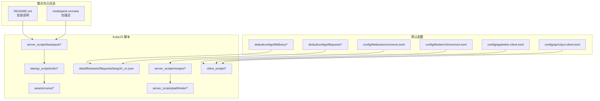
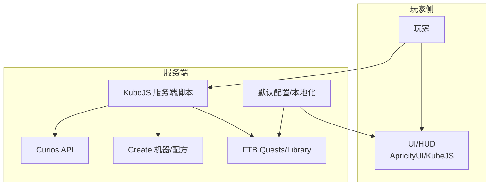
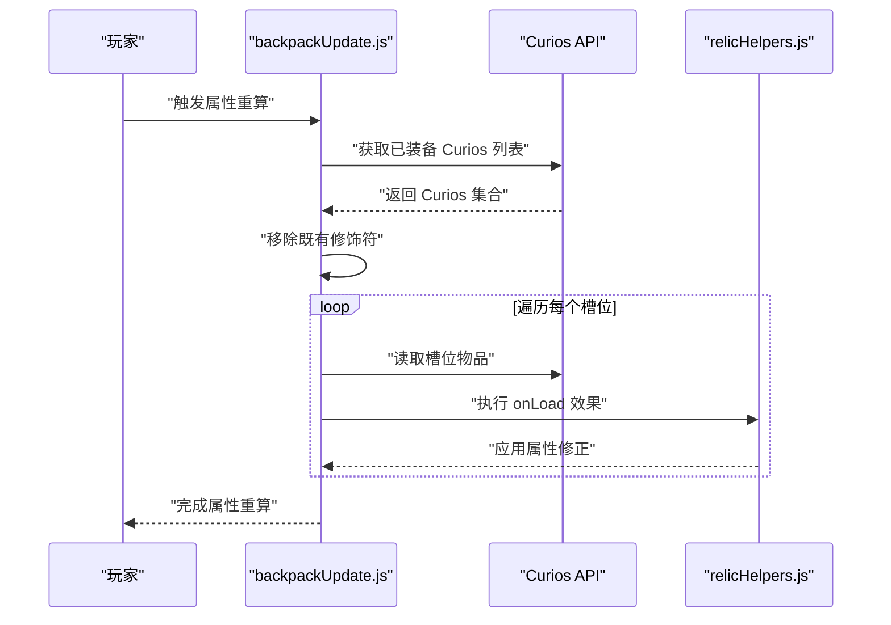
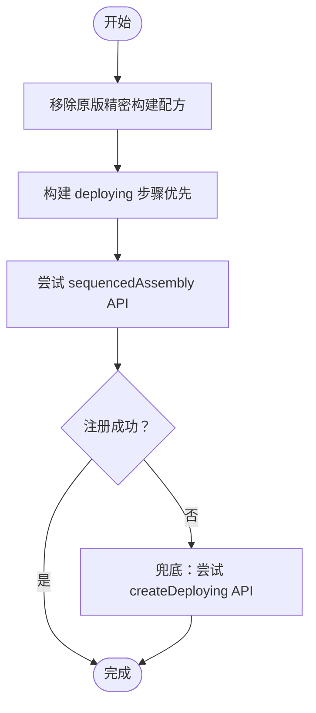
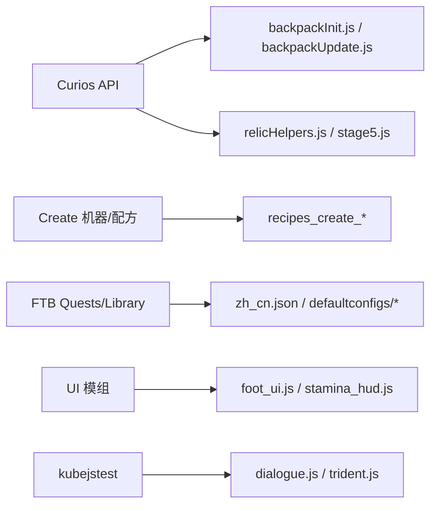

# 兼容性问题

<cite>
**本文引用的文件**
- [README.md](file://README.md)
- [pack.mcmeta](file://mods/pack.mcmeta)
- [ftblibrary-client.snbt](file://defaultconfigs/ftblibrary/ftblibrary-client.snbt)
- [client-config.snbt](file://defaultconfigs/ftbquests/client-config.snbt)
- [common.toml](file://config/Mekanism/common.toml)
- [common.toml](file://config/ModernUI/common.toml)
- [appleskin-client.toml](file://config/appleskin-client.toml)
- [apricityui-client.toml](file://config/apricityui-client.toml)
- [backpackInit.js](file://kubejs/server_scripts/backpack/backpackInit.js)
- [backpackUpdate.js](file://kubejs/server_scripts/backpack/backpackUpdate.js)
- [relicHelpers.js](file://kubejs/startup_scripts/relic/relicHelpers.js)
- [stage5.js](file://kubejs/startup_scripts/relic/relicItem/stage5/stage5.js)
- [recipes_create_precision_mechanism.js](file://kubejs/server_scripts/recipes/recipes_create_precision_mechanism.js)
- [recipes_create_dust.js](file://kubejs/server_scripts/recipes/recipes_create_dust.js)
- [pfBasinSoakManager.js](file://kubejs/server_scripts/pathfinder/pfBasinSoakManager.js)
- [pfSleepManager.js](file://kubejs/server_scripts/pathfinder/pfSleepManager.js)
- [dialogue.js](file://kubejstest/server_scripts/src/dialogue.js)
- [trident.js](file://kubejstest/server_scripts/src/trident.js)
- [zh_cn.json](file://kubejs/data/ftb/assets/ftbquests/lang/zh_cn.json)
</cite>

## 目录
1. [简介](#简介)
2. [项目结构](#项目结构)
3. [核心组件](#核心组件)
4. [架构总览](#架构总览)
5. [详细组件分析](#详细组件分析)
6. [依赖关系分析](#依赖关系分析)
7. [性能考量](#性能考量)
8. [故障排查指南](#故障排查指南)
9. [结论](#结论)
10. [附录](#附录)

## 简介
本指南聚焦于与第三方模组（尤其是 Curios API、Create 模组、FTB 系列）的兼容性问题与解决方案，涵盖注册器冲突、资源 ID 冲突、事件监听冲突等场景，并提供版本兼容性矩阵、冲突检测方法、修复策略、最佳实践与测试建议。文档基于仓库内实际实现进行归纳总结，帮助在不同模组组合下稳定运行。

## 项目结构
该项目为一个基于 KubeJS 的 Minecraft 1.20.1 版本整合包，围绕 Curios 背包系统、Create 机械流水线、FTB 任务与图书馆等模组展开扩展与适配。关键结构包括：
- KubeJS 数据与脚本：服务端、启动、客户端脚本，以及语言与资源文件
- 默认配置：FTB 系列、Mekanism、ModernUI、Appleskin、ApricityUI 等
- 测试脚本：kubejstest 中的对话与任务相关事件测试

**图表来源**
- [README.md:1-6](file://README.md#L1-L6)
- [pack.mcmeta:1-7](file://mods/pack.mcmeta#L1-L7)
- [ftblibrary-client.snbt:1-5](file://defaultconfigs/ftblibrary/ftblibrary-client.snbt#L1-L5)
- [client-config.snbt:1-5](file://defaultconfigs/ftbquests/client-config.snbt#L1-L5)
- [common.toml:1-13](file://config/Mekanism/common.toml#L1-L13)
- [common.toml:1-16](file://config/ModernUI/common.toml#L1-L16)
- [appleskin-client.toml:1-25](file://config/appleskin-client.toml#L1-L25)
- [apricityui-client.toml:1-8](file://config/apricityui-client.toml#L1-L8)
- [backpackInit.js:1-35](file://kubejs/server_scripts/backpack/backpackInit.js#L1-L35)
- [recipes_create_precision_mechanism.js:1-89](file://kubejs/server_scripts/recipes/recipes_create_precision_mechanism.js#L1-L89)
- [pfBasinSoakManager.js:1-260](file://kubejs/server_scripts/pathfinder/pfBasinSoakManager.js#L1-L260)
- [relicHelpers.js:1-331](file://kubejs/startup_scripts/relic/relicHelpers.js#L1-L331)
- [zh_cn.json:46-191](file://kubejs/data/ftb/assets/ftbquests/lang/zh_cn.json#L46-L191)

**章节来源**
- [README.md:1-6](file://README.md#L1-L6)
- [pack.mcmeta:1-7](file://mods/pack.mcmeta#L1-L7)

## 核心组件
- Curios 背包系统集成：通过 Curios API 访问与写入玩家装备槽位，实现背包面板初始化与属性重算，避免重复叠加与确保卸下即失效。
- Create 模组配方适配：覆盖原版“精密构建”配方，将基材替换为黄铜板；同时提供研磨与粉碎配方，适配 Create 流水线。
- FTB 系列本地化与任务：提供 FTB Quests 与 FTB Library 的本地化文本与默认配置，保障任务界面与体验一致。
- UI 与 HUD 扩展：通过 ApricityUI 与 KubeJS UI 接口，扩展足浴、睡眠、耐力等界面与提示。
- 遗物系统：基于 Curios 槽位与属性系统，实现多部位属性增益、行列判定与效果叠加控制。

**章节来源**
- [backpackInit.js:1-35](file://kubejs/server_scripts/backpack/backpackInit.js#L1-L35)
- [backpackUpdate.js:1-31](file://kubejs/server_scripts/backpack/backpackUpdate.js#L1-L31)
- [relicHelpers.js:314-331](file://kubejs/startup_scripts/relic/relicHelpers.js#L314-L331)
- [stage5.js:179-304](file://kubejs/startup_scripts/relic/relicItem/stage5/stage5.js#L179-L304)
- [recipes_create_precision_mechanism.js:1-89](file://kubejs/server_scripts/recipes/recipes_create_precision_mechanism.js#L1-L89)
- [recipes_create_dust.js:1-30](file://kubejs/server_scripts/recipes/recipes_create_dust.js#L1-L30)
- [pfBasinSoakManager.js:1-260](file://kubejs/server_scripts/pathfinder/pfBasinSoakManager.js#L1-L260)
- [pfSleepManager.js:100-120](file://kubejs/server_scripts/pathfinder/pfSleepManager.js#L100-L120)
- [zh_cn.json:46-191](file://kubejs/data/ftb/assets/ftbquests/lang/zh_cn.json#L46-L191)

## 架构总览
下图展示整合包与第三方模组的交互关系及关键数据流：

**图表来源**
- [backpackInit.js:17-35](file://kubejs/server_scripts/backpack/backpackInit.js#L17-L35)
- [recipes_create_precision_mechanism.js:12-89](file://kubejs/server_scripts/recipes/recipes_create_precision_mechanism.js#L12-L89)
- [pfBasinSoakManager.js:20-260](file://kubejs/server_scripts/pathfinder/pfBasinSoakManager.js#L20-L260)
- [ftblibrary-client.snbt:1-5](file://defaultconfigs/ftblibrary/ftblibrary-client.snbt#L1-L5)
- [client-config.snbt:1-5](file://defaultconfigs/ftbquests/client-config.snbt#L1-L5)

## 详细组件分析

### Curios 背包系统与属性重算
- 设计要点
  - 使用 Curios API 获取玩家当前已装备的 Curios 物品集合，限制遍历范围为有效槽位数，避免越界。
  - 在属性重算流程中，先移除既有修饰符，再根据当前装备逐一重新应用，防止重复叠加与数值膨胀。
  - 通过 persistentData 标志位避免重复初始化，确保仅在首次登录时填充背包镶板矩阵。
- 关键流程

**图表来源**
- [backpackUpdate.js:1-31](file://kubejs/server_scripts/backpack/backpackUpdate.js#L1-L31)
- [backpackUpdate.js:39-60](file://kubejs/server_scripts/backpack/backpackUpdate.js#L39-L60)
- [relicHelpers.js:314-331](file://kubejs/startup_scripts/relic/relicHelpers.js#L314-L331)

- 兼容性注意事项
  - 注册器冲突：通过 Java.loadClass 动态加载 CuriosApi 类，避免硬编码依赖导致的加载失败。
  - 资源 ID 冲突：严格限定 curios:package 槽位标识与背包镶板映射，避免与其他模组槽位混淆。
  - 事件监听冲突：在属性重算前统一清理修饰符，避免重复注册导致的叠加问题。

**章节来源**
- [backpackInit.js:1-35](file://kubejs/server_scripts/backpack/backpackInit.js#L1-L35)
- [backpackUpdate.js:1-31](file://kubejs/server_scripts/backpack/backpackUpdate.js#L1-L31)
- [relicHelpers.js:314-331](file://kubejs/startup_scripts/relic/relicHelpers.js#L314-L331)

### Create 模组配方覆盖与适配
- 设计要点
  - 覆盖原版“精密构建”配方，将基材替换为黄铜板，同时调整副产物构成，保持产出与概率平衡。
  - 提供研磨与粉碎配方，适配 Create 流水线，确保材料链闭环。
  - 采用多 API 尝试策略（deploying 与 createDeploying），在不同 KubeJS/Forge 版本间提供兼容路径。
- 关键流程

**图表来源**
- [recipes_create_precision_mechanism.js:60-89](file://kubejs/server_scripts/recipes/recipes_create_precision_mechanism.js#L60-L89)
- [recipes_create_dust.js:1-30](file://kubejs/server_scripts/recipes/recipes_create_dust.js#L1-L30)

- 兼容性注意事项
  - 注册器冲突：通过 remove({ id }) 与 remove({ type }) 双重移除，确保覆盖彻底。
  - 资源 ID 冲突：明确指定 transitionalItem 与 loops 参数，避免与其他模组的同名配方冲突。
  - 事件监听冲突：在注册前记录 lastError 并输出日志，便于定位 API 不可用原因。

**章节来源**
- [recipes_create_precision_mechanism.js:1-89](file://kubejs/server_scripts/recipes/recipes_create_precision_mechanism.js#L1-L89)
- [recipes_create_dust.js:1-30](file://kubejs/server_scripts/recipes/recipes_create_dust.js#L1-L30)

### FTB 系列本地化与默认配置
- 设计要点
  - 提供 FTB Quests 与 FTB Library 的默认配置文件，避免缺失配置导致的异常。
  - 本地化文本覆盖常用词条，确保任务界面与提示信息一致。
- 兼容性注意事项
  - 注册器冲突：默认配置文件仅作为模板，不直接注册任何内容，避免与 FTB 自身逻辑冲突。
  - 资源 ID 冲突：本地化文件仅影响显示文本，不引入新的资源 ID，降低冲突风险。

**章节来源**
- [ftblibrary-client.snbt:1-5](file://defaultconfigs/ftblibrary/ftblibrary-client.snbt#L1-L5)
- [client-config.snbt:1-5](file://defaultconfigs/ftbquests/client-config.snbt#L1-L5)
- [zh_cn.json:46-191](file://kubejs/data/ftb/assets/ftbquests/lang/zh_cn.json#L46-L191)

### UI 与 HUD 扩展
- 设计要点
  - 通过 ApricityUI 创建动态 HTML 文档，扩展足浴、睡眠、耐力等界面。
  - 使用 KubeJS UI 接口与客户端脚本，实现鼠标特效与窗口渲染。
- 兼容性注意事项
  - 注册器冲突：UI 文档路径与元素 ID 严格限定，避免与其他模组 UI 冲突。
  - 事件监听冲突：对 DOM 操作进行空值检查与异常捕获，避免因元素缺失导致崩溃。

**章节来源**
- [foot_ui.js:86-1000](file://kubejs/client_scripts/ui/foot_ui.js#L86-L1000)
- [stamina_hud.js:60-70](file://kubejs/client_scripts/ui/stamina_hud.js#L60-L70)

### 遗物系统与行列判定
- 设计要点
  - 基于 Curios 槽位与属性系统，实现多部位属性增益与效果叠加控制。
  - 通过行列扫描与标签匹配，实现“整行连续”“区域魔法”等判定逻辑。
- 兼容性注意事项
  - 注册器冲突：严格限定标签名称与属性前缀，避免与其他模组冲突。
  - 资源 ID 冲突：槽位索引与矩阵布局固定，避免动态分配导致的不一致。

**章节来源**
- [stage5.js:179-304](file://kubejs/startup_scripts/relic/relicItem/stage5/stage5.js#L179-L304)
- [relicHelpers.js:67-79](file://kubejs/startup_scripts/relic/relicHelpers.js#L67-L79)

## 依赖关系分析
- 模组依赖
  - Curios：提供可穿戴装备槽位系统，是背包面板与属性系统的前提。
  - Create：提供机械加工与配方 API，用于材料转换与自动化。
  - FTB 系列：提供任务与图书馆功能，依赖本地化与默认配置。
  - UI 模组：ApricityUI、Appleskin、ModernUI 等提供界面与 HUD 扩展。
- 脚本耦合
  - backpackUpdate.js 依赖 relicHelpers.js 的属性修正函数与 Curios API。
  - pfBasinSoakManager.js 与 pfSleepManager.js 依赖 Create 的 FluidHandler 与床旁交互。
  - kubejstest 中的 dialogue.js 与 trident.js 依赖 FTBQuestsEvents 事件。

**图表来源**
- [backpackInit.js:17-35](file://kubejs/server_scripts/backpack/backpackInit.js#L17-L35)
- [backpackUpdate.js:39-60](file://kubejs/server_scripts/backpack/backpackUpdate.js#L39-L60)
- [relicHelpers.js:314-331](file://kubejs/startup_scripts/relic/relicHelpers.js#L314-L331)
- [stage5.js:179-304](file://kubejs/startup_scripts/relic/relicItem/stage5/stage5.js#L179-L304)
- [recipes_create_precision_mechanism.js:12-89](file://kubejs/server_scripts/recipes/recipes_create_precision_mechanism.js#L12-L89)
- [pfBasinSoakManager.js:20-260](file://kubejs/server_scripts/pathfinder/pfBasinSoakManager.js#L20-L260)
- [pfSleepManager.js:100-120](file://kubejs/server_scripts/pathfinder/pfSleepManager.js#L100-L120)
- [zh_cn.json:46-191](file://kubejs/data/ftb/assets/ftbquests/lang/zh_cn.json#L46-L191)
- [dialogue.js:542-550](file://kubejstest/server_scripts/src/dialogue.js#L542-L550)
- [trident.js:315-320](file://kubejstest/server_scripts/src/trident.js#L315-L320)

**章节来源**
- [backpackInit.js:1-35](file://kubejs/server_scripts/backpack/backpackInit.js#L1-L35)
- [backpackUpdate.js:1-31](file://kubejs/server_scripts/backpack/backpackUpdate.js#L1-L31)
- [relicHelpers.js:314-331](file://kubejs/startup_scripts/relic/relicHelpers.js#L314-L331)
- [stage5.js:179-304](file://kubejs/startup_scripts/relic/relicItem/stage5/stage5.js#L179-L304)
- [recipes_create_precision_mechanism.js:1-89](file://kubejs/server_scripts/recipes/recipes_create_precision_mechanism.js#L1-L89)
- [pfBasinSoakManager.js:1-260](file://kubejs/server_scripts/pathfinder/pfBasinSoakManager.js#L1-L260)
- [pfSleepManager.js:100-120](file://kubejs/server_scripts/pathfinder/pfSleepManager.js#L100-L120)
- [zh_cn.json:46-191](file://kubejs/data/ftb/assets/ftbquests/lang/zh_cn.json#L46-L191)
- [dialogue.js:542-550](file://kubejstest/server_scripts/src/dialogue.js#L542-L550)
- [trident.js:315-320](file://kubejstest/server_scripts/src/trident.js#L315-L320)

## 性能考量
- 避免重复叠加：在属性重算前统一移除既有修饰符，减少无效计算与内存占用。
- 限制遍历范围：仅遍历 Curios 已装备槽位数量，避免对空槽位进行无意义操作。
- 日志与回退：在 API 不可用时输出日志并采用兜底方案，提升稳定性与可观测性。
- UI 渲染优化：对 DOM 操作进行节流与缓存，避免频繁重绘导致卡顿。

## 故障排查指南
- 注册器冲突
  - 现象：配方未生效或报错找不到默认值。
  - 处理：确认 remove({ id }) 与 remove({ type }) 是否正确执行；检查 transitionalItem 与 loops 参数是否一致。
  - 参考
    - [recipes_create_precision_mechanism.js:60-89](file://kubejs/server_scripts/recipes/recipes_create_precision_mechanism.js#L60-L89)
- 资源 ID 冲突
  - 现象：槽位或配方 ID 与其他模组冲突。
  - 处理：严格限定 curios:package 与自定义标签；在本地化与配方中避免使用通用名称。
  - 参考
    - [backpackInit.js:1-35](file://kubejs/server_scripts/backpack/backpackInit.js#L1-L35)
    - [stage5.js:179-304](file://kubejs/startup_scripts/relic/relicItem/stage5/stage5.js#L179-L304)
- 事件监听冲突
  - 现象：属性叠加异常或卸下后效果仍存在。
  - 处理：在重算前统一移除修饰符；确保 onLoad 仅在当前装备存在时执行。
  - 参考
    - [backpackUpdate.js:1-31](file://kubejs/server_scripts/backpack/backpackUpdate.js#L1-L31)
    - [relicHelpers.js:314-331](file://kubejs/startup_scripts/relic/relicHelpers.js#L314-L331)
- UI 渲染异常
  - 现象：窗口未显示或元素缺失。
  - 处理：检查 ApricityUI.createDocument 返回值与元素创建路径；对空值进行保护。
  - 参考
    - [foot_ui.js:974-999](file://kubejs/client_scripts/ui/foot_ui.js#L974-L999)

**章节来源**
- [recipes_create_precision_mechanism.js:60-89](file://kubejs/server_scripts/recipes/recipes_create_precision_mechanism.js#L60-L89)
- [backpackInit.js:1-35](file://kubejs/server_scripts/backpack/backpackInit.js#L1-L35)
- [stage5.js:179-304](file://kubejs/startup_scripts/relic/relicItem/stage5/stage5.js#L179-L304)
- [backpackUpdate.js:1-31](file://kubejs/server_scripts/backpack/backpackUpdate.js#L1-L31)
- [relicHelpers.js:314-331](file://kubejs/startup_scripts/relic/relicHelpers.js#L314-L331)
- [foot_ui.js:974-999](file://kubejs/client_scripts/ui/foot_ui.js#L974-L999)

## 结论
本项目通过严格的注册器与资源 ID 管理、事件监听的幂等处理、UI 渲染的健壮性设计，有效降低了与 Curios、Create、FTB 系列等模组的兼容性风险。建议在新版本发布前进行回归测试，确保配方覆盖、属性重算与 UI 显示均正常。

## 附录

### 版本兼容性矩阵（示例）
- Minecraft 1.20.1 + Forge 最新
- KubeJS 与 Create API：优先使用 create.sequencedAssembly，回退至 createDeploying
- Curios API：通过 Java.loadClass 动态加载，避免硬编码依赖
- FTB 系列：使用默认配置文件与本地化文本，避免直接注册

### 冲突检测方法
- 配方覆盖检测：在注册前输出 remove 成功日志与最后错误信息
- 属性重算检测：在重算前后对比修饰符数量与数值变化
- UI 渲染检测：对 DOM 创建与元素访问进行空值检查

### 修复策略
- 注册器冲突：使用 remove({ id }) 与 remove({ type }) 双重移除；明确 transitionalItem 与 loops
- 资源 ID 冲突：限定槽位与标签命名空间；避免通用名称
- 事件监听冲突：统一修饰符清理；确保 onLoad 幂等

### 兼容性测试方法与工具
- 回归测试：在每次更新后运行基础功能测试（配方、属性、UI）
- 日志监控：启用详细日志输出，定位 API 不可用与参数错误
- 模拟环境：使用 kubejstest 中的事件脚本模拟 FTB 任务奖励与对话