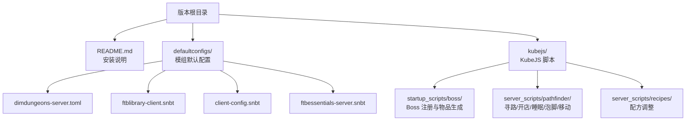
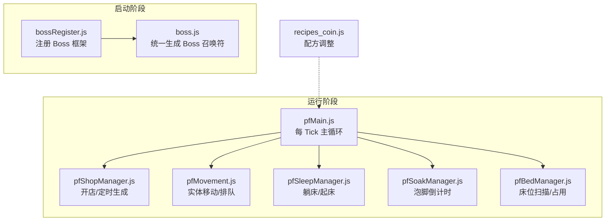
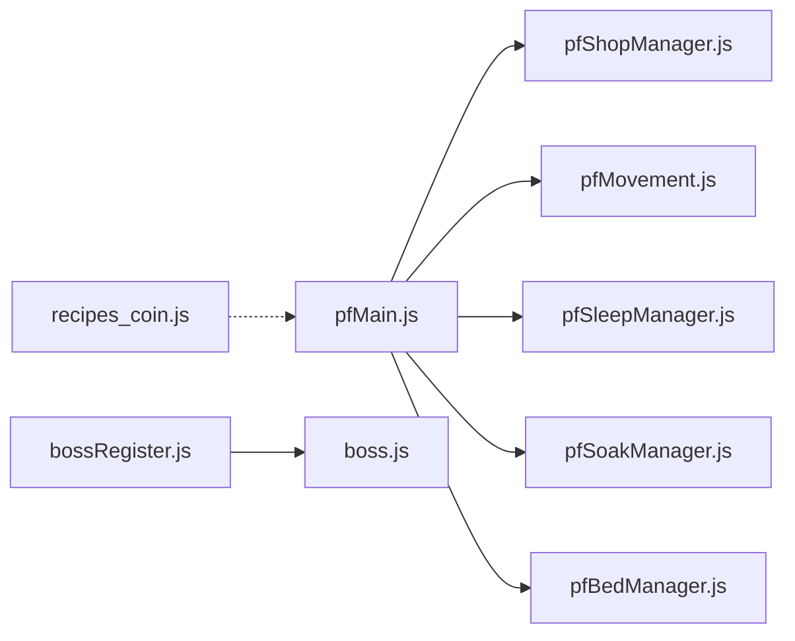

# 常见问题

<cite>
**本文引用的文件**
- [README.md](file://README.md)
- [dimdungeons-server.toml](file://defaultconfigs/dimdungeons-server.toml)
- [ftblibrary-client.snbt](file://defaultconfigs/ftblibrary/ftblibrary-client.snbt)
- [client-config.snbt](file://defaultconfigs/ftbquests/client-config.snbt)
- [ftbessentials-server.snbt](file://defaultconfigs/ftbessentials-server.snbt)
- [bossRegister.js](file://kubejs/startup_scripts/boss/bossRegister.js)
- [boss.js](file://kubejs/startup_scripts/boss/boss.js)
- [pfMain.js](file://kubejs/server_scripts/pathfinder/pfMain.js)
- [pfConstants.js](file://kubejs/server_scripts/pathfinder/pfConstants.js)
- [pfShopManager.js](file://kubejs/server_scripts/pathfinder/pfShopManager.js)
- [pfBedManager.js](file://kubejs/server_scripts/pathfinder/pfBedManager.js)
- [pfSoakManager.js](file://kubejs/server_scripts/pathfinder/pfSoakManager.js)
- [pfSleepManager.js](file://kubejs/server_scripts/pathfinder/pfSleepManager.js)
- [pfMovement.js](file://kubejs/server_scripts/pathfinder/pfMovement.js)
- [recipes_coin.js](file://kubejs/server_scripts/recipes/recipes_coin.js)
</cite>

## 目录
1. [简介](#简介)
2. [项目结构](#项目结构)
3. [核心组件](#核心组件)
4. [架构总览](#架构总览)
5. [详细组件分析](#详细组件分析)
6. [依赖分析](#依赖分析)
7. [性能考虑](#性能考虑)
8. [故障排查指南](#故障排查指南)
9. [结论](#结论)
10. [附录](#附录)

## 简介
本常见问题解答面向使用该Minecraft模组包的玩家，聚焦于系统启动、功能使用、物品与配方异常、Boss挑战失败等高频问题。文档提供问题描述、可能原因与解决步骤，并结合仓库内的配置与脚本文件，给出可操作的自助排查清单与预防建议。

## 项目结构
该版本仓库包含以下与问题排查密切相关的部分：
- 安装与基础说明：README.md
- 模组默认配置：defaultconfigs 下的 TOML/SNBT 配置文件
- KubeJS 脚本：kubejs 目录下的启动脚本、服务端脚本与配方脚本
- 其他资源：书签、菜单缓存、蓝图导出等

图表来源
- [README.md:1-6](file://README.md#L1-L6)
- [dimdungeons-server.toml:1-46](file://defaultconfigs/dimdungeons-server.toml#L1-L46)
- [ftblibrary-client.snbt:1-5](file://defaultconfigs/ftblibrary/ftblibrary-client.snbt#L1-L5)
- [client-config.snbt:1-5](file://defaultconfigs/ftbquests/client-config.snbt#L1-L5)
- [ftbessentials-server.snbt:1-14](file://defaultconfigs/ftbessentials-server.snbt#L1-L14)

章节来源
- [README.md:1-6](file://README.md#L1-L6)

## 核心组件
- Boss 系统：通过注册框架统一管理 Boss，支持自动生成“召唤符”物品，便于触发挑战。
- 寻路/开店系统：以“寻路方块实体”为核心，实现顾客生成、排队、睡眠、泡脚等流程。
- 配方系统：对特定模组的合成配方进行调整，避免冲突与资源浪费。
- 模组配置：提供默认配置文件，便于覆盖与调试。

章节来源
- [bossRegister.js:1-103](file://kubejs/startup_scripts/boss/bossRegister.js#L1-L103)
- [boss.js:1-37](file://kubejs/startup_scripts/boss/boss.js#L1-L37)
- [pfMain.js:1-177](file://kubejs/server_scripts/pathfinder/pfMain.js#L1-L177)
- [pfShopManager.js:1-300](file://kubejs/server_scripts/pathfinder/pfShopManager.js#L1-L300)
- [recipes_coin.js:1-57](file://kubejs/server_scripts/recipes/recipes_coin.js#L1-L57)

## 架构总览
整体运行时由“启动脚本注册”“服务端 Tick 驱动”“模块化子系统”组成，Boss 与寻路两大系统相互解耦但通过通用数据结构协同。

图表来源
- [bossRegister.js:1-103](file://kubejs/startup_scripts/boss/bossRegister.js#L1-L103)
- [boss.js:1-37](file://kubejs/startup_scripts/boss/boss.js#L1-L37)
- [pfMain.js:1-177](file://kubejs/server_scripts/pathfinder/pfMain.js#L1-L177)
- [pfShopManager.js:1-300](file://kubejs/server_scripts/pathfinder/pfShopManager.js#L1-L300)
- [pfMovement.js:1-186](file://kubejs/server_scripts/pathfinder/pfMovement.js#L1-L186)
- [pfSleepManager.js:1-232](file://kubejs/server_scripts/pathfinder/pfSleepManager.js#L1-L232)
- [pfSoakManager.js:1-197](file://kubejs/server_scripts/pathfinder/pfSoakManager.js#L1-L197)
- [pfBedManager.js:1-129](file://kubejs/server_scripts/pathfinder/pfBedManager.js#L1-L129)
- [recipes_coin.js:1-57](file://kubejs/server_scripts/recipes/recipes_coin.js#L1-L57)

## 详细组件分析

### Boss 挑战失败
- 问题描述
  - 召唤 Boss 时没有出现预期的 Boss。
  - 使用“召唤符”后无反应或报错。
- 可能原因
  - Boss 注册未完成或注册冲突。
  - “召唤符”物品未正确生成或命名不匹配。
  - 触发条件（如模型、需求倍率、满意度倍率）未满足。
- 解决步骤
  1) 检查控制台日志，确认是否存在“注册失败”“id 冲突”“缺少 triggerItem”等提示。
  2) 确认 Boss 的 triggerItemId 与实际物品 ID 一致。
  3) 若启用自动创建，确认生成的物品名称与短 ID 匹配。
  4) 检查 Boss 的模型 ID 是否存在且可加载。
  5) 如需修改，可在对应的启动脚本中调整注册参数或关闭自动创建后手动注册。
- 预防措施
  - 统一使用注册框架，避免直接拼接字符串。
  - 为每个 Boss 明确设置唯一 id 与 triggerItemId。
  - 在开发阶段开启严格日志，及时发现冲突。

章节来源
- [bossRegister.js:65-96](file://kubejs/startup_scripts/boss/bossRegister.js#L65-L96)
- [boss.js:9-36](file://kubejs/startup_scripts/boss/boss.js#L9-L36)

### 功能无法正常使用（寻路/开店/睡眠/泡脚）
- 问题描述
  - 顾客无法生成或生成后立即消失。
  - 实体卡在蓝色地毯等待或无法进入睡眠。
  - 泡脚倒计时不生效或水桶未消耗。
- 可能原因
  - 寻路方块实体缺失或持久化数据异常。
  - 白天结束导致自动关店。
  - 床位扫描/占用检测异常。
  - 泡脚水桶不可用或状态未同步。
- 解决步骤
  1) 确认“寻路方块实体”存在且 persistentData 正常。
  2) 检查是否处于白天（日落会自动关店）。
  3) 检查路径上的床是否被占用，或床头朝向是否正确。
  4) 确认手持物品为同步用纸，且泡脚水桶在注册表中可用。
  5) 查看 pfMain 每 Tick 的日志，确认各模块是否被调用。
- 预防措施
  - 保持路径连续、床头朝向一致。
  - 使用标准水桶 ID 或在注册表中添加自定义水桶。
  - 避免在夜晚或极端环境下频繁开关店。

章节来源
- [pfMain.js:11-174](file://kubejs/server_scripts/pathfinder/pfMain.js#L11-L174)
- [pfShopManager.js:237-284](file://kubejs/server_scripts/pathfinder/pfShopManager.js#L237-L284)
- [pfBedManager.js:10-77](file://kubejs/server_scripts/pathfinder/pfBedManager.js#L10-L77)
- [pfSoakManager.js:90-145](file://kubejs/server_scripts/pathfinder/pfSoakManager.js#L90-L145)
- [pfMovement.js:101-162](file://kubejs/server_scripts/pathfinder/pfMovement.js#L101-L162)

### 物品丢失（顾客、水桶、硬币）
- 问题描述
  - 顾客在等待时被清理。
  - 泡脚水桶未消耗。
  - 硬币升级合成异常。
- 可能原因
  - 关店时仅清理行走中与等待中的顾客。
  - 泡脚水桶不在可用列表。
  - 原版“9 硬币 → 1 堆金币”配方被移除，导致冲突。
- 解决步骤
  1) 关店时会清理非服务中的顾客，这是设计行为。若需保留，请在白天或手动延长营业。
  2) 确认使用的水桶 ID 在注册表中存在，或使用原版水桶。
  3) 硬币升级采用“无序 9→1”合成链，确保输入材料数量足够。
- 预防措施
  - 在关店前确认顾客状态，必要时手动延长营业时段。
  - 使用受支持的水桶类型，避免自定义水桶导致不可用。

章节来源
- [pfShopManager.js:199-231](file://kubejs/server_scripts/pathfinder/pfShopManager.js#L199-L231)
- [pfSoakManager.js:74-88](file://kubejs/server_scripts/pathfinder/pfSoakManager.js#L74-L88)
- [recipes_coin.js:15-56](file://kubejs/server_scripts/recipes/recipes_coin.js#L15-L56)

### 配方错误（硬币升级/洗脚水/商店交易）
- 问题描述
  - 合成结果不符合预期。
  - 洗脚水无法应用效果。
  - 商店交易无法正常进行。
- 可能原因
  - 原版堆叠合成配方被移除，与自定义链冲突。
  - 洗脚水桶 ID 未注册或名称不匹配。
  - 服务器配置限制了某些功能。
- 解决步骤
  1) 硬币升级配方为自定义链，确保使用正确的下级硬币。
  2) 洗脚水需在注册表中定义，或使用原版水桶兜底。
  3) 检查 ftbessentials 等服务器配置是否禁用了相关功能。
- 预防措施
  - 在启用前备份原版配方，以便回退。
  - 通过注册表集中管理自定义水桶与效果。

章节来源
- [recipes_coin.js:15-56](file://kubejs/server_scripts/recipes/recipes_coin.js#L15-L56)
- [pfSoakManager.js:133-140](file://kubejs/server_scripts/pathfinder/pfSoakManager.js#L133-L140)
- [ftbessentials-server.snbt:1-14](file://defaultconfigs/ftbessentials-server.snbt#L1-L14)

### 系统启动失败
- 问题描述
  - 游戏无法进入世界或直接崩溃。
- 可能原因
  - Forge 版本与客户端不匹配。
  - 模组包未正确拉取至版本根目录。
- 解决步骤
  1) 确认使用 1.20.1 客户端并安装最新 Forge。
  2) 在版本根目录执行仓库拉取操作。
  3) 清理缓存后重试，必要时重新下载版本。
- 预防措施
  - 固定版本号，避免频繁切换。
  - 使用官方推荐的 Forge 版本。

章节来源
- [README.md:1-6](file://README.md#L1-L6)

## 依赖分析
- 组件耦合
  - pfMain 作为调度中枢，依赖各子模块（shop/movement/sleep/soak/bed）。
  - Boss 系统通过注册框架与物品生成解耦，便于扩展。
- 外部依赖
  - 某些功能依赖特定模组（如 Create Basin、FTB 系列、Dim Dungeons）。
- 配置影响
  - dimdungeons 的全局保护、日志级别等会影响体验与调试。

图表来源
- [pfMain.js:11-174](file://kubejs/server_scripts/pathfinder/pfMain.js#L11-L174)
- [pfShopManager.js:237-284](file://kubejs/server_scripts/pathfinder/pfShopManager.js#L237-L284)
- [pfMovement.js:101-162](file://kubejs/server_scripts/pathfinder/pfMovement.js#L101-L162)
- [pfSleepManager.js:65-128](file://kubejs/server_scripts/pathfinder/pfSleepManager.js#L65-L128)
- [pfSoakManager.js:90-145](file://kubejs/server_scripts/pathfinder/pfSoakManager.js#L90-L145)
- [pfBedManager.js:10-77](file://kubejs/server_scripts/pathfinder/pfBedManager.js#L10-L77)
- [bossRegister.js:65-96](file://kubejs/startup_scripts/boss/bossRegister.js#L65-L96)
- [boss.js:9-36](file://kubejs/startup_scripts/boss/boss.js#L9-L36)
- [recipes_coin.js:15-56](file://kubejs/server_scripts/recipes/recipes_coin.js#L15-L56)

## 性能考虑
- 寻路网格与扫描范围
  - GRID_HALF 控制搜索半径，过大可能导致性能抖动。
- 每 Tick 处理
  - pfMain 会对多种实体状态进行检查与更新，注意避免在路径附近放置过多实体。
- 日志级别
  - dimdungeons 的日志级别可调，生产环境建议设为 error 以减少刷屏。

章节来源
- [pfConstants.js:10-13](file://kubejs/server_scripts/pathfinder/pfConstants.js#L10-L13)
- [dimdungeons-server.toml:28-29](file://defaultconfigs/dimdungeons-server.toml#L28-L29)

## 故障排查指南
- 自助检查清单
  - 安装与版本：确认 Forge 与客户端版本匹配。
  - 配置文件：核对 defaultconfigs 中的关键项（日志级别、维度保护、交互黑名单等）。
  - 控制台日志：关注“注册失败”“找不到方块实体”“无可用洗脚水”等关键字。
  - 数据一致性：确认寻路方块实体 persistentData 字段存在且有效。
  - 功能状态：白天/夜晚、开店状态、床占用情况。
- 常见症状与定位
  - 顾客消失：检查关店逻辑与实体状态。
  - 泡脚无效：检查水桶 ID 与注册表。
  - 合成异常：检查配方移除与自定义链是否生效。
- 预防措施
  - 在变更前备份配置与日志。
  - 使用最小化测试场景验证问题。
  - 分模块启用/禁用以缩小问题范围。

章节来源
- [dimdungeons-server.toml:28-29](file://defaultconfigs/dimdungeons-server.toml#L28-L29)
- [ftblibrary-client.snbt:1-5](file://defaultconfigs/ftblibrary/ftblibrary-client.snbt#L1-L5)
- [client-config.snbt:1-5](file://defaultconfigs/ftbquests/client-config.snbt#L1-L5)
- [pfShopManager.js:199-231](file://kubejs/server_scripts/pathfinder/pfShopManager.js#L199-L231)
- [pfSoakManager.js:74-88](file://kubejs/server_scripts/pathfinder/pfSoakManager.js#L74-L88)
- [recipes_coin.js:15-56](file://kubejs/server_scripts/recipes/recipes_coin.js#L15-L56)

## 结论
本模组包通过 KubeJS 与多模块协作实现了丰富的玩法。针对常见问题，建议优先从配置与日志入手，结合模块职责快速定位。遵循本文提供的检查清单与预防措施，可显著降低问题发生概率并提升修复效率。

## 附录
- 相关配置与默认值
  - dimdungeons-server.toml：全局保护、日志级别、交互黑名单等。
  - ftblibrary-client.snbt / client-config.snbt：客户端显示与任务界面相关默认值。
  - ftbessentials-server.snbt：服务器端功能开关（如末影箱）。
- 关键脚本要点
  - Boss 注册与物品生成：确保 id/triggerItemId 唯一且正确。
  - 寻路主循环：关注每 Tick 的实体状态与模块调用。
  - 配方调整：移除原版堆叠配方，采用自定义链。

章节来源
- [dimdungeons-server.toml:1-46](file://defaultconfigs/dimdungeons-server.toml#L1-L46)
- [ftblibrary-client.snbt:1-5](file://defaultconfigs/ftblibrary/ftblibrary-client.snbt#L1-L5)
- [client-config.snbt:1-5](file://defaultconfigs/ftbquests/client-config.snbt#L1-L5)
- [ftbessentials-server.snbt:1-14](file://defaultconfigs/ftbessentials-server.snbt#L1-L14)
- [bossRegister.js:65-96](file://kubejs/startup_scripts/boss/bossRegister.js#L65-L96)
- [pfMain.js:11-174](file://kubejs/server_scripts/pathfinder/pfMain.js#L11-L174)
- [recipes_coin.js:15-56](file://kubejs/server_scripts/recipes/recipes_coin.js#L15-L56)