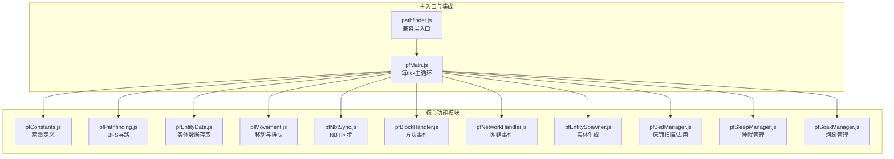
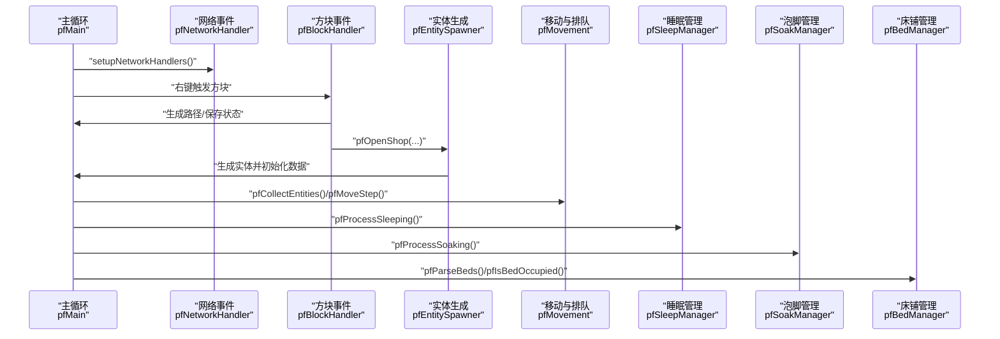
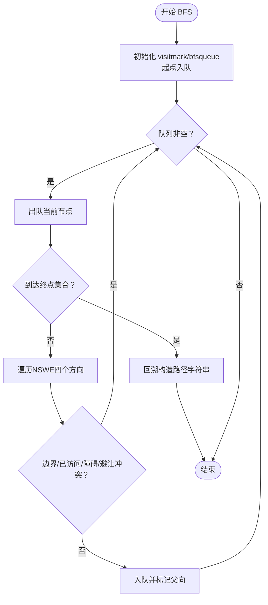
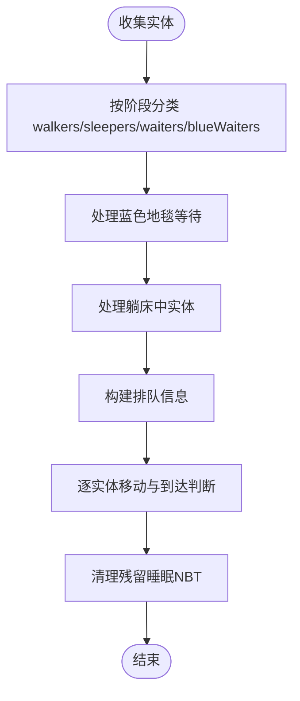
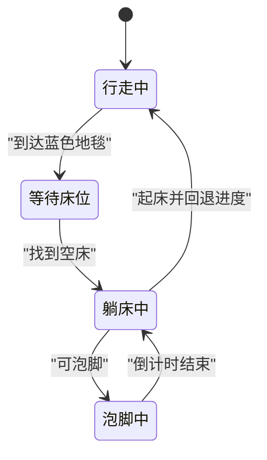
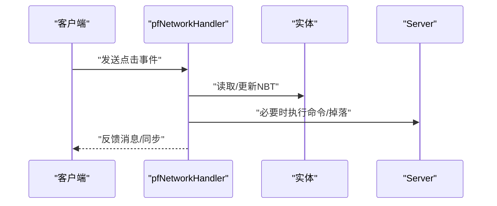
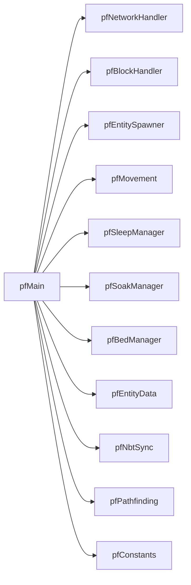

# 性能问题

<cite>
**本文引用的文件**
- [pathfinder.js](file://kubejs/server_scripts/pathfinder.js)
- [pfMain.js](file://kubejs/server_scripts/pathfinder/pfMain.js)
- [pfPathfinding.js](file://kubejs/server_scripts/pathfinder/pfPathfinding.js)
- [pfEntityData.js](file://kubejs/server_scripts/pathfinder/pfEntityData.js)
- [pfMovement.js](file://kubejs/server_scripts/pathfinder/pfMovement.js)
- [pfConstants.js](file://kubejs/server_scripts/pathfinder/pfConstants.js)
- [pfNetworkHandler.js](file://kubejs/server_scripts/pathfinder/pfNetworkHandler.js)
- [pfBlockHandler.js](file://kubejs/server_scripts/pathfinder/pfBlockHandler.js)
- [pfSoakManager.js](file://kubejs/server_scripts/pathfinder/pfSoakManager.js)
- [pfSleepManager.js](file://kubejs/server_scripts/pathfinder/pfSleepManager.js)
- [pfNbtSync.js](file://kubejs/server_scripts/pathfinder/pfNbtSync.js)
- [pfEntitySpawner.js](file://kubejs/server_scripts/pathfinder/pfEntitySpawner.js)
- [pfBedManager.js](file://kubejs/server_scripts/pathfinder/pfBedManager.js)
</cite>

## 目录
1. [简介](#简介)
2. [项目结构](#项目结构)
3. [核心组件](#核心组件)
4. [架构总览](#架构总览)
5. [详细组件分析](#详细组件分析)
6. [依赖分析](#依赖分析)
7. [性能考量](#性能考量)
8. [故障排查指南](#故障排查指南)
9. [结论](#结论)
10. [附录](#附录)

## 简介
本指南聚焦于该Minecraft模组项目中寻路系统的性能问题诊断与优化，覆盖以下方面：
- 寻路算法的复杂度与瓶颈定位
- 实体处理开销与批量操作优化
- 内存使用与持久化数据管理
- CPU占用率与tick负载控制
- 性能监控方法、负载测试技巧与优化策略
- 卡顿、延迟过高、内存泄漏等问题的识别与解决
- 面向大型服务器与高并发场景的调优建议与最佳实践

## 项目结构
该系统采用模块化设计，主入口负责整合各子模块，并在每tick驱动执行。关键模块包括：常量定义、寻路算法、实体数据、移动与排队、网络事件、方块事件、睡眠与泡脚管理、床铺扫描与占用检测、NBT同步、实体生成等。

**图表来源**
- [pathfinder.js:1-30](file://kubejs/server_scripts/pathfinder.js#L1-L30)
- [pfMain.js:11-177](file://kubejs/server_scripts/pathfinder/pfMain.js#L11-L177)
- [pfConstants.js:1-65](file://kubejs/server_scripts/pathfinder/pfConstants.js#L1-L65)
- [pfPathfinding.js:1-91](file://kubejs/server_scripts/pathfinder/pfPathfinding.js#L1-L91)
- [pfEntityData.js:1-218](file://kubejs/server_scripts/pathfinder/pfEntityData.js#L1-L218)
- [pfMovement.js:1-186](file://kubejs/server_scripts/pathfinder/pfMovement.js#L1-L186)
- [pfNbtSync.js:1-94](file://kubejs/server_scripts/pathfinder/pfNbtSync.js#L1-L94)
- [pfBlockHandler.js:1-148](file://kubejs/server_scripts/pathfinder/pfBlockHandler.js#L1-L148)
- [pfNetworkHandler.js:1-317](file://kubejs/server_scripts/pathfinder/pfNetworkHandler.js#L1-L317)
- [pfEntitySpawner.js:1-141](file://kubejs/server_scripts/pathfinder/pfEntitySpawner.js#L1-L141)
- [pfBedManager.js:1-129](file://kubejs/server_scripts/pathfinder/pfBedManager.js#L1-L129)
- [pfSleepManager.js:1-232](file://kubejs/server_scripts/pathfinder/pfSleepManager.js#L1-L232)
- [pfSoakManager.js:1-197](file://kubejs/server_scripts/pathfinder/pfSoakManager.js#L1-L197)

**章节来源**
- [pathfinder.js:1-30](file://kubejs/server_scripts/pathfinder.js#L1-L30)
- [pfMain.js:11-177](file://kubejs/server_scripts/pathfinder/pfMain.js#L11-L177)

## 核心组件
- 主循环与调度：每tick由主入口统一调度，收集实体、处理状态、驱动移动与行为。
- 寻路算法：基于网格的BFS，支持避让已有路径，输出方向序列。
- 实体数据：封装persistentData读写，统一字段命名与同步。
- 移动与排队：按进度与相对位置进行排队判定，子步插值移动。
- 睡眠与泡脚：以秒为粒度的状态机，避免依赖tick差值，跨重启友好。
- 床铺管理：扫描路径周边床铺，序列化存储，占用检测。
- 网络与方块事件：响应客户端点击与右键触发，生成路径与实体。
- NBT同步：通过手持物品NBT实现客户端同步，降低网络压力。

**章节来源**
- [pfMain.js:11-177](file://kubejs/server_scripts/pathfinder/pfMain.js#L11-L177)
- [pfPathfinding.js:46-83](file://kubejs/server_scripts/pathfinder/pfPathfinding.js#L46-L83)
- [pfMovement.js:8-34](file://kubejs/server_scripts/pathfinder/pfMovement.js#L8-L34)
- [pfSleepManager.js:65-128](file://kubejs/server_scripts/pathfinder/pfSleepManager.js#L65-L128)
- [pfSoakManager.js:92-145](file://kubejs/server_scripts/pathfinder/pfSoakManager.js#L92-L145)
- [pfBedManager.js:10-77](file://kubejs/server_scripts/pathfinder/pfBedManager.js#L10-L77)
- [pfNetworkHandler.js:37-311](file://kubejs/server_scripts/pathfinder/pfNetworkHandler.js#L37-L311)
- [pfBlockHandler.js:8-145](file://kubejs/server_scripts/pathfinder/pfBlockHandler.js#L8-L145)
- [pfNbtSync.js:8-94](file://kubejs/server_scripts/pathfinder/pfNbtSync.js#L8-L94)

## 架构总览
系统以“每tick主循环”为核心，围绕实体生命周期与状态机展开。主循环按阶段处理实体，调用各模块完成寻路、移动、睡眠、泡脚等动作。网络与方块事件作为外部输入，触发路径规划与实体生成。

**图表来源**
- [pfMain.js:11-177](file://kubejs/server_scripts/pathfinder/pfMain.js#L11-L177)
- [pfNetworkHandler.js:37-311](file://kubejs/server_scripts/pathfinder/pfNetworkHandler.js#L37-L311)
- [pfBlockHandler.js:8-145](file://kubejs/server_scripts/pathfinder/pfBlockHandler.js#L8-L145)
- [pfEntitySpawner.js:8-135](file://kubejs/server_scripts/pathfinder/pfEntitySpawner.js#L8-L135)
- [pfMovement.js:8-186](file://kubejs/server_scripts/pathfinder/pfMovement.js#L8-L186)
- [pfSleepManager.js:65-232](file://kubejs/server_scripts/pathfinder/pfSleepManager.js#L65-L232)
- [pfSoakManager.js:92-197](file://kubejs/server_scripts/pathfinder/pfSoakManager.js#L92-L197)
- [pfBedManager.js:10-129](file://kubejs/server_scripts/pathfinder/pfBedManager.js#L10-L129)

## 详细组件分析

### 寻路系统（BFS）性能分析
- 网格尺寸：以出发点为中心，半径为常量范围内的方格网格，网格宽为奇数，便于对称处理。
- BFS复杂度：节点数近似为半径平方，每轮扩展最多4方向，整体复杂度近似O(W^2)。
- 避让策略：对已有路径进行邻接步数内的冲突检测，增加常数因子开销。
- 路径长度影响：路径越长，实体移动与渲染开销越大；同时BFS搜索空间受网格限制。

**图表来源**
- [pfPathfinding.js:46-83](file://kubejs/server_scripts/pathfinder/pfPathfinding.js#L46-L83)
- [pfConstants.js:10-12](file://kubejs/server_scripts/pathfinder/pfConstants.js#L10-L12)

**章节来源**
- [pfPathfinding.js:13-83](file://kubejs/server_scripts/pathfinder/pfPathfinding.js#L13-L83)
- [pfConstants.js:10-12](file://kubejs/server_scripts/pathfinder/pfConstants.js#L10-L12)

### 实体处理与移动（CPU与内存）
- 实体收集：以主触发方块为中心的AABB范围收集实体，按阶段分类，避免对无关实体处理。
- 排队检测：基于实体间距离与进度比较，复杂度与范围内实体数量线性相关。
- 子步插值：每tick子步递增，10次进一格，减少每tick的实体移动频率，降低渲染与碰撞压力。
- 持久化字段：大量字段存储在实体persistentData，注意跨重启一致性与清理策略。

**图表来源**
- [pfMain.js:22-174](file://kubejs/server_scripts/pathfinder/pfMain.js#L22-L174)
- [pfMovement.js:8-186](file://kubejs/server_scripts/pathfinder/pfMovement.js#L8-L186)

**章节来源**
- [pfMain.js:22-174](file://kubejs/server_scripts/pathfinder/pfMain.js#L22-L174)
- [pfMovement.js:8-186](file://kubejs/server_scripts/pathfinder/pfMovement.js#L8-L186)

### 睡眠与泡脚（状态机与时间驱动）
- 睡眠状态机：以秒为单位的子步计数器，每20tick触发一次秒事件，避免依赖tick差值。
- 泡脚状态机：同理，以秒为单位计时，无水时重置倒计时，有水时逐秒递减。
- 与床铺管理联动：占用检测与下床位置回退逻辑，保证寻路连续性。

**图表来源**
- [pfSleepManager.js:65-232](file://kubejs/server_scripts/pathfinder/pfSleepManager.js#L65-L232)
- [pfSoakManager.js:92-197](file://kubejs/server_scripts/pathfinder/pfSoakManager.js#L92-L197)
- [pfBedManager.js:109-120](file://kubejs/server_scripts/pathfinder/pfBedManager.js#L109-L120)

**章节来源**
- [pfSleepManager.js:16-232](file://kubejs/server_scripts/pathfinder/pfSleepManager.js#L16-L232)
- [pfSoakManager.js:16-197](file://kubejs/server_scripts/pathfinder/pfSoakManager.js#L16-L197)
- [pfBedManager.js:109-120](file://kubejs/server_scripts/pathfinder/pfBedManager.js#L109-L120)

### 网络与方块事件（I/O与命令开销）
- 网络事件：客户端点击需求/泡脚/送客，服务端解析并更新实体NBT，必要时触发掉落与提示。
- 方块事件：右键触发方块，扫描网格、BFS生成路径、开店/关店、凭证/Boss分支处理。
- 命令调用：设置睡眠NBT、移除睡眠NBT、掉落物品等，属于高开销I/O，应尽量减少频率。

**图表来源**
- [pfNetworkHandler.js:37-311](file://kubejs/server_scripts/pathfinder/pfNetworkHandler.js#L37-L311)
- [pfBlockHandler.js:8-145](file://kubejs/server_scripts/pathfinder/pfBlockHandler.js#L8-L145)

**章节来源**
- [pfNetworkHandler.js:37-311](file://kubejs/server_scripts/pathfinder/pfNetworkHandler.js#L37-L311)
- [pfBlockHandler.js:8-145](file://kubejs/server_scripts/pathfinder/pfBlockHandler.js#L8-L145)

### 实体生成与数据初始化（一次性成本）
- 生成实体：设置位置、模型、NoAI、Invulnerable、PersistenceRequired、NoGravity等标志。
- 初始化数据：origin/route/phase/time/subStep/bedList等，预扫描床铺并序列化。
- 需求清单：随机生成并支持Boss倍率与跳过泡脚设置，最终写入NBT。

**章节来源**
- [pfEntitySpawner.js:8-135](file://kubejs/server_scripts/pathfinder/pfEntitySpawner.js#L8-L135)
- [pfEntityData.js:185-218](file://kubejs/server_scripts/pathfinder/pfEntityData.js#L185-L218)

## 依赖分析
- 模块耦合：主循环依赖各子模块接口，彼此通过全局对象调用，耦合度适中。
- 数据流：实体数据通过NBT同步至客户端，网络事件与方块事件驱动状态变更。
- 外部依赖：命令执行、实体/方块查询、属性读取等，均可能成为性能瓶颈。

**图表来源**
- [pfMain.js:11-177](file://kubejs/server_scripts/pathfinder/pfMain.js#L11-L177)
- [pfNetworkHandler.js:37-311](file://kubejs/server_scripts/pathfinder/pfNetworkHandler.js#L37-L311)
- [pfBlockHandler.js:8-145](file://kubejs/server_scripts/pathfinder/pfBlockHandler.js#L8-L145)
- [pfEntitySpawner.js:8-135](file://kubejs/server_scripts/pathfinder/pfEntitySpawner.js#L8-L135)
- [pfMovement.js:8-186](file://kubejs/server_scripts/pathfinder/pfMovement.js#L8-L186)
- [pfSleepManager.js:65-232](file://kubejs/server_scripts/pathfinder/pfSleepManager.js#L65-L232)
- [pfSoakManager.js:92-197](file://kubejs/server_scripts/pathfinder/pfSoakManager.js#L92-L197)
- [pfBedManager.js:10-129](file://kubejs/server_scripts/pathfinder/pfBedManager.js#L10-L129)
- [pfEntityData.js:185-218](file://kubejs/server_scripts/pathfinder/pfEntityData.js#L185-L218)
- [pfNbtSync.js:8-94](file://kubejs/server_scripts/pathfinder/pfNbtSync.js#L8-L94)
- [pfPathfinding.js:46-83](file://kubejs/server_scripts/pathfinder/pfPathfinding.js#L46-L83)
- [pfConstants.js:52-64](file://kubejs/server_scripts/pathfinder/pfConstants.js#L52-L64)

**章节来源**
- [pfMain.js:11-177](file://kubejs/server_scripts/pathfinder/pfMain.js#L11-L177)

## 性能考量

### 寻路系统性能瓶颈
- 网格扫描与BFS：网格大小与路径长度直接影响复杂度。建议：
  - 控制触发范围与路径长度，避免超长路径导致BFS队列膨胀。
  - 在大规模场景中考虑分片或分层寻路，减少每tick扫描范围。
- 避让逻辑：对已有路径的冲突检测带来额外开销，建议：
  - 缓存近期冲突路径片段，避免重复计算。
  - 限制避让检测范围，例如仅检测前若干步。

**章节来源**
- [pfPathfinding.js:46-83](file://kubejs/server_scripts/pathfinder/pfPathfinding.js#L46-L83)
- [pfConstants.js:10-12](file://kubejs/server_scripts/pathfinder/pfConstants.js#L10-L12)

### 实体处理开销
- 实体收集与分类：AABB范围过大将导致实体遍历成本上升，建议：
  - 根据服务器负载动态调整搜索半径，或按chunk分批处理。
- 排队检测：复杂度与实体数量线性相关，建议：
  - 使用空间分割（如四叉树）降低邻域查询成本。
  - 对静止实体进行缓存，仅在移动或状态变化时重新计算。
- 子步移动：每tick子步递增，10次进一格，有助于平滑移动；但过多实体仍会带来渲染与物理计算压力，建议：
  - 合理控制生成速率与最大实体数量，避免同时移动过多实体。

**章节来源**
- [pfMain.js:22-174](file://kubejs/server_scripts/pathfinder/pfMain.js#L22-L174)
- [pfMovement.js:8-186](file://kubejs/server_scripts/pathfinder/pfMovement.js#L8-L186)

### 内存使用与持久化
- 持久化字段：实体persistentData存储大量字段，建议：
  - 定期清理不再需要的字段，避免无限增长。
  - 对跨重启友好的字段进行压缩或合并存储。
- NBT同步：通过手持物品NBT同步至客户端，减少网络压力；但频繁写入仍需控制频率。
- 实体生成：一次性初始化成本较高，建议：
  - 复用实体或延迟初始化部分字段，减少瞬时峰值。

**章节来源**
- [pfEntityData.js:185-218](file://kubejs/server_scripts/pathfinder/pfEntityData.js#L185-L218)
- [pfNbtSync.js:8-94](file://kubejs/server_scripts/pathfinder/pfNbtSync.js#L8-L94)
- [pfEntitySpawner.js:8-135](file://kubejs/server_scripts/pathfinder/pfEntitySpawner.js#L8-L135)

### CPU占用率与命令开销
- 命令执行：设置/移除睡眠NBT、掉落物品等命令调用成本高，建议：
  - 减少命令频率，合并同类命令。
  - 使用更高效的数据更新方式（若可行）。
- 网络事件：解析与更新NBT、掉落与提示，建议：
  - 批量处理事件，避免每事件单独触发。
  - 对高频事件进行节流或去抖。

**章节来源**
- [pfSleepManager.js:75-144](file://kubejs/server_scripts/pathfinder/pfSleepManager.js#L75-L144)
- [pfSoakManager.js:147-197](file://kubejs/server_scripts/pathfinder/pfSoakManager.js#L147-L197)
- [pfNetworkHandler.js:37-311](file://kubejs/server_scripts/pathfinder/pfNetworkHandler.js#L37-L311)

### 性能监控与负载测试
- 监控指标建议：
  - 每tick主循环耗时、实体数量、BFS队列长度、命令执行次数、NBT写入次数。
- 负载测试技巧：
  - 逐步增加实体数量与路径长度，观察主循环耗时与帧时间波动。
  - 在不同网格半径与避让范围下对比性能表现。
- 优化验证：
  - 通过日志与计时器验证优化前后差异，关注CPU占用与内存峰值。

[本节为通用指导，无需特定文件来源]

### 高并发与大型服务器调优
- 限流与节流：对网络事件与方块事件进行限流，避免瞬时高峰。
- 分片与分区：将大范围网格拆分为多个子网格，分别处理，降低单次扫描成本。
- 异步与批处理：尽可能将非关键路径的命令与I/O批处理，减少主线程阻塞。
- 资源回收：定期清理无效实体与持久化数据，防止内存泄漏。

[本节为通用指导，无需特定文件来源]

## 故障排查指南

### 常见性能问题与定位
- 卡顿与延迟过高：
  - 检查主循环耗时与实体数量，确认是否存在异常长路径或大量实体同时移动。
  - 关注BFS队列长度与避让冲突检测频率。
- 内存泄漏：
  - 检查实体持久化字段是否正确清理，确认无冗余数据累积。
  - 关注NBT写入频率与客户端同步开销。
- CPU占用率异常：
  - 统计命令执行次数与频率，减少不必要的命令调用。
  - 优化网络事件处理，避免每事件单独触发昂贵操作。

**章节来源**
- [pfMain.js:11-177](file://kubejs/server_scripts/pathfinder/pfMain.js#L11-L177)
- [pfEntityData.js:185-218](file://kubejs/server_scripts/pathfinder/pfEntityData.js#L185-L218)
- [pfSleepManager.js:75-144](file://kubejs/server_scripts/pathfinder/pfSleepManager.js#L75-L144)
- [pfSoakManager.js:92-145](file://kubejs/server_scripts/pathfinder/pfSoakManager.js#L92-L145)

### 诊断工具与方法
- 日志与计时：在关键路径添加计时与日志，记录耗时与实体数量。
- 命令统计：统计命令执行次数与耗时，识别热点命令。
- 内存快照：定期采集内存快照，观察持久化数据增长趋势。

[本节为通用指导，无需特定文件来源]

## 结论
该寻路系统通过模块化设计实现了清晰的功能边界与可维护性。性能优化的关键在于：
- 控制网格扫描与BFS搜索规模，合理设置路径长度与避让范围；
- 优化实体收集与排队检测，采用空间分割与缓存策略；
- 减少命令与网络同步频率，提升状态更新效率；
- 在高并发场景下实施限流、分片与批处理，保障稳定性。

[本节为总结，无需特定文件来源]

## 附录

### 关键流程图（算法与状态机）
- BFS寻路流程已在“详细组件分析”中给出。
- 睡眠与泡脚状态机已在“详细组件分析”中给出。

[本节为补充说明，无需特定文件来源]