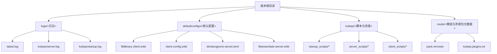
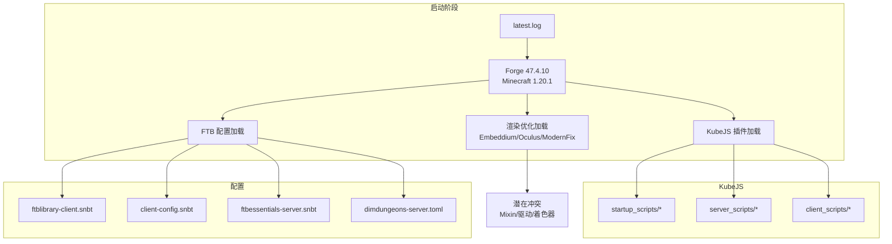
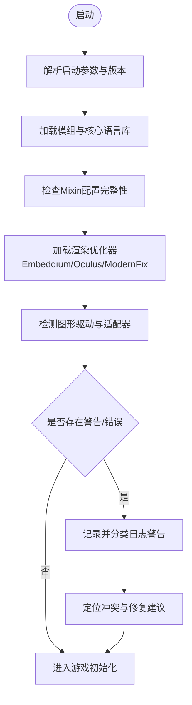
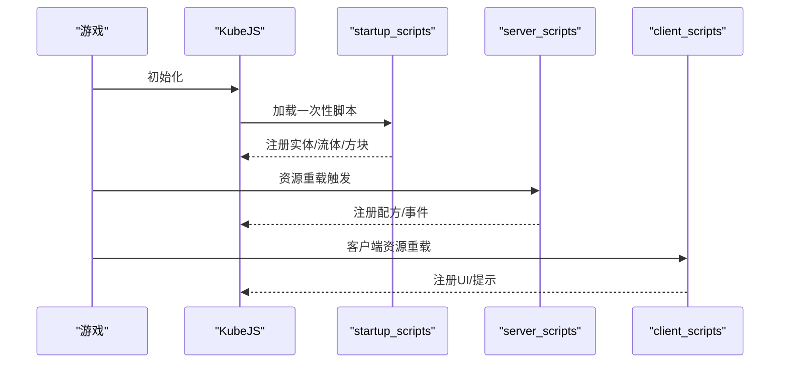
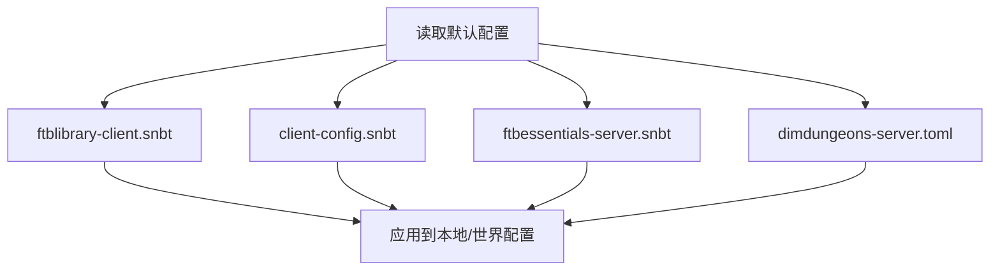
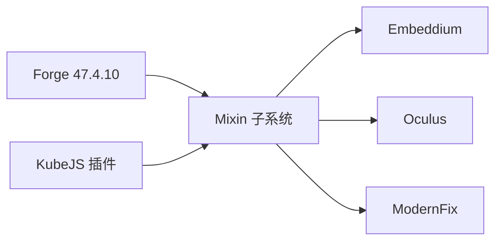

# 故障排除

<cite>
**本文引用的文件**
- [README.md](file://README.md)
- [latest.log](file://logs/latest.log)
- [server.log](file://logs/kubejs/server.log)
- [startup.log](file://logs/kubejs/startup.log)
- [ftblibrary-client.snbt](file://defaultconfigs/ftblibrary/ftblibrary-client.snbt)
- [client-config.snbt](file://defaultconfigs/ftbquests/client-config.snbt)
- [dimdungeons-server.toml](file://defaultconfigs/dimdungeons-server.toml)
- [ftbessentials-server.snbt](file://defaultconfigs/ftbessentials-server.snbt)
- [example.js](file://kubejs/startup_scripts/example.js)
- [serveHooks.js](file://kubejs/startup_scripts/serveHooks.js)
- [README.txt](file://kubejs/README.txt)
- [pack.mcmeta](file://mods/pack.mcmeta)
- [kubejs.plugins.txt](file://mods/kubejs.plugins.txt)
</cite>

## 目录
1. [简介](#简介)
2. [项目结构](#项目结构)
3. [核心组件](#核心组件)
4. [架构总览](#架构总览)
5. [详细组件分析](#详细组件分析)
6. [依赖关系分析](#依赖关系分析)
7. [性能考虑](#性能考虑)
8. [故障排除指南](#故障排除指南)
9. [结论](#结论)
10. [附录](#附录)

## 简介
本指南面向玩家与开发者，聚焦于该Minecraft 1.20.1 Forge版本的常见问题定位与解决。内容覆盖系统启动失败、功能异常、性能问题与兼容性冲突，并提供系统化的诊断流程、日志分析方法、错误代码解释、调试技巧与预防措施。文档同时解释常见配置错误、模组冲突与版本不兼容问题的处理方法，为技术支持与用户自助排障提供完整指引。

## 项目结构
该版本目录包含以下关键区域：
- 根目录安装说明与版本元数据
- 日志目录（Forge、KubeJS）
- 默认配置（FTB系列、维度地牢等）
- KubeJS脚本与资源（startup/server/client）
- 模组插件与资源包元数据

图表来源
- [README.md](file://README.md)
- [latest.log](file://logs/latest.log)
- [server.log](file://logs/kubejs/server.log)
- [startup.log](file://logs/kubejs/startup.log)
- [ftblibrary-client.snbt](file://defaultconfigs/ftblibrary/ftblibrary-client.snbt)
- [client-config.snbt](file://defaultconfigs/ftbquests/client-config.snbt)
- [dimdungeons-server.toml](file://defaultconfigs/dimdungeons-server.toml)
- [ftbessentials-server.snbt](file://defaultconfigs/ftbessentials-server.snbt)
- [pack.mcmeta](file://mods/pack.mcmeta)
- [kubejs.plugins.txt](file://mods/kubejs.plugins.txt)

章节来源
- [README.md](file://README.md)
- [latest.log](file://logs/latest.log)
- [server.log](file://logs/kubejs/server.log)
- [startup.log](file://logs/kubejs/startup.log)
- [ftblibrary-client.snbt](file://defaultconfigs/ftblibrary/ftblibrary-client.snbt)
- [client-config.snbt](file://defaultconfigs/ftbquests/client-config.snbt)
- [dimdungeons-server.toml](file://defaultconfigs/dimdungeons-server.toml)
- [ftbessentials-server.snbt](file://defaultconfigs/ftbessentials-server.snbt)
- [pack.mcmeta](file://mods/pack.mcmeta)
- [kubejs.plugins.txt](file://mods/kubejs.plugins.txt)

## 核心组件
- 启动与渲染管线：Forge 47.4.10、Minecraft 1.20.1、Java 17、OpenGL 4.6
- KubeJS：脚本生命周期（startup/server/client）、插件体系
- FTB系列：FTB Library、FTB Quests、FTBEssentials
- 维度地牢：dimdungeons（服务器配置）
- 渲染优化：Embeddium、Sodium、Oculus、ModernFix
- 资源包：pack.mcmeta定义资源包格式与描述

章节来源
- [latest.log](file://logs/latest.log)
- [README.txt](file://kubejs/README.txt)
- [ftblibrary-client.snbt](file://defaultconfigs/ftblibrary/ftblibrary-client.snbt)
- [client-config.snbt](file://defaultconfigs/ftbquests/client-config.snbt)
- [dimdungeons-server.toml](file://defaultconfigs/dimdungeons-server.toml)
- [ftbessentials-server.snbt](file://defaultconfigs/ftbessentials-server.snbt)
- [pack.mcmeta](file://mods/pack.mcmeta)

## 架构总览
下图展示启动阶段的关键交互与潜在冲突点，包括模组加载、Mixin与渲染优化之间的关系。

图表来源
- [latest.log](file://logs/latest.log)
- [server.log](file://logs/kubejs/server.log)
- [startup.log](file://logs/kubejs/startup.log)
- [ftblibrary-client.snbt](file://defaultconfigs/ftblibrary/ftblibrary-client.snbt)
- [client-config.snbt](file://defaultconfigs/ftbquests/client-config.snbt)
- [dimdungeons-server.toml](file://defaultconfigs/dimdungeons-server.toml)
- [ftbessentials-server.snbt](file://defaultconfigs/ftbessentials-server.snbt)

## 详细组件分析

### 启动日志与渲染优化
- 关键信息：ModLauncher、GL版本、Sodium/Oculus/Embeddium加载、工作区与驱动探测
- 警告要点：
  - 缺失mods.toml的FML核心语言库
  - JarJar依赖选择重复警告
  - Mixin缺少minVersion属性
  - 多个Mixin引用类缺失导致目标未找到
  - Embeddium检测到第三方修改并强制禁用部分Mixin
  - NVIDIA驱动线程优化工作区提示
  - OSHI计数器查询失败与会话服务环境变更

图表来源
- [latest.log](file://logs/latest.log)

章节来源
- [latest.log](file://logs/latest.log)

### KubeJS脚本生命周期与插件
- 生命周期：
  - startup_scripts：仅在启动时加载，适合注册实体、流体、方块等一次性内容
  - server_scripts：每次资源重载时加载，适合配方、标签、服务端事件
  - client_scripts：每次客户端资源重载时加载，适合JEI、UI、提示
- 插件：通过plugins.txt声明，日志中可见多个插件被加载
- 常见问题：
  - 启动脚本中的API变更（如方块构建器接口变化）
  - 服务端脚本执行顺序与钩子机制

图表来源
- [README.txt](file://kubejs/README.txt)
- [startup.log](file://logs/kubejs/startup.log)
- [server.log](file://logs/kubejs/server.log)

章节来源
- [README.txt](file://kubejs/README.txt)
- [startup.log](file://logs/kubejs/startup.log)
- [server.log](file://logs/kubejs/server.log)
- [example.js](file://kubejs/startup_scripts/example.js)
- [serveHooks.js](file://kubejs/startup_scripts/serveHooks.js)
- [kubejs.plugins.txt](file://mods/kubejs.plugins.txt)

### FTB配置与维度地牢
- FTB Library/Quests客户端配置：默认snbt文件存在，可按需覆盖
- FTBEssentials服务器配置：示例snbt展示了如何在世界路径下覆盖配置
- 维度地牢服务器配置：包含全局保护、硬核模式、日志级别、维度边界等选项

图表来源
- [ftblibrary-client.snbt](file://defaultconfigs/ftblibrary/ftblibrary-client.snbt)
- [client-config.snbt](file://defaultconfigs/ftbquests/client-config.snbt)
- [ftbessentials-server.snbt](file://defaultconfigs/ftbessentials-server.snbt)
- [dimdungeons-server.toml](file://defaultconfigs/dimdungeons-server.toml)

章节来源
- [ftblibrary-client.snbt](file://defaultconfigs/ftblibrary/ftblibrary-client.snbt)
- [client-config.snbt](file://defaultconfigs/ftbquests/client-config.snbt)
- [ftbessentials-server.snbt](file://defaultconfigs/ftbessentials-server.snbt)
- [dimdungeons-server.toml](file://defaultconfigs/dimdungeons-server.toml)

## 依赖关系分析
- 模组加载链：Forge -> Mixin -> 渲染优化（Embeddium/Oculus/ModernFix）-> KubeJS插件
- 冲突点：
  - Mixin目标类缺失或版本不匹配
  - 渲染优化对第三方修改的保护与禁用
  - 驱动计数器查询失败与会话服务环境变更

图表来源
- [latest.log](file://logs/latest.log)
- [server.log](file://logs/kubejs/server.log)

章节来源
- [latest.log](file://logs/latest.log)
- [server.log](file://logs/kubejs/server.log)

## 性能考虑
- 渲染优化：Embeddium、Sodium、Oculus、ModernFix均在启动日志中出现，表明已启用高性能渲染路径
- 工作区提示：NVIDIA线程优化工作区与驱动版本提示，建议升级显卡驱动以减少限制
- 图形适配器探测：多GPU/虚拟显示器探测，确保主显示设备正确

章节来源
- [latest.log](file://logs/latest.log)

## 故障排除指南

### 一、系统启动失败
- 症状
  - 启动后立即退出或无法进入主菜单
  - 显示黑屏或卡在加载界面
- 诊断步骤
  1. 查看启动日志中的早期阶段信息（ModLauncher、GL版本、驱动探测）
  2. 检查是否存在缺失mods.toml的核心语言库警告
  3. 关注JarJar依赖选择重复与Mixin配置完整性警告
  4. 留意渲染优化器对第三方修改的保护与禁用
- 解决方案
  - 升级显卡驱动至最新稳定版，消除NVIDIA线程优化工作区提示
  - 确认所有模组均提供完整元数据（mods.toml），避免缺失警告
  - 临时禁用可疑渲染优化或与之冲突的模组，验证是否恢复
  - 若存在驱动计数器查询失败，尝试关闭相关监控工具或使用管理员权限运行

章节来源
- [latest.log](file://logs/latest.log)

### 二、功能异常（KubeJS脚本）
- 症状
  - 实体模型/纹理未生效、方块注册失败、点击结算钩子不触发
- 诊断步骤
  1. 查看startup.log与server.log中的脚本加载与错误信息
  2. 关注API变更警告（如方块构建器接口变化）
  3. 检查serveHooks的注册与执行流程
- 解决方案
  - 根据日志提示调整API调用（如替换过时方法）
  - 确保钩子函数正确注册且上下文传递正常
  - 对于实体注册，参考示例脚本的写法进行修正

章节来源
- [startup.log](file://logs/kubejs/startup.log)
- [server.log](file://logs/kubejs/server.log)
- [example.js](file://kubejs/startup_scripts/example.js)
- [serveHooks.js](file://kubejs/startup_scripts/serveHooks.js)

### 三、性能问题（帧率低/掉帧）
- 症状
  - 进入游戏后帧率骤降或不稳定
- 诊断步骤
  1. 观察启动日志中关于驱动与工作区的警告
  2. 检查渲染优化器是否因第三方修改而禁用部分特性
- 解决方案
  - 升级显卡驱动，消除工作区提示
  - 降低渲染距离或关闭部分特效以缓解压力
  - 逐步禁用可疑模组，定位具体瓶颈

章节来源
- [latest.log](file://logs/latest.log)

### 四、兼容性冲突
- 症状
  - 启动时报错或运行中崩溃，提示Mixin目标类缺失
- 诊断步骤
  1. 在启动日志中查找“@Mixin target ... was not found”等信息
  2. 关注Embeddium对第三方修改的保护与禁用
- 解决方案
  - 升级或回退与目标类相关的模组版本
  - 避免同时安装相互冲突的渲染优化类模组
  - 如必须保留某模组，请评估其对Embeddium的修改范围

章节来源
- [latest.log](file://logs/latest.log)

### 五、配置错误
- FTB配置
  - 使用默认snbt文件作为模板，在本地/世界路径下进行覆盖
  - 注意字段名称与类型，避免无效覆盖
- 维度地牢
  - 根据需求调整全局保护、硬核模式、日志级别等选项
  - 若出现日志刷屏，可将logLevel调整为warn或error

章节来源
- [ftblibrary-client.snbt](file://defaultconfigs/ftblibrary/ftblibrary-client.snbt)
- [client-config.snbt](file://defaultconfigs/ftbquests/client-config.snbt)
- [ftbessentials-server.snbt](file://defaultconfigs/ftbessentials-server.snbt)
- [dimdungeons-server.toml](file://defaultconfigs/dimdungeons-server.toml)

### 六、模组冲突与版本不兼容
- 症状
  - 启动阶段出现大量Mixin错误或类找不到
- 诊断步骤
  - 在latest.log中定位具体报错行
  - 检查相关模组版本与Minecraft/Forge版本是否匹配
- 解决方案
  - 更新/回退冲突模组至兼容版本
  - 移除不必要的模组以减少冲突面

章节来源
- [latest.log](file://logs/latest.log)

### 七、日志分析方法
- 启动日志（latest.log）
  - 关注早期阶段的GL版本、驱动探测与核心语言库加载
  - 记录所有Mixin与渲染优化相关的警告/错误
- KubeJS日志
  - startup.log：脚本加载与API变更提示
  - server.log：配方与网络事件处理信息

章节来源
- [latest.log](file://logs/latest.log)
- [startup.log](file://logs/kubejs/startup.log)
- [server.log](file://logs/kubejs/server.log)

### 八、调试技巧
- 分步验证：逐一禁用模组，确认问题是否消失
- 版本对齐：确保Minecraft、Forge、模组版本一致
- 权限与路径：以管理员权限运行，避免资源访问受限
- 驱动与系统：保持显卡驱动与Windows更新到最新

章节来源
- [latest.log](file://logs/latest.log)

## 结论
本指南提供了从启动、脚本、配置到性能与兼容性的系统化排障路径。建议优先检查启动日志中的早期警告与渲染优化提示，再结合KubeJS日志定位脚本问题，最后通过默认配置模板与版本对齐解决兼容性与配置问题。若问题仍无法解决，可逐步禁用模组以缩小范围。

## 附录

### A. 错误代码与含义速查
- 缺失mods.toml：核心语言库元数据不完整，可能导致加载异常
- JarJar依赖选择重复：同一依赖被多次打包，建议清理重复依赖
- Mixin minVersion缺失：Mixin配置不完整，可能导致注入失败
- Mixin目标类缺失：目标类不存在或版本不匹配，需升级/回退相关模组
- Embeddium第三方修改：渲染优化检测到外部修改，强制禁用相关特性
- NVIDIA线程优化工作区：驱动工作区提示，建议升级驱动
- OSHI计数器查询失败：系统监控计数器不可用，不影响游戏但可能影响统计

章节来源
- [latest.log](file://logs/latest.log)

### B. 常见配置项参考
- FTB Library/Quests客户端配置：用于覆盖本地客户端行为
- FTBEssentials服务器配置：用于覆盖世界服务器配置
- 维度地牢服务器配置：控制地牢维度行为与日志级别

章节来源
- [ftblibrary-client.snbt](file://defaultconfigs/ftblibrary/ftblibrary-client.snbt)
- [client-config.snbt](file://defaultconfigs/ftbquests/client-config.snbt)
- [ftbessentials-server.snbt](file://defaultconfigs/ftbessentials-server.snbt)
- [dimdungeons-server.toml](file://defaultconfigs/dimdungeons-server.toml)

### C. 资源包与插件
- pack.mcmeta：定义资源包格式与描述
- kubejs.plugins.txt：声明KubeJS插件来源

章节来源
- [pack.mcmeta](file://mods/pack.mcmeta)
- [kubejs.plugins.txt](file://mods/kubejs.plugins.txt)