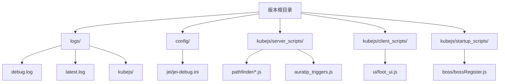
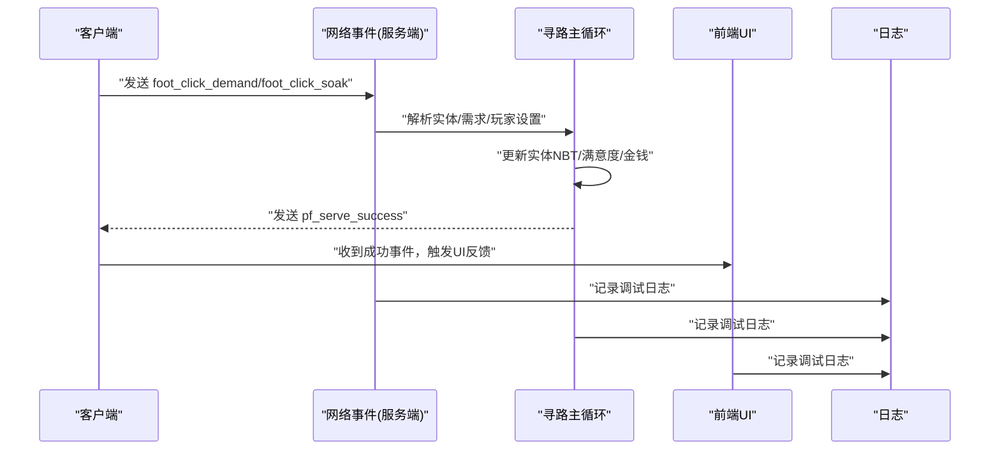
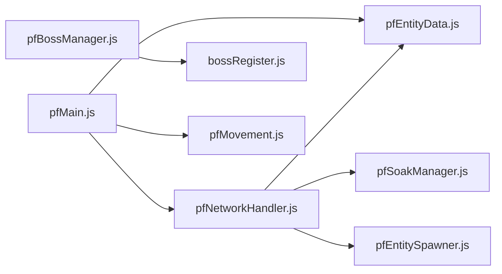

# 调试方法

<cite>
**本文引用的文件**
- [README.md](file://README.md)
- [debug.log](file://logs/debug.log)
- [jei-debug.ini](file://config/jei/jei-debug.ini)
- [auratip_triggers.js](file://kubejs/server_scripts/auratip_triggers.js)
- [foot_ui.js](file://kubejs/client_scripts/ui/foot_ui.js)
- [pfNetworkHandler.js](file://kubejs/server_scripts/pathfinder/pfNetworkHandler.js)
- [pfMain.js](file://kubejs/server_scripts/pathfinder/pfMain.js)
- [pathfinder.js](file://kubejs/server_scripts/pathfinder.js)
- [pfMovement.js](file://kubejs/server_scripts/pathfinder/pfMovement.js)
- [pfBossManager.js](file://kubejs/server_scripts/pathfinder/pfBossManager.js)
- [bossRegister.js](file://kubejs/startup_scripts/boss/bossRegister.js)
- [pfEntityData.js](file://kubejs/server_scripts/pathfinder/pfEntityData.js)
- [pfEntitySpawner.js](file://kubejs/server_scripts/pathfinder/pfEntitySpawner.js)
</cite>

## 目录
1. [简介](#简介)
2. [项目结构](#项目结构)
3. [核心组件](#核心组件)
4. [架构总览](#架构总览)
5. [详细组件分析](#详细组件分析)
6. [依赖关系分析](#依赖关系分析)
7. [性能考量](#性能考量)
8. [故障排查指南](#故障排查指南)
9. [结论](#结论)
10. [附录](#附录)

## 简介
本指南面向开发者与高级用户，系统化介绍在该 Minecraft 版本中进行问题诊断与定位的方法。内容覆盖日志分析、控制台命令使用、数据检查技巧（尤其是 NBT 数据）、断点调试技术，并结合系统内寻路系统、SPA 系统、Boss 系统的实际模块，给出可操作的调试策略与工具使用方法。

## 项目结构
该版本包含大量 KubeJS 脚本与配置，调试相关的关键位置如下：
- 日志目录：logs/（包含 debug.log、latest.log、kubejs 子目录等）
- 配置目录：config/（如 JEI 调试配置 jei-debug.ini）
- KubeJS 服务器端脚本：kubejs/server_scripts/
- KubeJS 客户端脚本：kubejs/client_scripts/
- 启动期脚本：kubejs/startup_scripts/

图示来源
- [README.md](file://README.md)
- [jei-debug.ini](file://config/jei/jei-debug.ini)
- [debug.log](file://logs/debug.log)

章节来源
- [README.md](file://README.md)
- [jei-debug.ini](file://config/jei/jei-debug.ini)
- [debug.log](file://logs/debug.log)

## 核心组件
- 日志系统：Forge/KubeJS 输出到 logs/debug.log 与 kubejs/*，便于定位启动、加载、运行期异常。
- 控制台命令：KubeJS 通过 ServerEvents.commandRegistry 注册调试命令，如 AuraTip 教学提示调试命令。
- 网络事件：客户端与服务端通过 NetworkEvents.dataReceived 发送/接收数据，用于 SPA 交互与状态同步。
- 数据持久化：实体 NBT（persistentData 与主手物品 NBT）承载寻路与 SPA 状态，是调试重点。
- 模块化架构：寻路系统以模块化组织，主循环与各子模块职责清晰，便于分段调试。

章节来源
- [auratip_triggers.js](file://kubejs/server_scripts/auratip_triggers.js)
- [foot_ui.js](file://kubejs/client_scripts/ui/foot_ui.js)
- [pfNetworkHandler.js](file://kubejs/server_scripts/pathfinder/pfNetworkHandler.js)
- [pfMain.js](file://kubejs/server_scripts/pathfinder/pfMain.js)
- [pathfinder.js](file://kubejs/server_scripts/pathfinder.js)

## 架构总览
下图展示 SPA/寻路系统与网络事件交互、日志输出与数据持久化的关系：

图示来源
- [pfNetworkHandler.js](file://kubejs/server_scripts/pathfinder/pfNetworkHandler.js)
- [foot_ui.js](file://kubejs/client_scripts/ui/foot_ui.js)
- [pfMain.js](file://kubejs/server_scripts/pathfinder/pfMain.js)

## 详细组件分析

### 日志分析方法
- Forge/KubeJS 日志定位
  - 使用 logs/debug.log 与 logs/latest.log 进行时间线追踪，关注 [PF-]、[PF-NETWORK]、[PF-SOAK]、[FOOT-UI]、[BOSS] 等前缀，快速定位模块。
  - KubeJS 侧日志位于 logs/kubejs/，包含 client.log、server.log、startup.log，分别对应客户端、服务端与启动期脚本。
- 关键日志模式
  - 启动与模块加载：查找模块初始化日志（如 “已加载”、“网络事件处理器已设置”）。
  - 运行期事件：点击/泡脚/成功回调等均有明确日志输出，便于核对交互链路。
- 日志级别与过滤
  - 使用日志文件中的时间戳与模块前缀进行过滤，缩小范围后再深入分析。
  - 对于 JEI 调试，可通过 config/jei/jei-debug.ini 启用调试开关（如 DebugMode、DebugGuis），观察 JEI 行为差异。

章节来源
- [debug.log](file://logs/debug.log)
- [jei-debug.ini](file://config/jei/jei-debug.ini)

### 控制台命令使用
- AuraTip 教学提示调试命令
  - 通过命令注册，支持显式显示特定教学提示，便于验证触发条件与 UI 展示。
  - 常用命令：auratip_debug_show（后接具体提示 ID）。
- 寻路系统命令
  - 通过命令注册，支持开启店铺、重置等操作，便于快速进入目标状态进行测试。
- 使用建议
  - 在命令执行前后对比日志与 UI 反馈，确认命令链路与副作用。

章节来源
- [auratip_triggers.js](file://kubejs/server_scripts/auratip_triggers.js)

### 数据检查技巧（NBT 与持久化）
- 实体 NBT 检查
  - 主手物品 NBT：包含需求值、满意度、金钱、步骤记录、动作玩家 UUID 等，是 SPA 流程的核心数据载体。
  - 持久化数据 persistentData：包含路径起点、路线字符串、蓝毯等待位置、睡眠状态、是否来自蓝毯等待等。
- SPA 数据要点
  - 需求键：脚掌、脚跟、脚趾、脚心（对应 NBT 字段）。
  - 满意度与金钱：随点击逐步累加，受 Boss 满意度倍率影响。
  - 动作玩家 UUID：用于结算时回溯操作人，避免依赖商店状态。
- Boss 相关
  - 实体持久化写入 pfBossId，用于倍率查询；同时清除顾客类别字段，避免常规评价逻辑干扰。
- 检查方法
  - 通过命令或 UI 触发后，立即查看对应实体的主手物品 NBT 与 persistentData，核对字段变化。
  - 结合日志中的实体 UUID，定位目标实体。

章节来源
- [pfNetworkHandler.js](file://kubejs/server_scripts/pathfinder/pfNetworkHandler.js)
- [pfEntityData.js](file://kubejs/server_scripts/pathfinder/pfEntityData.js)
- [pfEntitySpawner.js](file://kubejs/server_scripts/pathfinder/pfEntitySpawner.js)
- [pfBossManager.js](file://kubejs/server_scripts/pathfinder/pfBossManager.js)

### 断点调试技术
- 客户端断点
  - 在客户端脚本（如 UI 回调）中插入日志或临时断点，观察事件到达与 UI 反馈。
  - 示例：NetworkEvents.dataReceived('pf_serve_success') 的处理逻辑，可在 try/catch 包裹中加入日志，确认数据结构。
- 服务端断点
  - 在网络事件处理函数中增加日志，打印关键参数（实体 UUID、部位键、玩家设置等），核对业务分支。
  - 在主循环与移动逻辑中增加阶段性日志，验证路径推进与状态切换。
- 模块化调试
  - 将问题限定在单一模块（如 SPA、寻路、Boss），关闭其他模块干扰，逐步恢复以定位耦合点。

章节来源
- [foot_ui.js](file://kubejs/client_scripts/ui/foot_ui.js)
- [pfNetworkHandler.js](file://kubejs/server_scripts/pathfinder/pfNetworkHandler.js)
- [pfMain.js](file://kubejs/server_scripts/pathfinder/pfMain.js)
- [pfMovement.js](file://kubejs/server_scripts/pathfinder/pfMovement.js)

### 寻路系统调试要点
- 主循环与状态机
  - 通过 global.pathfinderTick 驱动，按 tick 收集实体、推进等待/睡眠/泡脚/按摩流程。
  - 关注蓝毯等待判定、到达判断与状态切换日志。
- 路径与移动
  - 依据 routeStr 与 time/subStep 推进实体位置，检查路径字符与坐标变化。
- SPA 交互
  - 客户端点击需求按钮 → 服务端解析需求与玩家设置 → 更新 NBT 与收益 → 客户端收到成功事件 → UI 反馈。
- 调试建议
  - 在主循环与移动逻辑中增加日志，核对实体到达蓝毯、进入等待、开始泡脚等关键节点。
  - 使用命令快速生成/唤醒实体，缩短测试周期。

章节来源
- [pfMain.js](file://kubejs/server_scripts/pathfinder/pfMain.js)
- [pfMovement.js](file://kubejs/server_scripts/pathfinder/pfMovement.js)
- [pathfinder.js](file://kubejs/server_scripts/pathfinder.js)

### SPA 系统调试要点
- 点击需求按钮
  - 服务端解析部位键（优先使用传入 key，否则根据主手物品映射），校验需求值与玩家设置（一键满足）。
  - 计算体力消耗与收益，更新满意度与金钱，记录步骤与动作玩家 UUID。
  - 通知客户端成功事件，触发 UI 动画。
- 泡脚按钮
  - 校验玩家持有水桶（原版或自定义洗脚水桶），查找目标实体，启动泡脚流程。
  - 记录动作玩家 UUID，推进教学提示。
- 调试建议
  - 使用日志前缀区分 SPA 与泡脚分支，核对实体 UUID 与部位键。
  - 在一键满足与普通模式下分别测试，对比收益与体力消耗。

章节来源
- [pfNetworkHandler.js](file://kubejs/server_scripts/pathfinder/pfNetworkHandler.js)
- [foot_ui.js](file://kubejs/client_scripts/ui/foot_ui.js)

### Boss 系统调试要点
- Boss 生成
  - 通过触发物品在路由上生成 Boss 顾客，写入 pfBossId 并应用需求/满意度倍率。
  - 清除顾客类别字段，避免常规评价逻辑。
- 注册与查询
  - bossRegister 维护 byId/byTriggerItem 映射，便于倍率查询与日志输出。
- 调试建议
  - 在生成日志中核对 bossDef 的倍率与提示信息，确认实体持久化写入成功。
  - 通过命令或触发物品快速复现，观察倍率生效与粒子特效。

章节来源
- [pfBossManager.js](file://kubejs/server_scripts/pathfinder/pfBossManager.js)
- [bossRegister.js](file://kubejs/startup_scripts/boss/bossRegister.js)

## 依赖关系分析
- 模块间依赖
  - pathfinder.js 作为兼容层，负责设置网络事件处理器与模块加载顺序。
  - pfNetworkHandler.js 依赖全局常量、设置读取、SPA 计算与掉落模块。
  - pfEntityData.js 提供实体数据访问接口，被多个模块共享。
  - pfBossManager.js 依赖注册表与商店管理模块，实现 Boss 统一管理。
- 网络事件依赖
  - 客户端通过 NetworkEvents 发送事件，服务端通过 pfNetworkHandler 接收并处理，再通过 send 或 tell 返回反馈。

图示来源
- [pathfinder.js](file://kubejs/server_scripts/pathfinder.js)
- [pfNetworkHandler.js](file://kubejs/server_scripts/pathfinder/pfNetworkHandler.js)
- [pfEntityData.js](file://kubejs/server_scripts/pathfinder/pfEntityData.js)
- [pfEntitySpawner.js](file://kubejs/server_scripts/pathfinder/pfEntitySpawner.js)
- [pfBossManager.js](file://kubejs/server_scripts/pathfinder/pfBossManager.js)
- [bossRegister.js](file://kubejs/startup_scripts/boss/bossRegister.js)
- [pfMovement.js](file://kubejs/server_scripts/pathfinder/pfMovement.js)

章节来源
- [pathfinder.js](file://kubejs/server_scripts/pathfinder.js)
- [pfNetworkHandler.js](file://kubejs/server_scripts/pathfinder/pfNetworkHandler.js)
- [pfEntityData.js](file://kubejs/server_scripts/pathfinder/pfEntityData.js)
- [pfEntitySpawner.js](file://kubejs/server_scripts/pathfinder/pfEntitySpawner.js)
- [pfBossManager.js](file://kubejs/server_scripts/pathfinder/pfBossManager.js)
- [bossRegister.js](file://kubejs/startup_scripts/boss/bossRegister.js)
- [pfMovement.js](file://kubejs/server_scripts/pathfinder/pfMovement.js)

## 性能考量
- 日志风暴防护
  - 在高频 tick 的模块（如主循环、移动）中，避免过度日志输出，必要时降低日志频率或使用条件日志。
- 网络事件节流
  - SPA 交互应避免频繁发送事件，合并状态更新，减少客户端压力。
- 数据访问优化
  - 复用实体与 NBT 访问结果，避免重复查询；在循环中缓存常用字段。

## 故障排查指南
- 无法定位实体
  - 现象：日志提示“未找到实体 uuid=...”
  - 排查：确认实体是否存在、UUID 是否正确传递；在主循环与网络事件中增加实体存在性检查与日志。
- 需求未更新
  - 现象：点击无效或收益未增加
  - 排查：核对部位键映射、主手物品 NBT 字段、玩家设置（一键满足）、体力消耗与收益计算。
- 泡脚无法开始
  - 现象：提示需要手持水桶或洗脚水桶
  - 排查：确认玩家主手物品 ID 是否在注册表中，或为原版水桶；检查泡脚管理器启动逻辑。
- Boss 倍率不生效
  - 现象：需求/满意度倍率未按预期提升
  - 排查：确认实体持久化写入 pfBossId，注册表 byId 查询成功，倍率应用逻辑正确。
- UI 动画不同步
  - 现象：服务端已成功但 UI 未反馈
  - 排查：检查 pf_serve_success 事件发送与客户端接收逻辑，确认数据结构一致。

章节来源
- [pfNetworkHandler.js](file://kubejs/server_scripts/pathfinder/pfNetworkHandler.js)
- [foot_ui.js](file://kubejs/client_scripts/ui/foot_ui.js)
- [pfBossManager.js](file://kubejs/server_scripts/pathfinder/pfBossManager.js)

## 结论
通过日志前缀、控制台命令、NBT 数据检查与断点调试相结合，可以高效定位与解决寻路、SPA、Boss 等模块的问题。建议在开发与排障过程中，先以日志与命令快速收敛问题范围，再深入到具体模块与网络事件处理逻辑，最后通过数据持久化核对确保状态一致性。

## 附录
- 快速定位技巧
  - 使用日志前缀快速筛选：[PF]、[PF-NETWORK]、[PF-SOAK]、[FOOT-UI]、[BOSS]。
  - 在关键函数入口与出口增加日志，形成调用链路。
  - 对照实体 UUID 与 NBT 字段，逐项验证状态变更。
- 常用命令参考
  - AuraTip 教学提示调试命令：auratip_debug_show（后接提示 ID）
  - 寻路系统命令：auratip_openshop、auratip_reset 等（按实际注册）