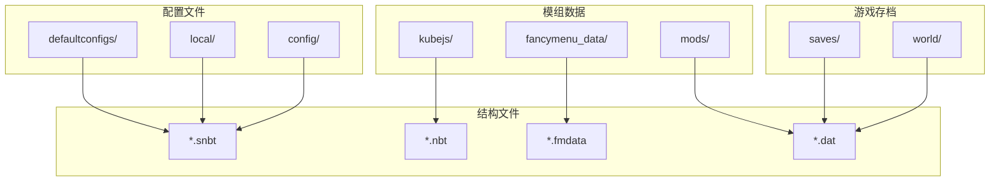
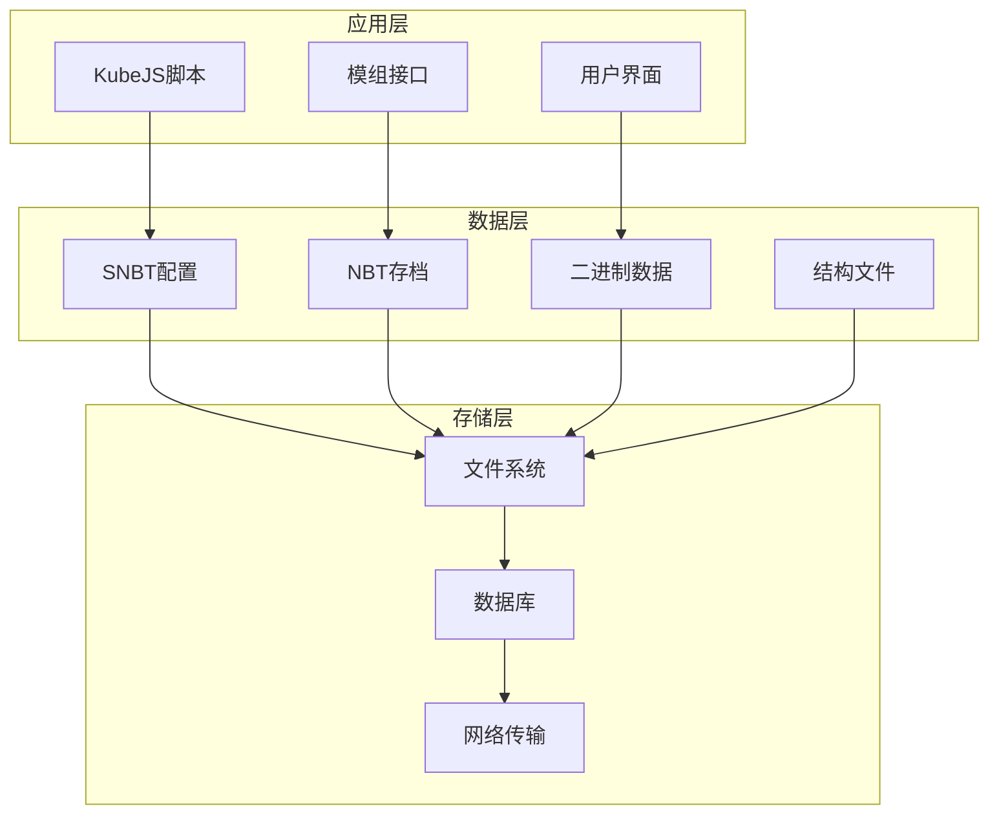
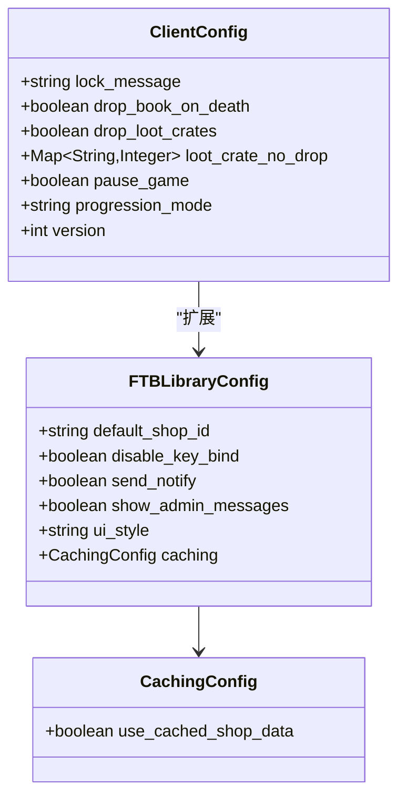
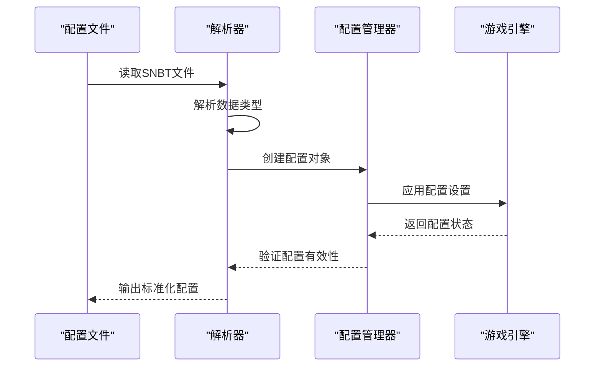
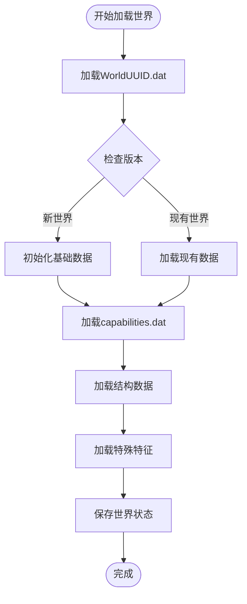
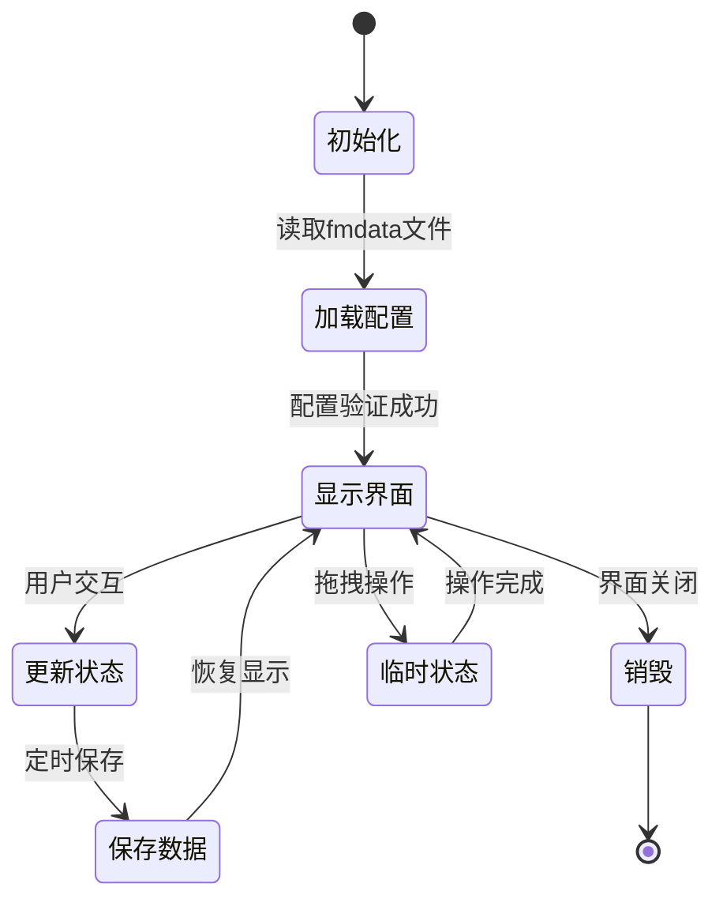
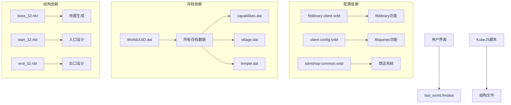
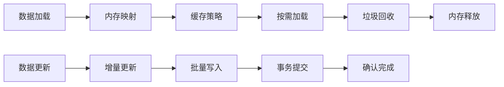
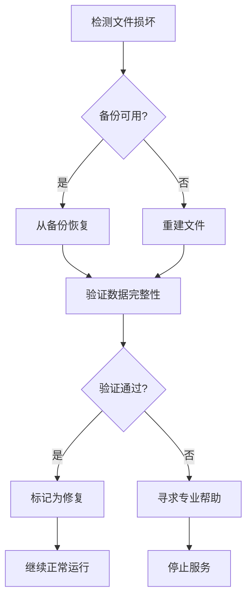

# NBT数据处理

<cite>
**本文档引用的文件**
- [ftblibrary-client.snbt](file://defaultconfigs/ftblibrary/ftblibrary-client.snbt)
- [client-config.snbt](file://defaultconfigs/ftbquests/client-config.snbt)
- [sdmshop-common.snbt](file://defaultconfigs/sdmshop/sdmshop-common.snbt)
- [data.snbt](file://config/ftbquests/quests/data.snbt)
- [last_world.fmdata](file://fancymenu_data/last_world.fmdata)
- [buddy_save.json](file://fancymenu_data/buddy/buddy_save.json)
- [WorldUUID.dat](file://saves/幻想乡/data/WorldUUID.dat)
- [capabilities.dat](file://saves/幻想乡/data/capabilities.dat)
- [raids.dat](file://saves/幻想乡/data/raids.dat)
- [villages_nether.dat](file://saves/幻想乡/data/villages_nether.dat)
- [forcedchunks.dat](file://saves/幻想乡/DIM-1/forcedchunks.dat)
- [temple.dat](file://saves/幻想乡/data/Temple.dat)
- [monument.dat](file://saves/幻想乡/data/Monument.dat)
- [mineshaft.dat](file://saves/幻想乡/data/Mineshaft.dat)
- [village.dat](file://saves/幻想乡/data/Village.dat)
- [idcounts.dat](file://saves/幻想乡/data/idcounts.dat)
- [map_10.dat](file://saves/幻想乡/data/map_10.dat)
- [adastra_planet_data.dat](file://saves/幻想乡/data/adastra_planet_data.dat)
- [disk_manager.dat](file://saves/幻想乡/data/disk_manager.dat)
- [fabricRegistry.dat](file://saves/幻想乡/data/fabricRegistry.dat)
- [boss_32.nbt](file://kubejs/data/marguerite/structures/boss_32.nbt)
- [corner_32.nbt](file://kubejs/data/marguerite/structures/corner_32.nbt)
- [direct_32.nbt](file://kubejs/data/marguerite/structures/direct_32.nbt)
- [start_32.nbt](file://kubejs/data/marguerite/structures/start_32.nbt)
- [three_32.nbt](file://kubejs/data/marguerite/structures/three_32.nbt)
- [l1_start_1.nbt](file://kubejs/data/marguerite/structures/l1_start_1.nbt)
- [l1_end_1.nbt](file://kubejs/data/marguerite/structures/l1_end_1.nbt)
- [000_cr.nbt](file://kubejstest/data/sushi/structures/000_cr.nbt)
</cite>

## 目录
1. [简介](#简介)
2. [项目结构](#项目结构)
3. [核心组件](#核心组件)
4. [架构概览](#架构概览)
5. [详细组件分析](#详细组件分析)
6. [依赖关系分析](#依赖关系分析)
7. [性能考虑](#性能考虑)
8. [故障排除指南](#故障排除指南)
9. [结论](#结论)
10. [附录](#附录)

## 简介

本项目展示了Minecraft中NBT（Named Binary Tag）数据系统的实际应用。通过分析代码库中的各种配置文件和数据文件，我们可以看到NBT系统在游戏存档、模组配置和自定义数据存储中的重要作用。

NBT数据系统是Minecraft的核心数据存储机制，它提供了类型安全的二进制数据序列化和反序列化功能。本项目中的各种文件展示了从简单的键值对配置到复杂的多维数组数据的完整应用场景。

## 项目结构

项目采用模块化的文件组织结构，主要包含以下几类数据文件：

**图表来源**
- [ftblibrary-client.snbt:1-5](file://defaultconfigs/ftblibrary/ftblibrary-client.snbt#L1-L5)
- [data.snbt:1-23](file://config/ftbquests/quests/data.snbt#L1-L23)
- [last_world.fmdata:1-8](file://fancymenu_data/last_world.fmdata#L1-L8)

**章节来源**
- [ftblibrary-client.snbt:1-5](file://defaultconfigs/ftblibrary/ftblibrary-client.snbt#L1-L5)
- [client-config.snbt:1-5](file://defaultconfigs/ftbquests/client-config.snbt#L1-L5)
- [sdmshop-common.snbt:1-24](file://defaultconfigs/sdmshop/sdmshop-common.snbt#L1-L24)
- [data.snbt:1-23](file://config/ftbquests/quests/data.snbt#L1-L23)

## 核心组件

### 数据类型系统

Minecraft的NBT系统支持多种数据类型，这些类型在项目中得到了广泛应用：

| 数据类型 | SNBT表示 | 示例用途 | 文件示例 |
|---------|---------|---------|---------|
| Byte | 127b | 游戏设置标志 | ftblibrary-client.snbt |
| Short | 32767s | 数值限制参数 | sdmshop-common.snbt |
| Int | 1000 | 计数器和ID | data.snbt |
| Long | 123456789L | UUID和时间戳 | WorldUUID.dat |
| Float | 1.5f | 浮点数值 | buddy_save.json |
| Double | 0.5d | 高精度计算 | data.snbt |
| ByteArray | [B; 1b, 2b, 3b] | 二进制数据 | capabilities.dat |
| IntArray | [I; 1, 2, 3] | 坐标和索引 | Village.dat |
| LongArray | [L; 1L, 2L, 3L] | 大型数据块 | idcounts.dat |
| String | "text" | 文本标签和路径 | last_world.fmdata |

### 序列化格式

项目中使用了三种主要的数据序列化格式：

1. **SNBT（Stringified NBT）**：人类可读的文本格式
   - 特点：易于编辑和调试
   - 应用：配置文件、模组设置
   - 示例：ftblibrary-client.snbt, data.snbt

2. **Binary NBT**：标准二进制格式
   - 特点：紧凑高效，适合存储
   - 应用：游戏存档、持久化数据
   - 示例：WorldUUID.dat, capabilities.dat

3. **FMData**：自定义格式
   - 特点：键值对结构，简单易用
   - 应用：界面状态、临时数据
   - 示例：last_world.fmdata

**章节来源**
- [ftblibrary-client.snbt:1-5](file://defaultconfigs/ftblibrary/ftblibrary-client.snbt#L1-L5)
- [sdmshop-common.snbt:1-24](file://defaultconfigs/sdmshop/sdmshop-common.snbt#L1-L24)
- [data.snbt:1-23](file://config/ftbquests/quests/data.snbt#L1-L23)
- [last_world.fmdata:1-8](file://fancymenu_data/last_world.fmdata#L1-L8)

## 架构概览

项目中的数据处理架构可以分为三个层次：

**图表来源**
- [boss_32.nbt](file://kubejs/data/marguerite/structures/boss_32.nbt)
- [WorldUUID.dat](file://saves/幻想乡/data/WorldUUID.dat)
- [capabilities.dat](file://saves/幻想乡/data/capabilities.dat)

## 详细组件分析

### 配置管理系统

配置系统是项目中最复杂的NBT应用之一，主要由FTB系列模组提供支持。

#### FTBLibrary配置

FTBLibrary提供了一个完整的客户端配置框架：

**图表来源**
- [ftblibrary-client.snbt:1-5](file://defaultconfigs/ftblibrary/ftblibrary-client.snbt#L1-L5)
- [sdmshop-common.snbt:1-24](file://defaultconfigs/sdmshop/sdmshop-common.snbt#L1-L24)

#### FTBQuests配置

FTBQuests模块提供了任务系统的完整配置：

**图表来源**
- [data.snbt:1-23](file://config/ftbquests/quests/data.snbt#L1-L23)

**章节来源**
- [ftblibrary-client.snbt:1-5](file://defaultconfigs/ftblibrary/ftblibrary-client.snbt#L1-L5)
- [client-config.snbt:1-5](file://defaultconfigs/ftbquests/client-config.snbt#L1-L5)
- [sdmshop-common.snbt:1-24](file://defaultconfigs/sdmshop/sdmshop-common.snbt#L1-L24)
- [data.snbt:1-23](file://config/ftbquests/quests/data.snbt#L1-L23)

### 存档数据管理系统

游戏存档系统包含了大量不同类型的数据文件，每种文件都有特定的用途和数据结构。

#### 世界数据管理

**图表来源**
- [WorldUUID.dat](file://saves/幻想乡/data/WorldUUID.dat)
- [capabilities.dat](file://saves/幻想乡/data/capabilities.dat)

#### 结构数据存储

项目中的结构文件展示了复杂的三维数据存储：

| 结构类型 | 文件数量 | 数据特点 | 存储用途 |
|---------|---------|---------|---------|
| 基础结构 | 5个 | 32x32x32方块网格 | 地图生成 |
| L1层级结构 | 6个 | 分层设计，包含起点和终点 | 关卡设计 |
| 测试结构 | 2个 | 简化版本，用于开发测试 | 开发工具 |

**章节来源**
- [boss_32.nbt](file://kubejs/data/marguerite/structures/boss_32.nbt)
- [corner_32.nbt](file://kubejs/data/marguerite/structures/corner_32.nbt)
- [direct_32.nbt](file://kubejs/data/marguerite/structures/direct_32.nbt)
- [start_32.nbt](file://kubejs/data/marguerite/structures/start_32.nbt)
- [three_32.nbt](file://kubejs/data/marguerite/structures/three_32.nbt)
- [l1_start_1.nbt](file://kubejs/data/marguerite/structures/l1_start_1.nbt)
- [l1_end_1.nbt](file://kubejs/data/marguerite/structures/l1_end_1.nbt)
- [000_cr.nbt](file://kubejstest/data/sushi/structures/000_cr.nbt)

### 界面状态管理

FancyMenu模组提供了复杂的状态管理功能：

**图表来源**
- [last_world.fmdata:1-8](file://fancymenu_data/last_world.fmdata#L1-L8)

**章节来源**
- [last_world.fmdata:1-8](file://fancymenu_data/last_world.fmdata#L1-L8)

## 依赖关系分析

项目中的数据文件之间存在复杂的依赖关系：

**图表来源**
- [ftblibrary-client.snbt:1-5](file://defaultconfigs/ftblibrary/ftblibrary-client.snbt#L1-L5)
- [client-config.snbt:1-5](file://defaultconfigs/ftbquests/client-config.snbt#L1-L5)
- [WorldUUID.dat](file://saves/幻想乡/data/WorldUUID.dat)
- [boss_32.nbt](file://kubejs/data/marguerite/structures/boss_32.nbt)

**章节来源**
- [ftblibrary-client.snbt:1-5](file://defaultconfigs/ftblibrary/ftblibrary-client.snbt#L1-L5)
- [client-config.snbt:1-5](file://defaultconfigs/ftbquests/client-config.snbt#L1-L5)
- [sdmshop-common.snbt:1-24](file://defaultconfigs/sdmshop/sdmshop-common.snbt#L1-L24)
- [data.snbt:1-23](file://config/ftbquests/quests/data.snbt#L1-L23)
- [WorldUUID.dat](file://saves/幻想乡/data/WorldUUID.dat)

## 性能考虑

### 数据压缩策略

项目中采用了多种数据压缩和优化技术：

1. **类型优化**：根据数据范围选择最合适的NBT类型
   - 小数值使用Byte类型
   - 中等数值使用Short类型
   - 大数值使用Long类型

2. **数组优化**：使用Int数组存储坐标和索引
   - 减少存储空间需求
   - 提高访问速度

3. **结构化存储**：将相关数据组织在同一文件中
   - 减少文件系统开销
   - 提高数据访问效率

### 内存管理

**图表来源**
- [capabilities.dat](file://saves/幻想乡/data/capabilities.dat)
- [village.dat](file://saves/幻想乡/data/Village.dat)

## 故障排除指南

### 常见问题及解决方案

#### 数据格式错误

当遇到SNBT格式错误时，通常表现为解析失败或数据丢失：

1. **检查语法**：确保所有括号匹配，逗号正确使用
2. **验证类型**：确认数据类型与预期一致
3. **检查转义字符**：特殊字符需要正确转义

#### 文件损坏处理

对于损坏的NBT文件，建议采用以下步骤：

#### 性能问题诊断

当遇到性能问题时，可以通过以下方式进行诊断：

1. **监控内存使用**：检查是否有内存泄漏
2. **分析I/O性能**：评估文件读写速度
3. **检查并发访问**：避免数据竞争条件

**章节来源**
- [ftblibrary-client.snbt:1-5](file://defaultconfigs/ftblibrary/ftblibrary-client.snbt#L1-L5)
- [data.snbt:1-23](file://config/ftbquests/quests/data.snbt#L1-L23)

## 结论

本项目展示了Minecraft NBT数据系统的完整应用实践。通过分析不同类型的文件和数据结构，我们可以看到：

1. **多样化应用**：NBT系统被广泛应用于配置管理、游戏存档、模组数据和用户界面状态等多个方面。

2. **类型安全**：通过明确的数据类型定义，确保了数据的完整性和一致性。

3. **性能优化**：合理的数据结构设计和存储策略提高了系统的整体性能。

4. **可维护性**：清晰的文件组织和版本控制机制保证了系统的长期稳定性。

5. **扩展性**：模块化的架构设计使得系统能够轻松适应新的需求和功能。

## 附录

### 数据迁移指南

当需要进行数据迁移时，建议遵循以下流程：

1. **备份现有数据**：在迁移前创建完整备份
2. **验证新格式**：确保新格式的兼容性
3. **逐步迁移**：分批迁移数据以减少风险
4. **验证结果**：迁移完成后进行全面测试
5. **清理旧数据**：确认无误后删除旧版本数据

### 最佳实践建议

1. **命名规范**：使用有意义的文件名和键名
2. **版本控制**：为重要数据添加版本信息
3. **错误处理**：实现完善的异常处理机制
4. **性能监控**：定期检查数据访问性能
5. **文档维护**：保持数据结构文档的及时更新