# 实体数据模型

<cite>
**本文引用的文件**
- [pfEntityData.js](file://kubejs/server_scripts/pathfinder/pfEntityData.js)
- [pfEntitySpawner.js](file://kubejs/server_scripts/pathfinder/pfEntitySpawner.js)
- [pfMovement.js](file://kubejs/server_scripts/pathfinder/pfMovement.js)
- [pfNbtSync.js](file://kubejs/server_scripts/pathfinder/pfNbtSync.js)
- [pfConstants.js](file://kubejs/server_scripts/pathfinder/pfConstants.js)
- [pfMain.js](file://kubejs/server_scripts/pathfinder/pfMain.js)
- [pfSoakManager.js](file://kubejs/server_scripts/pathfinder/pfSoakManager.js)
- [pfBedManager.js](file://kubejs/server_scripts/pathfinder/pfBedManager.js)
- [pfSleepManager.js](file://kubejs/server_scripts/pathfinder/pfSleepManager.js)
- [pathfinder.js](file://kubejs/server_scripts/pathfinder.js)
</cite>

## 目录
1. [简介](#简介)
2. [项目结构](#项目结构)
3. [核心组件](#核心组件)
4. [架构总览](#架构总览)
5. [详细组件分析](#详细组件分析)
6. [依赖分析](#依赖分析)
7. [性能考虑](#性能考虑)
8. [故障排查指南](#故障排查指南)
9. [结论](#结论)
10. [附录](#附录)

## 简介
本文件聚焦于项目中NPC实体（寻路女仆）的数据模型与管理机制，系统性阐述persistentData的使用方式、实体数据生命周期（创建、更新、查询、清理）、关键字段语义（origin坐标、route路径、time时间戳、phase阶段等）、数据验证与约束，以及与系统其他模块（床铺、睡眠、泡脚、NBT同步）的交互方式。文档同时提供最佳实践与性能优化建议，帮助开发者高效维护与扩展实体数据。

## 项目结构
寻路系统采用模块化设计，核心模块围绕实体数据控制、生成、移动与排队、NBT同步、床铺管理、睡眠与泡脚管理展开，并由主循环统一调度。模块加载顺序与职责在主入口文件中有明确说明。

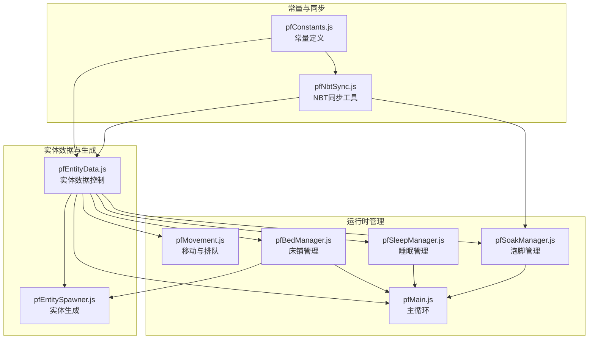

图表来源
- [pfConstants.js:1-65](file://kubejs/server_scripts/pathfinder/pfConstants.js#L1-L65)
- [pfNbtSync.js:1-94](file://kubejs/server_scripts/pathfinder/pfNbtSync.js#L1-L94)
- [pfEntityData.js:1-218](file://kubejs/server_scripts/pathfinder/pfEntityData.js#L1-L218)
- [pfEntitySpawner.js:1-141](file://kubejs/server_scripts/pathfinder/pfEntitySpawner.js#L1-L141)
- [pfMain.js:1-177](file://kubejs/server_scripts/pathfinder/pfMain.js#L1-L177)
- [pfMovement.js:1-186](file://kubejs/server_scripts/pathfinder/pfMovement.js#L1-L186)
- [pfBedManager.js:1-129](file://kubejs/server_scripts/pathfinder/pfBedManager.js#L1-L129)
- [pfSleepManager.js:1-232](file://kubejs/server_scripts/pathfinder/pfSleepManager.js#L1-L232)
- [pfSoakManager.js:1-197](file://kubejs/server_scripts/pathfinder/pfSoakManager.js#L1-L197)

章节来源
- [pathfinder.js:1-30](file://kubejs/server_scripts/pathfinder.js#L1-L30)

## 核心组件
- 实体数据控制（pfEntityData）：封装persistentData的读写，提供origin、route、time、phase、bed、sleep、wait、blueCarpet、lastTick、clearSleepTick、bedList等字段的访问器与设置器。
- 实体生成（pfEntitySpawner）：创建实体、设置基础NBT、初始化persistentData、预扫描床铺、生成需求清单并通过NBT同步到客户端。
- 主循环（pfMain）：按tick收集实体、分阶段处理蓝色地毯等待、睡眠、行走与等待队列，协调移动、睡眠、泡脚与床铺管理。
- 移动与排队（pfMovement）：实体收集、排队构建、距离判定、路径进度计算、单步移动、残留睡眠NBT清理。
- NBT同步（pfNbtSync）：通过实体主手物品NBT同步阶段、床位、倒计时与需求清单等状态至客户端。
- 床铺管理（pfBedManager）：沿路径扫描床铺、序列化/反序列化床铺列表、占用检测。
- 睡眠管理（pfSleepManager）：开始睡眠、按秒驱动睡眠进程、倒计时同步、起床与位置回退。
- 泡脚管理（pfSoakManager）：泡脚状态读写、倒计时按秒驱动、可用洗脚水判定、效果应用与状态更新。

章节来源
- [pfEntityData.js:1-218](file://kubejs/server_scripts/pathfinder/pfEntityData.js#L1-L218)
- [pfEntitySpawner.js:1-141](file://kubejs/server_scripts/pathfinder/pfEntitySpawner.js#L1-L141)
- [pfMain.js:1-177](file://kubejs/server_scripts/pathfinder/pfMain.js#L1-L177)
- [pfMovement.js:1-186](file://kubejs/server_scripts/pathfinder/pfMovement.js#L1-L186)
- [pfNbtSync.js:1-94](file://kubejs/server_scripts/pathfinder/pfNbtSync.js#L1-L94)
- [pfBedManager.js:1-129](file://kubejs/server_scripts/pathfinder/pfBedManager.js#L1-L129)
- [pfSleepManager.js:1-232](file://kubejs/server_scripts/pathfinder/pfSleepManager.js#L1-L232)
- [pfSoakManager.js:1-197](file://kubejs/server_scripts/pathfinder/pfSoakManager.js#L1-L197)

## 架构总览
实体数据模型围绕persistentData与主手物品NBT两条主线协同工作：persistentData负责跨重启持久化的状态与位置信息；主手物品NBT负责与客户端同步的状态展示。模块间通过全局命名空间共享函数，主循环统一调度各模块协作。

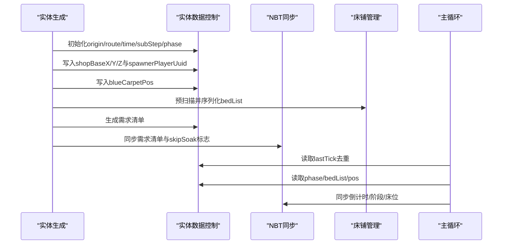

图表来源
- [pfEntitySpawner.js:32-82](file://kubejs/server_scripts/pathfinder/pfEntitySpawner.js#L32-L82)
- [pfEntityData.js:32-63](file://kubejs/server_scripts/pathfinder/pfEntityData.js#L32-L63)
- [pfNbtSync.js:43-75](file://kubejs/server_scripts/pathfinder/pfNbtSync.js#L43-L75)
- [pfBedManager.js:79-89](file://kubejs/server_scripts/pathfinder/pfBedManager.js#L79-L89)
- [pfMain.js:33-93](file://kubejs/server_scripts/pathfinder/pfMain.js#L33-L93)

## 详细组件分析

### 实体数据控制（pfEntityData）
- 功能概览
  - 基础数据：origin（起点坐标）、route（路径字符串）、time（路径进度索引）、subStep（格内插值子步，0~9）、phase（阶段状态）。
  - 床铺与睡眠：bedInfo（床坐标与朝向）、beforeSleepPos（睡眠前位置）、hasSlept（是否已上床）、sleepStartTick（睡眠起始tick）、fromBlueWait（是否来自蓝色地毯等待）、clearSleepTick（残留睡眠NBT清理计数）。
  - 位置与等待：blueCarpetPos（蓝色地毯坐标）、waitPos（等待位置）、lastTick（防重复处理tick）。
  - 床铺列表：bedList（序列化床铺列表）。
  - 需求清单生成：随机生成4部位需求（脚掌、脚后跟、脚趾、脚心）。
- 数据字段说明
  - origin：float x/z，记录实体生成时的起点坐标，用于路径进度还原。
  - route：string，记录路径字符序列（N/S/E/W），长度即最大time值。
  - time：int，当前已走过的路径步数索引，范围[0, len(route))。
  - subStep：int，格内插值子步，满10进位到下一格，同时time+1。
  - phase：int，阶段枚举（2=行走，3=躺床，4=等待床位，5=蓝色地毯等待）。
  - bedInfo：int bedX/Y/Z + int yaw，记录床头坐标与朝向。
  - beforeSleepPos：float x/y/z，记录进入睡眠前的位置。
  - hasSlept：int布尔，是否已上床。
  - sleepStartTick：int，睡眠起始tick，用于跨重启的时间驱动。
  - fromBlueWait：int布尔，是否由蓝色地毯等待转入睡眠。
  - blueCarpetPos：float x/z，蓝色地毯坐标。
  - waitPos：float x/y/z，等待位置。
  - lastTick：int，防重复处理的tick缓存。
  - clearSleepTick：int，残留睡眠NBT清理计数。
  - bedList：string，序列化床铺列表，格式为“bx,by,bz,yaw;...”。
  - shopBaseX/Y/Z：int，生成点基座坐标，用于跨重启恢复上下文。
  - spawnerPlayerUuid：string，生成玩家UUID。
  - pfBossId：string（可选），Boss标识，用于满意度倍率查询。
- 生命周期管理
  - 创建：生成实体后立即初始化origin、route、phase=2、time=0、subStep=0，并持久化shopBase与spawnerPlayerUuid。
  - 更新：主循环按tick读取并更新phase、bedInfo、waitPos、blueCarpetPos、sleep状态、lastTick等。
  - 查询：通过get/set方法安全访问persistentData，避免越界或类型错误。
  - 清理：实体到达终点丢弃；起床后清理残留睡眠NBT；睡眠/泡脚相关计数器清零。
- 数据验证与约束
  - time与route长度：time必须在[0, len(route))范围内，否则视为无效。
  - subStep：必须在[0, 9]范围内，超过9需进位。
  - phase：仅允许2/3/4/5四个阶段。
  - blueCarpetPos与waitPos：仅在相应阶段有效。
  - hasSlept与fromBlueWait：存在互斥与转换关系，需配合睡眠流程使用。
  - 底层约束：所有数值字段使用整型/浮点型存储，字符串字段使用UTF-8编码，床铺列表格式严格遵循“,”与";"分隔。
- 与其他系统交互
  - 与NBT同步：通过主手物品NBT同步phase、bed、countdown与需求清单。
  - 与床铺管理：生成时预扫描并序列化bedList；运行时解析bedList并检测占用。
  - 与睡眠管理：设置bedInfo、beforeSleepPos、sleepStartTick；处理起床后位置回退与time更新。
  - 与泡脚管理：通过skipSoak标志跳过泡脚流程；倒计时与状态通过NBT同步。

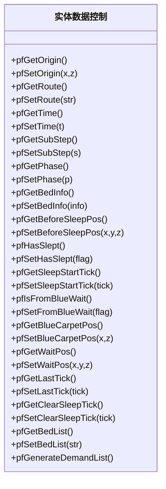

图表来源
- [pfEntityData.js:18-218](file://kubejs/server_scripts/pathfinder/pfEntityData.js#L18-L218)

章节来源
- [pfEntityData.js:1-218](file://kubejs/server_scripts/pathfinder/pfEntityData.js#L1-L218)

### 实体生成（pfEntitySpawner）
- 创建流程
  - 生成实体并设置基础NBT（NoAI、Invulnerable、PersistenceRequired、NoGravity、DeathLootTable、ModelId）。
  - 初始化persistentData：origin、route、phase=2、time=0、subStep=0。
  - 持久化shopBase与spawnerPlayerUuid，便于跨重启恢复上下文。
  - 保存蓝色地毯位置与预扫描床铺列表。
  - 生成需求清单（支持Boss倍率），并根据玩家设置决定是否跳过泡脚，通过NBT同步到客户端。
  - 标记BossId（可选），用于满意度倍率查询。
  - 验证存储结果（检查主手物品NBT中的需求清单）。
- 数据验证
  - 需求清单四部位均为非负整数，Boss倍率>1时按乘法放大。
  - 蓝色地毯位置与床铺列表在生成时校验有效性。
- 性能建议
  - 预扫描床铺仅在生成时执行一次，避免运行时重复扫描。
  - 使用序列化字符串存储bedList，减少复杂对象传输成本。

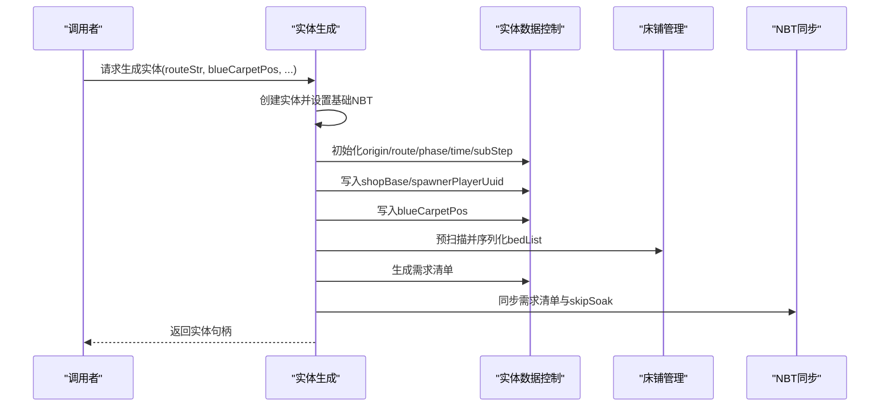

图表来源
- [pfEntitySpawner.js:7-100](file://kubejs/server_scripts/pathfinder/pfEntitySpawner.js#L7-L100)

章节来源
- [pfEntitySpawner.js:1-141](file://kubejs/server_scripts/pathfinder/pfEntitySpawner.js#L1-L141)

### 主循环（pfMain）
- 职责
  - 每tick收集实体并按phase分类（行走、躺床、等待床位、蓝色地毯等待）。
  - 处理蓝色地毯等待：若未上床且路径前方有空床，则进入睡眠阶段。
  - 处理躺床：调用睡眠管理器处理倒计时与起床条件。
  - 构建排队信息：综合walkers、waiters、sleepers、blueWaiters，按progress排序。
  - 处理行走：防重复处理、排队检测、单步移动、到达蓝色地毯切换等待。
- 数据一致性
  - 使用lastTick防止同tick重复处理。
  - 通过bedList与bedInfo确保床铺占用检测准确。
  - 通过beforeSleepPos与fromBlueWait保证起床后位置正确回退。
- 性能建议
  - 分类收集与排队构建在主循环中进行，避免在移动模块内重复扫描。
  - blueCarpet检测仅在subStep==0时触发，降低计算频率。

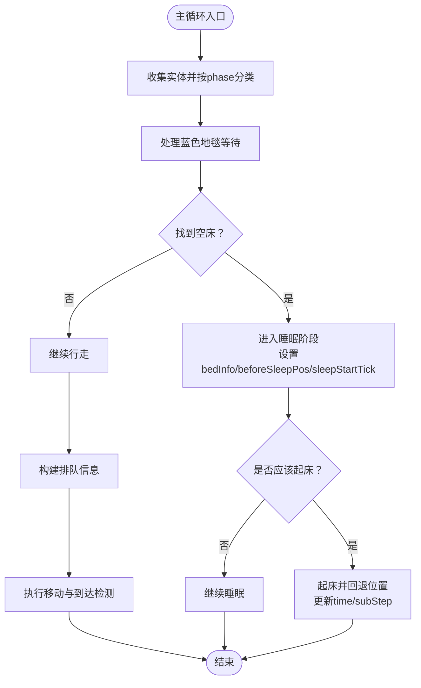

图表来源
- [pfMain.js:22-174](file://kubejs/server_scripts/pathfinder/pfMain.js#L22-L174)

章节来源
- [pfMain.js:1-177](file://kubejs/server_scripts/pathfinder/pfMain.js#L1-L177)

### 移动与排队（pfMovement）
- 实体收集与分类：基于AABB范围收集实体，按phase分类。
- 排队构建：以time*10+subStep为进度，结合实体ID解决同进度冲突。
- 排队检测：当其他实体在相近位置且进度更高时，当前实体需等待。
- 路径进度计算：根据origin、route与time还原当前位置。
- 单步移动：按route字符计算下一格中心，插值到subStep=9后进位。
- 残留睡眠NBT清理：定期通过命令移除SleepingX/Y/Z，避免客户端残留。

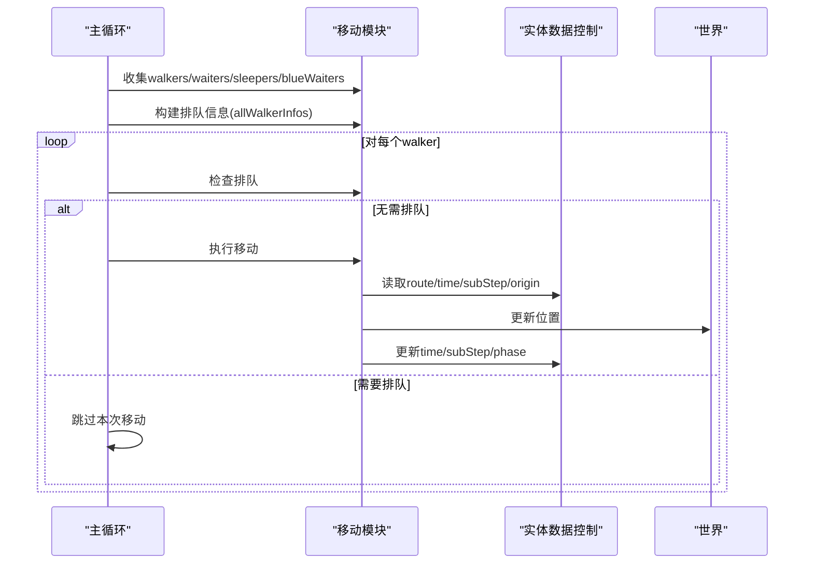

图表来源
- [pfMovement.js:7-186](file://kubejs/server_scripts/pathfinder/pfMovement.js#L7-L186)
- [pfMain.js:123-173](file://kubejs/server_scripts/pathfinder/pfMain.js#L123-L173)

章节来源
- [pfMovement.js:1-186](file://kubejs/server_scripts/pathfinder/pfMovement.js#L1-L186)

### NBT同步（pfNbtSync）
- 同步策略：通过实体主手物品NBT同步状态，物品ID由常量定义，自动同步到客户端。
- 同步内容：
  - 阶段：pfPhase（与phase字段一致）。
  - 床位：pfBedX/Y/Z/Yaw（与bedInfo一致）。
  - 倒计时：pfCountdown（0~10）。
  - 需求清单：pfDemandJiaozhang/Jiaogen/Jiaozhi/Jiaoxin（四部位需求）。
  - 泡脚：pfIsSoaking、pfSoakDone、pfSoakTimeLeft、pfSoakWaterType。
- 读取接口：服务端可通过pfGetPhase读取phase，确保与客户端一致。

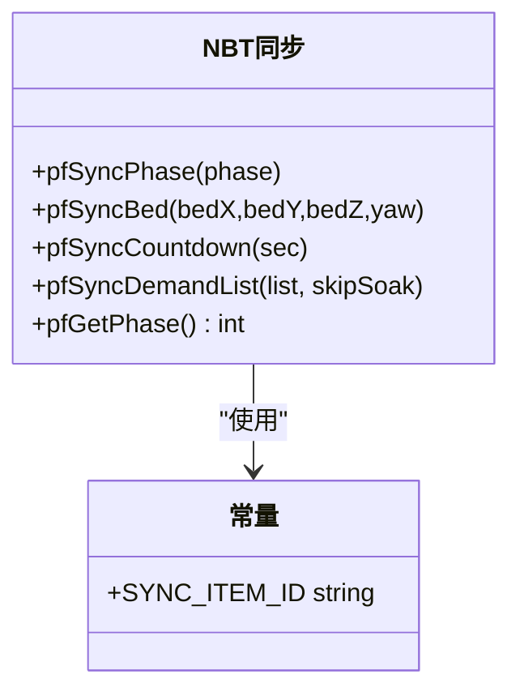

图表来源
- [pfNbtSync.js:8-93](file://kubejs/server_scripts/pathfinder/pfNbtSync.js#L8-L93)
- [pfConstants.js:7-8](file://kubejs/server_scripts/pathfinder/pfConstants.js#L7-L8)

章节来源
- [pfNbtSync.js:1-94](file://kubejs/server_scripts/pathfinder/pfNbtSync.js#L1-L94)
- [pfConstants.js:1-65](file://kubejs/server_scripts/pathfinder/pfConstants.js#L1-L65)

### 床铺管理（pfBedManager）
- 扫描：沿route每一格周围1格范围内扫描床，去重床头坐标，计算朝向yaw，返回床列表。
- 序列化/反序列化：将床列表转为字符串“bx,by,bz,yaw;...”，便于持久化。
- 占用检测：检查床周围1格范围内是否存在phase=3的实体，避免冲突。

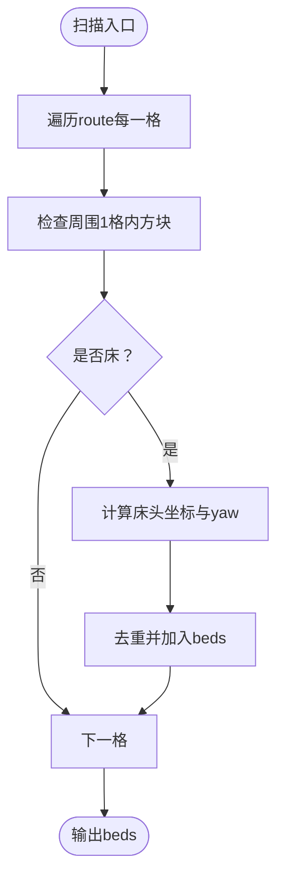

图表来源
- [pfBedManager.js:10-77](file://kubejs/server_scripts/pathfinder/pfBedManager.js#L10-L77)

章节来源
- [pfBedManager.js:1-129](file://kubejs/server_scripts/pathfinder/pfBedManager.js#L1-L129)

### 睡眠管理（pfSleepManager）
- 开始睡眠：保存beforeSleepPos、sleepStartTick、hasSlept、bedInfo，重置秒驱动字段，设置实体位置到床。
- 睡眠进程：前60tick设置SleepingX/Y/Z与朝向；之后按秒驱动（subTick累积到20触发秒事件），同步倒计时并驱动basin自动泡脚。
- 起床：stopSleeping并移除SleepingNBT，根据fromBlueWait寻找红色地毯或回退到beforeSleepPos，更新phase=2并回退time。

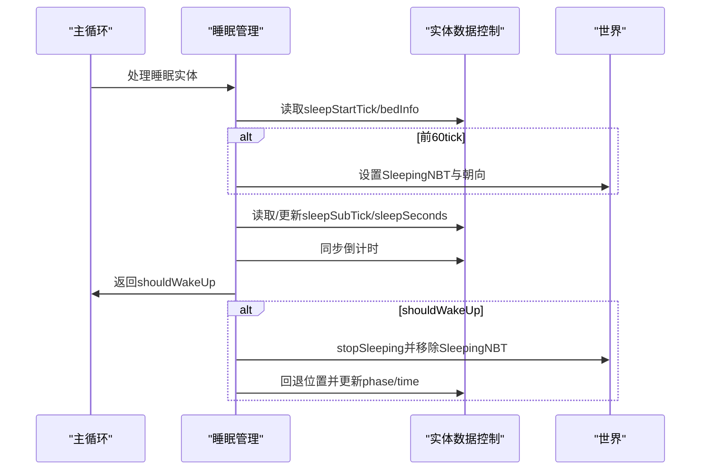

图表来源
- [pfSleepManager.js:63-223](file://kubejs/server_scripts/pathfinder/pfSleepManager.js#L63-L223)

章节来源
- [pfSleepManager.js:1-232](file://kubejs/server_scripts/pathfinder/pfSleepManager.js#L1-L232)

### 泡脚管理（pfSoakManager）
- 状态读写：从主手物品NBT读取isSoaking、soakDone、soakTimeLeft、waterType。
- 倒计时：每20tick（一秒）检查可用洗脚水，可用则剩余秒数-1，不可用则重置为默认秒数。
- 开始泡脚：设置isSoaking=1、soakTimeLeft=默认秒数、waterType，消耗水桶为空桶。
- 效果应用：倒计时结束后根据waterType应用额外效果。

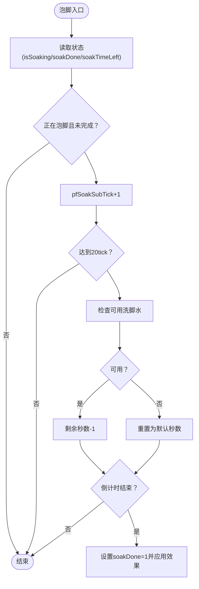

图表来源
- [pfSoakManager.js:90-196](file://kubejs/server_scripts/pathfinder/pfSoakManager.js#L90-L196)

章节来源
- [pfSoakManager.js:1-197](file://kubejs/server_scripts/pathfinder/pfSoakManager.js#L1-L197)

## 依赖分析
- 模块耦合
  - pfEntityData是数据中枢，被所有模块读写，耦合度高但职责单一。
  - pfNbtSync与pfSoakManager紧密协作，共同维护泡脚状态的客户端可见性。
  - pfMain作为编排者，依赖pfMovement、pfBedManager、pfSleepManager、pfEntityData等模块。
- 外部依赖
  - 依赖常量定义（实体类型、同步物品ID、方向列表、需求映射）。
  - 依赖全局回调（如pfOnStartSleep、pfShouldWakeUp）以扩展行为。
- 循环依赖
  - 不存在直接循环依赖；pfMain通过全局函数间接调用各模块，形成单向依赖。

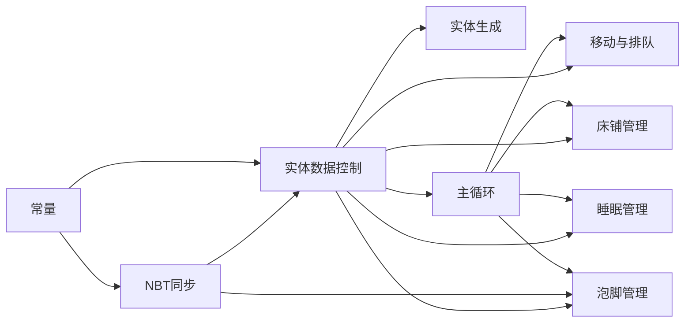

图表来源
- [pfEntityData.js:185-217](file://kubejs/server_scripts/pathfinder/pfEntityData.js#L185-L217)
- [pfMain.js:22-174](file://kubejs/server_scripts/pathfinder/pfMain.js#L22-L174)
- [pfNbtSync.js:87-93](file://kubejs/server_scripts/pathfinder/pfNbtSync.js#L87-L93)
- [pfConstants.js:52-64](file://kubejs/server_scripts/pathfinder/pfConstants.js#L52-L64)

章节来源
- [pfEntityData.js:185-217](file://kubejs/server_scripts/pathfinder/pfEntityData.js#L185-L217)
- [pfMain.js:22-174](file://kubejs/server_scripts/pathfinder/pfMain.js#L22-L174)
- [pfNbtSync.js:87-93](file://kubejs/server_scripts/pathfinder/pfNbtSync.js#L87-L93)
- [pfConstants.js:52-64](file://kubejs/server_scripts/pathfinder/pfConstants.js#L52-L64)

## 性能考虑
- 数据持久化
  - 使用整型/浮点型字段存储数值，字符串字段尽量短小（如bedList序列化）。
  - 通过lastTick防重复处理，避免同tick重复计算。
- 计算优化
  - 路径进度计算按time线性推进，避免每次重新解析route。
  - 排队检测仅在必要时进行（如蓝色地毯到达时或移动后）。
- I/O与命令
  - 睡眠NBT清理通过命令批量移除，减少频繁读写。
  - 泡脚与睡眠均采用秒驱动，避免依赖server.getTickCount()差值，提升跨重启稳定性。
- 客户端同步
  - 通过主手物品NBT同步状态，减少额外网络包，提高同步效率。

## 故障排查指南
- 实体未移动
  - 检查phase是否为2，time/subStep是否越界，lastTick是否阻塞。
  - 确认route字符串有效且time在[0, len)范围内。
- 蓝色地毯等待无效
  - 检查blueCarpetPos与waitPos是否正确设置，bedList是否包含可用床。
  - 确认hasSlept与fromBlueWait状态是否符合预期。
- 睡眠倒计时异常
  - 检查sleepStartTick是否设置，sleepSubTick/sleepSeconds是否按20tick递增。
  - 确认shouldWakeUp回调逻辑是否提前返回。
- 泡脚倒计时异常
  - 检查waterType是否在可用列表中，soakTimeLeft是否按秒递减。
  - 确认startSoak是否正确设置isSoaking与waterType。
- 数据不一致
  - 检查NBT同步是否成功（主手物品是否存在），phase/bed/countdown是否同步。

章节来源
- [pfMovement.js:100-175](file://kubejs/server_scripts/pathfinder/pfMovement.js#L100-L175)
- [pfMain.js:33-93](file://kubejs/server_scripts/pathfinder/pfMain.js#L33-L93)
- [pfSleepManager.js:63-223](file://kubejs/server_scripts/pathfinder/pfSleepManager.js#L63-L223)
- [pfSoakManager.js:90-196](file://kubejs/server_scripts/pathfinder/pfSoakManager.js#L90-L196)

## 结论
本实体数据模型通过persistentData与主手物品NBT双轨协同，实现了跨重启稳定、客户端可见、易于扩展的NPC寻路系统。pfEntityData作为数据中枢，统一管理origin、route、time、phase等关键字段；pfMain负责编排，pfMovement、pfBedManager、pfSleepManager、pfSoakManager分别处理移动、床铺、睡眠与泡脚；pfNbtSync确保状态同步。遵循本文的最佳实践与约束，可进一步提升系统性能与可维护性。

## 附录
- 字段速查
  - origin：float x/z
  - route：string（N/S/E/W序列）
  - time：int（[0, len)）
  - subStep：int（[0, 9]）
  - phase：int（2/3/4/5）
  - bedInfo：int bedX/Y/Z + int yaw
  - beforeSleepPos：float x/y/z
  - hasSlept：int布尔
  - sleepStartTick：int
  - fromBlueWait：int布尔
  - blueCarpetPos：float x/z
  - waitPos：float x/y/z
  - lastTick：int
  - clearSleepTick：int
  - bedList：string（序列化床铺）
  - shopBaseX/Y/Z：int
  - spawnerPlayerUuid：string
  - pfBossId：string（可选）