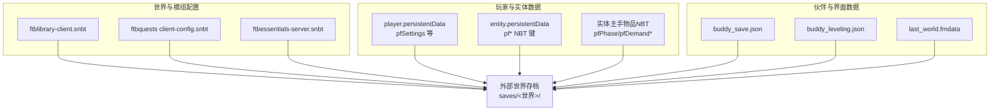
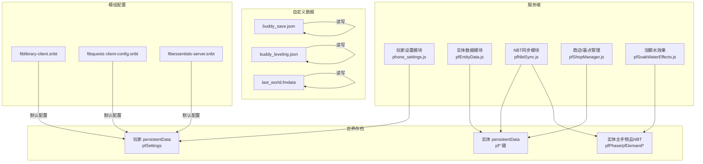
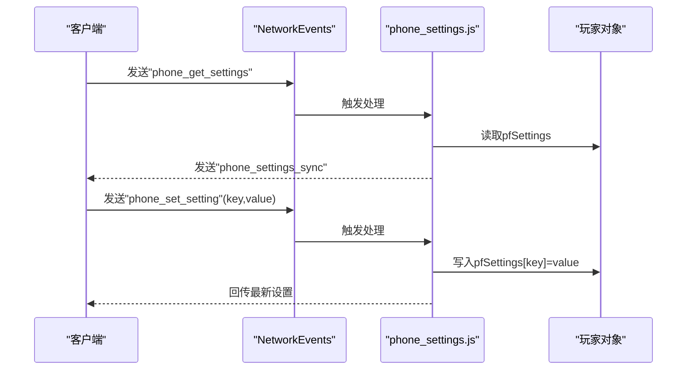
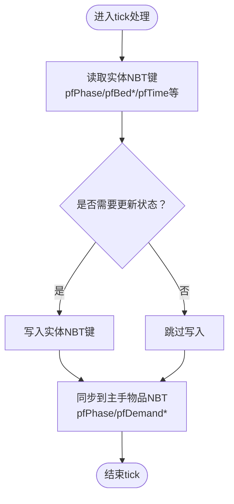
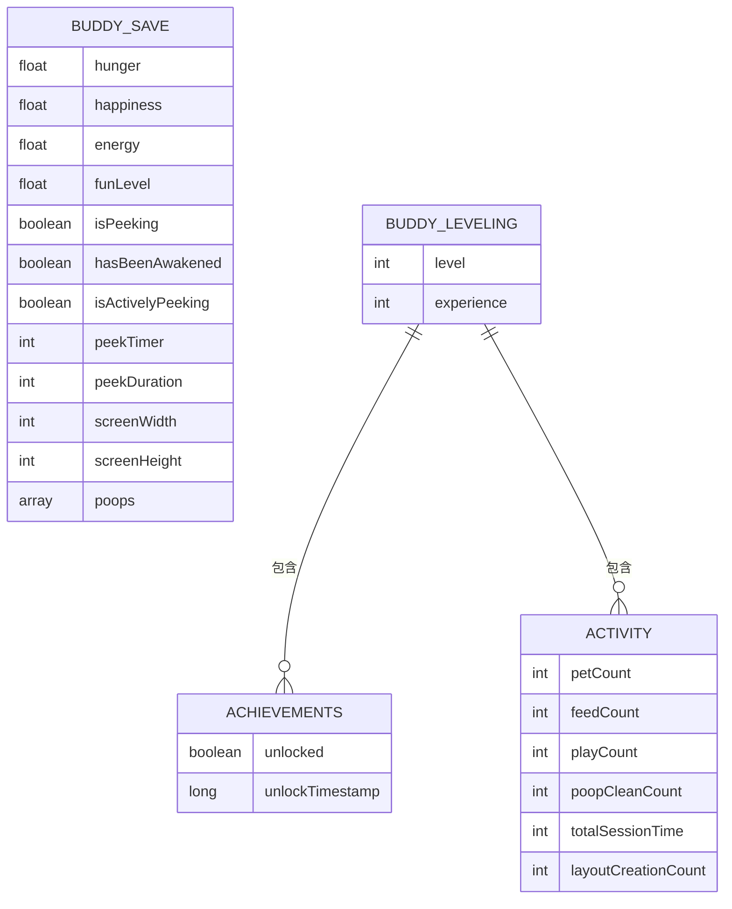
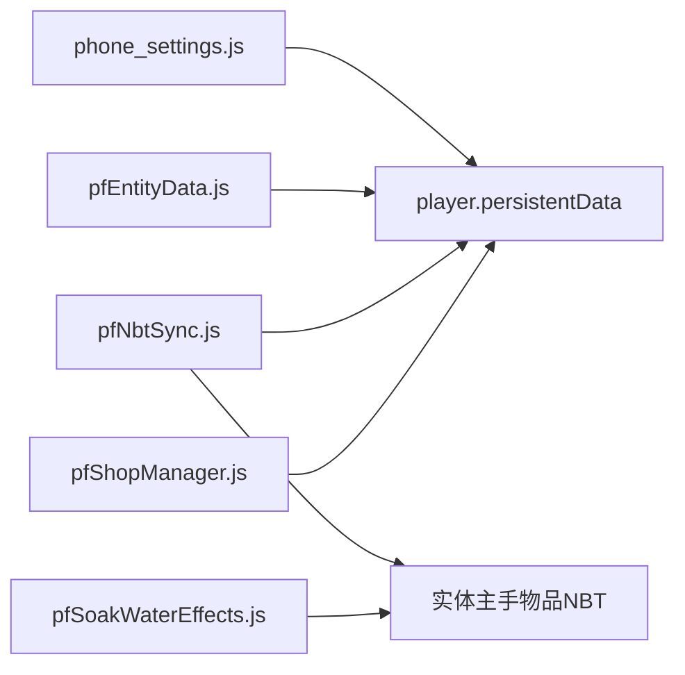

# 持久化存储

<cite>
**本文引用的文件**
- [buddy_save.json](file://fancymenu_data/buddy/buddy_save.json)
- [buddy_leveling.json](file://fancymenu_data/buddy/buddy_leveling.json)
- [last_world.fmdata](file://fancymenu_data/last_world.fmdata)
- [phone_settings.js](file://kubejs/server_scripts/phone_settings.js)
- [pfNbtSync.js](file://kubejs/server_scripts/pathfinder/pfNbtSync.js)
- [pfEntityData.js](file://kubejs/server_scripts/pathfinder/pfEntityData.js)
- [pfShopManager.js](file://kubejs/server_scripts/pathfinder/pfShopManager.js)
- [pfSoakWaterEffects.js](file://kubejs/server_scripts/pathfinder/pfSoakWaterEffects.js)
- [ftbquests client-config.snbt](file://defaultconfigs/ftbquests/client-config.snbt)
- [ftbessentials-server.snbt](file://defaultconfigs/ftbessentials-server.snbt)
- [ftblibrary-client.snbt](file://defaultconfigs/ftblibrary/ftblibrary-client.snbt)
- [README.md](file://README.md)
</cite>

## 目录
1. [简介](#简介)
2. [项目结构](#项目结构)
3. [核心组件](#核心组件)
4. [架构总览](#架构总览)
5. [详细组件分析](#详细组件分析)
6. [依赖关系分析](#依赖关系分析)
7. [性能考量](#性能考量)
8. [故障排查指南](#故障排查指南)
9. [结论](#结论)
10. [附录](#附录)

## 简介
本文件系统性梳理该Minecraft版本中的持久化存储方案，覆盖玩家数据、NPC/实体数据、世界与模组配置、以及“伙伴”小动物的数据存储。重点说明以下方面：
- 不同类型数据的存储介质与实现方式（NBT、SNBT、JSON）
- JSON文件存储的使用场景（如伙伴数据），包括结构与用途
- 数据备份与恢复流程（全量与增量思路）、完整性校验与修复建议
- 存储空间优化与清理策略
- 管理员可使用的维护工具与命令思路（基于现有脚本能力）

## 项目结构
该版本采用多层持久化策略：
- 世界与模组配置：以SNBT为主，位于defaultconfigs与world serverconfig目录
- 玩家与实体数据：以Minecraft NBT为主，存储于玩家与实体的persistentData中
- 自定义UI与伙伴数据：以JSON为主，位于fancymenu_data/buddy
- 临时与界面缓存：fmdata与缓存目录

图表来源
- [ftblibrary-client.snbt](file://defaultconfigs/ftblibrary/ftblibrary-client.snbt)
- [ftbquests client-config.snbt](file://defaultconfigs/ftbquests/client-config.snbt)
- [ftbessentials-server.snbt](file://defaultconfigs/ftbessentials-server.snbt)
- [phone_settings.js](file://kubejs/server_scripts/phone_settings.js)
- [pfEntityData.js](file://kubejs/server_scripts/pathfinder/pfEntityData.js)
- [pfNbtSync.js](file://kubejs/server_scripts/pathfinder/pfNbtSync.js)
- [buddy_save.json](file://fancymenu_data/buddy/buddy_save.json)
- [buddy_leveling.json](file://fancymenu_data/buddy/buddy_leveling.json)
- [last_world.fmdata](file://fancymenu_data/last_world.fmdata)

章节来源
- [README.md:1-6](file://README.md#L1-L6)

## 核心组件
- 玩家设置持久化（手机设置）：通过player.persistentData中的复合标签pfSettings进行读写，支持客户端与服务端双向同步
- 实体数据持久化（Pathfinder）：通过entity.persistentData存储路径、床铺、睡眠、等待点等状态；同时通过实体主手物品NBT同步关键状态到客户端
- 伙伴数据（Buddy）：以JSON文件形式保存伙伴的基础属性、行为状态与成就进度
- 世界与模组配置：以SNBT文件存储默认配置，随世界生成或复制到本地/服务器配置目录

章节来源
- [phone_settings.js:1-135](file://kubejs/server_scripts/phone_settings.js#L1-L135)
- [pfEntityData.js:1-182](file://kubejs/server_scripts/pathfinder/pfEntityData.js#L1-L182)
- [pfNbtSync.js:1-94](file://kubejs/server_scripts/pathfinder/pfNbtSync.js#L1-L94)
- [buddy_save.json:1-14](file://fancymenu_data/buddy/buddy_save.json#L1-L14)
- [buddy_leveling.json:1-82](file://fancymenu_data/buddy/buddy_leveling.json#L1-L82)
- [ftbquests client-config.snbt:1-5](file://defaultconfigs/ftbquests/client-config.snbt#L1-L5)
- [ftbessentials-server.snbt:1-14](file://defaultconfigs/ftbessentials-server.snbt#L1-L14)
- [ftblibrary-client.snbt:1-5](file://defaultconfigs/ftblibrary/ftblibrary-client.snbt#L1-L5)

## 架构总览
整体持久化架构围绕“世界存档 + 模组配置 + 自定义数据文件”展开，其中：
- 世界存档：Minecraft原生NBT（玩家/实体）与模组扩展（Pathfinder）
- 模组配置：defaultconfigs复制到world serverconfig，用于默认行为与功能开关
- 自定义数据：JSON（伙伴）与fmdata（界面/上次世界）等

图表来源
- [phone_settings.js:1-135](file://kubejs/server_scripts/phone_settings.js#L1-L135)
- [pfEntityData.js:1-182](file://kubejs/server_scripts/pathfinder/pfEntityData.js#L1-L182)
- [pfNbtSync.js:1-94](file://kubejs/server_scripts/pathfinder/pfNbtSync.js#L1-L94)
- [pfShopManager.js:69-114](file://kubejs/server_scripts/pathfinder/pfShopManager.js#L69-L114)
- [pfSoakWaterEffects.js:127-159](file://kubejs/server_scripts/pathfinder/pfSoakWaterEffects.js#L127-L159)
- [buddy_save.json:1-14](file://fancymenu_data/buddy/buddy_save.json#L1-L14)
- [buddy_leveling.json:1-82](file://fancymenu_data/buddy/buddy_leveling.json#L1-L82)
- [last_world.fmdata:1-6](file://fancymenu_data/last_world.fmdata#L1-L6)
- [ftblibrary-client.snbt:1-5](file://defaultconfigs/ftblibrary/ftblibrary-client.snbt#L1-L5)
- [ftbquests client-config.snbt:1-5](file://defaultconfigs/ftbquests/client-config.snbt#L1-L5)
- [ftbessentials-server.snbt:1-14](file://defaultconfigs/ftbessentials-server.snbt#L1-L14)

## 详细组件分析

### 玩家数据持久化（手机设置）
- 存储位置：player.persistentData中的复合标签pfSettings
- 默认值与键：包含泡脚跳过与一键满足等设置项
- 读写流程：服务端提供读取/写入函数，首次登录自动初始化默认设置
- 同步机制：通过NetworkEvents接收客户端请求，向客户端推送当前设置

图表来源
- [phone_settings.js:55-83](file://kubejs/server_scripts/phone_settings.js#L55-L83)
- [phone_settings.js:113-126](file://kubejs/server_scripts/phone_settings.js#L113-L126)

章节来源
- [phone_settings.js:1-135](file://kubejs/server_scripts/phone_settings.js#L1-L135)

### NPC/实体数据持久化（Pathfinder）
- 存储位置：entity.persistentData（整型/浮点/字符串键）
- 关键键族：pfTime、pfPhase、pfBedX/Y/Z、pfSleepStartTick、pfWaitX/Y/Z、pfLastTick、pfClearSleepTick、pfBedList、pfOriginX/Z、pfRoute、pfSubStep等
- 同步策略：通过实体主手物品NBT携带pfPhase、pfDemand*、pfSoakDone等，自动同步至客户端

图表来源
- [pfEntityData.js:44-62](file://kubejs/server_scripts/pathfinder/pfEntityData.js#L44-L62)
- [pfEntityData.js:76-82](file://kubejs/server_scripts/pathfinder/pfEntityData.js#L76-L82)
- [pfNbtSync.js:9-17](file://kubejs/server_scripts/pathfinder/pfNbtSync.js#L9-L17)
- [pfNbtSync.js:45-75](file://kubejs/server_scripts/pathfinder/pfNbtSync.js#L45-L75)

章节来源
- [pfEntityData.js:1-182](file://kubejs/server_scripts/pathfinder/pfEntityData.js#L1-L182)
- [pfNbtSync.js:1-94](file://kubejs/server_scripts/pathfinder/pfNbtSync.js#L1-L94)

### 伙伴数据持久化（JSON）
- buddy_save.json：保存伙伴基础状态（饥饿、快乐、精力、趣味等级、窥视状态、计时器、屏幕尺寸、排泄记录等）
- buddy_leveling.json：保存等级、经验、成就解锁状态、活动统计（抚摸次数、喂食次数、玩耍次数、清洁次数、总时长、布局创建次数等）
- 使用场景：作为自定义UI与交互的持久化载体，便于跨版本或重装后恢复伙伴体验

图表来源
- [buddy_save.json:1-14](file://fancymenu_data/buddy/buddy_save.json#L1-L14)
- [buddy_leveling.json:1-82](file://fancymenu_data/buddy/buddy_leveling.json#L1-L82)

章节来源
- [buddy_save.json:1-14](file://fancymenu_data/buddy/buddy_save.json#L1-L14)
- [buddy_leveling.json:1-82](file://fancymenu_data/buddy/buddy_leveling.json#L1-L82)

### 世界与模组配置持久化（SNBT）
- defaultconfigs下的snbt文件为默认配置模板，随世界生成或复制到本地/服务器配置目录
- 作用域：ftblibrary、ftbquests、ftbessentials等客户端/服务端配置项
- 维护建议：通过修改默认配置文件影响新生成的世界；对既有世界可通过复制/覆盖的方式应用

章节来源
- [ftblibrary-client.snbt:1-5](file://defaultconfigs/ftblibrary/ftblibrary-client.snbt#L1-L5)
- [ftbquests client-config.snbt:1-5](file://defaultconfigs/ftbquests/client-config.snbt#L1-L5)
- [ftbessentials-server.snbt:1-14](file://defaultconfigs/ftbessentials-server.snbt#L1-L14)

### 界面与临时数据（fmdata）
- last_world.fmdata：记录上次游玩的世界路径与是否为服务器环境
- 用途：快速定位上次世界，避免启动时选择错误世界

章节来源
- [last_world.fmdata:1-6](file://fancymenu_data/last_world.fmdata#L1-L6)

## 依赖关系分析
- 玩家设置模块依赖Minecraft NBT API（persistentData）与网络事件系统
- 实体数据模块依赖pfNbtSync模块进行客户端同步
- 泡脚水效果模块依赖实体主手物品NBT键进行状态叠加
- 商店管理模块依赖BE（实体/方块）的persistentData存储基点与生成列表

图表来源
- [phone_settings.js:1-135](file://kubejs/server_scripts/phone_settings.js#L1-L135)
- [pfEntityData.js:1-182](file://kubejs/server_scripts/pathfinder/pfEntityData.js#L1-L182)
- [pfNbtSync.js:1-94](file://kubejs/server_scripts/pathfinder/pfNbtSync.js#L1-L94)
- [pfSoakWaterEffects.js:127-159](file://kubejs/server_scripts/pathfinder/pfSoakWaterEffects.js#L127-L159)
- [pfShopManager.js:69-114](file://kubejs/server_scripts/pathfinder/pfShopManager.js#L69-L114)

章节来源
- [phone_settings.js:1-135](file://kubejs/server_scripts/phone_settings.js#L1-L135)
- [pfEntityData.js:1-182](file://kubejs/server_scripts/pathfinder/pfEntityData.js#L1-L182)
- [pfNbtSync.js:1-94](file://kubejs/server_scripts/pathfinder/pfNbtSync.js#L1-L94)
- [pfSoakWaterEffects.js:127-159](file://kubejs/server_scripts/pathfinder/pfSoakWaterEffects.js#L127-L159)
- [pfShopManager.js:69-114](file://kubejs/server_scripts/pathfinder/pfShopManager.js#L69-L114)

## 性能考量
- NBT写入频率控制：实体数据模块频繁读写NBT键，建议在tick中合并更新、避免每tick多次写入
- 主手物品NBT同步：仅在状态变化时更新，减少不必要的NBT写入与网络广播
- JSON文件访问：伙伴数据文件较小，读写频度低，但需注意磁盘IO与并发访问
- SNBT配置：默认配置文件体积小，读取成本低，适合在启动时一次性加载

## 故障排查指南
- 玩家设置异常
  - 现象：设置无法同步或丢失
  - 排查：确认pfSettings复合标签是否存在；检查NetworkEvents回调是否触发；验证默认值初始化逻辑
  - 参考路径：[phone_settings.js:19-49](file://kubejs/server_scripts/phone_settings.js#L19-L49)
- 实体状态不同步
  - 现象：客户端显示与服务端不一致
  - 排查：确认实体主手物品NBT键是否正确写入；检查pfNbtSync调用链
  - 参考路径：[pfNbtSync.js:9-17](file://kubejs/server_scripts/pathfinder/pfNbtSync.js#L9-L17), [pfNbtSync.js:45-75](file://kubejs/server_scripts/pathfinder/pfNbtSync.js#L45-L75)
- 伙伴数据损坏
  - 现象：伙伴状态异常或无法加载
  - 排查：检查buddy_save.json与buddy_leveling.json格式；必要时回滚至上一版本
  - 参考路径：[buddy_save.json:1-14](file://fancymenu_data/buddy/buddy_save.json#L1-L14), [buddy_leveling.json:1-82](file://fancymenu_data/buddy/buddy_leveling.json#L1-L82)
- 模组配置未生效
  - 现象：默认配置未覆盖到世界
  - 排查：确认defaultconfigs文件是否被复制到对应目录；检查文件权限与命名
  - 参考路径：[ftblibrary-client.snbt:1-5](file://defaultconfigs/ftblibrary/ftblibrary-client.snbt#L1-L5), [ftbquests client-config.snbt:1-5](file://defaultconfigs/ftbquests/client-config.snbt#L1-L5), [ftbessentials-server.snbt:1-14](file://defaultconfigs/ftbessentials-server.snbt#L1-L14)

章节来源
- [phone_settings.js:1-135](file://kubejs/server_scripts/phone_settings.js#L1-L135)
- [pfNbtSync.js:1-94](file://kubejs/server_scripts/pathfinder/pfNbtSync.js#L1-L94)
- [buddy_save.json:1-14](file://fancymenu_data/buddy/buddy_save.json#L1-L14)
- [buddy_leveling.json:1-82](file://fancymenu_data/buddy/buddy_leveling.json#L1-L82)
- [ftblibrary-client.snbt:1-5](file://defaultconfigs/ftblibrary/ftblibrary-client.snbt#L1-L5)
- [ftbquests client-config.snbt:1-5](file://defaultconfigs/ftbquests/client-config.snbt#L1-L5)
- [ftbessentials-server.snbt:1-14](file://defaultconfigs/ftbessentials-server.snbt#L1-L14)

## 结论
本版本的持久化体系以Minecraft原生NBT为核心，结合SNBT配置与自定义JSON文件，实现了玩家设置、实体状态、伙伴数据与模组配置的分层持久化。通过pfNbtSync模块将关键状态同步至客户端，确保了良好的交互体验。建议在运维层面完善备份与校验机制，保障数据安全与可恢复性。

## 附录

### 备份与恢复流程（全量/增量）
- 全量备份
  - 世界存档：打包saves/<世界>/目录（含ftb*、玩家数据、区块等）
  - 自定义数据：备份fancymenu_data（含buddy与last_world.fmdata）
  - 模组配置：备份defaultconfigs与world serverconfig目录
- 增量备份（建议策略）
  - 世界存档：按时间戳对比区块与玩家数据变更
  - 自定义数据：监控buddy_*与last_world.fmdata变动
  - 模组配置：记录defaultconfigs变更并定期比对
- 恢复步骤
  - 停服/退出游戏
  - 恢复saves/<世界>/与fancymenu_data
  - 恢复defaultconfigs与serverconfig
  - 启动游戏验证

### 数据完整性检查与修复
- JSON文件校验：读取前进行基本格式校验，失败则回滚至上一版本
- NBT一致性：对关键实体NBT键进行存在性与类型校验，缺失时回填默认值
- 配置一致性：对比defaultconfigs与实际生效配置差异，必要时重新复制

### 存储空间优化与清理
- 世界存档瘦身：清理长时间未使用的维度/区块、压缩日志
- 自定义数据清理：定期归档旧版buddy_*，删除无效fmdata
- 模组配置清理：移除冗余默认配置，保留必要覆盖项

### 管理员维护工具与命令（基于现有脚本能力）
- 玩家设置管理
  - 初始化默认设置：利用登录事件自动初始化
  - 同步设置到客户端：通过NetworkEvents推送
  - 参考路径：[phone_settings.js:55-83](file://kubejs/server_scripts/phone_settings.js#L55-L83), [phone_settings.js:113-126](file://kubejs/server_scripts/phone_settings.js#L113-L126)
- 实体状态维护
  - 读取/写入实体NBT键：pfGet*/pfSet*系列函数
  - 同步主手物品NBT：pfSync*系列函数
  - 参考路径：[pfEntityData.js:44-62](file://kubejs/server_scripts/pathfinder/pfEntityData.js#L44-L62), [pfNbtSync.js:9-17](file://kubejs/server_scripts/pathfinder/pfNbtSync.js#L9-L17)
- 商店/基点管理
  - 读取/设置商店基点与蓝标位置
  - 参考路径：[pfShopManager.js:71-101](file://kubejs/server_scripts/pathfinder/pfShopManager.js#L71-L101)
- 泡脚水效果叠加
  - 对主手物品NBT追加需求增量、满意度与皴加成
  - 参考路径：[pfSoakWaterEffects.js:127-159](file://kubejs/server_scripts/pathfinder/pfSoakWaterEffects.js#L127-L159)