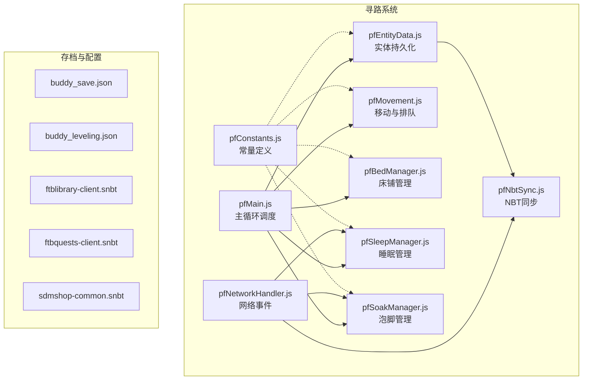
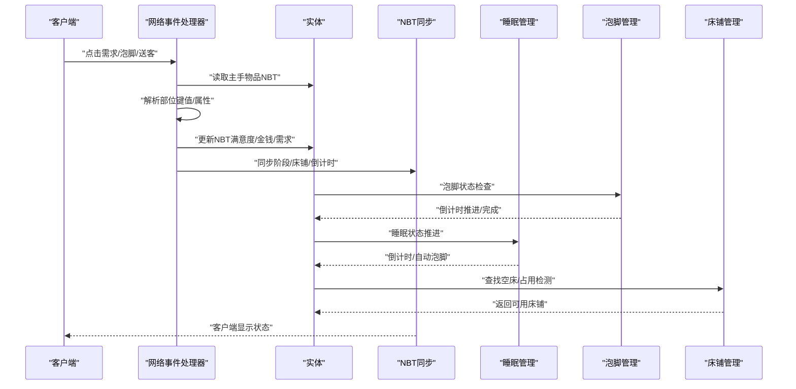
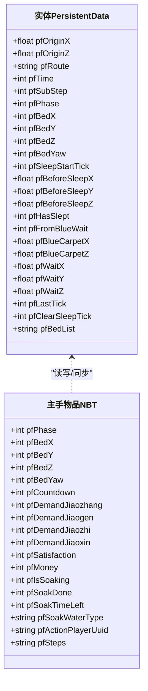
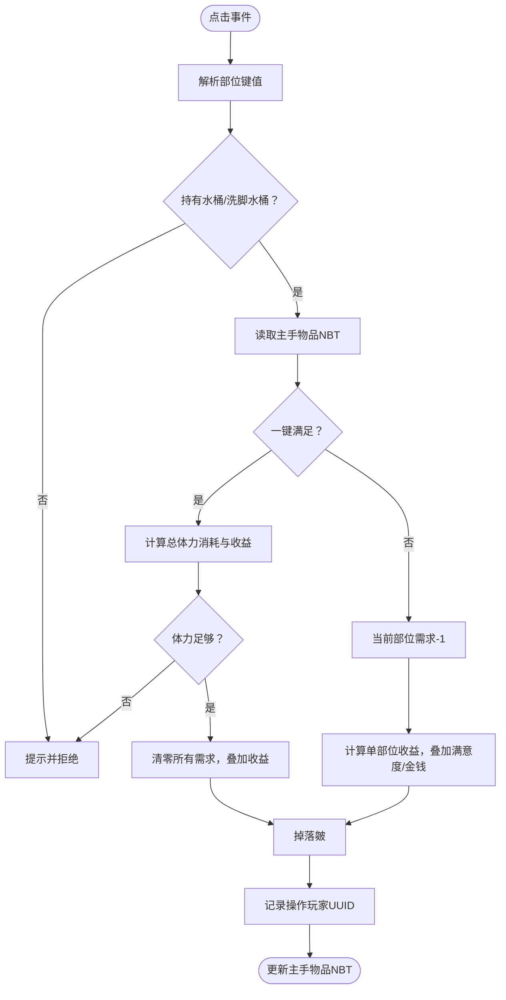
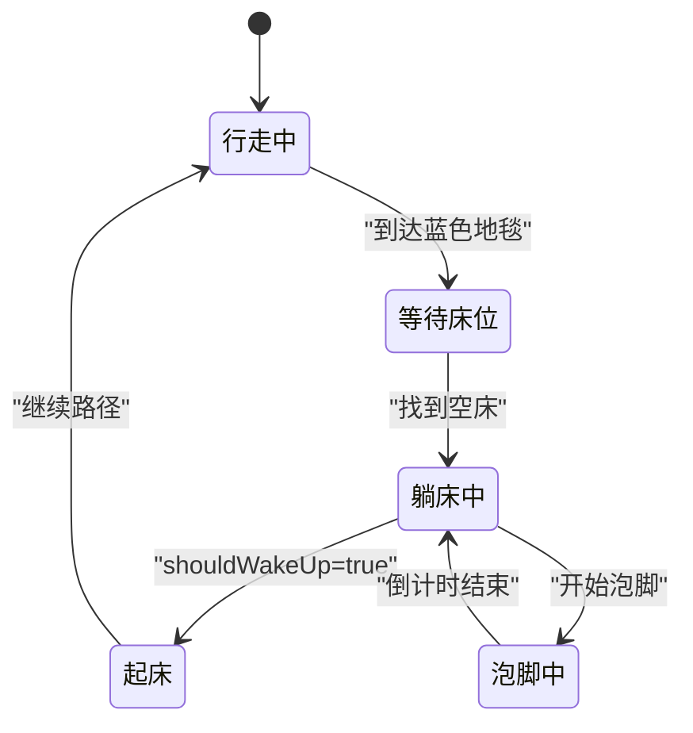
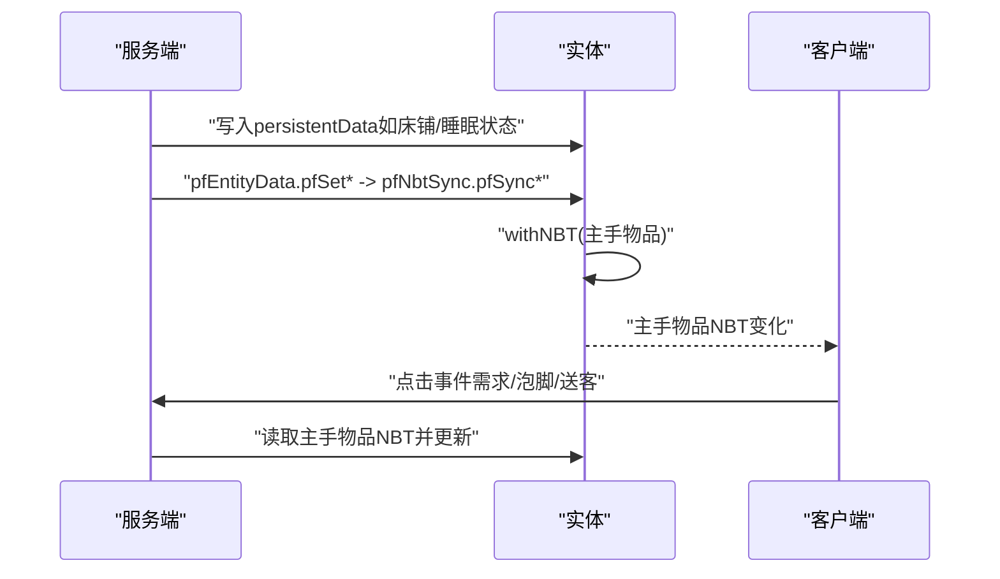
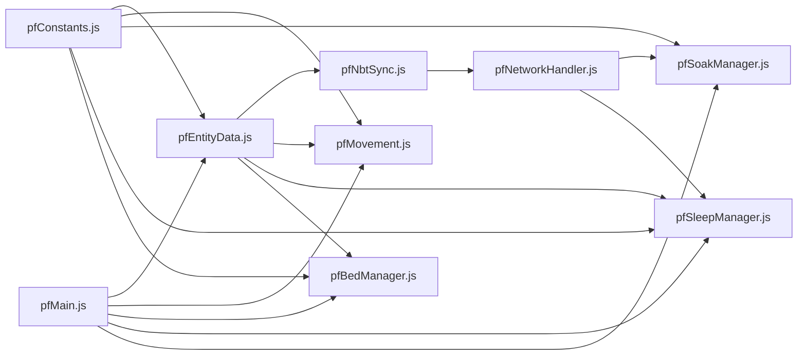

# 数据模型

<cite>
**本文引用的文件**
- [pfConstants.js](file://kubejs/server_scripts/pathfinder/pfConstants.js)
- [pfEntityData.js](file://kubejs/server_scripts/pathfinder/pfEntityData.js)
- [pfNbtSync.js](file://kubejs/server_scripts/pathfinder/pfNbtSync.js)
- [pfNetworkHandler.js](file://kubejs/server_scripts/pathfinder/pfNetworkHandler.js)
- [pfMovement.js](file://kubejs/server_scripts/pathfinder/pfMovement.js)
- [pfSoakManager.js](file://kubejs/server_scripts/pathfinder/pfSoakManager.js)
- [pfSleepManager.js](file://kubejs/server_scripts/pathfinder/pfSleepManager.js)
- [pfBedManager.js](file://kubejs/server_scripts/pathfinder/pfBedManager.js)
- [pfMain.js](file://kubejs/server_scripts/pathfinder/pfMain.js)
- [buddy_save.json](file://fancymenu_data/buddy/buddy_save.json)
- [buddy_leveling.json](file://fancymenu_data/buddy/buddy_leveling.json)
- [ftblibrary-client.snbt](file://defaultconfigs/ftblibrary/ftblibrary-client.snbt)
- [ftbquests-client.snbt](file://defaultconfigs/ftbquests/client-config.snbt)
- [sdmshop-common.snbt](file://defaultconfigs/sdmshop/sdmshop-common.snbt)
</cite>

## 目录
1. [简介](#简介)
2. [项目结构](#项目结构)
3. [核心组件](#核心组件)
4. [架构总览](#架构总览)
5. [详细组件分析](#详细组件分析)
6. [依赖关系分析](#依赖关系分析)
7. [性能考虑](#性能考虑)
8. [故障排查指南](#故障排查指南)
9. [结论](#结论)
10. [附录](#附录)

## 简介
本文件面向开发者，系统性梳理本项目中的数据模型与存储机制，重点覆盖以下方面：
- 实体数据模型：实体持久化状态、NBT同步与网络交互
- 需求管理系统：四足部位需求、体力消耗、满意度与货币收益
- 状态持久化：跨重启保留的时间状态、阶段状态与床铺信息
- NBT数据处理：实体主手物品NBT与实体persistentData的协同
- 数据生命周期：从生成、移动、睡眠、泡脚到结算的全链路
- 数据验证规则、约束条件与业务逻辑
- 数据迁移方案、备份恢复策略与性能优化建议

## 项目结构
本项目以KubeJS为核心扩展Minecraft功能，数据模型主要分布在以下区域：
- 寻路系统（pathfinder）：统一调度与状态流转
- 实体数据与NBT同步：通过实体主手物品与persistentData协同
- 需求与泡脚：网络事件驱动的交互与状态更新
- 配置与存档：默认配置SNBT与UI存档JSON

图表来源
- [pfMain.js:11-177](file://kubejs/server_scripts/pathfinder/pfMain.js#L11-L177)
- [pfConstants.js:53-64](file://kubejs/server_scripts/pathfinder/pfConstants.js#L53-L64)
- [pfEntityData.js:185-217](file://kubejs/server_scripts/pathfinder/pfEntityData.js#L185-L217)
- [pfNbtSync.js:87-93](file://kubejs/server_scripts/pathfinder/pfNbtSync.js#L87-L93)
- [pfNetworkHandler.js:314-316](file://kubejs/server_scripts/pathfinder/pfNetworkHandler.js#L314-L316)
- [pfMovement.js:178-185](file://kubejs/server_scripts/pathfinder/pfMovement.js#L178-L185)
- [pfBedManager.js:123-128](file://kubejs/server_scripts/pathfinder/pfBedManager.js#L123-L128)
- [pfSleepManager.js:226-231](file://kubejs/server_scripts/pathfinder/pfSleepManager.js#L226-L231)
- [pfSoakManager.js:189-196](file://kubejs/server_scripts/pathfinder/pfSoakManager.js#L189-L196)

章节来源
- [pfMain.js:11-177](file://kubejs/server_scripts/pathfinder/pfMain.js#L11-L177)
- [pfConstants.js:53-64](file://kubejs/server_scripts/pathfinder/pfConstants.js#L53-L64)

## 核心组件
本节概述数据模型的核心构件及其职责。

- 常量定义（pfConstants）
  - 统一管理同步物品ID、网格范围、实体类型、需求部位映射等
  - 提供部位键值与整数代码映射，支撑网络事件与NBT字段命名一致性

- 实体数据（pfEntityData）
  - 封装实体persistentData的读写，包括起点、路径、阶段、床铺信息、睡眠状态、等待位置等
  - 写入时自动触发NBT同步，保证客户端可见

- NBT同步（pfNbtSync）
  - 将关键状态写入实体主手物品NBT，实现客户端可视化与交互
  - 提供阶段、床铺、倒计时、需求清单等同步函数

- 网络事件（pfNetworkHandler）
  - 处理客户端点击事件：满足需求、泡脚、送客
  - 读取部位键值、体力消耗与收益属性，执行业务逻辑并更新NBT

- 移动与排队（pfMovement）
  - 基于路径字符串与子步进度驱动实体移动
  - 实现排队检测与位置计算，支持蓝色地毯等待与继续行走

- 床铺管理（pfBedManager）
  - 沿路径扫描床铺，序列化/反序列化床铺列表
  - 检测床铺占用，避免冲突

- 睡眠管理（pfSleepManager）
  - 睡眠/起床全流程：设置睡姿、秒驱动、倒计时同步、自动泡脚联动
  - 跨重启保留睡眠计时状态

- 泡脚管理（pfSoakManager）
  - 基于秒驱动的倒计时管理，支持多种洗脚水类型
  - 完成后应用水型特效并清理状态

- 主循环（pfMain）
  - 聚合各模块，按阶段处理实体：蓝色地毯等待、睡眠中、行走中、等待床位
  - 防重复处理、路径进度更新、床铺占用检测

章节来源
- [pfConstants.js:7-64](file://kubejs/server_scripts/pathfinder/pfConstants.js#L7-L64)
- [pfEntityData.js:18-217](file://kubejs/server_scripts/pathfinder/pfEntityData.js#L18-L217)
- [pfNbtSync.js:8-93](file://kubejs/server_scripts/pathfinder/pfNbtSync.js#L8-L93)
- [pfNetworkHandler.js:37-316](file://kubejs/server_scripts/pathfinder/pfNetworkHandler.js#L37-L316)
- [pfMovement.js:7-185](file://kubejs/server_scripts/pathfinder/pfMovement.js#L7-L185)
- [pfBedManager.js:10-128](file://kubejs/server_scripts/pathfinder/pfBedManager.js#L10-L128)
- [pfSleepManager.js:17-231](file://kubejs/server_scripts/pathfinder/pfSleepManager.js#L17-L231)
- [pfSoakManager.js:16-196](file://kubejs/server_scripts/pathfinder/pfSoakManager.js#L16-L196)
- [pfMain.js:11-177](file://kubejs/server_scripts/pathfinder/pfMain.js#L11-L177)

## 架构总览
下图展示数据在系统中的流向与交互关系：

图表来源
- [pfNetworkHandler.js:39-311](file://kubejs/server_scripts/pathfinder/pfNetworkHandler.js#L39-L311)
- [pfNbtSync.js:87-93](file://kubejs/server_scripts/pathfinder/pfNbtSync.js#L87-L93)
- [pfSoakManager.js:92-145](file://kubejs/server_scripts/pathfinder/pfSoakManager.js#L92-L145)
- [pfSleepManager.js:65-128](file://kubejs/server_scripts/pathfinder/pfSleepManager.js#L65-L128)
- [pfBedManager.js:109-120](file://kubejs/server_scripts/pathfinder/pfBedManager.js#L109-L120)

## 详细组件分析

### 实体数据模型与持久化
实体数据模型围绕实体的persistentData与主手物品NBT展开，形成“服务端持久化 + 客户端可视化”的双层结构。

图表来源
- [pfEntityData.js:18-217](file://kubejs/server_scripts/pathfinder/pfEntityData.js#L18-L217)
- [pfNbtSync.js:8-93](file://kubejs/server_scripts/pathfinder/pfNbtSync.js#L8-L93)
- [pfSoakManager.js:20-45](file://kubejs/server_scripts/pathfinder/pfSoakManager.js#L20-L45)

章节来源
- [pfEntityData.js:18-217](file://kubejs/server_scripts/pathfinder/pfEntityData.js#L18-L217)
- [pfNbtSync.js:8-93](file://kubejs/server_scripts/pathfinder/pfNbtSync.js#L8-L93)
- [pfSoakManager.js:20-45](file://kubejs/server_scripts/pathfinder/pfSoakManager.js#L20-L45)

### 需求管理系统
需求系统以“四足部位”为核心，支持一键满足与逐点满足两种模式，结合属性系统进行体力消耗与收益计算。

图表来源
- [pfNetworkHandler.js:39-219](file://kubejs/server_scripts/pathfinder/pfNetworkHandler.js#L39-L219)
- [pfConstants.js:36-50](file://kubejs/server_scripts/pathfinder/pfConstants.js#L36-L50)

章节来源
- [pfNetworkHandler.js:39-219](file://kubejs/server_scripts/pathfinder/pfNetworkHandler.js#L39-L219)
- [pfConstants.js:36-50](file://kubejs/server_scripts/pathfinder/pfConstants.js#L36-L50)

### 状态持久化与生命周期
系统采用“秒驱动”范式，将时间状态独立存储于实体persistentData，避免依赖server.getTickCount差值，确保跨重启保留。

图表来源
- [pfMovement.js:101-162](file://kubejs/server_scripts/pathfinder/pfMovement.js#L101-L162)
- [pfSleepManager.js:65-128](file://kubejs/server_scripts/pathfinder/pfSleepManager.js#L65-L128)
- [pfSoakManager.js:92-145](file://kubejs/server_scripts/pathfinder/pfSoakManager.js#L92-L145)

章节来源
- [pfMovement.js:101-162](file://kubejs/server_scripts/pathfinder/pfMovement.js#L101-L162)
- [pfSleepManager.js:65-128](file://kubejs/server_scripts/pathfinder/pfSleepManager.js#L65-L128)
- [pfSoakManager.js:92-145](file://kubejs/server_scripts/pathfinder/pfSoakManager.js#L92-L145)

### NBT数据处理与同步
NBT处理遵循“主手物品NBT用于客户端同步，persistentData用于服务端持久化”的分工原则。

图表来源
- [pfEntityData.js:60-82](file://kubejs/server_scripts/pathfinder/pfEntityData.js#L60-L82)
- [pfNbtSync.js:8-93](file://kubejs/server_scripts/pathfinder/pfNbtSync.js#L8-L93)
- [pfNetworkHandler.js:39-311](file://kubejs/server_scripts/pathfinder/pfNetworkHandler.js#L39-L311)

章节来源
- [pfEntityData.js:60-82](file://kubejs/server_scripts/pathfinder/pfEntityData.js#L60-L82)
- [pfNbtSync.js:8-93](file://kubejs/server_scripts/pathfinder/pfNbtSync.js#L8-L93)
- [pfNetworkHandler.js:39-311](file://kubejs/server_scripts/pathfinder/pfNetworkHandler.js#L39-L311)

### 数据验证规则与约束
- 需求部位键值必须来自预定义映射，否则拒绝操作
- 一键满足需校验总体力消耗与玩家体力
- 泡脚需校验水桶类型是否可用，不可用则重置倒计时
- 睡眠开始需设置睡姿NBT与朝向，防止重复初始化
- 床铺占用检测避免多实体同时占用同一床

章节来源
- [pfNetworkHandler.js:48-61](file://kubejs/server_scripts/pathfinder/pfNetworkHandler.js#L48-L61)
- [pfNetworkHandler.js:93-117](file://kubejs/server_scripts/pathfinder/pfNetworkHandler.js#L93-L117)
- [pfSoakManager.js:77-88](file://kubejs/server_scripts/pathfinder/pfSoakManager.js#L77-L88)
- [pfSleepManager.js:75-85](file://kubejs/server_scripts/pathfinder/pfSleepManager.js#L75-L85)
- [pfBedManager.js:109-120](file://kubejs/server_scripts/pathfinder/pfBedManager.js#L109-L120)

### 数据迁移与备份恢复
- persistentData跨重启保留，无需手动迁移
- 主手物品NBT随实体存在，实体消失则丢失
- 建议定期导出床铺列表与实体状态（序列化字符串）至外部存档
- 配置类SNBT可复制到本地配置目录进行覆盖

章节来源
- [pfSoakManager.js:16-14](file://kubejs/server_scripts/pathfinder/pfSoakManager.js#L16-L14)
- [pfSleepManager.js:16-14](file://kubejs/server_scripts/pathfinder/pfSleepManager.js#L16-L14)
- [pfBedManager.js:79-107](file://kubejs/server_scripts/pathfinder/pfBedManager.js#L79-L107)
- [ftblibrary-client.snbt:1-5](file://defaultconfigs/ftblibrary/ftblibrary-client.snbt#L1-L5)
- [ftbquests-client.snbt:1-5](file://defaultconfigs/ftbquests/client-config.snbt#L1-L5)
- [sdmshop-common.snbt:1-5](file://defaultconfigs/sdmshop/sdmshop-common.snbt#L1-L5)

## 依赖关系分析
模块间依赖关系如下：

图表来源
- [pfConstants.js:53-64](file://kubejs/server_scripts/pathfinder/pfConstants.js#L53-L64)
- [pfEntityData.js:185-217](file://kubejs/server_scripts/pathfinder/pfEntityData.js#L185-L217)
- [pfNbtSync.js:87-93](file://kubejs/server_scripts/pathfinder/pfNbtSync.js#L87-L93)
- [pfNetworkHandler.js:314-316](file://kubejs/server_scripts/pathfinder/pfNetworkHandler.js#L314-L316)
- [pfMovement.js:178-185](file://kubejs/server_scripts/pathfinder/pfMovement.js#L178-L185)
- [pfBedManager.js:123-128](file://kubejs/server_scripts/pathfinder/pfBedManager.js#L123-L128)
- [pfSleepManager.js:226-231](file://kubejs/server_scripts/pathfinder/pfSleepManager.js#L226-L231)
- [pfSoakManager.js:189-196](file://kubejs/server_scripts/pathfinder/pfSoakManager.js#L189-L196)
- [pfMain.js:11-177](file://kubejs/server_scripts/pathfinder/pfMain.js#L11-L177)

章节来源
- [pfConstants.js:53-64](file://kubejs/server_scripts/pathfinder/pfConstants.js#L53-L64)
- [pfEntityData.js:185-217](file://kubejs/server_scripts/pathfinder/pfEntityData.js#L185-L217)
- [pfNbtSync.js:87-93](file://kubejs/server_scripts/pathfinder/pfNbtSync.js#L87-L93)
- [pfNetworkHandler.js:314-316](file://kubejs/server_scripts/pathfinder/pfNetworkHandler.js#L314-L316)
- [pfMovement.js:178-185](file://kubejs/server_scripts/pathfinder/pfMovement.js#L178-L185)
- [pfBedManager.js:123-128](file://kubejs/server_scripts/pathfinder/pfBedManager.js#L123-L128)
- [pfSleepManager.js:226-231](file://kubejs/server_scripts/pathfinder/pfSleepManager.js#L226-L231)
- [pfSoakManager.js:189-196](file://kubejs/server_scripts/pathfinder/pfSoakManager.js#L189-L196)
- [pfMain.js:11-177](file://kubejs/server_scripts/pathfinder/pfMain.js#L11-L177)

## 性能考虑
- 防重复处理：通过pfLastTick避免同tick重复处理，降低CPU压力
- 局部搜索：实体收集范围限定在GRID半径内，减少遍历成本
- 秒驱动：persistentData中独立计时，避免频繁计算tick差值
- 客户端同步：仅通过主手物品NBT同步必要状态，减少网络传输
- 自动泡脚联动：在睡眠期间按秒触发，避免高频查询

章节来源
- [pfMain.js:34-37](file://kubejs/server_scripts/pathfinder/pfMain.js#L34-L37)
- [pfMovement.js:8-34](file://kubejs/server_scripts/pathfinder/pfMovement.js#L8-L34)
- [pfSleepManager.js:87-117](file://kubejs/server_scripts/pathfinder/pfSleepManager.js#L87-L117)
- [pfSoakManager.js:92-145](file://kubejs/server_scripts/pathfinder/pfSoakManager.js#L92-L145)

## 故障排查指南
- 点击无效
  - 检查部位键值是否在映射表中
  - 确认主手物品是否为同步物品ID
- 体力不足
  - 一键满足会累加总体力消耗，优先检查总体力
- 泡脚无效果
  - 检查水桶ID是否在注册表中，或是否为原版水桶
  - 倒计时结束后会应用水型特效，确认完成状态
- 睡眠异常
  - 检查pfSleepInitTicks是否正确递增，确认睡姿NBT设置
  - 起床后残留睡眠NBT会在一定次数后清理
- 床铺占用
  - 使用占用检测函数确认床铺是否被其他实体占用

章节来源
- [pfNetworkHandler.js:58-61](file://kubejs/server_scripts/pathfinder/pfNetworkHandler.js#L58-L61)
- [pfNetworkHandler.js:113-117](file://kubejs/server_scripts/pathfinder/pfNetworkHandler.js#L113-L117)
- [pfSoakManager.js:77-88](file://kubejs/server_scripts/pathfinder/pfSoakManager.js#L77-L88)
- [pfSoakManager.js:110-117](file://kubejs/server_scripts/pathfinder/pfSoakManager.js#L110-L117)
- [pfSleepManager.js:75-85](file://kubejs/server_scripts/pathfinder/pfSleepManager.js#L75-L85)
- [pfSleepManager.js:140-144](file://kubejs/server_scripts/pathfinder/pfSleepManager.js#L140-L144)
- [pfBedManager.js:109-120](file://kubejs/server_scripts/pathfinder/pfBedManager.js#L109-L120)

## 结论
本项目通过“实体persistentData + 主手物品NBT”的双层数据模型，实现了稳定的状态持久化与高效的客户端同步。寻路系统的模块化设计使得需求管理、睡眠与泡脚等复杂业务逻辑得以清晰分离与协作。遵循秒驱动与局部搜索等优化策略，系统在功能完整性与性能之间取得了良好平衡。建议在生产环境中定期导出床铺与实体状态，并对配置类SNBT进行版本化管理，以确保可迁移性与可恢复性。

## 附录
- UI与存档示例
  - 宠物伙伴存档：包含基础状态与成就活动统计
  - 客户端配置：默认配置文件模板，便于覆盖与迁移

章节来源
- [buddy_save.json:1-14](file://fancymenu_data/buddy/buddy_save.json#L1-L14)
- [buddy_leveling.json:1-82](file://fancymenu_data/buddy/buddy_leveling.json#L1-L82)
- [ftblibrary-client.snbt:1-5](file://defaultconfigs/ftblibrary/ftblibrary-client.snbt#L1-L5)
- [ftbquests-client.snbt:1-5](file://defaultconfigs/ftbquests/client-config.snbt#L1-L5)
- [sdmshop-common.snbt:1-5](file://defaultconfigs/sdmshop/sdmshop-common.snbt#L1-L5)