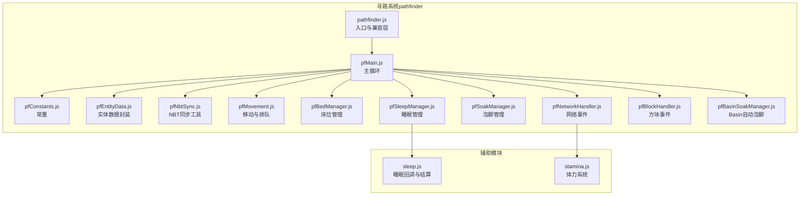
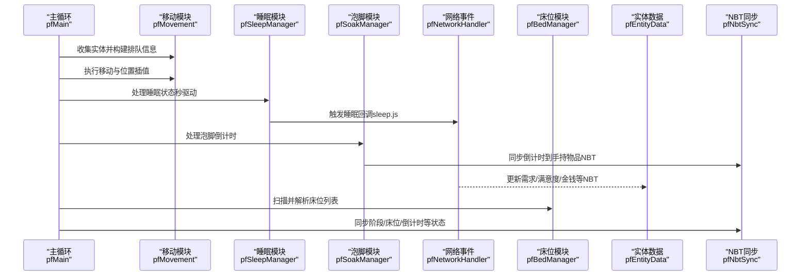
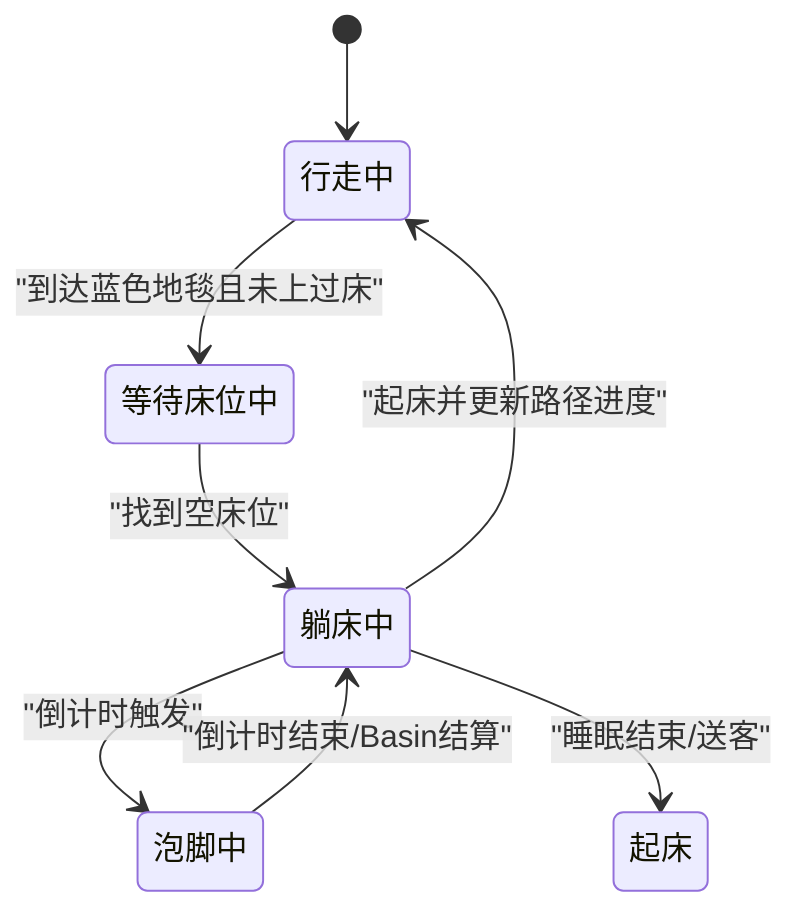
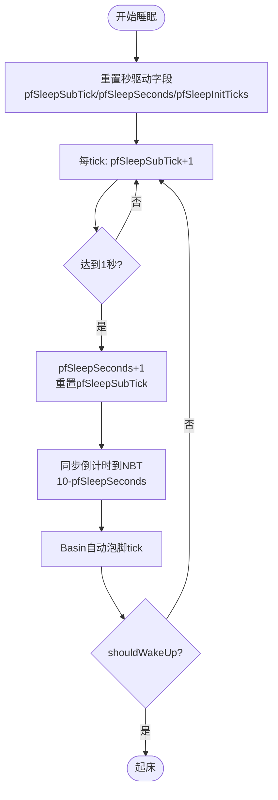
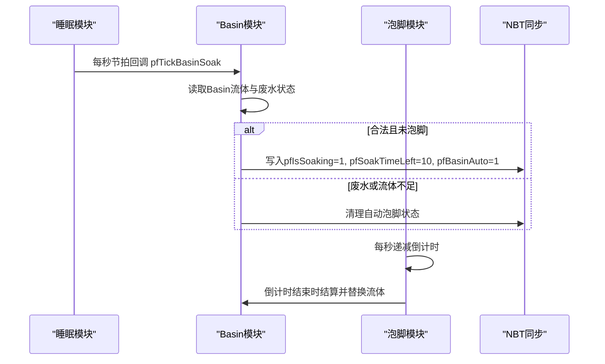
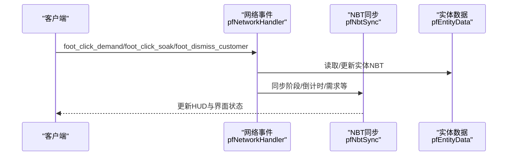
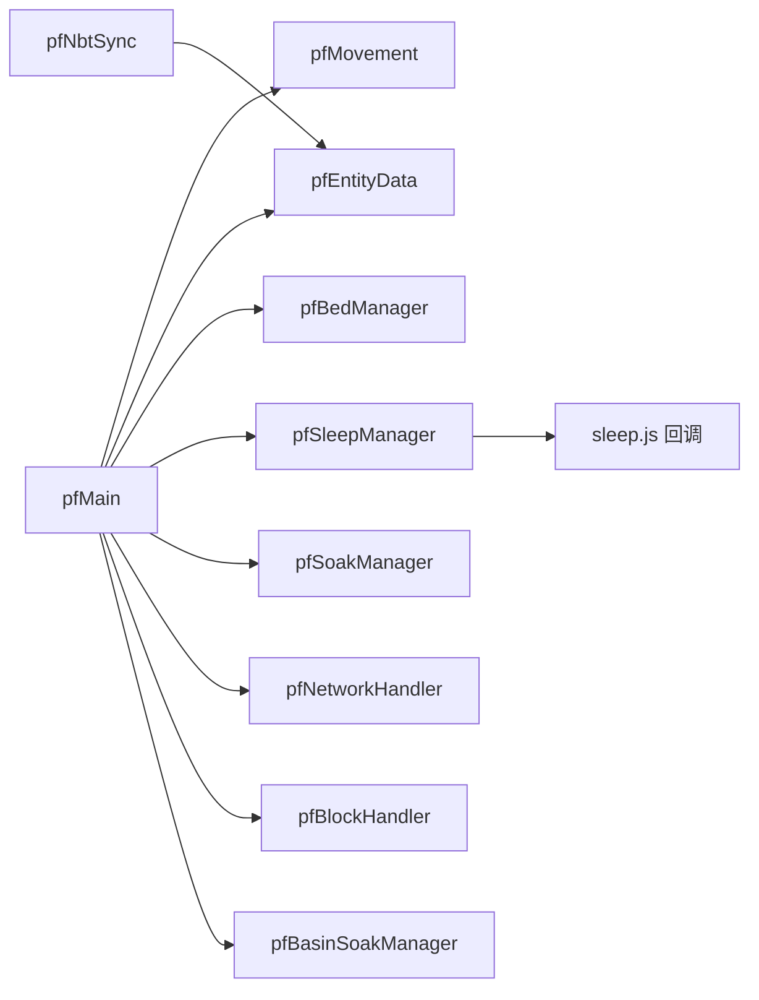

# 状态管理

<cite>
**本文引用的文件**
- [pathfinder.js](file://kubejs/server_scripts/pathfinder.js)
- [pfMain.js](file://kubejs/server_scripts/pathfinder/pfMain.js)
- [pfConstants.js](file://kubejs/server_scripts/pathfinder/pfConstants.js)
- [pfEntityData.js](file://kubejs/server_scripts/pathfinder/pfEntityData.js)
- [pfNbtSync.js](file://kubejs/server_scripts/pathfinder/pfNbtSync.js)
- [pfMovement.js](file://kubejs/server_scripts/pathfinder/pfMovement.js)
- [pfBedManager.js](file://kubejs/server_scripts/pathfinder/pfBedManager.js)
- [pfSleepManager.js](file://kubejs/server_scripts/pathfinder/pfSleepManager.js)
- [pfSoakManager.js](file://kubejs/server_scripts/pathfinder/pfSoakManager.js)
- [pfNetworkHandler.js](file://kubejs/server_scripts/pathfinder/pfNetworkHandler.js)
- [pfBlockHandler.js](file://kubejs/server_scripts/pathfinder/pfBlockHandler.js)
- [pfBasinSoakManager.js](file://kubejs/server_scripts/pathfinder/pfBasinSoakManager.js)
- [sleep.js](file://kubejs/server_scripts/sleep.js)
- [stamina.js](file://kubejs/server_scripts/stamina.js)
</cite>

## 目录
1. [简介](#简介)
2. [项目结构](#项目结构)
3. [核心组件](#核心组件)
4. [架构总览](#架构总览)
5. [详细组件分析](#详细组件分析)
6. [依赖分析](#依赖分析)
7. [性能考虑](#性能考虑)
8. [故障排查指南](#故障排查指南)
9. [结论](#结论)
10. [附录](#附录)

## 简介
本文件系统性梳理项目中的状态管理方案，覆盖实体状态的定义、转换与同步机制。重点包括：
- 实体状态分类：寻路状态、服务状态（搓脚）、睡眠状态、泡脚状态、等待状态等
- 状态机设计与触发条件：基于 tick 驱动、NBT 存储、网络事件驱动
- 客户端-服务端同步：以实体主手物品 NBT 为核心的数据通道，配合自定义网络包
- 状态持久化：实体 persistentData 与方块实体 NBT 的跨重启保留
- 冲突处理与异常恢复：重复处理防护、倒计时一致性、床占用检测、 Basin 自动泡脚校验
- 性能优化策略：批量收集、按阶段过滤、子步插值、最小化命令调用
- 调试与监控：日志分级、状态快照、HUD 数据推送

## 项目结构
本项目的状态管理主要集中在 kubejs/server_scripts/pathfinder 目录下的模块化脚本，以及与之协作的 sleep.js、stamina.js 等。

图示来源
- [pathfinder.js:1-30](file://kubejs/server_scripts/pathfinder.js#L1-L30)
- [pfMain.js:1-177](file://kubejs/server_scripts/pathfinder/pfMain.js#L1-L177)
- [pfConstants.js:1-65](file://kubejs/server_scripts/pathfinder/pfConstants.js#L1-L65)
- [pfEntityData.js:1-218](file://kubejs/server_scripts/pathfinder/pfEntityData.js#L1-L218)
- [pfNbtSync.js:1-94](file://kubejs/server_scripts/pathfinder/pfNbtSync.js#L1-L94)
- [pfMovement.js:1-186](file://kubejs/server_scripts/pathfinder/pfMovement.js#L1-L186)
- [pfBedManager.js:1-129](file://kubejs/server_scripts/pathfinder/pfBedManager.js#L1-L129)
- [pfSleepManager.js:1-232](file://kubejs/server_scripts/pathfinder/pfSleepManager.js#L1-L232)
- [pfSoakManager.js:1-197](file://kubejs/server_scripts/pathfinder/pfSoakManager.js#L1-L197)
- [pfNetworkHandler.js:1-317](file://kubejs/server_scripts/pathfinder/pfNetworkHandler.js#L1-L317)
- [pfBlockHandler.js:1-148](file://kubejs/server_scripts/pathfinder/pfBlockHandler.js#L1-L148)
- [pfBasinSoakManager.js:1-418](file://kubejs/server_scripts/pathfinder/pfBasinSoakManager.js#L1-L418)
- [sleep.js:1-313](file://kubejs/server_scripts/sleep.js#L1-L313)
- [stamina.js:1-81](file://kubejs/server_scripts/stamina.js#L1-L81)

章节来源
- [pathfinder.js:1-30](file://kubejs/server_scripts/pathfinder.js#L1-L30)
- [pfMain.js:1-177](file://kubejs/server_scripts/pathfinder/pfMain.js#L1-L177)

## 核心组件
- 常量与配置：统一管理同步物品 ID、网格尺寸、方向映射、需求部位等
- 实体数据封装：对实体 persistentData 的读写进行统一封装，保证跨模块一致访问
- NBT 同步工具：以实体主手物品为载体，将状态同步到客户端
- 主循环：每 tick 驱动实体状态机，协调移动、排队、睡眠、泡脚等
- 睡眠管理：以秒为单位的跨重启友好计时，驱动倒计时与结算
- 泡脚管理：基于秒驱动的倒计时，支持手动与 Basin 自动两种来源
- 网络事件：处理客户端点击、泡脚、送客等交互，更新 NBT 并触发状态变化
- 方块事件：右键触发方块，扫描地图生成路径，启动定时生成
- 辅助模块：睡眠回调与结算、体力系统

章节来源
- [pfConstants.js:1-65](file://kubejs/server_scripts/pathfinder/pfConstants.js#L1-L65)
- [pfEntityData.js:1-218](file://kubejs/server_scripts/pathfinder/pfEntityData.js#L1-L218)
- [pfNbtSync.js:1-94](file://kubejs/server_scripts/pathfinder/pfNbtSync.js#L1-L94)
- [pfMain.js:1-177](file://kubejs/server_scripts/pathfinder/pfMain.js#L1-L177)
- [pfSleepManager.js:1-232](file://kubejs/server_scripts/pathfinder/pfSleepManager.js#L1-L232)
- [pfSoakManager.js:1-197](file://kubejs/server_scripts/pathfinder/pfSoakManager.js#L1-L197)
- [pfNetworkHandler.js:1-317](file://kubejs/server_scripts/pathfinder/pfNetworkHandler.js#L1-L317)
- [pfBlockHandler.js:1-148](file://kubejs/server_scripts/pathfinder/pfBlockHandler.js#L1-L148)
- [sleep.js:1-313](file://kubejs/server_scripts/sleep.js#L1-L313)
- [stamina.js:1-81](file://kubejs/server_scripts/stamina.js#L1-L81)

## 架构总览
整体采用“主循环 + 模块化职责分离”的架构。主循环在每个 tick 收集实体并按阶段处理，各模块负责具体状态机逻辑，通过 NBT 与网络事件进行交互。

图示来源
- [pfMain.js:11-177](file://kubejs/server_scripts/pathfinder/pfMain.js#L11-L177)
- [pfMovement.js:1-186](file://kubejs/server_scripts/pathfinder/pfMovement.js#L1-L186)
- [pfSleepManager.js:65-128](file://kubejs/server_scripts/pathfinder/pfSleepManager.js#L65-L128)
- [pfSoakManager.js:92-145](file://kubejs/server_scripts/pathfinder/pfSoakManager.js#L92-L145)
- [pfNetworkHandler.js:39-219](file://kubejs/server_scripts/pathfinder/pfNetworkHandler.js#L39-L219)
- [pfBedManager.js:10-77](file://kubejs/server_scripts/pathfinder/pfBedManager.js#L10-L77)
- [pfEntityData.js:185-218](file://kubejs/server_scripts/pathfinder/pfEntityData.js#L185-L218)
- [pfNbtSync.js:8-94](file://kubejs/server_scripts/pathfinder/pfNbtSync.js#L8-L94)

## 详细组件分析

### 实体状态机与阶段
- 阶段定义（pfPhase）：
  - 2：行走中（walkers）
  - 3：躺床中（sleepers）
  - 4：等待床位中（waiters）
  - 5：蓝色地毯等待中（blueWaiters）
- 状态转换：
  - 行走 → 等待（到达蓝色地毯且未上过床）
  - 等待 → 躺床（找到空床位）
  - 躺床 → 起床（睡眠结束或送客）
  - 躺床 → 泡脚（倒计时触发）
  - 泡脚 → 完成（倒计时结束或 Basin 结算）

图示来源
- [pfMovement.js:14-34](file://kubejs/server_scripts/pathfinder/pfMovement.js#L14-L34)
- [pfMain.js:29-93](file://kubejs/server_scripts/pathfinder/pfMain.js#L29-L93)
- [pfSleepManager.js:24-61](file://kubejs/server_scripts/pathfinder/pfSleepManager.js#L24-L61)
- [pfSoakManager.js:92-145](file://kubejs/server_scripts/pathfinder/pfSoakManager.js#L92-L145)

章节来源
- [pfMovement.js:14-34](file://kubejs/server_scripts/pathfinder/pfMovement.js#L14-L34)
- [pfMain.js:29-173](file://kubejs/server_scripts/pathfinder/pfMain.js#L29-L173)

### 睡眠状态与倒计时
- 时间驱动：以“秒/计数”独立存储于实体 persistentData，避免依赖 server.getTickCount() 的差值，跨重启友好
- 秒事件：pfSleepSubTick（0~19）→ pfSleepSeconds，每秒触发一次
- 倒计时：从 10 秒倒数至 0，同步到手持物品 NBT
- 结算：由 sleep.js 的回调决定是否起床，并进行金钱、满意度、奖励等结算

图示来源
- [pfSleepManager.js:16-128](file://kubejs/server_scripts/pathfinder/pfSleepManager.js#L16-L128)
- [pfNbtSync.js:31-41](file://kubejs/server_scripts/pathfinder/pfNbtSync.js#L31-L41)
- [sleep.js:79-312](file://kubejs/server_scripts/sleep.js#L79-L312)

章节来源
- [pfSleepManager.js:16-128](file://kubejs/server_scripts/pathfinder/pfSleepManager.js#L16-L128)
- [sleep.js:79-312](file://kubejs/server_scripts/sleep.js#L79-L312)

### 泡脚状态与 Basin 自动泡脚
- 手动泡脚：玩家右键触发，消耗水桶，进入倒计时
- Basin 自动泡脚：床旁 Create Basin 合法且水量充足时自动启动，倒计时结束后结算并替换流体
- 倒计时：以秒为单位，pfSoakSubTick（0~19）驱动秒事件，无可用水时重置倒计时

图示来源
- [pfSleepManager.js:110-117](file://kubejs/server_scripts/pathfinder/pfSleepManager.js#L110-L117)
- [pfBasinSoakManager.js:329-408](file://kubejs/server_scripts/pathfinder/pfBasinSoakManager.js#L329-L408)
- [pfSoakManager.js:92-145](file://kubejs/server_scripts/pathfinder/pfSoakManager.js#L92-L145)

章节来源
- [pfBasinSoakManager.js:1-418](file://kubejs/server_scripts/pathfinder/pfBasinSoakManager.js#L1-L418)
- [pfSoakManager.js:92-197](file://kubejs/server_scripts/pathfinder/pfSoakManager.js#L92-L197)

### 客户端-服务端状态同步机制
- 同步载体：实体主手物品（默认 paper），NBT 字段承载状态
- 同步内容：阶段、床位、倒计时、需求清单、满意度、金钱、是否泡脚、是否完成等
- 客户端推送：服务端通过自定义网络包将数据推送到客户端
- 网络事件：处理搓脚点击、泡脚点击、送客等交互，更新 NBT 并触发状态变化

图示来源
- [pfNetworkHandler.js:39-311](file://kubejs/server_scripts/pathfinder/pfNetworkHandler.js#L39-L311)
- [pfNbtSync.js:8-94](file://kubejs/server_scripts/pathfinder/pfNbtSync.js#L8-L94)
- [stamina.js:11-21](file://kubejs/server_scripts/stamina.js#L11-L21)

章节来源
- [pfNetworkHandler.js:39-311](file://kubejs/server_scripts/pathfinder/pfNetworkHandler.js#L39-L311)
- [pfNbtSync.js:8-94](file://kubejs/server_scripts/pathfinder/pfNbtSync.js#L8-L94)
- [stamina.js:11-81](file://kubejs/server_scripts/stamina.js#L11-L81)

### 状态持久化与跨重启
- 实体持久化：实体 persistentData 存储路径进度、阶段、床信息、睡眠/泡脚计时等
- 方块实体持久化：开店状态、定时生成配置等存储在被点击方块的 BlockEntity NBT 中
- 跨重启友好：所有时间相关字段以“秒/计数”独立存储，避免依赖 tick 差值

章节来源
- [pfEntityData.js:185-218](file://kubejs/server_scripts/pathfinder/pfEntityData.js#L185-L218)
- [pfSleepManager.js:16-21](file://kubejs/server_scripts/pathfinder/pfSleepManager.js#L16-L21)
- [pfSoakManager.js:92-106](file://kubejs/server_scripts/pathfinder/pfSoakManager.js#L92-L106)
- [pfBlockHandler.js:32-38](file://kubejs/server_scripts/pathfinder/pfBlockHandler.js#L32-L38)

### 状态冲突处理与异常恢复
- 重复处理防护：pfEntityData.pfGetLastTick 防止同 tick 内重复处理
- 床占用检测：pfBedManager.pfIsBedOccupied 避免多个实体同时占用同一床位
- Basin 校验：每秒重查流体合法性，若流体被抽走或变为废水则终止自动泡脚
- 起床清理：pfMovement.pfClearSleepNbt 清理残留睡眠 NBT，防止状态污染

章节来源
- [pfMain.js:34-37](file://kubejs/server_scripts/pathfinder/pfMain.js#L34-L37)
- [pfBedManager.js:109-120](file://kubejs/server_scripts/pathfinder/pfBedManager.js#L109-L120)
- [pfBasinSoakManager.js:370-384](file://kubejs/server_scripts/pathfinder/pfBasinSoakManager.js#L370-L384)
- [pfMovement.js:164-175](file://kubejs/server_scripts/pathfinder/pfMovement.js#L164-L175)

## 依赖分析
- 模块耦合：
  - pfMain 作为中枢，依赖 pfMovement、pfEntityData、pfBedManager、pfSleepManager、pfSoakManager、pfNetworkHandler、pfBlockHandler、pfBasinSoakManager
  - pfNbtSync 与 pfEntityData 双向协作，前者负责同步到客户端，后者负责持久化
  - pfSleepManager 与 sleep.js 通过回调解耦
- 外部依赖：
  - KubeJS 网络事件、玩家事件、方块事件
  - Forge 流体能力（Basin 模块反射加载）

图示来源
- [pfMain.js:17-20](file://kubejs/server_scripts/pathfinder/pfMain.js#L17-L20)
- [pfNbtSync.js:60-75](file://kubejs/server_scripts/pathfinder/pfNbtSync.js#L60-L75)
- [sleep.js:57-66](file://kubejs/server_scripts/sleep.js#L57-L66)

章节来源
- [pfMain.js:17-20](file://kubejs/server_scripts/pathfinder/pfMain.js#L17-L20)
- [pfNbtSync.js:60-75](file://kubejs/server_scripts/pathfinder/pfNbtSync.js#L60-L75)
- [sleep.js:57-66](file://kubejs/server_scripts/sleep.js#L57-L66)

## 性能考虑
- 批量收集与过滤：pfMovement.pfCollectEntities 按阶段分类，减少后续遍历成本
- 子步插值：pfMovement.pfMoveStep 使用 0~9 的子步进行平滑插值，降低每 tick 的计算量
- 最小化命令调用：Basin 写入通过 /data modify 直接修改 BlockEntity NBT，避免频繁查询
- 自动回复：stamina.js 每秒为在线玩家恢复体力，使用子 tick 计数器跨重启友好
- 重复处理防护：pfEntityData.pfGetLastTick 防止同 tick 内重复处理，避免无效计算

章节来源
- [pfMovement.js:7-34](file://kubejs/server_scripts/pathfinder/pfMovement.js#L7-L34)
- [pfMovement.js:101-162](file://kubejs/server_scripts/pathfinder/pfMovement.js#L101-L162)
- [pfBasinSoakManager.js:264-301](file://kubejs/server_scripts/pathfinder/pfBasinSoakManager.js#L264-L301)
- [stamina.js:62-79](file://kubejs/server_scripts/stamina.js#L62-L79)
- [pfMain.js:34-37](file://kubejs/server_scripts/pathfinder/pfMain.js#L34-L37)

## 故障排查指南
- 睡眠倒计时异常：
  - 检查 pfSleepManager.pfProcessSleeping 的秒事件逻辑与倒计时同步
  - 确认 sleep.js 的起床判定条件是否满足
- 泡脚倒计时中断：
  - 检查 Basin 流体是否被抽走或变为废水
  - 确认 pfSoakManager.pfIsSoakWaterAvailable 的水桶识别
- 状态未同步到客户端：
  - 检查 pfNbtSync 是否正确写入主手物品 NBT
  - 确认客户端是否收到服务端推送的自定义数据包
- 重复处理导致的异常：
  - 检查 pfEntityData.pfGetLastTick 的设置与读取
- 床位占用冲突：
  - 检查 pfBedManager.pfIsBedOccupied 的检测范围与条件

章节来源
- [pfSleepManager.js:65-128](file://kubejs/server_scripts/pathfinder/pfSleepManager.js#L65-L128)
- [sleep.js:79-312](file://kubejs/server_scripts/sleep.js#L79-L312)
- [pfSoakManager.js:74-88](file://kubejs/server_scripts/pathfinder/pfSoakManager.js#L74-L88)
- [pfBasinSoakManager.js:340-384](file://kubejs/server_scripts/pathfinder/pfBasinSoakManager.js#L340-L384)
- [pfNbtSync.js:8-94](file://kubejs/server_scripts/pathfinder/pfNbtSync.js#L8-L94)
- [pfMain.js:34-37](file://kubejs/server_scripts/pathfinder/pfMain.js#L34-L37)
- [pfBedManager.js:109-120](file://kubejs/server_scripts/pathfinder/pfBedManager.js#L109-L120)

## 结论
本项目通过模块化设计与严格的 NBT 同步机制，实现了稳定、可扩展的状态管理体系。以“秒/计数”为核心的跨重启友好计时、以实体主手物品为载体的客户端同步、以及 Basin 自动泡脚等创新点，共同构成了高效、易维护的状态管理框架。建议在后续迭代中进一步完善状态快照与可视化监控工具，以提升调试效率与可观测性。

## 附录
- 状态字段一览（部分）
  - 路径与进度：pfOriginX/Z、pfRoute、pfTime、pfSubStep
  - 阶段与位置：pfPhase、pfWaitX/Y/Z、pfBeforeSleepX/Y/Z、pfBlueCarpetX/Z
  - 床位：pfBedX/Y/Z、pfBedYaw、pfBedList
  - 睡眠：pfSleepStartTick、pfSleepSubTick、pfSleepSeconds、pfSleepInitTicks
  - 泡脚：pfIsSoaking、pfSoakDone、pfSoakTimeLeft、pfSoakWaterType、pfBasinAuto
  - 需求与收益：pfDemandJiaozhang/…、pfSatisfaction、pfMoney、pfActionPlayerUuid
- 常用网络事件
  - foot_click_demand：搓脚点击
  - foot_click_soak：泡脚点击
  - foot_dismiss_customer：送客
  - stamina_request/stamina_sync：体力同步

章节来源
- [pfEntityData.js:185-218](file://kubejs/server_scripts/pathfinder/pfEntityData.js#L185-L218)
- [pfNbtSync.js:45-75](file://kubejs/server_scripts/pathfinder/pfNbtSync.js#L45-L75)
- [pfNetworkHandler.js:39-311](file://kubejs/server_scripts/pathfinder/pfNetworkHandler.js#L39-L311)
- [stamina.js:11-21](file://kubejs/server_scripts/stamina.js#L11-L21)