# 数据流架构

<cite>
**本文引用的文件**
- [pfConstants.js](file://kubejs/server_scripts/pathfinder/pfConstants.js)
- [pfNbtSync.js](file://kubejs/server_scripts/pathfinder/pfNbtSync.js)
- [pfNetworkHandler.js](file://kubejs/server_scripts/pathfinder/pfNetworkHandler.js)
- [pfEntityData.js](file://kubejs/server_scripts/pathfinder/pfEntityData.js)
- [pfMain.js](file://kubejs/server_scripts/pathfinder/pfMain.js)
- [pfSoakManager.js](file://kubejs/server_scripts/pathfinder/pfSoakManager.js)
- [pfSleepManager.js](file://kubejs/server_scripts/pathfinder/pfSleepManager.js)
- [pfMovement.js](file://kubejs/server_scripts/pathfinder/pfMovement.js)
- [pfBasinSoakManager.js](file://kubejs/server_scripts/pathfinder/pfBasinSoakManager.js)
- [pfBedManager.js](file://kubejs/server_scripts/pathfinder/pfBedManager.js)
- [pfEntitySpawner.js](file://kubejs/server_scripts/pathfinder/pfEntitySpawner.js)
- [pfShopManager.js](file://kubejs/server_scripts/pathfinder/pfShopManager.js)
- [pfPathfinding.js](file://kubejs/server_scripts/pathfinder/pfPathfinding.js)
- [pfSoakWaterEffects.js](file://kubejs/server_scripts/pathfinder/pfSoakWaterEffects.js)
- [pfCunDrop.js](file://kubejs/server_scripts/pathfinder/pfCunDrop.js)
</cite>

## 目录
1. [简介](#简介)
2. [项目结构](#项目结构)
3. [核心组件](#核心组件)
4. [架构总览](#架构总览)
5. [详细组件分析](#详细组件分析)
6. [依赖分析](#依赖分析)
7. [性能考量](#性能考量)
8. [故障排查指南](#故障排查指南)
9. [结论](#结论)
10. [附录](#附录)

## 简介
本文件面向Minecraft KubeJS Pathfinder模块，系统化梳理数据流架构，覆盖以下主题：
- 实体数据生命周期管理：生成、寻路、等待、睡眠、泡脚、状态回写与持久化
- NBT数据同步策略：以“同步物品”承载并驱动UI与交互
- 状态变更传播：从网络事件到实体状态再到UI反馈的端到端链路
- PF常量系统：集中配置与映射
- 网络处理器：客户端事件到服务端业务的协议解析
- 实体数据持久化：跨重启友好的时间与状态字段设计
- 数据模型与存储结构：实体persistentData与同步物品NBT的职责划分
- 访问模式：读写分离、幂等与防重复处理
- 数据流图与状态转换图：复杂流程与决策逻辑的可视化

## 项目结构
Pathfinder模块采用“功能域+职责清晰”的组织方式，围绕“实体寻路与服务”主线，将数据读写、状态机、网络协议、存储同步、效果应用等解耦为独立模块，并通过全局命名空间进行装配。

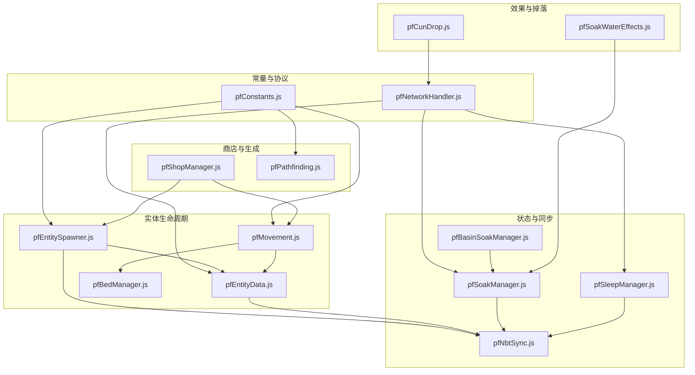

**图表来源**
- [pfConstants.js:1-65](file://kubejs/server_scripts/pathfinder/pfConstants.js#L1-L65)
- [pfNetworkHandler.js:1-317](file://kubejs/server_scripts/pathfinder/pfNetworkHandler.js#L1-L317)
- [pfEntitySpawner.js:1-141](file://kubejs/server_scripts/pathfinder/pfEntitySpawner.js#L1-L141)
- [pfEntityData.js:1-218](file://kubejs/server_scripts/pathfinder/pfEntityData.js#L1-L218)
- [pfMovement.js:1-186](file://kubejs/server_scripts/pathfinder/pfMovement.js#L1-L186)
- [pfBedManager.js:1-129](file://kubejs/server_scripts/pathfinder/pfBedManager.js#L1-L129)
- [pfNbtSync.js:1-94](file://kubejs/server_scripts/pathfinder/pfNbtSync.js#L1-L94)
- [pfSoakManager.js:1-197](file://kubejs/server_scripts/pathfinder/pfSoakManager.js#L1-L197)
- [pfSleepManager.js:1-232](file://kubejs/server_scripts/pathfinder/pfSleepManager.js#L1-L232)
- [pfBasinSoakManager.js:1-418](file://kubejs/server_scripts/pathfinder/pfBasinSoakManager.js#L1-L418)
- [pfShopManager.js:1-300](file://kubejs/server_scripts/pathfinder/pfShopManager.js#L1-L300)
- [pfPathfinding.js:1-91](file://kubejs/server_scripts/pathfinder/pfPathfinding.js#L1-L91)
- [pfSoakWaterEffects.js:1-233](file://kubejs/server_scripts/pathfinder/pfSoakWaterEffects.js#L1-L233)
- [pfCunDrop.js:1-100](file://kubejs/server_scripts/pathfinder/pfCunDrop.js#L1-L100)

**章节来源**
- [pfConstants.js:1-65](file://kubejs/server_scripts/pathfinder/pfConstants.js#L1-L65)
- [pfNetworkHandler.js:1-317](file://kubejs/server_scripts/pathfinder/pfNetworkHandler.js#L1-L317)
- [pfEntitySpawner.js:1-141](file://kubejs/server_scripts/pathfinder/pfEntitySpawner.js#L1-L141)
- [pfEntityData.js:1-218](file://kubejs/server_scripts/pathfinder/pfEntityData.js#L1-L218)
- [pfMovement.js:1-186](file://kubejs/server_scripts/pathfinder/pfMovement.js#L1-L186)
- [pfBedManager.js:1-129](file://kubejs/server_scripts/pathfinder/pfBedManager.js#L1-L129)
- [pfNbtSync.js:1-94](file://kubejs/server_scripts/pathfinder/pfNbtSync.js#L1-L94)
- [pfSoakManager.js:1-197](file://kubejs/server_scripts/pathfinder/pfSoakManager.js#L1-L197)
- [pfSleepManager.js:1-232](file://kubejs/server_scripts/pathfinder/pfSleepManager.js#L1-L232)
- [pfBasinSoakManager.js:1-418](file://kubejs/server_scripts/pathfinder/pfBasinSoakManager.js#L1-L418)
- [pfShopManager.js:1-300](file://kubejs/server_scripts/pathfinder/pfShopManager.js#L1-L300)
- [pfPathfinding.js:1-91](file://kubejs/server_scripts/pathfinder/pfPathfinding.js#L1-L91)
- [pfSoakWaterEffects.js:1-233](file://kubejs/server_scripts/pathfinder/pfSoakWaterEffects.js#L1-L233)
- [pfCunDrop.js:1-100](file://kubejs/server_scripts/pathfinder/pfCunDrop.js#L1-L100)

## 核心组件
- PF常量系统：集中定义同步物品ID、网格参数、实体类型、需求类型、方向映射与键值映射，导出至全局命名空间，供其他模块读取。
- 实体数据控制：封装persistentData的读写，提供origin、route、time、subStep、phase、bed信息、睡眠相关、等待位置、最后处理tick等字段的存取。
- NBT同步：将阶段、床位、倒计时、需求清单等状态写入实体主手的同步物品NBT，实现客户端自动同步。
- 网络处理器：接收客户端点击事件，解析部位与实体，执行体力消耗、满意度与金钱收益、一键满足、泡脚启动、送客等业务逻辑，并回写NBT与触发客户端反馈。
- 泡脚管理：以秒为单位的状态机，结合工作盆（Basin）自动触发与校验，支持多种洗脚水类型与效果叠加。
- 睡眠管理：以秒/计数器驱动的睡眠状态机，负责设置睡姿、倒计时同步、自动泡脚联动与起床后的路径进度恢复。
- 移动与排队：基于路径进度与子步长的插值移动，排队检测与防重复处理，蓝色地毯等待与床铺占用检测。
- 商店管理：以方块实体持久化状态，按昼夜与间隔计数生成顾客，支持自动关店与清理。
- 寻路算法：BFS网格寻路，支持避让已有路径。
- 洗脚水效果：根据桶ID解析水定义，应用需求增量、满意度、掉落货币、皴加成、药水效果与自定义回调。
- “皴”掉落：按点击次数与道具倍率计算掉落数量，支持泡脚附加加成。

**章节来源**
- [pfConstants.js:1-65](file://kubejs/server_scripts/pathfinder/pfConstants.js#L1-L65)
- [pfEntityData.js:1-218](file://kubejs/server_scripts/pathfinder/pfEntityData.js#L1-L218)
- [pfNbtSync.js:1-94](file://kubejs/server_scripts/pathfinder/pfNbtSync.js#L1-L94)
- [pfNetworkHandler.js:1-317](file://kubejs/server_scripts/pathfinder/pfNetworkHandler.js#L1-L317)
- [pfSoakManager.js:1-197](file://kubejs/server_scripts/pathfinder/pfSoakManager.js#L1-L197)
- [pfSleepManager.js:1-232](file://kubejs/server_scripts/pathfinder/pfSleepManager.js#L1-L232)
- [pfMovement.js:1-186](file://kubejs/server_scripts/pathfinder/pfMovement.js#L1-L186)
- [pfShopManager.js:1-300](file://kubejs/server_scripts/pathfinder/pfShopManager.js#L1-L300)
- [pfPathfinding.js:1-91](file://kubejs/server_scripts/pathfinder/pfPathfinding.js#L1-L91)
- [pfSoakWaterEffects.js:1-233](file://kubejs/server_scripts/pathfinder/pfSoakWaterEffects.js#L1-L233)
- [pfCunDrop.js:1-100](file://kubejs/server_scripts/pathfinder/pfCunDrop.js#L1-L100)

## 架构总览
Pathfinder采用“主循环驱动 + 模块化装配”的架构：
- 主循环（每tick）：收集实体、处理蓝色地毯等待、处理睡眠、构建排队信息、执行移动与到达蓝色地毯逻辑
- 网络层：客户端事件经网络处理器解析，更新实体NBT与状态，触发UI反馈
- 存储层：实体持久化数据（persistentData）与同步物品NBT分工明确，前者跨重启友好，后者驱动UI与网络
- 效果层：泡脚完成后按水定义应用多维效果，掉落与加成独立计算

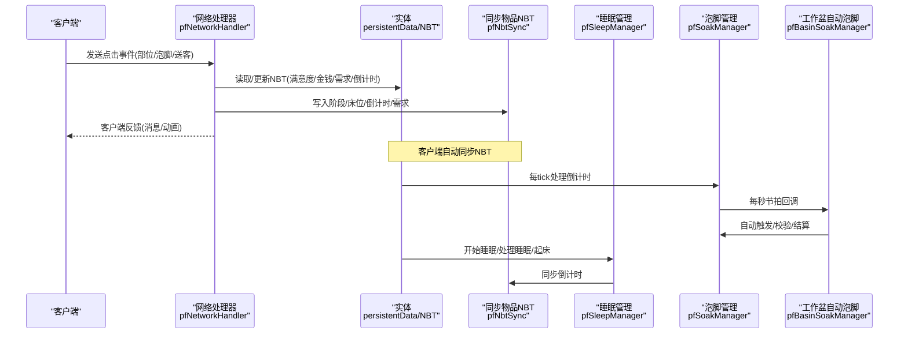

**图表来源**
- [pfNetworkHandler.js:36-311](file://kubejs/server_scripts/pathfinder/pfNetworkHandler.js#L36-L311)
- [pfNbtSync.js:8-93](file://kubejs/server_scripts/pathfinder/pfNbtSync.js#L8-L93)
- [pfSoakManager.js:90-145](file://kubejs/server_scripts/pathfinder/pfSoakManager.js#L90-L145)
- [pfBasinSoakManager.js:328-408](file://kubejs/server_scripts/pathfinder/pfBasinSoakManager.js#L328-L408)
- [pfSleepManager.js:63-128](file://kubejs/server_scripts/pathfinder/pfSleepManager.js#L63-L128)

**章节来源**
- [pfMain.js:11-177](file://kubejs/server_scripts/pathfinder/pfMain.js#L11-L177)
- [pfNetworkHandler.js:36-311](file://kubejs/server_scripts/pathfinder/pfNetworkHandler.js#L36-L311)
- [pfNbtSync.js:8-93](file://kubejs/server_scripts/pathfinder/pfNbtSync.js#L8-L93)
- [pfSoakManager.js:90-145](file://kubejs/server_scripts/pathfinder/pfSoakManager.js#L90-L145)
- [pfBasinSoakManager.js:328-408](file://kubejs/server_scripts/pathfinder/pfBasinSoakManager.js#L328-L408)
- [pfSleepManager.js:63-128](file://kubejs/server_scripts/pathfinder/pfSleepManager.js#L63-L128)

## 详细组件分析

### PF常量系统与配置管理
- 同步物品ID：统一使用特定物品承载NBT，确保客户端自动同步
- 网格参数：以方块为中心的半径与宽度，用于寻路与扫描
- 实体类型：限定为特定NPC实体
- 需求类型与映射：部位名称、整数代码、后缀映射
- 方向列表：N/S/W/E及其反向映射
- 物品与部位映射：羊毛与手物品到部位键的映射，支持一键满足

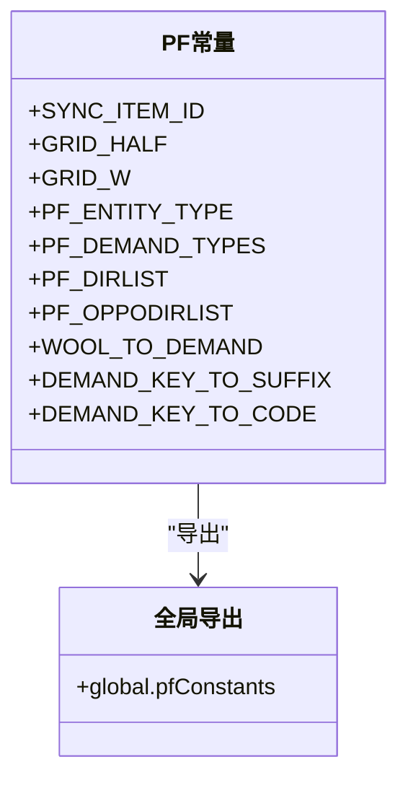

**图表来源**
- [pfConstants.js:7-64](file://kubejs/server_scripts/pathfinder/pfConstants.js#L7-L64)

**章节来源**
- [pfConstants.js:1-65](file://kubejs/server_scripts/pathfinder/pfConstants.js#L1-L65)

### 实体数据生命周期与持久化
- 生命周期阶段：生成、行走、蓝色地毯等待、等待床位、躺床、完成
- 关键字段：
  - origin/route/time/subStep：寻路进度
  - phase：阶段状态
  - bed信息：床坐标与朝向
  - 睡眠相关：开始tick、前位置、已睡眠标志、蓝色地毯来源
  - 等待位置：等待时记录位置
  - lastTick：防重复处理
  - clearSleepTick：起床后清理睡眠NBT的计数
  - bedList：预扫描床列表
- 生成时写入origin、route、phase、time、subStep、蓝色地毯位置、床列表、需求清单（含泡脚跳过标记）、Boss标识、验证同步物品NBT

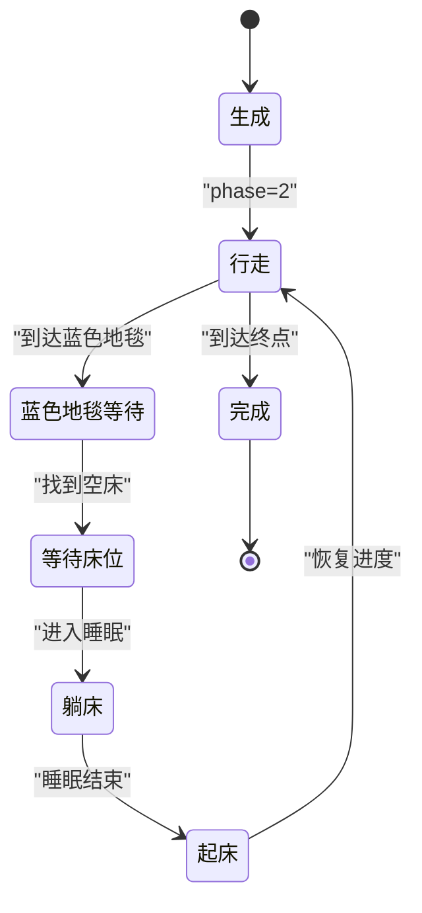

**图表来源**
- [pfEntityData.js:56-63](file://kubejs/server_scripts/pathfinder/pfEntityData.js#L56-L63)
- [pfEntityData.js:76-82](file://kubejs/server_scripts/pathfinder/pfEntityData.js#L76-L82)
- [pfMovement.js:16-34](file://kubejs/server_scripts/pathfinder/pfMovement.js#L16-L34)
- [pfSleepManager.js:24-61](file://kubejs/server_scripts/pathfinder/pfSleepManager.js#L24-L61)
- [pfMain.js:29-93](file://kubejs/server_scripts/pathfinder/pfMain.js#L29-L93)

**章节来源**
- [pfEntityData.js:1-218](file://kubejs/server_scripts/pathfinder/pfEntityData.js#L1-L218)
- [pfEntitySpawner.js:7-100](file://kubejs/server_scripts/pathfinder/pfEntitySpawner.js#L7-L100)

### NBT同步策略与UI传播
- 同步物品：主手持有特定物品，NBT变化自动同步到客户端
- 同步内容：阶段、床位、倒计时、需求清单、满意度、金钱、泡脚状态与时间
- 读写接口：服务端读取/写入NBT，客户端UI实时显示

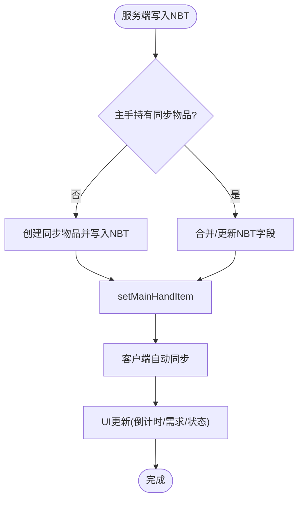

**图表来源**
- [pfNbtSync.js:8-75](file://kubejs/server_scripts/pathfinder/pfNbtSync.js#L8-L75)
- [pfNbtSync.js:77-93](file://kubejs/server_scripts/pathfinder/pfNbtSync.js#L77-L93)

**章节来源**
- [pfNbtSync.js:1-94](file://kubejs/server_scripts/pathfinder/pfNbtSync.js#L1-L94)

### 网络处理器与数据传输协议
- 客户端事件：
  - 足部点击：确定部位键，检查体力消耗，计算收益，更新NBT，记录操作玩家UUID，触发客户端成功动画
  - 一键满足：汇总所有部位需求，统一消耗体力，批量清零，累加满意度与金钱，掉落皴
  - 泡脚点击：校验手持水桶/洗脚水桶，启动泡脚流程，记录操作玩家UUID
  - 送客：绕过结算直接起床
- 属性读取：从玩家属性ID读取每部位体力消耗与收益系数，支持Boss倍率

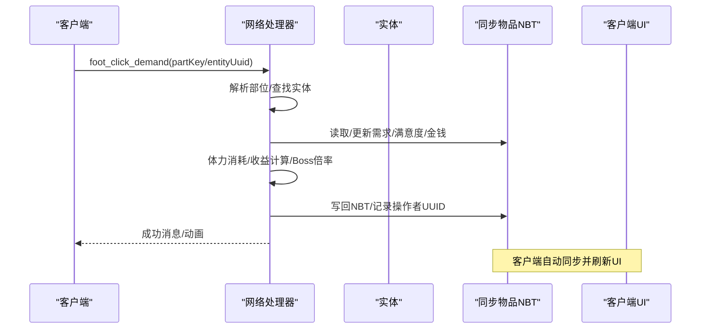

**图表来源**
- [pfNetworkHandler.js:38-219](file://kubejs/server_scripts/pathfinder/pfNetworkHandler.js#L38-L219)

**章节来源**
- [pfNetworkHandler.js:1-317](file://kubejs/server_scripts/pathfinder/pfNetworkHandler.js#L1-L317)

### 泡脚流程与工作盆自动触发
- 泡脚状态机：isSoaking、soakDone、soakTimeLeft、waterType、pfSoakSubTick
- 倒计时：每秒事件递减，无可用洗脚水则重置倒计时
- 工作盆（Basin）：床旁自动触发，校验流体合法性，结算时消耗流体并替换为成品
- 洗脚水效果：泡脚完成后按水定义应用需求增量、满意度、掉落货币、皴加成、药水效果与回调

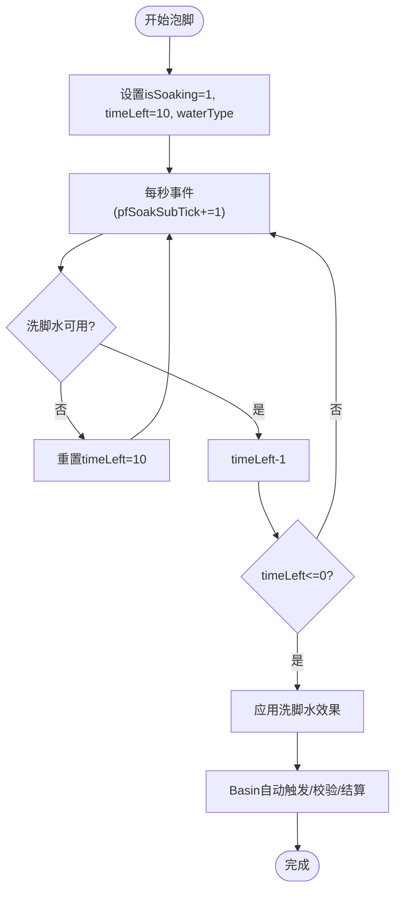

**图表来源**
- [pfSoakManager.js:90-145](file://kubejs/server_scripts/pathfinder/pfSoakManager.js#L90-L145)
- [pfBasinSoakManager.js:328-408](file://kubejs/server_scripts/pathfinder/pfBasinSoakManager.js#L328-L408)
- [pfSoakWaterEffects.js:107-226](file://kubejs/server_scripts/pathfinder/pfSoakWaterEffects.js#L107-L226)

**章节来源**
- [pfSoakManager.js:1-197](file://kubejs/server_scripts/pathfinder/pfSoakManager.js#L1-L197)
- [pfBasinSoakManager.js:1-418](file://kubejs/server_scripts/pathfinder/pfBasinSoakManager.js#L1-L418)
- [pfSoakWaterEffects.js:1-233](file://kubejs/server_scripts/pathfinder/pfSoakWaterEffects.js#L1-L233)

### 睡眠管理与倒计时同步
- 睡眠状态机：sleepSubTick、sleepSeconds、sleepInitTicks
- 起床逻辑：移除睡眠NBT、定位下床位置、恢复路径进度、更新phase
- 倒计时同步：每秒更新倒计时到同步物品NBT，驱动UI显示

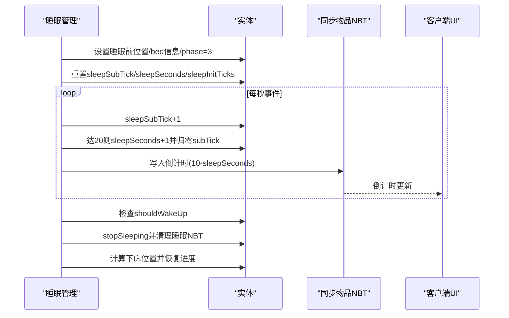

**图表来源**
- [pfSleepManager.js:63-128](file://kubejs/server_scripts/pathfinder/pfSleepManager.js#L63-L128)
- [pfNbtSync.js:31-41](file://kubejs/server_scripts/pathfinder/pfNbtSync.js#L31-L41)

**章节来源**
- [pfSleepManager.js:1-232](file://kubejs/server_scripts/pathfinder/pfSleepManager.js#L1-L232)
- [pfNbtSync.js:1-94](file://kubejs/server_scripts/pathfinder/pfNbtSync.js#L1-L94)

### 移动与排队、寻路与床铺管理
- 移动：基于route/time/subStep的插值移动，满10子步推进一格
- 排队：邻近距离阈值与进度比较，避免拥堵
- 蓝色地毯等待：到达蓝色地毯后进入等待状态，寻找空床后进入睡眠
- 床铺管理：扫描路径周边床，序列化/反序列化，占用检测

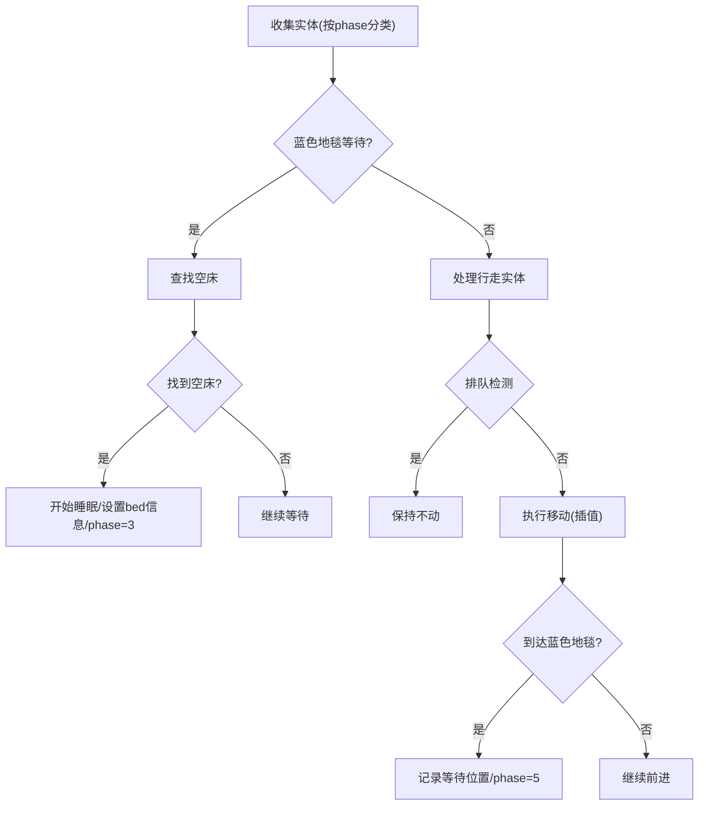

**图表来源**
- [pfMain.js:22-93](file://kubejs/server_scripts/pathfinder/pfMain.js#L22-L93)
- [pfMovement.js:54-79](file://kubejs/server_scripts/pathfinder/pfMovement.js#L54-L79)
- [pfMovement.js:100-162](file://kubejs/server_scripts/pathfinder/pfMovement.js#L100-L162)
- [pfBedManager.js:10-77](file://kubejs/server_scripts/pathfinder/pfBedManager.js#L10-L77)

**章节来源**
- [pfMain.js:1-177](file://kubejs/server_scripts/pathfinder/pfMain.js#L1-L177)
- [pfMovement.js:1-186](file://kubejs/server_scripts/pathfinder/pfMovement.js#L1-L186)
- [pfBedManager.js:1-129](file://kubejs/server_scripts/pathfinder/pfBedManager.js#L1-L129)

### 商店管理与自动生成
- 方块实体持久化：isOpen、tickCounter、playerUuid、routeStr、baseX/Y/Z、bluePos、spawnedUuids
- 自动生成：昼夜判定、间隔计数、顾客类型抽取、生成实体并写入spawnedUuids
- 关店：清理行走/等待中的顾客，重置状态

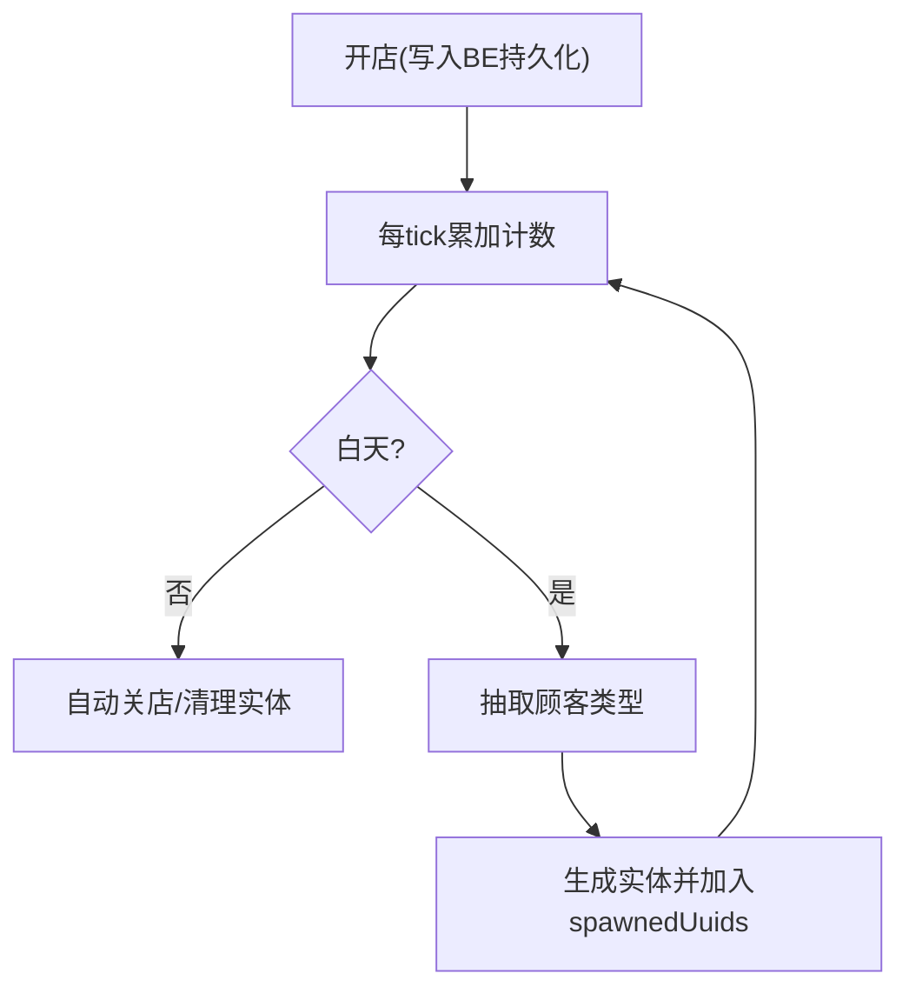

**图表来源**
- [pfShopManager.js:140-284](file://kubejs/server_scripts/pathfinder/pfShopManager.js#L140-L284)

**章节来源**
- [pfShopManager.js:1-300](file://kubejs/server_scripts/pathfinder/pfShopManager.js#L1-L300)

### 寻路算法与网格
- 网格索引：将世界坐标映射到固定尺寸网格
- BFS：支持避让已有路径，输出路径字符串
- 与移动模块配合：将路径字符串写入实体，逐格推进

**章节来源**
- [pfPathfinding.js:1-91](file://kubejs/server_scripts/pathfinder/pfPathfinding.js#L1-L91)
- [pfMovement.js:80-98](file://kubejs/server_scripts/pathfinder/pfMovement.js#L80-L98)

### “皴”掉落与收益计算
- 掉落计算：每次点击独立随机，支持搓泥宝翻倍与耐久消耗，支持泡脚附加加成
- 一键满足：按总清零次数结算

**章节来源**
- [pfCunDrop.js:1-100](file://kubejs/server_scripts/pathfinder/pfCunDrop.js#L1-L100)
- [pfNetworkHandler.js:92-155](file://kubejs/server_scripts/pathfinder/pfNetworkHandler.js#L92-L155)

## 依赖分析
- 模块耦合：
  - pfNetworkHandler依赖pfConstants、实体NBT、玩家属性、全局掉落与设置接口
  - pfSoakManager与pfBasinSoakManager相互协作，共同驱动泡脚状态
  - pfSleepManager与pfNbtSync协同，将倒计时同步到客户端
  - pfEntitySpawner依赖pfEntityData、pfBedManager、pfNbtSync、全局设置与Boss定义
  - pfShopManager依赖pfEntitySpawner与pfCustomerTypes（外部模块）
- 外部依赖：
  - Forge Capability API用于工作盆流体读写（回退到命令写入）
  - 全局注册表（soakWaterRegister、bossRegister、pfCustomerTypes等）

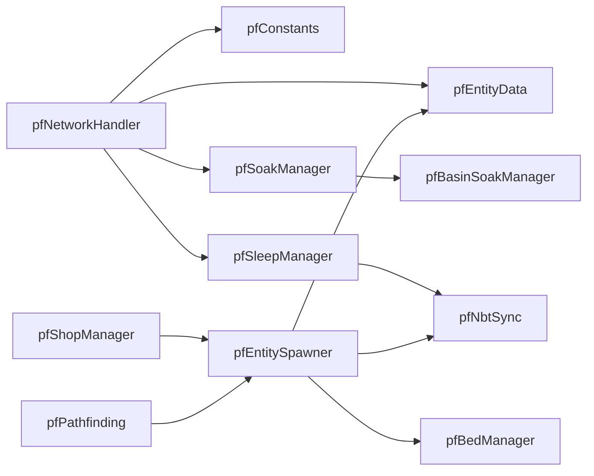

**图表来源**
- [pfNetworkHandler.js:1-317](file://kubejs/server_scripts/pathfinder/pfNetworkHandler.js#L1-L317)
- [pfSoakManager.js:1-197](file://kubejs/server_scripts/pathfinder/pfSoakManager.js#L1-L197)
- [pfBasinSoakManager.js:1-418](file://kubejs/server_scripts/pathfinder/pfBasinSoakManager.js#L1-L418)
- [pfSleepManager.js:1-232](file://kubejs/server_scripts/pathfinder/pfSleepManager.js#L1-L232)
- [pfNbtSync.js:1-94](file://kubejs/server_scripts/pathfinder/pfNbtSync.js#L1-L94)
- [pfEntitySpawner.js:1-141](file://kubejs/server_scripts/pathfinder/pfEntitySpawner.js#L1-L141)
- [pfShopManager.js:1-300](file://kubejs/server_scripts/pathfinder/pfShopManager.js#L1-L300)
- [pfPathfinding.js:1-91](file://kubejs/server_scripts/pathfinder/pfPathfinding.js#L1-L91)

**章节来源**
- [pfNetworkHandler.js:1-317](file://kubejs/server_scripts/pathfinder/pfNetworkHandler.js#L1-L317)
- [pfSoakManager.js:1-197](file://kubejs/server_scripts/pathfinder/pfSoakManager.js#L1-L197)
- [pfBasinSoakManager.js:1-418](file://kubejs/server_scripts/pathfinder/pfBasinSoakManager.js#L1-L418)
- [pfSleepManager.js:1-232](file://kubejs/server_scripts/pathfinder/pfSleepManager.js#L1-L232)
- [pfNbtSync.js:1-94](file://kubejs/server_scripts/pathfinder/pfNbtSync.js#L1-L94)
- [pfEntitySpawner.js:1-141](file://kubejs/server_scripts/pathfinder/pfEntitySpawner.js#L1-L141)
- [pfShopManager.js:1-300](file://kubejs/server_scripts/pathfinder/pfShopManager.js#L1-L300)
- [pfPathfinding.js:1-91](file://kubejs/server_scripts/pathfinder/pfPathfinding.js#L1-L91)

## 性能考量
- 防重复处理：实体lastTick字段避免同tick重复处理，降低CPU与I/O压力
- 跨重启友好：时间与状态字段存储于persistentData，不依赖server.getTickCount()差值
- 网络同步优化：同步物品NBT自动同步，UI无需轮询
- 流体读写回退：工作盆流体读写优先Capability，失败回退命令写入，兼顾性能与稳定性
- 掉落调度：优先使用掉落队列接口，避免大量summon命令带来的性能开销

## 故障排查指南
- 网络事件无响应
  - 检查网络处理器事件监听是否注册
  - 核对实体UUID与部位键解析逻辑
  - 确认玩家属性ID是否存在
- 泡脚无效
  - 检查手持水桶/洗脚水桶是否合法
  - 确认工作盆流体是否可用且未被标记为废水
  - 核对倒计时是否正确写入同步物品NBT
- 睡眠倒计时不更新
  - 检查sleepSubTick与sleepSeconds是否按秒事件递增
  - 确认倒计时写入同步物品NBT的调用
- 实体未生成或生成后立即消失
  - 检查商店状态isOpen与tickCounter
  - 确认spawnedUuids是否正确追加
  - 核对生成时的Boss倍率与跳过泡脚设置
- 掉落异常
  - 检查掉落队列接口是否可用
  - 确认搓泥宝耐久与倍率逻辑

**章节来源**
- [pfNetworkHandler.js:36-311](file://kubejs/server_scripts/pathfinder/pfNetworkHandler.js#L36-L311)
- [pfSoakManager.js:90-145](file://kubejs/server_scripts/pathfinder/pfSoakManager.js#L90-L145)
- [pfBasinSoakManager.js:328-408](file://kubejs/server_scripts/pathfinder/pfBasinSoakManager.js#L328-L408)
- [pfSleepManager.js:63-128](file://kubejs/server_scripts/pathfinder/pfSleepManager.js#L63-L128)
- [pfShopManager.js:237-284](file://kubejs/server_scripts/pathfinder/pfShopManager.js#L237-L284)
- [pfCunDrop.js:1-100](file://kubejs/server_scripts/pathfinder/pfCunDrop.js#L1-L100)

## 结论
本数据流架构通过“主循环驱动 + 模块化装配 + NBT同步”的设计，实现了从生成、寻路、等待、睡眠、泡脚到结算的完整闭环。PF常量系统提供集中配置，网络处理器承担协议解析与业务编排，实体数据持久化保障跨重启一致性，工作盆自动泡脚与洗脚水效果增强玩法深度。整体结构清晰、职责分明，具备良好的扩展性与可维护性。

## 附录
- 数据模型与存储结构
  - 实体persistentData：origin、route、time、subStep、phase、bed信息、睡眠相关、等待位置、lastTick、clearSleepTick、bedList
  - 同步物品NBT：pfPhase、pfBedX/Y/Z/Yaw、pfCountdown、需求清单、满意度、金钱、泡脚状态与时间、水类型、操作者UUID等
- 访问模式
  - 读写分离：持久化数据用于跨重启，同步NBT用于UI与网络
  - 幂等与防重复：lastTick、clearSleepTick等字段避免重复处理
  - 映射与转换：方向列表、部位键值映射、整数代码与后缀映射