# 架构设计

<cite>
**本文引用的文件**
- [kubejs/jsconfig.json](file://kubejs/jsconfig.json)
- [kubejs/README.txt](file://kubejs/README.txt)
- [kubejs/startup_scripts/serveHooks.js](file://kubejs/startup_scripts/serveHooks.js)
- [kubejs/startup_scripts/example.js](file://kubejs/startup_scripts/example.js)
- [kubejs/server_scripts/pathfinder/pfMain.js](file://kubejs/server_scripts/pathfinder/pfMain.js)
- [kubejs/server_scripts/pathfinder/pfConstants.js](file://kubejs/server_scripts/pathfinder/pfConstants.js)
- [kubejs/server_scripts/pathfinder/pfNetworkHandler.js](file://kubejs/server_scripts/pathfinder/pfNetworkHandler.js)
- [kubejs/server_scripts/pathfinder/pfEntityData.js](file://kubejs/server_scripts/pathfinder/pfEntityData.js)
- [kubejs/server_scripts/pathfinder/pfMovement.js](file://kubejs/server_scripts/pathfinder/pfMovement.js)
- [kubejs/server_scripts/pathfinder/pfSoakManager.js](file://kubejs/server_scripts/pathfinder/pfSoakManager.js)
- [kubejs/server_scripts/pathfinder/pfSleepManager.js](file://kubejs/server_scripts/pathfinder/pfSleepManager.js)
- [kubejs/server_scripts/pathfinder/pfShopManager.js](file://kubejs/server_scripts/pathfinder/pfShopManager.js)
- [kubejs/server_scripts/pathfinder/pfBedManager.js](file://kubejs/server_scripts/pathfinder/pfBedManager.js)
- [kubejs/server_scripts/pathfinder/pfBasinSoakManager.js](file://kubejs/server_scripts/pathfinder/pfBasinSoakManager.js)
</cite>

## 目录
1. [简介](#简介)
2. [项目结构](#项目结构)
3. [核心组件](#核心组件)
4. [架构总览](#架构总览)
5. [详细组件分析](#详细组件分析)
6. [依赖分析](#依赖分析)
7. [性能考量](#性能考量)
8. [故障排查指南](#故障排查指南)
9. [结论](#结论)
10. [附录](#附录)

## 简介
本架构设计文档面向基于 KubeJS 的“寻路系统”（Pathfinder）模组，系统围绕事件驱动、注册器模式与钩子系统展开，采用模块化分层设计，将游戏世界中的实体寻路、睡眠、泡脚、开店等行为解耦为可插拔的子模块，并通过全局命名空间进行协作。文档旨在帮助开发者快速理解系统边界、数据流向与组件依赖关系，支撑后续功能扩展与定制开发。

## 项目结构
KubeJS 项目遵循“资源包 + 数据包 + 脚本”的组织方式：
- assets：客户端资源（纹理、模型、声音、语言文件）
- data：服务端数据（函数、战利品表、标签等）
- startup_scripts：启动阶段一次性加载的脚本（注册实体、模型、动画等）
- server_scripts：服务器资源重载时加载的脚本（事件、配方、逻辑）
- client_scripts：客户端资源重载时加载的脚本（UI、提示、JEI）

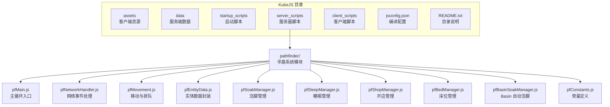

图表来源
- [kubejs/README.txt:1-15](file://kubejs/README.txt#L1-L15)
- [kubejs/jsconfig.json:1-16](file://kubejs/jsconfig.json#L1-L16)

章节来源
- [kubejs/README.txt:1-15](file://kubejs/README.txt#L1-L15)
- [kubejs/jsconfig.json:1-16](file://kubejs/jsconfig.json#L1-L16)

## 核心组件
- 事件驱动入口：由方块实体每 tick 触发的主循环，协调各子模块执行
- 注册器模式：通过全局命名空间暴露注册函数，供外部模块注册行为（如 Serve 点击 Hook）
- 钩子系统：在关键节点收集并顺序执行注册的钩子函数，实现功能解耦
- 模块化管理：将寻路、移动、睡眠、泡脚、开店、床位、Basin 自动泡脚等功能拆分为独立模块，通过全局对象协作

章节来源
- [kubejs/server_scripts/pathfinder/pfMain.js:1-177](file://kubejs/server_scripts/pathfinder/pfMain.js#L1-L177)
- [kubejs/startup_scripts/serveHooks.js:1-31](file://kubejs/startup_scripts/serveHooks.js#L1-L31)

## 架构总览
系统采用“主循环 + 子模块 + 全局协作”的架构：
- 主循环（pfMain）负责调度各模块，按实体状态（行走、等待、睡眠、泡脚）分别处理
- 子模块通过全局对象（global.pfXxx）互相调用，共享常量与实体数据
- 网络事件（pfNetworkHandler）接收客户端输入，更新实体状态并触发 UI 同步
- Serve 点击 Hook 通过注册器模式在启动阶段注册，运行时在主循环关键节点执行

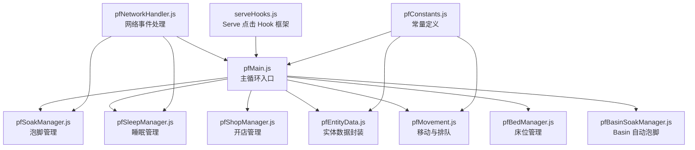

图表来源
- [kubejs/server_scripts/pathfinder/pfMain.js:1-177](file://kubejs/server_scripts/pathfinder/pfMain.js#L1-L177)
- [kubejs/server_scripts/pathfinder/pfNetworkHandler.js:1-317](file://kubejs/server_scripts/pathfinder/pfNetworkHandler.js#L1-L317)
- [kubejs/server_scripts/pathfinder/pfEntityData.js:1-218](file://kubejs/server_scripts/pathfinder/pfEntityData.js#L1-L218)
- [kubejs/server_scripts/pathfinder/pfMovement.js:1-186](file://kubejs/server_scripts/pathfinder/pfMovement.js#L1-L186)
- [kubejs/server_scripts/pathfinder/pfSoakManager.js:1-197](file://kubejs/server_scripts/pathfinder/pfSoakManager.js#L1-L197)
- [kubejs/server_scripts/pathfinder/pfSleepManager.js:1-232](file://kubejs/server_scripts/pathfinder/pfSleepManager.js#L1-L232)
- [kubejs/server_scripts/pathfinder/pfShopManager.js:1-300](file://kubejs/server_scripts/pathfinder/pfShopManager.js#L1-L300)
- [kubejs/server_scripts/pathfinder/pfBedManager.js:1-129](file://kubejs/server_scripts/pathfinder/pfBedManager.js#L1-L129)
- [kubejs/server_scripts/pathfinder/pfBasinSoakManager.js:1-418](file://kubejs/server_scripts/pathfinder/pfBasinSoakManager.js#L1-L418)
- [kubejs/server_scripts/pathfinder/pfConstants.js:1-65](file://kubejs/server_scripts/pathfinder/pfConstants.js#L1-L65)
- [kubejs/startup_scripts/serveHooks.js:1-31](file://kubejs/startup_scripts/serveHooks.js#L1-L31)

## 详细组件分析

### 主循环与系统边界
- 系统边界：由 pathfinder_block 方块实体每 tick 触发 global.pathfinderTick，范围限定在以方块为中心的网格内
- 边界内的实体按状态分类（行走、等待、睡眠、蓝色地毯等待），逐类处理
- 关键边界保护：防重复处理（lastTick）、跨重启友好（以秒为单位的状态存储）

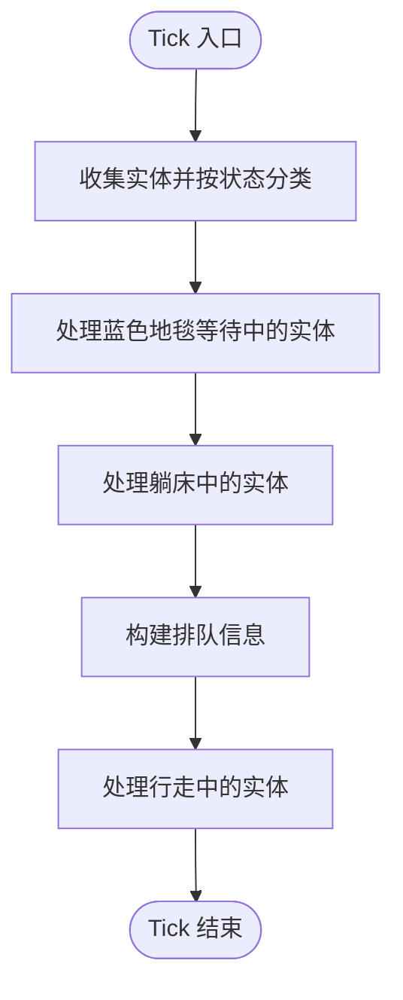

图表来源
- [kubejs/server_scripts/pathfinder/pfMain.js:11-174](file://kubejs/server_scripts/pathfinder/pfMain.js#L11-L174)

章节来源
- [kubejs/server_scripts/pathfinder/pfMain.js:1-177](file://kubejs/server_scripts/pathfinder/pfMain.js#L1-L177)

### 网络事件与客户端交互
- 客户端通过网络事件发送点击需求、泡脚、送客等指令
- 服务端解析事件，更新实体 NBT，触发 UI 同步与效果应用
- 一键满足、体力消耗、满意度与金钱结算均在服务端完成

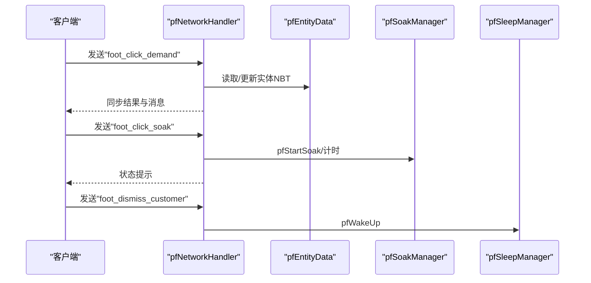

图表来源
- [kubejs/server_scripts/pathfinder/pfNetworkHandler.js:39-310](file://kubejs/server_scripts/pathfinder/pfNetworkHandler.js#L39-L310)
- [kubejs/server_scripts/pathfinder/pfEntityData.js:185-217](file://kubejs/server_scripts/pathfinder/pfEntityData.js#L185-L217)
- [kubejs/server_scripts/pathfinder/pfSoakManager.js:149-185](file://kubejs/server_scripts/pathfinder/pfSoakManager.js#L149-L185)
- [kubejs/server_scripts/pathfinder/pfSleepManager.js:131-223](file://kubejs/server_scripts/pathfinder/pfSleepManager.js#L131-L223)

章节来源
- [kubejs/server_scripts/pathfinder/pfNetworkHandler.js:1-317](file://kubejs/server_scripts/pathfinder/pfNetworkHandler.js#L1-L317)

### 实体数据封装与状态持久化
- 统一封装实体 persistentData 的读写，提供基础数据、床位信息、睡眠状态、蓝色地毯位置、等待位置、最后处理 tick 等
- 状态跨重启保留，避免依赖 server.getTickCount() 差值

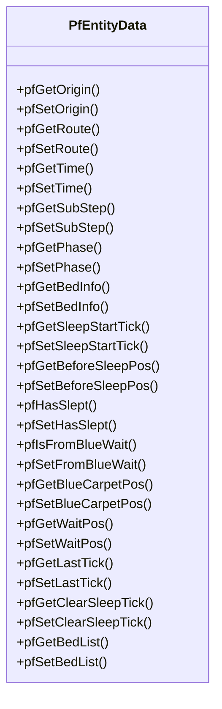

图表来源
- [kubejs/server_scripts/pathfinder/pfEntityData.js:185-217](file://kubejs/server_scripts/pathfinder/pfEntityData.js#L185-L217)

章节来源
- [kubejs/server_scripts/pathfinder/pfEntityData.js:1-218](file://kubejs/server_scripts/pathfinder/pfEntityData.js#L1-L218)

### 移动与排队算法
- 基于路径字符串与时间步进，计算实体当前位置
- 排队检测：当其他实体在相近位置且进度更高时，当前实体需等待
- 子步机制：每步细分为 10 个子步，实现平滑插值移动

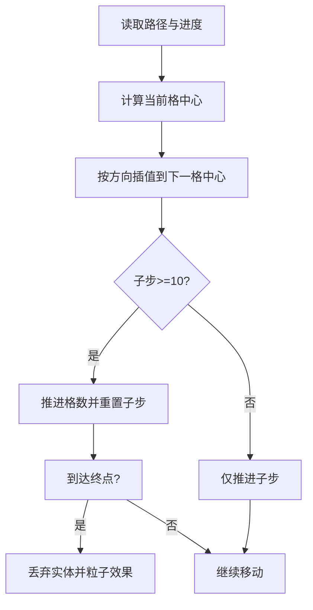

图表来源
- [kubejs/server_scripts/pathfinder/pfMovement.js:101-162](file://kubejs/server_scripts/pathfinder/pfMovement.js#L101-L162)

章节来源
- [kubejs/server_scripts/pathfinder/pfMovement.js:1-186](file://kubejs/server_scripts/pathfinder/pfMovement.js#L1-L186)

### 睡眠管理与秒驱动
- 采用“秒/计数”驱动，避免依赖 tick 差值，跨重启友好
- 前 60 tick 设置睡姿 NBT，随后每秒触发一次“秒事件”
- 支持 Basin 自动泡脚触发与倒计时同步

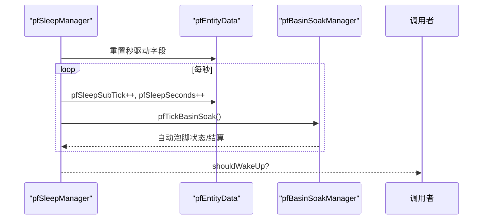

图表来源
- [kubejs/server_scripts/pathfinder/pfSleepManager.js:65-128](file://kubejs/server_scripts/pathfinder/pfSleepManager.js#L65-L128)
- [kubejs/server_scripts/pathfinder/pfBasinSoakManager.js:329-408](file://kubejs/server_scripts/pathfinder/pfBasinSoakManager.js#L329-L408)

章节来源
- [kubejs/server_scripts/pathfinder/pfSleepManager.js:1-232](file://kubejs/server_scripts/pathfinder/pfSleepManager.js#L1-L232)

### 泡脚管理与水桶类型
- 泡脚状态存储于实体主手物品 NBT，支持原版水桶与注册的洗脚水桶
- 无可用洗脚水时重置倒计时；倒计时结束后应用附加效果
- 支持 Basin 自动泡脚：检测流体、校验废水、结算替换

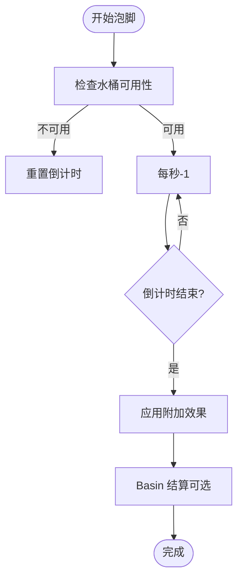

图表来源
- [kubejs/server_scripts/pathfinder/pfSoakManager.js:92-145](file://kubejs/server_scripts/pathfinder/pfSoakManager.js#L92-L145)
- [kubejs/server_scripts/pathfinder/pfBasinSoakManager.js:329-408](file://kubejs/server_scripts/pathfinder/pfBasinSoakManager.js#L329-L408)

章节来源
- [kubejs/server_scripts/pathfinder/pfSoakManager.js:1-197](file://kubejs/server_scripts/pathfinder/pfSoakManager.js#L1-L197)

### 开店管理与顾客生成
- 开店状态持久化在方块实体 NBT，支持白天自动判定与关店清理
- 每 5 秒判定一次生成顾客，按顾客类别生成实体并广播
- 提供持久化访问 API，供其他模块查询与记录

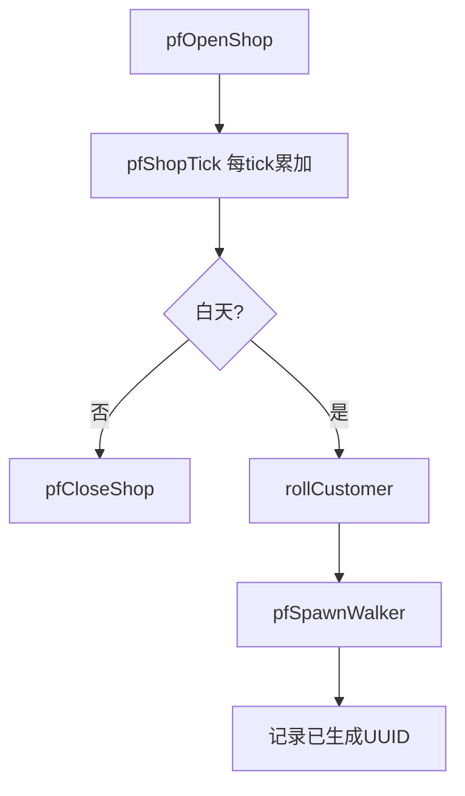

图表来源
- [kubejs/server_scripts/pathfinder/pfShopManager.js:237-284](file://kubejs/server_scripts/pathfinder/pfShopManager.js#L237-L284)

章节来源
- [kubejs/server_scripts/pathfinder/pfShopManager.js:1-300](file://kubejs/server_scripts/pathfinder/pfShopManager.js#L1-L300)

### 床位管理与占用检测
- 沿路径扫描床，序列化/反序列化床列表
- 占用检测：床附近存在处于睡眠状态的实体则视为占用

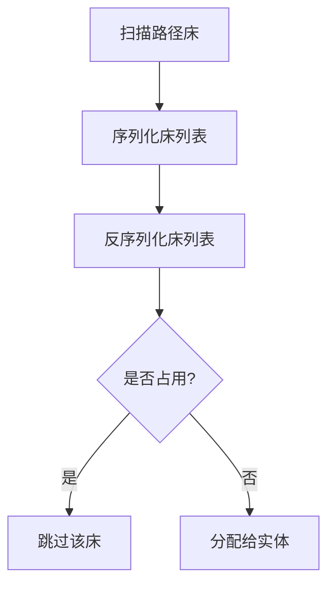

图表来源
- [kubejs/server_scripts/pathfinder/pfBedManager.js:10-120](file://kubejs/server_scripts/pathfinder/pfBedManager.js#L10-L120)

章节来源
- [kubejs/server_scripts/pathfinder/pfBedManager.js:1-129](file://kubejs/server_scripts/pathfinder/pfBedManager.js#L1-L129)

### Serve 点击 Hook 框架
- 启动阶段注册钩子函数，运行时在主循环关键节点顺序执行
- 支持取消链式调用（ctx.cancel），异常捕获与日志输出

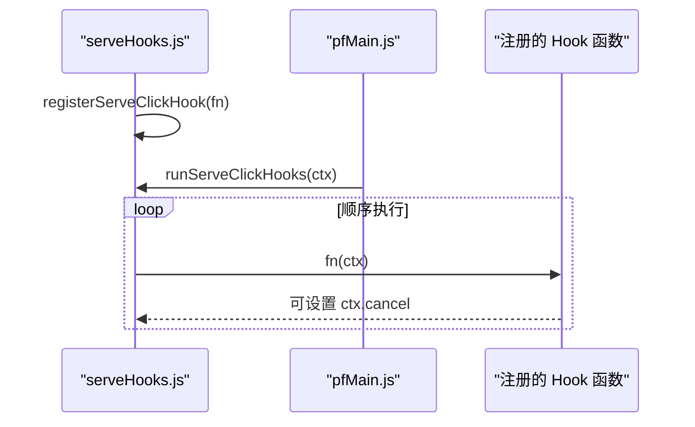

图表来源
- [kubejs/startup_scripts/serveHooks.js:13-30](file://kubejs/startup_scripts/serveHooks.js#L13-L30)
- [kubejs/server_scripts/pathfinder/pfMain.js:11-174](file://kubejs/server_scripts/pathfinder/pfMain.js#L11-L174)

章节来源
- [kubejs/startup_scripts/serveHooks.js:1-31](file://kubejs/startup_scripts/serveHooks.js#L1-L31)

### 常量定义与注册器
- 常量集中定义（同步物品 ID、网格参数、需求类型、方向映射等）
- 注册器模式：通过 global.registerXxx 函数注册行为（如实体模型、动画控制器等）

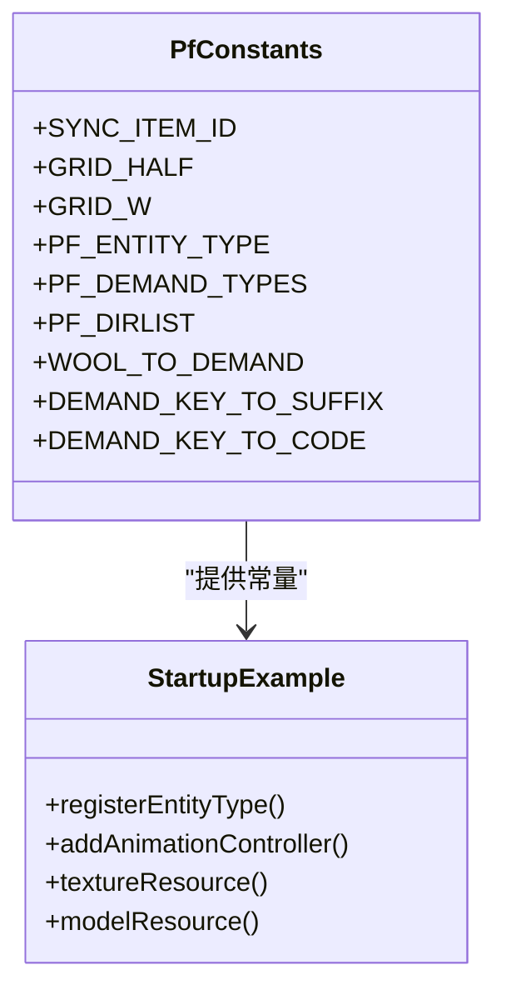

图表来源
- [kubejs/server_scripts/pathfinder/pfConstants.js:53-64](file://kubejs/server_scripts/pathfinder/pfConstants.js#L53-L64)
- [kubejs/startup_scripts/example.js:1-26](file://kubejs/startup_scripts/example.js#L1-L26)

章节来源
- [kubejs/server_scripts/pathfinder/pfConstants.js:1-65](file://kubejs/server_scripts/pathfinder/pfConstants.js#L1-L65)
- [kubejs/startup_scripts/example.js:1-26](file://kubejs/startup_scripts/example.js#L1-L26)

## 依赖分析
- 模块内聚：每个模块职责单一，通过全局对象进行松耦合协作
- 模块间依赖：
  - pfMain 依赖 pfShopManager、pfMovement、pfEntityData、pfSleepManager、pfSoakManager、pfBedManager、pfBasinSoakManager
  - pfNetworkHandler 依赖 pfSoakManager、pfSleepManager、pfEntityData、pfConstants
  - pfBasinSoakManager 依赖 pfEntityData、pfSoakManager、pfConstants
  - pfSleepManager 依赖 pfEntityData、pfBasinSoakManager
  - pfSoakManager 依赖 pfEntityData、pfConstants
  - pfMovement 依赖 pfEntityData、pfConstants
  - pfBedManager 依赖 pfConstants
  - serveHooks 与 pfMain 通过全局数组协作

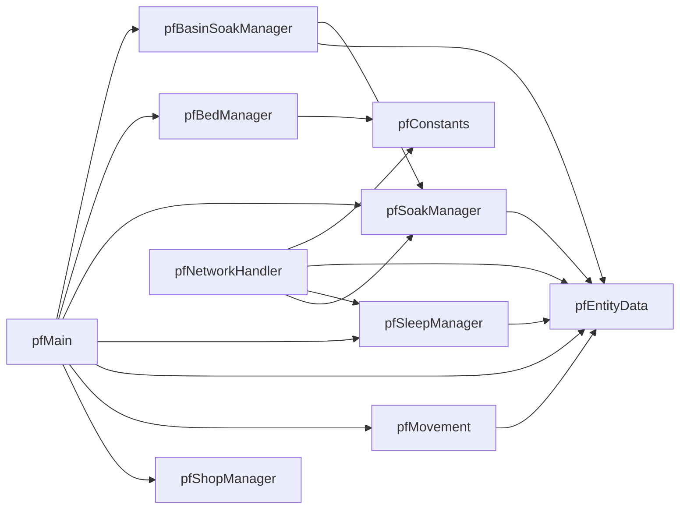

图表来源
- [kubejs/server_scripts/pathfinder/pfMain.js:11-174](file://kubejs/server_scripts/pathfinder/pfMain.js#L11-L174)
- [kubejs/server_scripts/pathfinder/pfNetworkHandler.js:39-310](file://kubejs/server_scripts/pathfinder/pfNetworkHandler.js#L39-L310)
- [kubejs/server_scripts/pathfinder/pfBasinSoakManager.js:329-408](file://kubejs/server_scripts/pathfinder/pfBasinSoakManager.js#L329-L408)

章节来源
- [kubejs/server_scripts/pathfinder/pfMain.js:1-177](file://kubejs/server_scripts/pathfinder/pfMain.js#L1-L177)
- [kubejs/server_scripts/pathfinder/pfNetworkHandler.js:1-317](file://kubejs/server_scripts/pathfinder/pfNetworkHandler.js#L1-L317)

## 性能考量
- 空间复杂度：实体状态以 NBT 存储，按需读写，避免频繁 GC
- 时间复杂度：主循环按状态分类处理，避免全量扫描；排队检测使用距离阈值与进度比较
- 跨重启友好：以秒为单位的状态存储，避免依赖 tick 差值导致的不一致
- I/O 优化：Basin 自动泡脚通过 Forge Capability 与 NBT 命令写入结合，尽量减少反射调用
- 网络优化：仅在必要时同步 UI 状态（倒计时、阶段变更），降低带宽压力

## 故障排查指南
- 网络事件无响应
  - 检查客户端是否正确发送事件名称与数据
  - 服务端日志中确认事件监听是否注册
- 泡脚水桶无效
  - 确认桶 ID 是否在注册表中，或为原版水桶
  - 检查 Basin 是否含有“已使用洗脚水”（废水）
- 睡眠倒计时异常
  - 检查实体 persistentData 中的秒驱动字段是否被意外修改
  - 确认是否跨重启导致状态丢失
- 开店未生成顾客
  - 检查是否白天、是否达到判定间隔
  - 确认 rollCustomer 是否返回有效类别
- Serve Hook 未执行
  - 检查是否在启动阶段正确注册
  - 确认 ctx.cancel 是否被设置

章节来源
- [kubejs/server_scripts/pathfinder/pfNetworkHandler.js:39-310](file://kubejs/server_scripts/pathfinder/pfNetworkHandler.js#L39-L310)
- [kubejs/server_scripts/pathfinder/pfBasinSoakManager.js:340-383](file://kubejs/server_scripts/pathfinder/pfBasinSoakManager.js#L340-L383)
- [kubejs/server_scripts/pathfinder/pfSleepManager.js:65-128](file://kubejs/server_scripts/pathfinder/pfSleepManager.js#L65-L128)
- [kubejs/server_scripts/pathfinder/pfShopManager.js:237-284](file://kubejs/server_scripts/pathfinder/pfShopManager.js#L237-L284)
- [kubejs/startup_scripts/serveHooks.js:13-30](file://kubejs/startup_scripts/serveHooks.js#L13-L30)

## 结论
本系统通过事件驱动、模块化与注册器模式，实现了寻路、睡眠、泡脚、开店等复杂行为的解耦与扩展。主循环作为系统中枢，通过全局协作与状态持久化保障跨重启一致性。Serve Hook 框架进一步降低了业务逻辑与主流程的耦合度，便于后续功能扩展与定制开发。建议在新增模块时遵循现有命名与数据约定，保持模块职责单一与接口稳定。

## 附录
- 目录说明与脚本加载时机参考 [kubejs/README.txt:1-15](file://kubejs/README.txt#L1-L15)
- 编译目标与根目录映射参考 [kubejs/jsconfig.json:1-16](file://kubejs/jsconfig.json#L1-L16)