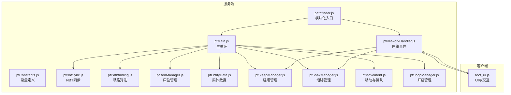
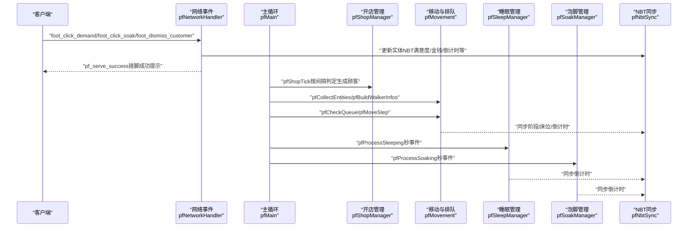
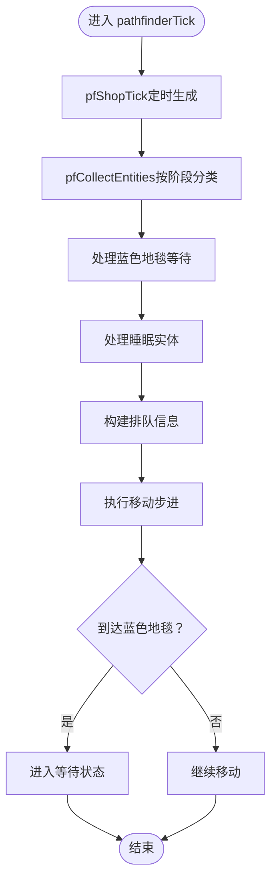
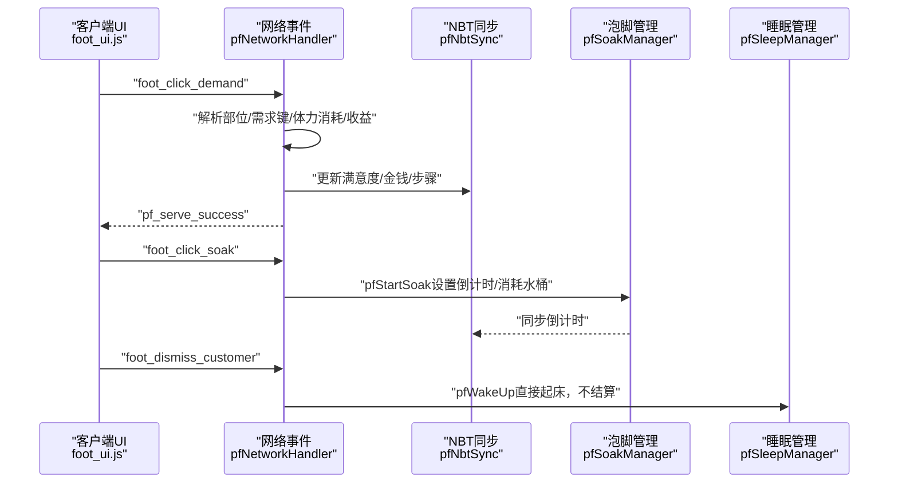
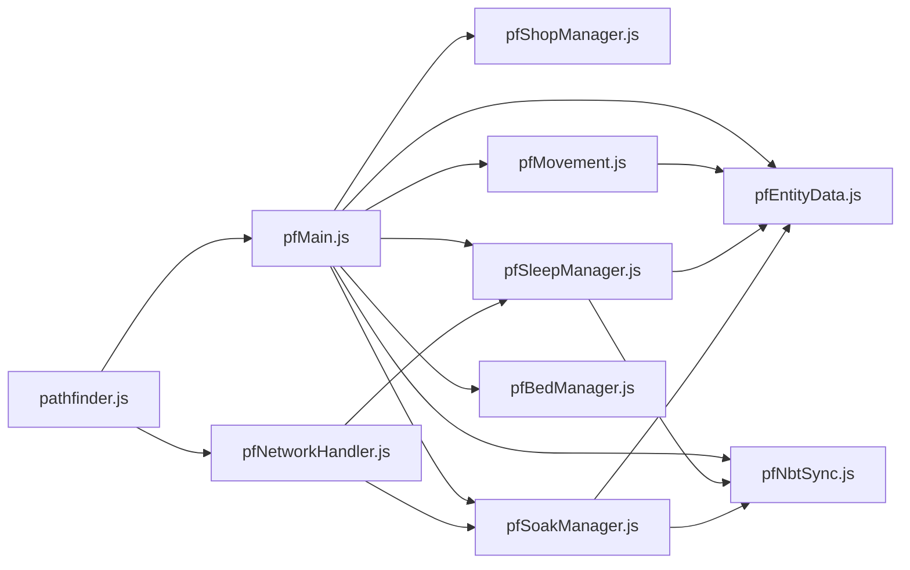

# 系统架构

<cite>
**本文引用的文件**   
- [pfMain.js](file://kubejs/server_scripts/pathfinder/pfMain.js)
- [pfNetworkHandler.js](file://kubejs/server_scripts/pathfinder/pfNetworkHandler.js)
- [pfEntityData.js](file://kubejs/server_scripts/pathfinder/pfEntityData.js)
- [pfConstants.js](file://kubejs/server_scripts/pathfinder/pfConstants.js)
- [pfMovement.js](file://kubejs/server_scripts/pathfinder/pfMovement.js)
- [pfSleepManager.js](file://kubejs/server_scripts/pathfinder/pfSleepManager.js)
- [pfSoakManager.js](file://kubejs/server_scripts/pathfinder/pfSoakManager.js)
- [pfNbtSync.js](file://kubejs/server_scripts/pathfinder/pfNbtSync.js)
- [pfBedManager.js](file://kubejs/server_scripts/pathfinder/pfBedManager.js)
- [pfShopManager.js](file://kubejs/server_scripts/pathfinder/pfShopManager.js)
- [pfPathfinding.js](file://kubejs/server_scripts/pathfinder/pfPathfinding.js)
- [pathfinder.js](file://kubejs/server_scripts/pathfinder.js)
- [foot_ui.js](file://kubejs/client_scripts/ui/foot_ui.js)
</cite>

## 目录
1. [简介](#简介)
2. [项目结构](#项目结构)
3. [核心组件](#核心组件)
4. [架构总览](#架构总览)
5. [详细组件分析](#详细组件分析)
6. [依赖分析](#依赖分析)
7. [性能考虑](#性能考虑)
8. [故障排查指南](#故障排查指南)
9. [结论](#结论)
10. [附录](#附录)

## 简介
本系统围绕 KubeJS 模组中的“寻路与服务”子系统展开，采用服务端-客户端分离架构，以事件驱动为核心，结合 NBT 数据同步与网络协议，实现实体寻路、排队、睡眠、泡脚、开店等复杂业务流程。系统边界清晰：服务端负责状态机与规则逻辑，客户端负责 UI 展示与用户交互；二者通过网络事件与实体手持物品的 NBT 实现数据同步。

## 项目结构
- 服务端模块（server_scripts/pathfinder）
  - 常量与工具：pfConstants.js、pfNbtSync.js、pfPathfinding.js
  - 实体生命周期：pfEntityData.js、pfMovement.js、pfSleepManager.js、pfSoakManager.js、pfBedManager.js
  - 商店与生成：pfShopManager.js、pfEntitySpawner.js（在本仓库中未直接出现，但被 pfMain.js 依赖）
  - 网络与入口：pfNetworkHandler.js、pathfinder.js（模块化入口）
  - 主循环：pfMain.js
- 客户端模块（client_scripts/ui）
  - UI 与交互：foot_ui.js（WorldWindow + HTML 模板）

图表来源
- [pathfinder.js:1-30](file://kubejs/server_scripts/pathfinder.js#L1-L30)
- [pfMain.js:1-177](file://kubejs/server_scripts/pathfinder/pfMain.js#L1-L177)
- [pfNetworkHandler.js:1-317](file://kubejs/server_scripts/pathfinder/pfNetworkHandler.js#L1-L317)
- [foot_ui.js:1-800](file://kubejs/client_scripts/ui/foot_ui.js#L1-L800)

章节来源
- [pathfinder.js:1-30](file://kubejs/server_scripts/pathfinder.js#L1-L30)

## 核心组件
- 常量与工具
  - pfConstants.js：定义同步物品 ID、网格尺寸、实体类型、需求类型、方向映射等。
  - pfNbtSync.js：封装实体手持物品 NBT 的读写与同步，作为客户端 UI 的数据源。
  - pfPathfinding.js：BFS 寻路算法，支持避让已有路径。
- 实体生命周期
  - pfEntityData.js：封装实体 persistentData 的读写，统一字段命名与默认值。
  - pfMovement.js：收集实体、构建排队信息、检查排队、计算当前位置、执行移动步进。
  - pfSleepManager.js：睡眠状态机（设置睡姿、秒级计时、倒计时同步、起床与位置回退）。
  - pfSoakManager.js：泡脚状态机（秒级计时、水桶可用性判定、效果应用）。
  - pfBedManager.js：扫描路径上的床、序列化/反序列化床列表、检测占用。
- 商店与生成
  - pfShopManager.js：开店/关店、按时间间隔判定生成顾客、持久化在方块实体 NBT。
- 网络与入口
  - pfNetworkHandler.js：接收客户端点击事件（搓脚、泡脚、送客），更新实体 NBT 并触发服务端逻辑。
  - pathfinder.js：模块化入口，确保子模块按序加载，并设置网络处理器。
- 主循环
  - pfMain.js：每 tick 驱动，整合商店、实体收集、蓝色地毯等待、睡眠、排队与移动。

章节来源
- [pfConstants.js:1-65](file://kubejs/server_scripts/pathfinder/pfConstants.js#L1-L65)
- [pfNbtSync.js:1-94](file://kubejs/server_scripts/pathfinder/pfNbtSync.js#L1-L94)
- [pfPathfinding.js:1-91](file://kubejs/server_scripts/pathfinder/pfPathfinding.js#L1-L91)
- [pfEntityData.js:1-218](file://kubejs/server_scripts/pathfinder/pfEntityData.js#L1-L218)
- [pfMovement.js:1-186](file://kubejs/server_scripts/pathfinder/pfMovement.js#L1-L186)
- [pfSleepManager.js:1-232](file://kubejs/server_scripts/pathfinder/pfSleepManager.js#L1-L232)
- [pfSoakManager.js:1-197](file://kubejs/server_scripts/pathfinder/pfSoakManager.js#L1-L197)
- [pfBedManager.js:1-129](file://kubejs/server_scripts/pathfinder/pfBedManager.js#L1-L129)
- [pfShopManager.js:1-300](file://kubejs/server_scripts/pathfinder/pfShopManager.js#L1-L300)
- [pfNetworkHandler.js:1-317](file://kubejs/server_scripts/pathfinder/pfNetworkHandler.js#L1-L317)
- [pathfinder.js:1-30](file://kubejs/server_scripts/pathfinder.js#L1-L30)
- [pfMain.js:1-177](file://kubejs/server_scripts/pathfinder/pfMain.js#L1-L177)

## 架构总览
系统采用“事件驱动 + 主循环”的双轨机制：
- 事件驱动：客户端通过网络事件触发服务端逻辑（搓脚、泡脚、送客），服务端更新实体 NBT 并联动 UI。
- 主循环：服务端每 tick 调用主入口，按阶段处理实体（行走、等待、睡眠、泡脚），并进行路径推进与状态同步。

图表来源
- [pfNetworkHandler.js:37-311](file://kubejs/server_scripts/pathfinder/pfNetworkHandler.js#L37-L311)
- [pfMain.js:11-174](file://kubejs/server_scripts/pathfinder/pfMain.js#L11-L174)
- [pfShopManager.js:237-284](file://kubejs/server_scripts/pathfinder/pfShopManager.js#L237-L284)
- [pfMovement.js:7-185](file://kubejs/server_scripts/pathfinder/pfMovement.js#L7-L185)
- [pfSleepManager.js:65-128](file://kubejs/server_scripts/pathfinder/pfSleepManager.js#L65-L128)
- [pfSoakManager.js:92-145](file://kubejs/server_scripts/pathfinder/pfSoakManager.js#L92-L145)
- [pfNbtSync.js:8-93](file://kubejs/server_scripts/pathfinder/pfNbtSync.js#L8-L93)

## 详细组件分析

### 主循环（pfMain.js）
- 职责
  - 每 tick 从触发方块实体获取世界与 tick 信息。
  - 调用商店管理模块进行定时生成。
  - 收集并分类实体（行走、睡眠、等待、蓝色地毯等待）。
  - 处理蓝色地毯等待队列（寻找空床、进入睡眠、记录位置）。
  - 处理睡眠实体（泡脚倒计时、睡眠逻辑、醒来）。
  - 构建排队信息，执行移动步进，处理到达蓝色地毯的逻辑。
- 性能与并发
  - 使用实体 lastTick 防重复处理，避免同 tick 内重复计算。
  - 分阶段处理，避免一次性遍历所有实体带来的峰值压力。
- 数据流
  - 依赖 pfMovement、pfEntityData、pfBedManager、pfSleepManager、pfSoakManager、pfShopManager、pfNbtSync。

图表来源
- [pfMain.js:11-174](file://kubejs/server_scripts/pathfinder/pfMain.js#L11-L174)
- [pfMovement.js:7-185](file://kubejs/server_scripts/pathfinder/pfMovement.js#L7-L185)
- [pfEntityData.js:154-162](file://kubejs/server_scripts/pathfinder/pfEntityData.js#L154-L162)
- [pfBedManager.js:109-120](file://kubejs/server_scripts/pathfinder/pfBedManager.js#L109-L120)
- [pfSleepManager.js:65-128](file://kubejs/server_scripts/pathfinder/pfSleepManager.js#L65-L128)
- [pfSoakManager.js:92-145](file://kubejs/server_scripts/pathfinder/pfSoakManager.js#L92-L145)

章节来源
- [pfMain.js:11-174](file://kubejs/server_scripts/pathfinder/pfMain.js#L11-L174)

### 网络事件处理（pfNetworkHandler.js）
- 职责
  - 监听客户端点击事件：搓脚、泡脚、送客。
  - 根据手持物品与常量映射确定部位与需求键。
  - 更新实体 NBT（满意度、金钱、步骤、倒计时等）。
  - 触发 Boss 满意度倍率、体力消耗、皴掉落等扩展逻辑。
  - 向客户端发送成功反馈（漂浮动画）。
- 数据同步
  - 通过实体主手物品 NBT 与 pfNbtSync 同步至客户端 UI。
- 错误处理
  - 未找到实体、需求为 0、体力不足等场景均有明确提示与回滚。

图表来源
- [pfNetworkHandler.js:37-311](file://kubejs/server_scripts/pathfinder/pfNetworkHandler.js#L37-L311)
- [pfNbtSync.js:8-93](file://kubejs/server_scripts/pathfinder/pfNbtSync.js#L8-L93)
- [pfSoakManager.js:147-186](file://kubejs/server_scripts/pathfinder/pfSoakManager.js#L147-L186)
- [pfSleepManager.js:130-223](file://kubejs/server_scripts/pathfinder/pfSleepManager.js#L130-L223)

章节来源
- [pfNetworkHandler.js:37-311](file://kubejs/server_scripts/pathfinder/pfNetworkHandler.js#L37-L311)

### 实体数据与状态（pfEntityData.js）
- 职责
  - 统一封装实体 persistentData 的读写，避免分散的字段管理。
  - 提供基础数据（起点、路径、时间、子步）、床信息、睡眠前位置、蓝色地毯位置、等待位置、最后处理 tick、床列表等。
- 同步策略
  - 部分字段（如阶段、床信息）在写入时主动同步到手持物品 NBT，供客户端 UI 使用。

章节来源
- [pfEntityData.js:18-217](file://kubejs/server_scripts/pathfinder/pfEntityData.js#L18-L217)

### 移动与排队（pfMovement.js）
- 职责
  - 收集指定范围内的实体并按阶段分类。
  - 构建排队信息（基于进度 time*10 + subStep），比较距离与进度决定是否排队。
  - 计算当前位置（按路径字符推进），执行移动步进（子步 0~9 插值）。
  - 到达终点时销毁实体并播放粒子效果。
- 排队算法
  - 当前实体与其它实体距离小于阈值时，比较进度；进度相同时以实体 ID 作为次级排序。

章节来源
- [pfMovement.js:7-185](file://kubejs/server_scripts/pathfinder/pfMovement.js#L7-L185)

### 睡眠管理（pfSleepManager.js）
- 职责
  - 设置睡姿（前 60 tick 合并 NBT），按秒驱动（subTick 0~19 → seconds）。
  - 每秒事件同步倒计时到客户端，驱动床旁 Create Basin 自动泡脚。
  - 通过回调接口（pfShouldWakeUp）判定是否醒来。
  - 起床时清理 NBT、计算下床位置、回退路径进度。
- 跨重启友好
  - 所有时间状态以“秒/计数”存储于实体 persistentData，避免依赖 server.getTickCount() 差值。

章节来源
- [pfSleepManager.js:16-231](file://kubejs/server_scripts/pathfinder/pfSleepManager.js#L16-L231)

### 泡脚管理（pfSoakManager.js）
- 职责
  - 以秒为单位的状态机，pfSoakSubTick 每 tick+1，满 20 触发秒事件。
  - 判定水桶可用性（原版水桶或注册表中的洗脚水桶），不可用则重置倒计时。
  - 倒计时结束时标记完成并应用洗脚水效果。
- 与网络事件联动
  - 客户端点击泡脚按钮触发服务端开始泡脚，消耗水桶并设置倒计时。

章节来源
- [pfSoakManager.js:16-196](file://kubejs/server_scripts/pathfinder/pfSoakManager.js#L16-L196)

### 床位管理（pfBedManager.js）
- 职责
  - 沿路径扫描床（考虑床头方向与朝向 yaw），去重并序列化/反序列化。
  - 检测指定床是否被占用（同一区域内处于睡眠阶段的实体）。
- 与睡眠管理配合
  - 为睡眠阶段提供床信息与占用检测，保障睡眠体验。

章节来源
- [pfBedManager.js:7-128](file://kubejs/server_scripts/pathfinder/pfBedManager.js#L7-L128)

### 开店管理（pfShopManager.js）
- 职责
  - 开店/关店状态持久化在触发方块实体 NBT，按间隔计数（PF_SPAWN_INTERVAL=100）判定生成顾客。
  - 日落自动关店，清理等待中的顾客。
  - 提供查询与追加已生成实体 UUID 的 API，供凭证/老板模块使用。
- 与主循环集成
  - 每 tick 调用 pfShopTick，内部调用实体生成器与顾客类型判定。

章节来源
- [pfShopManager.js:17-299](file://kubejs/server_scripts/pathfinder/pfShopManager.js#L17-L299)

### 寻路算法（pfPathfinding.js）
- 职责
  - 将世界坐标映射到网格索引，支持四向移动与边界检查。
  - BFS 寻路，支持避开已有路径，返回路径字符串与终点索引。
- 与路径生成配合
  - 为实体生成与路径推进提供基础算法支撑。

章节来源
- [pfPathfinding.js:7-90](file://kubejs/server_scripts/pathfinder/pfPathfinding.js#L7-L90)

### 客户端 UI（foot_ui.js）
- 职责
  - 基于 WorldWindow 与 HTML 模板创建 UI，读取实体手持物品 NBT 显示倒计时、需求清单、满意度、步骤等。
  - 鼠标拖动触发搓脚点击，泡脚按钮触发泡脚点击，送客按钮触发直接起床。
  - 通过 send data 与服务端通信，接收成功反馈并更新 UI。
- 数据来源
  - 所有显示数据均来自实体主手物品 NBT，由 pfNbtSync 同步。

章节来源
- [foot_ui.js:1-800](file://kubejs/client_scripts/ui/foot_ui.js#L1-L800)

## 依赖分析
- 模块化加载顺序
  - pathfinder.js 保证子模块按依赖顺序加载，确保 global.pf* 全局变量可用。
- 组件耦合
  - pfMain.js 作为中枢，依赖 pfMovement、pfEntityData、pfBedManager、pfSleepManager、pfSoakManager、pfShopManager、pfNbtSync。
  - pfNetworkHandler 依赖 pfConstants、pfSoakManager、pfSleepManager、pfCunDrop 等扩展模块。
  - pfMovement 依赖 pfEntityData 与 pfConstants。
  - pfSleepManager 与 pfSoakManager 依赖 pfEntityData 与 pfNbtSync。
- 外部依赖
  - 客户端 UI 依赖 WorldWindow 与 HTML 模板资源。

图表来源
- [pathfinder.js:1-30](file://kubejs/server_scripts/pathfinder.js#L1-L30)
- [pfMain.js:11-174](file://kubejs/server_scripts/pathfinder/pfMain.js#L11-L174)
- [pfNetworkHandler.js:37-311](file://kubejs/server_scripts/pathfinder/pfNetworkHandler.js#L37-L311)

章节来源
- [pathfinder.js:1-30](file://kubejs/server_scripts/pathfinder.js#L1-L30)

## 性能考虑
- 主循环节流
  - 使用实体 lastTick 防重复处理，避免同 tick 内多次计算。
- 范围限制
  - 实体收集与床扫描使用 AABB 限定范围，降低遍历成本。
- 状态机解耦
  - 睡眠与泡脚均采用“秒/计数”驱动，避免依赖 server.getTickCount() 差值，减少跨重启状态失效风险。
- 客户端渲染
  - UI 仅读取实体主手物品 NBT，避免频繁服务端计算，降低网络与 CPU 压力。

## 故障排查指南
- 网络事件无响应
  - 检查 pathfinder.js 是否正确设置网络处理器。
  - 确认客户端是否正确发送数据包，服务端是否收到并解析。
- 搓脚无效或体力不足
  - 检查 pfNetworkHandler 中体力消耗逻辑与属性值读取。
  - 确认需求键映射与手持物品是否匹配。
- 泡脚倒计时不更新
  - 检查 pfSoakManager 的秒事件逻辑与水桶可用性判定。
  - 确认客户端是否读取到 pfNbtSync 同步的倒计时。
- 睡眠状态异常
  - 检查 pfSleepManager 的睡姿设置与秒事件同步。
  - 确认起床后位置回退与路径进度更新逻辑。
- 开店不生成顾客
  - 检查 pfShopManager 的计数器与白天判定。
  - 确认顾客类型 roll 与实体生成器是否可用。

章节来源
- [pathfinder.js:25-29](file://kubejs/server_scripts/pathfinder.js#L25-L29)
- [pfNetworkHandler.js:37-311](file://kubejs/server_scripts/pathfinder/pfNetworkHandler.js#L37-L311)
- [pfSoakManager.js:92-145](file://kubejs/server_scripts/pathfinder/pfSoakManager.js#L92-L145)
- [pfSleepManager.js:65-128](file://kubejs/server_scripts/pathfinder/pfSleepManager.js#L65-L128)
- [pfShopManager.js:237-284](file://kubejs/server_scripts/pathfinder/pfShopManager.js#L237-L284)

## 结论
本系统通过服务端-客户端分离、事件驱动与 NBT 同步，实现了稳定、可扩展的寻路与服务流程。主循环与模块化设计使各功能边界清晰、易于维护；跨重启友好的状态机与范围限制策略兼顾了性能与可靠性。建议在扩展新功能时遵循现有模块接口与同步范式，保持一致性与可维护性。

## 附录
- 系统边界
  - 服务端：状态机、规则逻辑、网络事件处理、主循环。
  - 客户端：UI 展示、交互事件、数据读取。
- 数据流向
  - 客户端 → 网络事件 → 服务端 NBT → UI 同步 → 客户端展示。
- 架议
  - 新增功能尽量复用 pfNbtSync 与 pfEntityData，避免分散状态。
  - 严格区分“秒/计数”与“tick 差值”的使用场景，确保跨重启一致性。