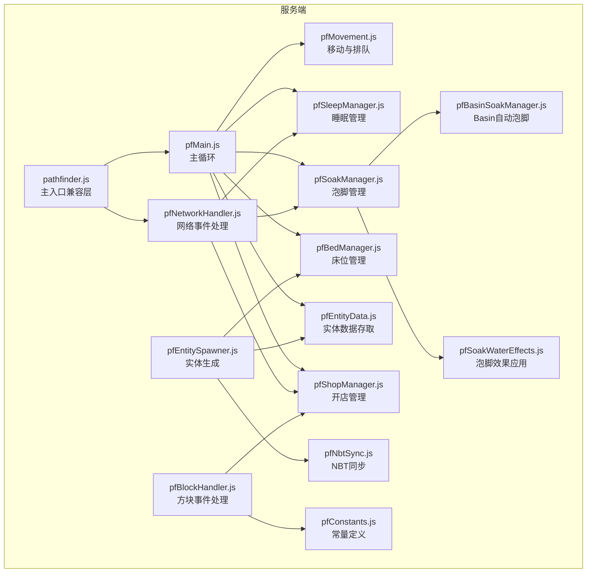
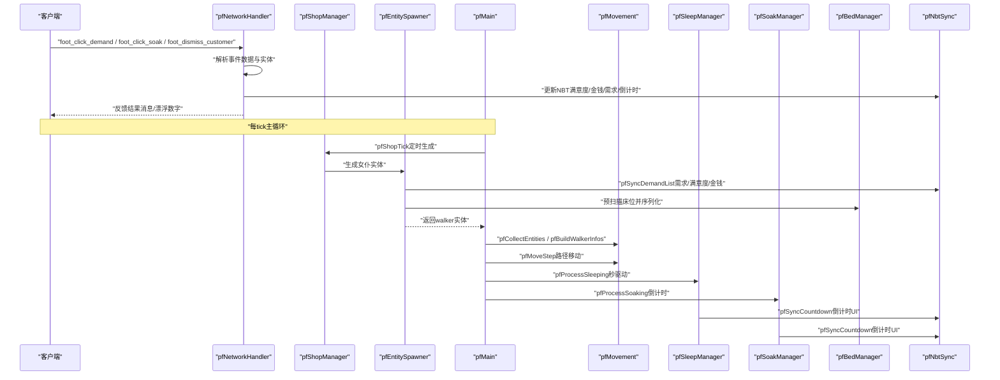
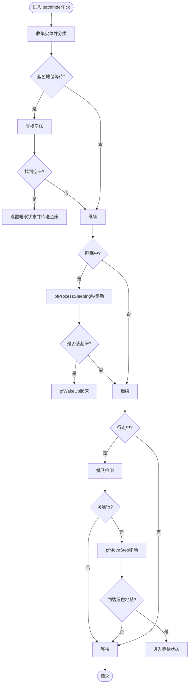
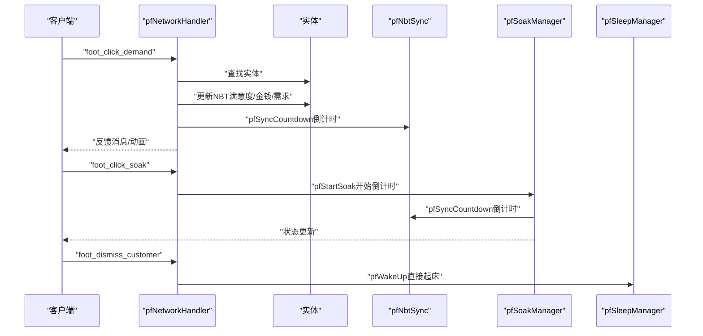
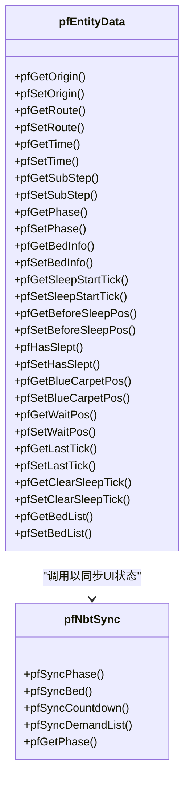
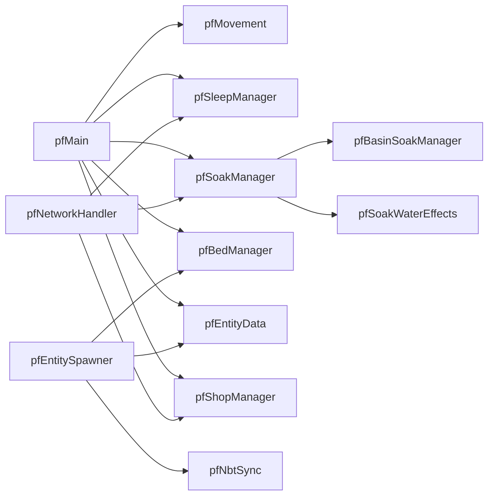

# 组件交互

<cite>
**本文引用的文件**
- [pathfinder.js](file://kubejs/server_scripts/pathfinder.js)
- [pfMain.js](file://kubejs/server_scripts/pathfinder/pfMain.js)
- [pfNetworkHandler.js](file://kubejs/server_scripts/pathfinder/pfNetworkHandler.js)
- [pfConstants.js](file://kubejs/server_scripts/pathfinder/pfConstants.js)
- [pfEntityData.js](file://kubejs/server_scripts/pathfinder/pfEntityData.js)
- [pfNbtSync.js](file://kubejs/server_scripts/pathfinder/pfNbtSync.js)
- [pfMovement.js](file://kubejs/server_scripts/pathfinder/pfMovement.js)
- [pfSleepManager.js](file://kubejs/server_scripts/pathfinder/pfSleepManager.js)
- [pfSoakManager.js](file://kubejs/server_scripts/pathfinder/pfSoakManager.js)
- [pfBedManager.js](file://kubejs/server_scripts/pathfinder/pfBedManager.js)
- [pfEntitySpawner.js](file://kubejs/server_scripts/pathfinder/pfEntitySpawner.js)
- [pfBlockHandler.js](file://kubejs/server_scripts/pathfinder/pfBlockHandler.js)
- [pfBasinSoakManager.js](file://kubejs/server_scripts/pathfinder/pfBasinSoakManager.js)
- [pfSoakWaterEffects.js](file://kubejs/server_scripts/pathfinder/pfSoakWaterEffects.js)
- [pfShopManager.js](file://kubejs/server_scripts/pathfinder/pfShopManager.js)
</cite>

## 目录
1. [简介](#简介)
2. [项目结构](#项目结构)
3. [核心组件](#核心组件)
4. [架构总览](#架构总览)
5. [详细组件分析](#详细组件分析)
6. [依赖关系分析](#依赖关系分析)
7. [性能考量](#性能考量)
8. [故障排查指南](#故障排查指南)
9. [结论](#结论)
10. [附录](#附录)

## 简介
本文件面向Minecraft KubeJS“寻路系统”（Pathfinder）的组件交互架构，聚焦服务端与客户端之间的同步机制、实体数据流转与状态管理策略。文档围绕以下目标展开：
- 明确服务端组件与客户端组件的同步机制（以实体手持物品NBT为核心载体）
- 描述实体数据的持久化与跨重启保留策略
- 解释PF网络处理器在网络事件与实体状态之间的桥接作用
- 绘制交互时序图与数据流图，帮助开发者快速理解复杂组件协作

## 项目结构
寻路系统采用模块化设计，核心入口位于pathfinder.js，实际逻辑分布在多个子模块中。模块间通过global命名空间共享函数与状态，形成清晰的职责边界。

图表来源
- [pathfinder.js:1-30](file://kubejs/server_scripts/pathfinder.js#L1-L30)
- [pfMain.js:1-177](file://kubejs/server_scripts/pathfinder/pfMain.js#L1-L177)
- [pfNetworkHandler.js:1-317](file://kubejs/server_scripts/pathfinder/pfNetworkHandler.js#L1-L317)
- [pfConstants.js:1-65](file://kubejs/server_scripts/pathfinder/pfConstants.js#L1-L65)
- [pfEntityData.js:1-218](file://kubejs/server_scripts/pathfinder/pfEntityData.js#L1-L218)
- [pfNbtSync.js:1-94](file://kubejs/server_scripts/pathfinder/pfNbtSync.js#L1-L94)
- [pfMovement.js:1-186](file://kubejs/server_scripts/pathfinder/pfMovement.js#L1-L186)
- [pfSleepManager.js:1-232](file://kubejs/server_scripts/pathfinder/pfSleepManager.js#L1-L232)
- [pfSoakManager.js:1-197](file://kubejs/server_scripts/pathfinder/pfSoakManager.js#L1-L197)
- [pfBedManager.js:1-129](file://kubejs/server_scripts/pathfinder/pfBedManager.js#L1-L129)
- [pfEntitySpawner.js:1-141](file://kubejs/server_scripts/pathfinder/pfEntitySpawner.js#L1-L141)
- [pfBlockHandler.js:1-148](file://kubejs/server_scripts/pathfinder/pfBlockHandler.js#L1-L148)
- [pfBasinSoakManager.js:1-418](file://kubejs/server_scripts/pathfinder/pfBasinSoakManager.js#L1-L418)
- [pfSoakWaterEffects.js:1-233](file://kubejs/server_scripts/pathfinder/pfSoakWaterEffects.js#L1-L233)
- [pfShopManager.js:1-300](file://kubejs/server_scripts/pathfinder/pfShopManager.js#L1-L300)

章节来源
- [pathfinder.js:1-30](file://kubejs/server_scripts/pathfinder.js#L1-L30)
- [pfMain.js:1-177](file://kubejs/server_scripts/pathfinder/pfMain.js#L1-L177)

## 核心组件
- 主循环与调度
  - global.pathfinderTick：每tick驱动寻路系统的核心入口，负责收集实体、处理蓝色地毯等待、睡眠、行走与移动等流程。
- 网络事件处理
  - pfNetworkHandler：接收客户端点击事件（需求、泡脚、送客），更新实体NBT并触发相应业务逻辑。
- 数据与状态管理
  - pfEntityData：封装实体persistentData的读写，提供统一的数据访问接口。
  - pfNbtSync：将关键状态同步到实体手持物品NBT，实现客户端可见的UI状态。
- 行为与流程
  - pfMovement：实体收集、排队检测、路径进度与移动执行。
  - pfSleepManager：睡眠/起床流程、秒级计时与倒计时同步。
  - pfSoakManager：泡脚倒计时、水桶可用性判定与完成结算。
  - pfBedManager：路径扫描、床位序列化与占用检测。
  - pfEntitySpawner：生成女仆实体、初始化需求与模型。
  - pfBasinSoakManager：Bedside Basin自动泡脚，与SoakManager无缝衔接。
  - pfSoakWaterEffects：泡脚完成后的效果应用（需求、满意度、掉落、buff等）。
  - pfShopManager：开店/关店、定时生成、状态持久化至方块实体NBT。
- 常量与配置
  - pfConstants：统一管理常量（同步物品ID、网格尺寸、方向列表、需求映射等）。

章节来源
- [pfMain.js:11-174](file://kubejs/server_scripts/pathfinder/pfMain.js#L11-L174)
- [pfNetworkHandler.js:36-311](file://kubejs/server_scripts/pathfinder/pfNetworkHandler.js#L36-L311)
- [pfEntityData.js:18-217](file://kubejs/server_scripts/pathfinder/pfEntityData.js#L18-L217)
- [pfNbtSync.js:8-93](file://kubejs/server_scripts/pathfinder/pfNbtSync.js#L8-L93)
- [pfMovement.js:7-185](file://kubejs/server_scripts/pathfinder/pfMovement.js#L7-L185)
- [pfSleepManager.js:16-231](file://kubejs/server_scripts/pathfinder/pfSleepManager.js#L16-L231)
- [pfSoakManager.js:16-196](file://kubejs/server_scripts/pathfinder/pfSoakManager.js#L16-L196)
- [pfBedManager.js:7-128](file://kubejs/server_scripts/pathfinder/pfBedManager.js#L7-L128)
- [pfEntitySpawner.js:7-140](file://kubejs/server_scripts/pathfinder/pfEntitySpawner.js#L7-L140)
- [pfBasinSoakManager.js:1-418](file://kubejs/server_scripts/pathfinder/pfBasinSoakManager.js#L1-L418)
- [pfSoakWaterEffects.js:16-232](file://kubejs/server_scripts/pathfinder/pfSoakWaterEffects.js#L16-L232)
- [pfShopManager.js:17-299](file://kubejs/server_scripts/pathfinder/pfShopManager.js#L17-L299)
- [pfConstants.js:1-65](file://kubejs/server_scripts/pathfinder/pfConstants.js#L1-L65)

## 架构总览
本系统采用“方块触发 + 实体状态 + NBT同步”的三层架构：
- 方块触发层：pathfinder_block右键触发，扫描路径、生成顾客、控制开店/关店。
- 实体状态层：实体persistentData承载核心状态，跨重启保留；NBT同步到手持物品，驱动UI。
- 网络事件层：客户端通过NetworkEvents上报点击，服务端更新状态并反馈。

图表来源
- [pfNetworkHandler.js:36-311](file://kubejs/server_scripts/pathfinder/pfNetworkHandler.js#L36-L311)
- [pfShopManager.js:237-284](file://kubejs/server_scripts/pathfinder/pfShopManager.js#L237-L284)
- [pfEntitySpawner.js:7-140](file://kubejs/server_scripts/pathfinder/pfEntitySpawner.js#L7-L140)
- [pfMain.js:11-174](file://kubejs/server_scripts/pathfinder/pfMain.js#L11-L174)
- [pfMovement.js:7-185](file://kubejs/server_scripts/pathfinder/pfMovement.js#L7-L185)
- [pfSleepManager.js:63-128](file://kubejs/server_scripts/pathfinder/pfSleepManager.js#L63-L128)
- [pfSoakManager.js:90-145](file://kubejs/server_scripts/pathfinder/pfSoakManager.js#L90-L145)
- [pfNbtSync.js:8-93](file://kubejs/server_scripts/pathfinder/pfNbtSync.js#L8-L93)

## 详细组件分析

### 主循环与调度（pfMain）
- 职责
  - 每tick收集实体并按阶段分类（行走、睡眠、等待、蓝色地毯等待）。
  - 处理蓝色地毯等待：寻找空床、设置睡眠状态、重置秒驱动。
  - 处理睡眠：秒驱动、倒计时同步、起床逻辑。
  - 处理行走：排队检测、移动执行、到达蓝色地毯后的等待状态切换。
- 关键点
  - 使用lastTick防重复处理，确保每tick仅处理一次。
  - 通过pfEntityData与pfMovement协调路径进度与位置。
  - 与pfSleepManager、pfSoakManager、pfBedManager协同完成完整流程。

图表来源
- [pfMain.js:11-174](file://kubejs/server_scripts/pathfinder/pfMain.js#L11-L174)
- [pfMovement.js:54-162](file://kubejs/server_scripts/pathfinder/pfMovement.js#L54-L162)
- [pfSleepManager.js:63-128](file://kubejs/server_scripts/pathfinder/pfSleepManager.js#L63-L128)

章节来源
- [pfMain.js:11-174](file://kubejs/server_scripts/pathfinder/pfMain.js#L11-L174)

### 网络事件处理（pfNetworkHandler）
- 职责
  - 接收客户端点击事件（需求、泡脚、送客）。
  - 解析部位与需求键，更新实体NBT（满意度、金钱、需求、步骤记录）。
  - 触发泡脚开始、送客、Boss满意度倍率应用等逻辑。
- 同步机制
  - 通过pfNbtSync将倒计时与状态同步到手持物品NBT，客户端自动渲染。
  - 通过sendData向客户端反馈成功动画等事件。

图表来源
- [pfNetworkHandler.js:36-311](file://kubejs/server_scripts/pathfinder/pfNetworkHandler.js#L36-L311)
- [pfNbtSync.js:31-41](file://kubejs/server_scripts/pathfinder/pfNbtSync.js#L31-L41)
- [pfSoakManager.js:147-186](file://kubejs/server_scripts/pathfinder/pfSoakManager.js#L147-L186)
- [pfSleepManager.js:130-145](file://kubejs/server_scripts/pathfinder/pfSleepManager.js#L130-L145)

章节来源
- [pfNetworkHandler.js:36-311](file://kubejs/server_scripts/pathfinder/pfNetworkHandler.js#L36-L311)

### 实体数据与NBT同步（pfEntityData / pfNbtSync）
- 职责
  - pfEntityData：封装persistentData读写，提供统一接口（origin/route/time/subStep/phase/bed/sleep/wait等）。
  - pfNbtSync：将关键状态（phase/bed/countdown/demandList）写入手持物品NBT，驱动客户端UI。
- 持久化策略
  - 实体状态（如睡眠秒驱动）使用persistentData跨重启保留，避免依赖server.getTickCount()差值。
  - 手持物品NBT用于客户端可见状态同步，减少网络传输负担。

图表来源
- [pfEntityData.js:18-217](file://kubejs/server_scripts/pathfinder/pfEntityData.js#L18-L217)
- [pfNbtSync.js:8-93](file://kubejs/server_scripts/pathfinder/pfNbtSync.js#L8-L93)

章节来源
- [pfEntityData.js:18-217](file://kubejs/server_scripts/pathfinder/pfEntityData.js#L18-L217)
- [pfNbtSync.js:8-93](file://kubejs/server_scripts/pathfinder/pfNbtSync.js#L8-L93)

### 移动与排队（pfMovement）
- 职责
  - 收集实体并按phase分类，构建排队信息。
  - 基于路径进度与子步长进行插值移动，到达终点后销毁实体。
  - 排队检测：距离阈值与进度比较，避免拥堵。
- 状态
  - time（格数进度）、subStep（格内子步，0~9）构成细粒度位置控制。

章节来源
- [pfMovement.js:7-185](file://kubejs/server_scripts/pathfinder/pfMovement.js#L7-L185)

### 睡眠管理（pfSleepManager）
- 职责
  - 开始睡眠：设置床位置、重置秒驱动、设置实体躺床状态。
  - 睡眠进程：每秒事件驱动倒计时同步与Basin自动泡脚。
  - 起床：移除睡眠NBT、定位下床位置、恢复行走进度。
- 时间策略
  - 使用pfSleepSubTick（0~19）、pfSleepSeconds、pfSleepInitTicks三字段实现跨重启友好的秒级驱动。

章节来源
- [pfSleepManager.js:16-231](file://kubejs/server_scripts/pathfinder/pfSleepManager.js#L16-L231)

### 泡脚管理（pfSoakManager）
- 职责
  - 泡脚倒计时：以秒为单位驱动，无可用洗脚水则重置倒计时。
  - 泡脚完成：应用泡脚水效果（需求、满意度、掉落、buff等）。
- 与Basin联动
  - 通过pfBasinSoakManager在床边Basin合法时自动启动倒计时，并在完成时消耗流体。

章节来源
- [pfSoakManager.js:16-196](file://kubejs/server_scripts/pathfinder/pfSoakManager.js#L16-L196)
- [pfBasinSoakManager.js:328-408](file://kubejs/server_scripts/pathfinder/pfBasinSoakManager.js#L328-L408)
- [pfSoakWaterEffects.js:107-226](file://kubejs/server_scripts/pathfinder/pfSoakWaterEffects.js#L107-L226)

### 床位管理（pfBedManager）
- 职责
  - 沿路径扫描床，序列化为字符串存入实体NBT。
  - 占用检测：排除正在睡眠的实体。
- 用途
  - 为蓝色地毯等待与睡眠阶段提供床资源分配依据。

章节来源
- [pfBedManager.js:7-128](file://kubejs/server_scripts/pathfinder/pfBedManager.js#L7-L128)

### 实体生成（pfEntitySpawner）
- 职责
  - 生成女仆实体，设置基础NBT与模型。
  - 初始化路径、阶段、时间、子步、蓝色地毯位置与床位列表。
  - 同步需求清单到手持物品NBT，支持Boss需求倍率与跳过泡脚设置。

章节来源
- [pfEntitySpawner.js:7-140](file://kubejs/server_scripts/pathfinder/pfEntitySpawner.js#L7-L140)

### 方块事件处理（pfBlockHandler）
- 职责
  - 右键pathfinder_block触发：扫描路径、生成顾客、开店/关店、凭证/BOSS分支。
  - 依赖pfShopManager与pfPathfinding（BFS）实现路径规划与生成。
- 与主循环协作
  - 通过global.pathfinderTick驱动后续流程。

章节来源
- [pfBlockHandler.js:7-147](file://kubejs/server_scripts/pathfinder/pfBlockHandler.js#L7-L147)

### 常量与配置（pfConstants）
- 职责
  - 统一管理常量：同步物品ID、网格半径、实体类型、方向列表、需求映射等。
  - 为其他模块提供只读常量，避免魔法数与分散配置。

章节来源
- [pfConstants.js:1-65](file://kubejs/server_scripts/pathfinder/pfConstants.js#L1-L65)

### 开店管理（pfShopManager）
- 职责
  - 将开店状态持久化至pathfinder_block方块实体NBT。
  - 每PF_SPAWN_INTERVAL tick判定一次生成顾客，支持日落自动关店。
- 状态持久化
  - 使用方块实体persistentData存储开关、计数器、玩家UUID、路径与已生成实体UUID列表。

章节来源
- [pfShopManager.js:17-299](file://kubejs/server_scripts/pathfinder/pfShopManager.js#L17-L299)

## 依赖关系分析
- 模块内聚与耦合
  - pfMain作为中枢，依赖pfMovement、pfSleepManager、pfSoakManager、pfBedManager、pfEntityData、pfShopManager等。
  - pfNetworkHandler与pfSoakManager、pfSleepManager、pfShopManager存在直接调用关系。
  - pfEntitySpawner与pfEntityData、pfBedManager、pfNbtSync紧密耦合。
- 外部依赖
  - KubeJS事件系统（BlockEvents、NetworkEvents）。
  - Forge/创建模组能力（FluidHandler）用于Basin自动泡脚。
- 循环依赖规避
  - 通过global命名空间共享函数，避免直接require引入导致的循环。

图表来源
- [pfMain.js:11-174](file://kubejs/server_scripts/pathfinder/pfMain.js#L11-L174)
- [pfNetworkHandler.js:36-311](file://kubejs/server_scripts/pathfinder/pfNetworkHandler.js#L36-L311)
- [pfEntitySpawner.js:7-140](file://kubejs/server_scripts/pathfinder/pfEntitySpawner.js#L7-L140)
- [pfSoakManager.js:16-196](file://kubejs/server_scripts/pathfinder/pfSoakManager.js#L16-L196)
- [pfBasinSoakManager.js:1-418](file://kubejs/server_scripts/pathfinder/pfBasinSoakManager.js#L1-L418)
- [pfSoakWaterEffects.js:16-232](file://kubejs/server_scripts/pathfinder/pfSoakWaterEffects.js#L16-L232)

## 性能考量
- Tick级驱动
  - 主循环每tick遍历实体并进行状态更新，建议合理控制实体数量与搜索范围（GRID_HALF）。
- 排队与碰撞
  - pfMovement的排队检测基于距离阈值，避免过度计算；注意实体密度与路径复杂度对性能的影响。
- NBT同步
  - 仅将必要状态同步至手持物品NBT，减少网络压力；避免频繁大体量NBT写入。
- Basin自动泡脚
  - 通过Forge Capability与命令两种路径读写Basin流体，优先使用Capability以降低命令开销；若失败回退命令路径。

## 故障排查指南
- 网络事件无响应
  - 检查pfNetworkHandler.setupNetworkHandlers是否已调用，确认事件主题与数据格式。
  - 确认实体存在且NBT结构正确（SYNC_ITEM_ID与字段存在）。
- 泡脚倒计时异常
  - 检查pfSoakManager的水桶可用性判定与Basin流体状态；确认pfBasinSoakManager读写路径。
- 睡眠倒计时不更新
  - 检查pfSleepManager的秒驱动字段（pfSleepSubTick/pfSleepSeconds）是否正确累加。
- 开店未生成顾客
  - 检查pfShopManager的计数器与白天判定；确认pfCustomerTypes.rollCustomer结果。
- 蓝色地毯等待无效
  - 检查pfMain中蓝色地毯位置识别与空床查找逻辑，确认床占用检测。

章节来源
- [pfNetworkHandler.js:36-311](file://kubejs/server_scripts/pathfinder/pfNetworkHandler.js#L36-L311)
- [pfSoakManager.js:74-145](file://kubejs/server_scripts/pathfinder/pfSoakManager.js#L74-L145)
- [pfBasinSoakManager.js:328-408](file://kubejs/server_scripts/pathfinder/pfBasinSoakManager.js#L328-L408)
- [pfSleepManager.js:63-128](file://kubejs/server_scripts/pathfinder/pfSleepManager.js#L63-L128)
- [pfShopManager.js:237-284](file://kubejs/server_scripts/pathfinder/pfShopManager.js#L237-L284)
- [pfMain.js:29-93](file://kubejs/server_scripts/pathfinder/pfMain.js#L29-L93)

## 结论
本寻路系统通过“方块触发 + 实体状态 + NBT同步”的架构实现了稳定的服务端行为与直观的客户端反馈。主循环pfMain协调多模块，网络事件pfNetworkHandler提供交互入口，pfEntityData与pfNbtSync确保状态一致性与跨重启保留。模块化设计使功能边界清晰、易于扩展与维护。

## 附录
- 术语
  - Phase：实体阶段（2=行走、3=睡眠、4=等待床位、5=蓝色地毯等待）
  - SubStep：格内子步（0~9），与time共同决定当前位置
  - Basin：Create模组工作盆，支持床边自动泡脚
- 建议
  - 在大规模实体场景中，适当调整GRID半径与生成频率，优化性能。
  - 为关键状态增加校验与回退逻辑，提升系统鲁棒性。