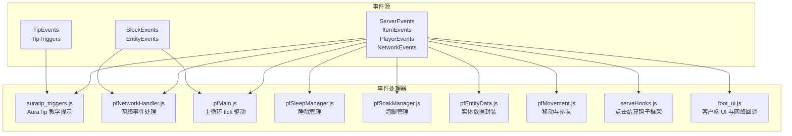
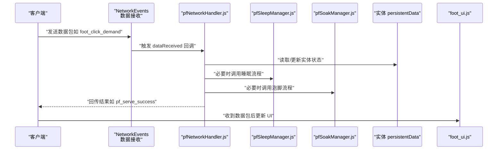
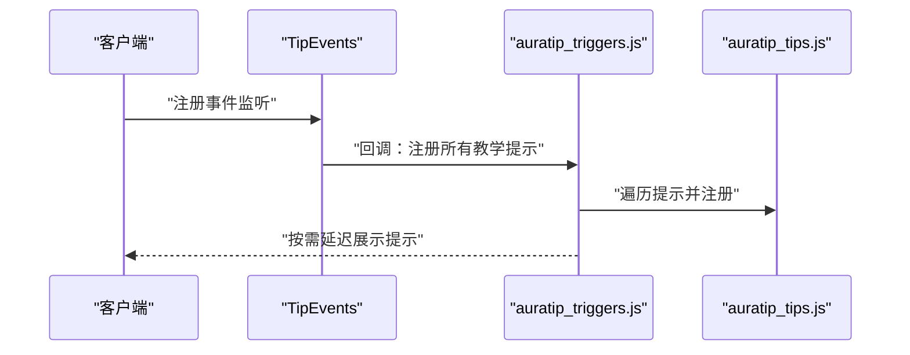
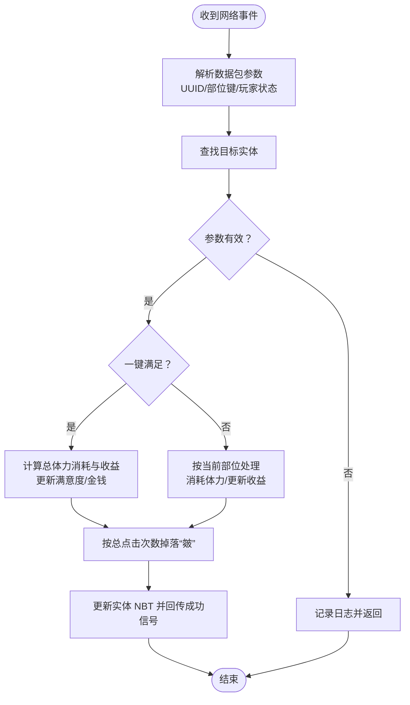
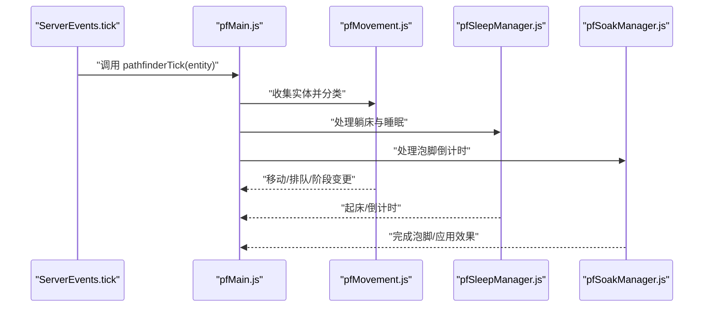
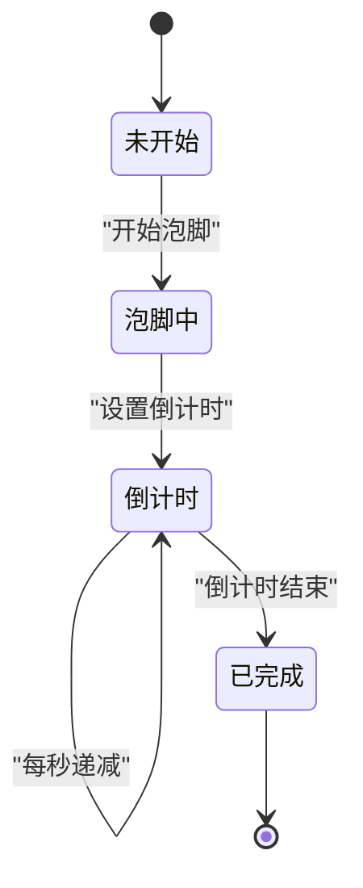
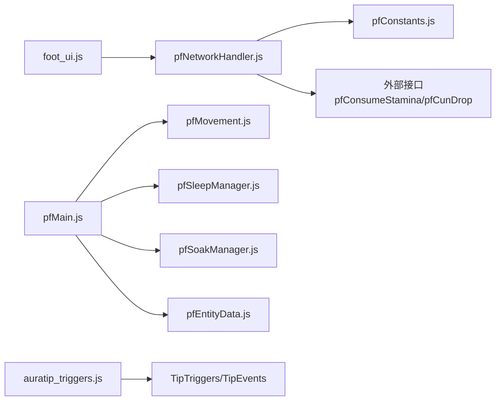

# 事件驱动模式

<cite>
**本文引用的文件**
- [auratip_triggers.js](file://kubejs/server_scripts/auratip_triggers.js)
- [auratip_tips.js](file://kubejs/client_scripts/auratip/auratip_tips.js)
- [pfNetworkHandler.js](file://kubejs/server_scripts/pathfinder/pfNetworkHandler.js)
- [pfMain.js](file://kubejs/server_scripts/pathfinder/pfMain.js)
- [pfConstants.js](file://kubejs/server_scripts/pathfinder/pfConstants.js)
- [pfSleepManager.js](file://kubejs/server_scripts/pathfinder/pfSleepManager.js)
- [pfSoakManager.js](file://kubejs/server_scripts/pathfinder/pfSoakManager.js)
- [pfEntityData.js](file://kubejs/server_scripts/pathfinder/pfEntityData.js)
- [pfMovement.js](file://kubejs/server_scripts/pathfinder/pfMovement.js)
- [serveHooks.js](file://kubejs/startup_scripts/serveHooks.js)
- [foot_ui.js](file://kubejs/client_scripts/ui/foot_ui.js)
- [energy_drinks.js](file://kubejs/server_scripts/energy_drinks.js)
- [stamina_potions.js](file://kubejs/server_scripts/stamina_potions.js)
- [example.js](file://kubejs/server_scripts/example.js)
</cite>

## 目录
1. [引言](#引言)
2. [项目结构](#项目结构)
3. [核心组件](#核心组件)
4. [架构总览](#架构总览)
5. [详细组件分析](#详细组件分析)
6. [依赖分析](#依赖分析)
7. [性能考量](#性能考量)
8. [故障排查指南](#故障排查指南)
9. [结论](#结论)
10. [附录](#附录)

## 引言
本文件系统性阐述该项目中基于 KubeJS 的事件驱动架构，重点覆盖事件的定义、发布、订阅与处理流程，并结合实际代码路径对服务事件、触发事件与游戏事件进行分类解析。文档同时总结事件驱动模式在 Minecraft 模组开发中的优势（解耦、异步处理、可扩展性），并给出最佳实践建议与排障要点。

## 项目结构
本项目围绕 KubeJS 事件体系组织，主要涉及以下几类事件与模块：
- 服务事件（ServerEvents、ItemEvents、PlayerEvents、NetworkEvents 等）：服务器侧生命周期与交互事件
- 触发事件（TipTriggers、TipEvents）：教学提示系统事件
- 游戏事件（BlockEvents、EntityEvents 等）：与世界交互、实体行为相关的事件
- 网络事件：客户端与服务器之间的数据传输事件
- Tick 事件：周期性调度与状态推进

图表来源
- [auratip_triggers.js:160-186](file://kubejs/server_scripts/auratip_triggers.js#L160-L186)
- [pfNetworkHandler.js:37-311](file://kubejs/server_scripts/pathfinder/pfNetworkHandler.js#L37-L311)
- [pfMain.js:11-174](file://kubejs/server_scripts/pathfinder/pfMain.js#L11-L174)
- [pfSleepManager.js:24-127](file://kubejs/server_scripts/pathfinder/pfSleepManager.js#L24-L127)
- [pfSoakManager.js:149-186](file://kubejs/server_scripts/pathfinder/pfSoakManager.js#L149-L186)
- [pfEntityData.js:185-217](file://kubejs/server_scripts/pathfinder/pfEntityData.js#L185-L217)
- [pfMovement.js:8-34](file://kubejs/server_scripts/pathfinder/pfMovement.js#L8-L34)
- [serveHooks.js:13-30](file://kubejs/startup_scripts/serveHooks.js#L13-L30)
- [foot_ui.js:1017-1025](file://kubejs/client_scripts/ui/foot_ui.js#L1017-L1025)

章节来源
- [auratip_triggers.js:160-186](file://kubejs/server_scripts/auratip_triggers.js#L160-L186)
- [pfNetworkHandler.js:37-311](file://kubejs/server_scripts/pathfinder/pfNetworkHandler.js#L37-L311)
- [pfMain.js:11-174](file://kubejs/server_scripts/pathfinder/pfMain.js#L11-L174)
- [pfConstants.js:53-64](file://kubejs/server_scripts/pathfinder/pfConstants.js#L53-L64)

## 核心组件
- 教学提示事件系统（服务事件 + 触发事件）
  - 服务端通过注册命令与 tick 回调，管理提示阶段与延迟展示队列
  - 客户端通过 TipEvents 注册监听，批量注册教学提示
- 网络事件处理（网络事件）
  - 服务器端监听客户端发送的数据包，解析实体 UUID、部位键等参数，执行业务逻辑并回传结果
- 主循环 tick 驱动（服务事件 tick）
  - 服务器每 tick 调用主入口函数，协调各子系统（移动、睡眠、泡脚、排队等）
- 睡眠与泡脚状态机（服务事件 + 网络事件）
  - 基于实体 persistentData 的秒级状态机，实现跨重启友好的倒计时与效果触发
- 实体数据封装（服务事件）
  - 统一封装实体 persistentData 的读写，提供多类状态字段的访问器
- 点击结算钩子框架（服务事件）
  - 提供钩子注册与执行机制，将额外功能（如抹油、连击奖励）从主流程拆分

章节来源
- [auratip_triggers.js:17-100](file://kubejs/server_scripts/auratip_triggers.js#L17-L100)
- [auratip_tips.js:79-98](file://kubejs/client_scripts/auratip/auratip_tips.js#L79-L98)
- [pfNetworkHandler.js:37-311](file://kubejs/server_scripts/pathfinder/pfNetworkHandler.js#L37-L311)
- [pfMain.js:11-174](file://kubejs/server_scripts/pathfinder/pfMain.js#L11-L174)
- [pfSleepManager.js:16-127](file://kubejs/server_scripts/pathfinder/pfSleepManager.js#L16-L127)
- [pfSoakManager.js:16-145](file://kubejs/server_scripts/pathfinder/pfSoakManager.js#L16-L145)
- [pfEntityData.js:185-217](file://kubejs/server_scripts/pathfinder/pfEntityData.js#L185-L217)
- [serveHooks.js:13-30](file://kubejs/startup_scripts/serveHooks.js#L13-L30)

## 架构总览
事件驱动架构在本项目中的体现：
- 事件定义：KubeJS 提供的各类事件（ServerEvents、ItemEvents、PlayerEvents、NetworkEvents、TipEvents 等）
- 事件发布：由引擎或用户交互触发（如右键方块、点击实体、网络数据包、玩家 tick）
- 事件订阅：通过注册回调函数，将处理逻辑绑定到具体事件
- 事件处理：在回调中读取上下文参数、执行业务逻辑、更新状态、广播结果

图表来源
- [pfNetworkHandler.js:39-219](file://kubejs/server_scripts/pathfinder/pfNetworkHandler.js#L39-L219)
- [pfSleepManager.js:24-127](file://kubejs/server_scripts/pathfinder/pfSleepManager.js#L24-L127)
- [pfSoakManager.js:149-186](file://kubejs/server_scripts/pathfinder/pfSoakManager.js#L149-L186)
- [foot_ui.js:1017-1025](file://kubejs/client_scripts/ui/foot_ui.js#L1017-L1025)

## 详细组件分析

### 教学提示事件系统（服务事件 + 触发事件）
- 事件定义与发布
  - 服务端通过命令注册与 tick 回调，管理提示阶段与延迟展示队列
  - 客户端通过 TipEvents 注册监听，批量注册教学提示
- 事件订阅与处理
  - 服务端：将提示 ID 映射到触发器，支持关闭、排队展示、阶段推进
  - 客户端：在 TipEvents 回调中批量注册提示项
- 参数与状态
  - 使用玩家 persistentData 存储教学阶段键值
  - 使用 pendingShows 队列与 serverTick 实现延迟展示
- 错误处理
  - 缺失 TipTriggers 时记录日志并返回
  - 未找到实体或无效参数时提前返回

图表来源
- [auratip_triggers.js:93-98](file://kubejs/server_scripts/auratip_triggers.js#L93-L98)
- [auratip_tips.js:79-98](file://kubejs/client_scripts/auratip/auratip_tips.js#L79-L98)
- [auratip_triggers.js:160-186](file://kubejs/server_scripts/auratip_triggers.js#L160-L186)

章节来源
- [auratip_triggers.js:9-125](file://kubejs/server_scripts/auratip_triggers.js#L9-L125)
- [auratip_tips.js:79-98](file://kubejs/client_scripts/auratip/auratip_tips.js#L79-L98)

### 网络事件处理（服务事件 + 网络事件）
- 事件定义与发布
  - 客户端通过 sendData 发送数据包（如 foot_click_demand、foot_click_soak、foot_dismiss_customer）
  - 服务器端通过 NetworkEvents.dataReceived 监听并解析
- 事件订阅与处理
  - 解析实体 UUID、部位键、玩家状态等参数
  - 根据需求键与部位属性计算体力消耗、满意度与金钱收益
  - 支持一键满足与正常模式的不同逻辑
  - 更新实体 NBT 并回传成功信号给客户端
- 参数与状态
  - 使用 global.pfConstants 映射部位键与代码
  - 使用 global.pfConsumeStamina、global.pfCunDrop 等外部接口扩展
- 错误处理
  - 未找到实体、无可用水桶、体力不足等情况均记录日志并中断处理

图表来源
- [pfNetworkHandler.js:39-219](file://kubejs/server_scripts/pathfinder/pfNetworkHandler.js#L39-L219)
- [pfConstants.js:25-50](file://kubejs/server_scripts/pathfinder/pfConstants.js#L25-L50)

章节来源
- [pfNetworkHandler.js:37-311](file://kubejs/server_scripts/pathfinder/pfNetworkHandler.js#L37-L311)
- [pfConstants.js:53-64](file://kubejs/server_scripts/pathfinder/pfConstants.js#L53-L64)

### 主循环 tick 驱动（服务事件 tick）
- 事件定义与发布
  - ServerEvents.tick 每 tick 触发一次
- 事件订阅与处理
  - 主入口函数收集实体并按阶段分类
  - 蓝色地毯等待 → 躺床 → 睡眠 → 泡脚 → 行走 → 结束
  - 调用各子系统（移动、睡眠、泡脚、排队）处理逻辑
- 参数与状态
  - 使用 global.pathfinderTick 作为统一入口
  - 通过 persistentData 与 NBT 存储状态
- 错误处理
  - 防重复处理（pfLastTick）、跨重启友好字段（pfSleepSeconds 等）

图表来源
- [pfMain.js:11-174](file://kubejs/server_scripts/pathfinder/pfMain.js#L11-L174)
- [pfMovement.js:8-34](file://kubejs/server_scripts/pathfinder/pfMovement.js#L8-L34)
- [pfSleepManager.js:65-127](file://kubejs/server_scripts/pathfinder/pfSleepManager.js#L65-L127)
- [pfSoakManager.js:92-145](file://kubejs/server_scripts/pathfinder/pfSoakManager.js#L92-L145)

章节来源
- [pfMain.js:11-174](file://kubejs/server_scripts/pathfinder/pfMain.js#L11-L174)
- [pfMovement.js:8-34](file://kubejs/server_scripts/pathfinder/pfMovement.js#L8-L34)
- [pfSleepManager.js:65-127](file://kubejs/server_scripts/pathfinder/pfSleepManager.js#L65-L127)
- [pfSoakManager.js:92-145](file://kubejs/server_scripts/pathfinder/pfSoakManager.js#L92-L145)

### 睡眠与泡脚状态机（服务事件 + 网络事件）
- 睡眠管理
  - 以秒为单位的状态机，独立于 server.getTickCount()，跨重启保留
  - 初始化睡眠时重置秒级计数器，每秒触发一次事件
  - 支持自动泡脚（Create Basin）联动
- 泡脚管理
  - 基于手持物品 NBT 的状态机，支持多种洗脚水类型
  - 无可用洗脚水时重置倒计时，可用时逐秒递减
  - 倒计时结束后应用洗脚水效果

图表来源
- [pfSoakManager.js:149-186](file://kubejs/server_scripts/pathfinder/pfSoakManager.js#L149-L186)
- [pfSleepManager.js:16-127](file://kubejs/server_scripts/pathfinder/pfSleepManager.js#L16-L127)

章节来源
- [pfSleepManager.js:16-127](file://kubejs/server_scripts/pathfinder/pfSleepManager.js#L16-L127)
- [pfSoakManager.js:16-145](file://kubejs/server_scripts/pathfinder/pfSoakManager.js#L16-L145)

### 实体数据封装（服务事件）
- 功能概述
  - 统一封装实体 persistentData 的读写，提供多类状态字段的访问器
  - 包括起点、路线、时间、子步、阶段、床位、睡眠、蓝色地毯等待、等待位置、最后处理 tick 等
- 优势
  - 避免分散读写带来的错误
  - 提升代码可维护性与一致性

章节来源
- [pfEntityData.js:185-217](file://kubejs/server_scripts/pathfinder/pfEntityData.js#L185-L217)

### 点击结算钩子框架（服务事件）
- 功能概述
  - 将“额外功能（如抹油、连击奖励等）”从主流程拆分
  - 在关键节点调用一次钩子，具体功能以独立脚本注册
- 优势
  - 降低主流程复杂度，提升可扩展性与可测试性

章节来源
- [serveHooks.js:13-30](file://kubejs/startup_scripts/serveHooks.js#L13-L30)

### 客户端 UI 与网络回调（网络事件）
- 功能概述
  - 客户端监听服务端回传的成功信号，更新 UI 状态
  - 用于确认搓脚成功等交互反馈
- 优势
  - 保持前后端状态一致，提升用户体验

章节来源
- [foot_ui.js:1017-1025](file://kubejs/client_scripts/ui/foot_ui.js#L1017-L1025)

## 依赖分析
- 事件间耦合
  - 网络事件处理依赖常量模块与外部接口（如 pfConsumeStamina、pfCunDrop）
  - 主循环 tick 依赖移动、睡眠、泡脚、实体数据等子模块
  - 教学提示系统依赖 TipTriggers 与 TipEvents
- 外部依赖
  - KubeJS 事件 API（ServerEvents、ItemEvents、PlayerEvents、NetworkEvents、TipEvents）
  - 全局变量（global.*）承载跨模块共享状态与接口

图表来源
- [pfNetworkHandler.js:37-311](file://kubejs/server_scripts/pathfinder/pfNetworkHandler.js#L37-L311)
- [pfMain.js:11-174](file://kubejs/server_scripts/pathfinder/pfMain.js#L11-L174)
- [pfConstants.js:53-64](file://kubejs/server_scripts/pathfinder/pfConstants.js#L53-L64)
- [auratip_triggers.js:93-98](file://kubejs/server_scripts/auratip_triggers.js#L93-L98)

章节来源
- [pfNetworkHandler.js:37-311](file://kubejs/server_scripts/pathfinder/pfNetworkHandler.js#L37-L311)
- [pfMain.js:11-174](file://kubejs/server_scripts/pathfinder/pfMain.js#L11-L174)
- [auratip_triggers.js:93-98](file://kubejs/server_scripts/auratip_triggers.js#L93-L98)

## 性能考量
- tick 驱动的节流
  - 主循环中对实体进行分类与去重处理，避免重复计算
  - 使用 persistentData 字段记录 lastTick，防止同 tick 内重复处理
- 状态机的跨重启友好
  - 睡眠与泡脚均以“秒”为单位存储状态，避免依赖 tick 差值
- 网络事件的轻量化
  - 仅传输必要参数（如 UUID、部位键），减少带宽占用
- 外部接口的健壮性
  - 对外部接口调用进行存在性检查与异常捕获，避免阻断主流程

## 故障排查指南
- 教学提示未显示
  - 检查 TipTriggers 是否可用与注册
  - 确认 pendingShows 队列与 serverTick 是否正确推进
- 网络事件无响应
  - 检查客户端是否正确发送数据包
  - 服务器端回调是否注册，参数解析是否正确
- 体力不足或收益异常
  - 检查属性读取与消耗逻辑
  - 确认外部接口（如 pfConsumeStamina）是否可用
- 睡眠/泡脚状态异常
  - 检查 persistentData 字段是否正确更新
  - 确认秒级计数器是否按预期递增与重置

章节来源
- [auratip_triggers.js:188-211](file://kubejs/server_scripts/auratip_triggers.js#L188-L211)
- [pfNetworkHandler.js:39-219](file://kubejs/server_scripts/pathfinder/pfNetworkHandler.js#L39-L219)
- [pfSleepManager.js:16-127](file://kubejs/server_scripts/pathfinder/pfSleepManager.js#L16-L127)
- [pfSoakManager.js:92-145](file://kubejs/server_scripts/pathfinder/pfSoakManager.js#L92-L145)

## 结论
本项目通过 KubeJS 事件体系实现了清晰的事件驱动架构：服务事件负责生命周期与交互，触发事件负责教学提示，网络事件负责前后端通信，Tick 事件负责状态推进。该架构具备良好的解耦、异步处理与可扩展性，适合在 Minecraft 模组中推广使用。建议在新功能开发中遵循钩子框架与状态机设计原则，确保代码可维护性与性能表现。

## 附录
- 事件类型与处理策略概览
  - 服务事件：命令注册、tick 驱动、物品右键、玩家 tick 等
  - 触发事件：TipEvents 注册、TipTriggers 触发
  - 游戏事件：方块右键、实体交互等
  - 网络事件：客户端数据包接收与回传
- 最佳实践
  - 使用钩子框架拆分额外功能
  - 采用状态机管理长时任务，避免依赖 tick 差值
  - 严格校验参数与外部接口可用性，做好异常捕获
  - 通过常量模块统一映射，减少魔法值