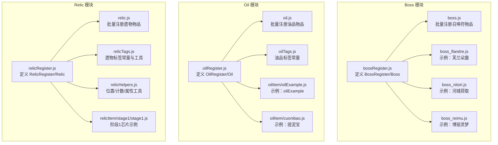
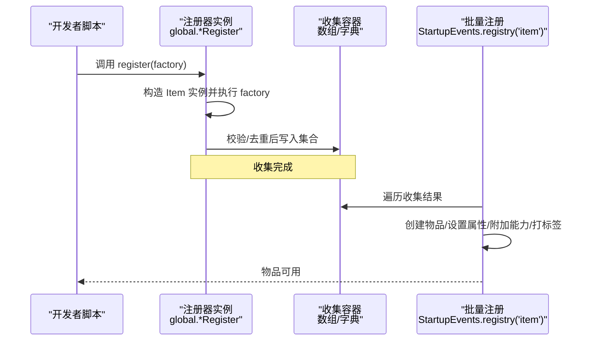
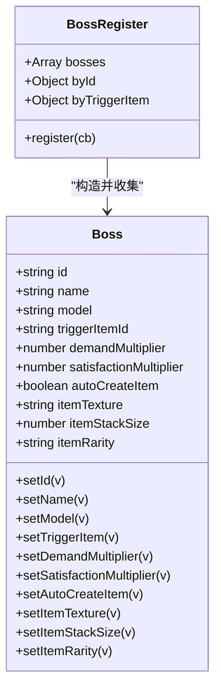
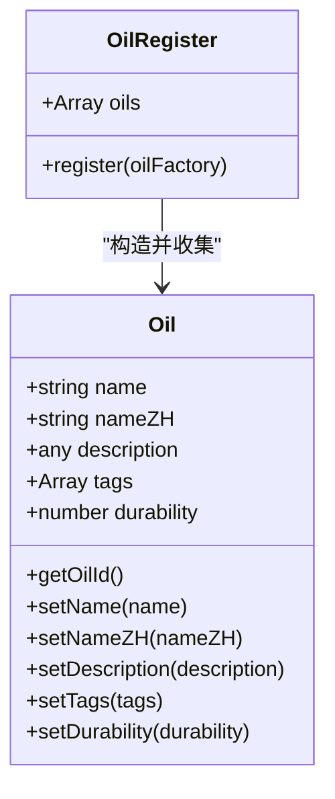
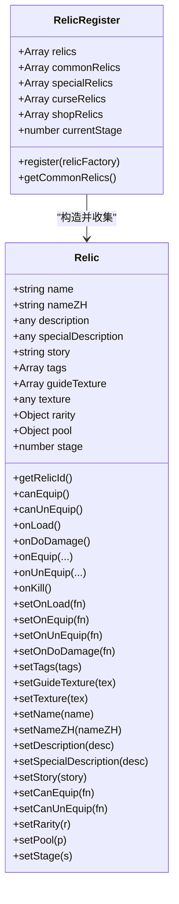
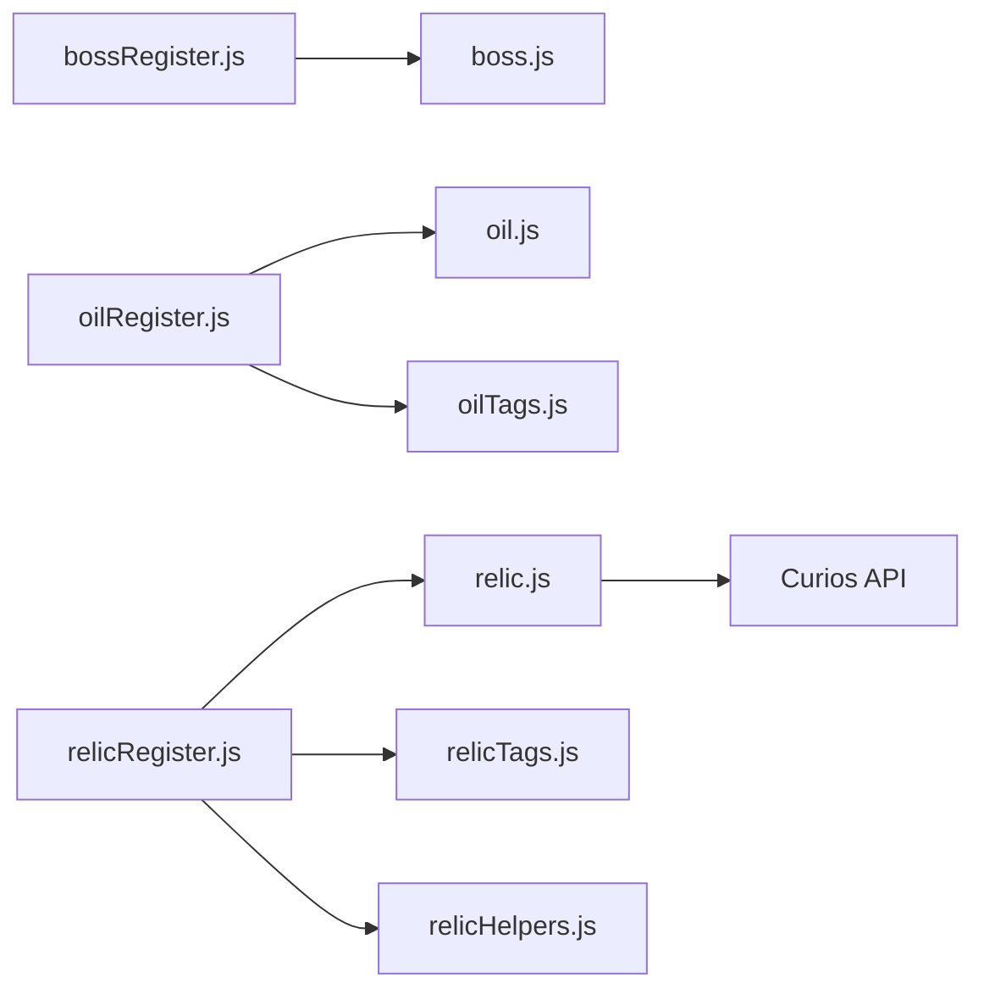

# 注册器模式

<cite>
**本文引用的文件**
- [kubejs/startup_scripts/boss/bossRegister.js](file://kubejs/startup_scripts/boss/bossRegister.js)
- [kubejs/startup_scripts/boss/boss.js](file://kubejs/startup_scripts/boss/boss.js)
- [kubejs/startup_scripts/boss/boss_flandre.js](file://kubejs/startup_scripts/boss/boss_flandre.js)
- [kubejs/startup_scripts/boss/boss_nitori.js](file://kubejs/startup_scripts/boss/boss_nitori.js)
- [kubejs/startup_scripts/boss/boss_reimu.js](file://kubejs/startup_scripts/boss/boss_reimu.js)
- [kubejs/startup_scripts/oil/oilRegister.js](file://kubejs/startup_scripts/oil/oilRegister.js)
- [kubejs/startup_scripts/oil/oil.js](file://kubejs/startup_scripts/oil/oil.js)
- [kubejs/startup_scripts/oil/oilItem/oilExample.js](file://kubejs/startup_scripts/oil/oilItem/oilExample.js)
- [kubejs/startup_scripts/oil/oilItem/cuonibao.js](file://kubejs/startup_scripts/oil/oilItem/cuonibao.js)
- [kubejs/startup_scripts/oil/oilTags.js](file://kubejs/startup_scripts/oil/oilTags.js)
- [kubejs/startup_scripts/relic/relicRegister.js](file://kubejs/startup_scripts/relic/relicRegister.js)
- [kubejs/startup_scripts/relic/relic.js](file://kubejs/startup_scripts/relic/relic.js)
- [kubejs/startup_scripts/relic/relicItem/stage1/stage1.js](file://kubejs/startup_scripts/relic/relicItem/stage1/stage1.js)
- [kubejs/startup_scripts/relic/relicTags.js](file://kubejs/startup_scripts/relic/relicTags.js)
- [kubejs/startup_scripts/relic/relicHelpers.js](file://kubejs/startup_scripts/relic/relicHelpers.js)
</cite>

## 目录
1. [引言](#引言)
2. [项目结构](#项目结构)
3. [核心组件](#核心组件)
4. [架构总览](#架构总览)
5. [详细组件分析](#详细组件分析)
6. [依赖关系分析](#依赖关系分析)
7. [性能考量](#性能考量)
8. [故障排查指南](#故障排查指南)
9. [结论](#结论)
10. [附录](#附录)

## 引言
本文件系统性阐述本项目中注册器模式的实现与应用，重点覆盖三类注册器：Boss 注册器、油品注册器与遗物注册器。注册器模式的核心价值在于集中式注册、动态扩展与统一管理，使新增内容无需改动现有代码，只需在启动脚本中按约定格式注册即可生效。本文将结合源码逐层解析其设计思想、数据结构、控制流程、冲突处理与错误管理，并给出在 KubeJS 环境下的最佳实践与扩展指引。

## 项目结构
围绕注册器模式的相关文件主要位于 kubejs 的 startup_scripts 子目录下，按功能划分为 boss、oil、relic 三大模块。每个模块均包含注册器定义、注册入口与批量注册（StartupEvents.registry）实现，以及若干示例与工具文件。



图表来源
- [kubejs/startup_scripts/boss/bossRegister.js:1-103](file://kubejs/startup_scripts/boss/bossRegister.js#L1-L103)
- [kubejs/startup_scripts/boss/boss.js:1-37](file://kubejs/startup_scripts/boss/boss.js#L1-L37)
- [kubejs/startup_scripts/boss/boss_flandre.js:1-22](file://kubejs/startup_scripts/boss/boss_flandre.js#L1-L22)
- [kubejs/startup_scripts/boss/boss_nitori.js:1-22](file://kubejs/startup_scripts/boss/boss_nitori.js#L1-L22)
- [kubejs/startup_scripts/boss/boss_reimu.js:1-22](file://kubejs/startup_scripts/boss/boss_reimu.js#L1-L22)
- [kubejs/startup_scripts/oil/oilRegister.js:1-61](file://kubejs/startup_scripts/oil/oilRegister.js#L1-L61)
- [kubejs/startup_scripts/oil/oil.js:1-28](file://kubejs/startup_scripts/oil/oil.js#L1-L28)
- [kubejs/startup_scripts/oil/oilTags.js:1-19](file://kubejs/startup_scripts/oil/oilTags.js#L1-L19)
- [kubejs/startup_scripts/oil/oilItem/oilExample.js:1-16](file://kubejs/startup_scripts/oil/oilItem/oilExample.js#L1-L16)
- [kubejs/startup_scripts/oil/oilItem/cuonibao.js:1-17](file://kubejs/startup_scripts/oil/oilItem/cuonibao.js#L1-L17)
- [kubejs/startup_scripts/relic/relicRegister.js:1-178](file://kubejs/startup_scripts/relic/relicRegister.js#L1-L178)
- [kubejs/startup_scripts/relic/relic.js:1-81](file://kubejs/startup_scripts/relic/relic.js#L1-L81)
- [kubejs/startup_scripts/relic/relicTags.js:1-192](file://kubejs/startup_scripts/relic/relicTags.js#L1-L192)
- [kubejs/startup_scripts/relic/relicHelpers.js:1-332](file://kubejs/startup_scripts/relic/relicHelpers.js#L1-L332)
- [kubejs/startup_scripts/relic/relicItem/stage1/stage1.js:1-224](file://kubejs/startup_scripts/relic/relicItem/stage1/stage1.js#L1-L224)

章节来源
- [kubejs/startup_scripts/boss/bossRegister.js:1-103](file://kubejs/startup_scripts/boss/bossRegister.js#L1-L103)
- [kubejs/startup_scripts/oil/oilRegister.js:1-61](file://kubejs/startup_scripts/oil/oilRegister.js#L1-L61)
- [kubejs/startup_scripts/relic/relicRegister.js:1-178](file://kubejs/startup_scripts/relic/relicRegister.js#L1-L178)

## 核心组件
- Boss 注册器：集中收集 Boss 定义，校验唯一性，支持自动创建触发物品，最终在批量注册阶段生成物品。
- 油品注册器：收集油品定义（名称、描述、耐久、标签等），统一生成物品 ID 并批量注册。
- 遗物注册器：收集遗物定义（名称、描述、故事、标签、稀有度、池子、阶段、贴图、行为钩子等），按池子分类并批量注册，同时挂接 Curios 能力。

章节来源
- [kubejs/startup_scripts/boss/bossRegister.js:60-97](file://kubejs/startup_scripts/boss/bossRegister.js#L60-L97)
- [kubejs/startup_scripts/oil/oilRegister.js:9-21](file://kubejs/startup_scripts/oil/oilRegister.js#L9-L21)
- [kubejs/startup_scripts/relic/relicRegister.js:3-42](file://kubejs/startup_scripts/relic/relicRegister.js#L3-L42)

## 架构总览
注册器模式在本项目中遵循“定义-收集-批量注册”的三层结构：
- 定义层：在各自模块的注册器文件中定义 Register/Item 类型与链式 API。
- 收集层：各业务脚本通过 global.<module>Register.register(...) 将定义注入全局注册器。
- 批量注册层：在 StartupEvents.registry('item') 中遍历收集结果，统一创建物品并附加能力或标签。



图表来源
- [kubejs/startup_scripts/boss/bossRegister.js:65-96](file://kubejs/startup_scripts/boss/bossRegister.js#L65-L96)
- [kubejs/startup_scripts/boss/boss.js:9-36](file://kubejs/startup_scripts/boss/boss.js#L9-L36)
- [kubejs/startup_scripts/oil/oilRegister.js:16-20](file://kubejs/startup_scripts/oil/oilRegister.js#L16-L20)
- [kubejs/startup_scripts/oil/oil.js:9-27](file://kubejs/startup_scripts/oil/oil.js#L9-L27)
- [kubejs/startup_scripts/relic/relicRegister.js:14-31](file://kubejs/startup_scripts/relic/relicRegister.js#L14-L31)
- [kubejs/startup_scripts/relic/relic.js:7-79](file://kubejs/startup_scripts/relic/relic.js#L7-L79)

## 详细组件分析

### Boss 注册器
- 设计要点
  - BossRegister 维护 bosses 数组与 byId/byTriggerItem 字典，用于快速查找与冲突检测。
  - Boss 提供链式 API，支持设置 id、名称、模型、触发物品、需求/满意度倍率、自动创建物品等。
  - 注册流程包含回调执行、字段校验、自动触发物品生成、冲突检测与日志输出。
- 关键流程
  - 注册回调异常捕获，避免中断后续注册。
  - 缺失关键字段（id/model/triggerItem）直接拒绝。
  - autoCreateItem 为真时，若未显式设置触发物品，则基于 id 自动生成。
  - 重复 id 或重复触发物品将被拒绝。
- 批量注册
  - 在 boss.js 中，遍历已注册 Boss，为 autoCreateItem 的条目创建物品，设置显示名、堆叠上限、稀有度与贴图。



图表来源
- [kubejs/startup_scripts/boss/bossRegister.js:18-97](file://kubejs/startup_scripts/boss/bossRegister.js#L18-L97)

```mermaid
sequenceDiagram
participant Dev as "开发者脚本"
participant BR as "BossRegister"
participant BI as "Boss 实例"
participant BJ as "boss.js 批量注册"
Dev->>BR : global.bossRegister.register(cb)
BR->>BI : new Boss(); cb(Boss)
BR->>BR : 校验 id/model/triggerItem
BR->>BR : autoCreateItem 时生成触发物品ID
BR->>BR : 冲突检测(byId/byTriggerItem)
BR-->>Dev : 注册成功/失败日志
BJ->>BR : 读取 bosses
BJ->>BJ : 为 autoCreateItem 的 Boss 创建物品
BJ-->>Dev : 物品注册完成
```

图表来源
- [kubejs/startup_scripts/boss/bossRegister.js:65-96](file://kubejs/startup_scripts/boss/bossRegister.js#L65-L96)
- [kubejs/startup_scripts/boss/boss.js:9-36](file://kubejs/startup_scripts/boss/boss.js#L9-L36)

章节来源
- [kubejs/startup_scripts/boss/bossRegister.js:1-103](file://kubejs/startup_scripts/boss/bossRegister.js#L1-L103)
- [kubejs/startup_scripts/boss/boss.js:1-37](file://kubejs/startup_scripts/boss/boss.js#L1-L37)
- [kubejs/startup_scripts/boss/boss_flandre.js:1-22](file://kubejs/startup_scripts/boss/boss_flandre.js#L1-L22)
- [kubejs/startup_scripts/boss/boss_nitori.js:1-22](file://kubejs/startup_scripts/boss/boss_nitori.js#L1-L22)
- [kubejs/startup_scripts/boss/boss_reimu.js:1-22](file://kubejs/startup_scripts/boss/boss_reimu.js#L1-L22)

### 油品注册器
- 设计要点
  - OilRegister 维护 oils 数组，register 接受工厂函数，注入 Oil 实例并追加到数组。
  - Oil 提供 setName/setNameZH/setDescription/setTags/setDurability/getOilId 等链式 API。
  - 批量注册在 oil.js 中完成，遍历 oils，按 getOilId 生成物品 ID，设置显示名、不可堆叠与最大耐久，并逐个打上标签。
- 标签体系
  - oilTags.js 提供统一的标签常量，便于各油品定义复用，减少硬编码风险。



图表来源
- [kubejs/startup_scripts/oil/oilRegister.js:9-58](file://kubejs/startup_scripts/oil/oilRegister.js#L9-L58)

```mermaid
sequenceDiagram
participant Dev as "开发者脚本"
participant OR as "OilRegister"
participant OI as "Oil 实例"
participant OJ as "oil.js 批量注册"
Dev->>OR : global.oilRegister.register(factory)
OR->>OI : new Oil(); factory(Oil)
OR->>OR : this.oils.push(Oil)
OJ->>OR : 读取 oils
OJ->>OJ : 为每个 Oil 创建物品(getOilId)
OJ->>OJ : 设置显示名/不可堆叠/最大耐久/标签
OJ-->>Dev : 物品注册完成
```

图表来源
- [kubejs/startup_scripts/oil/oilRegister.js:16-20](file://kubejs/startup_scripts/oil/oilRegister.js#L16-L20)
- [kubejs/startup_scripts/oil/oil.js:9-27](file://kubejs/startup_scripts/oil/oil.js#L9-L27)
- [kubejs/startup_scripts/oil/oilTags.js:8-14](file://kubejs/startup_scripts/oil/oilTags.js#L8-L14)

章节来源
- [kubejs/startup_scripts/oil/oilRegister.js:1-61](file://kubejs/startup_scripts/oil/oilRegister.js#L1-L61)
- [kubejs/startup_scripts/oil/oil.js:1-28](file://kubejs/startup_scripts/oil/oil.js#L1-L28)
- [kubejs/startup_scripts/oil/oilTags.js:1-19](file://kubejs/startup_scripts/oil/oilTags.js#L1-L19)
- [kubejs/startup_scripts/oil/oilItem/oilExample.js:1-16](file://kubejs/startup_scripts/oil/oilItem/oilExample.js#L1-L16)
- [kubejs/startup_scripts/oil/oilItem/cuonibao.js:1-17](file://kubejs/startup_scripts/oil/oilItem/cuonibao.js#L1-L17)

### 遗物注册器
- 设计要点
  - RelicRegister 维护 relics 数组，并按池子（普通/特殊/诅咒/商店）分类；currentStage 用于自动继承阶段。
  - Relic 提供丰富的链式 API（名称、描述、故事、标签、贴图、稀有度、池子、阶段、行为钩子等），并内置 getRelicId。
  - 批量注册在 relic.js 中完成，为每个遗物创建物品，附加 Curios 能力（onEquip/onUnequip/canEquip/canUnequip），设置最大堆叠为 1、打上 curios:package 标签，并按阶段选择贴图。
- 辅助与工具
  - relicTags.js 提供标签常量与网格计算工具（九宫格、十字、底部判断等）。
  - relicHelpers.js 提供位置判断、计数统计、标签查询、属性修改等工具函数，支撑游戏逻辑。



图表来源
- [kubejs/startup_scripts/relic/relicRegister.js:3-176](file://kubejs/startup_scripts/relic/relicRegister.js#L3-L176)

```mermaid
sequenceDiagram
participant Dev as "开发者脚本"
participant RR as "RelicRegister"
participant RL as "Relic 实例"
participant RJ as "relic.js 批量注册"
Dev->>RR : global.relicRegister.register(factory)
RR->>RL : new Relic(); factory(Relic)
RR->>RR : 继承 currentStage/分类写入
Note over RR : 收集完成
RJ->>RR : 读取 relics
RJ->>RJ : 为每个 Relic 创建物品并附加 Curios 能力
RJ->>RJ : 设置 maxStackSize=1/打标签/按阶段选择贴图
RJ-->>Dev : 物品注册完成
```

图表来源
- [kubejs/startup_scripts/relic/relicRegister.js:14-31](file://kubejs/startup_scripts/relic/relicRegister.js#L14-L31)
- [kubejs/startup_scripts/relic/relic.js:7-79](file://kubejs/startup_scripts/relic/relic.js#L7-L79)

章节来源
- [kubejs/startup_scripts/relic/relicRegister.js:1-178](file://kubejs/startup_scripts/relic/relicRegister.js#L1-L178)
- [kubejs/startup_scripts/relic/relic.js:1-81](file://kubejs/startup_scripts/relic/relic.js#L1-L81)
- [kubejs/startup_scripts/relic/relicTags.js:1-192](file://kubejs/startup_scripts/relic/relicTags.js#L1-L192)
- [kubejs/startup_scripts/relic/relicHelpers.js:1-332](file://kubejs/startup_scripts/relic/relicHelpers.js#L1-L332)
- [kubejs/startup_scripts/relic/relicItem/stage1/stage1.js:1-224](file://kubejs/startup_scripts/relic/relicItem/stage1/stage1.js#L1-L224)

## 依赖关系分析
- 模块内依赖
  - Boss：bossRegister.js 定义注册器与实体，boss.js 依赖 bossRegister.bosses 进行批量注册。
  - Oil：oilRegister.js 定义注册器与实体，oil.js 依赖 global.oilRegister.oils 进行批量注册；oilTags.js 提供标签常量。
  - Relic：relicRegister.js 定义注册器与实体，relic.js 依赖 global.relicRegister.relics 进行批量注册；relicTags.js 与 relicHelpers.js 提供标签与工具。
- 外部依赖
  - Curios API：relic.js 通过 CuriosJSCapabilityBuilder 为物品附加能力。
  - KubeJS 事件：StartupEvents.registry('item') 作为批量注册的统一入口。



图表来源
- [kubejs/startup_scripts/boss/bossRegister.js](file://kubejs/startup_scripts/boss/bossRegister.js#L99)
- [kubejs/startup_scripts/boss/boss.js](file://kubejs/startup_scripts/boss/boss.js#L9)
- [kubejs/startup_scripts/oil/oilRegister.js](file://kubejs/startup_scripts/oil/oilRegister.js#L60)
- [kubejs/startup_scripts/oil/oil.js](file://kubejs/startup_scripts/oil/oil.js#L9)
- [kubejs/startup_scripts/relic/relicRegister.js](file://kubejs/startup_scripts/relic/relicRegister.js#L178)
- [kubejs/startup_scripts/relic/relic.js:1-81](file://kubejs/startup_scripts/relic/relic.js#L1-L81)

章节来源
- [kubejs/startup_scripts/boss/bossRegister.js:99-103](file://kubejs/startup_scripts/boss/bossRegister.js#L99-L103)
- [kubejs/startup_scripts/oil/oilRegister.js](file://kubejs/startup_scripts/oil/oilRegister.js#L60)
- [kubejs/startup_scripts/relic/relicRegister.js](file://kubejs/startup_scripts/relic/relicRegister.js#L178)

## 性能考量
- 收集阶段
  - 注册器内部使用数组与字典进行 O(1) 查重与查找，适合中小规模内容扩展。
- 批量注册阶段
  - StartupEvents.registry('item') 会遍历收集结果，建议避免在 register 回调中执行重型操作，将复杂逻辑移至运行时事件或服务端脚本。
- Curios 能力
  - onEquip/onUnequip/canEquip/canUnequip 中的回调应尽量轻量，必要时进行异常保护与短路判断，避免阻塞事件总线。
- 标签与映射
  - relicHelpers.js 中的标签懒加载映射表可减少重复计算，但需注意首次访问的开销。

[本节为通用指导，不直接分析具体文件]

## 故障排查指南
- 注册失败：缺少关键字段
  - Boss：缺失 id、model 或 triggerItem 会导致注册失败并记录日志。
  - Oil：可通过 getOilId 生成标准 ID，确保 name 设置正确。
  - Relic：确保 name 与 pool/rarity 等字段设置合理。
- 冲突处理
  - Boss：byId 与 byTriggerItem 发生重复时会被拒绝，检查 id 与触发物品是否唯一。
- 异常保护
  - Boss：注册回调异常被捕获并记录，不影响其他注册。
  - Relic：Curios 能力回调中对异常进行 try-catch，避免中断事件总线。
- 日志定位
  - 各注册器在注册成功/失败时输出明确日志，便于定位问题。

章节来源
- [kubejs/startup_scripts/boss/bossRegister.js:67-96](file://kubejs/startup_scripts/boss/bossRegister.js#L67-L96)
- [kubejs/startup_scripts/boss/boss.js:31-33](file://kubejs/startup_scripts/boss/boss.js#L31-L33)
- [kubejs/startup_scripts/oil/oil.js:22-25](file://kubejs/startup_scripts/oil/oil.js#L22-L25)
- [kubejs/startup_scripts/relic/relic.js:15-28](file://kubejs/startup_scripts/relic/relic.js#L15-L28)
- [kubejs/startup_scripts/relic/relic.js:42-57](file://kubejs/startup_scripts/relic/relic.js#L42-L57)

## 结论
本项目通过注册器模式实现了 Boss、油品与遗物三类内容的集中式注册、动态扩展与统一管理。注册器在定义层提供一致的链式 API，在收集层完成校验与去重，在批量注册层统一生成物品与附加能力。配合标签体系与工具函数，既保证了开发效率，又提升了运行时的稳定性与可维护性。在 KubeJS 环境下，遵循 StartupEvents.registry 的生命周期与异常保护策略，是实现高质量扩展的关键。

[本节为总结性内容，不直接分析具体文件]

## 附录

### 如何使用注册器模式扩展新功能（步骤指引）
- 添加新的 Boss
  - 在 boss 目录下新建脚本文件，调用 global.bossRegister.register(...)，按链式 API 设置 id、名称、模型、触发物品、倍率与提示信息；如需自动创建触发物品，启用 autoCreateItem 并设置贴图与稀有度。
  - 在 boss.js 批量注册阶段自动创建物品。
  - 参考路径
    - [kubejs/startup_scripts/boss/bossRegister.js:65-96](file://kubejs/startup_scripts/boss/bossRegister.js#L65-L96)
    - [kubejs/startup_scripts/boss/boss.js:9-36](file://kubejs/startup_scripts/boss/boss.js#L9-L36)
    - [kubejs/startup_scripts/boss/boss_flandre.js:10-21](file://kubejs/startup_scripts/boss/boss_flandre.js#L10-L21)
- 注册新的油品
  - 在 oilItem 目录下新建脚本文件，调用 global.oilRegister.register(...)，设置 name/nameZH/description/tags/durability；如需标签，引用 global.oilTags。
  - 在 oil.js 批量注册阶段统一创建物品。
  - 参考路径
    - [kubejs/startup_scripts/oil/oilRegister.js:16-20](file://kubejs/startup_scripts/oil/oilRegister.js#L16-L20)
    - [kubejs/startup_scripts/oil/oil.js:9-27](file://kubejs/startup_scripts/oil/oil.js#L9-L27)
    - [kubejs/startup_scripts/oil/oilTags.js:8-14](file://kubejs/startup_scripts/oil/oilTags.js#L8-L14)
    - [kubejs/startup_scripts/oil/oilItem/oilExample.js:9-15](file://kubejs/startup_scripts/oil/oilItem/oilExample.js#L9-L15)
- 创建新的遗物
  - 在 relicItem 目录下新建脚本文件，调用 global.relicRegister.register(...)，设置 name/nameZH/description/story/tags/rarity/pool/stage/texture 等；可设置 onEquip/onUnEquip/onLoad 等钩子。
  - 在 relic.js 批量注册阶段统一创建物品并附加 Curios 能力。
  - 参考路径
    - [kubejs/startup_scripts/relic/relicRegister.js:14-31](file://kubejs/startup_scripts/relic/relicRegister.js#L14-L31)
    - [kubejs/startup_scripts/relic/relic.js:7-79](file://kubejs/startup_scripts/relic/relic.js#L7-L79)
    - [kubejs/startup_scripts/relic/relicTags.js:3-64](file://kubejs/startup_scripts/relic/relicTags.js#L3-L64)
    - [kubejs/startup_scripts/relic/relicHelpers.js:47-65](file://kubejs/startup_scripts/relic/relicHelpers.js#L47-L65)
    - [kubejs/startup_scripts/relic/relicItem/stage1/stage1.js:30-43](file://kubejs/startup_scripts/relic/relicItem/stage1/stage1.js#L30-L43)

### 在 KubeJS 环境下的特殊考虑与最佳实践
- 生命周期与加载顺序
  - Boss：bossRegister.js（priority:11）→ 各 boss_*.js（priority:5）→ boss.js（默认）；确保在批量注册阶段 global.bossRegister 已填充。
  - Oil：oilRegister.js（priority:11）→ oilItem/*（priority:9）→ oil.js（priority:8）。
  - Relic：relicRegister.js（priority:11）→ relicItem/*（priority:9）→ relic.js（priority:默认）。
- 异常保护
  - 注册回调与 Curios 能力回调中使用 try-catch，避免中断流程。
- 标识符与唯一性
  - 严格保证 id 与触发物品的唯一性，避免 byId/byTriggerItem 冲突。
- 贴图与标签
  - 使用统一的贴图与标签常量，减少硬编码，提升一致性与可维护性。

[本节为通用指导，不直接分析具体文件]